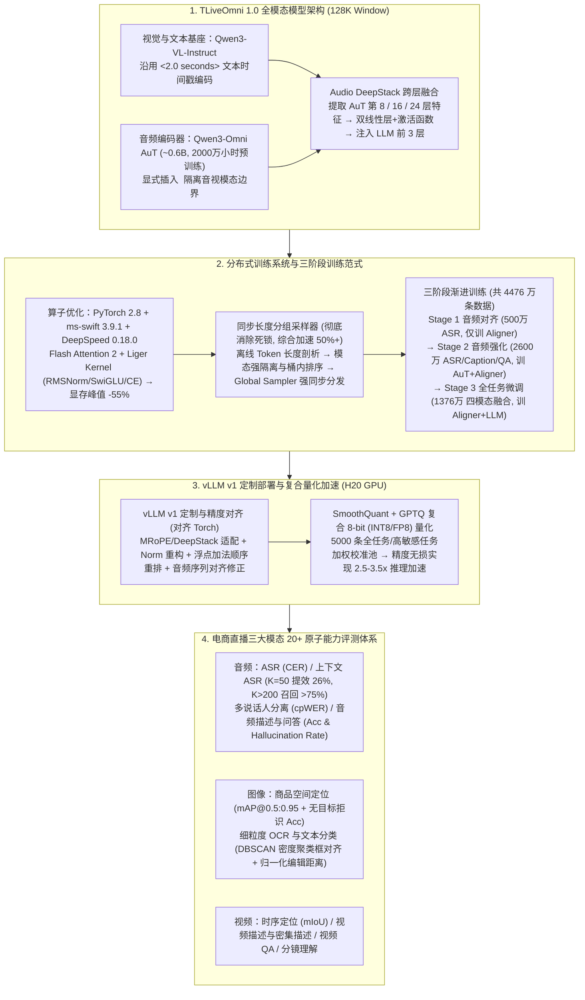

# TLiveOmni 1.0: 直播视频多模态理解大模型

## 1. TL;DR

1. **电商直播全模态架构（128K 上下文）**：针对全球主流厂商模型中全模态（Omni-modal）占比仅 **1.9%** 的稀缺现状，基于 `Qwen3-VL-Instruct` 视觉语言基座与 `Qwen3-Omni` 的 `Audio Transformer (AuT, ~0.6B，超 2000 万小时多语种预训练)` 构建原生支持图像、文本、视频、音频四模态统一输入的 **TLiveOmni 1.0**，沉淀超 **20 项**电商直播精细化原子能力。
2. **Audio DeepStack 与显式时空 Token 排布**：参照 Vision DeepStack 设计 **Audio DeepStack**（抽取 Audio Encoder 第 `8, 16, 24` 层特征经双线性层+激活函数映射融入 LLM 前三层）；视频输入沿用 `<2.0 seconds>` 文本时间戳编码并在音画 Token 间显式插入 `<audio_start_token>`，显著强化视频时序定位（Temporal Grounding）与密集描述能力。
3. **训练显存削减 55% 与同步长度分组采样器（加速 50%+）**：基于 `ms-swift 3.9.1 + DeepSpeed 0.18.0 + Flash Attention 2 + Liger Kernel (Triton)` 将训练显存峰值降低 **55%**；首创**同步长度分组采样器（模态强隔离 $\rightarrow$ 桶内长度排序 $\rightarrow$ 全局强同步分发）**，彻底根治异构多模态动态图引发的分布式死锁并实现整机训练吞吐 **50%+ 加速**；配合“模态对齐（500 万条）$\rightarrow$ 能力强化（2600 万条）$\rightarrow$ 全任务微调（1376 万条）”三阶段训练达到直播域 SOTA。
4. **vLLM v1 定制对齐与 8-bit 量化（2.5–3.5 倍推理加速）**：修复 vLLM 长视频死锁与训练/推理算子精度漂移（重构 Norm、重排 GPU 浮点加法顺序防残差吞噬小值、修正音频缓存对齐填充），并基于 **5,000 条**多模态全任务敏感度加权校准池实施 **SmoothQuant + GPTQ（INT8/FP8）** 量化，在 H20 上无损实现 **2.5–3.5 倍**单样本推理加速。

## 2. 问题定义与背景

### 2.1 电商直播异构多媒体流的四大核心挑战

截至 2025 年 11 月，全球 8 大主流厂商大模型中单模态占 `61.4%`、多模态占 `36.7%`，而真正统一处理视听言的**全模态模型仅占 `1.9%`**。在电商直播与短视频高密度商业场域中，传统单模态或割裂管线面临四大瓶颈：
1. **音频高噪、多说话人并发与领域低频词**：直播间背景音乐嘈杂、主播与助播高频抢话重叠，且充斥品牌名、面料成分（如“海蓝之谜”、“锦纶”）等低频专有词，传统 ASR 极易误识。
2. **视觉动态时空瞬时性与复杂图文排版**：核心商品可能仅在镜头中闪现数秒，静态贴片与包装文字排版密集杂乱，要求兼具时空 Grounding 与细粒度 OCR 分类能力。
3. **跨模态语义碎片化与时序错位**：促销利益点往往分散在主播口播（音频）、拿取展示（视觉）与背景贴片（文本）三个通道中，缺乏统一表征空间会导致事实拼装矛盾。
4. **全模态长序列训练死锁与高昂推理成本**：视频、音频、图文混合训练极易因序列长度悬殊与动态计算图不一致触发多卡通信死锁；128K 长上下文在线推理显存与延迟压力巨大。

## 3. 知识框架

## 4. 核心内容拆解

### 4.1 模型结构创新：Audio DeepStack 与显式模态时序排布

1. **基座与音频编码器选型**：以 `Qwen3-VL-Instruct` 为多模态主干，接入 `Qwen3-Omni` 在超 **2,000 万小时**多语种语音上预训练的 **Audio Transformer (`AuT`, ~0.6B)**。
2. **Audio DeepStack 跨层特征注入**：
   - 借鉴 `Qwen3-VL` 的 Vision DeepStack，采用与 AuT Aligner 相同的“两层线性层 + 一层激活函数”结构；
   - 在前向传播时，提取 Audio Encoder 的**第 8、16、24 层**中低高层特征，分别经 Audio DeepStack 映射后融合进 **LLM 的前 3 层特征**中，大幅加快音频任务收敛并提升细粒度声学表征。
3. **显式文本时间戳与 `<audio_start_token>` 边界**：
   - 视频帧片段前插入格式化文本时间戳（如 `<2.0 seconds>`），直接利用 LLM 文本理解能力强化精确时间感知；
   - 在音视频联合输入序列中，于 Audio tokens 与 Vision tokens 之间显式插入 `<audio_start_token>`，消除长序列跨模态边界混淆。

### 4.2 分布式训练优化：同步长度分组采样器与三阶段训练

1. **Liger Kernel 显存优化（`-55%`）**：基于 `PyTorch 2.8 + ms-swift 3.9.1 + DeepSpeed 0.18.0`，结合 Flash Attention 2 与 **Liger Kernel（Triton 算子库优化 `RMSNorm`、`SwiGLU`、`CrossEntropyLoss`）**，将训练显存峰值降低 **55%**，支撑 128K 长上下文训练。
2. **同步长度分组采样器（破除异构死锁，吞吐 `+50%+`）**：
   - **痛点**：随机模态采样导致同 Batch 序列长度悬殊与海量无效 Padding；而定长序列打包（Packing）又会使每个训练 Step 的 Global Batch Size 动态剧烈波动，损害数据分布感知与模型收敛，更因各 Rank 节点模态计算图不一致频繁触发分布式死锁。
   - **三步解法**：
     1. **离线数据剖析**：预计算每个样本的模态标签与精确 Token 序列长度；
     2. **先隔离、再排序分桶**：先做**模态强隔离（Modality Binning，保证单 Batch 模态纯净）**，再做**桶内长度排序（Intra-bucket Sort）**并切分全局批次生成索引注册表（Registry）；
     3. **Global Sampler 强同步分发（Sync Dispatch）**：在 DP/PP/TP/CP 混合并行下保证 Rank 0 至 Rank $N$ 每轮获取的模态与序列长度高度对齐。子数据集 Token 长度方差越大加速越显著，综合整机训练吞吐提升 **50% 以上**。
3. **三阶段训练范式（累计 4,476 万条高质量样本）**：
   - **Stage 1（音频模态对齐，500 万条语音-文本对）**：以 ASR 为核心任务，**冻结 LLM 与 Audio Encoder，仅训练 Audio Aligner**。
   - **Stage 2（音频能力强化，2,600 万条音频数据）**：覆盖 ASR、Audio Caption、Audio QA，**放开 Audio Encoder 与 Audio Aligner，冻结 LLM**，习得声学事件、音乐、韵律与情感。
   - **Stage 3（全任务微调，1,376 万条四模态数据）**：面向图、文、视、音联合任务，**冻结 Audio/Vision Encoder，集中优化 Aligner 与 LLM 参数**。

### 4.3 vLLM v1 定制精度对齐与复合 8-bit 量化

1. **vLLM v1 深度改造（消除训练-部署精度漂移）**：
   - 解决开源 vLLM 处理长视频死锁（`#28375`）、多模精度骤降（`#29595`）及官方 `Qwen3-Omni` 仅停留在旧版 vLLM v0 的断层问题。
   - **算子级数值对齐（使 vLLM 与 PyTorch 原生推理精度完全对齐）**：
     - **Norm 算子重构**：消除 vLLM 与 HuggingFace Transformers 的归一化计算偏差；
     - **GPU 浮点加法顺序重排**：防止残差连接（Residual）数值量级过大时吞噬微小的增量特征值；
     - **音频序列对齐修正**：修复音频模块因缓存对齐引入的自动 Padding 偏差，保证推理序列长度与训练 100% 一致。
2. **SmoothQuant + GPTQ 复合量化（2.5–3.5 倍加速）**：
   - 构建 **5,000 条**高质量多模态校准池，遵循**任务完整性、任务敏感性加权（对 OCR、Grounding 等数值波动敏感任务赋予更高样本权重）、模态与时空维度完整性**三大原则。
   - 在单张 **H20 GPU** 上对 Language Model 实施 INT8 / FP8 量化，在各模态指标几乎零掉点的前提下取得 **2.5–3.5 倍**单样本推理加速（并释放约 `50%–75%` 显存）。

### 4.4 评测体系创新与关键实验结论

1. **音频理解（ASR / 上下文 ASR / 多说话人分离 / 描述与问答）**：
   - **上下文 ASR（Contextualized ASR）**：注入 $K$ 个低频词（1 个目标实体 + $K-1$ 个干扰实体）。当注入 **$K=50$ 个关键词时，ASR 性能较无上下文提升 26%**；当干扰词规模扩展至 **$K > 200$ 时，TLiveOmni 1.0 仍保持 > 75% 的关键词召回率**（显著优于大幅回退的 Qwen3-ASR-Flash 与 Qwen3-Omni）。
   - **端到端多说话人分离（`<|spk0|>`, `<|spk1|>`, `<|spkall|>`）**：采用遍历 $K!$ 种说话人排列取最小词错误率的 **cpWER** 指标评估，达行业 SOTA。
   - **音频描述与 QA**：强制在 3–5 个选择题中加入“**无法判断**”选项，联合度量准确率（Accuracy）与幻觉率（Hallucination Rate），表现超越 Gemini 2.5/3-Flash 并逼近 Gemini 2.5-Pro。
2. **图像理解（Visual Grounding 与 DBSCAN 聚类 OCR 评测）**：
   - **商品空间定位**：联合评估細粒度多框定位 $\text{mAP}_{@[0.5:0.95]}$ 与无目标样本的**拒识准确率（Acc）**，揭示了部分竞品（如 OmniVinci、Gemini 2.5-Flash）看似拒识率高实则是因为过度倾向输出空检测框导致正样本 AP 极低。
   - **DBSCAN 空间聚类消除 OCR 检测粒度偏置**：不同模型输出的文本框粒度不一（词级、行级、块级），直接算 IoU 极不公平；评测前先对检测框中心点做 **DBSCAN 密度聚类**合并为统一语义区域最小外接矩形，再计算 `IoU ≥ 0.5` 的 F1、基于 Levenshtein 的归一化编辑距离（Normalized Edit Distance）与商业标签分类准确率。
3. **视频理解（时序定位 mIoU / 密集描述 / 分镜理解）**：
   - 覆盖电商事件 `[start_time, end_time]` 时序定位（mIoU）、视频密集描述（Dense Caption）、Video QA 与多维直播分镜理解（景别/视角/布局），在直播时序定位与密集描述上取得 SOTA。

## 5. 数据速查表

| 维度 / 阶段 | 核心量化指标 | 对照基准或技术细节 |
| :--- | :--- | :--- |
| **全球全模态模型稀缺度** | 全模态仅占 **`1.9%`** | 单模态占 `61.4%`，常规多模态占 `36.7%`（截至 2025.11 行业报告） |
| **上下文窗口与原子能力数** | **`128K` 窗口**，**`> 20 项`** 原子能力 | 原生统一输入图像、文本、视频、音频四模态 |
| **Audio Encoder 预训练规模** | `AuT (~0.6B)`，**`> 2,000 万小时`** | 抽取第 **`8, 16, 24` 层**经 Audio DeepStack 注入 LLM 前 **3 层** |
| **训练显存削减与采样加速** | 显存峰值 **`-55%`**，整机吞吐 **`+50%+`** | Flash Attention 2 + Liger Kernel + 同步长度分组采样器 |
| **三阶段训练数据规模** | **`500 万` + `2,600 万` + `1,376 万`** 条 | 依次对应 Stage 1 音频对齐、Stage 2 音频强化、Stage 3 全任务微调 |
| **量化校准池与推理加速比** | **`5,000 条`** 校准集，**`2.5–3.5 倍`** 加速 | SmoothQuant + GPTQ 8-bit 量化（H20 单卡评测无损） |
| **上下文 ASR 增益与抗干扰** | `K=50` 时 **ASR 提升 `26%`**；`K>200` 时**召回率 `> 75%`** | 解决电商直播品牌/材质低频专有词识别难题 |

## 6. 踩坑与教训 / 可迁移的设计原则

1. **多模态分布式训练切忌混用随机采样或盲目 Packing，必须采用“先模态隔离、再桶内按长度排序、全局强同步分发”**：混合模态数据在單 Step 内若计算图分支或序列长度不一致，极易引发 NCCL 通信死锁或高额 Padding 浪费；同步长度分组采样器利用“方差坍缩”在不改变 Global Batch Size 的前提下带来 50%+ 吞吐提升。
2. **训练框架（ms-swift/PyTorch）迁移至推理引擎（vLLM）时必须排查底层算子数值漂移**：当发现部署后多模态精度莫名下降时，重点核查 Norm 算子实现差异、GPU 浮点累加顺序（大残差吃掉小激活值）以及音频/视觉编码器缓存对齐自动填充导致的序列长度偏移。
3. **多模态量化校准集必须按“任务数值敏感度”非均匀加权采样**：细粒度坐标回归（Grounding）与密集文字识别（OCR）对权重 bit 压缩远比普通对话敏感，必须在 5,000 条校准池中提高此类高敏感任务权重。
4. **评测开放域 OCR 与检测任务时需防“粒度偏差”与“空框作弊”**：用 DBSCAN 密度聚类对齐词/行/块检测框后再算 IoU，同时必须将正样本 mAP 与负样本拒识率联合考核，防止模型靠“永远预测空框”刷高拒识率。

## 7. 记忆锚点

- **一个跨层结构**：**Audio DeepStack**（取 AuT 第 `8 / 16 / 24` 层特征映射注入 LLM 前 `3` 层）+ `<2.0 seconds>` 时间戳 + `<audio_start_token>`。
- **一套分布式采样器**：**同步长度分组采样器**（离线长度剖析 $\rightarrow$ 模态强隔离 + 桶内排序 $\rightarrow$ Global Sampler 强同步分发，吞吐 `+50%+`）。
- **三阶段训练配比**：Stage 1 对齐（`500W`，训 Aligner）$\rightarrow$ Stage 2 强化（`2600W`，训 AuT+Aligner）$\rightarrow$ Stage 3 全微调（`1376W`，训 Aligner+LLM）。
- **三项 vLLM 精度修复**：重构 Norm 算子 + 优化 GPU 浮点加法顺序 + 修正音频序列缓存对齐填充（配合 5000 条校准池 8-bit 量化提速 `2.5–3.5x`）。

## 8. 复习卡片

1. TLiveOmni 1.0 的整体架构是如何构建的？什么是 Audio DeepStack？::以 `Qwen3-VL-Instruct` 为主干并集成 `Qwen3-Omni` 的 `AuT (~0.6B)` 音频编码器；Audio DeepStack 抽取 Audio Encoder 第 8、16、24 层特征，经两个线性层与一个激活函数映射后融合至 LLM 前三层特征中，增强音频表征并加速收敛。
2. TLiveOmni 1.0 在处理带音频的视频输入时，对时间戳和 Token 排布做了哪两项改进？::一是在每个视频时间片段前添加格式化文本时间戳（如 `<2.0 seconds>`）以强化时间感知；二是在 Audio tokens 与 Vision tokens 之间显式插入 `<audio_start_token>` 以明确模态边界。
3. 为什么多模态训练中“随机采样”和“定长打包（Packing）”都有缺陷？“同步长度分组采样器”如何解决？::随机采样产生大量无效 Padding 且因各卡动态计算图不一致易触发死锁；定长 Packing 则导致每步 Global Batch Size 动态波动损害收敛。同步长度分组采样器通过离线量化 Token 长度、先按模态强隔离分桶再桶内按长度排序、最后由 Global Sampler 全局同步分发，彻底消除死锁并提升 50%+ 训练吞吐。
4. TLiveOmni 1.0 的“三阶段训练范式”在每一阶段的数据规模与参数冻结策略分别是什么？::Stage 1（音频模态对齐，500 万条 ASR 数据）冻结 LLM 与 Audio Encoder，仅训 Audio Aligner；Stage 2（音频能力强化，2600 万条 ASR/Caption/QA 数据）放开 Audio Encoder 与 Aligner，冻结 LLM；Stage 3（全任务微调，1376 万条四模态数据）冻结 Audio/Vision Encoder，联合优化 Aligner 与 LLM。
5. 团队在对 vLLM v1 进行定制化改造时，通过哪三项算子层优化消除了与 PyTorch 训练端的精度漂移？::一是重构 Norm 算子修正计算差异；二是重排 GPU 浮点加法运算顺序，防止因残差（Residual）量级过大导致小值丢失；三是修复音频模块因缓存对齐导致的序列自动填充，确保推理与训练序列长度完全一致。
6. TLiveOmni 1.0 采用什么量化方案？5,000 条校准集的抽取遵循哪三个原则？::采用 SmoothQuant + GPTQ 的 8-bit（INT8/FP8）复合量化方案，实现 2.5–3.5 倍推理加速；校准集遵循任务完整性、任务敏感性加权（对 OCR、Grounding 等数值敏感任务赋予更高权重）和模态时空完整性三大原则。
7. 在评测细粒度图像 OCR 文本定位与多说话人语音分离时，团队分别采用了什么特殊评测机制？::在 OCR 文本定位评测前，使用 DBSCAN 密度聚类将物理空间临近的词/行碎片检测框合并为统一语义外接矩形，消除不同模型检测粒度差异；在多说话人分离中采用 cpWER 指标，遍历 $K!$ 种说话人排列组合取最小词错误率。

## 9. 知识关联

- **所属主题**：
  - [模型架构与训练](../../20_topics/模型架构与训练.md)
  - [大模型推理与算子优化](../../20_topics/大模型推理与算子优化.md)
  - [推荐系统与多模态评测](../../20_topics/推荐系统与多模态评测.md)
- **本地跃迁**：[原始 PDF](RAW.pdf) · [逐页转写文本](MD.md)
- **候选双链**：[[TaoAvatar 3D数字人应用]] · [[MNN-Sana-Edit-V2端侧图像编辑]] · [[高价率工作台评测优化]]

## 10. 原文参考资料

1. **基座模型与技术报告**：
   - *Qwen3-VL Technical Report* (`https://arxiv.org/pdf/2511.21631`)
   - *Qwen3-Omni Technical Report* (`https://arxiv.org/pdf/2509.17765`)
   - *Qwen2.5-Omni Technical Report* (`https://arxiv.org/pdf/2503.20215`)
   - *Fun-ASR* (`https://arxiv.org/abs/2509.12508`) & *Fun-Audio-Chat* (`https://arxiv.org/pdf/2512.20156`)
2. **量化、多模态与评测基准文献**：
   - *SmoothQuant* (`https://arxiv.org/pdf/2211.10438`) & *GPTQ* (`https://arxiv.org/pdf/2210.17323`)
   - *CHiME-6 Challenge (cpWER)* (`https://arxiv.org/pdf/2004.09249`)
   - *Omni-Captioner* (`https://arxiv.org/abs/2510.12720`)、*AudioSetCaps* (`https://arxiv.org/abs/2411.18953`)、*ARC-Hunyuan-Video-7B* (`https://arxiv.org/pdf/2507.20939`)、*Ming-Omni* (`https://arxiv.org/pdf/2506.09344`)、*OmniVinci* (`https://arxiv.org/pdf/2510.15870`)

> [!note]- 校对报告
> - **页码溯源**：p.1–3（QuestMobile 1.9% 全模态占比背景、TLiveOmni 1.0 128K 窗口与 20+ 原子能力矩阵、四大背景挑战）；p.3–4（Qwen3-VL-Instruct + Qwen3-Omni AuT ~0.6B 2000 万小时预训练架构、Audio DeepStack 第 8/16/24 层注入 LLM 前三层、`<2.0 seconds>` 时间戳与 `<audio_start_token>` 排布）；p.4–6（PyTorch 2.8 + ms-swift 3.9.1 + DeepSpeed 0.18.0 + Flash Attention 2 + Liger Kernel 显存峰值降低 55%；同步长度分组采样器三层逻辑解决死锁并综合加速 50%+）；p.7–9（音视数据构建流程、Stage 1 500万 / Stage 2 2600万 / Stage 3 1376万三阶段训练范式）；p.9–12（vLLM v1 定制改造：Norm 重构、浮点加法顺序重排、音频缓存序列对齐修正；SmoothQuant+GPTQ 5000 条校准池与 H20 上 INT8/FP8 2.5–3.5 倍加速）；p.12–25（音频 CER / 上下文 ASR K=50 提升 26% 与 K>200 召回 >75% / cpWER 多说话人分离 / 带“无法判断”选项的描述与 QA；图像 Visual Grounding mAP 与拒识 Acc / DBSCAN 聚类 OCR 框对齐与归一化编辑距离；视频 Temporal Grounding mIoU / Dense Caption / 分镜理解及 25 篇参考文献）。
> - **一致性核验**：作者团队（淘天集团-直播 AIGC 团队）、发布时间（2026-05-20）、所有模型架构参数、训练数据量、算子优化幅度与评测公式均与原文核对一致；正文中无任何内联页码引用。
> - **质量边界**：原文中表 1–9 的具体对比数值单元格以图片形式呈现，已完整提取正文中明确总结的 SOTA 结论、百分比提升与核心数学公式。
