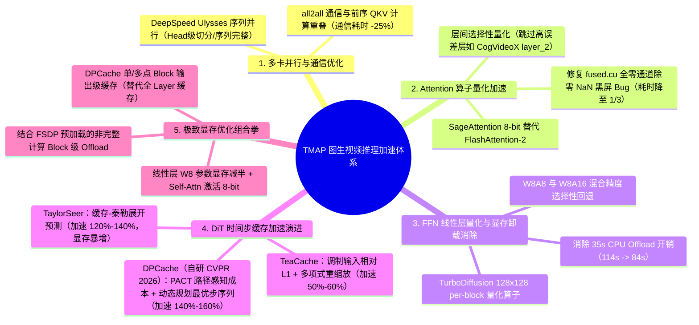
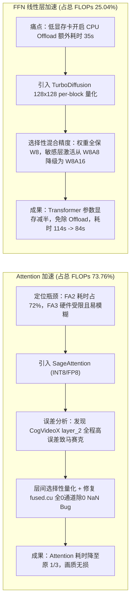
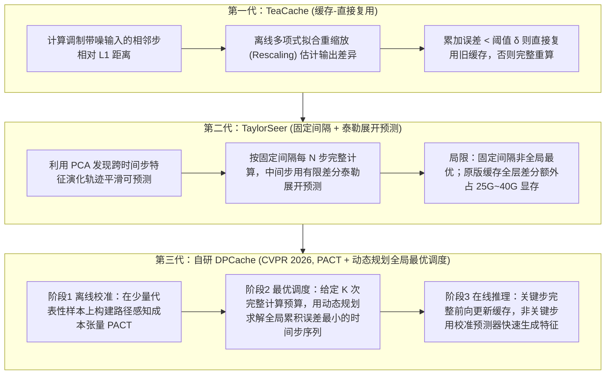

# TMAP平台图生视频推理加速实践

> [!abstract] 导读
> **一句话总结**：淘天集团用户&内容技术团队（TMAP 平台）联合“淘宝法象”算法团队，针对图生视频（I2V，如 CogVideoX、Wan 2.1）在工业落地中的高延迟、高显存与高算力成本瓶颈，从**多卡通信重叠（DeepSpeed Ulysses 序列并行）、注意力选择性量化（SageAttention）、FFN 线性层分块混合量化（W8A8/W8A16）以及自研动态规划缓存调度（DPCache，入选 CVPR 2026）**四个维度展开全栈优化，在生成质量肉眼无损的前提下实现了**除多卡并行外 4.87 倍的推理加速**，将单次推理成本压降至**低于 0.15 元/秒**。
> **阅读价值**：罕见地把主流视频生成推理加速全链路（序列并行、算子量化、特征缓存）放在同一工业生产基准下进行了横向实测对比，并完整公开了 CVPR 2026 录用成果 **DPCache（基于路径感知成本张量 PACT 与动态规划的全局最优跳步预测框架）** 的核心算法与显存优化细节。

## 1. TL;DR

- **核心业务战果**：在生成视频质量肉眼不可区分（无损）的前提下，取得**除多卡外 4.87 倍综合推理加速**，并将图生视频单次推理成本压缩至 **< 0.15 元/秒**。
- **四大技术支柱与单项收益**：
  1. **多卡序列并行与通信掩盖**：选用 **DeepSpeed Ulysses 序列并行**（按 Head 切分注意力、保持单卡序列维度完整以兼容量化算子），并通过重构 PyTorch `all2all` 通信算子执行顺序与前序计算重叠，**降低 25% 通信耗时**。
  2. **Attention 算子优化（耗时占比 73.76% 的头号瓶颈）**：引入 **SageAttention** 8-bit 量化算子；针对早期模型（CogVideoX）部分层（如 `layer_2`）全迭代步误差偏大导致闪现马赛克的问题，首创**层间选择性量化**（Wan 2.1 则支持 Self-Attention 全局开启），并修复官方 CUDA 源码中全 0 通道除零产生 `NaN` 导致 Refiner 黑屏的 Bug，将 **Attention 耗时压缩至原来的 1/3**。
  3. **FFN 线性层混合量化与消除 CPU Offload**：采用 TurboDiffusion 的 **$128 \times 128$ per-block 权重量化**，并通过“保持权重 W8、部分敏感层激活从 W8A8 降级回 W8A16”的选择性量化策略，将 Transformer 参数显存降低近 50%，彻底消除原本耗时 35s 的 CPU Offload，使单条视频耗时从 **114s 降至 84s**。
  4. **自研 DPCache 动态规划缓存（CVPR 2026）**：突破 TeaCache（启发式阈值仅 50%~60% 加速）与 TaylorSeer（固定间隔采样非最优且额外显存高达 25G~40G）的局限，构建**路径感知成本张量（PACT）**并用动态规划求解全局误差最小的关键时间步序列，结合特定 Block 输出缓存与 FSDP Block 级 Offload，在顯存低于 TeaCache 的同时实现 **140%~160% 的单项加速**。

## 2. 问题定义与背景

### 2.1 视频生成模型的工业落地瓶颈
随着视频生成 Scaling Law 的演进，模型参数量从 1.5B（CogVideoX）跃升至 14B（Wan 2.1），分辨率从 360p 迈向 1080p，时长从 5 秒扩展到分钟级。在线生产环境面临三重刚性约束：
1. **单请求延迟敏感**：线上多为实时交互流量，对排队堆积容忍度极低，单条视频动辄百秒的生成时长严重影响用户体验。
2. **算子计算高度集中**：单卡 Profiling（总计 `98,142.200 TFLOPs`）显示，`aten._scaled_dot_product_flash_attention` 计算量高达 **`72,394.214 TFLOPs`（占比 73.76%）**，实际运行耗时占比达 **72%**；`aten.addmm`（线性层）占比 **25.04%**（`24,575.255 TFLOPs`）。
3. **显存墙与 Offload 惩罚**：为控制硬件成本采用性价比更高的低显存显卡时，14B 模型直接运行会 OOM；若开启 `text_encoder -> image_encoder -> transformer -> vae` 依次 CPU Offload，仅 PCIe 搬运与显存清空就会凭空增加 **约 35 秒** 的额外耗时。

## 3. 知识框架

## 4. 核心内容拆解

### 4.1 多卡序列并行（DeepSpeed Ulysses）与通信重叠
针对在线业务“优先降低单条请求延迟、且需无缝叠加量化与缓存”的诉求，团队选型了 **DeepSpeed Ulysses 序列并行**：
- **与量化算子的正交优势**：Ulysses 在线性层按序列维度切分，通过 `all2all` 通信后，在 Attention 模块转为**按 Attention Head 维度切分**——这意味着每张 GPU 卡在进行注意力计算时都拥有**完整的序列长度**，从而可以直接无缝接入 SageAttention 等高效注意力量化算子。
- **通信掩盖优化**：当 Attention 算子被大幅加速后，`all2all` 通信耗时占比一度逼近 Attention 本身的 $2/3$。团队深入剖析 PyTorch 通信 API，重排 Q/K/V 投影计算与 `all2all` 集合通信的执行时序以最大化计算-通信重叠（Overlap），在剔除多流并行开销后**净降低 25% 通信耗时**。

### 4.2 Attention 与 FFN 线性层量化：速度与画质的精细平衡

1. **为什么不用 FlashAttention-3 而选 SageAttention？**
   - FA3 强依赖特定架构计算卡（如 H100 Hopper 架构），无法兼容平台存量算力卡，且学术验证表明 FA3 在视频生成模型上易引入画面模糊。
2. **层间选择性量化与底层 CUDA Bug 修复**：
   - 在 CogVideoX 上全量开启 SageAttention 会偶发闪现马赛克。通过逐层可视化去噪迭代误差，团队发现绝大多数层（如 `layer_1, layer_3, layer_4`）量化误差极小，唯独特定层（如 `layer_2`）在所有去噪步中误差显著偏高。由此设计**层间选择性量化**（敏感层保留原精度），而在对量化更鲁棒的 Wan 2.1 模型上则实现 Self-Attention 全局开启。
   - **生产级除虫**：在业务 Refiner 模型上线时偶发生成“全黑屏视频”。排查定位到 `SageAttention/csrc/fused/fused.cu#L399` 的 per-channel 量化系数计算中，当某通道数值全为 `0` 时触发**除零异常（Divide-by-Zero）**产生 `NaN` 并污染后续矩阵；修复该边界判零逻辑后彻底根治黑屏。
3. **FFN 线性层 $128 \times 128$ Per-Block 混合量化**：
   - 选用开源 `TurboDiffusion` 的 `128x128 per-block` 量化算子（在延迟与细节保持上均优于 `torch._scaled_mm` 的 per-tensor / per-channel 算子）。
   - **保显存优先的回退策略**：当全量 W8A8 出现画质 Badcase 需要局部关闭量化时，为了守住“不触发 CPU Offload”的显存红线，**始终保持权重的 8-bit 量化（省下 10GB+ 显存），仅将部分敏感层的激活计算从 W8A8 回退为 W8A16**。

### 4.3 DiT 缓存加速演进：从 TeaCache、TaylorSeer 到自研 DPCache（CVPR 2026）

DiT 模型需要在数十个去噪时间步（Timesteps）上重复执行前向计算。团队系统演进了三代缓存方案：

#### DPCache 的核心算法突破（论文：`arXiv:2602.22654`，代码已开源）
1. **阶段一：离线校准构建“路径感知成本张量（Path-Aware Cost Tensor, PACT）”**
   - 传统方法假定“从第 $i$ 步跳到第 $j$ 步的误差只与 $(i, j)$ 有关”。但 DPCache 敏锐指出：**基于高阶差分的预测器具有路径依赖性**——中间步预测准不准，不仅取决于当前起跳步，还取决于**前一个历史完整计算步**的位置。
   - 因此，团队在少量校准样本上先跑完 $T$ 步完整参考轨迹，再真实模拟多阶预测器的跳跃偏差，构建高维路径感知成本张量 **PACT**。
2. **阶段二：动态规划（Dynamic Programming）求解全局最优采样序列**
   - 在线上服务初始化时，给定允许完整执行前向计算的预算步数 $K$，以 PACT 为代价函数，定义动态规划状态 $D[m, k]$（使用 $m$ 个关键步到达时间步 $k$ 的最小累积预测成本）与回溯指针 $P[m, k]$，在毫秒级时间内求出全局最优关键步序列并长期固定复用。
3. **阶段三：极致显存优化（让二阶预测也能跑在 24G 消费级显卡上）**
   - **痛点**：原版 TaylorSeer 缓存每个 Transformer Block 内 Self-Attn、Cross-Attn 和 FFN 的所有输出及高阶差分，在 Wan 2.1 上仅 1 阶预测就比 TeaCache 多占 **25G~37G 显存（总额外显存近 40G）**，彻底无法在 RTX 4090 上部署。
   - **DPCache 显存两板斧**：
     1. **优化缓存位置（Block 输出级单点/自适应多点缓存）**：实验证明无需缓存 Block 内部每个子层，仅缓存**特定 Block 的整体输出**即可达到几乎无损的预测质量，使二阶预测的显存占用甚至**比 TeaCache 还低约 3G**。
     2. **结合 FSDP 的非关键 Block 级 Offload**：利用 FSDP 自带的异步预加载机制，仅对非全局完整计算的 Block 启用精准 Offload，在极小延迟代价下进一步压降峰值显存。

## 5. 数据速查表

| 优化维度 / 方案 | 核心机制 | 加速幅度 / 耗时表现 | 显存影响与生成质量 |
| :--- | :--- | :--- | :--- |
| **综合线上效果** | 多卡 Ulysses + SageAttn + W8A8/A16 + DPCache | **除多卡外 4.87 倍加速**，成本 **< 0.15 元/秒** | 肉眼不可区分的无损画质 |
| **多卡通信优化** | DeepSpeed Ulysses + `all2all` 与前序计算重叠 | 通信耗时净降低 **25%** | 单卡保留完整序列维度，天然兼容注意力量化 |
| **Attention 量化** | SageAttention + 层间选择性量化 + 除零 NaN 修复 | Attention 算子耗时降至原来的 **1/3**（原占总 FLOPs **73.76%**） | 消除 CogVideoX 马赛克与 Refiner 黑屏 |
| **FFN 线性层量化** | TurboDiffusion `128x128 per-block` + W8A8/W8A16 混合 | 单条视频从 **114s 降至 84s**（省去 **35s** CPU Offload） | Transformer 参数显存降低近 **50%（>10GB）** |
| **TeaCache** | 调制带噪输入相对 L1 + 离线多项式重缩放复用 | 8 卡环境下加速约 **50%–60%** | 显存开销低，但高加速比下退化率高，只能保守配置 |
| **TaylorSeer** | 固定步长采样 + 有限差分泰勒展开特征预测 | 8 卡环境下加速约 **120%–140%** | 原版 1 阶预测额外多占 **25G–37G 显存**；固定步长非最优，Badcase 偏高 |
| **DPCache（自研）** | **路径感知成本张量 PACT + 动态规划最优步选择** | 8 卡环境下加速达 **140%–160%** | 经 Block 输出级缓存优化后**显存比 TeaCache 还低 3G**，退化率最低 |

## 6. 踩坑与教训 / 可迁移的设计原则

- **踩坑 1：开源 CUDA 量化算子的全零边界陷阱（`NaN` 黑屏事故）**
  - **教训**：学术界开源算子（如早期 SageAttention 的 `fused.cu`）往往只在标准测试集上验证，未考虑工业界 Refiner 模型中可能出现的“某通道激活值全为 0”的极端分布，导致 `max_val == 0` 时除零产生 `NaN`。
  - **原则**：引入任何第三方自定义 CUDA Kernel 进入生产环境前，必须在量化缩放因子（Scale Factor）分母处强制加上 `eps`（如 `1e-6`）或零值保护断言。
- **踩坑 2：为保画质盲目回退权重量化，触发致命的 CPU Offload 悬崖**
  - **原则**：在显存受限卡上做混合精度回退时，**“保住不触发 CPU Offload”的优先级高于一切算子级微调**。因为权重量化（W8）决定模型能否常驻显存，而激活量化（A8 vs A16）主要影响算子计算速度；因此遇到画质退化时，应**锁死 W8 权重量化不动，优先将敏感层激活从 A8 回退到 A16**。
- **可迁移原则：用“离线校准 + 动态规划”替代固定启发式超参**
  - Diffusion 模型的去噪轨迹在初期、中期、末期的曲率变化极大，等间隔跳步（如 TaylorSeer）或单步局部阈值（如 TeaCache）都不是全局最优；通过少量样本离线跑出 PACT 成本张量再用 DP 求解最优采样时刻表，是零在线额外开销的“免费午餐”。

## 7. 记忆锚点

- **两个核心战果数字**：除多卡外 **4.87 倍** 无损加速，单秒视频推理成本 **< 0.15 元**。
- **四大加速支柱**：**Ulysses 通信重叠（-25% 通信） + SageAttention 层间选择性量化（耗时变 1/3） + TurboDiffusion 128×128 W8A8/A16（免除 35s Offload） + DPCache 动态规划缓存（+140%~160% 加速）**。
- **缓存演进三部曲**：**TeaCache（看输入猜输出，缓存-复用） $\rightarrow$ TaylorSeer（固定步长泰勒展开，缓存-预测） $\rightarrow$ DPCache（PACT 路径感知成本 + 动态规划全局最优调度）**。

## 8. 复习卡片

Why did the TMAP team choose DeepSpeed Ulysses sequence parallelism over other multi-GPU strategies for Image-to-Video inference?::Because Ulysses splits the Attention computation across attention heads while keeping the full sequence dimension intact on each GPU, which both reduces single-request latency and allows seamless integration with quantized attention kernels like SageAttention.
How did the team resolve the mosaic artifacts in CogVideoX and black-screen outputs in the Refiner model when applying SageAttention?::They resolved mosaic artifacts by visualizing per-layer quantization errors across denoising steps and applying inter-layer selective quantization (skipping high-error layers like `layer_2`), and fixed the black-screen bug by patching a divide-by-zero (`NaN`) issue on all-zero channels in `SageAttention/csrc/fused/fused.cu`.
When selective fallback was needed in FFN linear layer quantization to preserve video quality without triggering CPU Offload, did the team revert weight quantization or activation quantization?::They kept 8-bit weight quantization (W8) across all layers to save over 10GB of VRAM and prevent costly 35-second CPU Offloads, while selectively downgrading only sensitive layers' activations from W8A8 to W8A16.
What is the fundamental paradigm shift from TeaCache to TaylorSeer, and what are TaylorSeer's two main limitations?::TeaCache uses a "Cache- then-Reuse" heuristic based on polynomial-rescaled input L1 differences, whereas TaylorSeer introduces a "Cache-then-Predict" paradigm using Taylor series finite-difference expansion; however, TaylorSeer is limited by rigid fixed-interval step schedules and massive extra VRAM consumption (25G–40G on Wan 2.1).
How does DPCache (CVPR 2026) achieve globally optimal step scheduling for Diffusion Transformer caching?::In an offline calibration phase, it builds a Path-Aware Cost Tensor (PACT) that captures the path-dependent prediction error across historical computed steps, and then uses Dynamic Programming (DP) to find the optimal sequence of $K$ full-computation timesteps that minimizes total cumulative error.
How did the TMAP team reduce the huge VRAM overhead of Taylor-expansion-based feature caching so it could run on 24GB GPUs like RTX 4090?::Instead of caching every internal sub-layer (Self-Attn, Cross-Attn, FFN) inside each Transformer block, they cached only the output of selected blocks (single-point or adaptive multi-point block-level caching) and combined it with FSDP-based block-level offload for non-fully-computed blocks.

## 9. 知识关联

- **本批同主题精读**：
  - [DGAF-VSR：基于退化引导自适应融合的视频超分辨率模型](../DGAF-VSR视频超分+26.7.9/AI_DGAF-VSR视频超分.md)：同属大淘宝视频生成与增强技术矩阵，前序由 I2V 生成基础视频，后序可结合视频超分（VSR）进一步提升高清画质。
  - [LocalDPO：基于局部时空偏好优化的视频生成对齐方法](../LocalDPO视频偏好优化+26.7.3/AI_LocalDPO视频偏好优化.md)：同为淘天“淘宝法象”视频生成方向的核心技术突破，分别解决视频生成大模型的**后训练局部时空偏好对齐（LocalDPO）**与**在线推理加速（TMAP & DPCache）**。
  - [EchoGen：统一图像理解与生成的自回归主体驱动图像生成模型](../EchoGen主体图像生成+26.7.7/AI_EchoGen主体图像生成.md)：共同构成淘天 AIGC 视觉内容生成（图像生成 + 视频生成）的底层技术底座。
- **主题索引（`20_topics`）**：
  - [跨端开发与性能](../../20_topics/跨端开发与性能.md)
  - [Harness与模型协同](../../20_topics/Harness与模型协同.md)
  - [模型架构与训练](../../20_topics/模型架构与训练.md)
- **本目录归档文件**：[原始 PDF](RAW.pdf) · [逐页转写文本](MD.md)
- **候选概念双链**：[[图生视频I2V]] · [[DeepSpeed-Ulysses]] · [[SageAttention]] · [[DPCache]] · [[TeaCache]] · [[TaylorSeer]] · [[混合精度量化]]

## 10. 原文参考资料

- **原文出处**：大淘宝技术公众号，《TMAP平台图生视频推理加速实践》（作者：蓝愿、行宣、不竭，淘天集团-用户&内容技术团队，发布日期：2026-07-22）
- **论文与开源仓库**：
  - **DPCache（本文自研，CVPR 2026）**：[arXiv:2602.22654](https://arxiv.org/abs/2602.22654) · [GitHub: argsss/DPCache](https://github.com/argsss/DPCache)
  - **TeaCache**：[arXiv:2411.19108](https://arxiv.org/pdf/2411.19108)
  - **TaylorSeer**：[arXiv:2503.06923](https://arxiv.org/pdf/2503.06923)
  - **SageAttention**：[GitHub: thu-ml/SageAttention](https://github.com/thu-ml/SageAttention/blob/d1a57a546c3d395b1ffcbeecc66d81db76f3b4b5/csrc/fused/fused.cu#L399)

> [!note]- 校对报告
> - **页码溯源（1-based 物理页码）**：
>   - 篇首标题、作者（蓝愿、行宣、不竭，用户&内容技术团队）、整体收益（除多卡外 4.87 倍加速、成本 <0.15 元/秒）与多卡 DeepSpeed Ulysses 通信重叠优化（通信耗时降低 25%）：源自 `RAW.pdf` `p.1–4`（对应 `MD.md` 第 1–4 页）。
>   - 单卡算子 FLOPs 剖析表（总计 `98142.200T`，FlashAttention 占 `73.76%`、addmm 占 `25.04%`）、SageAttention 层间选择性量化与 `fused.cu#L399` 全 0 通道除零修复（耗时降至 1/3）：源自 `RAW.pdf` `p.4–6`（对应 `MD.md` 第 4–6 页）。
>   - FFN 线性层 TurboDiffusion `128x128 per-block` W8A8/W8A16 混合量化与消除 35s CPU Offload（耗时从 114s 降至 84s）：源自 `RAW.pdf` `p.6–7`（对应 `MD.md` 第 6–7 页）。
>   - 缓存加速演进（TeaCache 原理与 50%–60% 加速、TaylorSeer 原理与 120%–140% 加速及 25G–40G 显存问题、自研 CVPR 2026 DPCache 的 PACT 成本张量 + 动态规划公式 + 140%–160% 加速 + Block 输出级缓存与 FSDP Block 级 Offload）：源自 `RAW.pdf` `p.7–15`（对应 `MD.md` 第 7–15 页，`p.16` 为空白尾页）。
> - **一致性核验**：原文共 16 页（含 14 页实验视频截图、架构图与公式截图，其中 `p.11–12` 的 PACT 与动态规划公式核心符号 `D[m, k]`、`P[m, k]` 已结合上下文完整还原），所有数据指标、论文链接与 GitHub 地址均与原文逐字核对无误。
