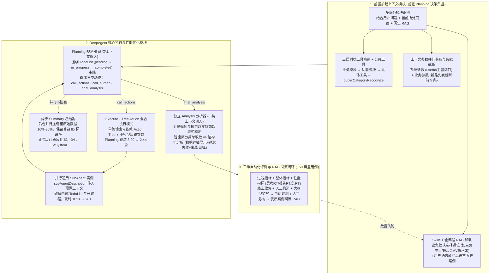

# 从定制Workflow到AI自主决策的架构演进——以TMIC AI小新为例

## 1. TL;DR

1. **从预设 Workflow 到 DeepAgent 自主决策**：针对天猫新品创新中心（TMIC）问答助手“AI 小新”在跨模块协作、层层下钻动态参数识别（如上百次工具调用的类目 $\rightarrow$ 价格带 $\rightarrow$ Top20 竞品下钻）与全局综合分析上的瓶颈，借鉴 DeepAgent 核心思想（`TodoList`、`SubAgent`、`Summary`、`FileSystem`），重构为“**前置加载上下文模块 + DeepAgent 核心模块**”双层架构。
2. **三大业务创新性能优化**：
   - **Tree Action 混合执行模式**：单轮 Planning 直接输出带依赖标记的 `Action Tree` 并由小模型串联参数传递，在单次 Execute 内自动完成“无依赖并行 + 有依赖串行”，将平均 Planning 轮次从 **3.20 次降至 2.44 次**。
   - **SubAgent 职责裁剪提速**：删除 SubAgent 内部冗余的 `TodoList` 规划与长篇分析过程（仅输出结论，上下文由主 Agent 通过 `subAgentDescription` 全量预置传入），将 SubAgent 平均耗时从 **103 秒压缩至 20 秒**。
   - **异步 Summary 机制**：将原本串行阻塞达 **60 秒**的上下文压缩改为后台与 Planning 并行异步执行。
3. **前置上下文工程与全流程 RAG + Skills 约束**：前置完成多业务模块识别、三层树状工具箱按需挂载（含公共工具去重）、业务默认规则 Skills（如缺省取主营类目或 GMV 最高价格带）、系统/模块参数并行拉取与 Top-5 智能截断，并用包含五维结构化字段的 RAG 贯穿“模块识别 $\rightarrow$ Planning $\rightarrow$ Analysis”保障分析路径稳定。
4. **工程取舍与评测飞轮**：结合业务预设取数工具精准精简的特性，**果断弃用 `FileSystem` 卸载机制**（改用内存上下文保留 + `Summary` 压缩至 `10%–30%`）；将 `Analysis` 拆分为独立流式输出节点，并基于 **150 个典型问题**构建“过程 + 整体 + 性能”三维自动化评测与高质量案例回流 RAG 的闭环。

## 2. 问题定义与背景

### 2.1 简单取数问题 vs 复杂开放性下钻问题

TMIC“AI 小新”服务品牌商家的数据洞察与新品研发决策，实际线上提问呈现两极分化：
- **简单确定性问题**（如“2025 年 12 月女装连衣裙销售额/价格带表现”）：参数明确、单一模块即可回答，传统预设 Workflow 表现稳定。
- **复杂开放性问题**（如“研发美容护肤新品，选 10 个竞争强度最低的叶子类目，并分析对应各价格带下 Top20 竞品特点”）：需要先在**类目趋势报告模块**从一级类目（如 `1801`）逐层下钻数百个叶子类目筛选 Top10，再跨模块进入**新品管理模块**获取各叶子类目价格带，继而对“10 个类目 $\times$ 多价格带 $\times$ Top20 商品”发起**上百次动态工具调用**，最后综合提炼竞品定价与利益点。

### 2.2 传统定制化 Workflow 的三大核心痛点

1. **无法跨业务模块协同**：前置意图识别强制绑定单一业务模块，无法同时串联“类目趋势报告”与“新品管理”等多个产品模块。
2. **功能拆分与参数识别过度刚性**：子 Agent 互不感知且必须前置静态提取确定参数，无法支持“根据上一层返回结果动态下钻获取叶子类目 ID”或“多份报告对比”。
3. **总结阶段上下文严重缺失**：取数过程与中间推理上下文未传递给总结节点，仅凭扁平结果字段汇总导致洞察片面；而若直接改用朴素 ReAct 模式，又会陷入**缺乏全局规划迷失方向、长历史上下文溢出、无法并行分解独立子任务**三大困境。

## 3. 知识框架

## 4. 核心内容拆解

### 4.1 前置加载上下文模块：五项核心预处理

由于单个业务模块平均拥有 **10–20 个工具**，若将全平台工具全量暴露给 Planning 会导致上下文膨胀与工具误选；团队对比后放弃了“Planning 阶段动态拉取工具列表”，采用**前置业务范围决策**：
1. **多业务模块识别**：结合用户问题、当前所在页面与 RAG 历史案例，支持同时返回多个相关业务模块名称。
2. **三层树状工具箱与公共工具合并**：按“业务模块（如新品管理）$\rightarrow$ 功能模块（如人群分析/竞争分析）$\rightarrow$ 具体工具（如 `queryNewItemCrowdInfo`）”三层树筛选；同时抽取跨模块复用的**公共工具**（如 `publicCategoryRecognize` 类目识别）统一加载一次。
3. **Skills 默认规则与业务边界注入**：在 Skills 中固化缺省决策规则（例如用户未指明新品时按“我的新品首项 $\rightarrow$ 当前所在页面商品/报告 $\rightarrow$ 列表首项”降级；未指明价格带时**默认选择 GMV 占比最高的价格带**并在 Thought 中告知用户），避免频繁触发 `call_human` 打断体验。
4. **并行参数预取与 Top-K 智能截断**：前置并行拉取 `userId`、主营类目、报告支持时间范围及最近新品列表；对分页长列表采取**智能截断（如仅预加载命中率最高的前 5 条新品）**，其余交由 Planning 按需调用接口。
5. **全流程结构化 RAG 注入**：每条 RAG 记录包含**用户问题、业务模块、功能模块、所需数据字段、分析思路**五个字段，解决三大难题：
   - **用户语言到产品语言翻译**（如“潜力最高的类目” $\rightarrow$ “Top10 品牌 GMV 占比即竞争强度最低的类目”；“竞品如何起量” $\rightarrow$ “上市后广告/派样/直播成长路径”）；
   - **固化业务定制分析三步法**（如新品流失分析：流转数据筛流出竞品 $\rightarrow$ 关联竞争力指标 $\rightarrow$ 对比品类痛点/利益点/核心支撑）；
   - **消除多轮 Planning 路径漂移**，保障多次询问结论一致。

### 4.2 DeepAgent 核心组件与四项关键工程改造

1. **Planning（8 类上下文 + TodoList 主线 + 3 类动作 + 防死循环容错）**：
   - 接收 **8 类上下文**：用户原始问题、上下文参数、业务 Skills、筛选后工具列表、执行历史、上一轮 `TodoList`、RAG 参考分析思路、对话历史。
   - **TodoList 锚定主线**：每个任务项包含 `status`（`pending` $\rightarrow$ `in_progress` $\rightarrow$ `completed`）与原子可执行 `content`，每轮全量输出并支持动态增删改，防止多轮 ReAct 偏离主线。
   - **三类标准动作**：`call_actions`（调用工具或 SubAgent）、`call_human`（仅在无默认规则时请求人工补充）、`final_analysis`（进入最终报告生成）。
   - **分级错误处理**：数据查询为空时严禁硬编结论；工具调用失败时**严禁原参数重试**（防死循环），永久性错误直接说明原因，可恢复错误尝试替代方案。
2. **Tree Action 混合执行模式（Planning 轮次 `3.20` $\rightarrow$ `2.44`）**：
   - 传统 ReAct 每次只出 1 个 Action（串行多次往返），标准 DeepAgent 虽支持并行 Action List 但无法处理“获取类目 $\rightarrow$ 获取最高价格带 $\rightarrow$ 获取 Top20 商品”这类前后依赖链。
   - **Tree Action** 让 Planning 单次输出带依赖关系标记的 `Action Tree`，执行引擎按层级拓扑自动执行（无依赖并行、有依赖串行），并**引入轻量小模型负责上下游工具间的输出提取与入参传递**，无需人工枚举封装大 Tool，将测试集平均 Planning 次数从 **3.20 次降至 2.44 次**。
3. **SubAgent 职责裁剪与并行下钻（耗时 `103s` $\rightarrow$ `20s`）**：
   - 主 Agent 通过 `subAgentDescription` 将已识别的类目 ID、目标工具名与具体分析要求直接传给多个并行通用 SubAgent 实例（禁止 SubAgent 再嵌套调用 SubAgent 或 Human）。
   - **砍掉 SubAgent 内部的 `TodoList` 规划与长篇分析过程（仅输出结论）**，使其平均执行耗时从 **103 秒骤降至 20 秒**。
4. **异步 Summary 替代 FileSystem + 独立 Analysis 流式节点**：
   - **为什么不用 FileSystem？** AI 小新的工具均为预设结构化取数接口，返回结果皆为分析必需数据，读写外部文件系统徒增延迟与失败风险；因此直接用 `Summary` 将历史上下文压缩至原始体积的 **`10%–30%`**（强制保留 `cateId`/`itemId` 等核心标识符及贯穿性信息）。
   - **异步 Summary**：将原本串行耗时可达 **60 秒**的 Summary 改为后台与下一轮 Planning 并行异步执行。
   - **独立 Analysis 节点**：将报告生成从 Planning 中剥离，既使前端得以**流式输出（Streaming）**最终报告（避免透出内部 `todoList` 与动作 JSON），又能智能区分“简单取数（直接精炼返回）”与“综合分析（按最终结论 $\rightarrow$ 分析过程 $\rightarrow$ 详细建议三段式输出，且**表格穿插在正文对应推理处、自动过滤失败/无关数据、左对齐 Markdown 表格并强制附带 `[数据名称](url)` 来源标注**）”。

## 5. 数据速查表

| 模块 / 优化指标 | 优化前 / 基线状态 | 优化后（DeepAgent + 业务改造） | 核心技术手段 |
| :--- | :--- | :--- | :--- |
| **单模块平均工具数量** | `10–20 个 / 业务模块` | 前置识别仅挂载相关模块 + 公共工具 | 三层树状工具库筛选，降低 Planning 上下文噪声 |
| **分页参数预加载截断** | 全量加载或 Planning 临时多次查询 | **仅前置并行加载前 `5` 条**（如新品列表） | 智能截断命中率最高项，长尾按需调公共接口 |
| **平均 Planning 轮次** | `3.20 次` | **`2.44 次`** | **Tree Action 混合执行模式** + 小模型串联上下游参数 |
| **SubAgent 平均执行耗时** | `103 秒` | **`20 秒`**（提速约 80%） | 主 Agent 预置上下文 + 砍掉 SubAgent 内部 TodoList 与过程分析 |
| **Summary 压缩率与延迟** | 串行阻塞最高达 `60 秒` | **压缩至原始数据 `10%–30%`**，**后台异步零阻塞** | 保留贯穿性信息与 `cateId`/`itemId` 标识符，与 Planning 并行 |
| **首批标准评测集规模** | 缺乏跨模块复杂基准 | **`150 个` 典型问题** | 线上收集 + 人工构造 + 大模型扩写，覆盖过程/整体/性能三维度 |

## 6. 踩坑与教训 / 可迁移的设计原则

1. **不要教条式照搬开源框架的所有组件（如 `FileSystem`）**：当业务工具返回的是高密度结构化业务数据而非数万行原始网页/代码日志时，落盘文件系统再分页拉取反而增加 I/O 延迟；采用“内存保留 + 异步 `Summary`（保留 ID 标识符压缩至 10%–30%）”更轻量可靠。
2. **用“Tree Action + 轻量小模型参数桥接”消除多跳依赖的 Planning 往返**：面对“A 的输出作为 B 的入参”的链式工具调用，既不要退回单步 ReAct 反复调大模型，也不要硬编码无数个组合大 Tool；让主规划器一次产出依赖树，用低延迟小模型完成中间参数提取映射。
3. **SubAgent 必须“重执行、轻规划”，且上下文由主 Agent 喂熟**：子代理处理的是边界明确的子任务，去掉其内部的 `TodoList` 与冗余叙事，直接通过 `subAgentDescription` 注入已解析好的 `cateId` 和目标工具名，可将耗时从百秒级压至 20 秒级。
4. **将最终报告生成（Analysis）从规划器（Planning）中拆出以解锁流式体验**：Planning 节点输出含内部状态 JSON 无法直接向用户流式透出；拆出独立的 Analysis 节点后即可边生成边流式渲染，并通过“表格随文穿插 + 过滤空/错数据 + 强制附带数据来源链接”大幅提升商业报告可信度。

## 7. 记忆锚点

- **两大顶层模块**：前置加载上下文模块（模块识别 / 三层工具树 / Skills / 参数预取截断 / RAG）+ DeepAgent 核心模块（`Planning` / `Execute` / `SubAgent` / `Summary` / `Analysis`）。
- **三项硬核提速优化**：`Tree Action`（Planning 次数 `3.20 → 2.44`）+ `SubAgent 职责简化`（耗时 `103s → 20s`）+ `异步 Summary`（消除 `60s` 串行阻塞，压缩至 `10%–30%`）。
- **五维 RAG 结构字段**：用户问题 + 业务模块 + 功能模块 + 所需数据字段 + 业务定制分析思路。

## 8. 复习卡片

1. TMIC“AI 小新”在复杂新品研发问答中面临怎样的调用复杂度？为什么传统定制化 Workflow 无法胜任？::复杂问题需从一级类目逐层下钻数百个叶子类目筛选机会类目，再跨模块下钻价格带与 Top20 商品，涉及上百次动态工具调用；传统 Workflow 强制绑定单一业务模块、要求前置静态提取参数且总结阶段缺失中间思考上下文，无法跨模块动态下钻。
2. DeepAgent 架构中的“前置加载上下文模块”包含哪五项核心职责？::多业务模块识别、按三层树状结构筛选加载工具（含公共工具）、加载业务特定 Skills（含默认选择逻辑与边界规则）、并行预取系统与业务模块上下文参数（对长列表做前 5 条智能截断）、以及加载分析思路与业务模块 RAG。
3. 什么是 Tree Action 混合执行模式？它是如何将平均 Planning 次数从 3.20 次降低到 2.44 次的？::Tree Action 允许 Planning 在单轮输出带依赖关系标记的 Action Tree，在单次 Execute 中自动并行执行无依赖动作、按序串行执行有依赖动作，并利用轻量小模型完成上下游工具间的输出提取与入参传递，免去了多次 Planning 往返。
4. 团队是如何将 SubAgent 的平均执行时间从 103 秒大幅优化到 20 秒的？::一方面由主 Agent 完成全部上下文准备工作并通过 `subAgentDescription` 显式传入已识别参数（如类目 ID）和目标工具；另一方面简化 SubAgent 内部职责，删除其 `TodoList` 规划并让其 `Analysis` 仅输出精简结论。
5. 为什么 AI 小新没有使用 DeepAgent 标准架构中的 `FileSystem` 组件，而是采用异步 `Summary`？::因为 AI 小新的工具均为目的明确的预设取数接口，返回内容皆为必需上下文，落盘文件系统再读取会增加额外耗时与失败风险；通过后台与 Planning 并行执行的异步 `Summary`（压缩至原始数据的 10%–30% 并强制保留 `cateId`/`itemId` 等关键标识符），即可消除 60 秒串行阻塞并防止窗口溢出。
6. 为什么需要将 `Analysis`（分析器）从 `Planning`（规划器）中独立出来？它在数据展示上有哪些规范？::因为 Planning 输出包含 `todoList` 和动作指令等内部字段，无法直接向前端做流式透出；独立 Analysis 节点既支持前端流式输出，又能按问题类型动态切换简短回答或三段式报告，并要求数据表格随文穿插展示、自动过滤失败/无关数据、统一左对齐及强制标注数据来源链接。
7. RAG 在 AI 小新 DeepAgent 模式中解决了哪三个核心问题？每条 RAG 记录包含哪些字段？::解决了“用户语言到产品语言的翻译（如潜力最高→竞争强度最低）”、“固化业务定制分析思路”与“多次执行路径不稳定”三个问题；每条记录包含用户问题、业务模块、功能模块、所需数据字段、分析思路五个字段。

## 9. 知识关联

- **所属主题**：
  - [Agent工程循环](../../20_topics/Agent工程循环.md)
  - [Agent数据分析](../../20_topics/Agent数据分析.md)
  - [Agent成本与上下文预算](../../20_topics/Agent成本与上下文预算.md)
  - [Harness与模型协同](../../20_topics/Harness与模型协同.md)
- **本地跃迁**：[原始 PDF](RAW.pdf) · [逐页转写文本](MD.md)
- **候选双链**：[[面向LLM的AI Friendly架构]] · [[智能导购Agent评测实践]] · [[场景营销前端AI Coding方案]] · [[QoderWork数科Skills]]

## 10. 原文参考资料

1. **DeepAgent 架构范式**：基于 `TodoList + SubAgent + Summary + FileSystem` 的长程自主智能体设计方法论
2. **内部业务平台与生态**：天猫新品创新中心（TMIC）、天猫小黑盒、天猫 U 先、淘系新品运营平台

> [!note]- 校对报告
> - **页码溯源**：p.1–5（AI 小新产品定位、简单问题 vs 1801 美容护肤叶子类目×价格带×Top20 竞品上百次工具调用复杂下钻挑战）；p.5–9（定制化 Workflow 六步流程与三大核心痛点：无法跨模块、功能与参数识别刚性、总结上下文缺失）；p.9–12（DeepAgent 三大设计目标、标准 ReAct 三大痛点、TodoList/SubAgent/Summary/FileSystem 四大组件与 Tree Action/SubAgent 提速/异步 Summary 三大业务创新）；p.12–20（前置加载上下文模块五大功能、10–20 个工具/模块筛选对比、三层树状工具箱与 `publicCategoryRecognize` 公共工具、Skills 默认规则如 GMV 最高价格带、前 5 条新品智能截断并行获取）；p.20–39（Planning 8 类上下文、TodoList 三态流转、`call_actions`/`call_human`/`final_analysis` 三动作、防死循环错误处理；Tree Action 混合执行与小模型串联参数使 Planning 次数从 3.20 降至 2.44；SubAgent 上下文传递与职责简化使耗时从 103s 降至 20s；Summary 10%–30% 压缩与异步化消除 60s 阻塞；Analysis 流式分离、穿插表格与数据来源标注；弃用 FileSystem 的四大原因）；p.40–51（RAG 五字段结构与三大价值、150 个典型问题测试集、过程/整体/性能三维自动化评测与 RAG 回流闭环）。
> - **一致性核验**：作者（帆华，淘天集团-天猫新品营销技术团队）、发表时间（2026-05-29）、所有核心性能指标（3.20→2.44 次、103s→20s、60s、10%–30%、前 5 条、150 用例）均与原文逐字核对一致；正文中无任何内联页码引用。
> - **质量边界**：p.44–47 中部分具体指标得分对比表在原文中为截图，正文中明确给出的关键优化前后数值均已完整收录。
