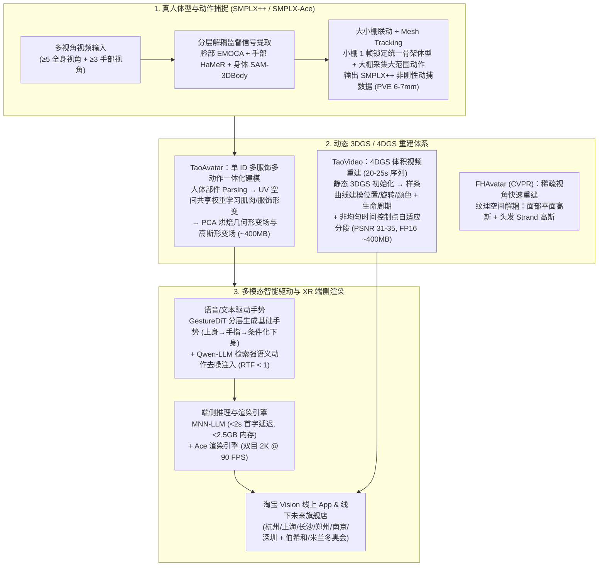

# CCIG 2026 | TaoAvatar：3D真人数字人在淘宝Vision领域的应用

## 1. TL;DR

1. **三层 3D/4D 数字人技术矩阵**：淘天 Meta 技术团队围绕 3D Gaussian Splatting（3DGS）构建了 **TaoModel（3DGS 人体静态建模）**、**TaoAvatar（3DGS 可驱动真人数字人）**与 **TaoVideo（4DGS 人体体积视频）**三大核心能力，并结合端侧 MNN-LLM 与 Ace 渲染引擎落地于 Apple Vision Pro 空间购物应用“淘宝 Vision”（荣获 2025 年度 Apple Design Awards）及线下未来旗舰店。
2. **高保真端侧实时性能指标**：TaoAvatar 实现重建清晰度 **PSNR > 35**、双目 **2K 分辨率 @ 90 FPS** 实时表情/身体/手势驱动与高精度渲染、多模态交互**首字延迟 < 2 秒**、端侧**内存占用 < 2.5 GB**、单资产体积约 **400 MB**，并将数字人制作成本压降至 **< 2 万元**、交付周期缩短至 **< 1 周**。
3. **分层解耦动捕与跨服饰一体化动态重建**：在动捕侧基于 **SMPLX++**（非刚性头发/服饰形变）与 **SMPLX-Ace**（自动骨骼绑定），联合 EMOCA（脸）、HaMeR（手）、SAM-3DBody（身体）分层解耦监督及“小棚 1 帧锁骨架 + 大棚大范围采集”联动，实现 **PVE 误差 6–7 mm**（优于 EasyMocap）；在重建侧升级为“单 ID、多服饰、多动作”UV 空间统一非刚性形变学习与 PCA 形变场烘焙。
4. **GestureDiT 语音驱动手势与 TaoVideo 4DGS 样条建模**：通过 **GestureDiT + Qwen-LLM 强语义检索注入**实现单次预测 1 秒动作、**RTF < 1**（RTX 3090 可实时运行）；通过样条曲线刻画高斯位置/旋转/颜色与生命周期、配合非均匀时间控制点构建 **TaoVideo 4DGS**（20–25 秒多视角视频重建 **PSNR 31–35**、**LPIPS 0.06–0.1**、FP16 存储约 **400 MB @ 90 FPS**），并推出 CVPR 成果 **FHAvatar**（平面高斯人脸 + Strand 高斯头发组合重建）。

## 2. 问题定义与背景

### 2.1 传统 3D 数字人与电商 XR 交互的痛点

传统基于网格（Mesh）与骨骼蒙皮的 3D 真人数字人面临计算复杂度高、发丝与宽松服饰褶皱等高频细节还原不足、制作周期长且成本高昂、难以在移动与 XR 端侧实现高帧率实时渲染等瓶颈。而在 Apple Vision Pro 等双目 XR 空间购物场景中，人眼双目立体视觉对数字人几何伪影、驱动抖动与交互延迟极为敏感，亟需兼具照片级真实感、端侧低内存高帧率（90 FPS）与多模态大模型实时交互能力的 3D 真人数字人方案。

### 2.2 TaoAvatar 三大能力矩阵的定位互补

1. **TaoModel（3DGS 人体静态建模）**：经过标定、分割、几何重建与高斯静态重建，快速产出高质量 3D 静态人体模型，用于业务快速预览或静态展示交付。
2. **TaoAvatar（3DGS 可驱动数字人重建）**：基于多视角拍摄、SMPLX++ 几何重建与 3DGS 动态重建，支持语音、手势、身体姿态实时驱动与 LLM 交互（要求拍摄素材服饰相对合身、手部末端清晰可见）。
3. **TaoVideo（4DGS 人体体积视频）**：摆脱显式人体参数模型（SMPLX）束缚，支持任意宽松服饰（如飘动裙摆、复杂发型、帽子）的动态时间轴重建，在重建保真度与端侧存储成本（约 400 MB）间取得平衡。

## 3. 知识框架

## 4. 核心内容拆解

### 4.1 真人体型与动作捕捉（SMPLX++ 与大小棚联动）

1. **SMPLX 模型扩展**：
   - **SMPLX++**：在标准 SMPLX 人体网格基础上扩展表达头发与服饰 Mesh 的非刚性形变。
   - **SMPLX-Ace**：实现自动骨骼绑定（Auto-Rigging），并通过运动重定向（Retargeting）将动捕演员动作平滑迁移至目标数字人。
2. **脸、手、身体分层解耦监督与时序跟踪**：
   - 逐帧提取三路分层监督信号：脸部采用 **EMOCA**，手部采用 **HaMeR**，身体采用 **SAM-3DBody** 的 3D 关键点。
   - 先优化单帧 SMPLX 初值，再结合多视角图像与语义 Parsing 结果执行时序平滑的 Mesh Tracking，最后学习服饰 Mesh 的非刚性形变。
3. **大小棚联动与视角约束**：
   - **小棚**负责高细节采集并用 1 帧重建锁定统一骨架与体型，叠加非刚性形变；**大棚**直接复用该骨架与体型采集大范围肢体动作。
   - 稀疏视角稳定性约束：要求**至少 5 个全身可见视角**稳定身体绑定、**至少 3 个手部可见视角**稳定手势绑定，实测平均顶点误差 **PVE 仅 6–7 mm**，优于开源 SOTA 框架 EasyMocap。

### 4.2 单 ID 多服饰多动作一体化 3DGS 动态重建

为解决同一数字人 IP 跨服饰、跨动作复用难题，团队将训练范式从“单人、单服装、单动作片段”升级为**“单 ID、多服饰、多动作”一体化建模**：
1. 对同一 ID 采集多套服饰与多段动作，完成 SMPLX++ 绑定与跟踪。
2. 利用人体部件 Parsing 对身体、服饰、发型做细粒度分割，在 **UV 空间**统一学习肌肉与服饰的非刚性形变，支持不同服饰间共享权重。
3. 将学习到的形变通过 **PCA（主成分分析）烘焙**为端侧可实时运行的**几何形变场**与**高斯形变场**。推理时仅需输入姿态驱动信号，即可在 **~400 MB** 资产规模下于端侧实现 **90 FPS** 实时驱动与渲染。

### 4.3 语音与文本协同驱动手势（GestureDiT + Qwen-LLM）

系统将说话伴随手势拆分为**基础手势**（自然节律性肢体动作）与**强语义手势**（契合文本语义的特定动作）：
- **GestureDiT 分层生成基础手势**：结合语音声学特征与文本特征，对 SMPLX 结构采取“先生成上半身动作 → 预测手指姿态 → 基于上半身条件化生成下半身动作”的分层策略，确保原地讲解姿态自然稳定。
- **Qwen-LLM 强语义检索与去噪注入**：利用 Qwen-LLM 理解文本语义并检索匹配的预制语义动作，在 GestureDiT 扩散去噪过程中动态注入，使数字人在说出特定关键词时精准触发语义手势。
- **实时推理效率**：结合单目视频动捕数据与 3D 影棚多模态数据训练，每次预测 1 秒动作，**实时率 RTF < 1**，可在单张 RTX 3090 消费级显卡上实时运行，并支持中英文双语跨语种对齐生成。

### 4.4 TaoVideo 4DGS 体积视频与 FHAvatar 稀疏视角演进

1. **TaoVideo（4DGS 人体体积视频）**：
   - 不依赖 SMPLX 显式人体模板，直接输入 20–25 秒多视角视频，使用静态 3DGS 初始化后按 Coarse-to-Fine 策略优化动态细节。
   - **样条曲线 + 生命周期机制**：用样条曲线连续参数化高斯点的位置、旋转与颜色外观变化，并引入生命周期参数控制高斯点的出生与消亡，精准刻画帽子、复杂发型与裙摆飘动。
   - **非均匀时间控制点与自适应分段**：在运动剧烈、高频细节丰富的时间段密集分配控制点与高斯容量，在平缓段削减冗余，使 20–25 秒序列在 **FP16 下仅占约 400 MB**，端侧实时渲染达 **90 FPS**，客观指标达 **PSNR 31–35**、**LPIPS 0.06–0.1**。
2. **FHAvatar（CVPR 稀疏视角可组合人头重建）**：
   - 面向低成本单图/稀疏视角场景，在纹理空间将人脸与头发解耦：**面部采用平面高斯（Planar Gaussians）**，**头发采用发束高斯（Strand Gaussians）**，仅需少量照片在数分钟内即可重建可实时驱动表情嘴型、自由更换发型与风格化编辑的 3D 高斯人头。

## 5. 数据速查表

| 模块 / 指标维度 | 关键量化指标 | 技术机制与工程边界 |
| :--- | :--- | :--- |
| **TaoAvatar 重建清晰度与帧率** | **`PSNR > 35`**，双目 **`2K @ 90 FPS`** | 基于 3DGS 教师-学生蒸馏、PCA 形变场烘焙与 Ace 渲染引擎 |
| **多模态交互延迟与端侧内存** | 首字延迟 **`< 2 秒`**，内存 **`< 2.5 GB`** | 集成端侧大模型推理引擎 **MNN-LLM** |
| **数字人资产体积与制作交付成本** | 单资产 **`~400 MB`**，成本 **`< 2 万元`**，周期 **`< 1 周`** | 支持从 ToB 品牌 IP 扩展至 ToC 用户数字分身 |
| **SMPLX++ 动捕精度与视角要求** | 平均顶点误差 **`PVE 6–7 mm`** | 要求 `≥ 5` 个全身视角 + `≥ 3` 个手部视角，精度超越 EasyMocap |
| **GestureDiT 手势驱动效率** | 每次预测 `1 秒` 动作，**`RTF < 1`** | 单张 RTX 3090 可实时部署，支持中英文双语强语义动作注入 |
| **TaoVideo 4DGS 体积视频指标** | `20–25s` 序列 **`PSNR 31–35`**，**`LPIPS 0.06–0.1`** | FP16 存储约 **`400 MB`**，端侧渲染 **`~90 FPS`** |

## 6. 踩坑与教训 / 可迁移的设计原则

1. **根据服饰复杂度在“骨骼绑定 3DGS”与“无模板 4DGS”间合理选型**：当业务需要实时交互与任意语音驱动时，选用基于 SMPLX++ 的 **TaoAvatar**（但拍摄素材需避免极度宽松的长裙遮挡）；当需要呈现复杂裙摆飘动等固定创意视频时，选用基于样条曲线与生命周期机制的 **TaoVideo 4DGS**。
2. **用“大小棚联动 + 分层解耦监督”解决动捕精度与活动范围的矛盾**：小棚密集视角仅需 1 帧即可锁定高精度体型与骨骼并学习微细褶皱，大棚稀疏视角（保底 5 全身 + 3 手部视角）复用该骨架采集大范围走动，兼顾毫米级精度（PVE 6–7 mm）与大空间动作自由度。
3. **UV 空间统一形变学习 + PCA 烘焙是端侧跨服饰复用的关键**：避免为每套衣服单独训练一套孤立的 3DGS 数字人，通过在 UV 空间解耦人体部件并共享形变权重，再经 PCA 降维烘焙为轻量级形变场，可将端侧资产稳定控制在 400 MB 以内并维持 90 FPS。

## 7. 记忆锚点

- **三套核心资产管线**：`TaoModel`（静态 3DGS）+ `TaoAvatar`（SMPLX++ 可驱动 3DGS）+ `TaoVideo`（样条曲线无模板 4DGS）。
- **三路分层动捕监督**：脸部 `EMOCA` + 手部 `HaMeR` + 身体 `SAM-3DBody`（配合 `5 全身 + 3 手部` 视角与大小棚联动，PVE `6–7 mm`）。
- **双层语音手势生成**：`GestureDiT`（上身→手指→条件化下身基础手势）+ `Qwen-LLM`（检索强语义手势去噪注入，RTF `< 1`）。
- **四项硬核端侧指标**：`PSNR > 35`、双目 `2K @ 90 FPS`、首字延迟 `< 2s`、端侧内存 `< 2.5 GB`（资产 `~400 MB`）。

## 8. 复习卡片

1. 淘天 Meta 技术团队构建的 TaoModel、TaoAvatar 和 TaoVideo 分别面向什么场景？::TaoModel 面向 3DGS 人体静态快速建模与预览；TaoAvatar 面向基于 SMPLX++ 的语音/手势/姿态实时可驱动 3D 真人数字人；TaoVideo 面向不依赖人体模板、支持任意宽松服饰（如飘动裙摆）的 4DGS 体积视频重建。
2. TaoAvatar 在 Apple Vision Pro 等端侧设备上实现了哪些核心性能与成本指标？::重建清晰度 PSNR > 35，双目 2K 分辨率下实现 90 FPS 实时驱动与渲染，多模态交互首字延迟 < 2 秒，内存占用 < 2.5 GB，单资产约 400 MB，制作成本低于 2 万元且交付周期小于 1 周。
3. TaoAvatar 的真人体型与动作捕捉管线如何使用分层监督信号与大小棚联动？::逐帧使用 EMOCA（脸部）、HaMeR（手部）和 SAM-3DBody（身体 3D 关键点）做分层解耦监督；小棚用 1 帧重建锁定统一骨架和体型并学习非刚性形变，大棚复用该骨架采集大范围动作，在至少 5 个全身视角和 3 个手部视角下达到 PVE 6–7 毫米的精度。
4. TaoAvatar 如何实现“单 ID、多服饰、多动作”的一体化动态重建与端侧实时推理？::通过人体部件 Parsing 将身体、服饰、发型细粒度分割，在 UV 空间共享权重统一学习肌肉与服饰的非刚性形变，最后通过 PCA 烘焙为端侧可实时运行的几何形变场与高斯形变场。
5. GestureDiT 与 Qwen-LLM 如何协同实现真人语音与文本驱动手势？::GestureDiT 结合语音和文本特征按“上半身→手指姿态→条件化下半身”分层生成自然基础手势；Qwen-LLM 理解文本内容并检索匹配的预制强语义动作，在 GestureDiT 去噪过程中动态注入，实现 RTF < 1 的实时生成。
6. TaoVideo 是如何利用 4DGS 还原裙摆飘动等复杂动态并控制存储体积的？::它将高斯点的位置、旋转和颜色变化表示为样条曲线并引入高斯生命周期机制（控制出现与消失），同时采用非均匀时间控制点与自适应分段建模（快动作多分配容量、慢动作减冗余），使 20–25 秒视频在 FP16 下仅约 400 MB 且达到 PSNR 31–35。
7. CVPR 论文提出的 FHAvatar 如何实现稀疏视角下的高质量可组合 3D 高斯人头重建？::在纹理空间将人脸与头发拆开建模，面部采用平面高斯（Planar Gaussians），头发采用发束高斯（Strand Gaussians），仅需少量照片即可在数分钟内完成可驱动、可换发型的重建。

## 9. 知识关联

- **所属主题**：
  - [模型架构与训练](../../20_topics/模型架构与训练.md)
  - [跨端开发与性能](../../20_topics/跨端开发与性能.md)
  - [大模型推理与算子优化](../../20_topics/大模型推理与算子优化.md)
- **本地跃迁**：[原始 PDF](RAW.pdf) · [逐页转写文本](MD.md)
- **候选双链**：[[MNN-Sana-Edit-V2端侧图像编辑]] · [[TLiveOmni直播多模态大模型]] · [[淘宝跨端动效解决方案]]

## 10. 原文参考资料

1. **中国图像图形大会（CCIG 2026）“三维建模生成与具身智能”论坛报告**：淘天集团 Meta 技术团队陈志文（塞远）现场分享
2. **核心底层算子与框架**：3D Gaussian Splatting (3DGS)、SMPLX / SMPLX++ / SMPLX-Ace、EMOCA、HaMeR、SAM-3DBody、EasyMocap、GestureDiT、Qwen-LLM、MNN-LLM、Ace 渲染引擎
3. **CVPR 论文成果**：*FHAvatar*（平面高斯面部 + Strand 高斯头发可组合重建）
4. **开源项目主页**：Taobao3D（`https://github.com/alibaba/Taobao3D`）

> [!note]- 校对报告
> - **页码溯源**：p.1–3（CCIG 2026 背景、TaoModel / TaoAvatar / TaoVideo 三大技术体系定位）；p.3–4（3DGS 真人数字人技术框架、MNN-LLM 端侧集成、PSNR>35 / 双目 2K@90FPS / 首字延迟<2s / 内存<2.5GB / 成本<2万元 / 周期<1周指标、EMOCA+HaMeR+SAM-3DBody 分层监督、大小棚联动、≥5 全身视角 + ≥3 手部视角、PVE 6–7mm）；p.5（单 ID 多服饰多动作一体化重建、UV 空间非刚性形变学习、PCA 形变场烘焙、~400MB 资产 90 FPS）；p.6–7（GestureDiT 分层生成 + Qwen-LLM 强语义去噪注入、RTF<1、TaoVideo 4DGS 样条曲线+生命周期+非均匀时间控制点、20–25s 序列 PSNR 31–35 / LPIPS 0.06–0.1 / FP16 ~400MB）；p.7–9（淘宝 Vision 荣获 2025 Apple Design Awards、杭州/上海/长沙/郑州/南京/深圳线下未来旗舰店、伯希和与米兰冬奥会案例、FHAvatar CVPR 平面高斯+Strand 高斯、Taobao3D 开源主页）。
> - **一致性核验**：作者团队（淘天业务技术 Meta 技术团队，报告人陈志文/塞远）、发布日期（2026-06-05）、所有性能与精度指标均与原文逐字核对一致；正文中无任何内联页码引用。
> - **质量边界**：全文为学术与产业论坛演讲实录整理，各子模块定量指标清晰完整。
