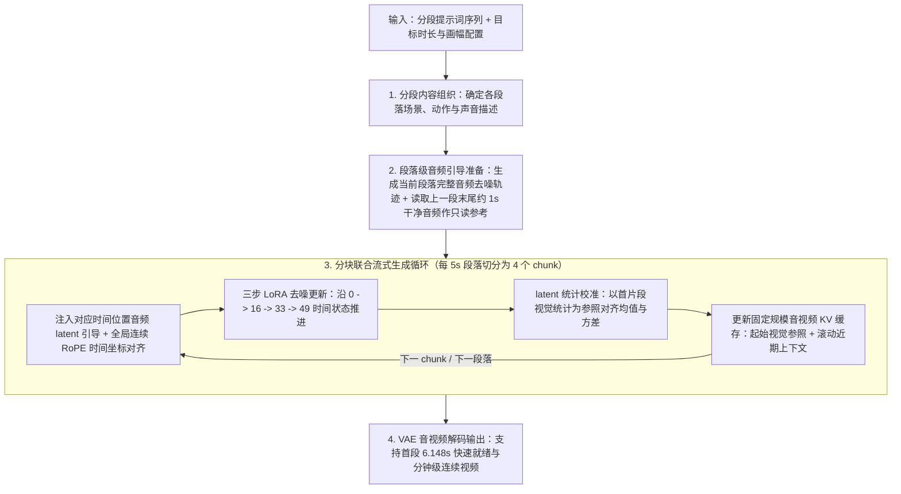

# 淘宝TaoMate-H3开源：三步生成「分钟级」音视频连续创作

## 1. TL;DR

**TaoMate-H3** 是阿里巴巴 TaoLive AIGC 团队基于 `MiniMax H3` 研发并开源的音视频联合流式生成模型。针对传统整段视频反复去噪耗时漫长、无法边生成边播放以及长视频跨段续写易发生音画漂移的痛点，TaoMate-H3 将**三步 LoRA 蒸馏推理**（沿 `0→16→33→49` 时间状态推进）与 **Self Forcing 自回归训练**相结合，以约 `1.4 秒` 的小片段（chunk）为单位流式生成包含人物对白、歌声或环境音效的 `480p / 768p / 1080p` 横竖屏视频。通过**“起始视觉参照 + 近期音视频上下文”固定规模 KV 缓存**、**全局连续 RoPE 时间编码 + 首个片段均值方差对齐**以及**段落级音频去噪轨迹引导（含上一段末尾约 1 秒只读干净音频参考）**，模型实现了分钟级跨提示词连续续写。在 `8 × NVIDIA H20 96GB`（`TP2 × Ulysses4` 并行）实测 10 秒 `480×864` 视频生成中，纯 DiT 计算耗时从 `169.572 秒` 降至 **`14.810 秒`（加速 `11.45 倍`）**，首段最终 latent 就绪时间从 `170.052 秒` 压缩至 **`6.148 秒`（加速 `27.66 倍`）**。

## 2. 问题定义与背景

### 2.1 传统视频生成在直播与长内容创作中的三大瓶颈

1. **整段去噪首帧等待极长**：传统视频扩散模型需等待整段视频完成数十步反复去噪后才能解码输出（如原版 `MiniMax H3` 生成 10 秒视频需约 `170 秒` 才能拿到首段可用表示），无法支撑直播讲解或交互式视频的及时反馈与边生成边播放。
2. **长视频跨段续写的一致性与显存膨胀矛盾**：分钟级电商商品讲解（外观展示 → 功能细节 → 使用场景）或剧情表演需要按段切换提示词，若不保留历史状态会导致人物外貌、音色与场景突变；若无上限累积全量历史 KV 缓存，显存与计算开销又会随视频时长线性乃至平方级膨胀。
3. **分块流式生成下的台词节奏断裂与画面色调漂移**：将段落拆成约 `1.4 秒` 的短片段（chunk）后，局部片段容易失去整句台词的停顿、语速与结束位置控制（出现重复起句），且多轮自回归续写后画面亮度与色调易发生累积漂移。

### 2.2 核心概念定义

- **音视频联合流式生成**：在同一扩散生成过程中同步处理声音与画面 latent 表示，使人声对白、歌声或环境特效音（海浪、车辆、爆炸）直接参与生成，在时间轴上自然对齐人物口型、表情与肢体动作。
- **首段最终 latent 就绪时间**：模型完成第一个小片段（chunk）的三步去噪、可立即交由 VAE 解码为可观看/收听媒体的时刻，是衡量流式交互响应速度的核心指标。

## 3. 知识框架



## 4. 核心内容拆解

### 4.1 四阶段推理主流程与三步 LoRA 分块机制

**核心主张**：将整段双向反复去噪拆解为“段落级规划 + 片段级（chunk）三步去噪 + 滚动 KV 缓存更新”，是同时降低总计算量与首包延迟的关键。

- **四阶段端到端推理流水线**：
  1. **分段组织内容**：根据目标总时长读取提示词序列，确定每个段落（如 5 秒一段）的场景、动作与声音描述。
  2. **准备音频引导**：为当前整个段落预先生成音频去噪轨迹，并截取上一段尾部约 1 秒的干净音频衔接音色与语气。
  3. **联合流式生成**：将每个段落切分为多个小片段（chunk），每个 chunk 执行三步音视频联合去噪并持续更新历史 KV 缓存。
  4. **VAE 解码输出**：将音视频压缩表示（latent）经 VAE 解码为画面与声音。
- **三步 LoRA 与分块（Chunk）切分规格**：
  - **段落与分块粒度**：在 5 秒提示词配置下，每个段落切分为 **4 个 chunk**，其中主体 chunk 时长约为 **`1.4 秒`**，尾部片段较短；在 10 秒视频配置下共生成 **8 个 chunk**，总计仅需执行 **24 次生成前向计算**和 **8 次 KV 缓存更新**。
  - **三步去噪时间步轨迹**：通过少步 LoRA 适配，每个 chunk 的去噪过程压缩为三个区间，严格沿 **`0 → 16 → 33 → 49`** 的时间状态推进；当前 chunk 到达终点状态后立即基于最终音视频状态更新 KV 缓存供下一 chunk 使用。

### 4.2 面向连续续写的四大核心技术机制

**核心主张**：通过训练期消除分布偏差（Self Forcing）与推理期控制空间（双区 KV 缓存）、时间（全局连续 RoPE + 均值方差对齐）和声音（段落音频轨迹 + 跨段只读参考），实现分钟级稳定续写。

| 核心技术模块 | 解决的具体问题 | 运作机制与实现细节 | 工程收益与边界 |
| :--- | :--- | :--- | :--- |
| **1. Self Forcing 自回归训练** | 仅用真实历史视频训练（Teacher Forcing）时，推理期面对模型自身生成历史会出现误差累积与分布失配 | 训练阶段让模型直接**以自身生成的历史片段为条件**继续生成后续内容（引用 NeurIPS 2025 *Self Forcing*） | 弥合训练与推理分布差异（Train-Test Gap），与少步推理、KV 缓存共同构成流式续写基础 |
| **2. 双区固定规模音视频 KV 缓存** | 长视频若无限累积历史 KV 会导致显存爆炸，若完全丢弃又会丢失初始人物与近期动作 | 采用**“起始视觉参照 + 近期音视频上下文”**双区结构：起始参照锁定人物与场景初始特征，近期上下文随进度滚动更新 | 将历史缓存控制在**固定规模**内，不随视频时长增长，支撑分钟级连续生成 |
| **3. 全局连续 RoPE 与视觉统计对齐** | 切换提示词时时间线断裂，以及长程续写中画面亮度、色调逐渐发灰或过曝漂移 | 使用**全局连续 RoPE 位置编码**随媒体进度移动文本时间坐标，将新提示词右边界对齐到当前媒体起点；并以**首个片段的视觉统计为参照**，对后续视频 latent 做**均值与方差对齐** | 历史内容仅作只读衔接不重复生成；显著抑制长视频跨提示词续写时的亮度与色彩漂移 |
| **4. 段落级音频轨迹引导与跨段衔接** | 短 chunk（1.4秒）生成缺乏全局台词停顿与语速感知（易重复起句），且跨段落切换时音色语气易突变 | 先生成覆盖当前完整段落的音频去噪轨迹，让每个 chunk 的三次去噪分别对齐轨迹中的三个状态及干净终点；跨段时将**上一段最后约 1 秒的干净音频**作为只读参考引导新音频生成 | 稳定整句台词展开节奏、减少短片段重复起句，并保持跨段落人声音色与语气连贯 |

### 4.3 分布式并行优化与快速运行命令

**核心主张**：结合模型级少步蒸馏与系统级混合并行（`TP2 × Ulysses4`）、算子融合及局部低精度计算，在单机 8 卡 H20 上实现超 11 倍计算加速与超 27 倍首包提速。

- **单机 8 卡并行与推理加速策略**：
  - 在 `8 × NVIDIA H20 96GB` 上采用 **`TP2 × Ulysses4`**（2 路张量并行 $\times$ 4 路 Ulysses 序列并行），配合高效注意力实现、算子融合以及部分线性层的选择性低精度计算。
- **环境要求与标准运行命令**：
  - 软硬件依赖：`Linux`、`Python 3.10/3.11`、`CUDA 12.8`、`PyTorch 2.8`，支持单机 4 卡或 8 卡推理（验证配置为 `8 × H20 96GB`）。
  - 克隆与十秒示例运行命令（首次运行时自动下载 TaoMate-H3 LoRA 权重）：

```bash
git clone https://github.com/TaoLiveAIGC/TaoMate-H3.git
cd TaoMate-H3

python -m taomate_h3 \
--model-root models/MiniMax-H3 \
--prompt-json examples/prompts_10s.json \
--duration 10 \
--resolution 768x1376 \
--gpus 8 \
--output outputs/demo_10s
```

## 5. 数据速查表

| 指标 | 原文数值 | 语境 / 条件 |
| :--- | :--- | :--- |
| 支持输出分辨率与画幅 | `480p`、`768p`（如 `768x1376`）、`1080p` 横竖屏 | 支持电商口播、演唱、动漫对白、自然环境与特效场景 |
| 演示案例时长与规格 | 背包讲解 `60s`（1080p 竖屏）；木梳讲解 `30s`；电影爆炸 `20s`；窗边演唱 / 日落海岸 `10s`；月夜少女与白狐 `7s` | 原文公开的应用效果演示片段 |
| 5 秒段落分块（Chunk）结构 | 每段分为 `4` 个 chunk，主体 chunk 约 `1.4 秒`（尾部较短） | 当前 5 秒提示词配置下的流式切分粒度 |
| 三步 LoRA 去噪时间状态序列 | `0 → 16 → 33 → 49`（共 3 个去噪更新区间） | 每个 chunk 内部的去噪步进轨迹 |
| 跨段音色衔接参考时长 | 上一段最后约 `1 秒` 的干净音频（只读参考） | 用于衔接相邻段落的音色与语气 |
| 10 秒视频总分块与前向次数 | `8` 个小片段（chunk）、`24` 次生成前向、`8` 次 KV 更新 | `8 × NVIDIA H20 96GB`，输出 `480 × 864`、10 秒视频 |
| 纯 DiT 计算耗时对比 | 原版 MiniMax H3：`169.572 秒` $\to$ TaoMate-H3：**`14.810 秒`**（加速 **`11.45 倍`**） | 同机 `8 × H20 96GB`，`480 × 864`、10 秒视频 |
| 首段最终 latent 就绪时间对比 | 原版 MiniMax H3：`170.052 秒` $\to$ TaoMate-H3：**`6.148 秒`**（加速 **`27.66 倍`**） | 对应完成第一段生成、可交由 VAE 解码的时间 |
| 单机 8 卡并行策略与软件栈 | `TP2 × Ulysses4`；`Python 3.10/3.11`、`CUDA 12.8`、`PyTorch 2.8` | 已验证的 8 卡 H20 运行环境配置 |

## 6. 踩坑与教训 / 可迁移的设计原则

| 错误做法 | 失败表现或原因 | 原文应对（可迁移的设计原则） |
| :--- | :--- | :--- |
| **仅使用真实视频历史做 Teacher Forcing 训练自回归续写模型** | 推理时历史片段由模型自己生成，微小的生成瑕疵会在长程续写中被不断放大，导致训练与推理分布失配 | **引入 Self Forcing 自回归训练**：在训练期即让模型以自身生成的历史片段为条件生成后续内容，主动暴露并适应推理期分布 |
| **在长视频生成中无限追加全量音视频 KV 缓存** | 随着视频延长至分钟级，KV 缓存显存占用与注意力计算量持续膨胀直至 OOM | **“起始视觉参照 + 滚动近期上下文”定长缓存**：固定保留初始人物/场景参照并滚动更新近期音视频状态，使缓存规模与总时长解耦 |
| **将视频切分为 1.4 秒短 chunk 后完全独立生成音频，或跨提示词重置位置编码** | 短片段无法把握整句台词停顿与结尾，易出现重复起句；重置位置编码或缺乏统计约束会导致跨段衔接断裂及画面亮度色调漂移 | **全局连续控制 + 局部流式执行**：音频侧先生成段落级去噪轨迹引导各 chunk 并用上一段末 1 秒干净音频衔接；视觉侧采用全局连续 RoPE 并以首段统计对齐后续 latent 的均值与方差 |

## 7. 记忆锚点

- **核心机制口诀**：“五秒四块一秒四，零到四九三步走；首帧参照加近邻，均值方差防漂移；整段音轨控节奏，末秒净音接下段。”
- **性能对比锚点**：“十秒视频八分块、二十四次前向算：DiT 耗时 `169.6s → 14.8s`（快 `11.45` 倍），首段就绪 `170.1s → 6.15s`（快 `27.66` 倍）。”

## 8. 复习卡片

TaoMate-H3 相比原版 MiniMax H3 为什么能将首段 latent 就绪时间从 170.052 秒缩短到 6.148 秒（加速 27.66 倍）？::原版需对整段视频反复去噪完成后才能输出；TaoMate-H3 将视频按约 1.4 秒的小片段（chunk）切分，并通过少步 LoRA 将每个片段的去噪压缩为沿 `0→16→33→49` 推进的 3 步更新，优先完成第一段即可交由 VAE 解码。
TaoMate-H3 的音视频 KV 缓存如何组织，为什么能支撑分钟级连续生成而不发生显存爆炸？::缓存采用“起始视觉参照 + 近期音视频上下文”的双区组织方式：起始参照固定保留人物与场景的初始外观信息，近期上下文随生成进度滚动更新，从而将历史缓存严格控制在固定规模内。
在分块流式生成（每个主体 chunk 约 1.4 秒）中，TaoMate-H3 如何防止台词节奏混乱、重复起句以及跨段落音色突变？::在段落内部预先生成覆盖整个提示词段落的音频去噪轨迹，让各小片段的三步去噪严格对齐轨迹中的三个状态与干净终点；在跨段落时，截取上一段最后约 1 秒的干净音频作为只读参考来引导新段落音频生成。
为什么长视频连续续写容易出现画面亮度和色调漂移，TaoMate-H3 如何解决跨提示词衔接问题？::多轮自回归生成会产生 latent 分布偏移；模型一方面使用全局连续的 RoPE 位置编码将新提示词右边界对齐到当前媒体时间起点，另一方面以首个片段的视觉统计量为参照，对后续视频 latent 持续执行均值与方差对齐。
Self Forcing 训练机制在 TaoMate-H3 中起什么作用？::它在训练阶段让模型直接以自身生成的历史片段（而非仅用真实无损视频历史）为条件继续生成后续内容，使模型在训练期就接触真实续写中的历史状态，缓解训练与推理之间的分布差异（Train-Test Gap）。

## 9. 知识关联

- **本库通用主题**：[模型架构与训练](../../20_topics/模型架构与训练.md) · [大模型推理与算子优化](../../20_topics/大模型推理与算子优化.md) · [模型与开发工具发布](../../20_topics/模型与开发工具发布.md)
- **本篇原始与转写材料**：[原始 PDF](RAW.pdf) · [逐页转写文本](MD.md)
- **候选双链**：[[音视频联合流式生成]] · [[Self-Forcing自回归扩散训练]] · [[Ulysses序列并行与TP混合并行]] · [[扩散模型KV缓存与统计对齐]]

## 10. 原文参考资料

- **原文信息**：《淘宝TaoMate-H3开源：三步生成「分钟级」音视频连续创作》，作者：祁隽（淘天集团-直播 AIGC 团队），公众号：大淘宝技术，发布时间：`2026-10-13 19:27`（浙江）。
- **开源代码与模型权重**（来自原文，遵循 `MiniMax H3 Community License`，未在本地联网克隆或下载验证）：
  - GitHub 仓库：`https://github.com/TaoLiveAIGC/TaoMate-H3`
  - Hugging Face 权重：`https://huggingface.co/TaoLiveAIGC/TaoMate-H3`
- **文内引用论文**：
  1. Huang et al., *Self Forcing: Bridging the Train-Test Gap in Autoregressive Video Diffusion*, NeurIPS 2025.

> [!note]- 校对报告
> 1. **页码溯源汇总**：
>    - `p.1–2`：TaoMate-H3 模型定位、开源地址（GitHub 与 Hugging Face）及三大核心能力（三步流式生成、音视频联合生成、分钟级连续续写）。
>    - `p.2–5`：四大类应用效果展示（60秒竖屏背包与 30秒横屏木梳电商讲解、10秒窗边演唱、7秒月夜少女与白狐动漫对白、10秒日落海岸与 20秒建筑爆炸环境特效）及推理四环节总览（分段组织、准备音频引导、联合流式生成、VAE 解码输出）。
>    - `p.6–7`：五大关键技术详解（三步 LoRA `0→16→33→49` 与 5 秒 4 chunk / `1.4s` 切分、Self Forcing 自回归训练、起始视觉参照+近期上下文 KV 缓存、全局连续 RoPE 时间编码+首片段均值方差对齐、段落级音频去噪轨迹+上一段末尾约 1 秒只读干净音频参考）。
>    - `p.7–9`：`8 × NVIDIA H20 96GB` 性能对比（`480×864` 10 秒视频：DiT 耗时 `169.572s → 14.810s` 加速 `11.45` 倍，首段 latent 就绪 `170.052s → 6.148s` 加速 `27.66` 倍，8 个片段 24 次前向 8 次 KV 更新，`TP2 × Ulysses4` 并行）、环境要求、CLI 运行示例与后续 `FL2AV` / `Ref2AV` 开源计划。
> 2. **勘误与质量边界说明**：
>    - `p.1–5` 包含多个微信内嵌视频播放器帧画面（带 `01:47`、`01:00`、`00:30`、`00:10`、`00:07`、`00:20` 时长角标），静态 PDF 仅保留视频封面图与文字说明；`p.7` 性能对比图的核心数值均已在正文精确给出。
> 3. **核验结论**：全文满足单 H1、10 大编号章节、正文零内联页码、5 条单行 `::` 复习卡片，所有性能指标、步数与命令参数均与原文逐一核对一致；开源仓库命令未在本地执行。
