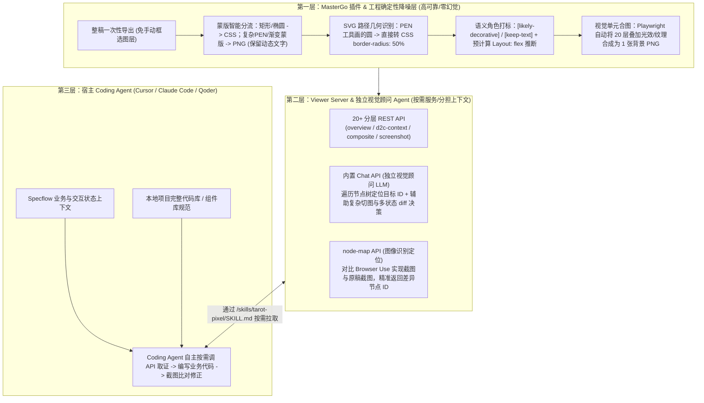

# 场景营销前端 AI Coding — AI Native 的视觉稿还原

> [!abstract] 导读
> **一句话总结**：淘天集团用户场景营销技术团队（作者：木偶）针对传统 D2C（Design to Code）平台“强依赖人工选图层/切图/合并多状态、一次性生成的静态空壳代码与项目业务上下文彻底脱节”的结构性死结，颠覆性地提出了 **“不生成代码，只做 Coding Agent 的视觉感知层（建图书馆而非建管道）”** 的 **Tarot Pixel** 方案——通过 MasterGo 插件整稿一次性导出与确定性工程降噪（蒙版翻译、PEN 路径识别、`[likely-decorative]` 标记、Playwright 视觉单元自动合图），在本地启动提供 20+ 按需分层 REST API 与独立视觉顾问 `Chat API / node-map` 的 Viewer Server，结合纯声明式 `SKILL.md` 与任务规划 `Specflow`，让拥有完整业务代码库上下文的 Coding Agent（Cursor / Claude Code / Qoder）自主走通 **“按需查阅 $\rightarrow$ 编码实现 $\rightarrow$ 截图比对 $\rightarrow$ 持续对话修正”** 闭环。
> **阅读价值**：深刻回答了 Agentic Engineering 时代工具设计的本质命题——**“当 Coding Agent 已经成为开发主力时，外部工具不该再越俎代庖去猜项目规范生成模板代码，而应为 Agent 提供干净、按需拉取、持续在线的结构化上下文”**。

## 1. TL;DR

- **核心颠覆性理念（“不建管道，建图书馆”）**：
  - 传统 D2C 试图建一条“输入设计稿 $\rightarrow$ 输出代码”的单向管道，但产出的只是脱离业务状态、交互逻辑与项目规范的“静态空壳”。
  - **Tarot Pixel 自己绝不生成业务代码**，而是定位为 **Coding Agent 的视觉感知层（Visual Perception Layer）**：将设计稿转化为本地持续在线、分层降噪的“视觉参考图书馆（Viewer Server + 20+ REST API）”，由掌握完整项目代码库上下文的 Coding Agent 按需调用 API 取证并自己动手写代码。
- **为什么传统 D2C 与原生 MasterGo MCP 在复杂 C 端营销场景不够用？**
  1. **C 端视觉极度复杂**：一个“红包组件”往往由 20 个渐变、光效、PEN 路径蒙版图层堆叠而成；同一个按钮/卡片的多种状态（未解锁/已解锁/已过期）分散在不同画板。
  2. **原生 MasterGo MCP 的四大局限**：仍需人工手选容器获取 ID、一次性返回全量原始脏 JSON 撑爆上下文、缺乏自动合图与视觉比对工具链、数据一次性交付后无法持续在线回查。
- **Tarot Pixel 四大核心工程支柱**：
  1. **MasterGo 插件整稿一键导出与确定性降噪**：无需人工整理图层，整页导出时由工程规则自动完成**简单蒙版转 CSS / 复杂蒙版转 PNG、PEN 画圆识别为 `border-radius: 50%`、纯装饰层打标 `[likely-decorative]`、Playwright 视觉单元自动合图**。
  2. **按需拉取的四层渐进式 REST API**：提供 `overview`、`d2c-context`（每次仅返回单节点及直接子节点 + 预推断的 `Layout: flex`）、`composite`（一键合图）、`screenshot` 等 20+ 幂等接口，把 Token 消耗压到最低。
  3. **独立上下文的视觉顾问（`Chat API` + `node-map API`）**：用内置独立 LLM Agent（`Chat API`）和图像识别定位（`node-map API`）替主 Coding Agent 分担遍历节点树与切图决策的上下文压力，并配合 **Browser Use** 实现 `实现截图 → 比对 → 定位 → 自主修正` 闭环。
  4. **纯 API 参考型 `SKILL.md` 与 `Specflow` 双剑合璧**：`Specflow` 提供业务与状态上下文，`Tarot Pixel` 提供视觉上下文；在 34 个 BC 端典型复杂视觉稿测评中已完整跑通 24 个，复杂模块仅需 **1–3 次自然语言指正**即可高还原交付，甚至让不懂 CSS 的服务端同学也能直接指挥 Agent 修页面。

## 2. 问题定义与背景

### 2.1 C 端营销场景下传统 D2C 的四大结构性断点
在淘宝大促与日常场景营销中，前端开发面临极高的视觉复杂度与迭代频率，传统 D2C 暴露四大断点：
1. **重度依赖人工预处理**：开发者必须手动打开设计软件框选图层（选少漏信息、选多引噪音）、人工判断切图与合图边界、人工识别跨画板的多状态并手写条件渲染。
2. **一次性开环输出，无法对话式修正**：D2C 平台吐出代码后设计稿使命即告终结；若还原度只有 80%，开发者无法对它说“红包卡片缺了分割线”，只能人工进代码微调或推倒重来。
3. **视觉还原与业务逻辑强耦合**：真实前端没有孤立的“纯静态切图任务”——商品卡片的按钮置灰、标签变色、倒计时显隐强耦合于后端接口数据流与活动状态机，脱离项目代码库生成的 D2C 代码只是无法直接合并的空壳。

### 2.2 传统 D2C vs. 原生 MasterGo MCP vs. Tarot Pixel 全方位对比

| 对比维度 | 传统 D2C 平台 | 原生 MasterGo MCP | 本文 Tarot Pixel（Agent-Native） |
| :--- | :--- | :--- | :--- |
| **核心定位** | 中心化代码生成器（替你写代码） | 原始图层 JSON 搬运工 | **Coding Agent 的在线视觉感知层（建图书馆）** |
| **设计稿预处理成本** | 高（需手动整理图层、打标、切图） | 高（需手动选中容器复制 ID 粘贴到对话） | **零人工预处理**（整稿一次性导出，多模块并行预览） |
| **上下文供给方式** | 内部黑盒消费 | 选中节点**全量原始 JSON 一次性塞入上下文**（极易过载） | **四层按需拉取 REST API + 工程预降噪**（单次仅返单节点及直接子节点） |
| **20 层复杂装饰合图** | 需人工打合图标记 | 无合图能力，返回 20 层脏数据干扰 AI | 自动识别 `[likely-decorative]`，调 `composite` API 由 Playwright 按视觉单元一键合成单张 PNG |
| **后续修正与迭代** | 一次性产物，不满意只能人工手改代码 | 一次性上下文，对话拉长后丢失细节 | **设计稿始终本地在线**，配合 Browser Use + `node-map` 支持持续比对与对话自愈 |
| **核心考核指标** | 静态首次代码生成率 | 单次转换成功率 | **全链路人工干预次数（Human Intervention Count）** |

## 3. 知识框架

```mermaid
mindmap
  root((Tarot Pixel：AI Native 视觉稿还原体系))
    核心哲学：Agent-Native 工具观
      从 Vibe Coding 走向 Agentic Engineering
      不建单向生码管道，建可按需查阅的“视觉参考图书馆”
      工程做确定性提取降噪，AI 做视觉语义理解，Coding Agent 结合项目写代码
    双翼协同：Specflow + Tarot Pixel
      Specflow：补齐业务需求、交互状态与任务拆解上下文
      Tarot Pixel：补齐像素级 CSS、切图资源与多状态视觉上下文
    四大系统模块与关键实现
      1. MasterGo 插件（整稿导出 + 确定性降噪）
        蒙版分流（简单转 CSS overflow+radius，复杂 PEN/布尔转 PNG 且文字保活）
        PEN 画圆路径自动识别为 border-radius: 50%
        装饰层自动打标 [likely-decorative] 与 Ghost 节点识别
      2. Viewer Server（Bun + Vite + React 19）
        1:1 Web 渲染预览 + Map 节点边界标注模式
        20+ 幂等无状态 REST API（overview / d2c-context / composite / screenshot / node-map）
        Playwright 视觉单元级自动合图（20层红包装饰合成1张背景PNG）
      3. 内置视觉顾问（Chat API + node-map API）
        独立 LLM Agent 拥有专属上下文窗口，替主 Coding Agent 分担节点树遍历与切图决策
        node-map 图像识别定位，衔接 Browser Use 构建“实现截图->比对->定位->修正”闭环
      4. 声明式 SKILL.md（去中心化扩展）
        纯 API 参考手册，不绑定具体框架与项目代码规范
```

## 4. 核心内容拆解

### 4.1 “工程确定性降噪 + AI 语义理解 + Coding Agent 实现”三层分工架构



#### 1. MasterGo 插件与查询层的“外科手术式”确定性降噪
如果把设计稿原始 Schema 直接塞给大模型，复杂的图层嵌套与幽灵节点会迅速造成注意力坍塌。Tarot Pixel 坚持**“凡是能用工程确定性解决的，绝不交给 AI 猜”**：
- **蒙版与矢量智能转换**：自动识别简单矩形/椭圆蒙版并转为 `overflow: hidden + border-radius`；对复杂的 PEN 路径、布尔运算或渐变蒙版强制导出为 PNG，但将其中的**文本图层剥离保持动态可编辑（`[keep-text]`）**；对设计师用 PEN 钢笔工具手绘的圆形，通过 SVG 路径几何分析直接还原为 `border-radius: 50%` 而非冗余 SVG 图。
- **信息密度严格受控的 `d2c-context`**：每次请求仅返回**当前节点及其直接子节点（深度为 1）**，附上工程层预先算好的布局推断（如 `Layout: flex column gap 60px`）、四舍五入后的精确数值与透明度去重结果。
- **按“视觉单元”而非“图层节点”合图**：面对由 20 个渐变、阴影、光效图层叠加而成的红包背景，工程层自动标记 `[likely-decorative]`，Coding Agent 只需调用 `composite`（或 `multi-composite`，支持 `include/exclude` 精确控制），后台即通过 **Playwright** 截图合成一张纯净背景 PNG。

#### 2. 为什么要在本地服务里再内置一个独立 `Chat API`（视觉顾问 Agent）？
在实际落地中团队发现：**主 Coding Agent（如 Cursor）的单窗口上下文非常金贵**——需求理解（Specflow）、检索本地业务代码库已经占用了大半窗口；如果再让主 Agent 自己发十几次请求去逐层遍历几百个设计稿节点找“红包里的领券按钮在哪”，它的编码注意力会被严重挤占。
- **子代理上下文隔离解耦**：Tarot Pixel 将 `Chat API` 实现为一个拥有**独立上下文窗口与 20+ 内部工具**的专职“视觉顾问 Agent”。主 Coding Agent 只需发出一句高语义请求（*“帮我找出红包组件按钮的节点 ID 并判断背景是否需要合图”*），`Chat API` 自己在后台遍历节点树、看图比对后，只把最精简的结论返回给主 Agent！

### 4.2 去中心化 Skill 设计与“实现 $\rightarrow$ 比对 $\rightarrow$ 修正”自愈闭环

1. **纯声明式 API 字典 `/skills/tarot-pixel/SKILL.md`**：
   - 该 Skill 文档不规定用 React 还是 Vue、不规定用 Tailwind 还是 CSS Modules，只做**纯正的 REST API 说明书**与通用视觉取证原则（“装饰优先切图、内容优先代码、所有数值必须来自 API”）。
   - **去中心化演进红利**：当底层大模型升级（如升级至 Claude Sonnet 4.6 / Opus 4.6）或普遍内置 **Browser Use** 能力时，Tarot Pixel 无需修改一行代码生成模板，Agent 自己就能把工具组合得更聪明。
2. **打破前后端工种边界的持续修正闭环**：
   - 因为本地 Viewer Server（基于 `Bun + Vite + React 19`）让设计稿信息**始终在线**，首次还原哪怕只有 80%，开发者（甚至完全不懂 CSS 和图层结构的服务端开发同学）只需用自然语言指出“背景图圆角不对、红包缺了分割线”，或者由 Coding Agent 自主通过 Browser Use 截图并调 `node-map` API 比对差异，1–3 轮对话即可收敛至像素级还原。

## 5. 数据速查表

| 模块 / 评估项 | 技术栈与接口规模 | 实测进展与量化表现 |
| :--- | :--- | :--- |
| **工程技术栈** | MasterGo 插件（`TS + React`）、Viewer Server（`Bun + Vite`）、前端（`React 19`）、合图（`Playwright`）、TUI CLI | 纯工程高确定性底座 + REST API 通用接入（兼容 Cursor / Claude Code / Qoder） |
| **开放 API 与内置工具** | 提供 `overview`、`d2c-context`、`composite`、`screenshot`、`chat`、`node-map` 等 **20+ 个 REST API** | 按需分层拉取、幂等无状态，每次仅取单层直接子节点防上下文爆炸 |
| **BC 端真实场景测评** | 收集 **34 个** 覆盖 B/C 端典型复杂场景的视觉稿，已完成全流程验证 **24 个** | 导出与中间态工程问题 **100% 解决**；复杂 UI 差异仅需 **1–3 次**自然语言引导即可完成修复 |
| **核心效能北极星指标** | 从考核“单次静态代码采纳率”转向考核 **“端到端人工干预次数”** | 彻底免除手动选图层、手动切图、手动标多状态的传统前置人工配合 |

## 6. 踩坑与教训 / 可迁移的设计原则

- **核心认知 1：在 Agent 时代，“建图书馆（按需查询的感知服务）”远胜于“建单向管道（替 Agent 生成死代码）”**
  - **教训**：任何外部独立平台生成的业务代码，因为没有本地项目的真实路由、状态管理与老代码上下文，合入项目时必然面临痛苦的“二次手术”。
  - **可迁移原则**：尊重宿主 Coding Agent 作为“唯一主程”的地位——外部工具的最佳形态是通过 **轻量级 `SKILL.md` + 本地幂等 REST API** 向主 Agent 暴露干净的感知数据（无论是设计稿、监控日志还是数据库血缘），让主 Agent 结合项目代码库自己写代码。
- **核心认知 2：为主 Agent 配备“自带独立上下文窗口的领域顾问子 Agent（如 `Chat API`）”**
  - 当某个子领域（如复杂 UI 树检索、海量日志排查）需要多步探索性搜索时，不要让主 Coding Agent 在主会话里直接做大海捞针式的工具调用，而是通过一个封装好的顾问 API 在独立上下文中完成搜索并返回精准 ID，保护主窗口的信噪比。
- **当前客观局限与演进方向**：超大型复杂设计稿中图层定位速度、半透明装饰层与内容层交叠时的切图边界判定、以及跨多画板相似节点的多状态自动合并准确率仍在持续打磨中；同时方案对基座模型（推荐 `Sonnet 4.6` 及以上）的多模态与长程工具调用能力有较高要求。

## 7. 记忆锚点

- **一句核心口号**：**我不做 Agent，我做为 Agent 服务的视觉感知层；不生成代码，让 Coding Agent 自己看懂设计稿（建图书馆而非建管道）**。
- **双翼上下文拼图**：**`Specflow` 供业务与交互上下文 + `Tarot Pixel` 供像素与切图视觉上下文 $\rightarrow$ Coding Agent 写出真正能用的代码**。
- **四大工程利器**：**MasterGo 整稿降噪导出 + 20+ 按需分层 REST API + `Chat API / node-map` 独立视觉顾问 + Playwright 视觉单元合图**。

## 8. 复习卡片

What is the fundamental philosophical difference between traditional D2C platforms and Tarot Pixel?::Traditional D2C builds a one-way pipeline that generates isolated, template-bound UI code lacking project business context; Tarot Pixel never generates code itself—instead, it acts as an online "Visual Perception Library" (via REST APIs) that empowers the host Coding Agent (which already holds the full project codebase context) to inspect the design on-demand and write project-native code.
How does Tarot Pixel's MasterGo plugin pre-process and denoise complex C-end design files during export?::It exports the entire design at once and deterministically converts simple masks to CSS (`overflow: hidden + border-radius`), exports complex PEN/boolean masks to PNG while keeping text layers editable (`[keep-text]`), converts PEN-drawn circles into `border-radius: 50%`, tags decorative layers as `[likely-decorative]`, and pre-computes layout inferences (`Layout: flex`).
Why does Tarot Pixel provide a dedicated `Chat API` backed by an independent LLM Agent instead of letting the main Coding Agent traverse the design node tree directly?::Because the main Coding Agent's context window is already heavily occupied by requirements and project source files; delegating exploratory node-tree traversal and slicing decisions to the isolated `Chat API` agent prevents context bloat in the main coding session.
How does Tarot Pixel handle a complex component like a red-packet card composed of 20 overlapping gradient, glow, and texture layers?::The engineering layer identifies and tags the decorative layers as `[likely-decorative]`, allowing the Coding Agent to call the `composite` API, which uses Playwright to merge the entire visual unit into a single background PNG.
How does Tarot Pixel differ from using raw MasterGo MCP directly?::Raw MasterGo MCP requires manual container selection, dumps the entire raw JSON tree into context at once, lacks image compositing or visual diff tools, and is a one-shot input; Tarot Pixel exports whole files without manual prep, serves progressive 1-level-deep `d2c-context` via 20+ REST APIs, provides `composite`/`node-map` tools, and stays online for iterative self-correction.
How do `Specflow`, `Tarot Pixel`, and Browser Use work together to minimize the "Human Intervention Count" metric?::`Specflow` supplies structured business and state requirements while `Tarot Pixel` supplies online visual context; after coding, the Coding Agent uses Browser Use to screenshot its rendered page, compares it against the design via `node-map` and `screenshot` APIs, and autonomously fixes visual discrepancies in a closed loop.

## 9. 知识关联

- **本批同主题精读**：
  - [AI 动画辅助实现（实践篇）：从 AE 到可运行代码的全链路方案](../AE到代码AI动画实践+26.6.28/AI_AE到代码AI动画实践.md)：同属淘天营销&交易技术团队的“塔罗（Tarot）”前端 AI 体系！本文 **Tarot Pixel** 攻克静态复杂视觉稿的 Agent-Native 还原，该文攻克动态 **After Effects（AE）营销动效**的代码直出与融合。
  - [百亿补贴 C 端 AI Coding 实战：端到端 CodingAgent 设计与实践](../百补C端CodingAgent+26.8.2/AI_百补C端CodingAgent.md)：可对比两种不同的前端 AI-D2C 架构取向——百亿补贴采用“MasterGo MCP + 多模态截图 + 组件特征 DSL 路由”内嵌于垂直 CodingAgent，而本文 Tarot Pixel 则采用“整稿降噪导出本地 Viewer Server + 20+ 按需 REST API”赋能通用 Coding Agent。
  - [AI Agent 的 Skill 系统设计](../Agent Skill系统设计+26.7.1/AI_Agent Skill系统设计.md)：本文 `/skills/tarot-pixel/SKILL.md` 的“纯声明式 API 参考、去中心化扩展、按需渐进拉取”正是高水平 Skill 设计的绝佳范本。
- **主题索引（`20_topics`）**：
  - [AI研发协同](../../20_topics/AI研发协同.md)
  - [Skill设计与治理](../../20_topics/Skill设计与治理.md)
  - [跨端开发与性能](../../20_topics/跨端开发与性能.md)
- **本目录归档文件**：[原始 PDF](RAW.pdf) · [逐页转写文本](MD.md)
- **候选概念双链**：[[Tarot-Pixel]] · [[D2C设计稿转代码]] · [[Agent-Native]] · [[渐进式上下文]] · [[MasterGo]] · [[Browser-Use]] · [[Specflow]]

## 10. 原文参考资料

- **原文出处**：大淘宝技术公众号，《场景营销前端 AI Coding — AI Native 的视觉稿还原》（作者：木偶，淘天集团-用户场景营销技术团队，发布日期：2026-06-24）
- **文中引用报告与概念**：
  - Andrej Karpathy，从 *Vibe Coding* 到 *Agentic Engineering* 的演进论述
  - Anthropic，《2026 Agentic Coding Trends Report》与《The Complete Guide to Agentic Coding 2026》

> [!note]- 校对报告
> - **页码溯源（1-based 物理页码）**：
>   - 篇首标题、作者（木偶，用户场景营销技术团队）、从 Vibe Coding 到 Agentic Engineering 的范式转变、设计稿视觉上下文痛点（Pencil vs Figma MCP 路线对比）：源自 `RAW.pdf` `p.1–5`（对应 `MD.md` 第 1–5 页）。
>   - 传统 D2C 在复杂 C 端场景的四大结构性断点（20 层红包叠加、跨画板多状态、频繁变更、与业务状态/交互/数据流耦合）及“不建管道、建图书馆”的 Agent-Native 设计逻辑与四层渐进式上下文：源自 `RAW.pdf` `p.5–9`（对应 `MD.md` 第 5–9 页）。
>   - `/skills/tarot-pixel/SKILL.md` 纯 API 参考设计、去中心化扩展优势、工程与 AI 边界划分及与 `Specflow` 的协同模式：源自 `RAW.pdf` `p.9–14`（对应 `MD.md` 第 9–14 页）。
>   - 系统四大模块实现（TUI CLI、Viewer Server、20+ REST API、内置独立 `Chat API` 视觉顾问与 `node-map` 图片定位、MasterGo 插件整稿导出与蒙版/PEN圆/装饰层降噪、Playwright 合图）、与 MasterGo MCP 的四点本质差异、修正闭环与“人工干预次数”指标及 34 稿测通 24 稿的进展总结：源自 `RAW.pdf` `p.14–26`（对应 `MD.md` 第 14–26 页，其中 `p.22` 为纯效果图页）。
> - **一致性核验**：原文共 26 页（含 22 页架构图、对比图与演示视频截图），无独立可剥离的外部 Prompt/Skill 全文。全文零正文内页码引用，所有模块名称、技术栈（TS + React / Bun + Vite / React 19 / Playwright / Sonnet 4.6）与测评数字（34 个视觉稿完成 24 个，1–3 次对话引导）均与 `MD.md` 完全一致。
