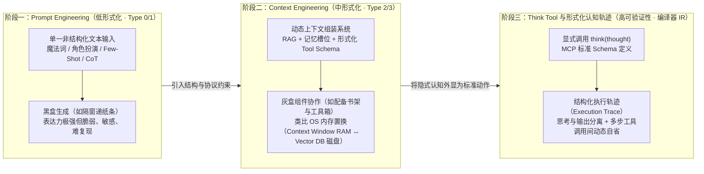

# 从Prompt到Context：为什么Think Tool是形式化的必然？

## 1. TL;DR

1. **工程范式跃迁（Prompt $\to$ Context）**：大模型应用开发正经历从“语言调优的艺术（Prompt Engineering，基于非结构化单文本接口）”向“系统上下文工程（Context Engineering，基于 RAG、形式化工具 Schema、多级记忆槽位与动态组装）”的范式迁移，其底层驱动力是**形式化程度（Formalization）**的阶梯式提升。
2. **理论根基（乔姆斯基谱系与编译器语义保持）**：依据形式语言理论中的**乔姆斯基谱系（Chomsky Hierarchy，Type 0 无限制文法 $\to$ Type 3 正则文法）**，限制系统的自由表达能力、引入更严格的语法与协议约束，能够显著换取更高的可预测性、可验证性与计算可处理性；在无法对神经网络黑盒做数学归纳证明的前提下，唯有通过**运行时执行轨迹（Execution Trace）**与**中间表示（Intermediate Representation, IR）**来验证语义保持（Semantic Preservation）。
3. **Think Tool 的本质（认知过程的形式化与外显化）**：Anthropic 提出的 `think` 工具并非获取外部数据的 API，而是将原本隐式、不可观测、与最终回答混杂在一起的内部推理（如传统 CoT）升级为具有**形式化 MCP 输入 Schema、在执行轨迹中显式留痕、可动态暂停并在工具调用间触发的元认知脚手架（Metacognitive Scaffolding）**，在复杂策略约束场景（如航空订票系统）中带来 **`54%`** 的相对性能提升。

## 2. 问题定义与背景

### 2.1 从编译器语义保持看大模型工程困境

在传统计算机科学（尤其是编译器设计）中，系统的核心目标是**语义保持（Semantic Preservation）**——将高级语言源码经过词法分析、语法分析、属性文法（Attribute Grammar）计算与中间表示（IR）转换后，生成的目标机器码必须在语义上与源码严格等价。对于确定性程序，研究者可以通过形式化语义与结构归纳法严格证明编译器的正确性。

然而，当核心计算引擎变成拥有数百亿参数的概率生成模型（LLM）时，传统静态形式化证明路径失效：
- **内部状态不可证明**：无法对神经网络权重矩阵的激活路径做静态形式化规约；
- **执行轨迹（Execution Trace）成为唯一抓手**：当无法直接证明系统内部结构时，工程上唯一可行的方案就是**规范并观测系统的运行时执行轨迹**——通过强制模型在关键节点输出符合形式化 Schema 的中间状态（如工具调用记录、显式思考块），验证其外部行为是否满足业务策略与安全约束。

### 2.2 Prompt Engineering 的四大工程瓶颈

早期的 **Prompt Engineering（提示词工程）** 试图仅靠调整自然语言指令（如“请一步步思考”、角色扮演、添加 Few-Shot 示例）来控制模型行为。这就像**隔着一扇小窗户，仅通过一张纸条与房间里才华横溢但脾气古怪的专家交流**：
1. **极度脆弱与敏感（Fragility）**：微小的措辞变动、标点符号修改或示例顺序调整，就可能导致模型输出质量断崖式下跌；
2. **缺乏状态与记忆管理（Poor Memory Management）**：将背景知识、历史对话、工具说明与当前指令全部塞进同一段扁平文本，极易引发注意力稀释与上下文溢出；
3. **推理与输出高度耦合（Entangled Reasoning & Output）**：即使使用思维链（Chain-of-Thought, CoT），模型的中间推理与最终结论依然混杂在同一段自由文本流中，既难以被外部程序精确解析过滤，也无法在多轮工具调用之间按需触发；
4. **不可验证与难调试（Unverifiable）**：当模型在包含数十条复杂业务规则的场景中出错时，开发者无法从黑盒输出中定位究竟是漏读规则、工具返回值解析错误还是逻辑推导跳步。

## 3. 知识框架



## 4. 核心内容拆解

### 4.1 乔姆斯基谱系视角下的形式化阶梯

文章引入形式语言理论中的 **乔姆斯基谱系（Chomsky Hierarchy）**，解释为什么大模型工程必然走向更高程度的形式化：
- **Type 0（无限制文法 / 图灵机）** $\to$ **Type 1（上下文有关文法）** $\to$ **Type 2（上下文无关文法 / 下推自动机）** $\to$ **Type 3（正则文法 / 有限状态自动机）**；
- **核心权衡定律**：**形式化程度越高，表达的随意性越受限，但系统的可预测性（Predictability）、可验证性（Verifiability）与计算可处理性（Computational Tractability）呈阶梯式上升。** Prompt Engineering 停留在低形式化的 Type 0/1 自然语言层，而 Context Engineering 则通过语法与协议约束将系统推向 Type 2/3 层级。

### 4.2 Context Engineering：把 LLM 变成操作系统中的“灰盒组件”

如果说 Prompt Engineering 是在单条字符串上做“修辞微调”（类似早期汇编语言直接拨弄比特位），那么 **Context Engineering（上下文工程）** 则是把大模型视为软件架构中的一个**灰盒计算核心**，相当于从汇编迈向结构化高级编程语言：
- **从“递纸条”到“豪华工作室”**：为专家配备分门别类的参考书架（RAG 知识库）、标准化的专业仪器（形式化 Tool Schema）、便签本与档案柜（短期工作记忆与长期向量存储）；
- **类比计算机操作系统的内存分级置换（OS Memory Management）**：
  - **Context Window = 内存（RAM）**：容量有限、访问极快、成本高昂，只能存放当前推理最急需的活跃信息；
  - **Vector DB 与历史存储 = 磁盘（Disk）**：容量巨大，需通过检索（Retrieval）、摘要压缩（Summarization）与槽位注入（Short/Long-term Memory Slots）按需换入（Swap-in）或换出（Swap-out）上下文窗口。

### 4.3 Think Tool：将“内部认知”形式化为“标准工具调用”

在 Context Engineering 解决了外部信息与外部工具的结构化之后，模型内部的**思考过程（Reasoning Process）**成了最后一个尚未被形式化的盲区。Anthropic 提出的 **`think` tool** 完成了这一关键跨越：
1. **基于 MCP 的形式化 Schema 定义**：
   ```json
   {
     "name": "think",
     "description": "Use the tool to think about something. It will not obtain new information or change the database, but just append the thought to the log. Use it when complex reasoning or some cache memory is needed.",
     "input_schema": {
       "type": "object",
       "properties": {
         "thought": {
           "type": "string",
           "description": "A thought to think about."
         }
       },
       "required": ["thought"]
     }
   }
   ```
   与普通外部工具不同，`think` 工具**不访问任何外部数据源，也不改变数据库状态**，而是将内部认知动作显式化为系统执行轨迹（Execution Trace）中的标准节点。
2. **全面超越传统思维链（CoT）的三大机制**：
   - **触发时机不同**：CoT 是初始 Prompt 的一部分，只能在单次生成回复前静态思考；`think` tool 是正式的 API 特性，模型可在**多次外部工具调用之间动态暂停**，专门消化刚刚拿到的复杂工具返回值并规划下一步动作；
   - **关注点分离（Separation of Concerns）**：CoT 将思考与最终回答混杂在同一段非结构化文本中；`think` tool 将思考严格隔离在结构化 `tool_use` 块内，对用户输出保持干净；
   - **元认知脚手架（Metacognitive Scaffolding）与自我纠错**：相当于编译器中的**中间表示（IR）**，帮助模型在复杂策略核验（如航空订票系统实测提升 **`54%`**）和工具报错恢复时进行结构化自省。
3. **未来演进（Agent 系统的形式化理论）**：面向金融、医疗等高风险领域，未来可借鉴逻辑框架（Logical Frameworks, 如 LF）为 Agent 系统建立完整的形式化规约体系。

## 5. 数据速查表

| 概念 / 实验维度 | 原文数值 / 分类 | 语境 / 条件 |
| --- | --- | --- |
| 乔姆斯基形式语言谱系 | **Type 0（无限制）$\to$ Type 1（上下文有关）$\to$ Type 2（上下文无关）$\to$ Type 3（正则）** | 形式化程度越高，表达力受限但可预测性与可验证性越强 |
| Prompt Engineering 形式化层级 | **Low Formalization（对应 Type 0 / Type 1）** | 单一文本接口，依赖措辞微调、Few-Shot、CoT，脆弱且难复现 |
| Context Engineering 形式化层级 | **Medium Formalization（迈向 Type 2 / Type 3）** | 结合 RAG、形式化 Tool Schema、短/长期记忆槽位与动态组装 |
| Context Window vs. Vector DB 类比 | **操作系统内存（RAM）vs. 磁盘（Disk）** | 通过摘要、检索与记忆槽位完成上下文换入换出 |
| `think` tool 输入参数 Schema | **`thought: string`（唯一必填字段，`required: ["thought"]`）** | 不获取外部新信息、不修改数据库，仅将思考追加至执行日志 |
| 航空订票系统（Airline Domain）评测提升 | **相对性能提升 `54%`** | 在策略密集型（Policy-heavy）复杂工具调用场景下启用 `think` tool |

## 6. 踩坑与教训 / 可迁移的设计原则

| 错误做法 | 失败表现或原因 | 原文应对（可迁移的设计原则） |
| --- | --- | --- |
| **企图仅靠堆砌自然语言“魔法词”和长 Prompt 控制复杂多步业务规则** | 自然语言属于低形式化文法，微小改词即引发输出漂移，且长上下文导致记忆混乱 | **从 Prompt 升级为 Context Engineering**：用结构化记忆槽位、按需 RAG 换入换出和形式化 Schema 替代扁平长文本 |
| **在多步工具调用的复杂任务中仅依赖传统前置 CoT（“让我们一步步思考”）** | 传统 CoT 只能在一开始思考，无法在收到外部 API 返回的几百行复杂 JSON 或报错后中途停下来重新推理，且思考与回答混杂 | **引入形式化 `think` Tool 作为元认知脚手架**：允许模型在工具调用间隙动态发起 `think(thought)`，将认知过程外显为独立的 Execution Trace 节点 |
| **试图把神经网络当成纯黑盒或指望对其内部权重做直接验证** | 概率模型内部激活无法做传统静态数学证明，出了错无从排查 | **借鉴编译器 IR 验证外部执行轨迹（Execution Trace）**：通过强制输出结构化中间表示（如 `think` 节点与标准 Tool Call）来验证语义保持与策略合规 |

## 7. 记忆锚点

1. **三句核心类比**：
   - **Prompt vs Context** = “隔窗递一张纸条” vs “配备参考书架、档案柜与标准工具箱的豪华工作室”（或“汇编拨比特位” vs “结构化高级语言”）；
   - **Context Window vs Vector DB** = “操作系统内存（RAM）” vs “外部磁盘（Disk）”；
   - **`think` Tool** = 认知过程的**编译器中间表示（IR）**与**元认知脚手架（Metacognitive Scaffolding）**。
2. **一个核心数字**：策略密集型航空订票系统引入 `think` tool 后实现 **`54%`** 的相对性能提升。

## 8. 复习卡片

1. 从形式语言理论（乔姆斯基谱系）来看，为什么大模型工程会从 Prompt Engineering 演进到 Context Engineering？::乔姆斯基谱系（Type 0 无限制文法 $\to$ Type 3 正则文法）表明，系统的表达自由度越受限、形式化程度越高，其**可预测性、可验证性与计算可处理性**就越强。Prompt Engineering 处于低形式化的自然语言层（脆弱、难复现），而 Context Engineering 通过结构化模板、JSON Schema 与状态机约束将系统推向更高形式化层级，将黑盒转化为可控的灰盒组件。
2. 在无法对神经网络内部权重做数学归纳证明的前提下，工程上如何借鉴编译器理论来验证 LLM 系统的“语义保持（Semantic Preservation）”？::借鉴编译器中的**中间表示（IR）**与属性文法思想，转而规范并观测系统的**运行时执行轨迹（Execution Trace）**——强制模型在关键决策点输出符合形式化 Schema 的中间状态（如显式的 `think` 工具调用与结构化工具参数），从而对外部可观测轨迹进行策略校验与审计。
3. Context Engineering 与计算机操作系统（OS）的存储管理有何对应关系？::大模型的 **Context Window（上下文窗口）** 对应容量有限但访问极快的 **内存（RAM）**；外部 **Vector DB / 知识库 / 历史日志** 对应容量巨大的 **磁盘（Disk）**。Context Engineering 的核心就是通过检索（RAG）、摘要压缩与短/长期记忆槽位管理，高效地完成信息在“磁盘”与“内存”之间的换入换出。
4. Anthropic 提出的 `think` tool 在技术机制上是什么？它与普通外部工具（如搜索、查库 API）有何本质区别？::`think` tool 是一个基于标准 MCP / JSON Schema 定义的工具（仅包含一个必填的 `thought: string` 参数）。与普通外部工具不同，它**不访问任何外部数据源，也不改变数据库状态**，仅将模型的内部思考过程显式追加到结构化执行日志中，充当模型的**元认知脚手架（Metacognitive Scaffolding）**。
5. `think` tool 相比传统的思维链（Chain-of-Thought, CoT）有哪三个核心优势？::① **动态触发时机**：CoT 只能在生成最终答案前静态输出，而 `think` tool 可在多步外部工具调用之间随时按需暂停触发，专门用于消化复杂的工具返回值；② **关注点分离**：思考内容被严格封装在独立的 `tool_use` 节点中，与面向用户的最终回答彻底解耦；③ **高可验证性**：天然成为系统 Execution Trace 的结构化节点，便于审计与复杂策略核验。
6. 在 Anthropic 的实证评测中，`think` tool 在什么场景下带来了多大的性能提升？为什么？::在策略密集型（Policy-heavy）的**航空订票客服系统（Airline Domain）**中带来了 **`54%`** 的相对性能提升；因为该场景需要长链工具调用并严格核对多条复杂退改签业务规则，`think` tool 让模型能够在每次拿到工具返回数据后先在结构化草稿纸上逐条核验政策条款、发生错误时动态自省纠错，避免直接跳向错误操作。

## 9. 知识关联

- **本库主题关联**：
  - [Prompt优化](../../20_topics/Prompt优化.md)：从乔姆斯基谱系（Type 0–3）与操作系统 RAM/磁盘置换视角，系统阐明从低形式化 Prompt Engineering 向中等形式化 Context Engineering 演进的理论必然性。
  - [Agent工程循环](../../20_topics/Agent工程循环.md)：借鉴编译器中间表示（IR）与运行时执行轨迹（Execution Trace），解析如何通过元认知脚手架与逻辑框架（LF）提升复杂 Agent 系统的可验证性。
  - [Skill设计与治理](../../20_topics/Skill设计与治理.md)：剖析 Anthropic `think` tool 的标准 MCP JSON Schema 设计（将隐式内部认知封装为无副作用的显式工具调用），在航空客服策略密集场景实现 54% 性能跃升。
- **候选双链**：`[[ThinkTool]]`、`[[ContextEngineering]]`、`[[乔姆斯基谱系]]`、`[[元认知脚手架]]`、`[[执行轨迹验证]]`

## 10. 原文参考资料

- **原文标题**：《从Prompt到Context：为什么Think Tool是形式化的必然？》
- **发布渠道与日期**：微信公众号「大淘宝技术」，2025-10-09
- **作者与团队**：凤聆（淘天集团）
- **核心提及理论与工具**：Anthropic `think` tool、Model Context Protocol (MCP)、乔姆斯基谱系（Chomsky Hierarchy）、属性文法（Attribute Grammar）、编译器中间表示（IR）、逻辑框架（Logical Frameworks, LF）

> [!note]- 校对报告
> - **页码溯源汇总**：
>   - 编译器语义保持、属性文法、通过运行时执行轨迹（Execution Trace）替代静态归纳证明：`p.1–2`
>   - 乔姆斯基谱系（Type 0 无限制文法至 Type 3 正则文法）及形式化程度与可预测性/可验证性的权衡：`p.2–3`
>   - Prompt Engineering（低形式化、隔窗递纸条）向 Context Engineering（中形式化、豪华工作室、汇编到高级语言、OS 内存 RAM 与 Vector DB 磁盘置换）演进：`p.3–4`
>   - Anthropic `think` tool 的 MCP JSON Schema 定义（`thought: string`）与内部认知过程外显化：`p.5`
>   - 航空订票系统（Airline Domain）`54%` 相对性能提升实证与编译器中间表示（IR）类比：`p.6`
>   - `think` tool 超越传统 CoT 的三大维度（动态时机、关注点分离、元认知脚手架）及面向高风险领域的 Agent 形式化理论（LF）展望：`p.6–8`
> - **关键数值一致性核查**：
>   - 乔姆斯基谱系 `Type 0 – Type 3`、`think` tool 参数 `thought`、航空订票系统相对提升 `54%` 均与原文完全一致。
> - **图像与版面质量说明**：
>   - `p.1–7` 含 7 张配图（乔姆斯基谱系图、Prompt vs Context 演进对比图、`think` tool Schema 与评测柱状图等，位于 PDF 图像层），核心概念、JSON Schema 与全部论据均在文本层完整保留。
