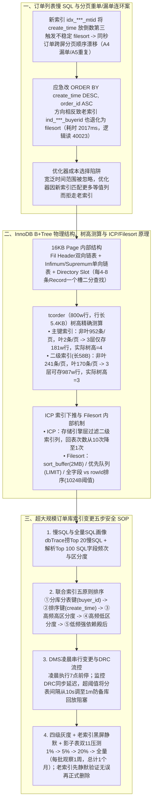

# 交易订单表如何做索引优化

## 1. TL;DR

1. **核心业务与非典型慢 SQL 破案**：淘天核心交易订单表 `tcorder` 含近 **60 个字段**、单分表约 **800w–1,000w 行**、平均行长 **5.4KB**；在治理订单列表分页查询时，发现 `ORDER BY create_time DESC, order_id ASC LIMIT 0, 10`（平均耗时 **2,017ms**，扫描 **8,705 行**，逻辑读 **40,023 页**）因跨索引字段排序触发 `Using filesort`（`Show Profile` 显示 `Creating sort index` 耗时 `0.094799s` 远高于索引排序的 `0.000019s`）；而当初之所以加 `order_id ASC`，是因为新索引 `idx_***_mtid` 将 `create_time` 放在倒数第三位导致 `filesort` 在相同 `create_time` 下跨屏分页顺序不稳定（引发线上订单重复或漏单舆情）。
2. **B+Tree 高度精确测算与底层原理**：基于 16KB InnoDB Page 测算出 `tcorder`（800w 行，行长 `5.4KB`）**主键索引树高为 4**（非叶子单页 `952` 条、叶子单页仅 `2` 条，3 层上限 `181.26w` 行），而**二级索引树高为 3**（非叶子单页 `241` 条、叶子单页 `170` 条，3 层上限 `987.38w` 行）；据此确立铁律：**单表控制在 1,000w 行以内、主键行长 $\le 1.5\text{KB}$、二级索引长度 $\le 50$ 字节，确保 B+Tree 高度不超过 3**。
3. **大规模集群索引变更五步 SOP**：沉淀出“慢 SQL 根因排查（`dbTrace` Top 20） $\to$ 全量 Top 100 SQL 字段频次与区分度分析 $\to$ 五原则排定联合索引顺序（分库分表键第一、排序键第二、高频高区分度居中、高频低区分度殿后） $\to$ DMS 凌晨低峰期串行变更（监控 DRC 同步延迟，间隔 `10s→1m`） $\to$ **1% → 5% → 20% → 全量四级分库灰度 + DBA 黑屏老索引静默（Invisible Index） + 影子表双 11 压测**（耗时约 1 个月）”的零事故标准流程。

## 2. 问题定义与背景

### 2.1 巨型订单表 `tcorder` 的物理特征

- **表规模**：近 **60 个字段**，单个分表 **800w～1,000w 行**，平均行长高达 **5.4KB**，支撑创单、逆向退款、订单列表等核心交易链路。
- **典型慢 SQL 现象**（`sql_id = 71d14de3`）：
  ```sql
  SELECT order_id FROM tcorder
  WHERE is_main = 1 AND buyer_id = 2********5 ...
  ORDER BY create_time DESC, order_id ASC LIMIT 0, 10;
  ```
  - 统计期内慢 SQL 触发 **3,106 次**，平均耗时 **`2,017 ms`**，平均返回 `10` 行却扫描了 **`8,705 行`**，平均逻辑读高达 **`40,023` 页（16KB/页）**，同步物理读 **`5,174` 页**。

### 2.2 连环案复盘：为什么会多出 `order_id ASC`？为什么去掉后仍走错索引？

1. **第一幕（引入 `m_tid` 与新索引 `idx_***_mtid` 引发分页丢单/重单舆情）**：
   - 2024 年做订单列表后置过滤治理时，为在 DB 层前置过滤非手淘展示订单新增了 `m_tid` 字段及新索引 `idx_***_mtid(buyer_id, is_main, ..., create_time, ...)`，因 `create_time` 不是等值查询条件而被放在了**倒数第三位**。
   - **诡异线上舆情**：压测全绿，但放量次日大量用户反馈**订单列表翻页时订单找不到或重复出现**！
   - **根因破案**：走老索引 `ind_***_buyerid` 时，`create_time` 排在第二位，直接按 B+Tree 叶子节点固定顺序返回；而走新索引 `idx_***_mtid` 时，`create_time` 在倒数第三位无法利用索引排序，只能走 **`Using filesort`（优先队列堆排/快排）**。由于 MySQL 的快速排序、优先队列排序与多路归并排序均为**不稳定排序**，当多笔订单 `create_time` 相同时（如 `A1~A6`），首屏分页请求排出的顺序可能是 `A1, A2, A3, A5, A4, A6`（取前 4 条），而次屏分页请求排出的顺序变成了 `A1, A2, A3, A4, A5, A6`（取后 2 条），直接导致 **`A4` 漏单、`A5` 重复**！
2. **第二幕（应急加上 `order_id ASC` 止血，却埋下跨索引 `filesort` 慢 SQL）**：
   - 当时因无二次改索引窗口，应急将排序改为 `ORDER BY create_time DESC, order_id ASC`（利用二级索引叶子节点自带主键 `order_id` 且唯一确定顺序，无需回表）。
   - 但副作用是：**哪怕命中了老索引 `ind_***_buyerid`，由于 `create_time DESC`（逆序）与主键 `order_id ASC`（正序）方向相反，依然无法利用索引顺序，导致所有走老索引的大买家查询也全部退化为扫全量满足条件记录的 `Using filesort`！**（`SHOW PROFILE` 证实单次 `Creating sort index` 耗时 `0.094799s`，而去掉 `order_id ASC` 走索引排序仅需 `0.000019s`，相差近 **5,000 倍**）。
3. **第三幕（去掉非 `m_tid` 请求的 `order_id ASC` 后，优化器为何仍偏爱新索引？）**：
   - 尝试对不带 `m_tid` 的请求去掉 `order_id ASC`，预期它们走老索引 `ind_***_buyerid`；但上线后发现当查询条件带 `create_time > '2025-01-01'`（而该用户所有订单都在 2025 年之后）时，优化器判定该时间范围过滤度极低，转而选择包含更多等值过滤字段的新索引 `idx_***_mtid`（通过 `INFORMATION_SCHEMA.INDEX_STATISTICS` 证实大量流量仍命中新索引），最终促使团队按标准 SOP 重新设计联合索引。

## 3. 知识框架



## 4. 核心内容拆解

### 4.1 InnoDB B+Tree 物理页结构与树高精确测算公式

1. **16KB 物理页（Page）内部构造**：
   - 同层 Page 通过 `Fil Header` 中的双向指针构成**双向链表**；
   - 页内 `User Records` 按索引键升序构成**单向链表**（首尾固定为系统记录 `Infimum` 与 `Supremum`）；
   - 页内维护 **`Directory Slot`（页目录槽）**，每 **4–8 条** Record 设一个 Slot，查找时先在 Slot 数组上做二分查找锁定区间，再在 4–8 条记录内线性遍历。
   - 主键索引根页 `PageNo` 默认为 **`3`**；二级索引根页 `PageNo` 维护在 `INFORMATION_SCHEMA.INNODB_SYS_INDEXES` 中。
2. **`tcorder`（单表 800w 行，平均行长 `5.4KB`）树高测算**：
   - **主键索引（`order_id` BIGINT 8B）**：
     - 非叶子节点单条 Record 大小 $\approx 8\text{B（键）} + 5\text{B（Header）} + 4\text{B（子页号指针）} = 17\text{B}$（原文按 `8+5+4=13` 估算），单页（扣除 200B 页头）可存 $(16 \times 1024 - 200) / 13 \approx \mathbf{952}$ 条；
     - 叶子节点单条 Record 大小 $\approx 5.4\text{KB} + 20\text{B（Header）} \approx 5.5\text{KB}$，单页最多仅能存 **`2` 条**！
     - 因此：高度 2 最多存 $952 \times 2 = 1,904$ 行；**高度 3 最多存 $952 \times 952 \times 2 = \mathbf{1,812,608}$ 行（约 181w 行）**；800w 行的 `tcorder` 主键 B+Tree **高度必然为 4**（上限 17.25 亿行）。
   - **二级索引 `ind_***_buyerid`（索引列长 `58B`）**：
     - 非叶子节点单条 Record $\approx 58 + 5 + 4 = 67\text{B}$，单页可存 $(16384 - 200) / 67 \approx \mathbf{241}$ 条；
     - 叶子节点单条 Record $\approx 67 + 8\text{B（主键）} + 20\text{B（Header）} = 95\text{B}$，单页可存 $(16384 - 200) / 95 \approx \mathbf{170}$ 条；
     - 因此：**高度 3 即可存 $241 \times 241 \times 170 = \mathbf{9,873,770}$ 行（约 987w 行）**，800w 行的二级索引 **高度仅为 3**！
   - **三大架构军规**：为确保 B+Tree 高度 $\le 3$，**单表行数控制在 `1,000w` 以内、主键行长 $\le 1.5\text{KB}$、二级索引总长 $\le 50\text{B}$**。

### 4.2 诊断利器：`EXPLAIN FORMAT=JSON`、`SHOW PROFILE` 与 `optimizer_trace`

1. **`EXPLAIN FORMAT=JSON`**：相比传统表格输出，能额外揭示 `query_cost`、`read_cost`、`eval_cost`、`used_key_parts`（实际生效的索引前缀列）、`materialized_from_subquery` 等关键优化器成本细节（注意 MySQL 8.0+ 推荐使用 `EXPLAIN ANALYZE`）。
2. **`Index Condition Pushdown (ICP，索引下推)`**：
   - 未开启 ICP 时，存储引擎仅用索引定位 `parent_id` 的 10 条记录并执行 **10 次回表**，交由 Server 层过滤 `from_group > 3`；开启 ICP（`Using index condition`）后，存储引擎直接在二级索引上过滤 `from_group > 3`，**仅对命中的 1 条记录执行 1 次回表**。
   - **ICP 不生效的 4 种例外**：① 覆盖索引（`Using index` 无需回表）；② 为满足 `ORDER BY ... LIMIT` 优化器选择顺序扫索引；③ 条件含 `NOW()`/`RAND()` 等非确定性函数；④ 优化器估算候选行极少下推无收益。
3. **`Filesort` 内部三模式与 `optimizer_trace` 验证**：
   - **内存快排 vs 磁盘多路归并**：小于 `sort_buffer_size`（默认 **2MB**，按连接分配）走内存快排，超出则写磁盘临时文件走多路归并；
   - **带 `LIMIT m, n` 的优先队列优化（Priority Queue）**：在 `optimizer_trace` 中可见 `"filesort_priority_queue_optimization": {"limit": 10, "chosen": true, "number_of_tmp_files": 0}`，利用堆维护 Top $m+n$ 条免去全量临时文件（故严禁大偏移量深翻页）；
   - **全字段排序 vs `rowId` 排序**：单行排序字段超过 `max_sort_length`（默认 `1024B`）截断；若所需返回列总长超过 `max_length_for_sort_data`（默认 **`1024B`**），则从 `<sort_key, additional_fields>` 退化为 `<sort_key, rowid>` 排序完再回表。

### 4.3 生产级大规模分库分表索引变更 SOP 与常见慢 SQL 治理

1. **联合索引字段顺序五原则**：
   - **第 1 位**：分库分表路由键（如 `buyer_id` / `seller_id`，区分度最高）；
   - **第 2 位**：核心排序字段（如 `create_time`），消除 `filesort` 并保证分页顺序稳定；
   - **中间位**：高频且高区分度的等值查询字段；
   - **末尾位**：高频但低区分度的状态字段（充分利用 ICP 下推减少回表）；
   - **取舍**：低频字段（如 `gmt_modified`）优先引导业务改写，确需保留则放最末。
2. **线上变更安全护栏（DRC 流控 + 凌晨窗口 + 四级灰度 + 老索引静默）**：
   - **DRC 主备同步延迟保护**：密切监控 DRC 延迟，若延迟升高立即让 DBA 将分表 DDL 执行间隔从 **`10s` 调大至 `1m`**，防止主库故障切换时备库因回放未同步完的 binlog 而长时间不可写；
   - **执行时间窗**：必须在凌晨低峰期执行、**早上 7:00 前停止**；线上表与**压测影子表**必须同步建单；
   - **四级渐进灰度（耗时约 1 个月）**：按 **`1% → 5% → 20% → 全量`** 分四批按分库/实例串行推进，每批观察 **1 周**；
   - **老索引黑屏静默（Invisible Index）**：每批新索引建好后**绝不立即 Drop 老索引**，而是由 DBA 黑屏将老索引设为**静默（正常维护更新但对优化器不可见）**，一旦新索引劣化可秒级切回；待全量完成并经双 11 压测和大促检验后才正式删除老索引。
3. **两道高频慢 SQL 奇招**：
   - **列表倒序但查询数据落在 B+Tree 左侧**：例如查最近 1 周订单却写了 `create_time ASC`，导致从右向左扫遍整棵树；应顺应数据位置改用 `create_time DESC`。
   - **大买家 `COUNT(*)` 慢查询改造为 `COUNT LIMIT` 子查询**：当业务只需判断“近 1 个月退款是否超过 100 笔以拦截活动资格”时，严禁直接 `COUNT(*)` 扫全表，应改为 `SELECT COUNT(*) FROM (SELECT 1 FROM ... LIMIT 101) t`，扫满 101 条即刻中断返回。

## 5. 数据速查表

| 指标 / 参数 | 原文数值 | 语境 / 条件 |
| --- | --- | --- |
| `tcorder` 单分表规模与行长 | **近 60 个字段 / 单表 800w–1,000w 行 / 平均行长 `5.4 KB`** | 淘天核心在线交易订单表 |
| 典型分页慢 SQL（`71d14de3`）指标 | **3,106 次 / 平均耗时 `2,017 ms` / 扫描 `8,705 行` / 逻辑读 `40,023 页`** | 同步物理读 `5,174 页`，仅返回 `10 行` |
| `SHOW PROFILE` 索引排序 vs 堆排耗时 | **索引排序 `0.000019 s` vs `Creating sort index` `0.094799 s`** | 相差约 5,000 倍 |
| `tcorder` 主键 B+Tree 容量与树高 | **非叶 `952 条/页`、叶 `2 条/页` $\to$ 3 层上限 `1,812,608 行`（800w 行树高为 `4`）** | InnoDB Page 大小 `16 KB`，主键 `BIGINT` 8B |
| `tcorder` 二级索引 B+Tree 容量与树高 | **非叶 `241 条/页`、叶 `170 条/页` $\to$ 3 层上限 `9,873,770 行`（800w 行树高为 `3`）** | 二级索引长 `58 B`，单叶记录 `95 B` |
| 控制树高 $\le 3$ 的三大设计阈值 | **单表 $\le 1,000\text{w}$ 行 / 主键行长 $\le 1.5\text{KB}$ / 二级索引长 $\le 50\text{B}$** | 保障点查与列表查询磁盘 IO 次数稳定 |
| MySQL 排序核心内存与长度阈值 | **`sort_buffer_size = 2MB` / `max_sort_length = 1024B` / `max_length_for_sort_data = 1024B`** | `optimizer_trace_max_mem_size = 1638400` |
| 索引变更分表间隔与四级灰度比例 | **分表间隔 `10s → 1m`（防 DRC 延迟） / 灰度 `1% → 5% → 20% → 全量`** | 凌晨执行早 7 点前停，每批观察 1 周，总周期约 1 个月 |

## 6. 踩坑与教训 / 可迁移的设计原则

| 错误做法 | 失败表现或原因 | 原文应对（可迁移的设计原则） |
| --- | --- | --- |
| **在联合索引中把高频分页排序字段 `create_time` 放在倒数第三位** | 触发 `Using filesort`；而快排/优先队列堆排是**不稳定排序**，导致同秒创建的订单在跨屏分页时顺序漂移，引发线上漏单与重复订单舆情 | **联合索引排序原则**：第 1 位放分库分表键（`buyer_id`），**第 2 位紧跟核心排序键（`create_time`）**，或确保排序包含唯一主键且方向一致 |
| **在二级索引上用 `ORDER BY create_time DESC, order_id ASC` 一正一反排序** | 二级索引叶子节点在相同 `create_time` 下按主键升序排列，一逆一正导致无法利用索引顺序，退化为扫全量记录的 `filesort` | **保持多字段排序方向与索引物理顺序完全一致**（全正序或全逆序），利用二级索引直接消除 `filesort` |
| **在 WHERE 条件中对索引列套用 `IFNULL(create_time, 0)` 等函数** | 优化器无法在编译期确定函数值，导致索引失效退化为全表或全索引扫描 | **改写为裸列比较（如 `create_time > SUBDATE(NOW(), INTERVAL 51 DAY)`）**，将函数移至比较符右侧 |
| **用 `SELECT COUNT(*)` 判断用户近 1 个月退款是否超过 100 笔** | 大卖家/高频用户命中的记录数极大，捞出全量记录产生巨额逻辑读 | **改用 `COUNT LIMIT` 子查询（`LIMIT 101`）**：MySQL 扫满 101 条即刻短路中断返回 |
| **线上大表加完新索引后立刻 `DROP` 老索引，或漏改压测影子表** | 一旦新索引在特定慢 SQL 下劣化将无法秒级回滚；影子表漏加索引会导致双 11 全链路压测失真 | **老索引先由 DBA 黑屏设为“静默（Invisible）”观察 1 个月 + 线上表与影子表同步建单** |

## 7. 记忆锚点

1. **联合索引五顺位口诀**：“**一放分片键（`buyer_id`），二放排序列（`create_time`），三放高频高区分，四放高频低区分（走 ICP），低频强依赖垫底**”。
2. **树高 $\le 3$ 三条铁律**：“**单表不过千万行，行长不过 1.5K，二级索引不过 50 字节**”。

## 8. 复习卡片

1. 为什么新索引 `idx_***_mtid` 把 `create_time` 放在倒数第三位后，会导致线上订单列表翻页出现“订单丢失或重复”？::因为 `create_time` 不紧接在等值条件后，导致 `ORDER BY create_time DESC` 无法利用索引有序性而走 `Using filesort`；MySQL 的快排、优先队列堆排和多路归并都是**不稳定排序**，当多笔订单 `create_time` 相同时，首屏分页与次屏分页请求排出的先后顺序可能不一致，从而造成跨页边界上的订单遗漏或重复。
2. 为什么应急改成 `ORDER BY create_time DESC, order_id ASC` 虽然解决了分页丢单问题，却引发了平均耗时 2,017ms 的严重慢 SQL？::因为二级索引叶子节点虽包含主键 `order_id`，但 `create_time DESC`（降序）与 `order_id ASC`（升序）方向相反，无法直接顺序或逆序扫描二级索引叶子节点，迫使走老索引的大买家查询也必须先捞出全部满足条件的数千行记录再做 `filesort`。
3. 同样是存储 800 万行数据的 `tcorder` 表（平均行长 5.4KB），为什么主键索引 B+Tree 的高度是 4，而二级索引（长 58B）的高度只有 3？::因为 InnoDB 物理页固定为 16KB：主键索引叶子节点存储完整行数据（约 5.5KB），单页最多只能放 2 条记录（非叶节点单页 952 条），3 层最多存 $952^2 \times 2 \approx 181\text{w}$ 行，故 800w 行需 4 层；而二级索引叶子节点只存索引列+主键值（约 95B），单页可放 170 条（非叶单页 241 条），3 层即可存 $241^2 \times 170 \approx 987\text{w}$ 行。
4. 什么是索引下推（ICP，Index Condition Pushdown）？在什么情况下即使查询列在二级索引中也不会触发 ICP？::ICP 指在存储引擎层扫描二级索引时，直接利用索引中已有的后续列过滤记录，从而大幅减少回表读取完整行的次数（如从回表 10 次降至 1 次）。以下 4 种情况不触发 ICP：① 索引已覆盖全部返回列（`Using index` 无需回表）；② 为满足 `ORDER BY/LIMIT` 选择顺序扫或 filesort；③ 条件含 `NOW()`/`RAND()` 等非确定性函数；④ 优化器评估候选行极少下推收益过低。
5. MySQL 的 `filesort` 在什么条件下会启用“优先队列排序（Priority Queue）”？什么条件下会从“全字段排序”切换为“`rowId` 排序”？::当 SQL 带有 `ORDER BY ... LIMIT m, n` 且 $m+n$ 条数据的排序键大小不超过 `sort_buffer_size`（默认 2MB）时，会启用基于堆的优先队列排序以避免写磁盘临时文件；当单行待返回字段总长度超过 `max_length_for_sort_data`（默认 1024 字节）时，会从携带全字段的 `<sort_key, additional_fields>` 切换为仅携带主键的 `<sort_key, rowid>` 排序完再回表。
6. 在对千万级核心订单表执行线上索引变更时，如何防止主备延迟故障与新索引劣化风险？::① 必须在凌晨低峰期执行并在早 7 点前停止；② 实时监控 DRC 同步延迟，延迟上涨时将分表变更间隔从 10s 调大至 1m 以免主备切换时备库回放 binlog 阻塞写入；③ 按 `1% -> 5% -> 20% -> 全量` 分四批灰度（每批观察 1 周）；④ 老索引先由 DBA 黑屏设为“静默（Invisible）”而非直接删除，待双 11 压测（含影子表同步变更）与大促验证通过后再正式删除。

## 9. 知识关联

- **本库主题关联**：
  - [分布式计算与数据管道](../../20_topics/分布式计算与数据管道.md)：深入剖析 InnoDB 16KB 数据页物理结构、B+Tree 树高测算公式、ICP 索引下推与 Filesort 三种排序机制。
  - [异常监控与稳定性](../../20_topics/异常监控与稳定性.md)：沉淀千万级分表索引变更 SOP（DRC 同步流控、凌晨窗口、1%–100% 四级灰度、老索引黑屏静默与影子表对齐）。
  - [解决问题](../../20_topics/解决问题.md)：利用 `EXPLAIN FORMAT=JSON`、`SHOW PROFILE`、`optimizer_trace` 与 `INDEX_STATISTICS` 侦破跨屏分页丢单与跨索引 `filesort` 慢 SQL 连环案。
- **候选双链**：`[[MySQL索引优化]]`、`[[B+Tree树高测算]]`、`[[Filesort不稳定排序]]`、`[[索引下推ICP]]`、`[[数据库灰度变更SOP]]`

## 10. 原文参考资料

- **原文标题**：《交易订单表如何做索引优化》
- **发布渠道与日期**：微信公众号「大淘宝技术」，2025-11-19
- **作者与团队**：业空（淘天集团-营销&交易技术团队）
- **官方文档与技术参考**：
  - MySQL 5.7 `SHOW PROFILE`: `https://dev.mysql.com/doc/refman/5.7/en/show-profile.html`
  - MySQL 5.7 `ORDER BY Optimization`: `https://dev.mysql.com/doc/refman/5.7/en/order-by-optimization.html`
  - MySQL 5.7 `LIMIT Query Optimization`: `https://dev.mysql.com/doc/refman/5.7/en/limit-optimization.html`
  - 淘宝数据库内核月报《MySQL · 引擎特性 · 排序实现》：`http://mysql.taobao.org/monthly/2020/03/09/`

> [!note]- 校对报告
> - **页码溯源汇总**：
>   - `tcorder` 表规模（近 60 字段、单表近千万行、平均行长 `5.4KB`）与非典型慢 SQL（`71d14de3`，平均 `2017ms`、逻辑读 `40023`、`Creating sort index` `0.094799s` vs `0.000019s`）：`p.1–3`
>   - `m_tid` 新索引 `idx_***_mtid` 引发分页丢单/重单舆情（`A1~A6` 不稳定排序）、应急加 `order_id ASC` 与优化器索引选择分析：`p.3–7`
>   - B+Tree 16KB Page 内部结构（`Infimum`/`Supremum`、`Directory Slot` 4–8 条间隔、根页 `PageNo=3`）、`tcorder` 主键与二级索引树高测算表及 B-Tree vs B+Tree 对比：`p.7–12`
>   - `EXPLAIN FORMAT=JSON` 详解、`SHOW PROFILE` / `INFORMATION_SCHEMA.PROFILING` 状态字典、ICP 索引下推与 4 类例外、Filesort（`sort_buffer_size=2M`、优先队列、`1024B` 阈值、`optimizer_trace`）：`p.13–29`
>   - 索引变更五步 SOP（`dbTrace` Top 20/Top 100、五原则排序、DRC 延迟 `10s→1m`、凌晨至早 7 点窗口、`1%→5%→20%→全量` 灰度、老索引黑屏静默、影子表压测）与常见慢 SQL 治理表（含 `COUNT LIMIT 101`）：`p.29–35`
> - **关键数值与原文勘误核查**：
>   - **原文算术笔误标注**：① `p.8` 写“3 层 8 阶的 B+Tree 第三层的节点数等于 `8*8*8=252`”（算术实为 `512`，或 $8 \times 8 = 64$）；② `p.10` 写主键非叶子节点 Record 大小 `8 + 5(Header) + 4(指针) = 13`（$8+5+4$ 实为 `17`，但后续除法 `(16*1024-200)/13 = 1244.9` 原文又取了 `952`，恰接近 $(16384-200)/17 = 952$！说明作者实际是用 `17` 算出的 `952`，仅文字误写为 `=13`）；③ `p.11` 二级索引表高度 2 的最大记录数写 `241*170=1904`（系复制了上表主键 `952*2=1904` 未改，实为 $241 \times 170 = 40,970$，高度 3 则正确算为 `241*241*170=9873770`）。笔记严格保留原文表格数值并在此处注明推导关系。
> - **图像与版面质量说明**：
>   - `p.1, 3–10, 13–15, 18–19, 28–29` 含 `EXPLAIN` 截图、`SHOW PROFILE` 截图、B+Tree 物理页结构图与 Filesort 流程图（位于 PDF 图像层），`p.37` 含底部推广小卡片；全部核心 SQL、JSON 执行计划与 SOP 均在文本层完整保留。
