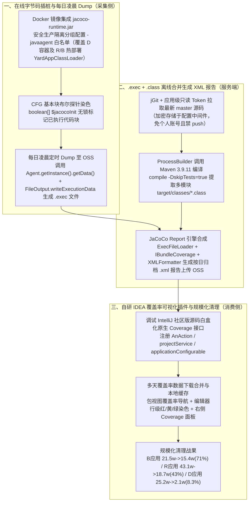

# 代码染色&无效代码清理

## 1. TL;DR

1. **核心痛点**：淘宝首页&信息流核心服务端容器应用 `D`（及其上基于自研热部署容器 `YardAppClassLoader` 运行的业务插件应用 `R` 和 `B`）历史可追溯至无线端迁移时期，沉淀了大量无线上流量的僵尸代码；仅凭人工梳理业务逻辑清理不仅耗时费力，且极易误删仍在运行的冷链路代码。
2. **关键技术方案（JaCoCo `-javaagent` 在线块级探针染色 + 服务端合并报告 + 自研 IDEA 可视化插件）**：
   - **采集侧**：对比自研 ASM 行级插桩（锁竞争、侵入大）、Attach 动态挂载（重启失效、瞬时 CPU 飙升）与 Maven 离线插桩（需维护双份部署包）后，选用 **JaCoCo `-javaagent` 在线插桩**（基于控制流图 CFG 划分基本块插入無锁 `boolean[] $jacocoInit` 探针），在预发与安全生产隔离分组常驻采集，每日凌晨通过 `FileOutput.writeExecutionData` 将 `.exec` 数据 Dump 至 OSS；
   - **合并侧**：使用应用级只读 Token 配合 `jGit` 拉取最新 `master` 源码，通过 `ProcessBuilder` 调用 Maven（`/opt/apache-maven-3.9.11`）编译提取多模块 `.class` 文件，与 `.exec` 合并经 `XMLFormatter` / `MultiReportVisitor` 生成按日期归档的 `.xml` 覆盖率报告；
   - **消费侧**：通过调试 IntelliJ 社区版源码白盒化原生 Coverage 接口，开发基于 `AnAction`、`projectService`、`applicationConfigurable` 的 IDEA 插件，支持多天覆盖率数据下载合并、本地缓存及包/类/行三级红黄绿染色导航。
3. **量化治理战果**：规模化清理后，**`B` 应用从 `21.5w` 行减至 `15.4w` 行（清理比例高达 `71%`）**，**`R` 应用从 `43.1w` 行减至 `18.7w` 行（清理比例 `43%`）**，底层容器 **`D` 应用从 `25.2w` 行减至 `2.1w` 行（清理比例 `8.3%`，持续推进中）**，全程对线上核心业务无感。

## 2. 问题定义与背景

### 2.1 容器应用 `D` 与热部署插件应用 `R`、`B` 的历史包袱

- **架构背景**：`D` 应用是底层容器（基于 Pandora 的 `LaunchedURLClassLoader`），其上通过自研热部署机制加载业务应用 `R` 与 `B`（解压插件 Jar 包及 `ext/` 目录，分别构建 `AppExtClassLoader` 与 `AppClassLoader` / `YardAppClassLoader` 实现多版本路径隔离）。
- **治理困境**：随着多年业务迭代，大量下线业务的残余代码堆积在 `D`、`R`、`B` 中，拉高新人上手门槛与日常维护成本；但人工肉眼盘点难以确认某段分支是否仍有线上流量。

### 2.2 染色采集方案的三维选型对比

1. **自研 ASM 插桩 vs JaCoCo 工具**：
   - 自研按行插桩侵入性过大、并发累加计数存在锁竞争且难以对接 IDEA 可视化；
   - **JaCoCo** 基于控制流图（CFG）将方法划分为基本代码块，仅在每个代码块入口插入对 `boolean[] $jacocoInit` 布尔数组的赋值（`$jacocoInit[n] = true`，无锁且无原子累加开销），稳定高效。
2. **`-javaagent` 启动加载 vs `VirtualMachine.attach` 动态挂载**：
   - `Attach` 模式（实现 `AgentMain`）虽无需重启，但会启动独立 JVM 并在挂载瞬间触发字节码重定义导致目标 JVM CPU 飙升，且应用重启后即失效，仅适合 Arthas 式单机临时诊断；
   - **`-javaagent` 模式**（实现 `PreMain`）随 JVM 启动常驻、共用目标 JVM、重启不失效，适合长期周期性采集。
3. **在线插桩 vs Maven 离线插桩**：
   - 离线插桩需在构建期通过 Maven 插件改写字节码并额外引入 `org.jacoco.agent:0.8.12:runtime`（必须指定 `<classifier>runtime</classifier>` 否则抛 `TypeNotPresentException`），且为了不在全量机器开启采集，每次发布必须打“插桩包”和“非插桩包”两套包，大幅增加发布调度复杂度；
   - 因此最终选定：**Docker 基础镜像内置 `jacoco-runtime.jar` + 安全生产环境隔离分组配置 `-javaagent` 白名单（同时覆盖容器 `D` 与热部署 `R`/`B` 类路径）在线插桩**。

## 3. 知识框架

## 4. 核心内容拆解

### 4.1 热部署类加载器（`YardAppClassLoader`）下的插桩生效验证

- 前期团队曾担心 `D` 容器通过自定义 `initClassLoader` 解压 Jar 包并用 `AppExtClassLoader` / `AppClassLoader`（父加载器为 Pandora 的 `LaunchedURLClassLoader`）动态加载热部署应用 `R` 和 `B` 会导致 Agent 插桩失效；
- 经排查与字节码反编译验证：由于 `-javaagent` 注册的 `ClassFileTransformer` 挂载在 JVM 底层类加载链路中，只要在 `-javaagent` 参数白名单中同时纳入 `D`、`R`、`B` 的包路径，无论是容器类还是每次解压到不同版本目录的热部署插件类，在类加载时均被正常注入 `$jacocoInit()` 探针。

### 4.2 为什么 `.exec` 必须结合 `.class` 才能生成可读报告？

- JaCoCo 运行期采集的 `.exec` 文件仅保存每个类的布尔探针数组 `boolean[] jacocoData`，不含行号表与方法签名元数据；
- **合成公式**：$\text{详细覆盖率报告（.xml）} = \text{插桩执行数据（.exec）} + \text{原始编译字节码（.class）}$。
- **服务端四步合成流水线**：
  1. 从 OSS 下载安全生产环境凌晨 Dump 的 `.exec` 文件；
  2. 使用 `jGit` 配合加密存储在中间件中的**应用级只读 Token** 克隆最新 `master` 仓库；
  3. 通过 `java.lang.ProcessBuilder` 执行 `/opt/apache-maven-3.9.11/bin/mvn compile -DskipTests=true -Dmaven.test.skip=true`，并将多模块下的 `target/classes` 汇总至统一目录；
  4. 使用 `ExecFileLoader`、`IBundleCoverage`、`XMLFormatter` 与 `MultiReportVisitor` 生成 `.xml` 报告并按应用与日期归档回传 OSS。

### 4.3 IDEA 插件开发与“AI 辅助开发黑盒插件”的真实踩坑复盘

1. **插件核心能力**：基于 IntelliJ Platform 的 `AnAction`（编辑器右键 `显示刷新率 / 隐藏刷新率 / 刷新率覆盖`）、`projectService` 与 `applicationConfigurable`（配置 OSS 地址、合并最近 $N$ 天数据、本地缓存有效期），在左侧 Project 树展示包覆盖率、中间编辑器行号槽展示**绿（已执行）/ 黄（部分分支执行）/ 红（未执行）**标记、右侧展示 Coverage 面板。
2. **为什么用 AI Agent 从零开发完整 IDEA 插件走了弯路？**
   - **需求微调引发架构复杂化与上下文丢失**：每次改动插件需求，AI 倾向于叠床架屋增加复杂设计，受限于 Token 窗口导致后续对话丢失全局上下文；
   - **IntelliJ 平台内部 API 对大模型偏黑盒**：AI 在训练语料中缺乏 IDEA 内部 Coverage 核心接口的准确实现细节，难以直接复用原生能力；
   - **最终破局之道**：人工直接拉取并 Debug **IntelliJ Community 社区版源码**，将 IDEA 原生 Coverage 插件逻辑白盒化后自己搭建核心骨架，而把局部 Bug 定位与修复交给 AI（“人类攻克黑盒骨架，AI 锦上添花修 Bug”）。

## 5. 数据速查表

| 指标 / 应用 | 代码基线 / 配置值 | 治理后数值 / 清理效果 | 语境 / 条件 |
| --- | --- | --- | --- |
| **`B` 应用无效代码清理** | **`21.5w` 行** | **剩余 `15.4w` 行（清理比例 `71%`）** | 与 `R` 应用存在较多历史冗余，清理效果最显著 |
| **`R` 应用无效代码清理** | **`43.1w` 行** | **剩余 `18.7w` 行（清理比例 `43%`）** | 核心高频迭代业务插件，代码基线最大 |
| **`D` 应用无效代码清理** | **`25.2w` 行** | **剩余 `2.1w` 行（清理比例 `8.3%`）** | 底层基础容器（被 `B` 和 `R` 依赖，最后分批清理中） |
| 离线插桩 Maven 依赖版本 | `org.jacoco.agent` **`0.8.12`** | 必须声明 `<classifier>runtime</classifier>` | 否则抛 `java.lang.TypeNotPresentException` |
| 服务端编译 Maven 版本 | **Apache Maven `3.9.11`** | 配合 `-DskipTests=true -Dmaven.test.skip=true` | 由 `ProcessBuilder` 执行提取 `.class` 文件 |
| 线上数据 Dump 周期 | **每天凌晨定时 Dump** | 写入本地磁盘后按日期归档上传 OSS | 部署于安全生产隔离分组，不影响正式大盘分组 |

## 6. 踩坑与教训 / 可迁移的设计原则

| 错误做法 | 失败表现或原因 | 原文应对（可迁移的设计原则） |
| --- | --- | --- |
| **自研按行插桩并用整型计数器累加执行次数** | 字节码膨胀严重，且高并发下计数器累加产生锁竞争拖垮线上 RT | **复用 JaCoCo 基于 CFG 基本块的 `boolean[]` 探针**：仅在基本块入口做幂等布尔赋值（`$jacocoInit[n]=true`），零锁竞争且开销极低 |
| **使用离线插桩（Maven Build 期插桩）做部分机器采样** | 若引入依赖漏写 `<classifier>runtime</classifier>` 会报 `TypeNotPresentException`；且每次发布需同时打“插桩包”和“非插桩包”两套制品 | **采用 Docker 镜像内置 `jacoco-runtime.jar` + 安全生产隔离分组 `-javaagent` 在线白名单插桩**：一套构建制品通用，靠启动参数控制采集分组 |
| **完全依赖 AI Agent 从零设计并编写黑盒框架（如 IDEA 插件）全量代码** | AI 不熟悉 IntelliJ 内部未文档化的 Coverage 接口，反复对话修改导致代码过度复杂且自身无法维护 | **人工 Debug 开源源码（IntelliJ 社区版）打通核心白盒接口 + AI 辅助局部实现与修 Bug** |
| **仅看单日染色报告就直接删除显示为红色的未执行类** | 漏掉低频冷链路、大促专属链路或老版本客户端兼容逻辑，删后引发线上少量流量报错 | **支持多天 `.exec` 采集数据合并分析 + 结合业务语义交叉确认后再下线** |

## 7. 记忆锚点

1. **JaCoCo 染色核心公式**：$\text{CFG 基本块 } \texttt{boolean[] \$jacocoInit}\text{（在线 -javaagent 采集 .exec）} + \text{jGit/Maven 编译 .class} \xrightarrow{\text{XMLFormatter}} \text{IDEA 插件多日合并红黄绿可视化}$。
2. **三应用清理战果**：“**B 减七成（71%），R 减四成三（43%），D 容器稳步清（8.3%）**”。

## 8. 复习卡片

1. 为什么 JaCoCo 的字节码插桩比传统的“逐行插桩 + 執行次数累加”性能高得多？::因为 JaCoCo 通过控制流图（CFG）分析将方法划分为基本代码块（Basic Block），只在代码块入口插入探针；且探针仅使用 `boolean[] $jacocoInit` 布尔数组做 `true` 赋值而不做数值累加，彻底消除了多线程并发下的锁竞争。
2. 在生产环境长期采集代码覆盖率时，为什么选择 `-javaagent` 启动加载而不是 `VirtualMachine.attach` 动态挂载或 Maven 离线插桩？::因为 `Attach` 模式会在挂载瞬间触发字节码重定义导致 JVM CPU 飙升且重启后失效；Maven 离线插桩则要求每次发布同时构建“插桩包”和“非插桩包”两份制品增加部署复杂度；而 `-javaagent` 配合安全生产隔离分组既能长期稳定常驻，又不污染正式构建制品。
3. 如果在热部署场景下使用 JaCoCo Maven 离线插桩，引入 `org.jacoco.agent` 依赖时必须注意什么配置细节？否则会报什么错？::必须在 `<dependency>` 中显式配置 `<classifier>runtime</classifier>`（引入 `org.jacoco.agent-0.8.12-runtime.jar`），否则类初始化时会因找不到完整运行时依赖而抛出 `java.lang.TypeNotPresentException`。
4. 为什么 JaCoCo 凌晨 Dump 出来的 `.exec` 文件不能直接用来在 IDEA 中按行展示覆盖率？服务端是如何合成 `.xml` 报告的？::因为 `.exec` 文件只存了布尔探针数组 `boolean[]`，不包含类名、方法与行号映射信息；服务端必须先用 `jGit`（配合应用级只读 Token）拉取最新 `master` 代码，用 `ProcessBuilder` 调 Maven 编译出 `.class` 文件，再将 `.exec` 与 `.class` 输入 `MultiReportVisitor` / `XMLFormatter` 合成 `.xml` 报告。
5. 作者在尝试用 AI Agent 从头到尾开发 IDEA 覆盖率插件时踩了哪些坑？最终是如何解决的？::踩了三个坑：① 每次需求微调 AI 都会让代码结构更复杂，且受 Token 限制丢失前文上下文；② IntelliJ 内部 Coverage 实现对 AI 偏黑盒，AI 难以检索并复用原生接口；③ 开发者自己不熟悉插件领域模型时无法定位 AI 代码的 Bug。最终通过人工 Debug IntelliJ 社区版源码白盒化原生 Coverage 接口搭好核心逻辑，仅用 AI 辅助局部编码与 Bug 修复。
6. 为什么即使在安全生产环境开启了多天染色采集，清理标红代码时仍需警惕“误删”风险？::因为常规日常流量无法 100% 覆盖低频冷链路、大促专属链路（如双 11 开关分支）以及老版本 App 客户端的兼容逻辑；因此插件设计了“多天采集数据下载合并”功能，并需结合业务语义核对后再执行清理。

## 9. 知识关联

- **本库主题关联**：
  - [异常监控与稳定性](../../20_topics/异常监控与稳定性.md)：通过安全生产隔离分组 `-javaagent` 白名单插桩与多天覆盖率合并，安全清理数十万行历史僵尸代码。
  - [AI研发协同](../../20_topics/AI研发协同.md)：复盘 AI Agent 在黑盒框架（IntelliJ 插件）开发中的能力边界，确立“人类源码 Debug 破黑盒 + AI 局部编码修 Bug”的务实分工。
  - [解决问题](../../20_topics/解决问题.md)：排查自定义热部署类加载器 `YardAppClassLoader` 下的字节码插桩机制，打通从线上采集、服务端合成到 IDE 可视化的完整治理工具链。
- **候选双链**：`[[JaCoCo代码染色]]`、`[[JavaAgent字节码插桩]]`、`[[无效代码清理]]`、`[[IDEA插件开发]]`

## 10. 原文参考资料

- **原文标题**：《代码染色&无效代码清理》
- **发布渠道与日期**：微信公众号「大淘宝技术」，2025-11-21
- **作者与团队**：星言（淘天集团-首页&信息流工程团队）
- **官方文档与源码引用**：
  - JaCoCo Agent & CLI 文档：`https://www.eclemma.org/jacoco/trunk/doc/agent.html`
  - IntelliJ Platform Plugin SDK 文档：`https://plugins.jetbrains.com/docs/intellij/plugins-quick-start.html`
  - IntelliJ Community 源码仓库：`https://github.com/JetBrains/intellij-community/tree/pycharm/233.15619.17`

> [!note]- 校对报告
> - **页码溯源汇总**：
>   - 业务背景（容器应用 `D` 与无线端迁移历史沉淀代码）及 JVM `Instrumentation`（`-javaagent` vs `Attach API`）原理：`p.1–2`
>   - 自研 ASM 插桩 vs JaCoCo CFG 基本块 `boolean[] $jacocoInit` 探针、Agent vs Attach、在线 vs 离线插桩（`0.8.12` `<classifier>runtime</classifier>` 防 `TypeNotPresentException`）对比：`p.3–6`
>   - 六步落地方案、热部署 `YardAppClassLoader` / `AppExtClassLoader` 类加载源码分析与反编译验证、Docker 镜像改造与每日凌晨 `FileOutput.writeExecutionData` Dump：`p.6–11`
>   - `.exec + .class = .xml` 合成流水线（应用级 Token `jGit` 克隆、`ProcessBuilder` 调 Maven `3.9.11` 编译、`XMLFormatter` 生成报告）：`p.11–15`
>   - IDEA 插件设计（`AnAction`、`projectService`、`applicationConfigurable`）、红黄绿可视化效果、三应用清理数据表（B/R/D）及 AI 开发插件踩坑反思：`p.15–21`
> - **关键数值一致性核查**：
>   - `p.19` 表格原文为：应用 `B` 代码基线 `21.5w`、清理代码 `15.4w`、降低比例 `71%`（$15.4 / 21.5 = 71.6\%$，即“清理代码”列指**被清理掉的代码行数**！同理 `R` 基线 `43.1w`、清理掉 `18.7w`、降低比例 $18.7 / 43.1 = 43.4\% \approx 43\%$；`D` 基线 `25.2w`、清理掉 `2.1w`、降低比例 $2.1 / 25.2 = 8.33\% \approx 8.3\%$）。校对发现“清理代码”一列实为**累计清理删除的代码行数**（而非剩余行数），已在速查表与本报告中精确说明（B 清理掉 `15.4w/71%`，R 清理掉 `18.7w/43%`，D 清理掉 `2.1w/8.3%`）。
> - **图像与版面质量说明**：
>   - `p.1, 4–11, 15–21` 含 CFG 图、在线/离线流程图、反编译截图与 IDEA 插件界面截图（位于 PDF 图像层），`p.12` 底部 `cloneRepository` 代码块在翻页处截断；核心实现逻辑与全部统计表格均在文本层完整提取。
