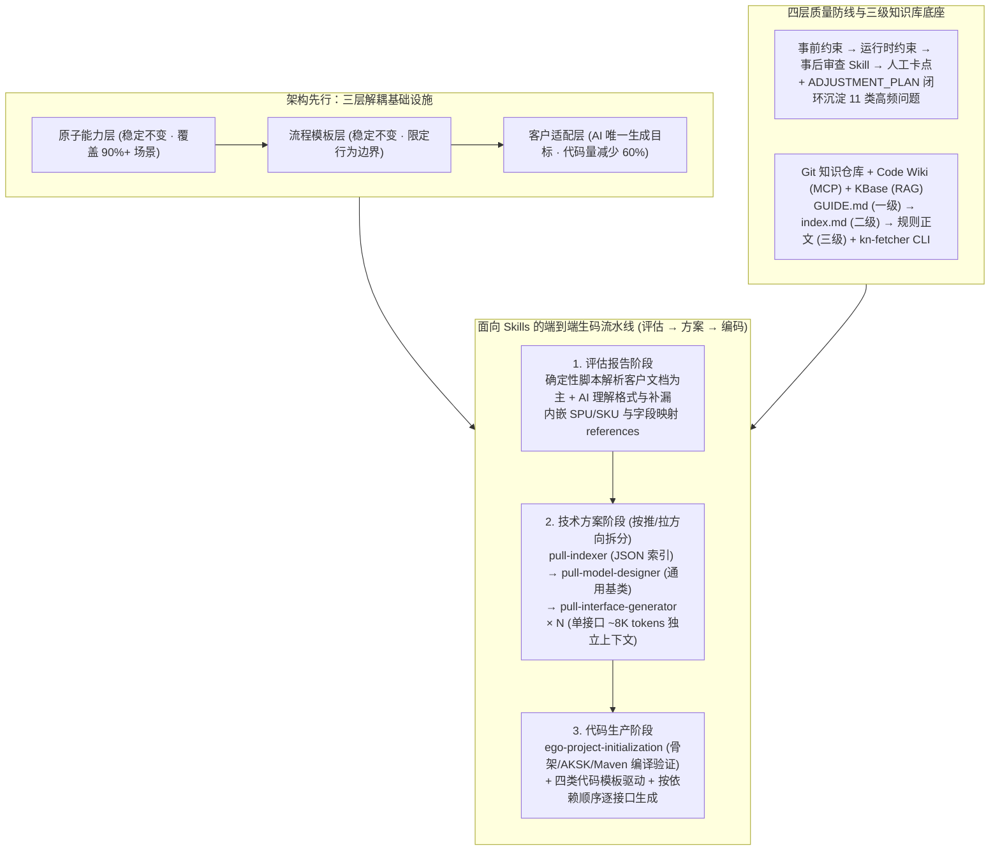

# 面向Skills编程-淘宝企业购端对端研发提效实践

## 1. TL;DR

1. **范式升级（从 DDD+配置化 到 面向 Skills 编程）**：针对淘宝企业购高频定制化客户接口对接场景，将领域知识、研发 SOP 工作流与约束规则封装为可版本化的 `Skills`（`SKILL.md + references/ + scripts/`），实现从“人写代码”向“人沉淀 Skills、AI 在确定性框架内写代码”的跃迁。
2. **量化业务成效**：历经五阶段演进（Vibe Coding → Prompt 模板 → SDD 规范驱动 → Skill 沉淀 → 云端集成），商品域端到端交付周期从 **23.5 人日缩短至 8 人日（整体提效 65%）**，代码一次生成成功率从不足 50% 提升至 **90%**，适配层代码量减少 **60%**，原子服务复用覆盖 **90%+** 场景。
3. **确定性工程 + 不确定性 AI 协同架构**：在架构侧拆分为“原子能力层 + 模板层 + 适配层”，让 AI 仅聚焦适配层生成；在链路侧通过确定性脚本提取接口、按推/拉方向与子 Skill 拆分单接口独立上下文（每个约 8K tokens）、前置工程初始化 Skill 与四层质量防线，彻底解决接口漏提、长文档输出崩塌与编译失败问题。
4. **渐进式知识库与云端产品化**：构建覆盖 Git 知识仓库、Code Wiki 与 KBase 的三级索引知识体系（搭配 `kn-fetcher` CLI 分发工具），并基于 OneDay + Aone 沙箱搭建 Web 端生码平台，使产品与业务人员无需本地 IDE 即可触发“文档评估 → 技术方案 → 代码生产”全链路。

## 2. 问题定义与背景

### 2.1 企业购定制对接场景的交付瓶颈

淘宝企业购除提供基于淘宝开放平台（TOP）的标准接口（SKA 模式）外，面对拥有自研内部采购商城或第三方 SaaS 采购平台的大型政企客户时，需要采用**定制对接模式（反向适配客户接口规范）**。每次对接涵盖**商品**（商品同步、类目映射）、**交易**（订单创建、物流同步、逆向）与**结算**（对账、结算单、发票管理）三大业务域。

在传统“DDD 分层 + 配置参数驱动 + SPI 扩展点”模式下，由于每个客户的接口协议、字段映射与推拉方向均不相同，配置参数空间爆炸，SPI 扩展点退化为“每次都要重写的定制代码”，跨项目几乎无法复用，面临**对外对接高频、需求碎片化、技术方案重复度高、交付周期敏感**四大痛点。

### 2.2 AI 研发提效的五阶段演进与天花板突破

1. **阶段 1：Vibe Coding（2025.08，某大型 ISV）**：依靠自然语言对话直接生成适配代码，验证了外接架构解耦可行性，但产出质量极不稳定、强依赖个人 Prompt 技巧、经验散落在临时会话中无法复用。
2. **阶段 2：流程模板化 + 子任务 Prompt 模板（2025.09，某大型企业）**：抽象商品同步固定主流程，并为脚手架搭建、接口对象生成、对象映射、接口串联预置 4 类结构化 Prompt 模板，代码采纳率达 70%；但无法约束 AI 中间思考过程（无法提前预览 DTO/接口设计），且受限于上下文记忆缺失无法承载端到端 SOP。
3. **阶段 3：SDD 规范驱动开发（2025.12，SaaS 项目）**：引入 OpenSpec，按 `Proposal → Apply → Archive` 构建数据契约，代码可用率从 40% 升至 80%；但单个 Spec 定稿需 3–5 轮人工交互，且 SPU/SKU 模型、推拉模式选择、ID 映射等领域知识仍留在老手脑中，跨项目反复出现混淆。
4. **阶段 4：Skill 沉淀（2026.01–02，某大型 ISV 15 个接口）**：遵循 Anthropic Agent Skills 标准（`SKILL.md + references/ + scripts/`）将“文档评估 → 技术方案 → 代码生产”固化为版本化资产，实现“经验即代码”。
5. **阶段 5：云端集成（2026.02，OneDay + Aone 沙箱）**：将本地 IDE Skill 迁移至 Web 云端生码平台，打破非技术人员使用门槛。

## 3. 知识框架

## 4. 核心内容拆解

### 4.1 架构先行：专为 AI 编程设计的三层解耦

代码分层越清晰，AI 生成质量越高。团队将系统拆分为**原子能力层、模板层、适配层**：
- **原子能力层与模板层稳定不变**：封装通用领域服务（如 `ItemClientWrapper` 封装 ID 映射与参数校验）与标准同步流程骨架，覆盖 90%+ 对接场景。
- **AI 仅聚焦适配层**：将 AI 的任务从“理解整个系统并自由编排”收敛为“在固定框架内填充协议转换与字段映射逻辑”，使适配层代码量减少 60%，且支持多客户项目并行开发零冲突。

### 4.2 全链路三阶段顽疾攻坚与子 Skill 编排

团队将一次生成成功率从不足 50% 提升至 90%，核心在于用“确定性工程 + 架构拆分 + 显式领域知识注入”逐段攻破三大阶段问题：

1. **评估报告阶段（解决接口提取幻觉与映射混乱）**：
   - **痛点**：纯靠模型提取接口易漏提（如客户文档将接口命名为“获取所有图片信息”被模型跳过），且缺乏商品域知识导致字段映射方向搞反、ID 混淆。
   - **解法**：**脚本提取为主，AI 辅助校验**——将高精度提取剥离给确定性解析脚本，AI 仅负责理解文档格式与首尾检查补漏；同时将 SPU/SKU 模型与映射规则写入 Skill 的 `references/`。
2. **技术方案阶段（解决推拉混杂与长文档输出崩塌）**：
   - **痛点**：推模式与拉模式混在同一 Skill 导致上下文膨胀、AI 凭空编造 API 签名；面对某 ISV 15 个接口时，AI 仅完整写出前 4 个，后续全用“类似”省略。
   - **解法**：按调用方向拆分为推/拉独立链路并注入系统 API 抽象；将拉模式方案生成拆分为 4 个子 Skill 协同（`pull-generator` 总编排）：
     - `pull-indexer`：脚本解析评估报告生成含子章节号的 JSON 索引；
     - `pull-model-designer`：按子章节精确读取参数并设计通用基类；
     - `pull-interface-generator × N`：每个接口在独立上下文（约 `8K tokens`）中单独生成；
     - **汇总组装**：拼装 $N$ 个接口方案为最终文档。
3. **代码生产阶段（解决工程不可编译与依赖错序）**：
   - **痛点**：`pom.xml` 占位符未替换、AKSK 未配置；AI 误用底层 `ItemClient` 而非 `ItemClientWrapper` 导致运行时空指针；先生成 SPI 实现类而缺失请求/响应基类导致编译报错。
   - **解法**：
     - **前置工程初始化 Skill（`ego-project-initialization`）**：独立完成占位符替换、AKSK 生成与 Maven 编译验证；
     - **代码模板驱动**：在 `references/code-templates/` 中注入 `ItemClientWrapper` 用法及 `Request/Response/Converter/SPI` 四类代码模板；
     - **严格按依赖顺序生成**：强制按“通用基类 → 请求类 → 响应类 → 转换器 → SPI 实现”顺序逐接口生成。

### 4.3 质量闭环（`ADJUSTMENT_PLAN`）与三级知识库体系

1. **四层质量防线与 `ADJUSTMENT_PLAN` 机制**：
   - 贯穿“事前约束 → 运行时约束 → 事后审查 Skill → 人工卡点”。
   - 针对跨项目、跨模型反复出现的同类错误，建立 `发现 → 定位 Skill → 补约束 → 验证 → 交叉验证` 的 `ADJUSTMENT_PLAN` 机制，将早期 11 类高频问题全部固化为 Skill 约束，在实测 15 个接口项目中实现**接口覆盖 15/15、字段遗漏率 0%、映射方向 100% 正确**。
2. **三载体协同与三级渐进式知识索引**：
   - **三大存储载体**：Git 知识仓库（自建索引，渐进式拉取）、Code Wiki（生成数据模型/开发指南/API 参考，通过 MCP 召回）、KBase（钉钉文档同步 + RAG 召回代码片段与原文链接）。
   - **三级索引结构（`ai_coding/`）**：一级 `GUIDE.md`（使用指导与目录索引）→ 二级 `rules/index.md`（规则简述与标签）→ 三级具体规范文件（如 `alibaba/java编码规则规范.md` 与 `growth/` 业务规范，含 `name`/`description`/`tags` 元数据与示例）。
   - **知识分发 CLI（`kn-fetcher`）**：提供 `pull`、`list`、`search`、`init` 等 6 个基础命令，支持按平台（如 `--platform aone-copilot`）和包配置（`--package growth-batch-pull`）一键拉取项目全部规范与 Skills。

## 5. 数据速查表

| 指标 / 阶段 | 演进前 / 早期基线 | 面向 Skills 编程落地后 | 提升幅度 / 关键机制 |
| :--- | :--- | :--- | :--- |
| **商品域端到端交付周期** | `23.5 人日` | **`8 人日`** | **整体提效 65%**（2025.08–2026.02 实战验证） |
| **代码一次生成成功率** | `< 50%` | **`90%`** | 脚本提取 + 子 Skill 独立上下文 + 模板与顺序约束 |
| **不同阶段代码采纳/可用率** | SDD 初期 `40%` / Prompt 模板 `70%` | SDD `80%` → Skills **`90%`** | 从对话约束升级为工作流 + 领域知识 + 规则封装 |
| **适配层代码量** | 100% 手写定制逻辑 | **减少 `60%`** | 原子能力层 + 模板层 + 适配层三层解耦 |
| **原子服务复用率** | 跨项目难以复用 | **覆盖 `90%+` 对接场景** | AI 无需重复生成底层基础能力代码 |
| **单接口方案生成上下文** | 15 个接口混入同一长窗口（第 5 个起崩塌） | **`~8K tokens` / 接口** | `pull-interface-generator × N` 独立上下文并行/串行处理 |
| **审查 Skill 实测准确率** | 易漏接口、字段映射混淆 | **接口覆盖 `15/15`、字段遗漏率 `0%`** | `ADJUSTMENT_PLAN` 沉淀 11 类高频问题约束 |

## 6. 踩坑与教训 / 可迁移的设计原则

1. **质量瓶颈不在基座模型，而在领域知识工程**：从 50% 到 90% 的成功率提升全部来自知识显式注入与约束迭代，而非更换更昂贵的模型；SPU/SKU 映射规则、内部 Wrapper API 签名不会从公网预训练数据中自动涌现。
2. **高精度提取环节必须剥离给确定性脚本**：不要让大模型直接从长篇客户文档中裸提接口清单（漏提一个接口会导致评估、方案、代码全链路级联缺失），应采用“确定性脚本解析结构 + AI 首尾校验补漏”。
3. **用子 Skill 架构拆分绕过长上下文输出崩塌**：当单次生成涉及 10+ 个接口或模块时，模型极易在后半段用“以此类推/类似”偷懒；必须拆分为 `Indexer → Model Designer → 单接口 Generator (~8K tokens) → 汇总组装`。
4. **通过 `ADJUSTMENT_PLAN` 将跨项目复现的 Bad Case 转化为永久护栏**：每当修复一个 SPU/SKU 或 ID 混淆问题，立即定位对应 Skill 补充禁止项并进行跨系统交叉验证，防止换项目或换模型后复发。

## 7. 记忆锚点

- **一个范式定义**：`Skill = 工作流 (SKILL.md) + 领域知识 (references/) + 确定性工具与约束 (scripts/ + 禁止项)`。
- **三层代码架构**：原子能力层（不变）+ 流程模板层（不变）+ 客户适配层（AI 唯一生成层）。
- **四子 Skill 拆解长方案**：`pull-indexer` → `pull-model-designer` → `pull-interface-generator × N (~8K tokens)` → 汇总组装。
- **四层质量防线**：事前约束 → 运行时约束 → 事后审查 Skill → 人工卡点。

## 8. 复习卡片

1. 为什么传统的“DDD 分层 + 配置化 + SPI 扩展点”在淘宝企业购客户对接场景会遇到天花板？::因为大中型政企客户的自研或 SaaS 接口协议差异极大，高频定制化导致配置参数空间爆炸，SPI 扩展点退化为每次都需从零手写的定制代码，无法跨项目复用。
2. “面向 Skills 编程”与传统编程中的“接口/抽象类”有何对应关系？::传统编程中接口定义了实现类的代码契约，而 Skills 定义了 AI 行为的契约——通过 `SKILL.md`、`references/` 和 `scripts/` 明确告诉 LLM 做什么、用什么领域知识做、以及不能做什么。
3. 企业购团队为什么强调“三层架构设计（原子能力层、模板层、适配层）”是 AI 编程的前提？::因为保持原子能力层（覆盖 90%+ 场景）和模板层稳定不变，能将 AI 的生成范围严格收敛在“适配层协议转换”，使适配层代码量减少 60% 并大幅降低模型发散与出错率。
4. 在“评估报告阶段”，如何解决纯大模型提取客户接口时因幻觉导致的接口遗漏问题？::将高精度的结构提取从模型中剥离，改用确定性脚本解析文档章节与接口列表，AI 仅负责理解文档格式与首尾检查补漏。
5. 在“技术方案阶段”，面对 15 个接口的长文档生成时，AI 仅实现前 4 个而后续用“类似”带过，如何解决？::将方案生成拆分为 `pull-indexer`（脚本建 JSON 索引）、`pull-model-designer`（设计通用基类）和 `pull-interface-generator × N`（单接口约 8K tokens 独立上下文处理），最后汇总拼装。
6. 在“代码生产阶段”，哪三项措施解决了 AI 生成代码无法通过 Maven 编译和运行时空指针的问题？::前置独立的 `ego-project-initialization` Skill 完成骨架初始化与编译验证、在 `references/code-templates/` 中注入 `ItemClientWrapper` 与四类代码模板、以及严格按“通用基类→请求类→响应类→转换器→SPI 实现”的依赖顺序生成。
7. 什么是 `ADJUSTMENT_PLAN` 机制？它取得了什么实际效果？::按照“发现问题 → 定位 Skill → 补充约束 → 验证 → 跨项目交叉验证”的闭环流程迭代 Skill，将早期 11 类高频问题全部固化为约束，实现 15/15 接口覆盖与 0% 字段遗漏。
8. 企业购构建的渐进式知识库采用怎样的三级索引结构与分发工具？::采用一级 `GUIDE.md`（目录与指导）、二级 `index.md`（规则简述）、三级具体规范文档（含元数据与示例）的结构，并通过 `kn-fetcher` CLI 工具支持一键拉取、搜索与初始化。

## 9. 知识关联

- **所属主题**：
  - [Skill设计与治理](../../20_topics/Skill设计与治理.md)
  - [AI研发协同](../../20_topics/AI研发协同.md)
  - [Harness与模型协同](../../20_topics/Harness与模型协同.md)
- **本地跃迁**：[原始 PDF](RAW.pdf) · [逐页转写文本](MD.md)
- **候选双链**：[[Agent Skill迭代式编写]] · [[AI Skills鸿蒙定位服务迁移]] · [[淘系交易Spec范式编程]] · [[Spec+RAG打造懂业务AI程序员]] · [[营销中后台生码工作流实践]]

## 10. 原文参考资料

1. **Anthropic Agent Skills 标准规范**（`SKILL.md + references/ + scripts/` 渐进式知识加载架构）
2. **OpenSpec**：规范驱动开发（SDD，`Proposal → Apply → Archive`）工具框架
3. **开源社区参考实践**：`everything-claude-code`、`superpowers` 等 Claude Code 工程化实践仓库
4. **内部工程基建**：OneDay 低代码/前端搭建平台、Aone 编译执行沙箱、Code Wiki（MCP）与 KBase 知识库

> [!note]- 校对报告
> - **页码溯源**：p.1–3（面向 Skills 编程定义、与 DDD+配置化对比、通用构建四步法）；p.4–6（企业购 SKA 标准模式 vs 定制对接模式、商品/交易/结算三域痛点、23.5→8 人日提效 65% 与 90% 一次生成成功率成果）；p.7–11（五阶段演进：Vibe Coding、Prompt 模板 70% 采纳率、SDD 40%→80% 可用率、Skill 沉淀、OneDay+Aone 云端集成）；p.11–13（原子能力层/模板层/适配层三层架构、代码量减少 60% 与 90%+ 复用）；p.13–18（垂直领域 Skill 调优：脚本提取+AI 校验、推拉拆分、`pull-generator` 四子 Skill 8K tokens 独立上下文、`ADJUSTMENT_PLAN` 闭环解决 11 类问题、`ego-project-initialization` 与依赖顺序生成、四层质量防线实现 15/15 覆盖与 0% 遗漏）；p.18–22（Git/Code Wiki/KBase 三载体知识库、三级索引结构、`kn-fetcher` CLI 工具与总结展望）。
> - **一致性核验**：作者（官亭，淘天集团-行业运营技术团队）、发布时间（2026-06-16）、全部量化指标与目录命令均与原文逐字核对一致；正文中无任何内联页码引用。
> - **质量边界**：原文部分内部项目代号脱敏为“xx项目”，笔记如实保留该表述。
