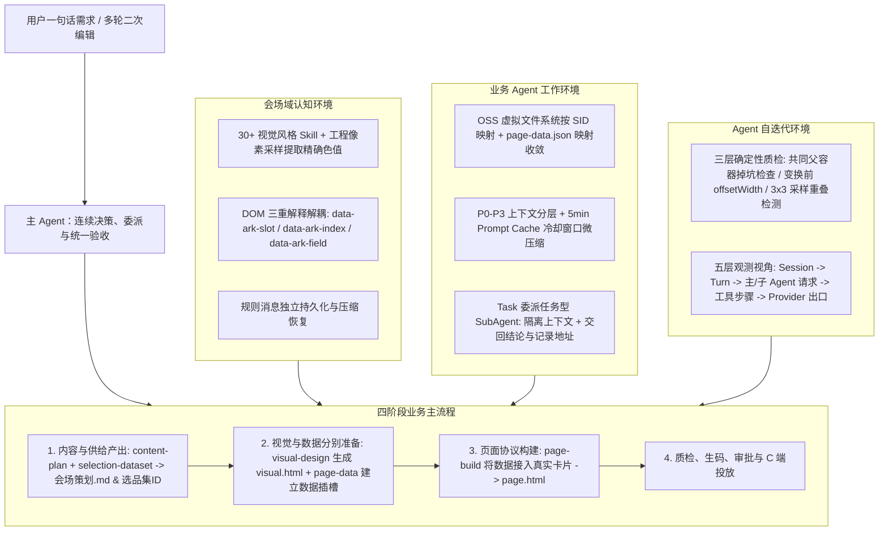
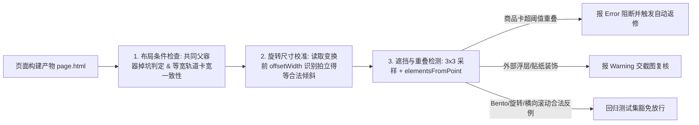

# 告别 AI Demo 页面：构建支持淘内货品运营、可C端投放的会场 Agent Harness

## 1. TL;DR

传统一句话生码工具只能产出静态 Demo 页面，无法满足手淘端内外的性能、埋点、视觉设计规范与动态商品推荐要求。**方舟 AI 会场 Agent Harness** 将会场研发拆解为内容实时策划、视觉设计、数据装配与页面构建四阶段闭环，围绕承载视觉软约束、货品数据认知约束和 Ark 生码硬约束的 `page.html` 推进交付。系统在工程层构建了三类核心环境：**会场域认知环境**（通过 `30+` 设计师共创视觉风格 Skill 与 `<skill-loaded>` 规则持久化机制注入领域知识）、**业务 Agent 工作环境**（基于 OSS 虚拟文件系统与 `page-data.json` 收敛认知，结合 `P0–P3` 上下文分层、5 分钟 Prompt Cache 冷却窗口清理与任务型 SubAgent 隔离上下文）以及**自迭代环境**（通过不牺牲创造力的三层确定性质检工具与五层 Session 观测工作台保障交付质量），实现“想法即生成，生成即可投放”。

## 2. 问题定义与背景

### 2.1 为什么“一句话生成 HTML”难以直接用于生产投放

通用 AI 办公或生码工具虽能根据简短提示词快速生成静态 HTML 页面，但在淘系真实营销会场场景下存在三重工程鸿沟：

1. **生产渲染与投放协议不兼容**：直接生成的静态 HTML 无法对接手淘端内与端外的页面渲染体系，性能指标、埋点规范、多端屏幕适配及天马模块挂载均不达标。
2. **缺乏真实货品供给与动态运营能力**：模型直接生成页面时会编造商品数据；即便传入静态商品列表，也无法处理线上个性化推荐、白底图与场景图切换、指定坑位固定主推（定坑）或利益点动态补全等真实货品运营诉求。
3. **视觉表达缺乏淘系设计规范约束**：营销会场涉及排版、材质、情绪与色彩角色等复杂设计语言，若无结构化设计约束，模型产物难以达到淘天生产级精修视觉水准。

### 2.2 核心概念与三类约束定义

- **方舟会场 Agent 四大目标**：内容实时策划（基于人群/场景/热点挖掘）、淘天设计水准（沉淀精修会场经验）、真实货品运营（淘内商品圈选与投放）、C 端线上投放（支持淘内与端外生产环境及天马模块）。
- **协议级 `page.html` 的三重约束**：
  - **视觉设计（软约束）**：由 `visual-design` 与 `visual-style-*` Skill 守住气质、视觉层级和关键特征，但相框、字体、层叠与留白仍允许自由组合，避免退化为死板模板填空。
  - **货品数据（认知约束）**：由 `page-data` 建立选品集、数据插槽（Slot）与召回认知，明确哪些文案随页面静态保留、哪些字段由运行时商品数据动态填充。
  - **生码装配（硬约束）**：由 `page-build` 与 Ark 协议规定 Section、卡片、字段的表达与装配边界；视觉外观可自由发挥，但节点归属、字段位置与动态组件输入必须严格合规。

## 3. 知识框架

## 4. 核心内容拆解

### 4.1 业务主流程与 `page.html` 的多维认知解耦

**核心主张**：同一棵 DOM 树同时承载视觉布局、货品供给与转码协议，必须通过属性绑定而非新增 DOM 容器来解耦“视觉分组”与“供给分组”的冲突。

- **从一句话到线上会场的四步链路**：
  1. **内容与供给产出**：策划 Skill（`content-plan`）多轮挖掘人群与场景切口，核验类目与供给，产出《会场策划.md》与选品集 ID 交用户确认。
  2. **设计与数据分别准备**：版头与风格遵循视觉 Skill 生成独立视觉基准产物 `{主题}-{风格}-visual.html`；数据阶段建立数据插槽（Slot）、投放与召回关系。
  3. **构建页面并交付**：`page-build` 将数据接到真实卡片生成 `page.html`，经质检后保存版本并进入生码、审批与发布。
  4. **主 Agent 贯穿全局**：确认、委派、验收与二次编辑均由主 Agent 承接；业务阶段划分不等于常驻七个长期 Agent，仅独立子任务才并行委派。
- **为什么 `page.html` 是设计冲突中心**：
  - **三重解释冲突**：视觉设计关注 DOM 结构与盒模型；数据链路识别 Slot、组内位置与字段承载节点；转码链路提取楼层、组件与样式关系。
  - **视觉分组 $\neq$ 供给分组**：同一视觉楼层可混排不同 Slot 的商品，同一 Slot 的商品卡片也可跨行或采用不同视觉样式。
  - **禁止随意加 Wrapper 容器**：若为某个 Slot 额外包裹一层 DOM 容器，会直接改变 CSS Grid/Flex 的直接子项层级，破坏跨行跨列布局与位置选择器；即便使用 `display: contents` 也会改变 DOM 父子关系。
  - **属性绑定解法**：协议将 `data-ark-slot`、`data-ark-index` 直接挂载在商品卡片 `<a>` 标签上，运行时（`Render.ts`）按 `a[data-ark-slot][data-ark-index]` 选择器定位卡片并按 `data-ark-field` 绑定动态字段，使视觉布局层级与数据供给分组互不破坏。

| 二次编辑诉求类型 | 触发的 Skill 与处理路径 | 边界与一致性复核要求 |
| :--- | :--- | :--- |
| **改变视觉与样式** | 整体换风格加载 `visual-design` + `visual-style-*` 先生成新视觉稿再 `page-build`；局部改字号/静态文案直接加载 `page-build` 编辑 `page.html` | 保持未受影响的 DOM 结构与字段绑定不变 |
| **改变货品供给** | 如“修护区换成 200 元以内商品”：先由 `page-data` 定位受影响 Slot，加载 `selection-dataset` 校验候选并创建选品集，再由 `page-build` 更新受影响卡片绑定 | 候选商品不足时必须如实暴露，严禁写静态卡片掩盖 |
| **改变数据投放（定坑/分流）** | 如“左侧主推坑只投选品集 B，其余继续用 A”：按 `page-data` 固坑规则拆出独立数据插槽，原插槽继续服务其余卡片，`page-build` 仅更新目标坑绑定 | 区分组内位置（`data-ark-index="0"`）与固定商品 ID，主推位绑定独立 `pin/0` |
| **修改页面文案** | 先区分静态内容与动态字段：楼层标题可直接改 HTML；商品卡内名称、价格、卖点须沿 `data-ark-field` 判断来源 | 动态字段值由线上运行时替换，不能按静态文本硬编码修改 |

### 4.2 视觉遵循度保障与真实货品数据运营机制

**核心主张**：将视觉生成与数据绑定分阶段隔离，用工程工具负责精确色值提取、用 `<skill-loaded>` 持久化对抗长程压缩遗忘，可将淘天设计规范稳定落地到动态商品页面。

- **30+ 视觉风格 Skill 与遵循度五步法**：
  - 团队联合设计师沉淀了 `30+` 面向内容型会场的 Design Skill，将情绪、材质、排版、组件结构、色彩角色和禁用规则显式化（如“海报拍立得”保留倾斜黑板、摆正面板和粗描边；`LOOKBOOK` 强调扁平、无投影和编辑式排版）。
  - **五步保障长链路遵循度**：
    1. **阶段注意力隔离**：确认版头与风格后，主 Agent 仅加载 `visual-design` 与 `visual-style-*`，专注布局与盒模型，不同时处理 Slot、召回与数据绑定。
    2. **工程采样提取色值 + AI 映射角色**：先用工程手段对参考图做像素采样和统计，返回底缘色、主色簇等精确可复核的 Hex 色值（消除大模型看图猜 Hex 的色偏），再由 AI 按风格规范映射到背景、主色和强调色。
    3. **独立保存视觉基准产物**：通过 `designPageVisual` 落盘 `{主题}-{风格}-visual.html`，锁定布局、配色、字体与装饰后再进入数据阶段。
    4. **数据装配服从既有视觉结构**：`page-data` 与 `page-build` 在不破坏视觉结构的前提下注入协议属性。
    5. **规则消息持久化与压缩恢复**：Skill 工具将加载的完整正文包装为带名称的 `<skill-loaded>` 消息独立持久化——普通轮次微压缩不将其当作普通 `read` 结果清理；历史重建或全量压缩后，按加载记录和 Token 预算自动恢复正文（超长时保留截断与补读提示），避免长对话后只剩一句模糊的风格摘要。
- **真实货品运营推导示例**（以“第一个坑位固定主推 A，紧接两位只放修护类，其余继续个性化，布局不动”为例）：
  1. **定位现状**：识别“第一坑”是位置索引而非商品 ID，明确楼层商品区的动态渲染逻辑。
  2. **加载准绳**：通过 `selection-dataset` 明确有效选品条件，通过 `page-data` 明确数据插槽共享规则与独立投放单元要求。
  3. **拆解数据方案**：为商品 A 按商品 ID 条件建立独立选品集与 `pin` Slot；为修护区建立 `repair` Slot；其余坑位保留原 `recommend` Slot。
  4. **先核验供给再执行**：检查选品集候选数量，不足时主动暴露异常而非用静态 HTML 卡片掩盖。
  5. **落盘卡片与验收**：主推位绑定 `pin/0`，修护区绑定 `repair/0` 与 `repair/1`，其余继续引用原组，最后联合校验布局、定坑、类目与个性化四项要求同时成立。

### 4.3 业务 Agent 工作环境：上下文分层、Prompt Cache 与 SubAgent 架构

**核心主张**：上下文管理必须与 Prompt Cache 的 5 分钟生命周期协同优化，并通过 OSS 虚拟文件系统与“按任务边界拆分”的 SubAgent 机制平衡并行提效与上下文一致性。

- **上下文重要性四级分层（`P0–P3`）与 Prompt Cache 协同策略**：

| 优先级 | 上下文内容类型 | 典型实例 | 压缩与缓存处理策略 |
| :--- | :--- | :--- | :--- |
| **P0** | 核心约束与执行事实 | 系统提示词、用户目标 | 常驻保留，严禁清理 |
| **P1** | 已加载的关键 Skill | 设计风格规范、页面构建协议 | 封装为 `<skill-loaded>` 独立持久化，全量压缩后显式恢复 |
| **P2** | 当前判断所需的信息结果 | 当前 `page.html`、当前页面截图 | 当前决策周期内保留 |
| **P3** | 已过时、可重取的信息结果 | 历史 `read` 工具输出（占比极高）、早期截图、历史会场信息 | 利用缓存冷却窗口（超过 5 分钟必然 Miss 时）执行微压缩清理 |

- **Prompt Cache 在 Agent 场景下的真实失效机制**：
  - **同轮对话**：必须仅在消息末尾追加、严禁篡改历史前缀；若上下文超过窗口（如 200k）触发全量压缩，会导致一次整体 Cache Miss。
  - **SubAgent 启动与耗时**：空上下文启动的 SubAgent 会重建独立 Cache；若 SubAgent 执行耗时超过默认缓存有效期 **5 分钟**，主 Agent 等待返回后继续请求也会发生一次主链路 Cache Miss。
  - **跨轮对话分流**：用户 **5 分钟内快速追问**时，核心是保持压缩/微压缩后的消息恢复前缀一致以命中缓存；用户 **5 分钟后继续追问**时，由于缓存已冷却必然 Miss，此时顺势执行微压缩清理 `P3` 级历史 `read` 结果，可在不额外损失缓存命中率的前提下大幅缩减上下文体积。
- **云端 OSS 虚拟工作区与 `page-data.json` 认知收敛**：
  - AI 通过标准 `ls/read/write/copy/edit` 操作文件，底层按会话 `SID` 映射到 OSS 持久化路径（先落盘 OSS 再登记产物清单），进程释放不丢失状态。
  - 利用 `page-data.json` 收敛 `slotKey / aldSlotId / datasetId / cardCode` 映射关系，复杂的后端投放-选品对象关系由业务工具封装处理，避免 AI 在每轮对话中重建整套后端模型。
- **SubAgent 拆分边界对比与“结论 + 记录地址”交接协议**：
  - 多轮编辑同一份会场时，滥用 SubAgent 易出现三大痛点：① **只交回结论、未交回排除依据**（用户放宽预算到 300 元时，主 Agent 分不清哪些商品因价格排除、哪些因敏感肌排除）；② **追问路由归属不清**（旧子 Agent 缺少最新确认）；③ **并发修改同一份会场造成错绑或覆盖**（设计侧改了卡片结构而绑定侧仍按旧节点修改）。
  - 对比按职责拆（跨职责需求仍需全局协调）、按流程拆（Planner/Executor 在供给不足时需频繁回退）、按任务拆，团队选择**“主 Agent 负责连续决策 + Skill 提供领域方法 + Task 工具委派边界明确的子任务”**：
    1. **输入输出可说清的子任务才委派**：如互联网内容挖掘（输入主题/人群，返回角度与证据）、选品集创建（输入类目/价格带，返回 ID 与实际规则）。
    2. **独立同构任务并行加速**：策划结构明确后，洁面、修护、防晒三个选品集通过并行 Task 独立查询指标与预览样本，大幅缩短等待耗时。
    3. **“结论 + 归档记录路径”交接**：子任务结束后将完整执行过程写入工作区文件，Task 向主循环返回精简结论并附带执行记录文件路径；后续用户追问细节时，主 Agent 按路径补读依据后再决策。

### 4.4 自迭代环境：不扼杀创造力的确定性质检与五层观测

**核心主张**：质检工具必须在“视觉泛化创造力”与“交付确定性”之间取得平衡，通过 DOM 几何与渲染采样规则识别真实缺陷并豁免合法设计反例。

- **质检工具的三层设计与反例回归**：
  - **基本要求**：不阻碍 AI 在视觉设计与商品运营上的创造力，同时具备**高确定性**与**极快检测速度**（随处编辑后即时调用验证）。
  - **三大工程检测细节**：
    1. **先判布局前提条件**：掉坑检查先确认卡片是否处于共同父容器，区分“显式缺格”与“末行不满”；卡宽一致性检查以等宽轨道、无跨列为前提。
    2. **旋转元素看变换前尺寸**：对拍立得等倾斜卡片，读取 CSS 变换前的 `offsetWidth` 判断原始卡宽，避免把合法旋转渲染后的包围盒宽度误判为卡片宽度不齐。
    3. **实际绘制层叠采样**：采用 **`3×3` 采样 + `elementsFromPoint`** 检测元素遮挡；外部浮层可能是合法贴纸装饰，仅作为 `warning` 交截图复核，而商品卡超出阈值的实质重叠仍报 `error`。同时将 Bento 布局、旋转、横向滚动等合法设计反例纳入回归集，防止严苛规则把模型逼回千篇一律的死板版式。
- **五层观测工作台与对话打标闭环**：
  - 观测体系按 **Session → 用户 Turn → 主/子 Agent 请求（Task 父子运行标识关联） → 工具步骤（还原 ReAct 循环） → Provider 出口（记录 SDK 最终发送请求与原始响应）** 五层解构。
  - 在 Provider 出口核验 `<skill-loaded>` 规则是否真正进入请求、截图是否传入、字段是否可见及上下文块占比，并配合 LLM 对话打标服务持续统计高频修改诉求以反哺 Agent 迭代。

## 5. 数据速查表

| 指标 / 配置项 | 原文数值 / 表达式 | 语境 / 条件 |
| :--- | :--- | :--- |
| 视觉风格 Skill 数量 | `30+` 个 | 与淘内设计师合作沉淀的内容型会场 Design Skill |
| 卡片定位与动态绑定属性 | `a[data-ark-slot][data-ark-index]`、`data-ark-field` | `page.html` 与运行时 `Render.ts` 的数据插槽及字段绑定协议 |
| 工作区映射核心字段 | `slotKey` / `aldSlotId` / `datasetId` / `cardCode` | `page-data.json` 收敛的投放与选品映射字段 |
| 上下文重要性分层 | `P0` / `P1` / `P2` / `P3` 共 4 层 | `P0` 核心约束、`P1` 关键 Skill、`P2` 当前 HTML/截图、`P3` 历史 `read` 与早期截图 |
| Prompt Cache 默认有效期阈值 | `5 min` | 同轮 SubAgent 超 5 分钟或跨轮间隔超 5 分钟会触发缓存冷却 Miss |
| 触发频繁全量压缩的窗口示例 | `200k` tokens | 原文指出若模型上下文窗口仅 200k 且长对话频繁全量压缩会拉低缓存命中率 |
| 遮挡检测采样方式 | `3×3` 采样 + `elementsFromPoint` | 区分商品卡超阈值重叠（`error`）与外部贴纸浮层（`warning`） |
| 旋转卡片宽度校验属性 | 变换前 `offsetWidth` | 避免将拍立得风格倾斜卡片误判为宽度不一致 |

## 6. 踩坑与教训 / 可迁移的设计原则

| 错误做法 | 失败表现或原因 | 原文应对（可迁移的设计原则） |
| :--- | :--- | :--- |
| **为数据插槽（Slot）直接包裹一层 DOM Wrapper 容器** | 改变了 CSS Grid/Flex 的直接子项关系，导致跨行跨列布局与位置选择器失效（`display: contents` 也会改变父子关系） | **结构与供给属性解耦**：保持视觉 DOM 层级不动，将 `data-ark-slot` 与 `data-ark-index` 直接作为属性写在商品卡片 `<a>` 节点上 |
| **让大模型直接看参考图猜测颜色的 Hex 值** | 模型视觉识别颜色数值存在明显偏差且不可复核，导致生成页面色调偏离品牌规范 | **确定性计算交工具、语义映射交 AI**：先用工程像素采样与聚类统计提取底缘色、主色簇精确色值，再由 AI 按风格规范映射到背景、主色和强调色 |
| **在同阶段同时处理视觉设计、数据插槽与最终协议构建** | 多种异构规则争抢模型注意力，且长对话压缩后视觉规则被清理为一句摘要，导致后期页面视觉退化 | **阶段隔离 + `<skill-loaded>` 独立持久化**：先独立产出 `visual.html` 锁定视觉基因，再做数据装配；将关键 Skill 包装为 `<skill-loaded>` 在微压缩中保护、全量压缩后按预算恢复 |
| **为了追求高 Prompt Cache 命中率而从不清理历史，或在缓存有效期内随意删改历史消息** | 前者导致 `read` 工具输出塞满上下文污染注意力；后者破坏前缀一致性导致 5 分钟内请求也频繁 Cache Miss | **对齐缓存生命周期做上下文清理**：5 分钟内仅在末尾追加并保持恢复一致性；利用超过 5 分钟缓存已冷却（必然 Miss）的时机清理 `P3` 级过时 `read` 结果 |
| **SubAgent 仅向主 Agent 返回一句“已完成/已创建 ID”，或直接转发全量聊天记录** | 仅回结论会导致后续用户修改条件（如放宽预算）时主 Agent 丢失排除依据而重新盲猜；全量转发则丧失上下文隔离意义 | **“精简结论 + 工作区归档记录路径”交接协议**：子任务将详细筛选过程落盘 OSS 工作区，向主循环返回结论与记录地址，主 Agent 在追问时按需补读 |
| **用死板模板限制生成，或用未区分场景的几何规则一刀切报错** | 限制模板会丧失 HTML/CSS 视觉创造力；未区分旋转/贴纸的简单检测会把拍立得倾斜、Bento 布局误判为缺陷，逼迫模型退化为单一版式 | **确定性质检 + 合法设计反例回归**：用 `offsetWidth` 校验旋转前卡宽、用 `3×3` 采样区分重叠 `error` 与浮层 `warning`，并持续维护合法反例回归集 |

## 7. 记忆锚点

- **协议解耦口诀**：“视觉软、数据认、生码硬；Slot 属性写 `<a>` 不加层，采样取色先定版，`<skill-loaded>` 抗压缩。”
- **缓存与协同锚点**：“五分钟内保前缀，五分钟外清 `P3`；主控决策子并行，交回结论带路径。”

## 8. 复习卡片

为什么方舟会场协议禁止为数据插槽（Slot）额外包裹一层 DOM 容器，而是将 `data-ark-slot` 写在卡片 `<a>` 标签上？::因为同一棵 DOM 同时承载视觉布局、数据供给和转码要求，且视觉分组不等于供给分组；额外包裹容器会改变 Grid/Flex 直接子项关系并破坏跨行跨列布局，将 `data-ark-slot` 与 `data-ark-index` 直接写在卡片 `<a>` 上可在保留视觉层级的同时完成运行时动态绑定。
方舟会场 Agent 如何解决长程多轮对话中视觉设计风格遵循度下降的问题？::一是先将任务聚焦于视觉阶段并独立产出 `{主题}-{风格}-visual.html` 锁定视觉基准；二是用工程像素采样提取精确色值交 AI 映射色彩角色；三是将加载的 Skill 包装为 `<skill-loaded>` 消息独立持久化，在微压缩中豁免清理并在全量压缩后按预算自动恢复。
当运营提出“第一个坑位固定主推商品 A，紧接两位放修护类，其余继续个性化”时，Agent 如何防止候选不足导致线上空白？::Agent 将位置索引转化为独立 `pin` Slot、修护区 `repair` Slot 与原有 `recommend` Slot，并在绑定前先通过 `selection-dataset` 核验真实候选商品数量；若候选不足必须主动暴露异常，严禁通过写死静态 HTML 卡片来掩盖供给缺失。
在多轮 Agent 交互中，如何协同优化上下文清理（如清理庞大的 `read` 工具结果）与 Prompt Cache 命中率？::将上下文按重要性分为 `P0–P3` 四层；在 5 分钟缓存有效期内严格追加消息并保持前缀一致以命中缓存，而在跨轮间隔超过 5 分钟（缓存已冷却必然 Miss）的时机执行微压缩，集中清理 `P3` 级过时的 `read` 结果与早期截图。
为什么会场场景下不能简单按固定角色拆成多个长期独立会话的 Agent，而采用“主 Agent + 任务型 SubAgent”？::因为会场需求会连续修改同一份 `page.html`，独立会话容易造成“只交回结果没交齐排除依据”“追问归属不清”以及“并发修改同一份 DOM 导致错绑覆盖”；由主 Agent 维护连续主循环、仅将边界清晰或可并行的子任务通过 Task 委派，并以“结论+工作区执行记录地址”交接，才能兼顾上下文隔离与全局一致性。
会场确定性质检工具如何避免误杀“拍立得倾斜卡片”和“顶部装饰贴纸”等合法视觉设计？::对旋转卡片读取 CSS 变换前的 `offsetWidth` 校验原始卡宽，避免把旋转后的视觉投影当成宽度不齐；对遮挡检测采用 `3×3` 采样加 `elementsFromPoint`，将外部浮层贴纸标为 `warning` 交截图复核，仅对商品卡超阈值重叠报 `error`，并将 Bento、旋转等合法反例纳入回归保护。

## 9. 知识关联

- **本库通用主题**：[Harness与模型协同](../../20_topics/Harness与模型协同.md) · [Skill设计与治理](../../20_topics/Skill设计与治理.md) · [Agent成本与上下文预算](../../20_topics/Agent成本与上下文预算.md) · [AI研发协同](../../20_topics/AI研发协同.md)
- **本篇原始与转写材料**：[原始 PDF](RAW.pdf) · [逐页转写文本](MD.md)
- **候选双链**：[[会场Agent-Harness]] · [[Prompt-Cache与上下文分层]] · [[SubAgent任务委派与交接协议]] · [[UI确定性质检与反例回归]]

## 10. 原文参考资料

- **原文信息**：《告别 AI Demo 页面：构建支持淘内货品运营、可C端投放的会场 Agent Harness》，作者：巷年（淘天集团-营销&交易技术团队），公众号：大淘宝技术，发布时间：`2026-10-19 00:24`（浙江）。
- **文内提及的关联组件与内部体系**：方舟 AI 会场、天马模块、`visual-design` / `visual-style-*` / `page-data` / `page-build` / `content-plan` / `selection-dataset` Skill 体系、`Render.ts` 运行时渲染协议（原文未提供外部开源仓库链接，提及的“内容策划与货品挖掘”“生产环境性能与埋点适配”为团队另文展开内容）。

> [!note]- 校对报告
> 1. **页码溯源汇总**：
>    - `p.1–3`：静态 Demo 页面无法直接投放的三大痛点（渲染/性能/埋点、动态商品运营、淘系设计规范）与方舟 AI 会场四大特点及产品界面。
>    - `p.3–5`：四步业务主流程（内容与供给产出、设计与数据分别准备、构建页面并交付、主 Agent 贯穿链路）与三类 Harness 环境（会场域认知环境、业务 Agent 工作环境、自迭代环境）。
>    - `p.6–10`：`page.html` 的三重约束（视觉软约束、货品数据认知约束、生码硬约束）、同一棵 DOM 的三重解释冲突、`a[data-ark-slot][data-ark-index]` 属性绑定机制及四类二次编辑路径。
>    - `p.11–14`：`30+` 视觉风格 Skill、五步遵循度保障机制（含像素采样提取色值、`designPageVisual` 与 `<skill-loaded>` 持久化恢复）及真实商品运营五步推导实例（`pin/0`、`repair/0、1`、`recommend`）。
>    - `p.15–20`：`P0–P3` 上下文重要性分层、同轮/SubAgent/跨轮 5 分钟 Prompt Cache 失效与清理机制、LLM Trace 观测工作台、五类认知 Skill 体系及基于 OSS（按 `SID` 映射）与 `page-data.json` 的云端工作区。
>    - `p.20–23`：SubAgent 协作三大痛点、三种拆分视角（按职责/按流程/按任务）对比及“结论 + 工作区执行记录地址”交接方案。
>    - `p.23–27`：质检工具“一个前提、两个基本要求”、三大检测细节（共同父容器掉坑检查、变换前 `offsetWidth`、`3×3` 采样 + `elementsFromPoint`）、Session 五层观测视角与未来规划。
> 2. **勘误与质量边界说明**：
>    - `p.6` 小节标题原文存在排版错字（`▐ 历如何做到内容策划以及淘内货品挖掘` 多出一“历”字），`p.24` 存在错别字（`设计的创造里也会一并消失` 应为“创造力”），笔记正文已按准确语义表述并在此保留原文文字特征记录。
>    - 原文 `p.1–26` 包含多处产品界面截图、架构示意与工作台截图（位于 PDF 图像层，未包含在纯文本层），核心机制均已在正文中完整阐述。
> 3. **核验结论**：全文满足唯一 H1、标准 10 大编号二级章节、正文零内联页码、6 条单行 `::` 复习卡片、所有数值与属性名与原文逐页对齐；Mermaid 图表与文内提及脚本未在外部环境执行。
