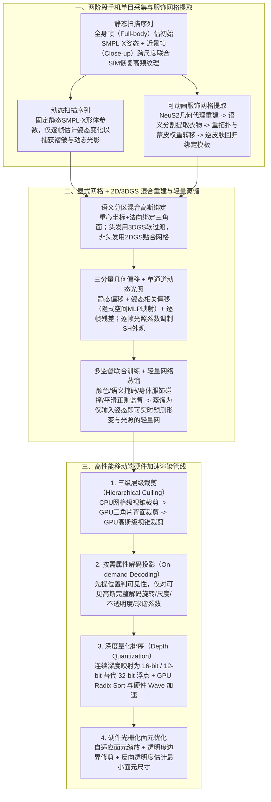

# SIGGRAPH Asia 2025｜只用一部手机创建和渲染高质量3D数字人

## 1. TL;DR

1. **核心痛点**：传统高精度可驱动 3D 数字人（如 `TaoAvatar`、`CodecAvatar`）依赖昂贵复杂的多相机阵列影棚，普通用户无法使用；而在仅有一部普通智能手机单目视频输入时，面临**几何与局部高频细节缺失**、**外观-动作强耦合（褶皱/光照与姿态混杂导致纹理漂移）**以及**移动端算力与带宽难以支撑 3DGS 实时渲染**三大挑战。
2. **核心机制（`HRM²Avatar`，SIGGRAPH Asia 2025 录用）**：
   - **双序列采集与服饰网格提取**：设计“静态扫描（全身帧估姿态 + 近景帧跨尺度联合 SfM 恢复高频细节，经 `NeuS2` 重建与语义分割提取可蒙皮绑定的显式服饰网格）+ 动态扫描（固定 SMPL-X 身体模板捕捉动作褶皱与光照）”两阶段协议；
   - **显式网格 + 语义分区高斯混合表征**：头发区域用 **3DGS** 建模软过渡，非头发区域用 **2DGS** 贴合网格表面；几何由“静态偏移 + 姿态相关偏移（隐式空间经 MLP 映射）+ 逐帧残差”三项叠加，配合单通道姿态相关动态光照调制，并通过**轻量网络蒸馏**实现实时仅输入姿态即可预测形变与光照；
   - **移动端四步渲染加速**：通过**三级层级裁剪（CPU 网格视锥 + GPU 三角片背面 + GPU 高斯视锥）+ 按需属性解码投影 + 16/12-bit 深度量化 GPU Radix Sort & Wave 排序 + 硬件光栅化（自适应面元缩放/透明度修剪）**消除带宽瓶颈。
3. **实测性能**：单数字人（约 **53 万高斯点**）在 **iPhone 15 Pro Max** 上达到 **2K@120 FPS**（3 个数字人同屏达 **2K@30 FPS**），在 **Apple Vision Pro** 上达到 **2K@90 FPS**，在自建数据集与公开 `Neuman` 数据集上的 PSNR、SSIM、LPIPS 均全面超越现有单目方案。

## 2. 问题定义与背景

### 2.1 从多视角影棚（TaoAvatar）走向普通人一部手机（HRM²Avatar）

淘天 Meta 技术团队此前在 CVPR 2025 发表了基于专业多视角拍摄影棚的 `TaoAvatar`（作为 Highlight Paper 落地杭州西溪园区淘宝未来旗舰店 3D 真人导购）。为彻底降低建模门槛，团队提出仅靠**普通智能手机单目视频输入**即可创建和实时渲染高保真 3D 数字人的系统 **HRM²Avatar**（获计算机图形学顶会 **SIGGRAPH Asia 2025** 接收）。

### 2.2 单目手机重建与移动端实时驱动的三大核心难题

1. **几何与局部细节缺失**：手机拍摄距离与视角受限，衣物褶皱、材质结构、头发丝等高频细节极易丢失或模糊。
2. **外观—动作耦合（Pose-dependent Appearance）**：单目视频中人体姿态变化、布料非刚性形变与环境光影偏移混杂在一起，直接建模易在新姿态驱动时产生纹理漂移或拉伸伪影。
3. **移动端实时推理与渲染受限**：传统神经渲染与 3DGS（3D Gaussian Splatting）依赖桌面级高带宽 GPU 做全量属性展开与 32-bit 浮点深度排序，难以在手机与 XR 头显上跑满高帧率。

## 3. 知识框架

## 4. 核心内容拆解

### 4.1 两阶段采集协议与显式服饰网格提取

1. **双序列互补拍摄协议**：
   - **静态扫描阶段（全身帧 + 近景帧联合 SfM）**：用户保持相对固定姿态，手机环绕拍摄。其中**全身帧（Full-body）**提供完整人体轮廓以估计初始 SMPL-X 姿态；**近景帧（Close-up）**聚焦头部、胸部与衣物纹理，虽因人体视野占比小无法独立检出关键点，但通过**与全身帧联合运行 SfM 并利用跨尺度视角一致性**稳定了近景相机轨迹。
   - **动态扫描阶段**：直接锁定静态阶段所得的 SMPL-X 身体体型参数，仅逐帧跟踪姿态变化，专门捕获随动作产生的衣物褶皱、遮挡与光照响应。
2. **四步提取拓扑干净的穿衣人体网格**：
   - **几何重建**：在静态序列上运行 `NeuS2` 生成连续的服饰表面几何代理；
   - **服装区域提取**：用语义分割引导切出清晰衣物边界，防止身体与衣物表面粘连混合；
   - **重拓扑与蒙皮绑定**：重网格化后将蒙皮权重迁移至与身体一致的骨骼体系；
   - **绑定对齐**：通过逆皮肤变换（Inverse Skinning）回归至标准模板姿态，作为后续高斯附着的几何基底。

### 4.2 混合表征、三分量几何生成、动态光照与轻量蒸馏

1. **网格附着混合高斯表征（2DGS + 3DGS 分区）**：
   - **位置与协方差**：每个高斯通过重心坐标与沿三角面法向的局部偏移绑定在网格三角形 $(v_0, v_1, v_2)$ 上；高斯尺度协方差由参考/当前三角形边向量雅可比矩阵、局部旋转 $R$ 与对角缩放 $S$ 组合构造。
   - **可见性与语义分区**：每个高斯绑定可见性标记（仅当所属三角面朝向视点时参与渲染）；按语义分割将**头发区域设为 3DGS**（表现蓬松软过渡），**非头发区域设为 2DGS**（紧密贴合服装与皮肤表面）。
2. **三分量几何偏移组合**：
   - 在带服饰模板网格上叠加三类偏移：① **静态偏移**（与姿势无关，补全基础形状）；② **姿态相关偏移**（随关节动作可预测的形变，前两项均定义在隐式空间并经 MLP 映射为欧氏偏移以提升收敛稳定性）；③ **逐帧残差**（拥有更大自由度，捕捉衣物轻微摆动等细粒度动态）。
3. **单通道动态光照建模与四重训练监督**：
   - 引入轻量化的**单通道姿态相关光照项**，在渲染时与基于观察方向和球谐编码（SH）的外观解码相调制，消除新姿态下“死板无阴影变化”的假人感。
   - 训练同时联合近景与全身帧，施加**颜色一致性监督、语义掩码约束、身体与服饰区域碰撞约束、几何与参数平滑正则化**（相机与人体姿势仅做轻量微调以消除配准残差）。
4. **轻量网络蒸馏（支撑移动端实时推理）**：
   - 重建完成后，将离线获得的“逐帧姿态 $\to$ 几何偏移 + 光照参数”蒸馏进一个轻量级预测网络；部署到移动端后无需逐帧重建数据，仅输入驱动姿态即可实时推理出形变与光照。

### 4.3 面向移动端的四步渲染管线优化

为在手机与头显上实时渲染 **53 万高斯点**，系统对标准 3DGS 管线进行了深度改造：
1. **三级层级裁剪（Hierarchical Culling）**：
   - **CPU 侧网格级视锥裁剪**（剔除视野外身体部件） $\to$ **GPU 侧三角片级背面裁剪**（丢弃背向相机的三角面） $\to$ **GPU 侧高斯级视锥裁剪**（剔除不可见高斯实例），大幅削减进入排序与光栅化的高斯总数。
2. **按需属性解码投影（On-demand Decoding）**：
   - 摒弃一次性全量展开高斯存储块的做法，先仅提取空间位置与索引判断可见性，**仅对可见高斯点**完整解码旋转、尺度、不透明度与球谐系数，显著降低显存带宽开销。
3. **深度量化排序（Depth Quantization）**：
   - 将连续深度范围映射至紧凑区间，用 **16-bit 或 12-bit 整数深度替代 32-bit 浮点数**，配合 **GPU 并行 Radix Sort 与硬件 Wave 操作**加速深度排序。
4. **GPU 硬件光栅化面元优化**：
   - 利用硬件光栅化对每个高斯生成面元并做屏幕合成，结合**自适应面元缩放**（保持外观前提下缩小面元面积）、**基于透明度修剪**（剔除贡献极小的边缘像素）与**反向透明度估计**（按高斯分布推断最小必要面元尺寸）。

## 5. 数据速查表

| 指标 / 维度 | 原文数值 / 设定 | 语境 / 条件 |
| --- | --- | --- |
| 录用顶会 | **SIGGRAPH Asia 2025** | 计算机图形学顶会（继 CVPR 2025 Highlight `TaoAvatar` 后的移动端突破） |
| 单个数字人高斯规模 | **约 53 万（530,000）个高斯点** | 移动端实时驱动标准测试配置 |
| iPhone 15 Pro Max 单人渲染帧率 | **2K 分辨率 @ 120 FPS** | 约 53 万高斯点实时驱动 |
| iPhone 15 Pro Max 三人同屏帧率 | **2K 分辨率 @ 30 FPS** | 同时渲染 3 个数字人保持实时流畅 |
| Apple Vision Pro 渲染帧率 | **2K 分辨率 @ 90 FPS** | XR 头显端实时渲染表现 |
| 深度排序量化位宽 | **16-bit 或 12-bit（替代 32-bit 浮点）** | 结合 GPU 并行 Radix Sort 与硬件 Wave 操作 |
| 公开泛化评测基准与指标 | **`Neuman` 数据集（评测 PSNR ↑ / SSIM ↑ / LPIPS ↓）** | 验证复杂服饰与未见新姿态下的泛化能力与抗纹理漂移能力 |

## 6. 踩坑与教训 / 可迁移的设计原则

| 错误做法 | 失败表现或原因 | 原文应对（可迁移的设计原则） |
| --- | --- | --- |
| **仅用单目全身视频或仅用无参考的单序列拍摄训练数字人** | 全身视频看不清面部/织物高频细节；而纯近景帧因视野占比小无法检出人体关键点导致相机位姿崩坏；单序列缺乏静态拓扑基准 | **两阶段双序列采集 + 跨尺度联合 SfM**：静态阶段将全身帧与近景帧联合跑 SfM 兼得稳定姿态与高频细节；动态阶段锁定 SMPL-X 体型专捕动态褶皱 |
| **全身统一只用纯隐式场或纯 3DGS 建模穿衣人体** | 纯高斯或隐式场在大幅度抬手/转身时易出现服饰边界模糊、拓扑粘连与纹理漂移 | **显式服饰网格（NeuS2 + 语义分割重拓扑）+ 2DGS/3DGS 语义分区混合表征**：头发用 3DGS 保蓬松，衣物皮肤用 2DGS 贴合网格，并施加身体-服饰碰撞约束 |
| **将离线逐帧优化的重型网络直接搬上手机端推理** | 移动端算力无法承受逐帧高维神经场解码 | **离线联合优化 + 轻量网络蒸馏**：将姿态到几何偏移与单通道光照的映射蒸馏为轻量预测网络 |
| **在移动端照搬桌面端 3DGS 全量属性展开与 32-bit 浮点排序** | 内存带宽与排序耗时成为瓶颈，手机端严重掉帧发热 | **三级裁剪 + 按需属性解码 + 16/12-bit 深度量化 Radix Sort + 自适应面元修剪硬件光栅化** |

## 7. 记忆锚点

1. **混合表征口诀**：“**NeuS2 提网格做骨架，发丝 3D 衣肤 2D；静态姿态加残差，单通道光蒸馏化**”。
2. **移动端极速渲染四板斧**：“**三级裁剪（CPU 网格/GPU 背面/GPU 高斯） $\to$ 按需解码 $\to$ 12/16-bit 量化排序 $\to$ 自适应面元硬件光栅化（53 万高斯跑出 2K@120FPS）**”。

## 8. 复习卡片

1. `HRM²Avatar` 相比团队此前发表在 CVPR 2025 的 `TaoAvatar`，解决的最核心应用门槛问题是什么？::`TaoAvatar` 依赖昂贵复杂、难以搬出实验室的专业多视角拍摄影棚；而 `HRM²Avatar` 仅依赖一部普通智能手机拍摄的单目视频即可完成高保真 3D 数字人重建，并在手机与 XR 头显上实现实时驱动渲染。
2. 为什么在静态扫描阶段要同时采集“全身帧（Full-body）”与“近景帧（Close-up）”并联合运行 SfM？::因为全身帧能提供完整轮廓以稳定估计初始人体姿态，但缺乏高频细节；近景帧能捕捉头部与衣物高频纹理，但因局部视野无法独立检测人体关键点与相机位姿。二者跨尺度联合运行 SfM 即可兼得稳定的相机轨迹与局部高频几何纹理。
3. 系统是如何从静态序列中提取出拓扑干净、可用于动画驱动的显式服饰网格的？::分四步：① 运行 `NeuS2` 生成连续的服饰表面几何代理；② 利用语义分割提取衣物区域以防身体与衣物粘连；③ 重拓扑并将蒙皮权重迁移至与身体一致的骨骼体系；④ 经逆皮肤变换回归至标准绑定模板姿态。
4. 在混合表征中，为什么对“头发区域”和“非头发区域”分别采用不同的高斯表示？几何形变又拆分为哪三项？::头发区域采用 3DGS 以表现发丝软性过渡，非头发区域（衣物与皮肤）采用 2DGS 以紧密贴合网格表面；几何形变拆分为“静态偏移（姿势无关）+ 姿态相关偏移（隐式空间经 MLP 映射）+ 逐帧残差（捕捉细粒度衣物摆动）”。
5. 为消除传统 3DGS 在移动端的高带宽与冗余计算瓶颈，`HRM²Avatar` 设计了哪三级裁剪与怎样的排序优化？::设计了“CPU 侧网格级视锥裁剪 → GPU 侧三角片级背面裁剪 → GPU 侧高斯级视锥裁剪”三级裁剪，并配合仅对可见高斯解码完整属性的按需投影；排序上用 16-bit 或 12-bit 整数深度替代 32-bit 浮点，结合 GPU 并行 Radix Sort 与硬件 Wave 操作加速。
6. 在 iPhone 15 Pro Max 与 Apple Vision Pro 上，`HRM²Avatar` 渲染 53 万高斯点的实测性能分别是多少？::在约 53 万高斯点的单数字人配置下，iPhone 15 Pro Max 可稳定跑满 **2K@120 FPS**（3 个数字人同屏时达 **2K@30 FPS**），Apple Vision Pro 可稳定达到 **2K@90 FPS**。
7. 消融实验表明，若分别移除“显式服装网格”、“姿态相关外表建模”或“两阶段扫描协议”，会各自导致什么退化现象？::移除显式服装网格会导致服饰边界不连续或拓扑模糊；移除姿态相关外表建模会在大幅度动作（如抬手臂）时产生纹理漂移；移除两阶段扫描仅靠单序列输入会导致缺乏可靠静态参考、纹理分辨率下降且动态外观变化失真。

## 9. 知识关联

- **本库主题关联**：
  - [模型架构与训练](../../20_topics/模型架构与训练.md)：结合 `NeuS2` 显式网格、2DGS/3DGS 语义分区混合表征、动态光照调制与轻量级姿态预测网络蒸馏。
  - [跨端开发与性能](../../20_topics/跨端开发与性能.md)：通过三级层级裁剪、按需解码、16/12-bit 深度量化排序与硬件光栅化面元修剪，在 iPhone 15 Pro Max 上实现 53 万高斯点 2K@120FPS 实时渲染。
  - [推荐系统与多模态评测](../../20_topics/推荐系统与多模态评测.md)：在自采穿衣人体数据与公开 `Neuman` 数据集上通过 PSNR、SSIM、LPIPS 评测静态重建与跨姿态泛化一致性。
- **候选双链**：`[[HRM2Avatar]]`、`[[TaoAvatar]]`、`[[3DGaussianSplatting]]`、`[[2DGS]]`、`[[移动端实时渲染]]`

## 10. 原文参考资料

- **原文标题**：《SIGGRAPH Asia 2025｜只用一部手机创建和渲染高质量3D数字人》
- **发布渠道与日期**：微信公众号「大淘宝技术」，2025-12-18
- **作者与团队**：Meta技术团队（淘天集团）
- **论文与开源仓库链接**：
  - `HRM²Avatar` 论文主页：`https://acennr-engine.github.io/HRM2Avatar/`
  - `TaoAvatar` 论文主页：`https://pixelai-team.github.io/TaoAvatar/`
  - `Taobao3D` GitHub 仓库：`https://github.com/alibaba/Taobao3D`
  - `MNN` 端侧推理引擎仓库：`https://github.com/alibaba/MNN`

> [!note]- 校对报告
> - **页码溯源汇总**：
>   - SIGGRAPH Asia 2025 录用背景、CVPR 2025 `TaoAvatar` 回顾、单目手机建模三大难题（几何细节缺失、外观动作耦合、移动端实时受限）与方法概览：`p.1–4`
>   - 两阶段双序列采集协议（全身帧+近景帧联合 SfM、动态序列固定 SMPL-X 身体模板）与四步服饰网格提取（`NeuS2`、语义分割、重拓扑蒙皮、逆皮肤对齐）：`p.4–7`
>   - 混合表征（重心坐标+法向、雅可比协方差、头发 3DGS / 非头发 2DGS）、三分量几何偏移、单通道动态光照建模、四重监督训练与轻量网络蒸馏：`p.7–10`
>   - 移动端四步渲染优化（三级裁剪、按需属性解码、16/12-bit 深度量化 GPU Radix Sort & Wave 排序、硬件光栅化自适应面元修剪）：`p.10–12`
>   - 定性/定量对比（PSNR/SSIM/LPIPS、`Neuman` 数据集泛化）、三项消融实验与移动端实测帧率（53 万高斯点 iPhone 15 Pro Max 单人 2K@120FPS / 三人 2K@30FPS、Vision Pro 2K@90FPS）：`p.12–17`
> - **关键数值一致性核查**：
>   - 53 万高斯点、iPhone 15 Pro Max `2K@120 FPS`（单人）/ `2K@30 FPS`（三人）、Apple Vision Pro `2K@90 FPS`、深度量化 `16 Bit 或 12 Bit 替代 32Bit 浮点` 均与原文完全一致。
> - **图像与版面质量说明**：
>   - `p.1–16` 含架构图、行内数学公式小图、渲染对比视频帧与定量实验截图（位于 PDF 图像层）；全部公式物理含义、消融结论与性能指标已在正文完整还原。
