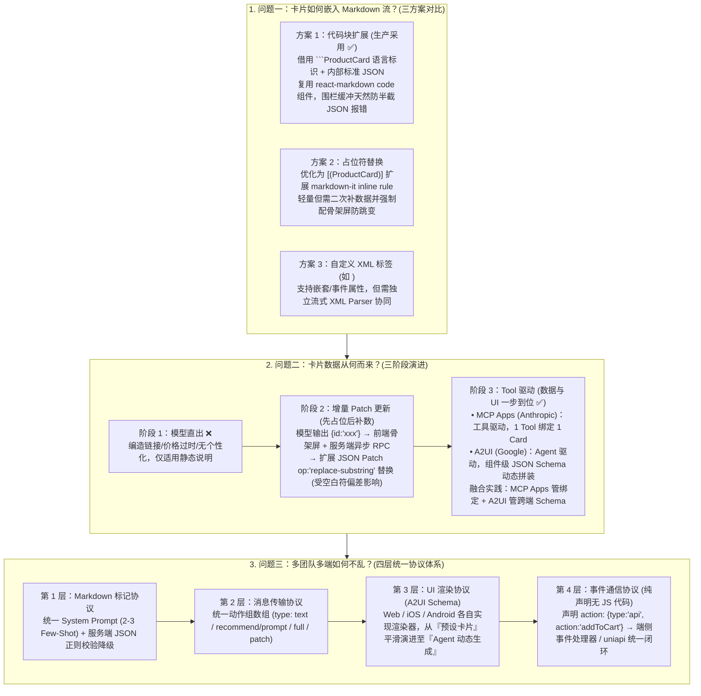

# 卡片式对话的协议方案探索和思考

## 1. TL;DR

1. **卡片嵌入 Markdown 流的三方案对比与选型**：系统对比了**代码块扩展（借用 ```` ```ProductCard ```` 的 `language` 字段传 JSON，生产首选）**、**占位符替换（如 `[(ProductCard)]` 扩展 `markdown-it` inline rule，需配骨架屏防文字跳变）**与**自定义 XML 标签（如 `<boltArtifact>`，表达力最强但需独立维护流式 XML Parser）**，最终因零额外解析依赖、天然规避 Markdown 二次转义及起止围栏缓冲防半截 JSON 报错而选定**代码块扩展**。
2. **卡片数据供给三阶段演进（从模型直出到 Tool 驱动）**：
   - **阶段 1（模型直出）**：模型直接编造价格与链接，存在严重幻觉、数据过时且无法千人千面，仅适用静态百科。
   - **阶段 2（增量 Patch 更新）**：模型先输出仅含 `{"id": "xxx"}` 的骨架代码块触发前端骨架屏，服务端异步 RPC 拉取真实数据后通过扩展 JSON Patch 的 **`replace-substring` 操作符**回填；但存在视觉跳变及空白符微小偏差导致字符串匹配失败的风险。
   - **阶段 3（Tool 驱动：MCP Apps + A2UI 融合）**：由 Tool 一步到位返回真实业务数据与 UI 描述；深度对比 Anthropic **MCP Apps**（工具驱动，Tool 级粒度强绑定）与 Google **A2UI**（Agent 驱动，组件级 JSON Schema 自由拼装），提出**用 MCP Apps 管理 Tool-UI 绑定、用 A2UI JSON Schema 标准化跨端渲染**的组合架构。
3. **收敛多团队多端混乱的“四层统一协议体系”**：构建 **1. Markdown 标记协议**（统一 System Prompt 卡片语法与 PascalCase 组件名）$\rightarrow$ **2. 消息传输协议**（统一动作组 `text` / `recommend/prompt` 及 `full` / `patch` 数据包）$\rightarrow$ **3. UI 渲染协议**（基于 A2UI Schema 实现 Web/iOS/Android 三端同构渲染，支撑从“预设卡片”平滑过渡至“Agent 动态生成”）$\rightarrow$ **4. 事件通信协议**（卡片 JSON 纯声明 `type: "api" | "ui"` 与 `action: "addToCart"`，不含任何可执行 JS 代码，由端侧事件处理器/H5 `uniapi` 统一执行并更新状态）。

## 2. 问题定义与背景

### 2.1 为什么“在聊天框里塞张商品卡片”是复杂的系统工程？

在智能导购与生活助手场景中，将可交互卡片融入 LLM 对话流并非单纯的前端组件开发，而是必须同时回答三个核心工程问题：
1. **流式嵌入难题**：LLM 输出的是纯文本 Token 流（Markdown），如何在不破坏流式排版解析的前提下混入自定义 UI 组件语义？
2. **实时数据保真难题**：LLM 不掌握商品实时售价、库存与千人千面优惠，如何将视觉结构与实时业务数据解耦并高效填充？
3. **跨团队跨端协同难题**：当 $N$ 个 Agent 业务团队与 Web / iOS / Android 三端各自发明标记、消息格式与点击事件时，系统迅速陷入 $N \times 3$ 的适配泥潭，急需标准化协议收敛。

## 3. 知识框架



## 4. 核心内容拆解

### 4.1 卡片嵌入 Markdown 流的三种技术方案对比

| 嵌入方案 | 语法示例 | 核心优势 | 核心局限与适用场景 |
| :--- | :--- | :--- | :--- |
| **1. 代码块扩展（生产首选）** | ```` ```ProductCard\n{"title":...}\n``` ```` | ① 所有 Markdown 解析器原生支持提取 `language-xxx`；② 块内字符不被 Markdown 二次转义；③ 明确起止围栏便于流式缓冲完再 `JSON.parse` | 需在 System Prompt 中注入 2–3 个 Few-Shot 示例约束 PascalCase 组件名与 camelCase JSON（服务端可加正则校验不合法降级纯文本） |
| **2. 占位符替换** | `[(ProductCard)]`（优于裸 `__placeholder__`） | 无需模型输出冗长 JSON，Token 消耗极小 | 流式吐出半截时易闪现乱码（需用 `markdown-it` 在 `link` 规则前拦截 `[(` 至 `)]` 缓冲并配合前端骨架屏）；本身不带数据 |
| **3. 自定义标签（XML-like）** | `<boltArtifact id="..."><boltAction>` | 表达力最强，天然支持深层嵌套与事件属性，跨模型通用 | 需在 Markdown 外单独维护流式 XML Parser（主要用于无原生 Function Calling 的场景） |

### 4.2 卡片数据获取的三阶段演进与 `MCP Apps` vs `A2UI` 辨析

1. **为什么必须遵循“数据与 UI 解耦”铁律？**
   - 商品价格、库存与优惠券具有强实时性与千人千面特征，模型直出必然产生幻觉或过期价格。
2. **从“增量 Patch（`replace-substring`）”到“Tool 驱动”**：
   - 在**增量 Patch 方案**中，模型仅输出 `{"id": "xxx"}` 触发前端渲染骨架屏；服务端检测到该代码块后异步调用商品 RPC，并在标准 JSON Patch 上扩展 **`op: "replace-substring"`** 将 Markdown 中的占位块替换为完整商品 JSON。但该方案存在**视觉骨架屏跳变**，且若模型多输出一个空格或换行会导致服务端子串精确匹配失败。
   - 在**Tool 驱动方案**中，Agent 调用 `search_products` 等工具，由工具直接返回真实结构化数据与 UI 描述，一步到位消除时序割裂。
3. **两大前沿社区协议对比与融合：Anthropic `MCP Apps` vs Google `A2UI`**：
   - **MCP Apps（工具驱动 UI）**：UI 是 Tool 执行结果的附属物，粒度为 **Tool 级别**（一个工具强绑定一种预设卡片渲染器），确定性高，适合固定业务卡片。
   - **A2UI（Agent to UI，Agent 驱动 UI）**：不绑定具体工具链，定义覆盖布局、表单、列表、图表的标准 **JSON Schema**，粒度为**原子组件级别**，由 Web/iOS/Android 各端原生渲染器绘制并回传 Action 事件。
   - **最佳实践组合**：在 MCP Tool 层采用 **MCP Apps** 机制管理 Tool 与 UI 的映射，而在 UI 描述层采用 **A2UI 的 JSON Schema**，兼顾工具层的强确定性与跨端渲染层的通用演进能力。

### 4.3 收敛跨团队协作的四层统一协议体系

1. **第一层：Markdown 标记协议（解决“文本流里怎么写”）**：
   - 统一规定代码块 `language` 使用 PascalCase 组件名（如 `ProductCard`、`FlightCard`），代码体为标准 camelCase JSON；全公司 Agent 共享同一份 System Prompt 卡片规范，前端仅维护一套解析注册表 `CARD_COMPONENTS`。
2. **第二层：消息传输协议（解决“前后端传什么数据包格式”）**：
   - 统一定义为“动作组（Action Group）”数组，通过 `type` 区分正文（`text`）、追问建议（`recommend/prompt`）、全量快照（`full`）与增量补丁（`patch`），使前端消息容器与具体业务 Agent 彻底解耦。
3. **第三层：UI 渲染协议（解决“跨端卡片长什么样”及 LUI 两阶段演进）**：
   - 基于 A2UI 思想实现“描述（JSON Schema）与渲染（Web/iOS/Android 原生实现）分离”。
   - **支撑 LUI 两阶段平滑过渡**：**第一阶段（预设卡片，当前主力）**采用固定模板 Schema + Agent 填数据确保可控；**第二阶段（Agent 动态生成）**由 Agent 自由拼装基础布局与表单组件实现千人千面界面——由于底层共用同一套 A2UI JSON Schema 渲染器，从阶段一升级到阶段二时**前端渲染引擎零改动**。
4. **第四层：事件通信协议（解决“用户点击卡片后怎么办”与安全边界）**：
   - **核心安全铁律**：卡片 JSON **只声明“是什么”和“能做什么（Intent/Action）”，绝不包含“怎么做（可执行 JS 代码）”**，彻底杜绝 Agent 注入恶意脚本的 XSS/RCE 风险。
   - **闭环流转（以点击“加入购物车”为例）**：卡片按钮声明 `action: { type: "api", action: "addToCart", params: { itemId: "12345" } }` $\rightarrow$ 端侧统一事件处理器（如 H5 侧 `uniapi`）拦截并调用加购网关 $\rightarrow$ 根据返回结果将按钮置灰为“已加购”或弹出 Toast 错误提示。

## 5. 数据速查表

| 维度 / 协议层次 | 核心方案对比 / 规范约定 | 关键工程特征 |
| :--- | :--- | :--- |
| **Markdown 嵌入三方案** | **代码块扩展（生产首选）** vs 占位符 `[()]` vs XML 标签 | 代码块复用标准解析器、防 Markdown 误转义、围栏缓冲防半截 JSON 报错 |
| **Prompt 稳定格式所需样本** | **`2–3 个` Few-Shot 示例** | 配合服务端 JSON 合法性正则校验与纯文本降级兜底 |
| **数据获取三阶段演进** | 模型直出 $\rightarrow$ 增量 Patch (`replace-substring`) $\rightarrow$ **Tool 驱动** | 将实时数据生产责任从模型剥离给 MCP 工具链 |
| **`MCP Apps` vs `A2UI`** | **Tool 级绑定（Anthropic）** vs **组件级 Schema（Google）** | 生产中可组合：MCP Apps 管 Tool-UI 映射，A2UI 管三端通用 Schema |
| **四层统一协议栈** | **1. 标记 $\rightarrow$ 2. 传输 $\rightarrow$ 3. UI 渲染 $\rightarrow$ 4. 事件通信** | 卡片 JSON 纯声明无 JS 代码，交互统一交由端侧处理器（如 `uniapi`）执行 |

## 6. 踩坑与教训 / 可迁移的设计原则

1. **严禁让大模型直接生成包含实时价格、库存或跳转 URL 的业务卡片 JSON**：模型预训练知识滞后且极易虚构商品 ID 与 URL；必须走“模型/Agent 触发 Tool $\rightarrow$ Tool 查真实业务库并组装 UI 数据”或“模型出 ID 占位 + 服务端异步 Patch”。
2. **流式占位符切忌使用裸文本（如 `__placeholder__`），优先用代码块围栏或成对括号缓冲 `[()]`**：裸文本在逐 Token 流式输出时会在用户眼前先闪现一串乱码英文再突变为卡片；借助 Markdown 代码块起止围栏 ```` ``` ```` 或在 `markdown-it` 中拦截 `[(` 至 `)]` 暂存并渲染骨架屏，才能保证丝滑体验。
3. **卡片交互协议必须坚守“纯声明式 JSON，零可执行代码”底线**：无论是预设卡片还是 Agent 动态拼装卡片，JSON 中只能出现 `type: "api" | "ui"` 与注册好的 `action` 枚举名（如 `addToCart`），实际网络请求与状态变更必须收口在端侧受控的 `uniapi` 或原生事件处理器中。

## 7. 记忆锚点

- **三个核心工程追问**：卡片怎么混进 Markdown 流？实时数据从哪来？多团队多端怎么不乱？
- **三种嵌入与三种取数**：代码块扩展（首选）/ 占位符 `[()]` / XML 标签；模型直出 / 增量 Patch（`replace-substring`）/ Tool 驱动（`MCP Apps + A2UI`）。
- **四层统一协议**：① Markdown 标记协议 $\rightarrow$ ② 消息传输协议 $\rightarrow$ ③ UI 渲染协议（预设卡片 $\rightarrow$ Agent 动态生成）$\rightarrow$ ④ 事件通信协议（纯声明无 JS）。
- **五大社区 Agentic 协议生态**：`AG-UI`、`MCP`、`A2A`、`A2UI / MCP Apps / Open-JSON-UI`、`Web MCP`。

## 8. 复习卡片

1. 在将业务卡片嵌入 Markdown 对话流的三种方案中，为什么生产环境最终选择了“代码块扩展（如 ```` ```ProductCard ````）”？::因为代码块扩展具有三大天然优势：一是所有标准 Markdown 解析器都原生支持提取 `language` 字段，无需手写自定义 Parser；二是代码块内部内容不会被 Markdown 二次转义，JSON 可安全传递；三是具备明确的起止围栏，流式解析器可缓冲至代码块闭合后再执行 `JSON.parse`，避免半截 JSON 报错。
2. 增量 Patch 更新方案是如何工作的？它在生产实践中有哪两个主要缺陷？::模型先输出仅含 `{"id": "xxx"}` 的占位代码块由前端渲染骨架屏，服务端识别后异步发起 RPC 拉取商品数据，再通过扩展的 `replace-substring` JSON Patch 操作替换占位块；缺陷一是用户会感知到骨架屏到真实卡片的“跳变”，缺陷二是若模型输出的空白符或换行有微小偏差会导致服务端字符串匹配替换失败。
3. Anthropic 的 `MCP Apps` 与 Google 的 `A2UI` 在驱动前端 UI 渲染的设计哲学上有何本质区别？如何将两者结合？::`MCP Apps` 是“工具驱动（Tool-driven）”，UI 是 Tool 返回结果的附属物，粒度为 Tool 级别（一个工具绑定一种卡片）；`A2UI` 是“Agent 驱动（Agent-driven）”，定义组件级 JSON Schema 供 Agent 自由拼装布局并跨端渲染。实践中可用 MCP Apps 管理 Tool 与 UI 的映射绑定，同时用 A2UI 的 JSON Schema 作为跨端 UI 描述标准。
4. 为解决多团队、多端（Web/iOS/Android）接入卡片的碎片化混乱，团队提出了哪“四层统一协议”？::依次为：1. Markdown 标记协议（卡片在文本流中怎么写）；2. 消息传输协议（前后端传什么全量/增量/推荐动作组格式）；3. UI 渲染协议（基于 A2UI Schema 定义卡片长什么样，支撑从预设卡片向 Agent 动态生成平滑演进）；4. 事件通信协议（定义用户点击卡片后的 Action 声明与响应）。
5. 第四层“事件通信协议”为什么规定卡片 JSON 只描述“是什么”和“能做什么”，而不包含“怎么做”？::为了消除安全风险与重复建设：禁止在 Agent 生成的 JSON 中注入可执行 JS 代码以防安全攻击，仅声明如 `{"type": "api", "action": "addToCart", "params": {...}}`，由端侧统一的事件处理器（如 H5 `uniapi`）负责发起请求并更新按钮状态或弹出 Toast。

## 9. 知识关联

- **所属主题**：
  - [跨端开发与性能](../../20_topics/跨端开发与性能.md)
  - [Harness与模型协同](../../20_topics/Harness与模型协同.md)
  - [AI研发协同](../../20_topics/AI研发协同.md)
- **本地跃迁**：[原始 PDF](RAW.pdf) · [逐页转写文本](MD.md)
- **候选双链**：[[AIGUI流式输出与渲染实践]] · [[淘宝跨端体验优化AI演进]] · [[淘宝跨端动效解决方案]]

## 10. 原文参考资料

1. **开源协议与标准规范**：
   - **MCP Apps (Anthropic)**：`https://modelcontextprotocol.io/extensions/apps/overview`
   - **A2UI (Google)**：`https://a2ui.org/` & CopilotKit A2UI 文档 (`https://docs.copilotkit.ai/built-in-agent/generative-ui/a2ui`)
   - **Bolt.new Message Parser**：`https://github.com/stackblitz/bolt.new/blob/main/app/lib/runtime/message-parser.ts`
   - **react-markdown**：`https://remarkjs.github.io/react-markdown/`

> [!note]- 校对报告
> - **页码溯源**：p.1–6（卡片嵌入对话流三大核心问题；方案一代码块扩展 `ProductCard` 与 `react-markdown` 实现、2–3 个 Few-Shot 约束；方案二占位符替换 `[(ProductCard)]` `markdown-it` inline rule 插件与骨架屏；方案三 `<boltArtifact>` 自定义 XML 标签对比）；p.6–11（数据与 UI 解耦原则；方案一模型直出缺陷；方案二增量 Patch 更新与 `op: "replace-substring"` 时序及缺陷；方案三 Tool 驱动、MCP Apps vs A2UI 深度对比与融合方案）；p.11–16（四层统一协议：Markdown 标记协议、消息传输协议、UI 渲染协议与预设卡片→Agent 动态生成两阶段演进、事件通信协议 `addToCart` 纯声明与 `uniapi` 闭环；角色重塑与 AG-UI/MCP/A2A/A2UI/Web MCP 协议生态展望）。
> - **一致性核验**：作者（无二，淘天集团-跨端技术团队）、发布时间（2026-04-17）、全部代码示例、协议分层与社区标准链接均逐页核对一致；正文中无任何内联页码引用。
> - **质量边界**：全文逻辑严密，所有代码与协议 JSON 示例均直接提取自 PDF 文本层。
