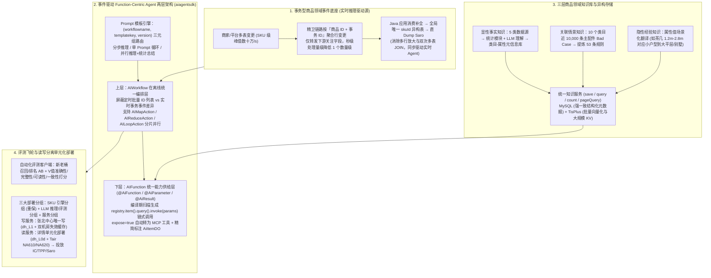

# 万级实时推理的商品领域Agent实践思考和总结

## 1. TL;DR

1. **事件驱动的 Function-Centric Agent 两层架构**：基于 `spring-ai-alibaba` 轻度耦合与自研轻量 `aiagentsdk`（几乎 100% 由 Cursor 辅助 2 小时对话 + 2 天测试生成），构建“上层业务场景 `AIWorkflow` 编排层 + 下层 `AIFunction` 统一能力供给层”，实现商品智能化从 `T+1` 离线单点提效迈向万级实时推理的“系统自治”。
2. **编译期链式调用与 MCP 自动转换**：通过 `@AIWorkflow`、`@AIAction`（含 `AIMapAction` / `AIReduceAction` / `AILoopAction`）、`@AIFunction`、`@AIParameter`、`@AIResult` 等注解规范，利用类似 Lombok 的编译期扫描生成 `registry.item().query().invoke(params)` 强类型链式调用（彻底消除枚举常量泛滥），且当 `expose=true` 时可一键转化为高质量 MCP 工具。
3. **三层商品领域知识库与 MySQL + TisPlus 异构存储**：构建**显性事实知识**（类目-属性元信息，如显卡 GPU 品牌定义与填写率）、**关联情景知识**（从 10 个类目近 10,000 条主配件 Bad Case 中提炼出 53 条规则）与**隐性经验知识**（如茶几 1.2m–2.8m 尺寸对应的户型场景翻译），底层通过 **MySQL（强一致元数据）+ TisPlus（批量向量化与大规模 KV 语义检索）** 统一提供服务。
4. **精卫事务聚合降维与在离线一体成效**：针对商品行变更膨胀至 SKU 行变更（从**万/秒升至数十万/秒**）及 Saro 多表双次 JOIN 放大难题，在精卫链路按“**商品 ID + 事务 ID**”聚合行变更，**将秒级事务处理量级降低一个数量级**；配合张北中心唯一写（`dh_L1`）+ 单元化多活就近读（`dh_L0d` + Tair `NA610/NA620`），已覆盖**亿级在线商品**，新业务需求研发周期缩短至 **1 周/人**。

## 2. 问题定义与背景

### 2.1 为什么商品域必须从 `T+1` 离线批处理演进为实时 Agent？

早期商品理解（卖点生成、规格提取、属性标准化）沿用“ODPS 离线节点 + 批量推理平台（Omega）”的 `T+1` 生产模式，在 2024–2025 年深入落地中暴露出四大工程瓶颈：
1. **复杂 SQL/UDF 与离散节点维护高昂**：大量精力耗费在数据清洗解析与离散节点调度上，受上游延迟与大促资源争抢影响大。
2. **缺乏多轮与复合推理扩展性**：离线节点 + Omega 难以灵活支撑多轮迭代推理、多模型对比以及推理后自动追加评测子流程。
3. **GPU 资源池共享争抢与独占浪费两难**：共享池产出不稳定，按卡粒度独占又易造成算力闲置或吞吐不足。
4. **在线与离线两套技术栈彻底割裂**：代码、调度、推理逻辑各自独立维护，不仅研发成本翻倍，更无法保障在离线数据口径一致。

与此同时，主搜全面推进 **SKU 化**（自 2015 年起演进的核心命题），商家或平台一次操作涉及多张表事务变更，从商品行到 SKU 行的变更峰值从**数万/秒激增至数十万/秒**。单纯的 Prompt、单轮 RAG、微调或裸 Function Calling 均无法独立闭环“采集小红书站外知识 $\rightarrow$ 调用统计策略 $\rightarrow$ 分析消费者提及率 $\rightarrow$ 生成决策属性建议 $\rightarrow$ 提交审核”的多跳自治流程。

## 3. 知识框架

## 4. 核心内容拆解

### 4.1 `aiagentsdk` 与 Function-Centric 两层统一架构

团队拒绝引入笨重的外部全家桶或在 Java 中重复造庞大平台，而是基于 `spring-ai-alibaba` 仅用 **Cursor 对话 2 小时 + 2 天测试打磨**构建了近 100% AI 生成的轻量级 **`aiagentsdk`**：
1. **`@AiFunction` 标准化契约**：
   - **基础必备字段（对齐 OpenAI Function Spec）**：`name`、`description`（必填）、`parameters`（通过 `@AiParam` 反射自动推导）、`returns`、`expose`（为 `true` 时由 `AIWorkflowScanner` / `AiFunctionScanner` 自动注册为外部问答 Agent 可调用的 MCP 工具）。
   - **治理扩展字段**：`tags`（如 `"llm"`, `"rag"`, `"电商数据"`）、`author`、`sideEffect`（布尔值，标识写库/发消息副作用）、`timeoutMs`、`deprecated`。
   - **LLM 友好 DTO 裁剪**：例如 `queryAiItemById` 返回的 `AiItemDO` 对底层 HSF 接口庞大的 `ItemDO` 做了大幅字段精简与中文语义标注。
2. **编译期扫描链式访问规范**：
   - 摒弃易导致字符串常量或枚举泛滥的 `functionRegistry.invoke("ITEM_QUERY")`，采用仿老 IC 客户端的 `{Registry}.{DomainRegistry}.{FunctionClass}.{FunctionName}` 规范，通过类似 Lombok 的编译期注解扫描自动生成引用，实现 `registry.item().query().invoke(params)` 强类型调用。
3. **在离线一体 `AIWorkflow` 与分布式 Action 节点**：
   - 同一套由 `Function`（原子能力）、`Action`（业务动作，含 `AIMapAction`、`AIReduceAction`、`AILoopAction`）与 `Workflow`（流程编排）组成的代码，向上同时承接**离线调度批量实体 ID 列表**与**在线商品变更实时事件**，向下统一调用存储 Function 双写 **MySQL/在线存储** 与 **ODPS 离线数仓**。

### 4.2 三层商品领域知识库：从定义、生产到异构存储

1. **显性事实知识（类目-属性元信息）**：
   - 整合五类数据源（商品 SKU 主数据、主图、小红书笔记/评价等外部素材、原始商品属性、人工评测与运营配置），分别输入**统计分析模块**（计算填写率、SKU 数、属性 PV 对、优级 SKU 占比）与 **LLM 理解模块**（图文属性提取、同义词与客观定义生成，如显卡“GPU 品牌”的 Top 值与定义），构建结构化类目-属性元知识库并向量化入库。
2. **关联情景知识（商品-商品 / 商品-场景关系）**：
   - 典型应用于主配件识别场景，从 **10 个类目的近 10,000 条 Bad Case** 中归纳提炼出 **53 条结构化规则**（如笔记本电脑类目的主配件判定规则）。
3. **隐性经验知识（V 值场景化主观翻译）**：
   - 将冰冷的规格参数转化为建立消费者信任的导购语言，例如在茶几 SKU 智能筛选中，将长度 `1.2米` $\rightarrow$ `2.8米` 分别映射为“小户型优选”、“适配三人沙发”、“大客厅标配”、“大平层理想尺寸”、“别墅客厅优选，搭配 L 型沙发”等 `scenario_translation`。
4. **MySQL + TisPlus 双层异构存储服务**：
   - 对外暴露标准 `save / query / count / pageQuery` 函数接口；底层以 **MySQL** 保障结构化元信息的事务强一致性，以 **TisPlus** 支撑批量向量化、高维语义索引与大规模 KV 历史回溯。

### 4.3 事务型商品领域事件与读写分离单元化部署

1. **精卫链路“商品 ID + 事务 ID”聚合降维（核心突破）**：
   - 传统 Saro 或精卫通道提供的是“单表 + 单行变更”视角：商家一次商品编辑往往触发多表多行事务，且若 A 表 `A1` 字段与 B 表 `B1` 字段先后变更，在 Saro 链路上会触发 **2 次多表 JOIN**，导致计算量随十万级/秒 SKU 变更剧烈放大。
   - **SKU 引擎 2.0 升级**：在精卫链路基于**“商品 ID + 事务 ID”**对多表行变更做聚合并仅转发下游关注字段，直接**将秒级需处理的事务量级降低了一个数量级**；下游 Java 应用消费聚合事务消息补全数据后，落入以全局唯一增强 `skuId` 为主键的异构 SKU 表并直接 Dump 至 Saro，彻底消除了多行放大与多表 JOIN，同时成为商品 Agent 实时推理的高性能事件源。
2. **七层模块化代码结构与三大生产集群分组**：
   - **代码分层**：`item-agent-client`（JDK 8 兼容轻量 SDK）$\rightarrow$ 服务层（`agent-server` / `item-agent-instances` / `item-agent-evaluation-client`）$\rightarrow$ `item-agent-functions` $\rightarrow$ `item-agent-sdk` + 公共层（`item-agent-event-engine` / `item-agent-admin`）。
   - **部署架构**：划分为 **SKU 引擎分组（主搜重保）**、**LLM 推理与评测分组**以及**读写分离单元化服务分组**——写服务以**张北中心**为唯一写入节点（经 `dh_L1` 与双机房失效缓存写中心 DB）；读服务按详情等单元化流量部署（经 `dh_L0d` 与 Tair 分布式缓存 `NA610/NA620` 及跨中心单元同步实现低延迟就近读取），最终通过 `IC / TPP / Saro` 投放至搜索与详情导购场域。

## 5. 数据速查表

| 维度 / 模块 | 关键量化数值 | 工程含义与业务效果 |
| :--- | :--- | :--- |
| **变更吞吐挑战与聚合降维** | 商品级 `万/s` $\rightarrow$ SKU 级 **`数十万/s`** | 精卫按“商品 ID + 事务 ID”聚合后，**秒级事务处理量级降低 `1 个数量级`** |
| **关联情景知识提炼规模** | **`10 个类目`、近 `10,000 条` Bad Case** | 归纳沉淀出 **`53 条`** 主配件关联判定规则 |
| **`aiagentsdk` 研发效率** | **Cursor 对话 `2 小时` + 测试打磨 `2 天`** | 核心 SDK 代码**近 `100%` 由 AI 生成**，保持“恰好够用”的极简设计 |
| **业务覆盖规模与新需求交付** | 覆盖 **`亿级` 在线商品**，新需求 **`1 周 / 人`** | 完成能力开发、数据试跑与评测调优全流程，搜索与详情成交转化率正向提升 |

## 6. 踩坑与教训 / 可迁移的设计原则

1. **高并发实时 Agent 必须将触发源从“底层表行变更（Row CDC）”提升到“领域事务事件（Domain Transaction Event）”**：直接订阅单表行变更会遭遇多表拆分放大与重复 JOIN 风暴；在消息采集层按“`EntityID + TransactionID`”做窗口聚合，可立竿见影砍掉一个数量级的无效调用。
2. **用编译期代码生成解决统一 Function 注册表的“字符串/枚举爆炸”**：当系统沉淀上百个 `@AiFunction` 时，借助注解处理器在编译期生成 `registry.domain().func().invoke()` 链式存根，兼顾 IDE 编译期类型安全与运行时统一调度（同时支持 `expose=true` 自动暴露 MCP）。
3. **坚持“一套 `AIWorkflow` 代码同时跑通离线批量与在线实时”**：将触发源（定时 ID 列表 vs 实时事务消息）与落地存储（ODPS vs MySQL/Tair）抽象为首尾可插拔适配器，中间的 `Map / Reduce / Loop` 推理与 Prompt 路由逻辑 100% 共享，彻底终结在离线两套代码口径不一的顽疾。

## 7. 记忆锚点

- **一个核心架构名**：事件驱动的 **Function-Centric Agent** 两层架构（上层 `AIWorkflow` 编排 + 下层 `AIFunction` 供给）。
- **三层商品领域知识**：显性事实知识（类目-属性元信息）+ 关联情景知识（10 类目万条案例提炼 53 条主配件规则）+ 隐性经验知识（V 值户型场景翻译），底层 `MySQL + TisPlus` 异构存储。
- **三项关键工程设计**：精卫 `商品ID + 事务ID` 聚合降维（降 1 个数量级）+ 编译期链式调用 `registry.item().query().invoke()` + 张北中心写（`dh_L1`）/ 单元化就近读（`dh_L0d` + Tair `NA610/NA620`）。

## 8. 复习卡片

1. 为什么商品中心在推进 AI 化时放弃了原有的“ODPS 离线节点 + Omega 批量推理”架构？::因为旧架构存在复杂 SQL/UDF 与离散节点维护成本高、难以支持多轮迭代与评测子流程扩展、GPU 共享争抢与独占浪费两难、以及在线与离线两套技术栈割裂导致逻辑不一致四大问题。
2. `aiagentsdk` 中的 `@AiFunction` 注解包含哪些治理扩展字段？如何避免调用时出现字符串常量或枚举泛滥？::除 OpenAI 标准字段外，扩展了 `tags`、`author`、`sideEffect`（是否有写库等副作用）、`timeoutMs` 和 `deprecated`；通过类似 Lombok 的编译期注解扫描自动生成 `{Registry}.{DomainRegistry}.{FunctionClass}.{FunctionName}` 链式调用（如 `registry.item().query().invoke(params)`），并在 `expose=true` 时自动转换为 MCP 工具。
3. 商品领域知识库划分为哪三个层次？底层采用什么存储架构？::划分为显性事实知识（类目-属性元信息，整合 5 类数据源）、关联情景知识（如从 10 个类目近万条主配件 Bad Case 中总结出 53 条规则）和隐性经验知识（如将茶几尺寸翻译为户型导购场景）；底层采用 MySQL（强一致结构化元数据）+ TisPlus（批量向量化与大规模 KV 存储）的两层异构存储。
4. Prompt 管理模块如何管理提示词版本，并在 `AIWorkflow` 中结合哪些 Action 节点支持复杂推理？::通过 `(workflowname, templatekey, version)` 三元组持久化与路由读取 Prompt；结合 SDK 中的 `AIMapAction`、`AIReduceAction` 和 `AILoopAction` 节点，支撑长 Prompt 拆分后的分步推理、单 Prompt 循环执行、以及并行推理+统计总结。
5. 面对从商品行到 SKU 行变更峰值达“数十万/秒”的挑战，SKU 引擎 2.0 是如何消除多行放大与多表双次 JOIN 的？::在精卫链路基于“商品 ID + 事务 ID”对多表行变更进行聚合并仅转发下游关注字段，将秒级处理的事务量级降低一个数量级；下游 Java 应用消费补全后写入以全局唯一 `skuId` 为主键的异构表并直 Dump 到 Saro，同时作为实时 Agent 的事件驱动源。
6. 商品 Agent 的生产部署架构分为哪三个分组？其读写分离与单元化策略是怎样的？::分为 SKU 引擎分组（主搜重保）、LLM 推理与评测分组、以及服务分组；写服务以张北中心为唯一写入节点（通过 `dh_L1` 与双机房失效缓存写中心 DB），读服务按详情等单元化流量部署（通过 `dh_L0d` 与 Tair `NA610/NA620` 及单元同步实现低延迟就近访问）。

## 9. 知识关联

- **所属主题**：
  - [Harness与模型协同](../../20_topics/Harness与模型协同.md)
  - [分布式计算与数据管道](../../20_topics/分布式计算与数据管道.md)
  - [决策知识结构化](../../20_topics/决策知识结构化.md)
  - [Agent工程循环](../../20_topics/Agent工程循环.md)
- **本地跃迁**：[原始 PDF](RAW.pdf) · [逐页转写文本](MD.md)
- **候选双链**：[[面向LLM的AI Friendly架构]] · [[淘宝交易结算缓存实践总结]] · [[智能导购Agent评测实践]] · [[构建高质量RAG知识库]]

## 10. 原文参考资料

1. **开发框架与开源生态参考**：`spring-ai-alibaba`、LangChain、LlamaIndex、AutoGen、CrewAI、MetaGPT、OpenDevin、DeepEval
2. **集团内部数据与中间件基建**：商品中心（IC / GALIC DB）、精卫（CDC 变更采集）、Saro / TPP（搜索推荐实时存储与投放）、TisPlus（向量与 KV 存储）、Tair（`NA610/NA620` 分布式缓存）、`dh_L1` / `dh_L0d` 数据服务层、ODPS 与 Omega 批量推理平台

> [!note]- 校对报告
> - **页码溯源**：p.1–3（商品域 T+1 离线向万级实时推理演进四大问题、Prompt/RAG/Fine-tuning/MaaS/Function Calling 局限与 Agent 容器定位）；p.3–7（`spring-ai-alibaba` 选型、Function-Centric 两层架构、`aiagentsdk` 核心类图、`@AiFunction` 基础与扩展字段、编译期扫描 `registry.item().query().invoke(params)` 链式调用、`AiItemDO` 精简标注）；p.7–11（显性事实知识 5 类数据源生产、关联情景知识 10 个类目近 10000 条案例提炼 53 条规则、隐性经验知识茶几 1.2m–2.8m 场景翻译、`MySQL + TisPlus` 两层异构存储）；p.11–16（Prompt `(workflowname, templatekey, version)` 三元组管理类图、`Map/Reduce/Loop` 节点、旧架构 `ODPS + Omega` 四大痛点与新架构在离线一体 `AIWorkflow` 双写机制）；p.16–21（新老桶 AB 与 V 值多维自动化评测体系、IC/TPP/Saro 投放链路、SKU 行变更万/s 到数十万/s 挑战、精卫 `商品ID+事务ID` 聚合降一个数量级并消除 2 次 JOIN、7 层应用模块与张北写 `dh_L1` / 单元化读 `dh_L0d`+Tair `NA610/NA620` 部署架构、Cursor 2 小时+2 天生成近 100% SDK 代码、亿级商品覆盖与 1 周/人新需求交付周期）。
> - **一致性核验**：作者（勇清，淘天集团-商品中心技术团队）、发布时间（2026-05-25）、全部架构类名、JSON 样例与量化指标均逐页核对一致；正文中无任何内联页码引用。
> - **质量边界**：文中 UML 类图与架构图已在正文中通过 Mermaid 与结构化列表完整还原。
