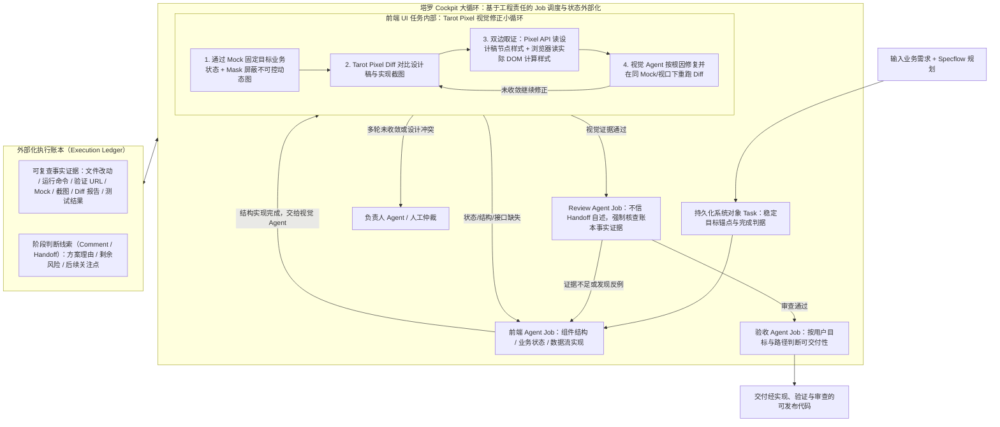

# 场景营销互动&体验 AI Coding — 构建 Agent 自主执行闭环

## 1. TL;DR

本文是淘天场景营销互动&体验团队（塔罗平台）AI Coding 系列的第三篇，聚焦于在具备业务上下文（`Specflow Agent`）与视觉上下文（`Tarot Pixel`）之后，如何通过**循环工程（Loop Engineering）**解决“Coding Agent 能完成单轮编码却无法独立交付完整需求”的痛点。作者指出，上下文工程只能提升单轮执行概率，而循环工程负责吸收并处理长链路中的执行偏差。塔罗通过四大核心机制将原本由人类隐式承担的调度与验收工作系统化：① 将规划文档升级为持久化系统对象 **Task（目标锚点）**；② 定义 **Job 为最小执行单元**并强制要求结构化出口结果与完成证据；③ 建立区分“可复查事实证据”与“阶段判断线索（Handoff）”的**外部化执行账本**；④ 按稳定的工程责任与完成标准划分**五类 Agent 角色**（前端/视觉/Review/验收/负责人），并内嵌基于双边取证的 **Tarot Pixel 视觉修正小循环**，实现可收敛的多轮自动研发闭环。

## 2. 问题定义与背景

### 2.1 为什么具备了业务与视觉上下文，仍需要人类持续盯盘

在塔罗平台前两阶段建设中，`Specflow Agent` 提供了 PRD/设计稿/代码库的业务与实现上下文，`Tarot Pixel` 提供了设计稿查询、截图与比对的视觉上下文。但进入长链路代码交付时，人类开发者仍被迫充当“隐形调度器”，反复执行六项人力工作：
1. 提醒 Agent 不要在多轮返修中遗忘最初的整体目标；
2. 甄别 Agent 自称“已完成 xx 功能”的声明是否真实成立；
3. 决定 Review 打回后该交由哪个角色返修；
4. 把上一轮结论手动转述给下一轮会话；
5. 发现 Agent 陷入重复无效尝试时及时叫停；
6. 在需求变更时通知旧目标已失效。

### 2.2 循环尚未工程化的五大典型症状

| 症状编号 | 失败现象 | 底层机制根因 |
| :--- | :--- | :--- |
| **1. 目标缺乏持久化载体** | 运行数十分钟经历多轮返修后，Agent 只围绕最近一条 Review 意见打转，把解决局部问题误判为整体需求完成 | 初始目标仅存在于首轮 Prompt 或静态文档中，随对话推进被中间过程稀释 |
| **2. 执行状态依赖对话历史** | 下一轮 Agent 必须重读冗长历史来推断改动文件、已验证状态与 Mock 对应关系，成本高且易受失效结论干扰 | 对话历史混杂了事实、推测、计划与作废结论，系统缺少结构化当前有效状态 |
| **3. 完成声明缺乏验证与路由依据** | Agent 输出“已完成 xx 功能，建议下一步进行 xx”的自然语言总结，系统无法据此自动推进流程 | 自然语言回复未绑定结构化完成状态、验证证据与确定的下一跳出口 |
| **4. 反馈缺少工程责任归属** | Review 发现“页面状态不完整”时，若统统退回同一个通用 Agent，修改往往停留在表层 | 未按视觉偏差、前端状态缺失、接口阻塞、产品边界划分独立责任角色 |
| **5. 循环缺乏收敛与止损机制** | 持续把失败结果喂给下一轮，Agent 只是换种措辞重复相同的错误尝试 | 缺少重试上限、证据门禁与转交负责人/人工仲裁的明确停止条件 |

## 3. 知识框架

## 4. 核心内容拆解

### 4.1 从静态文档到持久化 `Task` 与最小执行单元 `Job`

**核心主张**：Prompt 中的重复提醒无法形成长程目标牵引；必须将目标建模为独立于对话窗口的系统对象 `Task`，并将每一轮具体工作约束为带结构化出口与强制证据的 `Job`。

- **结构化 `Task`（跨越 5 分钟到 50 分钟的目标锚点）**：
  - 塔罗第二版将 `Specflow` 产出的规划报告改造为平台可保存、修改、验证和回溯的系统对象 `Task`，强制结构化记录六项要素：**① 最终要达成什么结果；② 哪些状态和用户路径属于本次范围；③ 哪些内容明确不做；④ 依赖哪些上游条件；⑤ 什么证据可以证明任务完成；⑥ 当前执行到了哪个阶段**。
  - 无论 Agent 运行到第 5 分钟还是第 50 分钟、对话上下文如何更替，只要用户未显式修改目标，`Task` 始终是系统判断“有没有做完”的唯一基准。
- **最小执行单元 `Job` 的四要素契约与五类结构化出口**：
  - `Agent` 代表一种稳定的能力与工程责任，而 `Job` 代表该角色当前要完成的一轮具体工作。每个可进入自动循环的 `Job` 必须明确：**① 这一轮解决什么问题；② 允许用哪些结构化结果结束；③ 结束时必须留下什么证据；④ 不同结果分别流向哪里**。
  - 以“前端开发 Agent 完成一次 UI 可见改动”为例，严禁仅返回一段自然语言总结，系统强制其只能从以下 **5 种结构化结果**中择一结束：
    1. `结构实现完成，交给视觉 Agent`
    2. `无需视觉验证，并给出理由`
    3. `缺少接口条件，交给负责人仲裁`
    4. `当前方案失败`
    5. `任务被新要求中断`
  - **局部失败隔离**：若 Agent 结束时未给出当前 `Job` 接受的结构化结果，系统将其标记为**“未闭环”**并转入审计或仲裁；当视觉修正失败或 Review 证据不足时，只需按 `Job` 颗粒度退回对应角色补齐，无需重启整条 `Task` 链路。

### 4.2 执行状态外部化：区分“可复查事实”与“Handoff 线索”

**核心主张**：多 Agent 系统的核心风险是“彼此读取总结而形成无事实依据的自我强化”；执行账本必须严格分离可复查的客观证据与仅供参考的主观交接线索。

| 账本记录类别 | 包含的具体内容 | 写入与传递载体 | 下游消费规则与防伪机制 |
| :--- | :--- | :--- | :--- |
| **可复查事实证据** | 文件改动（代码 Diff）、运行命令、验证 URL、Mock 场景、页面截图、Pixel Diff 报告、测试结果 | 直接写入**执行账本（Execution Ledger）** | 作为 Review 与验收的唯一客观依据；下一轮 Agent 只需按需读取当前 `Task`、`Job` 与必要证据，无需重读全量对话历史 |
| **阶段判断与交接线索** | 方案选择理由、剩余风险提示、后续关注点、建议接手责任角色 | 通过 **Comment** 与 **Handoff** 传递 | 🔥 **核心铁律：Handoff 只能作为线索，不能作为事实本身**（例如前端 Agent 在 Handoff 中声称“已验证所有状态”，Review Agent 严禁轻信，必须亲自核查对应的 Mock、截图、测试结果或代码 Diff） |

### 4.3 五类多 Agent 角色划分与雙层协作协议

**核心主张**：拆分多 Agent 只有在“不同角色对应稳定的工程责任、且对‘完成’的判断标准不同”时才有价值；必须将“模型单次调用结束”与“业务 Job 状态变更”严格解耦。

- **五类角色的工程责任与完成标准**：
  1. **前端 Agent**：负责组件结构、业务状态、数据流与交互入口（元素状态分支缺失退回此处）。
  2. **视觉 Agent**：负责页面截图、Pixel Diff 与可见样式修正（元素位置/尺寸偏差流向此处）。
  3. **Review Agent**：默认以挑刺视角寻找反例、风险与证据缺失（证据不足时将 `Job` 退回补充证据）。
  4. **验收 Agent**：按用户初始目标（`Task`）与真实用户路径判断是否达到可交付标准。
  5. **负责人 Agent**：处理任务分派、设计稿与需求冲突以及多轮无法自动收敛的异常仲裁。
- **沟通消息语义分离与忙碌态安全边界调度**：
  - **模型调用 $\neq$ 业务状态改变**：一次模型调用可被中断、恢复或重试，其对话结束绝不直接改变 `Job` 状态；只有提交了符合协议的“完成、阻塞、失败”结构化工作结果，流程才会路由演进。
  - **三种协作消息语义**：`Comment` 用于沉淀共享事实（不一定触发执行）；`Mention`（`@mention`）将明确问题投递给指定 Agent（系统为目标 Agent 创建附带上下文的 `Job` $\to$ 执行并提交结构化结果 $\to$ 保存交付物与回执 $\to$ 继续路由）；`Handoff` 保存阶段成果、证据与风险。
  - **忙碌态排队保护**：当目标 Agent 处于忙碌态时，新消息既不会丢失也不会无条件打断当前执行，而是由系统根据运行状态决定注入当前执行、延迟到下一轮或放入任务队列，在安全边界恢复工作。

### 4.4 前端 UI 任务中的 Tarot Pixel 视觉修正小循环

**核心主张**：通过“Mock 锁定业务状态 + Mask 屏蔽不可控动态图 + 设计侧与实现侧双边 API 取证”，让视觉 Agent 依据精确几何与样式数据修代码，而非凭截图肉眼盲猜参数。

- **Tarot Pixel 视觉修正六步小循环**：
  1. **Mock 固定目标业务状态**：同一页面包含多种业务状态，先用 Mock 锁定特定场景；**Mask 仅屏蔽商品图、用户头像等不可控运行时内容**，固定文案、装饰元素和业务状态仍严格纳入验收。
  2. **执行 Tarot Pixel Diff**：生成设计稿图、实现截图与像素级 Diff 图，定位缺失、多余、错位或尺寸不一致区域。
  3. 🔥 **设计侧与实现侧双边取证**：视觉 Agent 不靠看截图目测 CSS 参数，而是同时从 **Pixel API 读取设计稿节点的尺寸、相对位置和样式**，并从**浏览器读取实际 DOM 的位置与计算样式（Computed Style）**，以两侧结构化差异作为修改依据。
  4. **视觉 Agent 按根因修复代码**。
  5. **同条件回归对比**：在完全相同的 Mock 状态、视口尺寸和对比范围下重跑 Diff。
  6. **结构化出口分流**：视觉证据通过则进入 `Review Agent`；发现状态、DOM 结构或接口缺失则退回 `前端 Agent`；多轮修复仍不收敛则转交 `负责人 Agent` 或人工仲裁。

## 5. 数据速查表

| 指标 / 配置项 | 原文数值 / 表达式 | 语境 / 条件 |
| :--- | :--- | :--- |
| 塔罗 AI Coding 演进三阶段 | `Prompt`（单次表达） $\to$ `Context`（Specflow + Tarot Pixel） $\to$ `Loop`（自主执行闭环） | 场景营销互动&体验团队三篇系列文章的技术演进路线 |
| 长程任务目标锚点跨度示例 | 运行至第 `5 分钟` 与第 `50 分钟` | 说明对话上下文虽完全不同，但系统对象 `Task` 保持恒定 |
| 结构化 `Task` 必填要素 | `6` 项（最终结果、范围内状态与路径、明确不做内容、上游依赖、完成证据、当前阶段） | 替代第一版纯阅读性质的 Specflow 静态文档 |
| 最小执行单元 `Job` 契约要素 | `4` 项（解决什么问题、允许哪些结构化结果结束、必须留下什么证据、不同结果流向哪里） | 决定单轮工作能否进入自动循环的准入条件 |
| 前端 Agent UI 改动结构化出口 | `5` 类枚举结果（交视觉 Agent / 无需视觉验证含理由 / 缺接口交仲裁 / 方案失败 / 新要求中断） | 未返回合法枚举结果时系统强制标为“未闭环” |
| 多 Agent 工程角色数量 | `5` 类（前端 Agent、视觉 Agent、Review Agent、验收 Agent、负责人 Agent） | 按稳定工程责任与不同“完成”判断标准划分 |
| 协作消息类型 | `3` 类：`Comment`（沉淀共享事实）、`Mention`（创建 Job 派单）、`Handoff`（阶段交接线索） | 普通消息不直接改变任务状态 |
| Tarot Pixel 小循环步骤数 | `6` 步（Mock 固态 $\to$ Pixel Diff $\to$ 双边取证 $\to$ 根因修复 $\to$ 同态重比 $\to$ 出口路由） | 嵌于塔罗 Cockpit 大循环内部的 UI 验证子循环 |

## 6. 踩坑与教训 / 可迁移的设计原则

| 错误做法 | 失败表现或原因 | 原文应对（可迁移的设计原则） |
| :--- | :--- | :--- |
| **靠在 Prompt 中反复提醒来维持长链路任务目标** | 随着多轮返修推进，初始目标在长对话中被稀释，Agent 把解决最近一条局部 Review 意见当成整体需求完成 | **将目标建模为持久化系统对象 `Task`**：把目标、范围、不做项与完成证据固化为独立于对话窗口的平台对象 |
| **依赖下一轮 Agent 阅读全量历史对话来恢复状态，或让 Review Agent 直接采信上游 Handoff 总结** | 全量历史混杂失效推测且成本高；Agent 之间互信自然语言总结会形成“无真实证据的自我强化” | **执行账本外部化 + “Handoff 仅作线索”铁律**：将 Diff、截图、Mock、测试结果写入执行账本；强制 Review Agent 核查账本客观事实而非相信 Handoff 自述 |
| **把一次模型调用结束或一句自然语言“已完成”当成任务阶段完成** | 模型可能中途漏项或无证据空口宣称完成，导致下游流程在缺失前提下错误运转 | **解耦模型执行与业务 `Job` 状态**：强制 `Job` 只能以预定义的结构化枚举结果+验证证据退出，否则一律标为“未闭环” |
| **拆分多个使用相似上下文、做相似判断的同质化 Agent** | 多个 Agent 互相复述总结，不仅徒增调用成本与上下文噪声，遇到复杂缺陷依然停留在表层 | **按工程责任与不同“完成判据”拆分角色**：前端管结构状态、视觉管 Diff 还原、Review 找反例、验收看用户路径、负责人管冲突仲裁 |
| **让视觉 Agent 仅凭肉眼看截图猜测 CSS 修改参数，或在动态随机数据下做像素比对** | 随机商品图/头像会制造大量虚假 Diff 噪点；看图目测像素会导致反复试错难以收敛 | **Mock 固态 + Mask 局部屏蔽 + 双边 API 取证**：用 Mock 锁定业务状态、Mask 仅屏蔽不可控图片，同时读取 Pixel API 设计稿属性与浏览器实际 DOM 计算样式指导修复 |

## 7. 记忆锚点

- **上下文与循环分工金句**：“上下文工程提供执行输入（提高单轮正确概率），循环工程处理执行偏差（保证长链路偏航后可收敛）。”
- **塔罗闭环四柱口诀**：“`Task` 锚定总目标，`Job` 强约束四要素；账本存事实、`Handoff` 仅线索；Pixel 双边取证跑小环。”

## 8. 复习卡片

为什么作者指出“上下文工程无法替代循环工程（Loop Engineering）”？::因为真实业务开发天然存在需求歧义、状态难复现等不确定性，上下文工程（如提供 PRD 与视觉稿）只能提高单轮执行正确的概率，而循环工程通过目标锚定、证据核验、角色路由和停止条件，解决单轮执行出现偏差后如何自我修正与收敛的问题。
塔罗平台中的 `Task` 与 `Job` 各自承担什么职责，一个 `Job` 必须明确哪四件事才能进入自动循环？::`Task` 是持久化的系统级目标锚点（记录最终目标、范围、不做项与完成证据，不随对话轮次稀释）；`Job` 是某个 Agent 角色当前要完成的一轮最小执行单元，必须明确：① 本轮解决什么问题、② 允许用哪些结构化结果结束、③ 结束时必须留下什么证据、④ 不同结果分别流向哪里。
在外部化执行账本中，为什么规定 Review Agent 必须把 `Handoff` 当作线索而非事实本身？::因为多 Agent 系统若只相互读取自然语言总结（如前端 Agent 在 Handoff 中声称“已验证所有状态”），极易形成彼此强化却缺乏真实证据的虚假通过；Review Agent 必须回查执行账本中的实际代码 Diff、Mock 场景、截图和测试结果等客观事实。
在多 Agent 架构中，什么情况下拆分角色才有真实工程价值？::只有当不同角色对应稳定的工程责任边界、且它们对“完成”的判断标准各不相同（如前端管组件与状态、视觉管截图 Diff、Review 默认找反例、验收对齐用户路径、负责人管异常仲裁），问题才能沿工程边界精准路由给有能力处理的角色。
Tarot Pixel 视觉修正小循环是如何避免“动态图片干扰”和“看图盲猜 CSS 参数”的？::首先通过 Mock 固定页面业务状态，并用 Mask 仅屏蔽商品图、头像等不可控运行时图像（保留固定文案与装饰验收）；在修复阶段执行双边取证——同时调用 Pixel API 获取设计稿节点尺寸/位置/样式，并从浏览器读取实际 DOM 计算样式，凭两侧精确数据差异修复代码。

## 9. 知识关联

- **本库通用主题**：[Agent工程循环](../../20_topics/Agent工程循环.md) · [Harness与模型协同](../../20_topics/Harness与模型协同.md) · [AI研发协同](../../20_topics/AI研发协同.md) · [Agent评测与反馈](../../20_topics/Agent评测与反馈.md)
- **本篇原始与转写材料**：[原始 PDF](RAW.pdf) · [逐页转写文本](MD.md)
- **候选双链**：[[塔罗Cockpit循环工程]] · [[Tarot-Pixel双边取证视觉闭环]] · [[执行账本与Handoff分离]] · [[Job最小执行单元契约]]

## 10. 原文参考资料

- **原文信息**：《场景营销互动&体验 AI Coding — 构建 Agent 自主执行闭环》，作者：木偶（淘天集团-用户场景营销技术团队），公众号：大淘宝技术，发布时间：`2026-08-25 19:04`（浙江）。
- **系列前序文章与内部工具**（文内引用，本库 `00_inbox/大淘宝技术` 中亦存有对应 PDF）：
  1. 《场景营销前端 AI Coding — 从问题到方案》（介绍塔罗 `Specflow Agent`）
  2. 《场景营销前端 AI Coding — AI Native 的视觉稿还原》（介绍 `Tarot Pixel` 视觉上下文工具）

> [!note]- 校对报告
> 1. **页码溯源汇总**：
>    - `p.1–4`：系列前两篇回顾（`Specflow Agent` 与 `Tarot Pixel`）、长链路编码仍需人工介入的六类隐性工作、上下文工程与循环工程的本质区别，以及循环未工程化的五大症状（目标无持久化载体、状态依赖对话历史、完成声明缺验证、反馈缺责任归属、循环缺收敛机制）。
>    - `p.4–6`：将静态文档改造为持久化系统对象 `Task`（六项结构化要素，第 5 分钟与第 50 分钟保持一致）以及最小执行单元 `Job`（四项核心契约、前端 UI 改动的五种结构化出口枚举、未闭环拦截与局部失败回退）。
>    - `p.6–8`：外部化执行账本（区分可复查事实证据与 Comment/Handoff 线索，强制 Review Agent 不直接轻信 Handoff）、五类 Agent 角色划分（前端/视觉/Review/验收/负责人）、模型调用与业务工作状态分离、三种协作消息语义（`Comment` / `Mention` / `Handoff`）及忙碌态安全边界队列。
>    - `p.9–13`：前端 UI 任务中的 Tarot Pixel 六步视觉修正小循环（Mock 固定状态、Mask 屏蔽不可控动态图、设计侧 Pixel API 与实现侧浏览器 DOM 双边取证、同状态重跑 Diff 与退回/仲裁出口）、实战面板截图与 Prompt $\to$ Context $\to$ Loop 总结。
> 2. **勘误与质量边界说明**：
>    - `p.5`（服务端需求任务面板）与 `p.10–12`（编码与状态 Mock 验证、视觉 Diff 与修正过程、Review 打回与最终验收）为塔罗平台真实运行界面截图（位于 PDF 图像层），正文中已完整阐述其对应的六步流转与账本校验机制。
> 3. **核验结论**：全文满足单 H1、10 大编号章节、正文零内联页码、5 条单行 `::` 复习卡片，所有概念定义、枚举项与角色职责均与原文逐页核对一致。
