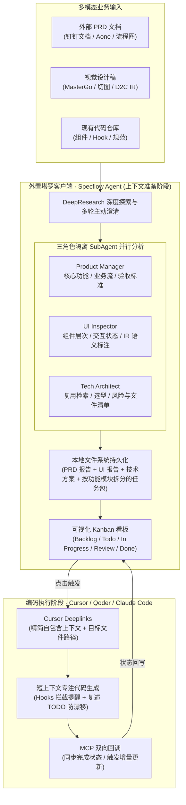

# 场景营销前端 AI Coding —— 从问题到方案

## 1. TL;DR

1. **核心问题诊断**：AI 生成了 80% 的代码但研发效率并未提升 80%，根源在于大模型自注意力机制 $O(n^2)$ 复杂度与长上下文“注意力坍塌（Lost in the Middle）”、传统 Spec 模式反直觉或流程僵化、以及 Vibecoding 长对话导致人机窗口不对称与“认知债”。
2. **真伪提效评估准则**：不能以“代码采纳率”作为 AI Coding 指标（纯对话不手写代码即可达到 100% 采纳率，但可能反复返工），真正的核心指标是**需求完成上线时的人工干预次数**；真实项目统计显示常规工程模式仅在约 20% 标准化场景真正有效，80% 复杂场景效果差甚至产生负向返工。
3. **职责分离架构（塔罗 + Specflow）**：基于 Claude Agent SDK 构建本地多 Agent 客户端“塔罗”及核心模块 Specflow，将“上下文准备（DeepResearch 语义理解与分析）”与“编码执行（IDE 短上下文生成）”彻底分离。
4. **多角色 SubAgent 与多模态 D2C 融合**：通过 Product Manager、UI Inspector、Tech Architect 三个上下文隔离的 SubAgent 并行分析 PRD、视觉稿与代码库，并在 D2C 的 IR（JSON 中间表示）之上叠加视觉语义标注，通过本地文件系统持久化、Kanban 看板、Cursor Deeplinks 与 MCP 回调构成端到端闭环。

## 2. 问题定义与背景

### 2.1 大模型的注意力边界与编码上下文困境

Transformer 自注意力机制需要计算每个 token 与其余 token 的关联度，计算复杂度与内存需求均为 $O(n^2)$（即便引入 Flash Attention、GQA、KV Cache 使单步增量推理降至 $O(n)$，长上下文性能劣化依然不可避免）。当上下文增长到几十 K 乃至上百 K 时，会出现**注意力坍塌（Attention Collapse）**与斯坦福研究指出的 **Lost in the Middle** 现象：模型注意力过度集中在末尾近期内容，中段信息检索命中率显著下滑。

在典型 AI Coding 会话中，编码真正需要的只是功能描述、2–3 个相关文件和几条规范，却往往混杂在 100K–140K+ tokens 的历史分析过程中。当上下文超过 180K–200K tokens 时输出质量明显下滑；若触发 Coding Agent 自动摘要压缩，又会造成**信息有损**（丢失具体文件路径、变量名与边界条件）、**上下文断层**与**隐含指代关联消失**。

### 2.2 现有两种主流模式的局限

1. **Vibecoding（直觉式编码）的认知债**：当对话持续到 50–80 轮时，AI 注意力窗口覆盖约 165K tokens（系统提示 10K + 历史对话 120K + 当前任务 5K + 代码上下文 30K），而人类仅记得最近 3–5 轮（约 5K tokens）。人机窗口极度不对称导致代码退化为没人真正理解的黑盒（即“认知债”）。
2. **Spec 驱动开发（OpenSpec / Spec Kit）的四重困境**：
   - **框架化编码限制灵活性**：强制要求按 `Proposal → Review/Apply → Archive` 顺序执行，违背前端“小步快跑”习惯。
   - **外部多模态上下文注入不足**：仅面向代码库内演进，无法结构化注入外部 PRD 流程图、MasterGo 设计稿与口头沟通背景。
   - **任务粒度单一**：假设“一个提案 = 一个原子变更”，无法编排跨越数天至数周的多模块依赖任务。
   - **缺乏 DeepResearch 深度探索**：Proposal 阶段过于轻量，缺乏多角色视角分析、代码库可复用资产检索与主动提问澄清。

## 3. 知识框架

## 4. 核心内容拆解

### 4.1 六大工程设计原则

1. **尊重认知规律**：不要求开发者手写完整 Spec，而是由 AI 通过深度探索与主动提问提取用户意图并生成结构化任务规格。
2. **职责分离**：阶段 1（外置 Specflow Agent）专注长链路语义理解、多角色分析与任务拆分；阶段 2（Cursor / Qoder / Claude Code）仅接收精简自包含的任务上下文，专注代码生成。
3. **多模态优先**：将 PRD 流程图、时序图与 UI 视觉稿作为一等公民输入给模型做结构化解析，补齐“视觉业务逻辑与交互细节”。
4. **持久化与复用**：将 PRD 分析报告、UI 分析报告、技术方案与任务列表持久化到本地文件系统，支持“重置上下文窗口后无损重试”以及导出任务包供团队交接复用。
5. **增量更新**：需求变更时识别受影响模块（如在已完成的主任务下派生增量子任务 `2.1` 并更新下游依赖），无需推倒重来。
6. **保持人的理解与掌控**：打破单窗口黑盒，通过 Kanban 看板与独立报告附件建立显式 Review 断点。

### 4.2 Specflow 的核心机制：DeepResearch 与功能模块拆分

1. **四步 PRD 拆解法**：
   - **文档读取与结构化**：抓取钉钉文档/Aone 内容，解析章节、表格与流程图。
   - **功能模块识别**：按页面/功能拆分模块并梳理依赖关系与复杂度。
   - **前后端职责划分**：明确前端独立实现、后端接口依赖及联调状态。
   - **按功能模块而非工序生成任务**：严禁按“定义 TS 类型 → 写组件结构 → 写样式 → 接接口”的工序拆分（会导致单任务上下文残缺）；必须按完整功能闭环拆分（如“任务 1：实现砸蛋主页面，含类型/组件/样式/交互”、“任务 2：实现奖品明细浮层”），确保单个任务在 IDE 中具备完整独立上下文。
2. **D2C 视觉语义叠加方案**：
   - 单纯的 D2C 产物（JSON 中间表示 IR 或初始 TSX）只有几何尺寸与色值（如 `120×40`、`#FF6B00`），缺乏业务语义。
   - Specflow 在 IR 之上叠加 **UI Inspector 视觉语义分析**：结合设计稿与 PRD 为元素打上业务标签（功能角色、切图 vs CSS 渐变、接口动态字段 vs 静态氛围素材），将 IR 与 PRD 分析、技术方案融合后再注入 IDE。
3. **三角色 SubAgent 并行与上下文隔离**：
   - **Product Manager（产品视角）**：输入 PRD 与功能描述，输出核心功能优先级、业务流程、异常分支与验收标准。
   - **UI Inspector（设计视角）**：输入视觉稿与界面描述，输出空间布局、组件层次、交互状态、复用模板与资源清单。
   - **Tech Architect（技术视角）**：输入需求与代码库，通过 `Grep`/`Glob` 检索可复用组件/Hook/工具函数，输出技术选型、数据流与修改文件清单。
   - 每个 SubAgent 拥有独立上下文窗口，主 Agent 仅接收结构化总结与报告文件路径，避免 50 轮探索对话污染主窗口。

### 4.3 防止 Agent 目标漂移与工程兜底

借鉴 Cursor 动态上下文发现（用文件系统管理长工具响应与历史）与 Manus 六大上下文原则（围绕 KV 缓存、遮蔽而非移除工具、文件系统作为无限上下文、复述操纵注意力、保留错误尝试、避免少样本单一化），塔罗在底层实现了四重防漂移机制：
1. **四层提示词注入**：全局规则（最高优常驻）→ Agent 专属规则 → 当前任务上下文 → 工具调用动态提醒。
2. **Claude Agent SDK 工具 Hooks 拦截**：通过 `PreToolUse` Hook 在文件读写或保存报告前校验必填字段并重申当前任务目标与验收标准。
3. **SubAgent 上下文隔离**：子任务探索过程不回流主上下文，仅返回摘要与文件索引。
4. **TODO 复述机制**：每完成一个子任务自动将待办计划复述到上下文末尾，维持近期注意力权重。

## 5. 数据速查表

| 维度 / 指标 | 数值 / 阈值 | 工程含义与实测结论 |
| :--- | :--- | :--- |
| **自注意力复杂度** | 预填充 $O(n^2)$ / 增量每步 $O(n)$ | 即便有 Flash Attention / GQA / KV Cache，上下文越长性能越易劣化 |
| **Coding 混杂上下文规模** | `100K–140K+ tokens` | 实际编码仅需 2–3 个文件与少量规范，过长历史使关键信息落入中段盲区 |
| **有效上下文天花板** | `180K–200K tokens` | 超过该阈值输出质量显著下滑，主流 Coding Agent 均以此作为窗口上限 |
| **Vibecoding 人机窗口比** | AI `165K tokens` vs 人 `~5K tokens` | 50–80 轮对话后人类仅记最近 3–5 轮，失去代码掌控并产生“认知债” |
| **真实项目有效场景占比** | 标准化场景 `~20%` vs 复杂场景 `80%` | 传统工程模式在 80% 复杂场景需 50%+ 人工返工，甚至产生负向提效 |
| **核心北极星指标** | **上线前人工干预次数** | 替代虚假的“代码采纳率”，以最少人工介入交付可维护代码衡量真提效 |

## 6. 踩坑与教训 / 可迁移的设计原则

1. **用“可恢复的文件系统索引”替代“不可逆的对话摘要压缩”**：长会话自动摘要会抹除变量名、文件路径与边界讨论；应将 PRD 报告、UI 报告、技术方案落盘为独立 Markdown 文件，通过 `Read`/`Grep`/`Glob` 按需加载。
2. **严禁按“开发工序”切分 AI 编码任务**：按“类型 → 样式 → 接口”切分会割裂上下文；必须按“垂直功能模块”切分，使每个子任务在 IDE 内自包含。
3. **外置 DeepResearch 与内置 IDE 执行解耦**：不要在 Cursor 同一个编码会话里做长篇 PRD 探索，用外置 Agent 完成多角色分析与澄清后，通过 Deeplink 将精简上下文注入全新 IDE 窗口执行，通过 MCP 回调同步状态。
4. **D2C 必须经过“业务语义标注”才能进入编码**：图层 JSON（IR）不等于业务组件，必须结合 PRD 明确动态数据绑定与交互状态后再生成代码。

## 7. 记忆锚点

- **一个核心指标转变**：摒弃“代码采纳率”，紧盯**上线前人工干预次数**。
- **两阶段物理隔离**：外置 **Specflow（DeepResearch 准备上下文）** + 内置 **IDE（短上下文专注写代码）**。
- **三角色并行 SubAgent**：`Product Manager`（业务与验收）+ `UI Inspector`（视觉与 IR 标注）+ `Tech Architect`（代码库复用与架构）。
- **四重防漂移机制**：分级提示词 + `PreToolUse` Hooks 拦截 + SubAgent 窗口隔离 + 末尾 TODO 复述。

## 8. 复习卡片

1. 为什么模型宣称支持百万级上下文，但主流 Coding Agent 仍将窗口限制在 200K 左右？::因为自注意力机制存在注意力坍塌与“Lost in the Middle”中段盲区，且 Agent 在多轮“观察—决策—行动”循环中持续追加内容，超过 180K–200K tokens 后推理稳定性与输出质量显著下降。
2. Coding Agent 在上下文逼近上限时自动触发的“摘要压缩”会导致哪三类不可逆问题？::信息有损（丢失具体文件路径、变量名与边界条件）、上下文断层（失去完整讨论脉络）、隐含指代关联消失。
3. 衡量 AI Coding 真实提效的核心指标应该是什么？为什么不能用“代码采纳率”？::应以“需求完成上线时的人工干预次数”为核心指标；因为只要开发者坚持不手写代码而靠反复对话修改，采纳率可达 100%，但实际耗费了大量交互与返工成本。
4. 为什么 Vibecoding 在 50–80 轮长对话后容易产生“认知债”？::因为人机注意力窗口极度不对称（AI 持有约 165K tokens 全量历史，人类仅清晰记得最近 3–5 轮约 5K tokens），导致开发者失去对代码结构的掌控，后续维护无法定位修改影响面。
5. Specflow 在拆分前端开发任务时，为什么强调“按功能模块拆分”而非“按工序拆分”？::按工序（类型、样式、逻辑、接口）拆分会导致单个任务的上下文残缺，IDE 无法独立完成闭环；按垂直功能模块（如砸蛋主页、奖品浮层）拆分能保证每个任务上下文完整自包含。
6. Specflow 如何解决传统 D2C（设计稿转代码）“形似神不似”的问题？::在 D2C 平台产出的几何图层 IR（JSON）之上，结合设计稿图像与 PRD 叠加一层视觉语义标注（明确组件角色、切图或 CSS 实现、接口动态字段或静态素材），并与技术方案融合后注入 IDE。
7. Specflow 与 Cursor 之间如何实现跨工具的自动化任务闭环？::通过点击看板任务生成 Cursor Deeplinks 自动打开 IDE 并注入精简任务上下文与相关文件路径；编码完成后通过 MCP 协议回调通知 Specflow 自动更新看板状态。
8. 塔罗客户端采用了哪四种机制防止长周期运行的 Agent 发生目标漂移？::多级分层提示词注入、Claude Agent SDK 的 `PreToolUse` 工具 Hooks 拦截提醒、SubAgent 独立上下文窗口隔离、以及借鉴 Manus 的末尾 TODO 复述机制。

## 9. 知识关联

- **所属主题**：
  - [AI研发协同](../../20_topics/AI研发协同.md)
  - [Harness与模型协同](../../20_topics/Harness与模型协同.md)
  - [Agent成本与上下文预算](../../20_topics/Agent成本与上下文预算.md)
- **本地跃迁**：[原始 PDF](RAW.pdf) · [逐页转写文本](MD.md)
- **候选双链**：[[企业购面向Skills编程]] · [[天猫新品AI编码实战指南上]] · [[天猫新品AI编码实战指南下]] · [[淘系交易Spec范式编程]] · [[Tarot Pixel视觉稿还原]]

## 10. 原文参考资料

1. **Lost in the Middle: How Language Models Use Long Contexts**（Stanford，关于长上下文中段信息检索能力下滑的经典研究）
2. **OpenSpec / Spec Kit / delta-spec**：社区新型规范驱动开发（Spec-Driven Development）工具体系
3. **Claude Agent SDK & Claude Cowork**：Anthropic 桌面端可编程 Agent 运行时与 Hooks 机制参考
4. **Cursor Dynamic Context Discovery & Manus Context Engineering Principles**：利用文件系统作为无限上下文桥梁与注意力复述机制的工程实践

> [!note]- 校对报告
> - **页码溯源**：p.1–5（AI Coding 效率瓶颈、Transformer $O(n^2)$ 自注意力瓶颈、注意力坍塌与 Lost in the Middle、180K–200K 有效上下文天花板与摘要压缩缺陷）；p.6–12（Vibecoding 与 Spec 驱动对比、真伪提效评估与 20%/80% 项目统计、OpenSpec 四大局限、165K vs 5K 人机窗口不对称与认知债、多模态缺失与三层根源总结）；p.12–15（四大核心论点、以人工干预次数为指标、六大工程原则）；p.15–26（塔罗客户端与 Specflow Agent 架构、DeepResearch 四步 PRD 分析、功能模块拆分原则、D2C IR 视觉语义叠加、持久化重试与任务包导入导出、增量更新、Product Manager / UI Inspector / Tech Architect 三 SubAgent 并行、Cursor Deeplinks + MCP 双向通信、对比 Cursor Plan 的五大差异）；p.26–31（Cursor 动态上下文发现与 Manus 六大原则、文件系统作为上下文桥梁、四重防目标漂移机制与 Hooks 工程兜底、未来展望与总结）。
> - **一致性核验**：原文标题、团队（淘天集团-用户场景营销技术团队，作者木偶）、发表日期（2026-06-22）、全部核心定量指标（80%/20%、100K–140K、180K–200K、165K vs 5K）与架构模块均已逐页核对一致；正文中无任何内联页码引用。
> - **质量边界**：文中部分上下文 token 分布数字为作者用于阐释原理的典型工程示意值，已在笔记中忠实呈现其工程边界说明。
