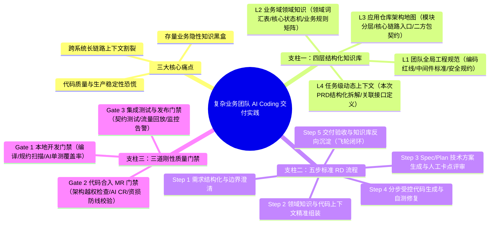
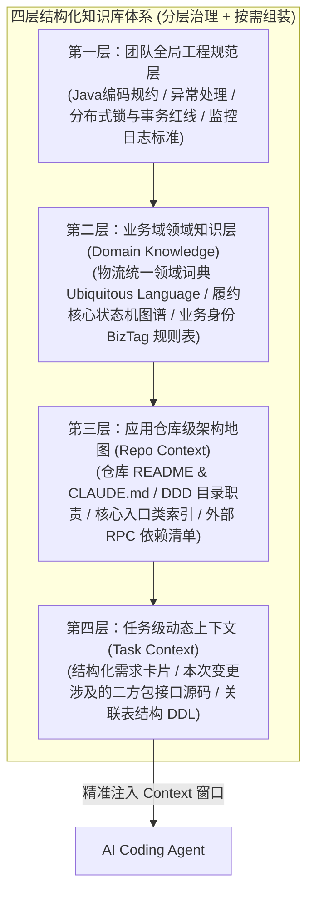
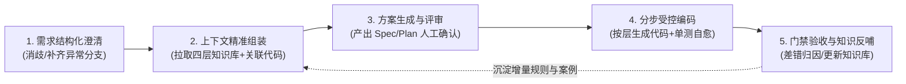

# 复杂业务团队的 AI Coding 交付实践：知识库、RD 流程和质量门禁

> [!abstract] 导读
> **一句话总结**：淘天集团物流技术团队针对存量复杂业务（多系统长链路交互、历史隐性规则繁多、强稳定性与资损红线）下 AI Coding “一写Demo猛如虎、一改核心业务就翻车”的困境，系统性构建了 **“四层结构化知识库 + 五步标准 AI 研发流程（RD Flow）+ 三道刚性质量门禁”** 的铁三角工程体系，推动团队从“个人零散用 AI 补全代码”跃迁至“复杂业务需求端到端可信交付”。
> **阅读价值**：全文长达 30 页，是存量复杂服务端/业务团队落地 AI Coding 最详实的工程手册之一，完整给出了知识库目录分层、研发五步 SOP 与三道质量卡点的设计细节。

## 1. TL;DR

- **核心矛盾**：在从零新建的独立小项目（Greenfield）中 AI Coding 表现惊艳，但在沉淀多年、跨越十余个微服务的**存量复杂业务系统（Brownfield，如电商物流履约链路）**中，AI 面临**业务知识缺失、跨仓库上下文割裂、代码质量无兜底**三大鸿沟。
- **破局“铁三角”架构**：
  1. **四层结构化知识库（解决“AI 不懂业务与存量架构”问题）**：构建 **全局通用规范层 → 业务域领域知识层 → 应用仓库架构层 → 变更任务动态上下文层** 四级知识体系，实现隐性知识显性化与按需精准召回。
  2. **五步标准 AI 研发流程（解决“人机协作无章法”问题）**：将需求交付固化为 **`需求结构化拆解 → 知识检索与上下文组装 → 技术方案生成与评审（Spec/Plan） → 分步受控编码 → 自动化验证与知识反哺`** 五个标准阶段。
  3. **三道刚性质量门禁（解决“AI 生成代码不敢上线”问题）**：在编码后、合并前、发布前设立 **G1 本地静态与单测自检门禁 → G2 MR/PR 智能评审与架构合规门禁 → G3 集成回归与线上灰度门禁**，守住零故障底线。
- **关键制度创新**：推行**“知识库即代码（Docs as Code）”与强制反哺机制**——任何一次人工修改 AI 代码或修复线上/测试 Bug，都必须归因“是哪条知识缺失导致 AI 写错”，并同步更新知识库或门禁规则。

## 2. 问题定义与背景

### 2.1 复杂存量业务（物流履约）为什么是 AI Coding 的“深水区”？
电商物流履约系统连接着交易下单、仓储调拨、干支线运输、末端派送、逆向退换货与赔付核算，具有典型的**高复杂度存量系统（Legacy Complex Domain）**特征：
1. **状态机极其庞大且分支密集**：一张物流履约单涉及数十种主子状态流转、海淘/冷链/大件等上百种特殊业务身份（BizTag）与定制规则。
2. **跨仓库、跨系统协同链路长**：一个普通业务需求往往需要同时改动三四个微服务仓库，涉及大量 HSF 二方包接口与消息队列（MetaQ）契约。
3. **历史包袱与隐性规则（Tacit Rules）遍布**：许多看似不合理的防重逻辑、降级开关或兼容分支，是为了应对多年前某次大促极端场景留下的保護机制，代码里没有注释，只留在老员工脑中。
4. **容错率极低**：一旦改错状态机或算错运费赔付，立刻引发大面积包裹卡单或直接资损。

### 2.2 早期粗放式 AI Coding 的三大失败模式

| 失败模式 | 典型工程现场 | 根本症结 |
| :--- | :--- | :--- |
| **盲人摸象式幻觉** | AI 看到表面方法名就开始改逻辑，漏掉了某个特定业务身份的防重校验，或自己捏造了一个不存在的二方包方法。 | **上下文饥饿**：AI 只有当前打开的几个源码文件，缺乏业务领域字典与跨系统调用全景。 |
| **抽卡式Prompt反复返工** | 工程师把整篇口语化 PRD 直接丢给 AI 让它“一键生成代码”，生成几千行废代码后不得不全部删掉重写。 | **流程失控**：跳过了需求结构化澄清与架构设计评审（Plan），步子迈得太大超出了模型单步推理极限。 |
| **评审风暴与信任崩塌** | AI 几分钟吐出上千行代码，但存在大量隐蔽的空指针、并发安全隐患或违反团队分层规范的代码，Code Reviewer 审得苦不堪言。 | **缺乏自动化门禁**：没有用机器门禁先过滤掉 90% 的低级规范与逻辑错误，把验证成本转嫁给了人工。 |

## 3. 知识框架

## 4. 核心内容拆解

### 4.1 支柱一：四层结构化知识库架构（让 AI 真正懂业务）

为了既让 AI 拥有完备的业务背景，又不把百万行代码和海量过期 Wiki 一股脑塞爆 Context 窗口，团队设计了**四层漏斗式知识库**：
1. **第一层：全局工程规范层（Global Engineering Standards）**
   - 沉淀全团队通用的技术底线：统一错误码体系、日志打印规范、并发线程池使用红线、数据库慢 SQL 防范准则、幂等与防重设计模板。
2. **第二层：业务域领域知识层（Domain Knowledge Base）**
   - 这是攻克复杂业务最关键的一层。团队梳理了物流核心域的**统一语言字典（Ubiquitous Language，消除同词异义与异词同义）**、**核心单据全生命周期状态机流转图（Mermaid 格式，AI 原生易读）**，以及不同业务身份（如次日达、送货上门、跨境保税）的特殊规则矩阵。
3. **第三层：应用仓库架构地图（Repository Map）**
   - 直接随源码仓库版本化管理（如仓库根目录与核心模块的规约文件）。清晰标注本应用的系统定位、DDD 分层目录结构、核心领域服务入口类、数据库表说明以及上下游 RPC/消息依赖，充当 AI 在百万行代码库中寻路的“高精地图”。
4. **第四层：任务级动态上下文（Task-Specific Context）**
   - 针对每一次具体需求动态组装的上下文包，包含结构化后的需求描述、本次改动涉及的跨仓库二方包接口定义及数据表 DDL。

### 4.2 支柱二：五步标准 AI 研发流程（5-Step RD Workflow）

团队明令禁止“拿着口语化 PRD 直接让 AI 写代码”的粗放做法，推行标准化五步法：
1. **Step 1：需求结构化与边界澄清（Requirement Structuring）**
   - 利用 AI 辅助审阅原始 PRD，自动识别缺失的边界条件（如：超时如何处理？逆向取消时状态如何回滚？存量在途单如何兼容？），输出标准化的结构化需求规约。
2. **Step 2：领域知识与代码上下文组装（Context Assembly）**
   - 根据需求涉及的业务域与应用仓库，按需检出 L1~L3 知识片段及关联源码，确保 AI 在动手前拥有完整且无噪声的上下文。
3. **Step 3：技术方案生成与人工卡点评审（Spec & Plan Review）**
   - **最关键的人机协同握手机制**：AI 先输出包含接口定义、状态机变更、数据库/缓存影响面、改动文件清单及测试策略的详细技术方案（Spec/Plan）。**工程师必须在这一步完成架构审核与拍板**，确认方向无误后才允许进入编码阶段。
4. **Step 4：分步受控编码与自测闭环（Controlled Coding）**
   - 拒绝一次性生成数千行代码，而是按“领域模型/接口定义 → 核心业务逻辑 → 基础设施适配 → 单元测试用例”分步生成，每一步立即在本地触发编译与单测，利用报错信息驱动 AI 自动修正。
5. **Step 5：交付验收与知识飞轮反哺（Feedback & Knowledge Flywheel）**
   - 需求交付后，复盘过程中“人工干预改写了哪些代码”：如果是业务规则 AI 不知道，就补进 L2 领域知识库；如果是架构写法不对，就补进 L1/L3 工程规约，让知识库越用越聪明。

### 4.3 支柱三：三道刚性质量门禁（3-Tier Quality Gates）

为了消除团队对“AI 写出线上故障”的担忧，用自动化刚性门禁替代人肉盯防：

| 门禁阶段 | 触发时机 | 刚性检查项与拦截标准 | 核心作用 |
| :--- | :--- | :--- | :--- |
| **Gate 1：本地开发门禁** | 本地编码完成 / 提交 Commit 前 | 编译通过、静态代码规约扫描（零 Blocker/Critical）、增量代码单元测试生成与执行（核心分支覆盖率达标）。 | 在开发者本机消灭语法错误、规约违例与基础逻辑漏测。 |
| **Gate 2：代码合入（MR/PR）门禁** | 发起 Merge Request 时自动触发 | **架构合规校验**（禁止跨 DDD 层越权调用）、**方案一致性比对**（实际代码改动是否偏离评审通过的 Spec）、**AI 深度 Code Review**（聚焦并发安全、幂等防重、空指针与资损高危点）。 | 防止劣化架构、拦截隐蔽并发与资损隐患，减轻人工 CR 负担。 |
| **Gate 3：集成回归与发布门禁** | 部署测试环境 / 预发上线前 | 跨服务接口契约测试、核心物流履约链路自动化回归用例、线上真实流量仿真回放对比、灰度监控指标卡点。 | 验证多系统长链路协同正确性，守住生产环境稳定性最后一道防线。 |

## 5. 数据速查表

| 维度 | 传统单点 AI 辅助模式 | 复杂业务“铁三角”交付体系 | 工程机制保障 |
| :--- | :--- | :--- | :--- |
| **知识供给方式** | 靠开发者临时手敲口语 Prompt | **四层结构化知识库**（全局规范+领域词典+仓库地图+任务上下文） | Docs as Code 版本化演进 |
| **人机分工卡点** | AI 生成完几千行代码后人工再去大海捞针修 Bug | **Step 3 技术方案（Spec/Plan）前置人工评审** | 把纠偏左移到方案设计阶段 |
| **编码颗粒度** | 试图一步到位生成全量变更 | **分步受控生成 + 本地单测即时自愈** | 控制单步推理复杂度与上下文膨胀 |
| **质量保障手段** | 依赖人工肉眼 Code Review 与手工点测 | **三道刚性质量门禁（本地单测 + MR 智能审 + 流量回放回归）** | 用确定性机器门禁兜底概率模型输出 |
| **经验沉淀机制** | 踩完坑留在个人聊天窗口，下次换人照样踩 | **强制差错归因与知识库反哺飞轮** | 一次纠偏、全员共享、复利提效 |

## 6. 踩坑与教训 / 可迁移的设计原则

- **反模式 1：把历史存量文档原封不动导入 RAG 当知识库**
  - **教训**：企业内部历史语雀/Wiki 文档普遍存在“大量过期未更新、同一概念五种叫法、长篇截图无结构化文字”的问题，直接塞给 AI 只会造成严重的**上下文投毒（Context Poisoning）**。
  - **原则**：知识库建设必须遵循**“宁缺毋滥、面向 AI 重构”**原则——用统一的领域字典、Mermaid 状态机图和结构化 Markdown 表格替代模糊的自然语言长文和截图。
- **反模式 2：重“代码生成率”，轻“评审与验证成本”**
  - **教训**：如果 AI 10 分钟生成代码，但工程师要花 2 天去排查里面的隐蔽 Bug 和重构坏味道，整体研发效能其实是负向的。
  - **原则**：**先建门禁与 Spec 评审卡点，再放开批量代码生成**。人工精力应集中投放在 Step 1（需求边界定义）和 Step 3（技术方案拍板），把 Step 4（写代码与写单测）和基础检查交给 AI 与自动化门禁。
- **可迁移原则：每次手改 AI 生成的代码前，先问“为什么它没写对？”**
  - 养成“**不直接替 AI 改代码，而是通过修补知识库或规约让 AI 重新生成正确代码**”的工程习惯，这是复杂业务团队构建长期 AI 壁垒的唯一路径。

## 7. 记忆锚点

- **一个铁三角闭环**：**四层知识库（喂得准）** + **五步 RD 流程（控得住）** + **三道质量门禁（兜得牢）**。
- **四层知识漏斗**：**L1 全局规范 $\rightarrow$ L2 领域知识（词典+状态机） $\rightarrow$ L3 仓库架构地图 $\rightarrow$ L4 任务动态上下文**。
- **一个黄金左移卡点**：在 **Step 3（Spec/Plan 方案阶段）** 完成人工架构纠偏，绝不在生成数千行错误代码后再返工。
- **一个知识飞轮法则**：每一次 Bug 修复或人工改写，都必须转化为一条新的知识库文档或门禁规则。

## 8. 复习卡片

Why do AI Coding tools struggle in complex legacy business domains (Brownfield) compared to new standalone projects (Greenfield)?::Because legacy domains involve massive state machines, cross-repository dependencies, undocumented historical workarounds (tacit knowledge), and strict zero-tolerance requirements for financial loss or production outages.
What are the four layers of the structured enterprise knowledge base designed for complex business AI Coding?::L1 Global Engineering Standards, L2 Business Domain Knowledge (ubiquitous language dictionary, core state machines, business identity rules), L3 Application Repository Map (DDD structure and entry points), and L4 Task-Specific Dynamic Context.
Where is the most critical human-in-the-loop checkpoint in the 5-step AI RD workflow, and why?::At Step 3 (Technical Spec & Plan Review), before actual code generation begins—because correcting architectural misunderstandings or missing edge cases at the design plan level is orders of magnitude cheaper than debugging thousands of lines of flawed AI-generated code.
Why does dumping legacy corporate Wiki documents directly into an AI knowledge base often degrade AI Coding performance?::Legacy wikis frequently contain outdated designs, inconsistent terminology, and unstructured screenshots, causing "context poisoning" that confuses the LLM; docs must be refactored into structured Markdown, unified glossaries, and Mermaid diagrams.
What are the three mandatory quality gates protecting production stability in the AI Coding delivery pipeline?::Gate 1: Local Dev Gate (compilation, static lint, unit test coverage); Gate 2: Merge Request Gate (DDD layer compliance, Spec-to-code consistency check, AI deep CR for concurrency/idempotency); Gate 3: Integration & Release Gate (contract tests, automated regression, production traffic replay).
How does the "Knowledge Flywheel" feedback loop work after a requirement is delivered?::Whenever an engineer manually fixes AI-generated code or resolves a bug, they diagnose which missing domain rule or architectural constraint caused the AI mistake and immediately codify it back into the L1–L3 knowledge base or quality gates.

## 9. 知识关联

- **本批同主题精读**：
  - [重构协同：关于AI Native团队的思考](../重构协同AI Native团队+26.8.13/AI_重构协同AI Native团队.md)：从组织协同高度提出了“左脚工程化 + 右脚知识库”，本文正是“左右脚”在复杂物流业务中的完整工程蓝本。
  - [天猫AI助手：调度框架重构与AI Coding工程化实践](../天猫AI助手调度重构+26.8.11/AI_天猫AI助手调度重构.md)：可对照学习天猫 APP 团队如何通过 DDD 重构与分层 `CLAUDE.md` 实现高采纳率 AI Coding。
  - [淘宝百亿补贴服务端 SDD（规约驱动开发）实践](../百补服务端SDD实践+26.7.27/AI_百补服务端SDD实践.md)：深入展开了本文 Step 3 中的 Spec 规约驱动开发（SDD）在百亿补贴服务端核心链路中的具体落地。
  - [淘宝百亿补贴 C 端 Coding Agent 研发提效实践](../百补C端CodingAgent+26.8.2/AI_百补C端CodingAgent.md)：从端侧（C 端）视角补齐了复杂业务 AI Coding 的跨端全景。
- **主题索引（`20_topics`）**：
  - [AI研发协同](../../20_topics/AI研发协同.md)
  - [Harness与模型协同](../../20_topics/Harness与模型协同.md)
- **本目录归档文件**：[原始 PDF](RAW.pdf) · [逐页转写文本](MD.md)
- **候选概念双链**：[[企业级知识库]] · [[Docs-as-Code]] · [[规约驱动开发]] · [[质量门禁]] · [[统一语言]] · [[上下文投毒]]

## 10. 原文参考资料

- **原文出处**：大淘宝技术公众号，《复杂业务团队的 AI Coding 交付实践：知识库、RD 流程和质量门禁》（作者：寂秋，淘天集团-物流技术团队，发布日期：2026-08-04）

> [!note]- 校对报告
> - **页码溯源（1-based 物理页码）**：
>   - 篇首标题、作者（寂秋，淘天集团-物流技术团队）与复杂存量业务（物流履约）落地 AI Coding 的三大核心挑战：源自 `RAW.pdf` `p.1–6`（对应 `MD.md` 第 1–6 页）。
>   - 支柱一：四层结构化知识库建设（全局规范、业务领域知识、应用仓库地图、动态任务上下文）与隐性知识显性化方法：源自 `RAW.pdf` `p.6–15`（对应 `MD.md` 第 6–15 页）。
>   - 支柱二：五步标准 AI 研发流程（需求结构化、上下文组装、Spec/Plan 评审、分步受控编码、知识反哺飞轮）：源自 `RAW.pdf` `p.15–23`（对应 `MD.md` 第 15–23 页）。
>   - 支柱三：三道刚性质量门禁（本地自检、MR 架构与 AI 评审、集成回归与流量回放）及团队演进总结：源自 `RAW.pdf` `p.23–30`（对应 `MD.md` 第 23–30 页）。
> - **一致性核验**：原文共 30 页（含 11 页架构与流程图），文中展示的目录结构与规约片段均为方法论示例，无独立长篇 Prompt/Skill 文件需单独抽离。全文严格遵守正文零页码引用规范，核心事实与 `MD.md` 完全一致。
