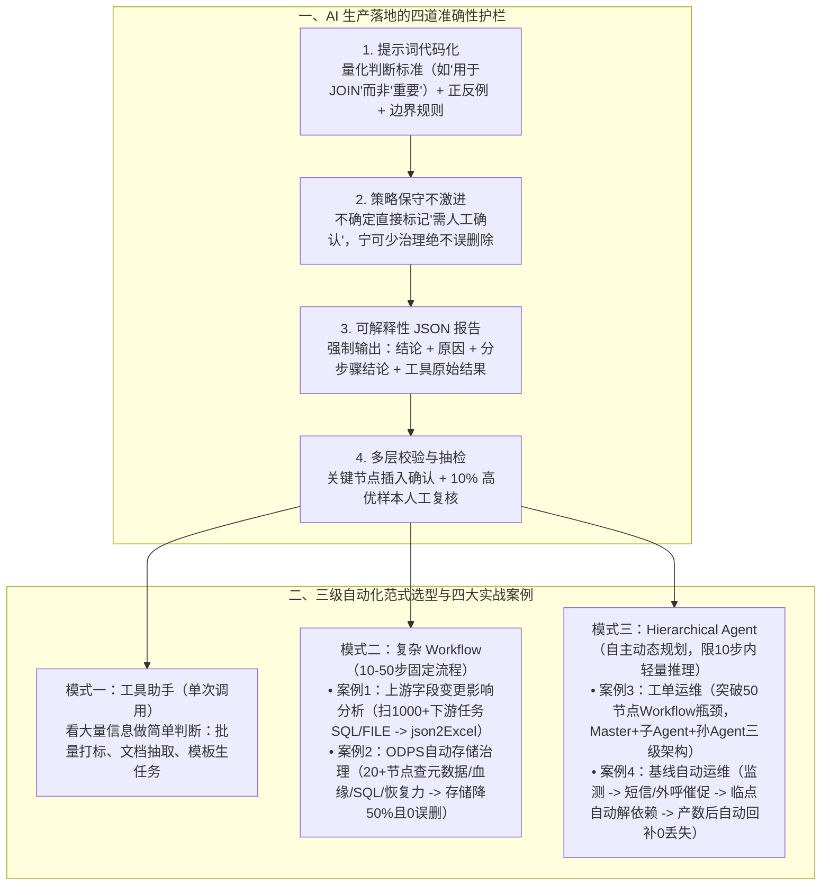

# 复杂任务AI处理实践：淘宝工程师的实战手记

## 1. TL;DR

1. **核心理念（“眼、手、脑”三元抽象）**：凡是“输入明确、逻辑清晰、动作固定”的显性或隐性重复工作（如跨平台工单排查、上游字段变更影响分析、ODPS 存储治理、夜间基线值班），只要能将 **90% 以上**场景抽象为固定套路，即可通过配齐 **“眼睛（读取类 SDK/MCP 工具）+ 手（操作类工具）+ 脑（Workflow 流程引擎或 Agent 智能体）”** 交由 AI 完成，人类仅做剩下 10% 的高价值兜底。
2. **四大准确性护栏**：① 提示词代码化（明确输入、可量化标准如“字段用于 JOIN”而非“字段重要”、结构化输出、正反例、边界规则）；② **策略宁保守勿激进**（不确定直接转人工确认，宁少治理不误删）；③ **可解释性 JSON 输出**（强制输出“结论 + 原因 + 分步骤结论 + 工具原始结果”）；④ 多层观测与高风险人工复核。
3. **三级自动化方案与四个真实案例**：
   - **案例 1（简单 Workflow：代码影响分析）**：上游字段变更需排查数百至 **1,000+ 个**下游任务是否将该字段用于 `JOIN`，通过“读 SQL + 读 FILE”双工具循环扫描并输出 `json2Excel`；
   - **案例 2（复杂 Workflow：自动存储治理）**：用 **20+ 节点** Workflow 串联表元信息、全链路血缘、下游 SQL 依赖与上游恢复能力评估，处理**数千张表**，使整个数据产品**存储降低 50%**（人工抽检 **10%** 高优样本，**误删数为 0**）；
   - **案例 3（Hierarchical Agent vs 50 节点 Workflow：工单运维）**：工单 Workflow 膨胀至 **50 个节点**后难以为继，改用 `Master Agent + 子Agent(日志A/数据B/工单C/链路D) + 孙Agent` 层级架构；坦诚复盘发现**多级 Agent 虽更通用但也更“笨”（受限于模型能力仅能跑通 10 步以内轻量推理，确定性场景体验反不如旧版 Workflow）**；
   - **案例 4（基线自动运维）**：“监控 $\to$ 短信/外呼催促上游 $\to$ 临近 SLA 决策点自动解除依赖并钉钉通知布防 $\to$ 上游产出后自动生成回补任务确保数据 0 丢失”。

## 2. 问题定义与背景

### 2.1 数据与后端研发的四大“隐性重复”痛点

1. **非工作时间被动值班**：因上游数百个依赖任务延迟产出而频繁在深夜收到基线告警，需人工催促或拍板解依赖。
2. **跨平台工单排查**：一年处理数百条工单，每条都要翻五六个平台（工单、日志、配置、代码、元数据）逐层排查。
3. **上游变更下游人工肉眼排雷**：上游改一个字段，需手动检查几百个甚至 **1,000+ 个**下游任务是否受影响。
4. **存量表存储治理举步维艰**：治理一张 ODPS 表需翻遍本表及所有上下游代码与血缘，人工一年只能治理极小一部分且极易误删。

### 2.2 人类操作向 AI 协作者的“眼、手、脑”映射

| 器官抽象 | 核心职能 | 接入与封装方式 | 典型工具实例 |
| --- | --- | --- | --- |
| **眼睛（感知上下文）** | 把人类“打开网页看信息”变成可调用的读取工具 | 接入各平台 SDK 封装为 MCP / Function | 代码平台（读 SQL/FILE/表结构）、工单平台（读内容/状态/评论）、文档平台、日志平台（捞报错/SQL） |
| **手（执行动作）** | 把人类“点击按钮改状态/提任务”变成操作工具 | 封装写操作 API 并加安全审批卡点 | 代码平台（创建/修改/发布任务）、工单平台（评论/流转）、数据平台（跑 SQL）、办公平台（发钉钉/写文档） |
| **脑（思考与闭环）** | 串联感知与执行，形成“感知→决策→执行→反馈”闭环 | **Workflow（SOP 固定流程）** vs **Agent（动态规划）** | Java（接入 SDK / 开发 MCP / 定时任务）+ Python（批量调用 / 数据处理 / 封装 UDF） |

## 3. 知识框架

## 4. 核心内容拆解

### 4.1 保障 AI 结果可信的四大工程策略

1. **设计阶段：提示词像写代码一样严谨**：
   - 明确输入范围、规定结构化输出（JSON/表格）、提供正反例示范、设定不确定时的边界处理规则；
   - **判断标准必须可量化、可验证**：例如严禁写“判断该字段是否重要”，必须写“判断代码中是否包含该字段？是否用于 `JOIN` 操作？是否转换了数据类型？”。
2. **执行阶段：策略保守不激进（Safety First）**：
   - 在数据表下线/缩生命周期等高风险场景中，设置高置信度阈值；只要 AI 无法 100% 确认某表无下游依赖，一律输出 `"需人工确认"` 而非冒险自动执行。
3. **输出阶段：可解释性结构化报告（结论 + 理由 + 过程 + 原始数据）**：
   - 严禁只输出一个简单的“是/否”，强制返回包含 `"是否可缩短生命周期"`、`"是否可下线"`、`"原因"`、`"分步骤结论": ["任务优先级", "下游最长依赖时长", "上游可恢复性"]` 以及 `"工具原始结果": {"下游节点列表": [...], "节点元信息": {...}}` 的完整 JSON，使人类无需重查系统即可在数秒内完成复核与归因。
4. **验收阶段：多层校验（观测节点 + 验证节点 + 人工复核 + 多次执行取一致）**。

### 4.2 四大真实生产案例拆解与 Workflow vs Agent 深度对比

1. **案例一：上游字段变更代码影响分析（简单 Workflow）**
   - **痛点**：上游核心表某字段变更，需排查 **几百至 1,000+ 个**下游任务是否受影响。
   - **实现**：输入任务列表 $\to$ 循环调用两个“眼睛”MCP 工具（**读取 SQL 代码 + 读取 FILE 文件内容**，兼容通过外部文件拼接 SQL 的任务） $\to$ AI 判定三要素（是否含该字段 / 是否用于 `JOIN` / 是否转换数据类型） $\to$ Python `json2Excel` 导出完整排查表。
2. **案例二：ODPS 自动存储治理（20+ 节点复杂 Workflow）**
   - **流程（20+ 节点）**：① 接收待治理表名 $\to$ ②【眼】查表元信息（生命周期、大小、优先级） $\to$ ③【眼】获取全链路血缘（上游来源 + 下游消费） $\to$ ④【眼】遍历所有下游任务读 SQL 代码 $\to$ ⑤【AI 分析】判断真实依赖范围 $\to$ ⑥【眼】检查上游数据恢复能力（冷备策略、重跑成本） $\to$ ⑦【AI 决策】综合评估重要性与使用频次 $\to$ ⑧【AI 输出】生成治理建议（`下线` / `缩短生命周期` / `深度冷存备份`） $\to$ ⑨【手】自动执行或输出 JSON。
   - **实测战果**：全年自动扫描并决策**数千张表**，**整个数据产品的存储直接减少 50%**；人工抽检了 **10% 高优先级样本**，**未发现一例误删数据**（仅存在部分策略偏保守情况）。
3. **案例三：工单自动运维（从 50 节点 Workflow 转向 Hierarchical Agent 的得与失）**
   - **Workflow 瓶颈**：工单问题千变万化，固定 Workflow 很快膨胀到 **50 个节点**，几乎无法维护且覆盖率依然有限。
   - **Hierarchical Agent 三级架构**：
     - `Master Agent`（决策大脑）统领 4 类子 Agent + 定时播报 Agent：
     - `子Agent A（日志提取分析【眼】）`：含 `孙Agent A1`（获取日志并解析 SQL）、`工具 A2/A3`（读日志平台 2/3）；
     - `子Agent B（数据排查【手】）`：含 `孙Agent B1`（查各类关系）、`工具 B2/B3`（查绑定与历史）；
     - `子Agent C（工单系统【手+眼】）`：含 `孙Agent C1`（看工单+初判）、`工具 C2/C3`（评论/流转关闭）；
     - `子Agent D`：链路逐层排查 Workflow、知识库检索 Agent、代码分析 Agent。
   - **一线真实反思（极其宝贵的工程洞察）**：
     - 升级为 Hierarchical Agent 后，虽然理论上更通用，但**“更通用的同时也更‘笨’了”**——即使拆分多层子 Agent，受限于当前大模型规划能力，**实际只能稳定跑通 10 步以内的轻量推理**；在固定套路工单上的实际体验**反而不如旧版 50 节点 Workflow**！
     - **核心结论**：**不是所有场景都需要 Agent！** 步骤多（10–50 步）但顺序固定的任务，**复杂 Workflow 才是更优解**；只有每次排查路径完全不同、且推理步数可控（$\le 10$ 步）的场景才用 Agent，或者将固定子链路封装为 Workflow 挂在 Agent 下面调用。
4. **案例四：AI 自动基线运维（监控 $\to$ 催促 $\to$ 解耦 $\to$ 回补闭环）**
   - **监控与决策期**：定时监测数百个上游产出状态 $\to$ 异常触发后自动通过**短信 + 外呼**催促上游责任人 $\to$ 若临近 SLA 决策时间点仍未恢复，AI **自动解除依赖**保障主基线按时产出，并同步发钉钉提醒运营布防；
   - **恢复期**：待上游补产出后，AI **自动生成回补任务**先回补触点数据恢复能力，次日回补其余报告数据，实现**数据 0 丢失**。

## 5. 数据速查表

| 指标 / 维度 | 原文数值 | 语境 / 条件 |
| --- | --- | --- |
| AI 自动化准入黄金法则 | **90% 以上问题可抽象为固定流程（AI 做 90%，人兜底 10%）** | 适用显性与隐性重复工程任务 |
| 案例 1：单次上游变更受影响下游任务数 | **少则几百个、多则 1,000+ 个任务** | 自动扫描 SQL 与 FILE 代码判断是否用于 `JOIN` |
| 案例 2：自动存储治理 Workflow 规模 | **20+ 个节点 / 处理数千张表** | 串联元信息、全链路血缘、下游 SQL 与上游恢复力 |
| 案例 2：数据产品存储降本幅度与安全性 | **整个数据产品存储减少 50% / 10% 高优样本人工复核 0 误删** | 采用“保守优先”策略 |
| 案例 3：工单固定 Workflow 膨胀极限 | **50 个节点** | 因分支爆炸难以维护而探索 Hierarchical Agent |
| 案例 3：多层 Agent 稳定推理步数上限 | **10 步以内的轻量推理** | 超出 10 步易发散，固定流程场景下 Workflow 体验优于纯 Agent |

## 6. 踩坑与教训 / 可迁移的设计原则

| 错误做法 | 失败表现或原因 | 原文应对（可迁移的设计原则） |
| --- | --- | --- |
| **盲目崇拜自主规划 Agent，把原本顺序固定的 20 步流程也做成纯动态 Agent** | 当前大模型即使拆多层子 Agent 也只能稳定支撑 10 步以内轻量推理，纯 Agent 反而变“笨”、易陷入无效循环 | **按路径确定性选型**：步骤固定（哪怕长达 10–50 步）优先用确定性 **Workflow**；仅在路径高度动态且步数 $\le 10$ 步时用 **Agent**（或 Agent 调 Workflow） |
| **在 Prompt 里用“判断该字段是否重要/该表是否有用”等主观模糊词** | 大模型理解标准飘忽，不同批次输出前后矛盾 | **Prompt 判断标准代码化与量化**：明确拆解为“是否包含字段、是否用于 `JOIN`、是否做类型转换、下游最长依赖时长”等可验证指标 |
| **让存储治理 AI 只输出一个“建议下线：是/否”的布尔结论** | 人工复核时还得自己重新去翻血缘和代码，毫无提效且不敢上线 | **强制输出可解释性完整 JSON 报告**：同时包含最终结论、原因、分步骤子结论以及抓取到的**工具原始结果快照** |
| **只用 SQL 解析工具排查下游任务影响** | 漏掉大量通过外部 `FILE` 脚本动态拼接 SQL 的工程任务 | **补齐多模态“眼睛”工具**：同时挂载“读 SQL 代码”与“读 FILE 文件内容”工具 |

## 7. 记忆锚点

1. **三元抽象与九一法则**：“**配齐眼（读工具）、手（写工具）、脑（Workflow/Agent），AI 干掉 90% 套路活，人类守住 10% 兜底线**”。
2. **Workflow vs Agent 铁律**：“**20 步固定套路用 Workflow（存储立省 50% 零误删），10 步以内动态排障用 Hierarchical Agent（切忌盲目把 Workflow 全改成 Agent）**”。

## 8. 复习卡片

1. 作者提出的“把人类操作抽象成 AI 的眼、手、脑”分别对应什么工程组件？::“眼睛”对应读取上下文的 SDK/MCP 工具（如读代码/FILE、读工单、读文档、捞日志 SQL）；“手”对应执行变更的操作类工具（如建任务、评工单、跑 SQL、发钉钉）；“脑”对应串联感知与执行的决策机制（固定流程用 Workflow，动态路径用 Agent）。
2. 在类似“自动删除/下线数据表”的高风险自动化治理场景中，如何通过四道防线保证 AI 不会闯祸？::① 提示词精准量化判断标准并给正反例；② 策略保守优先（有丝毫不确定直接标记“需人工确认”，宁少治理不误删）；③ 强制输出含“结论+原因+分步骤结论+工具原始数据”的可解释 JSON；④ 关键节点插入确认并人工抽检 10% 高优样本。
3. 在“案例二：ODPS 自动存储治理”中，20+ 节点的复杂 Workflow 依次检查了哪些关键信息才敢给出下线或冷备建议？取得了什么效果？::依次检查：① 表元信息（生命周期/大小/优先级）；② 全链路上下游血缘；③ 遍历所有下游任务的 SQL 代码判断实际依赖；④ 检查上游数据恢复能力（冷备与重跑成本）。最终处理数千张表，使整个数据产品存储减少 50%，且 10% 高优样本复核实现 0 误删。
4. 为什么在“案例三：工单自动运维”中，团队从 Workflow 转向了三层 Hierarchical Agent？但落地后又发现了什么反直觉的局限？::因为工单场景分支过多，固定 Workflow 膨胀到 50 个节点后难以维护；但改用 `Master -> 子Agent -> 孙Agent` 后发现，Agent 在变得更通用的同时也更“笨”了，受限于模型能力目前只能稳定跑通 10 步以内的轻量推理，在固定流程工单上的体验反而不如旧版 Workflow。
5. 面对“工具助手”、“复杂 Workflow”和“智能规划 Agent”三种模式，工程选型的核心分界线是什么？::① 只需看大量信息做单步简单判断（如批量打标/影响字段扫描）用“工具助手/简单 Workflow”；② 步骤长达 10–50 步但每次执行顺序固定（如存储治理）用“复杂 Workflow”；③ 每次排查路径完全不同且推理步数在 10 步以内用“智能 Agent”。
6. “案例四：AI 自动基线运维”是如何将原本深夜靠“人催 + 拍板舍弃”的值班过程改造为全自动闭环的？::分为监控期与恢复期：监控期发现上游异常先自动发短信+外呼催促，若临近 SLA 决策点仍未产出则由 AI 自动解除依赖并钉钉通知运营布防；恢复期等上游产出后自动生成回补任务（先回补触点数据再于次日回补报告数据），实现数据 0 丢失。

## 9. 知识关联

- **本库主题关联**：
  - [Agent工程循环](../../20_topics/Agent工程循环.md)：基于“眼、手、脑”抽象对比单步助手、20–50 节点 Workflow 与三层 Hierarchical Agent（10 步推理边界）的工程取舍。
  - [Agent数据分析](../../20_topics/Agent数据分析.md)：落地 1,000+ 下游任务 SQL/FILE 字段影响分析与数千张 ODPS 表全链路血缘自动存储治理（存储降本 50%）。
  - [异常监控与稳定性](../../20_topics/异常监控与稳定性.md)：构建工单前置排查拦截与“监控-催促-自动解依赖-自动回补”的离线数据基线自愈系统。
- **候选双链**：`[[眼手脑Agent抽象]]`、`[[数据存储治理]]`、`[[HierarchicalAgent]]`、`[[基线自动运维]]`

## 10. 原文参考资料

- **原文标题**：《复杂任务AI处理实践：淘宝工程师的实战手记》
- **发布渠道与日期**：微信公众号「大淘宝技术」，2025-12-01
- **作者与团队**：晟泉（淘天集团-商家&开放平台技术团队）

> [!note]- 校对报告
> - **页码溯源汇总**：
>   - 引言（四大日常痛点）与“眼、手、脑”核心抽象范式：`p.1–3`
>   - AI 效果保证四大策略（提示词量化、保守优先、可解释性 JSON 报告、多层校验）：`p.3–5`
>   - 三种自动化方案对比（工具助手、10–50 步复杂 Workflow、10 步以内轻量推理智能 Agent）及 90%/10% 适用原则：`p.5–7`
>   - 四个真实生产案例：案例 1 代码影响分析（1,000+ 任务、`json2Excel`）、案例 2 自动存储治理（20+ 节点、数千张表、存储减少 50%、10% 复核 0 误删）、案例 3 工单运维（50 节点 Workflow vs 三层 Hierarchical Agent 的真实得失）、案例 4 自动基线运维（短信+外呼催促、自动解依赖、自动回补 0 丢失）：`p.7–13`
> - **关键数值一致性核查**：
>   - `10-50` 个步骤、`10` 步以内轻量推理、`90%` 固定流程 / `10%` 人工兜底、`1000+` 个下游任务、`20+` 节点存储治理 Workflow、存储减少 `50%`、人工复核 `10%` 高优样本、工单 Workflow `50` 个节点均与原文完全一致。
> - **图像与版面质量说明**：
>   - `p.1, 6, 8, 9, 10` 含平台工作流编排截图（位于 PDF 图像层），作者同时在正文文本层给出了对应的 ASCII 树状流程还原，无任何信息缺失。
