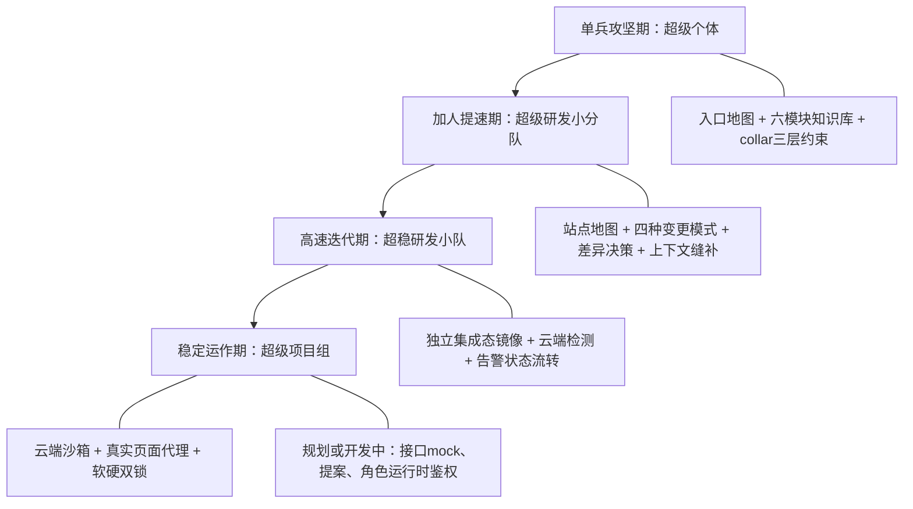
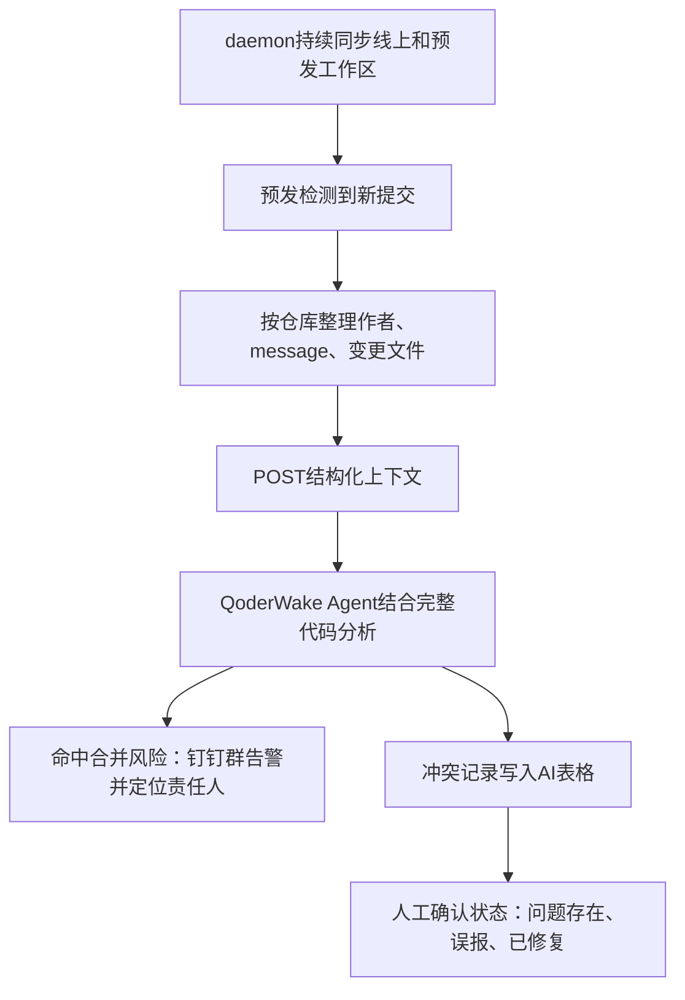
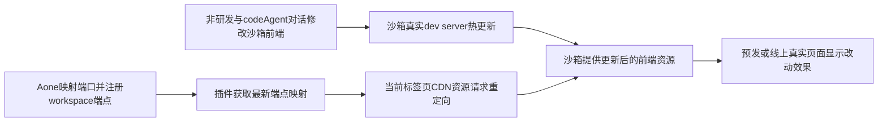
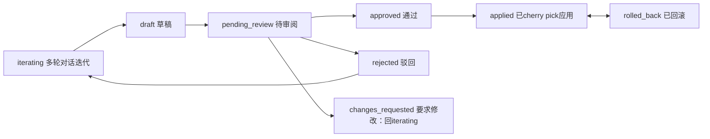

# 天猫技术大型 AI 项目的研发协同实践

## 1. TL;DR

本文以天猫新品 MDI 项目为例，讨论 AI 编码能力怎样从个人扩展到团队、持续迭代，再扩展到非研发角色。起点是把业务、工程约束和过程知识变成可版本化的全栈上下文；多人协作阶段则通过站点地图、Spec 生命周期和上下文缝补，减少分工冲突与外置逻辑造成的推理链断裂。质量治理从监听高噪声的本地编码过程，转向在独立哨兵机上还原预发集成态，再交由云端 Agent 检测业务逻辑冲突并形成有状态的告警记录。作者报告业务冲突有效发现率稳定超过 70%、每周发现 40+ 个潜在问题，但没有提供完整统计窗口及全部底层数据。面向非研发的 NekoCollar 将云端沙箱、真实页面资源代理与 Git 软硬双锁结合；前端代理和双锁已落地，服务端 mock、提案机制与角色运行时鉴权仍处于规划或开发阶段。

原始材料：[RAW.pdf](RAW.pdf)；带物理页码转写：[MD.md](MD.md)；来源与处理记录：[META.json](META.json)。下文页码均指 PDF 物理页序。

> [!warning] 配图缺失与实现状态边界
> 这份 PDF 多处技术图、告警截图和 AI 表格只保存了灰色加载占位框；本笔记的总览及主要流程图按可读正文整理，不代表复现了缺失原图。原文对应处 的提案状态机实际可读，但图上明确标注“设计中 / WIP”“代码尚未落地”。裁切的代码保留其片段身份，不补造缺失接口、注释或表达式。

## 2. 核心概念：能力放大需要怎样的上下文

**SDD（规格驱动）**是本文项目采用的高频敏捷开发方式：业务意图先沉淀为 Spec，编码提交时再检测 Spec 与实现的差异。**Spec**是“意图源”，代码偏离它不必然意味着代码错误，也可能是在实现中发现了更好的方案；因此差异需要显式交给人决定，而非自动反向覆盖文档。

**collar（项圈）**是作者给 AI Agent 提供边界和知识的研发体系，命名与 neko 系列产品关联；它把全栈项目、知识入口、约束与验证组织在同一工作区。**Harness**在本文语境中是支撑与约束 Agent 行为的工程层，后文的协议约束、权限白名单和计划中的提案审阅都属于这一层。

**上下文缝补**针对一个具体工程问题：业务逻辑虽然仍存在，却因移到 DB、配置平台或外部服务而离开 codeAgent 的代码视野。它用查询通道、调用协议、环境声明或源码锚点，把实际生效的逻辑重新带回 Agent 的判断依据中。这里补的是逻辑可见性，不是把配置重新硬编码回仓库。

**预发合并态**是多个仓库各自最新预发 release 版本在一个工作区中聚合后的完整快照。本文的做法是在工作区层面还原各服务的集成上下文，并非把所有仓库用 `git merge` 合成一个临时分支。**技术哨兵机**则持续维护线上与预发两套快照，并把新提交上下文交给云端 Agent 检测隐形冲突。

**NekoCollar**是把本地 collar SDD 体系平台化的云端上下文协作系统。产品、设计、测试可以围绕代码与运行态表达意图，系统以沙箱和约束控制改动；本文没有把它描述为所有环节均已完工的产品。

| 容易混淆的对象 | 本文中的职责区别 |
|---|---|
| AGENTS.md 与详细文档 | 前者是每会话必加载的入口地图，只告诉 Agent 去哪里找；后者承载业务、架构、约定和过程细节 |
| MCP 与配套 Skill | MCP 提供只读可达的能力；Skill 规定何时查询、如何按锚点查询、怎样理解并使用结果 |
| 单分支检查与集成态检查 | 前者看到个人当前改动；后者看到团队各服务最终组合，才能分析接口、Prompt 槽位等跨人依赖 |
| 群告警与 AI 表格 | 前者把冲突送达相关人；后者记录状态流转、人工确认与可度量的结果 |
| 资源代理与服务端 mock | 前者已落地，替换当前页面加载的前端资源；后者计划就地拦截接口并返回修改后的响应，尚未落地 |


## 3. 知识框架：个体 → 团队 → 可持续 → 全员

下图按正文整理，只表达作者明确给出的阶段顺序与各阶段手段；各阶段内的手段是组合关系，不是串行执行步骤。



项目规模解释了为什么单点代码生成不足以解决协同：它横跨 4 个角色端、约 40 个功能模块，还依赖外部智能投放系统、算法内核、自动化评测体系与阿里云百炼全模态能力；团队每周上线一个大版本，最繁忙的一次有 8 个仓库、十几个分支同时在预发集成开发。这些是本文案例的规模与节奏，不能当成所有项目采用本方案的门槛。

## 4. 关键要点：四阶段研发协同演进

### 4.1 单兵攻坚期：把全栈项目变成有纵深的编码上下文

### 入口地图需要薄，知识库需要深

**单人探索新领域时，首先要解决 AI 不理解项目的问题。**项目启动时只有一两个人，Agent 不知道业务地图、踩过的坑以及技术选型原因；每次新会话重灌上下文会使探索效率降低。因此作者没有仅增加提示词，而是把全栈项目集成在结构化知识库中，让后续会话可以重新读取。

根目录 `AGENTS.md` 是 Agent 进入项目的唯一入口，规则是“≤120 行，不放细节，只告诉你去哪里找”。MDI 使用多仓库聚合工作区 `workspace-mdi/`，前端主应用、5 个微应用/H5、Java 后端的 DDD 四层、Node 评测执行端和评测服务端等作为独立 Git 仓库放入同一工作区。入口不是逐仓库复制 README，而是提供四类信息：

- **仓库地图**：带注释的目录树，标明子仓职责、端口、唯一开发入口和已废弃禁改内容。
- **快速命令**：各应用如何启动、build、lint，减少 Agent 逐仓库查找。
- **关键约定速查**：每条“一句话 + 详见链接”，让强约束可快速发现，同时保留详细依据。
- **当前状态表**：各应用的完成度和已具备能力，让 Agent 知道当下进展。

约定例子包括时间戳必须格式化为北京时间；新增日志强制 `BizLog`，入口方法加入 `@BLog`；新接口使用 `@MtopController + @MtopMethod`，详情指向 `ADR-013`；改代码前先看 `PITFALLS.md`。这些是该项目的约定，并非可无条件移植的编码标准。

入口的精简也进入流程控制：`collar-runbook` 在行数逼近 115 行时提醒将细节迁到 `docs/`，入口只保留一行摘要与链接。**120 行是入口上限，115 行是接近上限时的提醒点，二者不能混成同一个阈值。**⚠️[材料缺失] 原文对应处 的 AGENTS.md 入口地图截图只剩加载框，以上职责和阈值依据可读正文，不含原截图细节。

### 六模块分工，以及提交时的三项知识门禁

**知识分层决定写到哪里，触发关卡决定何时写进去。**作者将 `docs/` 分为六个模块，每个模块对应一个唯一 Skill 和 README，以“模块 ↔ Skill ↔ README”组织维护职责。

| 模块 | 原文用途 | 对应 Skill |
|---|---|---|
| `specs/` | 业务地图，要做什么 | `collar-specs` |
| `changelog/` | 做了什么及将做什么，时间线 | `collar-changelog` |
| `architecture/` | 系统怎样连接，8 类连接点 | `collar-architecture` |
| `runbook/` | 零散过程知识，8 类 | `collar-runbook` |
| `vendor/` | 外部源码选择性同步 | `collar-vendor` |
| `wiki/` | 人工维护的中文自由知识库 | `collar-wiki` |


作者认为 Agent 看不到的知识等于不存在，因此知识要版本化落入仓库文件，后续会话和其他成员才能随拉取代码获得上下文。难点不是单个 Skill 的能力，而是多个 Skill 如何配合、避免相互干扰。本文把 `git commit` 设为统一触发关卡：`collar-changelog` 记录“做了什么”，`collar-runbook` 提取“学到了什么”，`collar-specs` 检查“代码是否偏离意图”。三个维度同时发生，但各自处理不同知识。

这把知识沉淀从个人自觉变为流程门禁，作者希望借此避免“先欠着，以后再补”导致知识库腐化。⚠️[材料缺失] 原文对应处 原本介绍六个 Skill 主动/被动触发及自动化梯度的图只剩加载框，另一张“三个方向上的互补两面”图也未加载；不能据图补出每个 Skill 的精确触发条件、梯度或三个方向的完整名称。正文明确给出的提交三项门禁仍可学习。

### 冷启把人工判断与自动沉淀分开

**自由研究素材和工程事实需要不同的维护方式。**新领域前期的设计理念、竞品分析、blue-print 蓝图调研放在 `wiki/`，由人保障质量；`changelog`、`architecture`、`runbook` 则由 AI 从 Git、代码、对话中提取和沉淀。这里的区分是材料来源与质量责任不同。

官方 demo 等外部参考资产进入 `vendor/`，原则是“只做减法，只下载所需内容”。`collar-vendor` 被描述为提供两种同步方式与一套选择算法，但材料没有展示具体算法定义。它也不是只用于存放代码：`collar-specs` 生成技术方案时会扫描相关 vendor，提取代码模板、API 用法与架构模式，融入方案并标注来源。人可以先收集粗糙素材，正式设计时再由 AI 提炼其与当前方案的关系。

### collar 的三层模型不等于完整配置已落地

**知识、修改边界、验证分别回答三个问题。**`collar.yaml` 在根目录中承担项圈抽象，但作者明确说它仍在 NekoCollar 中渐进落地，本文只讲思想：

| 层 | 负责什么 | 本文给出的机制 |
|---|---|---|
| Identity | AI 是谁、去哪里读知识 | 身份与知识入口 |
| Boundary | 能碰什么、不能碰什么 | 默认拒绝 `deny-by-default` |
| Validation | 改完怎样判断是否过关 | lint / typecheck 等门禁 |

三层模型已通过 `AGENTS.md`、pre-commit hook、后文软硬双锁分别实践，但不能把这些分散实践说成一份完整、可下载运行的 `collar.yaml`。⚠️[材料缺失] 原文对应处 对应示意图未加载；未提供配置全文和 Skill 源文件。

### 4.2 加人提速期：分工隔离与上下文缝补一起做

### 站点地图把认领边界提前落到目录与接口

**多人效率的复刻，先要减少改到同一处和丢失逻辑上下文这两类风险。**单人攻坚一个月后团队扩张，作者借鉴 Web2.0 的 sitemap：开工前横向展开站点分区与页面，再由成员认领。MDI 的 `docs/specs/` 按业务地图划分：站点整体骨架，以及管理端、用户端、小二端、专家端、评测端；数字前缀维持顺序。

一个业务地图相当于一个站点分区，一个功能模块相当于一个页面或功能区。认领时同时明确前台路由、后台 API 领域、产品模块和 Spec 范围，越界协同需与项目组对焦。因此“目录隔离”不能替代接口领域与权责边界的确认；目录是可见的认领单元，边界则贯穿前后端与需求文档。

### 四种变更类型保留不同成熟度和生命周期

**探索、正式需求、小步变化与功能退场不应都挤进主 Spec。**`feature / patch / sunset` 在 `docs/specs/` 正式规格层，`blueprint` 则放在 `docs/wiki/blue-print/` 自由探索层。蓝图是尚未确认如何沉淀成 Spec 的基础能力构思，命名前缀表示成熟度：`[调研] → [讨论稿] → [技术方案]...V4-MVP`，成熟后才迁入 specs 成为正式 feature。

| 类型 | 用途与归属 | 怎样支持协作 |
|---|---|---|
| blueprint | 预研、讨论和基础能力构思，放自由探索层 | 保留尚未成熟的设计，不提前作为正式规格 |
| feature | 正式功能及主 Spec | 功能目录作为认领单元，原始需求只追加 |
| patch | 挂在 feature 下的小改动 | 成员可并行提交补丁，主 Spec 稳定后再收敛 |
| sunset | 旧功能下线及历史规格退场 | 冻结历史、保留灰度期排查用途，并规定清场条件 |


原文 feature 示例中包含 `raw提示词.md`、主技术方案与 `patches/`，后者展示 `PATCH-001_TPP同步代理接入`、`PATCH-002_TPP异步代理接入` 等共 11 个 patch。`raw提示词.md` 的“只追加”约束保留原始需求轨迹；patch 让小改动有自己的空间，避免每次多人同时修改主文档。

⚠️[原文疑点] 原文对应处 说明文字称例子为“管理端/创建项目”，目录树却写“创建访谈”；原文对应处 双向指针示例又使用“创建项目”。本文保留这些原称，不认定三者是同一目录或静默统一命名。这不影响学习“功能目录 + 原始需求 + 主 Spec + patches”的结构，但实际复用路径前需核对。

### Patch 双向指针让当前生效的规格可从两端找到

**只在补丁或主文档单侧说明变化，都可能让另一侧读者拿到过期真相。**Patch 需要在开头声明覆盖主方案的哪些段落，对照原方案与新方案；主文档被替代处则加删除线和 `superseded` 指针，指向对应 Patch。Patch 本身还必须可独立阅读，不要求先读主文档。这样人或 AI 从任一文件切入，都能找到覆盖关系与来龙去脉。

示例涉及 `POST /api/project/{id}/refine-goals`，原方案为 SSE 流式并调用 DashScope，补丁是 `PATCH-001_TPP同步代理接入`。⚠️[原文疑点] 原文对应处 新方案列的右半部被裁切，原文对应处 指针行也被裁切，材料不能提供完整替代内容及完整 Markdown。不能据文件名猜出新接口或恢复缺失句子；本文保留机制与能确认的命名，不把残缺示例当作完整模板。

### Sunset 是带条件的迁移剧本

**旧逻辑退场后，灰度期仍需要其原始上下文。**本文用用户核心循环从 V1 自建 LLM Agent 迁往算法团队 TPP 服务的案例，展示如何冻结旧 Spec，而非立即移除所有历史材料。原文声明完整可读，作为操作规程示例保留一次；其中的命令仅是来源资料。

```text
# [技术方案] 用户端 - 核心循环
> ⚠ **日落声明（V1 范式 · 自建 LLM Agent）**
> 自 2026-05-26 起，用户核心链路迁移至算法团队 TPP 黑盒服务。本文档进入凝固期：
> - ❌ 不再修订章节内容（保留 T0 时刻的纯粹历史）
> - ❌ 不再新增 PATCH（V1 时代 PATCH-001~006 已封存）
> - ✅ 仍可阅读用于排查灰度期 V1 范式的线上问题
> 迁移决策：ADR-010
> 预计清场时间：V2 全量切换且稳定 1 周后，本文档及关联 V1 文件将被 git rm。
```

凝固期的含义是停止更新历史事实与追加旧范式 Patch，同时保留读取。清场条件是“V2 全量切换且稳定 1 周后”，不是从声明发布日期机械计时。本文同时指出同一模块还存在 V4 全双工 blueprint、V2 正式 feature、V1 的 PATCH-001~006 及 V1 sunset，说明四类型是不同成熟度/生命周期对象的组织方式，不是把每个版本编号排成四个固定步骤。

### 代码到 Spec 的检查输出差异，由人决定意图是否改变

**检测偏离与决定哪个版本正确，应分开处理。**提交时 Skill 比较代码和 Spec，但不自动反向更新 Spec。字段例子是 Spec 规定 `status: String`，实现却为 `status: Integer（枚举值）`，检查列出差异并提出建议。

人逐项选择：以代码为准反向更新 Spec；保持 Spec、后续修代码并记 TODO；或暂时搁置。机制的价值是让文档变化进入显式决策，并与 lint、Git hook、`collar-changelog` 的强制约束共同工作。**差异报告不是自动裁决，暂时搁置也不等于已解决。**

### 上下文缝补：外置业务逻辑后，Agent 必须仍能读到它

**配置与代码分离会改善传统发布方式，却可能切断 codeAgent 的业务推理链。**原先硬编码的 Prompt 可直接从代码读取；移到 Diamond、DB 等介质后，仓库中只剩 `promptService.load(agentCode)` 调用框架，Agent 不再知道被调用者的具体行为，就可能误判关键决策或要求人自行去平台修改。团队据此要求：任何导致上下文异常的架构变化，都需以合适方式缝补。

作者认为 human in the loop 越少效率越高，随即强调这里讨论的是效率、不是质量。因此减少人工中转的主张不能抹掉前述 Spec 决策及后述告警人工确认。

**案例一：MCP 的可达能力与 Skill 的调用认知结合。**MDI 多 Agent 报告管线的 Prompt 由工作台动态管理和独立发布。专属 MCP Server 暴露 20 个只读查询工具，其中第 7 组“Prompt 工程”按场景码与 Agent 码等锚点查询当前生效内容。可确认的接口名称及参数如下，均是原文接口片段，非可直接运行代码；右侧注释部分裁切，缺少 MCP 服务定义与配置。

```text
query_prompt_manifest(sceneCode, env?)
query_prompt_content(id)
query_prompt_versions(sceneCode, agentCode)
query_prompt_intermediates(insightId)
```

`manifest` 围绕场景码和 Agent 码定位，`content` 用 promptId 取得内容，`versions` 查询历史，`intermediates` 关联实际输入/输出的过程数据。正文指出 Skill 固定四步调用链，回答“何时查、怎么查、查到后怎么用”，但没有完整展示四步的分支与数据交接，不应把上面的接口列表包装成所有请求都必须顺序执行的四步教程。MCP 是能力层，Skill 是认知层：只有工具能查，Agent 可能仍不知道该查；只有规则却没有通道，又取不到外部上下文。


按正文整理；原文对应处 对应原图未加载，图中不补造固定四步的内部调用关系。

**案例二：环境差异要成为可发现的知识。**预发与线上差异可能使代码看起来正确却不生效。作者在 `AGENTS.md` 的关键约定中声明差异存在，遇到不可解释的问题先考虑环境，再将细节放进 ADR。入口负责提醒，详细记录负责解释。

**案例三：外置脚本仍保留声明锚点。**Transform 平台的 Groovy 脚本用 `//!` 注释保留元数据；Groovy 将其视为普通注释，平台则据此识别脚本名称、风险、参数和可运行环境。逻辑可以外置，但源码仍给 Agent 留下可解释入口。材料未提供完整注释语法或脚本实例。

### 4.3 高速迭代期：从编码态监控转向集成态哨兵

### 失败方案的问题是介入时机

**高频协同的新瓶颈是成员交换新增上下文的速度。**一个人改后端接口签名，另一个人改前端调用，各自本地都正常，预发集成后才出现业务冲突；有些冲突很久后才暴露。本文将这类跨人、跨版本依赖称为“隐形冲突”。

最初的 `nekocollar-app` 采用 Agent Manage 方式，采集 Cursor、Qoder、Claude Code 等 Agent 进程输入输出，试图在编码阶段提前判断冲突。但探索中写了又删、反复试验和对话调整，多数尚未定型的信息没有协同价值；全量监控同时造成较大 token 消耗，工具与习惯差异也增加监控难度。作者承认这次尝试失败，复盘认为介入编码态时信息熵最高、确定性最低。

因此方案演进不是单纯换一个更强模型，而是把触发节点后移到预发集成态：利用已进入发布路径的信息，降低过程噪声，并获得个人开发机不具备的完整组合上下文。⚠️[材料缺失] 原文对应处 失败/成功比较图未加载；上述结论依据正文。

### collar-daemon 在工作区层面聚合最终版本

**检测跨分支业务风险，要先构建团队集成上下文。**`collar-daemon` 是独立机器上的常驻守护进程，目标形态是一台 Mac mini。它用原生 Node.js 和 `child_process / https / net / fs` 等内置模块，零第三方依赖；作者选择极简实现是为了快速实现功能、稳定运行，并考虑后续部署到云端。

daemon 同步线上与预发两套独立工作区。原文配置中 `prod` 的 `interval` 为 600，`pre` 为 300；正文明确预发轮询为 300s。每个子仓库按 `committerdate` 倒序独立发现最新 release 分支，前端示例为 `def_releases_2026xxxx`，后端为 `releases/2026xxxx`。代码中的返回逻辑显示：匹配时去掉 `origin/`，未匹配时回退 `CONFIG.prodBranch`。

这种还原把各服务当前预发版本物理聚合到一台机器的同一工作区，不是造一个临时 merge 分支。团队无须每周人工告诉它分支名；持续轮询使镜像跟随提交更新。**“实时更新”在此实现中受轮询间隔约束，不能理解为每次提交即时触发。**

原文列举的跨人风险包括：接口签名与调用端不匹配；共享 Prompt 槽位 key 已更改而读取方仍依赖旧 key，造成静默失效；DB 字段、并发时序、共享配置的变化。作者强调这些组合问题在任何单一开发分支上都看不到，要在集成代码上检查。这里针对的是所举的跨分支组合冲突，不能将其外推成所有 bug 都只能集成后发现。

⚠️[原文疑点] 原文对应处 `discoverReleaseBranch` 中正则表达式长行右侧裁切，注释亦不完整；没有完整函数依赖、配置和可运行仓库。因此本笔记解释分支发现逻辑，不恢复正则或输出可执行实现。

### 本地保持稳定，易变的智能交给云端

**daemon 只提供可靠事实采集与传送，不内联易变判断。**它精确提取新提交作者、message、变更文件，按仓库分组，并突出提交人名字，因为“谁改的”是多人排查的重要线索。采集不阻塞或破坏开发者本地工作区。

daemon 不做规则判断、不内联 Prompt，而是把结构化上下文 POST 给 QoderWake Automation Agent。Agent 基于“提交上下文 + 完整代码”分析，命中风险后向群告警并写 AI 表格。把 Prompt 编排放到云端，使本地进程可以保持零依赖、长期稳定；代码问题排查、trace 检查与 changelog 业务冲突作为同一分析链路的不同产出维度。



按正文整理，来源 原文对应处。图中仅表达原文闭环；未补出无风险分支的具体实现、自动修复流程或强制发布阻断。

工程上还有一个管理界面可达性处理：QoderWake 管理界面绑定 `127.0.0.1:19820`，团队无法远程访问；daemon 用 `net.Server + pipe()` 进行同端口、不同 IP 的 TCP 透明转发，将其暴露到内网 IP，双向 `pipe` 支持并发多连接。该案例说明哨兵还需要团队可用的操作入口，材料未展示权限认证、异常清理等完整实现。

### 有状态的告警才能形成质量闭环

**群里发出一条告警并不意味着问题完成了治理。**信息可能被刷走、无人跟进，团队也无法度量；因此每条冲突进入钉钉 AI 表格，从“待回复”流转为“问题存在 / 误报 / 已修复”中的一个。人工确认同时反向校准 Agent 准确率。

北极星指标是**周冲突有效发现率**，原文定义为 Agent 报出的冲突中有多少被人确认为真问题。这个分母是已报出的冲突，不能把它写成“发现了全部真实冲突的比例”。作者报告该值稳定超过 70%、每周发现 40+ 个实在的多人研发潜在问题；同时使用“信噪比八成以上”“八成命中”描述效果，但没有给出两个表述各自的样本窗口与计算细节，笔记保留口径差异，不替换成统一精确值。

⚠️[材料缺失] 原文对应处 一天 24 小时内问题实例截图与哨兵架构图、原文对应处 图、原文对应处 AI 表格截图未加载。上述结果是作者正文报告，不是本次从截图或底层记录重新计算得出；原文也未提供可核查的全部报警、误报、漏报和周统计明细。

### 4.4 稳定运作期：让非研发围绕可执行事实协作

### 共同事实从上游产物回到代码与运行态

**产品、设计与测试同样需要理解最终系统行为。**作者认为产品文档描述希望发生什么，设计稿描述应该看到什么，测试用例描述应该满足什么；这些是最终系统的不同投影，传递过程中会受技术约束、接口、历史兼容和运行环境影响。用户最终收到运行出来的行为，而代码上下文是此前最后一份可版本化、可追踪、可验证的共同事实。

因此围绕代码协作，并不是要求所有角色学会 Git，而是让判断持续回到代码和运行态校准，发现“以为已实现”与实际行为之间的差距。扩展到不具备工程素养的角色后，也不能只依赖“记得不要 push 主干”这样的规范。作者提出参与者工程素养越低，系统约束就必须越硬，NekoCollar 的设计哲学是效率上做加法、稳定性上做物理约束。

### 云端沙箱先物化上下文，再连接 Agent

**一键开工的目标是消除本地环境配置，同时复现研发正在使用的上下文。**`WorkspaceProvisionOrchestrator` 通过 `@Async` 流水线在 Aone 沙箱准备工作区，原文称为“五步流水线”，可读列表还包含 `Step2.5` 与 `Step3.5` 两个细化步骤。主步与细化步骤是不同粒度，不属于编号矛盾。

1. `Step1 CreateInstance`：同步创建，前端立即拿到 `instanceId`。
2. `Step2 CREATING_SANDBOX`：Aone SDK 起沙箱；`Step2.5 INSTALLING_CLI` 安装 `claude-cli`。
3. `Step3 PrepareWorkdir`：先 clone 知识库作为外层目录，再将代码仓 clone 到知识库内部；`Step3.5 INJECTING_HISTORY` 在 reprovision 时恢复对话记忆。
4. `Step4 STARTING_BRIDGE`：启动 Bridge 与 Claude Agent。
5. `Step5 CONNECTING_AGENT`：`markActive → RUNNING`。

其中 Step3 不是随便拉一份代码：知识库外层与代码仓内层一起形成实际研发态的上下文，使非研发获得同一种阅读入口和工程事实。材料未给出各失败阶段如何重试、超时或回滚的完整流程。

### 真实页面编辑依靠前端资源代理，而非后端即时发布

**非研发角色能在预发或线上真实页面看到沙箱编辑效果，关键是浏览器资源请求转向沙箱。**本文已落地链路由四段组成：

1. 对配置了 `devServerPort` 的前端仓，在 Aone 沙箱后台启动真实开发服务器，原文使用 `npm run start`，带 `--host 0.0.0.0 --port %d`；准备过程包括清端口、安装依赖并写 `/tmp/dev-%s.log`。
2. Aone Sandbox SDK 将内部端口映射为外部可访问 URL，写入工作空间实例完成注册；平台接口 `/{workspaceId}/dev-servers` 供浏览器插件获取映射，Service 实时重新 `getEndpoint`，保证返回最新可用端点。
3. `nekocollar-extension` 获取当前工作区映射，动态注入重定向规则，把页面原本从 `g.alicdn.com / dev.g.alicdn.com` 加载的前端资源改由沙箱 dev server endpoint 提供。正文同时说插件只在 NekoCollar 页面生效，规则限定当前标签页，并用 20 秒 TTL 缓存与轮询刷新同步端点变化；笔记不扩写该作用域与普通线上标签页的关联细节。
4. 非研发与 codeAgent 对话改页面，dev server 热更新，插件代理真实页面资源，当前页面即时显示改动效果；产品或设计无须配置本地环境与代理。

这里的“真实页面”是当前页面上下文结合沙箱前端资源的编辑体验，**不能据此声称编辑自动发布到了生产 CDN 或服务端**。如果修改牵涉后端接口返回结构，构建、审批、部署仍可能需要分钟级或更久，不能用同一前端代理方式即时完成后端部署。作者规划以插件 mock 就地拦截并返回修改后的响应，使页面可马上显示数据变化，但明确此环节尚在规划中。



按正文整理，来源 原文对应处。服务端 mock 未画入已落地链路；原文对应处 对话式页面编辑截图未加载。

⚠️[原文疑点] 原文对应处 `CollarWorkspaceController.java` 的返回类型/参数与 `background.js` 中 redirect、regexFilter、resourceTypes 长行右侧裁切，不能从材料得到完整代理规则或控制器接口定义。原文对应处 dev server 示例是项目片段，依赖配置、SDK 与仓库环境；本文未执行任何命令，也不把这些资料包装成即用教程。

### 双锁控制直接 push，提案负责未来的受审改动入口

**编辑能力与直接落库权限需要分开。**硬锁在 clone 完成后遍历 Git 仓库，把 push URL 改成不存在的 `PUSH_DISABLED`，使 `git push` 在协议层失败，原文给出的错误为 `fatal: 'PUSH_DISABLED' does not appear to be a git repository`。沙箱可获得代码，但不能通过这条 push 路径将编辑直接推回仓库。

软锁写入 `~/.claude/settings.json` 的 `permissions.allow`，允许 `fetch/pull/merge/rebase/checkout/add/status/log/diff` 等操作，`push / remote` 不在白名单，在 `ACCEPT_EDITS` 模式下审批失败并拦截。原文将允许项称为“拉取类 git 命令”，但列出的命令还包含 merge、add 等；这里保留完整列表，不将它改写成“只允许读取”。软锁减少无谓尝试，硬锁控制 push 目的地，两者作用层次不同。

作者称两道锁已落地，同时以“不可绕过”“物理不可能”强调设计意图；本文给出的具体实现是 push URL 作废与 Agent 权限白名单，未提供独立对抗测试或完整安全证明。⚠️[原文疑点] 原文对应处 `disablePushForClonedRepos()` 的 shell 拼接长行被裁切，不能完整复制执行。

**提案是把满意的沙箱改动转成可审阅产物的计划机制。**双锁阻止直接 push 后，仍需安全地应用已验收改动。作者设计 Proposal：多轮对话不直接落库，先形成“已验收净 diff + 需求 + 决策 + 验收证据”的结构化提案，经审阅后再智能 cherry pick。提案、角色运行时鉴权仍在开发，不能把它们算作已运行的第三道锁。

原文对应处 已加载状态机图中有 8 个状态，下面按原图复现主要状态、分支与回路；原图带“设计中 / WIP”标识。`changes_requested` 的“回 iterating”是原图节点文字；`rejected → iterating` 则是原图画出的回路，两个都保留，不替作者统一语义。



图中还包括 `Boundary Check / lint / typecheck / test` 验证流水线；Boundary Check 消费 `collar.yaml` 中 roles 的 `editable/forbidden/配额` 边界。冲突检测有三个时机：创建时（标有与待审提案重叠的警示）、应用时（目标分支有新提交则尝试 rebase）、批量时（建议应用顺序）。回滚说明为生成反向 diff、建回滚 PR、同步移除关联 mock 规则，属于设计蓝图。

原图强调“当前真正生效的稳定性约束是软硬双锁”。这使已落地能力与目标机制边界清楚：可以安全地在沙箱中表达和预览意图，并不等于结构化提案、审阅、冲突治理与回滚已完整投入生产。

## 5. 数据速查表：保持案例条件与指标口径

| 指标或约束 | 原文数值 | 语境 / 条件 | 出处 |
|---|---|---|---|
| 发布节奏 | 每周线上一个大版本 | MDI 项目案例 | 原文对应处 |
| 一次预发集成规模 | 8 个仓库、十几个分支 | 作者称最夸张的一次上线 | 原文对应处 |
| 平台规模 | 4 个角色端、约 40 个模块 | 全栈平台总览 | 原文对应处 |
| AGENTS.md 上限 | ≤120 行 | 每会话必加载入口，不放细节 | 原文对应处 |
| 入口迁移提醒点 | 逼近 115 行 | collar-runbook 提醒迁出细节 | 原文对应处 |
| 业务地图模块数 | 管理16、用户6、小二14、专家1、评测2 | Spec 目录示例，原文未解释其与总览4个角色端的映射 | 原文对应处 |
| Sunset 起始日期 | 2026-05-26 | V1 自建 Agent 迁至 TPP 的案例日期，非文章发布日期 | 原文对应处 |
| Sunset 清场条件 | V2 全量切换且稳定 1 周后 | 才移除旧文档和关联 V1 文件 | 原文对应处 |
| MCP 查询工具规模 | 20 个；第7组为Prompt工程 | MDI 专属只读查询 Server | 原文对应处 |
| prod 轮询配置 | `interval: 600` | 线上工作区配置；代码没有在可读部分另列单位 | 原文对应处 |
| pre 轮询配置 | `interval: 300`；正文写300s | 预发工作区持续更新 | 原文对应处 |
| 管理界面地址 | `127.0.0.1:19820` | 通过同端口不同IP转发至内网 | 原文对应处 |
| 周冲突有效发现率 | 稳定 >70% | 已报警冲突中人工确认为真问题的比例 | 原文对应处 |
| 潜在问题发现量 | 每周40+个 | 作者报告多人研发真实潜在问题 | 原文对应处 |
| 信噪比表述 | “八成以上” / “八成命中” | 正文效果描述，没有完整窗口与计算明细 | 原文第 17、19 页 |
| endpoint 缓存 | 20秒 TTL + 轮询刷新 | 当前标签页的前端资源代理 | 原文对应处 |

总览的“约40模块”与业务地图示例列出的模块数量属于总览和细节层级，本文不把它们直接当成冲突，也不计算一个新指标替换原文。

## 6. 踩坑与教训及设计取舍

- **入口堆满细节 → 每会话必读内容变重 → 入口只导航、详情外置并设接近上限提醒。**此做法依赖详情链接和仓库知识可被 Agent 找到。
- **知识靠事后自觉补 → 欠账累积 → 在 commit 同时检查变更、过程知识与意图偏离。**三个 Skill 应分别负责正交维度；本文未给出完整触发配置。
- **主文档或 Patch 单侧更新 → 读另一侧拿到过期语义 → 双向指针与独立可读 Patch。**示例长行裁切不影响原则，但影响复制模板。
- **静默以代码覆盖 Spec → 实现探索可能改写原始意图 → 差异列表交人决策。**工程验证和语义决策分别承担职责。
- **配置与代码分离却不补上下文 → Agent 看不到实际 Prompt → MCP 查询通道配合 Skill 使用协议。**既要能查，也要知道何时与怎样查。
- **监听全部编码过程 → 探索噪声与 token 成本过高 → 将检测时机后移到预发集成态。**这是该团队失败方案的复盘，不是证明所有编码期检查均无价值。
- **只发群告警 → 被刷走、无人跟进、无法量化 → AI 表格状态流转与人工确认。**有效发现率衡量已报问题的有效性，材料没有提供漏报覆盖度。
- **给非研发编辑能力却靠记忆规范 → 直接 push 风险 → 沙箱双锁并设计受审提案。**已落地与开发中环节需要分别评估。

## 7. 记忆锚点

**作者主线：个体 → 团队 → 可持续 → 全员。**先让个人获得全栈上下文，再用权责边界复制效率，以集成态检测维持质量，最后让非研发在约束下共享能力。

**助记改写：入口找知识，Spec 定意图，MCP 补视野，集成态查冲突，双锁管出口。**五句各对应本文已经展开的职责，不代表所有项目必须按此固定顺序实施。

## 8. 复习卡片

为什么 AGENTS.md 需要短，而知识库需要深？::AGENTS.md 每个会话必加载，负责导航、关键约定和当前状态；业务与过程详情放入可版本化知识库，再通过摘要和链接发现。该项目上限为≤120行，逼近115行时提醒迁出细节。

提交时三个 Skill 分别检查什么？::collar-changelog记做了什么，collar-runbook提取学到了什么，collar-specs检查代码是否偏离意图；三者围绕一次commit从不同维度维护上下文。

为什么 blueprint 与 feature 不放在同一正式规格层？::blueprint承载尚未确认如何沉淀为Spec的能力构思，放自由探索层；成熟后才迁到specs成为正式feature，避免将预研当成已确认需求。

Patch 为什么要双向指针且能独立阅读？::单侧说明会使另一侧读者不知道当前覆盖关系；Patch声明替代范围，主文档指向Patch，同时Patch不依赖先读主文档，使人和AI从任一入口都能还原当前规格。

代码偏离 Spec 后为什么不自动反向更新文档？::偏离可能是实现错误，也可能是发现更优方案。提交检查应列差异，由人选择更新Spec、按Spec修代码并记TODO，或暂时搁置。

MCP 能查到 Prompt，为什么还需要 Skill？::MCP提供只读可达的能力，Skill规定触发条件、锚点、查询方法和结果使用；有工具不意味着Agent知道何时应该查询外置业务逻辑。

本地 Agent Manage 监控为什么失败？::编码态包含大量未定型的探索噪声，全量采集token成本高且工具习惯难统一；作者将检测时机后移到预发集成态，提高信息确定性并取得团队组合上下文。

哨兵机怎样取得个人开发机没有的上下文？::它持续同步独立线上与预发工作区，各子仓独立选择最新release版本，在工作区层面聚合服务当前组合；再将新提交作者、message、文件和完整代码交给云端Agent。

周冲突有效发现率的分母是什么？::分母是Agent报出的冲突，分子是人工确认为真问题的冲突；它不是所有真实冲突的发现比例。作者报告稳定超过70%，但未给完整统计明细。

NekoCollar 哪些关键能力已经落地，哪些仍在规划或开发？::前端静态资源代理与Git软硬双锁已落地；服务端接口mock仍规划中，提案机制和角色运行时鉴权仍开发中，不能合并为完整已验证能力。

## 9. 知识关联

- **上下文与知识生命周期**：[[上下文工程]]、[[Agent知识入口]]、[[工程知识库]]、[[Harness与模型协同]]。
- **协同与需求治理**：[[规格驱动开发]]、[[Spec生命周期]]、[[多仓库协作]]、[[变更追踪]]。
- **质量与运行态**：[[Agent评测与反馈]]、[[集成态冲突检测]]、[[告警闭环]]。
- **多角色工作流**：[[云端沙箱]]、[[真实页面代理]]、[[Agent权限边界]]、[[提案审阅]]。

以上均为候选双链，用于选择关联入口，不表示这些笔记已经存在。

## 10. 原文参考资料

- 原文提及内部工程体系 `collar`、`collar-daemon`、`NekoCollar`、MCP Server 及 Git 双锁机制，未附外部论文或开源仓库链接。
> [!note]- 校对报告
> **覆盖度**：通读28页文本层并查看全部28页缩略图；p.1–27有正文，p.28为空白尾页。放大检查p.1、8–10、12、16、18、22–25及p.25图裁切放大。正文实质覆盖入口地图、六模块/提交门禁、冷启、collar三层、站点地图、四变更类型、双向指针、sunset、Spec差异、三种缝补、失败监控、哨兵还原/云端检测/状态闭环、沙箱编排、前端代理、双锁和设计中提案。团队介绍只保留作者与机构；推广分类链接、关注入口、阅读/留言信息有意省略。
>
> **图表范围**：p.25提案状态机已查看并按原图复现主要结构；其余相关Mermaid明确按正文整理。p.1、2、4、5、7–9、13、15、17–21、24、25多处图为灰色加载占位框，涉及总览、入口、Skill触发梯度、知识互补、collar、四类型、生命周期、缝补、失败比较、告警示例、哨兵、AI表格、平台、真实页面和代码只进不出图；均是⚠️[材料缺失]，没有以文本解析失败代替判断，也没有声称覆盖缺失图细节。
>
> **一致性抽查**：
>
> | 核对项 | 笔记值 | 原文值与位置 | 结果 |
> |---|---|---|---|
> | 入口上限/提醒点 | ≤120行 / 逼近115行 | p.3≤120行，p.4逼近115行 | 一致，区分两阈值 |
> | 查询工具规模 | 20个，第7组Prompt工程 | p.12正文 | 一致 |
> | 预发轮询 | 300s | p.16配置300、正文300s | 一致 |
> | 有效发现率 | 稳定>70% | p.19，已报冲突中人工确认真问题 | 一致，保留分母 |
> | 端点缓存 | 20秒TTL | p.23正文 | 一致 |
>
> **异常汇总**：p.8“创建项目”与目录树“创建访谈”、p.9示例“创建项目”记⚠️[原文疑点]，不统一路径。p.9–10补丁片段、p.12接口注释、p.16release正则、p.18转发注释、p.22–23接口/代理规则、p.24禁push命令等长行右侧裁切记⚠️[原文疑点]，未补全。p.17“八成以上”与p.19“>70%/八成命中”保留各自描述，统计窗口不明，没有强行认定矛盾或统一精确值。p.25原图保留rejected回iterating的箭头与changes_requested的文字说明。没有图中文字放大后仍需猜读的核心内容，没有添加外部扩展或未经标注的跨场景推断。
>
> **日期与格式**：发布日期依据p.1“2026年9月7日”，作者卡狸及天猫技术团队依据p.27；页面显示05:09但未提供时区，不推断。本次结合知识库归档约定，实际文件名为 `AI_大型AI项目研发协同.md`；文章目录日期及 frontmatter 均为 2026-09-07，未以生成日期替代发布日期。清除正文抽取产生的兼容字形并恢复明确的跨页断词，未修改代码语义；仅一个H1，代码块闭合，10条卡片使用问题::答案。Mermaid未实际渲染验证，来源代码/命令未执行，缺失配图和实现规划未被标成已解决或已验证。
