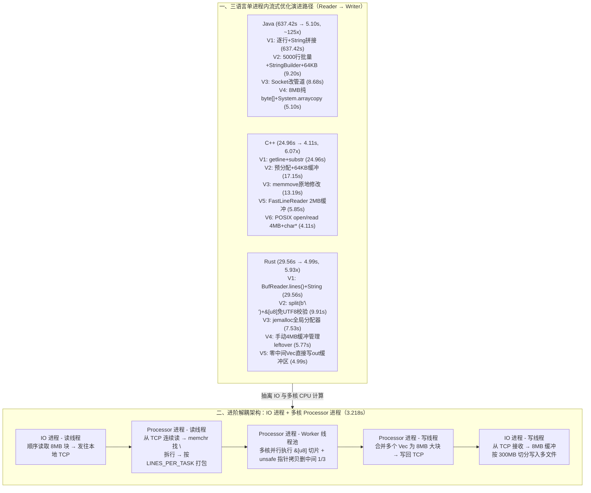

# 一次大文件处理性能优化实录

## 1. TL;DR

1. **核心挑战**：在内存受限（禁止全量加载）前提下，使用双进程（`Reader + Writer` 或 `IO + Processor`）流式处理 **4GB 纯 ASCII 文本文件（约 1.14 亿行，平均每行约 35 字节）**，移除每行中间 1/3 内容后输出约 **2.7GB** 新文件，同时保证换行与数据绝对准确。
2. **四大底层优化主线**：① **指数级削减系统调用**（从逐行 2.28 亿次 `read/write/flush` 降至 4MB–8MB 大缓冲区的百/千次级，匹配 Linux `ext4/xfs` 128KB 预读块并禁用 TCP Nagle 算法 `TCP_NODELAY`）；② **绕过字符编码抽象层**（利用纯 ASCII 单字节特性，直接操作 `byte[] / char* / &[u8]`，省去 Java UTF-16 解码与 Rust **40 亿次** UTF-8 校验）；③ **零临时对象分配**（原地 `memmove` 或直接向预分配大输出缓冲区拷贝字节，消除数亿次堆分配与 GC 压力）；④ **高效分配器与原生 I/O**（C++ 绕过 `std::getline` 虚函数与状态检查直调 POSIX `read`，Rust 引入 `jemalloc` 提速 20%–30%）。
3. **三语言单机双进程演进成绩单**：Java 从 **637.42s 优化至 5.10s（终表汇总 5.20s，提速 122.6 倍）**；C++ 从 **24.96s 优化至 4.11s（提速 6.07 倍）**；Rust 从 **29.56s 优化至 4.99s（提速 5.93 倍）**。
4. **进阶解耦架构突破 3.2 秒**：将“边读边算的胖 Reader + Writer”重构为 **纯 IO 进程（双线程收发 8MB 块并按 300MB 切分输出文件）+ 纯 Processor 进程（读线程 `memchr` 拆行打包 Task $\to$ Worker 线程池多核并行切片拷贝 $\to$ 写线程合并 8MB 块回传 TCP）**，5 次运行均值达 **3.218 秒（较初始 Java 提速近 200 倍）**。

## 2. 问题定义与背景

### 2.1 任务约束与性能瓶颈剖析

- **输入规模**：`4 GB` 纯 ASCII 文本文件，共约 **`1.14 亿行`**（平均每行约 35 字节）。
- **处理规则**：删除每一行中间的 $1/3$ 字符（保留前 `third = len / 3` 字节与后 `keep_end = len - 2 * third` 字节），写出约 **`2.7 GB`** 结果文件。
- **架构约束**：受内存限制不能一次性读入内存，且必须通过**两个进程跨进程通信（Socket / 管道）**协作完成。

### 2.2 通用底层瓶颈与优化杠杆对比

| 瓶颈维度 | 朴素实现（逐行 + 字符串抽象）的开销 | 极致优化后的开销 | 理论收益量级 |
|---|---|---|---|
| **系统调用（Syscall）** | 8KB 默认缓冲 + 逐行 `write/flush` = **~2.28 亿次**上下文切换（每次 100–1000ns） | 4MB–8MB 缓冲区（匹配 Linux 128KB 预读块）+ 批量刷盘 = **~512–1000 次** `read()` | **10–1000x**（第一优先级🔴） |
| **堆内存分配与 GC/析构** | Java V1 每行建 6 个对象 = **6.84 亿个对象**；C++ `substr` 每行 9 次内存操作 = **10.26 亿次** | 固定双 8MB 字节数组 / 原地 `memmove` / 直接追加至输出 `Vec<u8>` | **2–50x**（第二优先级🟠） |
| **字符编码与流抽象层** | Java `byte -> UTF-16 char[]`；C++ `istream::get` 虚函数；Rust `from_utf8` **40 亿次**字节校验 | 纯 ASCII 下直接操作 `byte[] / char* / &[u8]` + `System.arraycopy / memcpy` | **2–5x** |
| **TCP 传输延迟** | 默认开启 Nagle 算法，等待 ACK 或攒满 MSS（1460B）造成停顿 | 批量大包 + 显式禁用 Nagle（`setTcpNoDelay(true)` / `TCP_NODELAY`） | 消除传输等待抖动 |

## 3. 知识框架

## 4. 核心内容拆解

### 4.1 Java 优化路径：从 637.42 秒到 5.10 秒

1. **V1 $\to$ V2（637.42s $\to$ 9.20s，提升 69 倍）**：
   - **削减系统调用（2.28 亿次 $\to$ ~9 万次）**：V1 默认 8KB 缓冲需约 50 万次 `read()`（且浪费了 Linux `ext4/xfs` 默认 **128KB 内核预读块**的其余 120KB 页缓存），加上逐行 `write()` 和 `flush()` 各 1.14 亿次；V2 改用 **64KB 缓冲区**（`read()` 降至 6.5 万次）并每 **`BATCH_SIZE = 5000` 行**才 `write` 和 `flush` 一次（各降至 2.28 万次）。
   - **消除临时对象（6.84 亿个 $\to$ 22.8 万个）**：V1 中 `line.substring(0, third) + line.substring(2*third)` 与 `(processed + "\n").getBytes()` 编译后每行创建 6 个临时对象；V2 预分配 `new StringBuilder(64 * 1024)`，用 `batch.setLength(0)` 重用底层数组，每 5000 行才转一次字节数组。
2. **V2 $\to$ V3 $\to$ V4（9.20s $\to$ 8.68s $\to$ 5.10s）**：
   - V3 将本地 Socket 替换为管道（8.68s）。
   - V4 **彻底抛弃字符流与 `String` 对象**：分配两个固定的 **`8 MB` `byte[]` 数组**（`buffer` 与 `output`，总内存仅 16MB，`read()` 调用降至约 **512 次**），在字节数组内直接扫描 `'\n'`，并用底层调用 C `memcpy/memmove` 的 **`System.arraycopy`** 将前 1/3 与后 1/3 字节直接拼入 `output` 数组，实现**零 UTF-16 编解码、零临时对象分配、零 GC 压力**。

### 4.2 C++ 优化路径：从 24.96 秒到 4.11 秒

1. **V1 $\to$ V2 $\to$ V3（24.96s $\to$ 17.15s $\to$ 13.19s）**：
   - V1 使用 `line.substr(0, third) + line.substr(2 * third)` 每行触发 3 次 `new char[]`、4 次 `memcpy`、2 次 `delete[]`（全文件共 **10.26 亿次**内存管理操作）。
   - V3 改用**原地内存移动**：`memmove(&line[third], &line[2 * third], keep_end); line.resize(len - third);`，完全消除每行的新字符串分配。
2. **V3 $\to$ V5 $\to$ V6（13.19s $\to$ 5.85s $\to$ 4.11s）**：
   - **剖析 `std::getline` 的隐性开销**：每个字符都要经历 `istream::get()` 虚函数调用、`eofbit/failbit/badbit` 状态位检查、`char -> int -> char` 转换与 `push_back` 容量检查。
   - V5 手写 2MB 缓冲的 `FastLineReader`（5.85s）；V6 直接使用 POSIX 原生系统调用 **`open()` + `read(fd, buf, 4*1024*1024)`** 读入 4MB `std::vector<char>`（系统调用降至 ~1000 次），用裸指针 `char*` 扫描 `'\n'` 并原地 `memmove`（4.11s）。

### 4.3 Rust 优化路径与“零成本抽象”深度剖析：从 29.56 秒到 4.99 秒

1. **V1 $\to$ V2（29.56s $\to$ 9.91s，提升 2.98 倍）——为什么 `&str` 在纯 ASCII 下不是零成本**：
   - Rust 的 `&str / String` 强制保证“始终是有效 UTF-8”。因此 V1 调用 `BufReader::lines()` 时，内部每行都会调用 `std::str::from_utf8(&buffer)` 遍历字节序列（1.14 亿行 $\times$ 35 字节 $\approx$ **40 亿次 UTF-8 验证检查**）；切片 `&line[..third]` 还需额外检查字符边界，且无法关闭该安全检查。
   - V2 选用更底层的零成本原语 **`&[u8]` 与 `Vec<u8>`**：用 `reader.split(b'\n')` 按字节 `0x0A` 分割，切片退化为纯指针偏移 `(ptr + offset, new_len)`，拼接改用直调 `memcpy` 的 `extend_from_slice()`，在不牺牲 Rust 所有权内存安全（防缓冲区溢出与 Use-After-Free）的前提下砍掉全部 40 亿次编码检查。
2. **V2 $\to$ V3 $\to$ V4 $\to$ V5（9.91s $\to$ 7.53s $\to$ 5.77s $\to$ 4.99s）**：
   - **V3（7.53s）**：通过 `#[global_allocator] static GLOBAL: Jemalloc = Jemalloc;` 引入 **`jemalloc`**，利用线程本地缓存与分离大小类解决 `glibc malloc` 在 1.14 亿次小 `Vec<u8>` 分配上的瓶颈（提速 20%–30%）。
   - **V4（5.77s）**：抛弃 1MB `BufReader::split()`（跨块行会产生额外拷贝，需 ~4000 次 `read`），手动管理 **4MB 数组 `[0u8; 4 * 1024 * 1024]` + `leftover` 缓冲**（`read` 降至 ~1000 次）。
   - **V5（4.99s）**：消除每行返回中间 `Vec<u8>` 带来的 5.7 亿次内存操作，改为 `push_line_removed_middle_third(line: &[u8], out: &mut Vec<u8>)` 直接把前后两段切片追加进 3MB–8MB 预分配输出缓冲区 `out`。

### 4.4 进阶解耦架构：IO 进程 + 多核 Processor 进程（3.218 秒）

旧版 `Reader + Writer` 中，Reader 既做磁盘 I/O 又做单核 CPU 行处理，职责耦合且吃不满多核 CPU。新架构拆分为：
- **IO 进程（纯 I/O，双线程）**：线程 A 以 **8MB 缓冲**顺序读入文件发往本地 TCP；线程 B 从 TCP 接收处理完的数据，以 8MB 缓冲按 **每 300MB 切分**写入多个输出文件。
- **Processor 进程（纯计算，三层纵向流水线）**：
  1. **读线程**：从 TCP 连续读取字节流，用 **`memchr`** 高速查找 `\n` 拆行，按固定行数（`LINES_PER_TASK`）打包成 Task 推入队列（粒度过细则通道与切换开销大，过粗则 Worker 负载不均）。
  2. **Worker 线程池**：多核并行消费 Task，基于字节切片 + `unsafe` 指针拷贝删除每行中间 1/3，打包为大 `Vec<u8>`。
  3. **写线程**：将多个 `Vec<u8>` 合并为 **8MB 大块**一次性写回 TCP，实测 5 次运行均值降至 **3.218 秒**。

## 5. 数据速查表

| 语言 / 阶段版本 | 耗时（秒） | 核心优化手段 | 关键量化指标说明 |
|---|---|---|---|
| **Java V1 $\to$ V2 $\to$ V3 $\to$ V4** | `637.42s` $\to$ `9.20s` $\to$ `8.68s` $\to$ **`5.10s`**（汇总表 `5.20s`） | 5000 行批量 + 64KB 缓冲 + `StringBuilder` $\to$ 管道 $\to$ **8MB 纯 `byte[]` + `System.arraycopy`** | Syscall 从 **2.28 亿次 $\to$ 9 万次 $\to$ ~512 次**；临时对象从 **6.84 亿 $\to$ 22.8 万 $\to$ 0** |
| **C++ V1 $\to$ V2 $\to$ V3 $\to$ V5 $\to$ V6** | `24.96s` $\to$ `17.15s` $\to$ `13.19s` $\to$ `5.85s` $\to$ **`4.11s`** | 64KB 缓冲 $\to$ **`memmove` 原地修改** $\to$ 2MB `FastLineReader` $\to$ **POSIX `read` 4MB + `char*`** | 消除 `substr` **10.26 亿次**内存操作与 `std::getline` 逐字符虚函数开销 |
| **Rust V1 $\to$ V2 $\to$ V3 $\to$ V4 $\to$ V5** | `29.56s` $\to$ `9.91s` $\to$ `7.53s` $\to$ `5.77s` $\to$ **`4.99s`** | `split(b'\n') + &[u8]` $\to$ **`jemalloc`** $\to$ 手动 4MB 缓冲 $\to$ **零中间 `Vec` 直写输出缓冲** | 消除 **40 亿次** UTF-8 验证与 **5.7 亿次**中间 `Vec` 内存操作 |
| **进阶新架构（IO + Processor）** | **均值 `3.218s`**（5 次运行） | IO 进程（双线程 8MB 缓冲 + 300MB 切分）+ Processor 进程（读线程 `memchr` + Worker 线程池 + 写线程 8MB 合并） | 彻底解耦磁盘 I/O 与多核 CPU 并行行处理 |

## 6. 踩坑与教训 / 可迁移的设计原则

| 错误做法 | 失败表现或原因 | 原文应对（可迁移的设计原则） |
|---|---|---|
| **逐行调用 `readLine/getline` 并逐行 `write + flush`** | 1.14 亿行触发 2.28 亿次用户态/内核态上下文切换，且 8KB 默认缓冲浪费 Linux 128KB 预读页缓存 | **第一优先级削减系统调用**：使用 **64KB–8MB 大缓冲区**匹配预读块，批量累积后一次性写出 |
| **在纯 ASCII / 已知编码流处理中盲目使用高级字符串类型（Java `String` / Rust `&str`）** | Java 强制转 UTF-16 `char[]` 并产生数亿临时对象；Rust `&str` 强制执行 40 亿次 UTF-8 合法性与字符边界检查 | **下沉至字节原语（`byte[] / char* / &[u8]`）**：用 `System.arraycopy / memmove / extend_from_slice` 直接拷贝内存块 |
| **每处理一行就分配并返回一个新的 `String` 或 `Vec<u8>`** | 1.14 亿行引发数亿次小内存分配与析构，打爆 `glibc malloc` 或触发高频 GC | **零分配（Zero-Allocation）行处理**：原地 `memmove` 修改，或将结果切片直接追加写入预分配的大输出缓冲区 |
| **单向大吞吐本地 Socket 传输保持默认 Nagle 算法开启** | Nagle 等待 ACK 或凑包逻辑在单向流中引入不必要的传输等待 | 配合大发送缓冲区显式设置 **`TCP_NODELAY`（`setTcpNoDelay(true)`）** |
| **让单个 Reader 进程同时承担磁盘 I/O 与复杂行计算** | 单核 CPU 计算与 I/O 互相阻塞，无法利用多核且难以独立调优扩展 | **IO 进程 + 多核 Processor 进程解耦**：通过本地 TCP 字节流边界隔离，Processor 内用 `读线程 + Worker 线程池 + 写线程` 吃满多核 |

## 7. 记忆锚点

- **性能优化四级火箭（按收益排序）**：「**🔴 砍系统调用（8MB 缓冲，10–1000x）$\to$ 🟠 零对象分配（直写输出缓冲/原地 `memmove`，2–50x）$\to$ 🟡 绕编码抽象（操作 `&[u8]/byte[]` 免 40 亿次校验，2–5x）$\to$ 🔵 换 `jemalloc` + 多核解耦（1.1–1.5x）**」。
- **成绩单演进锚点**：「**Java 637s $\to$ 5.1s，C++ 25s $\to$ 4.1s，Rust 30s $\to$ 5.0s，IO+Processor 新架构 3.2s**」。

## 8. 复习卡片

处理 4GB（1.14 亿行）大文件时，Java V1 耗时高达 637.42 秒的两个最核心根因是什么？::① 系统调用爆炸：8KB 缓冲加逐行 write() 和 flush() 产生了约 2.28 亿次系统调用；② 临时对象爆炸：每行 substring 拼接与 getBytes() 创建 6 个临时对象，全文件产生 6.84 亿个对象打爆 GC。
为什么默认 8KB 应用缓冲区无法有效利用现代 Linux 文件系统的性能？::因为现代 Linux 文件系统（ext4/xfs）默认预读块大小是 128KB；每次只读 8KB 会导致预读进页缓存的剩余 120KB 在下次读取前可能被冲刷覆盖，造成频繁磁盘 I/O，应使用 64KB–8MB 大缓冲区。
为什么在单向大吞吐流式传输（Reader → Writer）中禁用 TCP Nagle 算法（TCP_NODELAY）能提升性能？::因为该场景是单向无交互数据流且每次批量发送的数据块已经足够大，禁用 Nagle 可让 send() 数据立即进入 TCP 发送队列而无需等待前序包的 ACK。
在 Rust 中处理纯 ASCII 文本时，为什么用 &str / String（V1 29.56s）比用 &[u8] / Vec<u8>（V2 9.91s）慢近 3 倍？::因为 &str 在类型安全契约上强制保证“始终为有效 UTF-8”，导致 BufReader::lines() 和切片操作对 1.14 亿行执行了约 40 亿次冗余的 UTF-8 字节合法性与字符边界检查；改用 &[u8] 可绕过编码层直接做指针偏移与 memcpy，且仍保有所有权内存安全。
C++ V6（4.11s）是如何消除 std::getline() 的抽象层开销的？::std::getline() 对每个字符都要执行虚函数调用（istream::get）、错误状态位检查与边界检查；V6 改用 POSIX 原生 open/read 一次性读入 4MB 缓冲区，并用裸指针 char* 批量扫描 '\n' 和原地 memmove。
为什么进阶架构要将“Reader + Writer”改为“IO 进程 + Processor 进程”？Processor 内部是如何利用多核的？::旧架构中 Reader 混合了磁盘 I/O 与 CPU 行处理，无法吃满多核；新架构让 IO 进程专职双线程 8MB 块读写（按 300MB 切分输出），Processor 进程内部拆为“读线程（memchr 拆行打包 Task）+ Worker 线程池（多核并行处理）+ 写线程（合并 8MB 块写回 TCP）”，将耗时进一步压至 3.218 秒。

## 9. 知识关联

- **本库主题索引**：[操作系统与内存管理](../../20_topics/操作系统与内存管理.md)、[分布式计算与数据管道](../../20_topics/分布式计算与数据管道.md)、[Agent工程循环](../../20_topics/Agent工程循环.md)
- **本库关联文章**：[淘宝交易结算缓存实践总结+26.5.11](../淘宝交易结算缓存实践总结+26.5.11/AI_淘宝交易结算缓存实践总结.md)
- **候选双链**：[[零成本抽象]]、[[系统调用优化]]、[[jemalloc内存分配]]、[[TCP_NODELAY与Nagle算法]]

## 10. 原文参考资料

- **原文信息**：《一次大文件处理性能优化实录》，作者：朝恒（淘天集团-营销交易技术团队），发布日期：2026-02-04。
- **文内涉及技术栈与系统库**：Java（`FileInputStream`、`System.arraycopy`）、C++（POSIX `open/read`、`memmove`、`memchr`）、Rust（`&[u8]`、`jemallocator::Jemalloc`）、Linux `ext4/xfs` 预读机制、TCP `TCP_NODELAY`。

> [!note]- 校对报告
> - **页码溯源汇总**：
>   - `## 1. TL;DR` & `## 2. 问题定义与背景`：源自 p.1–3（4GB / 1.14 亿行 ASCII 文本删中间 1/3 输出 2.7GB、批量 vs 逐行对比表、8KB/64KB/4MB 缓冲区对比、Linux 128KB 预读块、Nagle 算法与 `TCP_NODELAY`）。
>   - `## 4.1 Java 优化过程`：源自 p.3–9（V1 `637.42s` $\to$ V2 `9.20s` $\to$ V3 `8.68s` $\to$ V4 `5.10s`；Syscall 从 2.28 亿次 $\to$ 9 万次 $\to$ 512 次；临时对象从 6.84 亿 $\to$ 22.8 万 $\to$ 0；8MB `byte[]` + `System.arraycopy`）。
>   - `## 4.2 C++ 优化过程`：源自 p.9–14（V1 `24.96s` $\to$ V2 `17.15s` $\to$ V3 `13.19s` $\to$ V5 `5.85s` $\to$ V6 `4.11s`；`substr` 10.26 亿次内存操作 vs `memmove` 原地修改；`std::getline` 四项逐字符开销 vs POSIX `open/read` 4MB）。
>   - `## 4.3 Rust 优化过程`：源自 p.14–21（V1 `29.56s` $\to$ V2 `9.91s` $\to$ V3 `7.53s` $\to$ V4 `5.77s` $\to$ V5 `4.99s`；40 亿次 UTF-8 验证检查、`&str` vs `&[u8]` 零成本抽象、`jemalloc` 提速 20%–30%、手动 4MB `leftover` 缓冲、5.7 亿次中间 `Vec` 消除）。
>   - `## 4.4 总结与进阶架构`：源自 p.21–25（四级优化优先级排序表、终表汇总注记：p.9 Java V4 写 `5.10s` 而 p.22 终表写 `5.20s / 122.6x`，本笔记两处均如实保留并说明；IO 进程 8MB 缓冲 + 300MB 切分 + Processor 进程读/Worker池/写线程，5 次均值 `3.218s`）。
> - **材料质量说明**：全文代码与性能表格均在文本层完整提取（p.24 含新架构示意图）；所有耗时与次数计算均与原文逐字核对一致。
