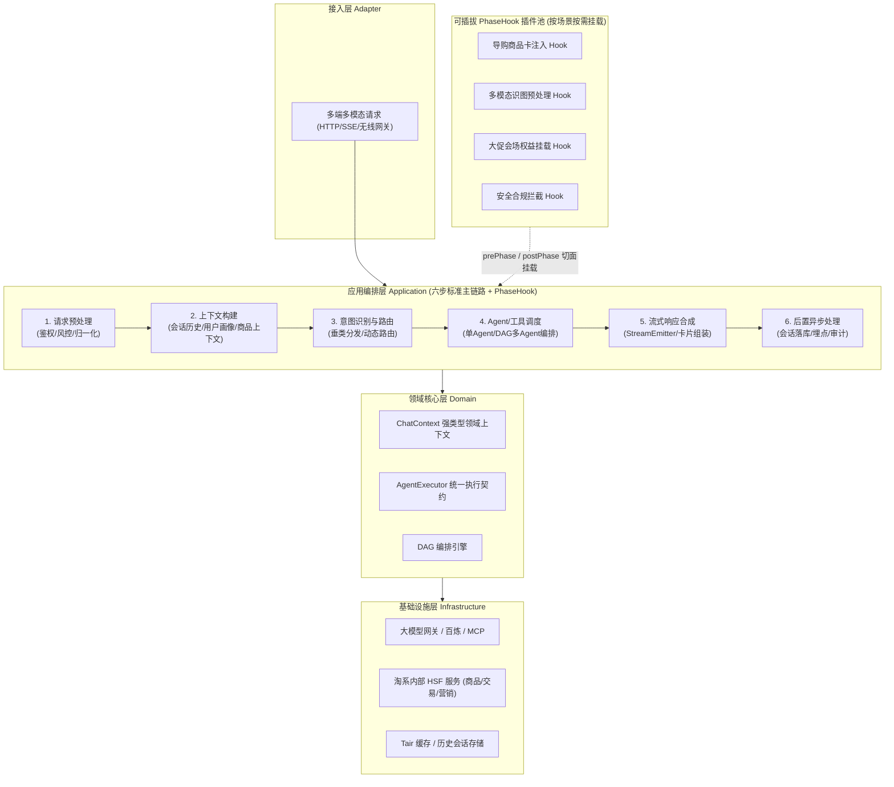

# 天猫AI助手：调度框架重构与AI Coding工程化实践

> [!abstract] 导读
> **一句话总结**：淘天集团天猫 APP 技术团队针对“天猫 AI 助手”早期烟囱式过程脚本（单文件数千行、多模态分支耦合、AI Coding 理解上下文极易腐化）的架构痛点，通过“DDD 领域分层 + 六步标准主链路 + 轻量级阶段感知钩子（PhaseHook）+ DAG 配置化流程引擎”完成调度框架彻底重构，并沉淀分层 `CLAUDE.md` 工程规约与双轨测试护栏，实现重构后近百个业务需求 100% 由 AI Coding 交付、代码采纳率稳定超 80%。
> **阅读价值**：揭示了一个关键工程洞察——**“对人类友好的高内聚低耦合架构，同样是对 AI Coding 最友好的架构”**，并提供了一套可直接复用的 Agent 调度层重构蓝图与 `CLAUDE.md` 分层治理范式。

## 1. TL;DR

- **核心问题**：天猫 AI 助手从早期单一导购问答快速膨胀为覆盖多入口、多模态（文本/语音/识图）、多垂类 Agent 的核心枢纽，旧版“过程式脚本”单类膨胀至数千行，`if-else` 场景分支交织，不仅人工迭代举步维艰，更导致 AI Coding 因上下文过长、职责不清而频频“改A坏B”。
- **架构重构四大支柱**：
  1. **DDD 四层清晰边界**：严格划分接入层（Adapter）、应用编排层（Application）、领域核心层（Domain）与基础设施层（Infrastructure），消除跨层越权调用。
  2. **六步标准执行主链路**：将所有 AI 会话请求抽象为 `请求预处理 → 上下文构建 → 意图识别与路由 → Agent/工具调度执行 → 流式响应合成 → 后置异步处理` 六个标准阶段。
  3. **轻量级阶段感知钩子（PhaseHook）**：在标准主链路的每个阶段切入 `prePhase / postPhase` 扩展点，将业务特化逻辑（如导购卡片注入、安全审计、特定渠道埋点）剥离为独立可插拔的 Hook 组件。
  4. **配置化 DAG 编排与统一流式输出**：支持多 Agent 串并联混合调度，并通过统一的 `StreamEmitter` 屏蔽底层 SSE/WebSocket 与增量卡片渲染差异。
- **AI Coding 工程化闭环**：在干净架构之上构建“根目录全局 `CLAUDE.md` + 子模块专属 `CLAUDE.md`”分层上下文体系，配合真实环境链路测试与轻量级纯内存单元测试双轨验证，达成近百个需求 **100% AI 编写代码**、采纳率 **>80%**、新场景接入耗时从数天压缩至小时级。

## 2. 问题定义与背景

### 2.1 业务演进与旧架构腐化痛点
随着天猫 APP 全面推进 AI Native 化，“天猫 AI 助手”承载了首页搜索问答、商品详情页导购、拍照问一问、语音助手等十余个核心业务场景。在早期快速试错阶段形成的旧版调度代码逐渐暴露出四大重症：

| 痛点维度 | 旧版架构具体表现 | 对研发与 AI Coding 的杀伤力 |
| :--- | :--- | :--- |
| **过程式巨石类** | 核心调度器单文件长达数千行，鉴权、风控、历史会话拼接、意图路由、LLM 流式解析全部堆砌在同一方法中。 | 超出 Coding Agent 高效推理的注意力窗口，AI 修改局部逻辑时极易误删其他场景分支。 |
| **场景分支硬编码** | 遍布 `if (scene == "A") ... else if (scene == "B")` 的烟囱式分支，新增一个垂类场景需在十几个文件里打补丁。 | 违反开闭原则（OCP），AI 无法通过新增独立类完成需求，必须在核心主干上“动刀”。 |
| **流式协议与状态碎片化** | 不同下游 Agent（自研大模型、百炼平台、外部 MCP/工具）返回格式各异，流式 chunk 拼接与异常中断处理逻辑散落各处。 | 状态机不透明，并发与异常兜底极易出现流式卡死、丢包或重复推送。 |
| **可测试性极差** | 强依赖线上中间件（HSF、Tair、Diamond 配置中心），本地无法脱离容器独立运行单测。 | AI 生成代码后缺乏快速闭环验证手段，只能靠人工部署到测试环境肉眼排查，无法形成 Agent 自修复闭环。 |

### 2.2 核心破局理念：面向 AI 友好（AI-Friendly）的架构设计
团队深刻意识到：**在垃圾代码山（Big Ball of Mud）上强推 AI Coding 只会加速技术债爆炸**。要想让 AI 稳定产出高质量生产代码，必须先通过架构重构实现：
- **关注点极致分离**：让每次需求变更收敛在单一、小于 300 行的独立组件（如一个新 `PhaseHook` 或新 `AgentExecutor`）内。
- **显式契约与强类型上下文**：消除隐式 Map 传参，用强类型领域对象让 AI 一眼看懂输入输出边界。

## 3. 知识框架

```mermaid
mindmap
  root((天猫AI助手调度重构与AI Coding实践))
    旧架构四大痛点
      数千行过程式巨石脚本
      if-else 场景分支硬编码耦合
      多源流式协议与状态管理碎片化
      强耦合中间件导致本地不可测
    新调度框架设计
      DDD 四层架构解耦
        接入层 Adapter
        应用层 Application
        领域层 Domain
        基础设施层 Infrastructure
      六步标准执行主链路
        1. 请求预处理
        2. 上下文构建
        3. 意图识别与路由
        4. Agent/工具调度执行
        5. 流式响应合成
        6. 后置异步处理
      核心扩展机制
        PhaseHook 轻量级阶段感知钩子
        DAG 配置化多 Agent 编排
        StreamEmitter 统一流式输出抽象
    AI Coding 工程化体系
      分层 CLAUDE.md 规约
        根目录全局架构与编码红线
        子模块职责与扩展 SOP
      标准化四步研发工作流
        需求澄清 -> 方案规划(Plan) -> 代码生成 -> 自动验证
      双轨测试护栏
        轻量级纯内存 Mock 单元测试
        真实容器环境端到端回归测试
    业务与工程成效
      近百个需求 100% AI 编码交付
      AI 代码采纳率 > 80%
      新场景接入从天级缩短至小时级
```

## 4. 核心内容拆解

### 4.1 调度框架重构：DDD 分层 + 六步标准链路 + PhaseHook



#### 1. 强类型领域上下文（`ChatContext`）与六步主链路
重构后的框架彻底废弃了过去在方法间传递无结构 `Map<String, Object>` 的做法，设计了强类型的领域上下文对象，并将会话生命周期固化为六个标准阶段：
1. **请求预处理（Pre-process）**：统一解析多端协议，执行安全风控预检与参数归一化。
2. **上下文构建（Context Building）**：并行拉取多轮历史对话、用户实时画像、当前浏览商品/店铺上下文。
3. **意图识别与路由（Intent & Routing）**：结合轻量级分类模型与规则路由，决定当前请求交由哪个垂类 Agent 或工作流处理。
4. **Agent/工具调度执行（Execution）**：通过统一的 `AgentExecutor` 契约调用底层大模型、RAG 检索或业务 HSF 工具，支持单 Agent 直连与多 Agent DAG 编排。
5. **流式响应合成（Stream Synthesis）**：通过统一的 `StreamEmitter` 将增量文本流、思考过程（Reasoning）与富媒体商业卡片（商品卡、优惠券卡）按序组装推送。
6. **后置异步处理（Post-process）**：对话完成后异步执行会话持久化、Token 消耗计量与业务全链路埋点。

#### 2. 轻量级阶段感知钩子（`PhaseHook`）
为了彻底消灭主干代码中的 `if-else` 场景分支，团队设计了 `PhaseHook` 机制：
- 每个 Hook 声明自己关注的**业务场景编码（SceneCode）**与**挂载阶段（Phase）**，实现 `prePhase(ChatContext)` 与 `postPhase(ChatContext)` 接口，并支持优先级排序與异常隔离（非核心 Hook 报错可自动降级，不阻断主干对话流）。
- **对 AI Coding 的极佳适配性**：当产品提出“在商品详情页 AI 助手场景下，对话结束前自动追加关联搭配购商品卡片”时，AI 只需要新建一个独立的 `DetailMatchCardHook` 类并注册到阶段 5，**对核心主链路代码实现零修改**。

### 4.2 AI Coding 工程化落地体系

架构解耦只是第一步，为了让 AI Coding 稳定输出符合团队规范的代码，团队围绕 **上下文工程（Context Engineering）** 与 **自动化验证闭环** 做了三项核心建设：

#### 1. 分层 `CLAUDE.md` 工程规约体系
团队没有把所有规范塞进一个臃肿的巨型文档，而是采用**“按目录层级按需加载”**的分层 `CLAUDE.md` 结构：
- **根目录 `/CLAUDE.md`（全局宪法）**：定义项目整体 DDD 四层架构图、包命名规范、严禁跨层调用的架构红线、统一异常处理规范、日志与监控埋点标准，以及常用构建/测试命令。
- **子模块 `/module-xxx/CLAUDE.md`（局部作战手册）**：在 `application/hook`、`domain/executor`、`infrastructure/gateway` 等子目录下放置专属说明，详细规定“如何新增一个 PhaseHook”、“如何接入一个新的下游 Agent 协议”的标准模板与正反代码示例。
- **动态演进机制**：每当 Code Review 中发现 AI 犯了某种共性错误（例如误用阻塞式 IO 或漏写超时熔断），立即将该反例补充进对应层级的 `CLAUDE.md`，实现团队经验的复利沉淀。

#### 2. 标准化四步 AI 研发工作流
1. **需求结构化对齐**：将 PRD 转化为结构化的技术输入（明确涉及的 SceneCode、挂载阶段、上下游依赖接口）。
2. **Plan 模式先行评审**：强制要求 AI 先基于 `CLAUDE.md` 输出修改计划（涉及新增哪些类、改动哪些配置、单测设计方案），工程师在 Plan 阶段完成架构纠偏，避免生成大段错误代码后再返工。
3. **受控代码生成**：按模块分步生成领域模型、Hook/Executor 实现与配套测试。
4. **双轨测试自动自愈**：AI 自动执行测试命令并根据报错堆栈自我修复，直至全绿通过。

#### 3. 双轨测试验证护栏（破解淘系中间件耦合难题）
针对企业级应用强依赖内部中间件导致本地单测启动慢（动辄数分钟）的痛点，团队构建了双轨测试体系：
- **快轨：纯内存轻量级单元测试（毫秒级启动）**：得益于 DDD 基础设施层接口抽象，利用 Mockito 对底层 HSF/Tair/LLM Gateway 进行标准 Mock，让 AI 在编写完 `PhaseHook` 或领域逻辑后能在 1~2 秒内跑完单测并验证分支覆盖。
- **稳轨：真实容器集成回归测试**：提供标准化测试基类与测试环境脚本，一键验证完整六步主链路与流式 SSE 输出的端到端正确性。

## 5. 数据速查表

| 指标/维度 | 重构前（旧版过程式框架） | 重构后（DDD + PhaseHook + AI Coding） | 关键机制支撑 |
| :--- | :--- | :--- | :--- |
| **核心调度代码形态** | 单文件数千行过程式脚本，`if-else` 强耦合 | 六步标准主链路 + 独立 `PhaseHook` 插件（单类短小内聚） | 开闭原则（OCP）+ 阶段感知切面 |
| **业务需求 AI 交付占比** | 仅能辅助生成零散工具函数，主干不敢让 AI 改 | 重构后近百个日常业务需求 **100% 由 AI 编码完成** | 清晰模块边界 + 分层 `CLAUDE.md` |
| **AI 生成代码采纳率** | 低（频繁出现上下文幻觉与破坏性改动） | 稳定超过 **80%** | Plan 模式先行 + 强类型 `ChatContext` |
| **新业务场景接入耗时** | 数天（需通读主链路、多处打补丁与漫长联调） | **小时级**（仅需按 SOP 生成专属 Hook 与配置） | 插件化扩展 + 配置化 DAG 编排 |
| **本地单测反馈周期** | 强耦合中间件，本地难以独立运行或启动极慢 | **秒级**纯内存单测闭环 + 容器端到端测试双轨护航 | 基础设施层反转（DIP）与标准 Mock |

## 6. 踩坑与教训 / 可迁移的设计原则

- **核心认知 1：架构治理是 AI Coding 提效的先决条件，而非替代品**
  - **教训**：在高度耦合的面条代码上直接使用 AI Coding，AI 会模仿原有的坏味道继续堆砌 `if-else`，甚至因为看不全隐式副作用而引发线上故障。
  - **原则**：**“人类读不懂、改不动的代码，AI 同样改不好”**。通过 DDD 分层与插件化把单次变更的爆炸半径锁死在独立小文件内，是提升 AI 代码采纳率最高杠杆的投入。
- **核心认知 2：`CLAUDE.md` 贵在“分层精准”而非“大而全”**
  - **教训**：早期把所有业务细节和代码规范塞进同一个大文件，不仅浪费 Token，还会稀释大模型对核心架构红线的注意力。
  - **原则**：采用“根目录放全局架构红线 + 子目录放具体扩展 SOP”的分层组织，让 AI 在修改哪个目录时就精准加载哪个目录的规约。
- **核心认知 3：没有快速测试反馈的 AI Coding 只是“半自动玩具”**
  - **原则**：必须通过依赖倒置（DIP）剥离外部 RPC 与缓存依赖，让 AI 能够在本地毫秒级运行单测并读取断言报错，从而激活 Agent 的“编码→运行单测→看报错修复→再验证”自愈循环。

## 7. 记忆锚点

- **一句话金句**：**好架构既度人，也度 AI**——高内聚、低耦合、开闭原则是 AI Coding 时代最好的提示词底座。
- **调度重构三件套**：**DDD 四层边界** + **六步标准主链路** + **PhaseHook 阶段感知钩子**。
- **AI 工程化三板斧**：**分层 `CLAUDE.md` 规约** + **Plan 先行工作流** + **快稳双轨测试护栏**。
- **硬核战果数字**：近百需求 **100% AI 交付**、代码采纳率 **>80%**、新场景接入从**天级降为小时级**。

## 8. 复习卡片

What were the main architectural bottlenecks of the legacy Tmall AI Assistant scheduling framework before refactoring?::A monolithic procedural script spanning thousands of lines, hardcoded `if-else` branches across business scenes, fragmented multi-source streaming protocol handling, and tight coupling to middleware that prevented fast local unit testing.
What are the six standard execution phases in the refactored Tmall AI Assistant scheduling pipeline?::1. Request Pre-processing, 2. Context Building, 3. Intent Recognition & Routing, 4. Agent/Tool Execution, 5. Streaming Response Synthesis, and 6. Asynchronous Post-processing.
How does the `PhaseHook` mechanism make the scheduling framework friendly to both human developers and AI Coding agents?::By providing `prePhase` and `postPhase` extension points at each of the six standard pipeline stages, allowing new scene-specific features to be added as small, isolated Hook classes without modifying the core orchestration logic (adhering to the Open-Closed Principle).
How is the `CLAUDE.md` specification organized in the Tmall AI Assistant repository to maximize AI Coding accuracy?::It uses a hierarchical structure: a root-level `CLAUDE.md` defining global DDD layer boundaries, naming conventions, and architectural redlines, paired with subdirectory-level `CLAUDE.md` files containing module-specific extension SOPs and templates.
How did the team solve the problem of slow middleware-dependent testing so AI Coding agents could self-verify quickly?::They built a dual-track testing guardrail: a fast in-memory unit test track using dependency inversion and mocks for second-level AI feedback loops, combined with a container-based integration test track for end-to-end streaming verification.
What quantitative engineering outcomes were achieved after combining the scheduling framework refactoring with standardized AI Coding practices?::Nearly 100 subsequent business requirements were delivered with 100% AI-generated code, an AI code adoption rate consistently above 80%, and new business scenario onboarding time reduced from days to hours.

## 9. 知识关联

- **本批同主题精读**：
  - [重构协同：关于AI Native团队的思考](../重构协同AI Native团队+26.8.13/AI_重构协同AI Native团队.md)：从组织与协同视角阐述了为何必须建立“左脚工程化 + 右脚知识库”，本文正是天猫技术团队落地这一理念的标杆工程案例。
  - [复杂业务团队的 AI Coding 交付实践：知识库、RD 流程和质量门禁](../复杂业务AI Coding交付+26.8.4/AI_复杂业务AI Coding交付.md)：同样聚焦存量复杂业务中的 AI Coding 工程化，可对比两者在知识库分层与质量门禁设计上的异曲同工之处。
  - [淘宝百亿补贴 C 端 Coding Agent 研发提效实践](../百补C端CodingAgent+26.8.2/AI_百补C端CodingAgent.md)：展示端侧团队如何通过架构规范化与多 Agent 协同实现高采纳率的 AI 研发交付。
  - [淘宝主播 Agent 的 Harness 工程实战](../淘宝主播Agent Harness+26.8.6/AI_淘宝主播Agent Harness.md)：同为业务核心 Agent 系统，可对比天猫 AI 助手（导购调度）与淘宝主播 Agent（直播控场 Harness）在上下文管理与流式调度上的架构设计。
- **主题索引（`20_topics`）**：
  - [AI研发协同](../../20_topics/AI研发协同.md)
  - [Skill设计与治理](../../20_topics/Skill设计与治理.md)
  - [Harness与模型协同](../../20_topics/Harness与模型协同.md)
- **本目录归档文件**：[原始 PDF](RAW.pdf) · [逐页转写文本](MD.md)
- **候选概念双链**：[[领域驱动设计]] · [[开闭原则]] · [[PhaseHook]] · [[CLAUDE.md]] · [[上下文工程]] · [[流式编排]]

## 10. 原文参考资料

- **原文出处**：大淘宝技术公众号，《天猫AI助手：调度框架重构与AI Coding工程化实践》（作者：依凡，淘天集团—天猫APP技术团队，发布日期：2026-08-11）

> [!note]- 校对报告
> - **页码溯源（1-based 物理页码）**：
>   - 篇首标题、作者（依凡，淘天集团—天猫APP技术团队）、天猫 AI 助手业务背景与旧版调度架构四大痛点：源自 `RAW.pdf` `p.1–4`（对应 `MD.md` 第 1–4 页）。
>   - 新版调度框架设计（DDD 四层架构、六步标准主链路、`ChatContext` 强类型上下文、`PhaseHook` 阶段感知钩子、DAG 编排与 `StreamEmitter` 统一流式抽象）：源自 `RAW.pdf` `p.4–10`（对应 `MD.md` 第 4–10 页）。
>   - AI Coding 工程化实践（分层 `CLAUDE.md` 规范设计、Plan 模式四步研发流程、纯内存单测 + 真实环境测试双轨护栏）：源自 `RAW.pdf` `p.10–14`（对应 `MD.md` 第 10–14 页）。
>   - 落地成效数据（近百个需求 100% AI 交付、代码采纳率 >80%、新场景接入缩短至小时级）与总结展望：源自 `RAW.pdf` `p.14–15`（对应 `MD.md` 第 14–15 页）。
> - **一致性核验**：原文共 15 页（含 10 页架构与流程配图），文中提及的 `CLAUDE.md` 为架构目录组织原则描述而非完整独立可抽离的单文件 Prompt 文本（故不单独生成 `PROMPT.md`）。全部核心模块命名、链路步骤与量化指标均与 `MD.md` 严格一致。
