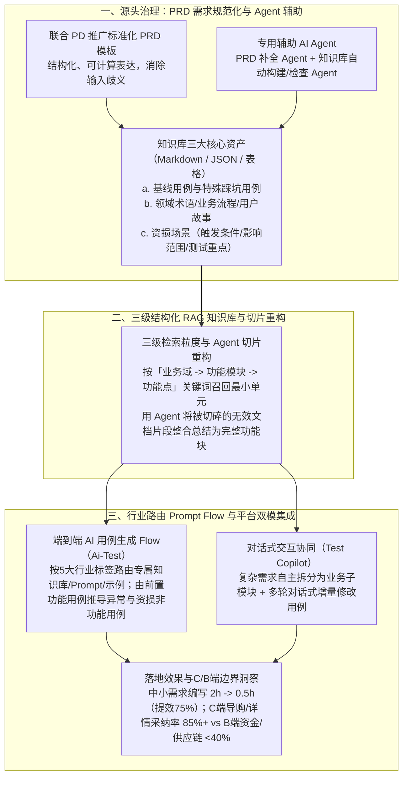

# 从0到1：天猫AI测试用例生成的实践与突破

## 1. TL;DR

1. **核心痛点**：在天猫快节奏迭代下，从“用例设计到最终回归”占据了 QA 约 **70% 的工作时间**；传统人工编写测试用例不仅耗时耗力、易受个人理解偏差影响，且难以全面覆盖复杂的异常边界与**资损场景**，同时天猫业务横跨**营销解决方案、导购场域、交易结算、多部门协作、中后台**五大差异显著的业务类型。
2. **关键机制（需求规范化 + 分层 RAG 知识库重构 Agent + 行业路由 Prompt Flow + 平台化集成）**：
   - **知识库构建与切片重构 Agent**：按“业务域 $\to$ 功能模块 $\to$ 功能点”三级结构沉淀基线用例、踩坑特殊用例、业务术语与资损场景；针对原始文档机械切分导致单个功能描述散落多个无效片段的问题，引入 **知识库自动构建与重构 Agent** 对全文整合总结，生成完整结构化切片；
   - **PRD 规范化与双模生成**：联合 PD 推广可被计算处理的标准化 PRD 模板；在用例管理平台集成 **Ai-Test**（按行业标签路由至专属知识库/Prompt/示例，并由前置功能用例自动推导异常与资损等非功能用例）与 **Test Copilot**（支持复杂需求模块化拆解与多轮对话式修改）。
3. **量化效果与能力边界**：在导购场域、营销解决方案等场景中，中小型需求用例编写时间从 **2 小时缩短至 0.5 小时（节省 75%）**；**C 端表现层（如导购、详情）用例采纳率达 85% 以上**，但逻辑深、链路长的 **B 端场景（如资金、供应链）采纳率普遍不到 40%**（受限于复杂隐性规则与非标 PRD/视觉交互稿解析瓶颈）。

## 2. 问题定义与背景

### 2.1 QA 研发时间分布与四大核心痛点

在“需求理解 $\to$ 风险评估 $\to$ 用例设计 $\to$ 用例执行 $\to$ 缺陷追踪 $\to$ 集成/回归 $\to$ 发版上线 $\to$ 反馈跟踪”全链路中，**从用例设计到最终回归占据了 QA 约 70% 的时间**。传统用例编写面临四大痛点：
1. **用例设计效率低**：人工编写难以穷举边界条件，尤其是高风险的**异常与资损场景**；
2. **需求理解偏差**：不同测试工程师对同一份 PRD 理解不一致，产出的用例颗粒度参差不齐；
3. **领域知识沉淀不足**：历史基线用例、线上踩坑点、业务背景缺乏结构化复用机制；
4. **跨业务域差异大**：天猫业务涵盖**营销解决方案、导购场域、交易结算、多部门协作、中后台**五大类，通用 Prompt 无法一刀切适配。

## 3. 知识框架

## 4. 核心内容拆解

### 4.1 为什么不微调模型，而是深耕“需求规范化 + Prompt + RAG + Agent”？

对比业界（如 QECon 大会案例）实践，测试领域的痛点主要在于**项目上下文缺失、PRD 输入质量差与领域踩坑知识未注入**，而非基座模型通用推理能力不足。因此团队制定了五位一体策略：
1. **Prompt 工程与行业路由 Flow**：
   - 根据需求所属的 **5 大业务标签（营销解决方案 / 导购场域 / 交易结算 / 多部门协作 / 中后台）**，自动路由至对应的行业知识库、专属 Prompt 与 Few-shot 示例；
   - **两步推导法**：先基于需求生成前置功能用例，再结合 RAG 召回的异常与资损设计原则，**由前置功能用例推导非功能用例（异常流、幂等性、资损防线）**，大幅提升用例确定性。
2. **高质量 RAG 知识库与“Agent 切片重构”**：
   - **三类核心语料**：① 测试用例（基线用例 + 历史踩坑特殊用例）；② 业务背景（领域术语、业务流程、用户故事）；③ **资损场景库（明确记录触发条件、影响范围、测试重点）**。
   - **三级目录索引**：按 `业务域 → 功能模块 → 功能点` 组织，通过关键词精准召回最小单元功能点。
   - **用 Agent 解决传统固定窗口 Chunking 的碎片化顽疾**：传统按字数切分常把同一个功能描述切散到多个残缺片段中；团队引入**知识库自动构建 Agent**，从原始技术文档中自动提取术语、流程与核心功能点并对全文做整合总结，确保每个知识切片语义完整、结构清晰。
3. **联合 PD 推动 PRD 需求规范化**：
   - 实验证明“垃圾进、垃圾出”——非标 PRD 会严重拉低用例覆盖率；
   - 团队与产品经理（PD）共建标准化 PRD 模板并在天猫 App 多业务域试点，辅以 PRD 补全 Agent，使生成的用例自动对齐业务子模块、无遗漏覆盖全部功能分支。
4. **平台化双模落地（`Ai-Test` + `Test Copilot`）**：
   - 集成至内部测试用例管理平台，既支持一键式端到端生成（`Ai-Test`），也支持针对复杂需求先拆分子模块、再通过 `Test Copilot` 进行多轮对话式用例精修。

## 5. 数据速查表

| 指标 / 维度 | 原文数值 | 语境 / 条件 |
| --- | --- | --- |
| 传统 QA 用例设计至回归耗时占比 | **约占 QA 70% 的工作时间** | 涵盖用例设计、执行、缺陷追踪与集成回归 |
| 天猫业务差异化分类数量 | **5 类业务类型** | 营销解决方案、导购场域、交易结算、多部门协作、中后台 |
| C 端表现类场景 AI 用例采纳率 | **85% 以上** | 如导购、商品详情等交互与展示逻辑相对显性的场景 |
| B 端复杂链路场景 AI 用例采纳率 | **普遍不到 40%** | 如资金处理、供应链等隐性领域规则深、状态流转复杂的场景 |
| 中小型需求用例编写耗时对比 | **从 2 小时缩短至 0.5 小时（节省 75%）** | 导购场域、营销解决方案领域实测提效 |

## 6. 踩坑与教训 / 可迁移的设计原则

| 错误做法 | 失败表现或原因 | 原文应对（可迁移的设计原则） |
| --- | --- | --- |
| **对原始测试文档与技术文档直接做机械固定长度切块（Chunking）** | 单个功能点的前置条件、操作步骤与预期结果被切散到不同片段，RAG 召回残缺导致生成用例漏测 | **引入“知识库构建与重构 Agent”**：按 `业务域 -> 功能模块 -> 功能点` 三级树组织，由 Agent 对原始文档做全文整合总结后再入库 |
| **对所有业务线使用同一套通用测试用例生成 Prompt** | 天猫导购、交易结算与资金中后台的测试关注点截然不同，通用 Prompt 产出的用例流于表面 | **按 5 大业务类型标签动态路由专属知识库/Prompt/示例 + 独立沉淀资损场景库（触发条件/影响范围/测试重点）** |
| **不对上游 PRD 做规范化治理，直接把口语化残缺需求喂给 AI** | 需求本身缺失异常分支定义，AI 只能靠猜，导致覆盖率与采纳率双低 | **源头左移联合 PD 推广标准化 PRD 模板 + PRD 补全 Agent**：用规范化的输入保障高确定性的用例输出 |

## 7. 记忆锚点

1. **五位一体测试提效公式**：$\text{标准化 PRD} + \text{Agent 重构三级知识库（含资损库）} + \text{5 大行业路由 Prompt Flow} + \text{Test Copilot 对话拆解} \implies \text{编写耗时 } 2\text{h} \to 0.5\text{h（省 75\%）}$。
2. **C 端与 B 端效果分水岭**：“**C 端导购商详采纳超八五（85%+），B 端资金供应链不足四成（<40%，亟待攻克复杂隐性规则与多模态交互稿）**”。

## 8. 复习卡片

1. 在 QA 的完整需求交付生命周期中，哪一部分工作占据了约 70% 的时间？传统人工编写用例面临哪四大痛点？::从“用例设计到最终回归”占据了约 70% 的时间；四大痛点是：① 效率低且难覆盖异常与资损场景；② 不同 QA 对需求理解存在偏差导致用例不一致；③ 基线用例与踩坑点沉淀复用不足；④ 跨业务域（营销/导购/交易结算/多部门协作/中后台 5 类）特性差异大。
2. 天猫测试团队构建的 RAG 知识库包含哪三类核心内容？是如何组织检索粒度的？::包含：① 测试用例（基线用例 + 历史踩坑特殊用例）；② 业务背景（领域术语、业务流程、用户故事）；③ 资损场景（触发条件、影响范围、测试重点）。检索上按“业务域 → 功能模块 → 功能点”三级拆分，利用关键词召回最小单元功能点。
3. 针对传统 RAG 知识库切分不合理、单个功能描述被切碎成多个无效片段的问题，团队是如何解决的？::专门研发了“知识库自动构建与重构 Agent”，不仅能从原始技术文档中自动抽取术语、流程与核心功能点，还能对切分不合理的存量知识片段进行全文信息整合与结构化重写，保证单个切片语义完整。
4. 在 Prompt 工程层面，如何提高非功能测试用例（如异常场景、资损防线）的生成确定性？::采用两步推导策略：先根据规范化 PRD 生成前置功能用例，再结合 RAG 召回的异常与资损设计原则及历史案例，基于前置功能用例正向推导异常与资损类非功能用例。
5. 该 AI 测试用例生成方案在天猫落地后的真实提效数据如何？在 C 端与 B 端场景的采纳率有何显著差异？::在导购场域与营销解决方案中，中小型需求的用例编写时间从 2 小时缩短至 0.5 小时（节省 75%）；在 C 端表现层（如导购、详情）采纳率达 85% 以上，但在 B 端深逻辑场景（如资金、供应链）采纳率普遍不到 40%。
6. 当前制约 AI 测试用例生成进一步突破的三大瓶颈是什么？::① 复杂需求的原始 PRD 质量仍不够高；② 需求解析尚不支持直接读取视觉稿与交互稿等多模态输入；③ 面对类似资金、供应链等超复杂跨系统状态流转需求时，深度逻辑推理能力仍有不足。

## 9. 知识关联

- **本库主题关联**：
  - [AI研发协同](../../20_topics/AI研发协同.md)：将 AI 从编码侧延伸至 QA 测试侧，通过联合 PD 标准化 PRD 与集成 `Ai-Test` / `Test Copilot` 将用例编写耗时缩短 75%。
  - [检索与文档解析](../../20_topics/检索与文档解析.md)：使用 Agent 重构被机械切碎的文档切片，按“业务域-功能模块-功能点”三级树精准召回基线用例与资损场景。
  - [Agent评测与反馈](../../20_topics/Agent评测与反馈.md)：客观评估并对比 AI 用例生成在 C 端（85%+ 采纳率）与 B 端资金/供应链（<40% 采纳率）的能力边界。
- **候选双链**：`[[AI测试用例生成]]`、`[[TestCopilot]]`、`[[资损防控]]`、`[[RAG切片重构]]`、`[[PRD规范化]]`

## 10. 原文参考资料

- **原文标题**：《从0到1：天猫AI测试用例生成的实践与突破》
- **发布渠道与日期**：微信公众号「大淘宝技术」，2025-11-10
- **作者与团队**：珞兮（淘天集团-天猫技术质量团队）
- **核心提及工具与参考**：QECon 大会案例、`Ai-Test`、`Test Copilot`

> [!note]- 校对报告
> - **页码溯源汇总**：
>   - 业界 Prompt+RAG 现状、天猫测试团队痛点与 5 类业务划分（营销解决方案、导购场域、交易结算、多部门协作、中后台）：`p.1–2`
>   - QA 交付全链路（用例设计到回归占 70% 时间）与五位一体总体策略：`p.2–5`
>   - Prompt 工程（前置功能用例推导异常/资损用例、5 大行业路由）、三级 RAG 知识库与 Agent 切片重构、标准化 PRD 试点：`p.6–8`
>   - 平台化集成（`Ai-Test` + `Test Copilot`）、落地效果（C 端采纳率 `85%以上`、B 端资金/供应链 `<40%`、编写时间 `2小时 -> 0.5小时` 省 `75%`）与未来展望：`p.9–11`
> - **关键数值一致性核查**：
>   - QA 时间占比 `70%`、5 类业务类型、C 端采纳率 `85%以上`、B 端采纳率 `不到40%`、编写耗时 `2小时缩短至0.5小时（节省75%）` 均与原文完全一致。
> - **图像与版面质量说明**：
>   - `p.1, 3–10` 含业界对比表、总体架构流程图、知识库三级拆解图與 PRD/生成用例对比截图（位于 PDF 图像层，其中 `p.4, 5` 为纯架构大图页）；全部核心方法论与量化评估指标均在文本层完整提取。
