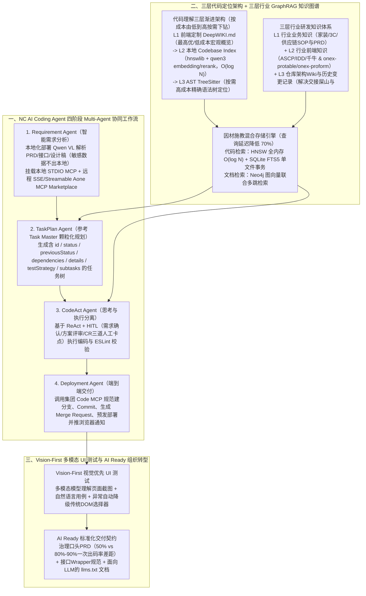

# 天猫行业中后台前端研发Agent设计

## 1. TL;DR

1. **核心痛点与瓶颈洞察**：统计发现程序员**纯编码时间仅占整体工作量的 25% 左右（通常不超过 40%）**，因此“AI 承担 50% 编码工作”远不等于工时减少 50%；且通用 Agent（如 Manus 任务完结率 **不到 35%**）缺乏企业内部 SOP 与领域知识，主流 AI IDE 局限于单点编码而无法覆盖存量代码库增量迭代与需求协同。
2. **以需求为中心的 Multi-Agent 架构（NC AI Coding Agent）**：聚焦 **1–3 人日及以下**的中后台日常需求，采用 **Workflow + ReAct + Human-in-the-Loop（HITL）** 构建四大专职子 Agent——① **`Requirement Agent`**（本地化部署 **`Qwen VL`** 解析 PRD/接口/视觉稿实现敏感数据外网隔离，集成 STDIO 本地 MCP 与 SSE/Streamable 远程 `Aone MCP Marketplace`）；② **`TaskPlan Agent`**（借鉴 `Task Master` 设计含 `dependencies`、`testStrategy`、`previousStatus` 的结构化任务模型，与 `CodeAct Agent` 严格分离）；③ **`CodeAct Agent`**；④ **`Deployment Agent`**（集成集团 Code MCP 自动建分支、提 Merge Request 并推送浏览器验收通知）。
3. **三层代码分析 + 三层行业知识图谱（`HNSW+SQLite` & `Neo4j`）+ Vision-First UI 测试**：
   - **代码理解三层渐进架构**：第一层**前端定制版 `DeepWIKI.md`**（低成本宏观认知） $\to$ 第二层**本地 `Codebase Indexing`**（基于 `hnswlib` + `qwen3` Embedding/Reranking，$O(\log N)$ 语义导航） $\to$ 第三层 **`TreeSitter` AST**（按需高成本精确语法定位）；
   - **三层知识体系与异构存储**：沉淀“行业业务知识（供销/家享等 SOP 与 PRD）+ 行业前端知识（ASCP/IDD/千牛工作台与 `onex-protable`/`onex-proform`）+ 代码仓库变更历史知识”；采用 **`HNSW + SQLite FTS5`（代码检索） + `Neo4j`（文档图向量混合多跳检索）** 组合架构，使**代码查询延迟降低 70%**；
   - **质量闭环与成效**：集成 ESLint 并引入摆脱脆弱 DOM 选择器的 **Vision-First 多模态自动化 UI 测试框架**（自然语言驱动截图理解 + 传统定位智能降级）；落地后将 **3 天以内需求实现立即交付，3 天以上需求交付时间缩短一半**（标准 PRD 领域一次出码率达 **`80%–90%`**，具备 AI Sense 的开发者产出达传统 **3–5 倍**）。

## 2. 问题定义与背景

### 2.1 为什么“AI 写掉 50% 代码”不等于“研发提效 50%”？

1. **纯编码时间占比偏低**：工时统计表明，程序员纯写代码的时间仅占整体工作量的 **25% 左右（上限不超 40%）**，大量时间消耗在需求评审、跨角色信息同步、接口联调与测试回归上。
2. **存量增量迭代 vs 从零建页错位**：主流外部 AI 工具擅长从零生成 Demo 页面，但企业 90% 以上需求是在数十万行存量工程上做增量修改。
3. **通用 Agent 完结率低与安全隐患**：通用大对话框 Agent（如 Manus 任务完结率 **`< 35%`**）缺乏私域工程规范；而直接使用海外云端 IDE 索引企业代码存在 API Key、数据库连接串与敏感业务逻辑外泄风险。

### 2.2 研发范式转移：从“以代码/IDE 为中心”转向“以需求（Spec）为中心”

对标 Amazon Kiro 的 SPEC 模式（将单一需求展开为 `requirements.md`、`design.md`、`tasks.md`）与 Claude Code / Gemini CLI 等独立 Agent 趋势，团队在全面推广自研 **NC VSCode IDE 插件**的基础上，将 AI 介入点前移至 **PRD 阶段**，优先攻坚占比最高的 **1–3 人日及以下**中后台日常需求。

## 3. 知识框架

## 4. 核心内容拆解

### 4.1 四大子 Agent 分工与 `Task Master` 风格任务对象设计

1. **`Requirement Agent`（多模态安全解析 + 双模 MCP）**：
   - 接收 PRD、后端 API 文档、UI/UX 设计稿与流程图；采用**本地化部署的 `Qwen VL` 视觉语言模型**在本地完成敏感需求解析，彻底阻断 VPN/代理环境下的外网泄密风险。
   - 初始化时同时拉起 **本地 STDIO MCP**（低延迟访问本地文件系统与代码仓）与 **远程 SSE / Streamable MCP**（对接集团 `Aone MCP Marketplace`）。
2. **`TaskPlan Agent` vs `CodeAct Agent`（Plan 与 Act 解耦）**：
   - 为避免“缺乏思考一股脑写代码导致质量剧烈波动”，参考知名开源项目 **`Task Master`** 设计了高完备度的任务对象 Schema：
     - `id` (`Number`)、`title` (`String`)、`description` (`String`)；
     - `status` (`pending | in-progress | done | deferred`) 与 **`previousStatus`**（专门用于追踪状态回退与变更轨迹）；
     - `dependencies` (`Array`，前置依赖任务 ID 列表)、`priority` (`high | medium | low`)；
     - `details`（深度实施说明）、**`testStrategy`**（任务级验证策略）、`subtasks`（子任务数组）。
3. **`Deployment Agent`（最后一公里自动化）**：
   - 深度集成集团研发 `Code MCP`，自动执行标准化分支创建、规范化 Commit 推送、自动发起 **Merge Request（MR）**、部署多套中后台预发环境，并在完成后主动发送**浏览器消息通知**提醒开发者验收。

### 4.2 代码理解三层渐进架构（`DeepWIKI` $\to$ `hnswlib` $\to$ `TreeSitter`）

针对动辄数十万行的企业级仓库（以及 Cline 博文指出的纯 RAG 存在**代码语义割裂、索引同步滞后、云端副本泄密**三大缺陷），团队设计了从宏观到微观、按计算成本分级调用的三层架构：
1. **第一层：`WIKI.md` / 前端定制化 `DeepWIKI`（优先级：最高，计算成本：低）**：
   - 鉴于 Cognition 官方 DeepWIKI 对私有仓收费、存在云端泄密风险且偏重后端部署，团队自研了**面向前端仓库的定制版 DeepWIKI**（聚焦页面交互模式、数据流架构、组件库规范），在 LLM 规划第一步即读入以建立全局心智。
2. **第二层：本地 `Codebase Indexing`（优先级：中高，计算成本：中）**：
   - 基于 Dev Studio 方案，在**本地环境**使用 **`hnswlib`**（查询复杂度 **$O(\log N)$**）配合 **`qwen3` 系列 Embedding 与 Reranking 模型**（辅以混合搜索与 HyDE 查询扩展），既避免云端索引泄密，又提供毫秒级跨文件语义导航。
3. **第三层：`AST TreeSitter`（优先级：按需使用，计算成本：高）**：
   - 在最后一步修改代码时，按需调用 TreeSitter 解析抽象语法树（AST），精确定位到具体方法与语法节点，保持代码语义完整性。

### 4.3 三层行业知识图谱与 `HNSW+SQLite` / `Neo4j` 异构存储

为弥合通用模型“知识截止点”导致的**企业私有组件空白**与**框架版本滞后（如 Tailwind CSS v4 Breaking Changes）**，在对比 Cursor Docs、Cline Memory Bank（6 大 Markdown 核心文件：`projectbrief / productContext / activeContext / systemPatterns / techContext / progress.md`）、Context7 与 Mem0（支持 `ADD/UPDATE/DELETE/NOOP` 及 Qdrant 等向量库）后，构建了三层行业知识体系：
1. **知识三层划分**：
   - **第一层（行业业务记忆）**：家装、家电、3C、汽车、服务供应链等行业术语、SOP 与历史 PRD/MRD；
   - **第二层（行业前端记忆）**：`ASCP`、`IDD`、`千牛`等工作台规范，内部私有组件库 **`onex-protable`、`onex-proform`** 及外部 Ant Design 最佳实践（按供销、家享等行业切分）；
   - **第三层（代码仓库与变更历史融合记忆）**：收录各仓库架构 Wiki、索引、**历史 Git 变更记录与技术交付单**——既帮新接手“多次转手历史老项目”的开发者理解当年因业务妥协留下的技术债（如为何設 `redis.set(..., 'EX', 3600)` 1 小时过期），又教会 AI 遵循团队不成文的编码默契（如表格单元格究竟用 `<Desc>` 组件还是 `
` 标签）。
2. **“因材施教”的异构存储选型（使代码查询延迟降低 `70%`）**：
   - **代码检索采用 `HNSW + SQLite FTS5`**：针对代码数万至数十万块、高频修改、需毫秒级精确+相似双模检索的特征，用全内存 `HNSW` 跑 $O(\log N)$ 向量近邻，用单文件零部署的 `SQLite FTS5` 跑全文检索与事务级元数据原子更新。
   - **文档检索采用 `Neo4j` 图向量统一方案**：针对 PRD、技术方案、变更单之间复杂的引用与多跳依赖关系，利用 Neo4j 原生的“向量索引 + 图结构多跳遍历”联合查询实现语义扩展与事务一致性。

### 4.4 Vision-First 多模态自动化 UI 测试与“AI Ready”组织转型

1. **为什么重投 Vision-First UI 测试而非简单 AI Code Review？**
   - 编码规范已在 CodeAct Agent 生成阶段内置且有 ESLint 兜底，事后简单 Prompt CR 增量价值有限；
   - 传统 UI 自动化测试强依赖脆弱的 DOM 选择器，UI 微调即全线崩溃；受 Gemini 零强化学习直接靠多模态视觉通关《宝可梦蓝》启发，团队构建了 **Vision-First 自动化测试框架**——直接用多模态大模型分析页面截图理解内容、用自然语言编写测试步骤，并在视觉定位受阻时**智能降级回退至传统 DOM 元素定位**，输出 HTML/Markdown 测试报告。
2. **从一次出码率 `50%` vs `80%–90%` 的悬殊差距看组织 AI Ready**：
   - 复盘发现：大部分行业一次出码率达 **`80%–90%`**，唯独个别行业（如紧急国补需求）一次出码率跌至 **`50%` 左右**；根因在于产品经理因时间紧未写详细 PRD 或多次电话/口头修改未同步回文档，以及外包后端将缺少外层 Wrapper 结构的接口直接发钉钉群交付。
   - **AI Ready 三大变革**：① 推行面向 AI 的标准化 PRD 与 API 联调契约；② 借鉴 Vercel（`llms.txt`）与 Stripe 由 LLM 自动维护面向大模型阅读的 Markdown 文档库；③ 将 3 天内需求缩短为**立即交付**、3 天以上需求**工期减半**，使具备 AI Sense 的开发者发挥 **3–5 倍**传统人力产出。

## 5. 数据速查表

| 指标 / 维度 | 原文数值 | 语境 / 条件 |
| --- | --- | --- |
| 程序员纯编码时间占总工作量比例 | **约 `25%` 左右（通常不超过 `40%`）** | 其余消耗在需求评审、会议协调、排期对齐与联调 |
| 研发 Agent 初期主攻需求颗粒度 | **`1–3 天人日`及以下的日常中后台需求** | 占中后台整体需求极高比例 |
| 通用 Agent（如 Manus）任务完结率对比 | **`35%` 不到** | 缺乏企业私域 SOP 与垂直知识沉淀 |
| `HNSW + SQLite` 与 `Neo4j` 混合检索收益 | **代码查询延迟降低 `70%`** | 相比单一存储方案的实测性能提升 |
| 标准 PRD 行业 vs 口头变更行业一次出码率 | **标准行业 `80%–90%` vs 口头变更行业约 `50%`** | 凸显 PRD 文档与实际代码对齐的重要性 |
| 业务感知提效对比（性能 vs 交付周期） | **3 天内需求实现`立即交付` / 3 天以上需求交付时间`缩短一半`** | 对比传统前端性能优化（100ms→80ms，提升 20%）业务感知更强烈 |
| 具备强 AI Sense 开发者的产出倍数 | **传统研发人员的 `3–5 倍`甚至更高** | AI 时代人才模型左移与效能放大效应 |

## 6. 踩坑与教训 / 可迁移的设计原则

| 错误做法 | 失败表现或原因 | 原文应对（可迁移的设计原则） |
| --- | --- | --- |
| **只盯着“提升写代码那 25% 时间的速度”做 IDE 辅助补全** | 就算编码速度翻倍，受制于 25% 的工时占比，整体需求交付周期依然缩短有限 | **以需求为中心将 AI 前移至 PRD 阶段**：用 `Requirement -> TaskPlan -> CodeAct -> Deployment` 四子 Agent 贯通从需求到 MR 部署全链路 |
| **在 VPN/代理环境下直接用外部云端工具解析核心业务 PRD 与全量源码** | 存在 API Key、DB 连接串泄露及云端向量副本泄密风险 | **本地化部署 `Qwen VL` 解析多模态 PRD + 本地部署 `hnswlib` 与 `qwen3` 索引文件** |
| **对代码库和业务文档一刀切使用同一种向量数据库做 RAG** | 代码高频变更且需精确语法边界，而文档强调跨篇多跳引用（如 PRD $\to$ 技术方案 $\to$ 变更单），单一引擎顾此失彼 | **因材施教混合存储架构**：代码检索用 `DeepWIKI + HNSW(全内存) + SQLite FTS5 + TreeSitter AST`；文档检索用 `Neo4j` 图向量联合多跳查询（查询延迟降 70%） |
| **紧急需求靠电话/钉钉口头传达修改而不更新 PRD 与接口文档** | 导致 AI 读取的 PRD 与真实意图脱节，一次出码率从 80%–90% 暴跌至 50%，联调频发空指针异常 | **推动组织 AI Ready**：建立完整包含响应外层 Wrapper 的接口契约、标准化 PRD 以及由 LLM 自动维护的 `llms.txt` / Markdown 知识库 |

## 7. 记忆锚点

1. **三层代码定位阶梯**：“**先读前端定制 `DeepWIKI` 知全局（低成本），再查本地 `HNSW + SQLite FTS5` 找模块（中成本 $O(\log N)$），最后用 `TreeSitter AST` 精确定位语法节点（按需高成本）**”。
2. **三层行业知识图谱**：“**一层行业业务（家装/3C/供应链 PRD），二层行业前端（ASCP/千牛 + `onex-protable`），三层单仓历史变更（Neo4j 串联 PRD-方案-Commit，专治交接屎山与风格分歧）**”。

## 8. 复习卡片

1. 为什么作者指出“AI 承担 50% 的编码工作并不等同于研发工时减少 50%”？据此团队确立了怎样的 Agent 设计方向？::因为工时分析表明程序员纯编码时间仅占整体工作量的 25% 左右（不超过 40%），真正的瓶颈在于需求评审、对齐与联调；且多数需求是存量工程增量迭代而非从零建页。因此团队将 AI 前移至 PRD 阶段，构建从需求分析、任务拆解、编码到部署的端到端 Multi-Agent 体系，主攻 1–3 人日中后台需求。
2. NC AI Coding Agent 包含哪四个专职子 Agent？其中 `Requirement Agent` 如何保障企业数据安全与工具通信效率？::包含 `Requirement Agent`（需求分析）、`TaskPlan Agent`（任务拆解）、`CodeAct Agent`（代码实现）和 `Deployment Agent`（发布部署）。`Requirement Agent` 通过**本地化部署 `Qwen VL` 视觉语言模型**在本地解析 PRD 与设计稿实现敏感数据隔离，并同时集成低延迟本地 `STDIO MCP` 与高可靠远程 `SSE/Streamable MCP`（对接集团 `Aone MCP Marketplace`）。
3. 借鉴 `Task Master` 设计的任务对象（Task Object）包含哪些关键字段来支撑复杂需求的拆解与状态回溯？::除 `id`、`title`、`description`、`priority`、`details`（深入实施说明）和 `subtasks` 外，特别设计了 `dependencies`（前置依赖任务 ID 数组）、`testStrategy`（任务级验证方法）以及 **`previousStatus`**（记录当前状态之前的历史状态，专门用于追踪变更轨迹与回滚）。
4. 面对动辄数十万行的企业级代码库，NC Coding Agent 的“三层代码分析架构”是如何按优先级与成本渐进工作的？::① 第一层（最高优/低成本）：读取预生成的**前端定制版 `DeepWIKI.md`**，在规划第一步快速建立全局架构与组件规范认知；② 第二层（中高优/中成本）：调用本地 **`Codebase Indexing`**（基于 `hnswlib` + `qwen3` embedding/reranking，$O(\log N)$）快速定位相关文件；③ 第三层（按需调用/高成本）：调用 **`TreeSitter` AST** 解析抽象语法树，精确定位待修改的方法与代码节点。
5. 为什么团队在 GraphRAG 知识库底层对“代码检索”和“文档检索”采用了截然不同的存储引擎组合？取得了什么性能收益？::因为代码具有高频变更、数十万块规模且需精确+语义双重匹配的特征，故采用 **`HNSW`（全内存 $O(\log N)$ 近邻搜索）+ `SQLite FTS5`（单文件零部署全文检索与事务原子更新）**；而文档（PRD、技术方案、变更单）间存在复杂的多跳引用关系，故采用 **`Neo4j`（原生支持图结构多跳导航与向量索引联合查询）**。该混合架构使代码查询延迟降低了 **70%**。
6. 行业知识图谱的“第三层（代码仓库与业务变更融合知识）”是如何解决“老项目交接踩坑”和“询问某行代码为什么设 1 小时过期”这类高阶问题的？::第三层将仓库架构 Wiki、代码函数索引与历史 PRD、技术方案、Git 变更记录及技术交付单关联进 `Neo4j` 图谱；当询问“为什么 `redis.set` 设 3600 秒过期”时，系统通过多路召回与重排同时定位代码函数、技术方案（日活 100 万防内存压力 + 配合 refresh token）及 PRD v2.3 变更单（2024-03-15 从 30 分钟延至 1 小时），完整还原历史决策上下文。
7. 复盘发现部分行业一次出码率达 `80%–90%`，而个别行业仅 `50%`，核心原因是什么？团队在 UI 测试上做了什么创新？::核心原因是低出码率行业在紧急需求（如国补）中靠电话/口头沟通修改而未同步更新 PRD，导致文档与实际严重脱节。在测试上，团队引入了 **Vision-First 多模态自动化 UI 测试框架**，用多模态大模型直接理解页面截图并用自然语言写用例，彻底摆脱对脆弱 DOM 选择器的依赖（异常时自动降级回传统元素定位）。

## 9. 知识关联

- **本库主题关联**：
  - [Agent工程循环](../../20_topics/Agent工程循环.md)：设计 `Requirement -> TaskPlan(Task Master Schema) -> CodeAct -> Deployment` 四阶段工作流与 ReAct + HITL 协同机制。
  - [检索与文档解析](../../20_topics/检索与文档解析.md)：首创“前端定制 DeepWIKI + 本地 `hnswlib`/`SQLite FTS5` + `TreeSitter` AST”三层代码检索与 `Neo4j` 三层行业 GraphRAG 知识图谱（查询延迟降低 70%）。
  - [AI研发协同](../../20_topics/AI研发协同.md)：剖析 25% 编码时间占比瓶颈，推动组织向标准化 PRD、API Wrapper 契约与 `llms.txt` 文档的 AI Ready 转型（3 天内需求立即交付）。
  - [Agent评测与反馈](../../20_topics/Agent评测与反馈.md)：构建摆脱脆弱 DOM 选择器的 Vision-First 视觉优先多模态自动化 UI 测试框架（含传统定位智能降级）。
- **候选双链**：`[[中后台前端Agent]]`、`[[DeepWIKI]]`、`[[TreeSitter]]`、`[[HNSW向量检索]]`、`[[VisionFirstUI测试]]`

## 10. 原文参考资料

- **原文标题**：《天猫行业中后台前端研发Agent设计》
- **发布渠道与日期**：微信公众号「大淘宝技术」，2025-10-20
- **作者与团队**：珈文（淘天集团-天猫品牌行业前端团队）
- **原文引用文章与基准**：
  - Nick Baumann (Cline), *《Why Cline Doesn't Index Your Codebase (and Why That's a Good Thing)》*: `https://cline.bot/blog/why-cline-doesnt-index-your-codebase-and-why-thats-a-good-thing`
  - 代码定位评测基准 `Loc-Bench_V1`: `https://arxiv.org/abs/2503.09089` & `https://huggingface.co/datasets/czlll/Loc-Bench_V1`
  - Cursor Documentation Guide: `https://docs.cursor.com/guides/advanced/working-with-documentation`
  - Vercel LLM Docs (`llms.txt`): `https://vercel.com/docs/llms.txt`

> [!note]- 校对报告
> - **页码溯源汇总**：
>   - 中后台研发背景（NC VSCode IDE 插件推广）与两大提效瓶颈（纯编码时间仅占 `25%` 左右、不超 `40%`）：`p.1–3`
>   - 研发 Agent 理念（聚焦 `1–3天人日` 需求、对比 Manus 完结率 `<35%`、对标 Amazon Kiro SPEC 模式 `requirements/design/tasks.md`）：`p.3–6`
>   - Multi-Agent 架构（需求分析/任务拆解/代码编写/发布部署 4 大子 Agent）、ReAct + HITL、本地部署 `Qwen VL` 防泄密与 STDIO/SSE/Streamable MCP 集成、`Task Master` 任务对象 Schema 表（含 `previousStatus`、`testStrategy`）及 `Deployment Agent`：`p.6–16`
>   - 上下文工程（Karpathy CPU/RAM 类比）与三层代码理解架构（L1 前端定制 `DeepWIKI.md` $\to$ L2 本地 `hnswlib` + `qwen3` `Codebase Indexing` $\to$ L3 `TreeSitter` AST，含 Cline 反 RAG 博文剖析）：`p.16–24`
>   - 行业知识图谱：Cursor Docs、Cline Memory Bank（6 大 `.md` 文件）、Context7、Mem0（`ADD/UPDATE/DELETE/NOOP` + Qdrant）对比；三层行业研发知识体系（业务/前端 `onex-protable` & `ASCP` / 仓库变更历史）与 `HNSW + SQLite FTS5` + `Neo4j` 异构检索（代码查询延迟降低 `70%`、Redis 3600s 过期溯源案例）：`p.24–35`
>   - Vision-First 多模态自动化 UI 测试框架（对比《宝可梦蓝》视觉通关，摆脱脆弱 DOM 选择器 + 智能降级）：`p.35–38`
>   - 组织 AI Ready 转型（`80%-90%` vs `50%` 一次出码率归因、接口 Wrapper 规范、`llms.txt`、3 天内需求立即交付 / 3 天以上减半、AI Sense 开发者 `3-5倍` 产出）：`p.39–44`
> - **关键数值一致性核查**：
>   - 纯编码占比 `25%`（不超 `40%`）、目标需求 `1-3天人日`、Manus 完结率 `35%不到`、代码查询延迟降低 `70%`、一次出码率 `80%-90%` vs `50%`、传统性能优化 `20%（100ms->80ms）` vs 3 天内立即交付/3 天以上减半、产出倍数 `3-5倍` 均与原文完全一致。
> - **图像与版面质量说明**：
>   - `p.1–4, 6–13, 15–18, 20–21, 23, 25–27, 29–33, 36–39, 41–42` 含架构图、Cline Memory Bank 拓扑图、混合检索图与测试报告截图（位于 PDF 图像层）；其中 `p.19` 代码分析三层架构图与 `p.28` 三层行业知识图谱大图内的全部文字均在 PDF 文本层完整提取并核对无误。
