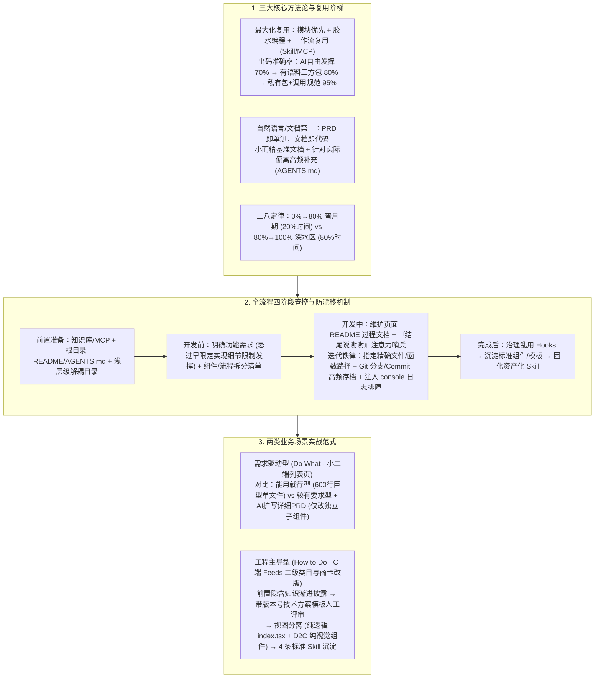

# 天猫新品营销技术团队AI编码实战指南（上）

## 1. TL;DR

1. **AI 生码四大痛点与五维根因诊断**：将一线 AI 编程困境归纳为**写不对**（偏离意图）、**写不好**（质量/风格不达标）、**写不了**（私有 SDK/隐含逻辑多、高耦合）与**改不动**（迭代陷入死循环、改坏存量功能、丧失代码掌控感），并从**项目知识、用户输入、任务复杂度、自检机制、模型能力与随机性**五个维度给出系统解法。
2. **三大核心方法论（最大化复用、自然语言/文档第一、二八定律）**：
   - **最大化复用（模块优先 + 胶水编程 + 工作流复用）**：私有包配合调用规范可将出码准确率从自由发挥的 **`70%`（高介入）** 与三方包的 **`80%`（低介入）** 大幅提升至 **`95%`（低介入）**；开发者代码只负责组合、调用、封装与适配。
   - **文档先行与适度 Spec**：先给“小而精”的基准文档，再根据 AI 偏离点补充高频约定（维护根目录 `README.md` / `AGENTS.md`）。
   - **认清 28 定律**：`0% → 80%`（蜜月期，新建独立逻辑）仅耗 20% 时间，而 `80% → 100%`（深水区，边缘 Case 与旧逻辑耦合）耗费 80% 时间。
3. **全流程节点管控与注意力哨兵技巧**：贯穿“前置准备 $\rightarrow$ 开发前 $\rightarrow$ 开发中（新建型 vs 迭代型）$\rightarrow$ 完成后沉淀”；通过**在 User Rules 中要求 AI 每次对话结尾固定说“谢谢”作为注意力哨兵**（一旦漏说即表明上下文窗口已溢出需切换新会话并注入过程文档），以及**精确路径约束 + Git 高频 Commit/分支存档**防止迭代漂移。
4. **双场景实战范式（需求驱动型 vs 工程主导型）与 C 端“视图分离”解耦**：
   - **需求驱动型（Do What，小二后台/研发工具）**：对比“能用就行型、较有要求型、严格型”，证明“较有要求型初版 + 人工核对扩写后的详细 PRD”能在迭代时只改子组件而不污染主文件（避免主文件膨胀至 600 行丧失人工介入可能）。
   - **工程主导型（How to Do，C 端频道/商家端）**：前置沉淀服务端（如 `ald solution`）与前端隐含知识库、强制要求 AI 先按带知识库版本号（`v1.2.3`）的模板输出技术方案至 `docs/` 经人工审查后再编码，并在 C 端推行**视图与逻辑彻底分离（将 400 行混杂商卡拆分为纯逻辑 `index.tsx` + D2C 纯视觉组件）**，使 Code Review 压力骤减大半。

## 2. 问题定义与背景

### 2.1 AI 生码四大典型症状

| 痛点类型 | 核心表征 | 典型触发场景 |
| :--- | :--- | :--- |
| **1. 写不对** | 未按意图实现功能，存在缺陷甚至无法运行 | 需求描述模糊，缺乏边界条件与字段类型约定 |
| **2. 写不好** | 代码风格混乱、单文件巨石堆砌、滥用 React Hooks | 缺乏项目编码规范、目录模板与分层约束 |
| **3. 写不了** | 面对复杂仓库与内部私有 SDK 完全无从下手 | 淘内私有业务语义、外部文档中的私有 SDK，AI 无法仅凭源码猜测 |
| **4. 改不动** | 二次迭代陷入报错死循环，改 A 坏 B，顺手乱改无关文件 | AI 天生“重模仿、弱理解”，面对数百行紧耦合旧代码时上下文失焦 |

### 2.2 五大成因与工程对策全景

1. **项目/需求隐含信息过多（AI 不知道）**：使用带明确类型声明的 npm 包或接入 `Artifact7` 等文档生成工具；提供 MCP、项目知识库与 CodeWiki。
2. **用户输入不精准（没给 AI 说）**：提供标准 Prompt 模板、维护持续更新的 `AGENTS.md`、利用“小而精初版文档 + 针对重复偏离点迭代补充”替代不切实际的“一次性大而全 Spec”。
3. **任务与工程复杂度过高**：将大型黑盒拆分为多个可独立单测的小型黑盒；降低文件引用层级（前端弱类型语言在深层引用下生码准确率显著下降）。
4. **缺少自检闭环（Review & Test）**：接入 Code 平台 AI CR 助手做发布前预检；后端跑单元测试，前端通过浏览器 MCP 感知页面或通过**视图分离**对纯逻辑 Hooks 做单测。
5. **模型上下文有限与随机性**：留存过程文档跨会话复用；设置**注意力哨兵规则**监控上下文健康度。

## 3. 知识框架

## 4. 核心内容拆解

### 4.1 核心方法论：胶水编程、注意力哨兵与新建/迭代差异化管控

1. **胶水编程与复用准确率阶梯**：
   - 将每个功能封装为输入输出明确的“可信任黑盒模块”，开发者的代码仅负责**组合、调用、封装、适配（胶水代码）**。
   - **实测出码准确率对比**：让 AI 完全自由发挥准确率仅 **`70%`**（人工介入成本高）$\rightarrow$ 使用有公开语料的三方包准确率达 **`80%`**（人工介入成本低）$\rightarrow$ **封装内部私有包 + 显式调用规范文档，准确率跃升至 `95%`**（人工介入成本低）。
2. **上下文窗口监控巧招（“谢谢”哨兵法）**：
   - 在自定义 User Rule 中规定：“*每次对话结束都必须用‘谢谢’结尾*”。当多轮对话后发现 AI 不再输出“谢谢”，即说明上下文窗口已逼近溢出、早期规则已进入注意力坍塌区，此时应立即基于沉淀的过程文档（页面 `README`、组件说明）开启全新会话。
3. **迭代型任务防崩坏指南（为什么“改不动”？）**：
   - **根因**：AI 擅长基于上下文做模式仿写（新建任务），但对存量复杂代码的因果理解力弱（迭代任务）。
   - **精准范围锁死**：严禁下达 `"帮我优化这个函数"` 或 `"修改弹窗样式和其他页面统一"` 这类宽泛指令（会导致 AI 重构整个类或乱改其他文件）；必须下达 `"只优化函数 calculateTotal，不做任何其他变更"` 或 `"修改 pages/GoodsManagement/drawer.tsx 下的弹窗样式，参考 pages/Warehouse/GoodsDetail/drawer.tsx"`。
   - **Git 高频 Commit 与半自动重构**：每次微调生效后立即 `git commit`（避免 AI 覆盖式生码毁掉几小时前的可用版本）；当人工必须介入时，采取**“人工给出重构方案 + AI 执行批量改动”**（如指令 AI 将函数内硬编码改为外部传参并同步修改所有调用方）。
   - **报错与空数据调试**：常规报错直接复制给 Agent 自动修复（**可解决率约 `80%`**，剩余 20% 多为三方库内部报错需特判）；遇到页面数据为空但无报错时，指令 AI *“在关键节点新增 `console` 日志以便复制排查”*。

### 4.2 实战案例一：需求驱动型（Do What）—— 小二端货品动态属性页

围绕“货品列表新增动态属性列展示、按 6 类数据类型（`STRING`/`TEXT`/`NUMBER`/`BOOLEAN`/`TIMESTAMP`/`TIMESTAMP_RANGE`）动态弹窗筛选、右侧抽屉编辑属性”的中型迭代，对比了三种路径：
- **能用就行型初版 + 原始需求**：AI 将所有代码堆砌在主文件中，迭代后**主文件膨胀至 600 行**，后续多次迭代成功率断崖式下跌，彻底丧失人工介入可能。
- **较有要求型初版 + 原始需求**：虽有基础文件模板与组件划分，但未先核对 PRD，做出的交互细节偏离业务预期。
- **较有要求型初版 + AI 扩写并经人工核对的详细功能文档（最佳实践）**：先让 AI 根据接口与简述生成结构化《货品属性功能需求文档》（明确枚举多选 vs 文本匹配、数值/时间范围控件映射表），人工确认后再执行编码；结果**主文件逻辑零污染，仅精准修改相关子组件**，人工介入与二次内聚优化成本极低。

### 4.3 实战案例二：工程主导型（How to Do）—— C 端 Feeds 二级类目与商卡改版

针对高严苛度的 C 端需求（Feeds 新增二级类目配置、服务端 `ald solution` 召回加参、重写支持多级 Tab 的 Feeds 组件、商品卡片样式更新并改为跳转自建中间页），落地四步工程法：
1. **前置隐含知识梳理与渐进式披露**：针对淘内特有的“自建中间页跳转协议”、“后端如何新建 `ald solution`”、“前端天马配置项与 Feeds 组件库用法”，采用 AI 初稿 + 人工精修沉淀入口文档（全而精）与二级详情文档。
2. **强制先出带知识库版本号的技术方案并人工评审**：
   - 规定 AI 在写代码前必须先按模板在仓库 `docs/` 下生成技术方案，**强制在头部声明引用的知识库版本号（如 `v1.2.3`，取自知识库根目录 `index.md`）及具体参考文档链接**（防止 AI 不查库凭空瞎猜），并包含功能拆解、核心代码/Mermaid 流程图、问题预警与埋点，经人类工程师审核确认后才准许生码（“线上 Bug 不能让 AI 背锅”）。
3. **C 端核心破局点：视图与逻辑彻底分离（View-Logic Separation）**：
   - **痛点**：C 端视觉样式极其复杂，传统商卡将业务逻辑与样式混写在 **400 行** 的巨型组件中，AI 同时改逻辑和样式必然顾此失彼。
   - **解法**：让 AI 先将组件拆解为**纯业务逻辑层（`index.tsx`，定义抽象属性与事件绑定，如购物车加购、跳中间页）**与**纯视觉呈现层（可由 D2C 工具生成或调用方自定义渲染，如把 Feeds 的 Tab 渲染权交给调用方）**。这不仅让 AI 生码一次性通过，更让前端 Code Review 只需重点审查 `index.tsx` 主逻辑，**CR 压力瞬间减少大半**。
4. **需求完成后的四条标准工作流（Skill）沉淀**：
   - ① 后端 `ald solution` 创建与多文件分步修改；② `solution → 接口文档 → 前端调用函数生成` 前后端串联；③ 前端天马配置项新增与读取代码生成；④ `逻辑代码生成 → D2C 生成视觉组件 → 逻辑与视图绑定`。

## 5. 数据速查表

| 评估项 / 对比维度 | 量化数值 / 对比结果 | 工程启示与来源 |
| :--- | :--- | :--- |
| **不同复用层级的出码准确率** | 自由发挥 **`70%`** $\rightarrow$ 三方包 **`80%`** $\rightarrow$ **私有包+规范 `95%`** | 私有包+规范不仅准确率最高，且人工介入成本最低 |
| **AI 编码二八定律时间分布** | 前 `80%` 功能耗 **`20%` 时间**；后 `20%` 收尾耗 **`80%` 时间** | 提效关键在于提升前 80% 代码结构质量并降低后 20% 耦合修改难度 |
| **常规报错 AI 自愈率** | **`80%`** 可由 Agent 直接复制报错解决 | 剩余 `20%` 多源自三方库内部异常，需人工特判或加 `console` 排查 |
| **小二端未解耦主文件膨胀行数** | 迭代后主文件达 **`600 行`**（能用就行型） | 丧失人工介入可能；采用模板+前置扩写 PRD 则仅修改独立子组件 |
| **C 端存量耦合商卡代码行数** | 原单组件约 **`400 行`**（逻辑与视觉混杂） | 拆分为纯逻辑 `index.tsx` + D2C 纯视觉组件后，CR 压力减少大半 |

## 6. 踩坑与教训 / 可迁移的设计原则

1. **用“私有包封装 + 调用规范”将 AI 从 70% 准确率的自由发挥拉升至 95% 的胶水组装**：不要让 AI 每次从零手写复杂的业务通用逻辑（尤其是爱乱用 React Hooks 的场景）；将其沉淀为边界清晰的私有模块，让 AI 只写组合调用的胶水代码。
2. **要求 AI 在技术方案头部显式打印“知识库版本号（如 `v1.2.3`）与引用文档链接”**：这是检验 Agent 是否真正读取了团队知识库、`index.md` 是否生效的最简单防伪手段，能有效拦截模型跳过文档直接凭预训练记忆瞎写。
3. **C 端复杂 UI 必须坚持“先拆视图与逻辑，再结合 D2C 绑定”**：永远不要让 AI 在同一个 400 行的组件里一边改复杂状态流转一边调像素级 CSS；先让 AI 写好纯逻辑 Hook/容器，再用 D2C 生成纯展示组件最后做属性事件绑定。

## 7. 记忆锚点

- **四大生码痛点**：写不对、写不好、写不了、改不动。
- **三大核心思想**：最大化复用（模块优先 / 胶水编程 / `70% → 80% → 95%` 准确率）+ 自然语言/文档第一（PRD 即单测）+ 二八定律（蜜月期 vs 深水区）。
- **两类实战范式**：需求驱动型（Do What，小二端扩写 PRD + 子组件隔离）vs 工程主导型（How to Do，C 端隐含知识前置 + 带版本号技术方案评审 + **视图分离**）。
- **两个实操暗号**：User Rule 结尾说“谢谢”监控上下文溢出；技术方案头部打印 `index.md` 版本号校验知识库读取。

## 8. 复习卡片

1. 天猫新品团队总结的 AI 生码“四大痛点”分别指什么？为什么“迭代型任务”比“新建型任务”更容易改不动？::四大痛点是写不对（偏离意图）、写不好（质量/风格差）、写不了（私有隐含逻辑多耦合高）、改不动（迭代死循环且改坏旧功能）；因为 AI 天生重模仿而弱理解，新建任务侧重代码仿写，而迭代任务要求精准理解存量复杂上下文并在不破坏旁路逻辑的前提下局部修改。
2. 在“最大化复用”原则下，AI 自由发挥、使用三方包、使用“私有包+调用规范”三者的出码准确率分别是多少？什么是“胶水编程”？::出码准确率依次为 70%（高人工介入）、80%（低介入）和 95%（低介入）；胶水编程指优先将功能封装为输入输出明确的标准模块黑盒，让 AI 生成的业务代码只负责组合、调用、封装和适配。
3. 如何利用一条简单的 User Rule 判断编码 Agent 的上下文窗口是否已经溢出（注意力丢失）？::在 User Rule 中要求 AI 每次对话结束都必须以“谢谢”结尾；一旦发现某轮回复末尾不再说“谢谢”，即说明上下文窗口已爆满导致早期指令失效，应立即携带过程文档开启新会话。
4. 在小二端“货品动态属性管理”中型迭代案例中，“能用就行型”与“较有要求型 + 人工核对扩写 PRD”在迭代结果上有何本质差异？::“能用就行型”将代码大量堆砌在主文件中，迭代后主文件膨胀至 600 行，基本丧失人工介入可能；而“较有要求型 + 扩写详细 PRD”在迭代时完全无需修改主文件，仅精准修改相关子组件。
5. 在 C 端“工程主导型”开发中，技术方案模板为什么要强制要求 AI 写出“知识库版本号（从 `index.md` 获取）”和引用文档链接？::为了强制验证 AI 确实读取了最新的团队前置知识库而非凭空臆造，同时便于工程师在编码前快速审查其技术选型与接口设计是否偏离规范。
6. 为什么 C 端前端 AI 编码必须推行“视图与逻辑分离”？它如何与 D2C 结合并减轻 Code Review 压力？::因为 C 端逻辑与视觉耦合极高（如 400 行的商卡组件），AI 同时处理两者极易顾此失彼；拆分为纯逻辑组件（`index.tsx`，负责状态与事件）与纯视觉组件（由 D2C 生成或调用方传入）后，不仅生码成功率大增，CR 时也只需重点审查主逻辑文件，审查压力减少大半。

## 9. 知识关联

- **所属主题**：
  - [AI研发协同](../../20_topics/AI研发协同.md)
  - [Harness与模型协同](../../20_topics/Harness与模型协同.md)
  - [Agent成本与上下文预算](../../20_topics/Agent成本与上下文预算.md)
  - [跨端开发与性能](../../20_topics/跨端开发与性能.md)
- **本地跃迁**：[原始 PDF](RAW.pdf) · [逐页转写文本](MD.md)
- **候选双链**：[[天猫新品AI编码实战指南下]] · [[场景营销前端AI Coding方案]] · [[营销中后台生码工作流实践]] · [[企业购面向Skills编程]]

## 10. 原文参考资料

1. **关联姊妹篇**：《天猫新品团队 AI 编码实战指南（下）》（涵盖小二端后端全栈化三阶段演进、C 端流程串联与六大实用技巧）
2. **内部工具与框架**：`Artifact7` 文档生成工具、`CodeWiki`、Code 平台 AI CR 助手、`tao-design` 组件库、服务端 `ald solution` 与前端天马配置体系

> [!note]- 校对报告
> - **页码溯源**：p.1–4（写不对/写不好/写不了/改不动四大痛点定义、五大成因与解法、“谢谢”结尾监控注意力规则、80% 常规报错自愈率）；p.5–12（最大化复用、模块优先、胶水编程、工作流复用、文档先行、二八定律；前置准备→开发前→开发中→完成后全流程节点管控；迭代任务精确路径约束与 Git Commit 存档；70%/80%/95% 出码准确率对比表）；p.12–18（需求驱动型 vs 工程主导型对比表；小二端货品动态属性列表页新建与中型迭代三方案对比：600 行巨石文件 vs 独立子组件修改）；p.18–24（C 端 Feeds 二级类目与商卡跳转自建中间页实战：前置隐含知识渐进式披露、带 `v1.2.3` 版本号的技术方案模板、400 行商卡视图与逻辑分离 + D2C 绑定、4 条标准工作流 Skill 沉淀）。
> - **一致性核验**：作者（卓屿，淘天集团-天猫新品营销技术团队）、发布时间（2026-05-06）、全部量化百分比、行数对比与方法论框架均与原文逐页核对一致；正文中无任何内联页码引用。
> - **质量边界**：全文结构完整，与下篇（`art-0231`）形成严密互补。
