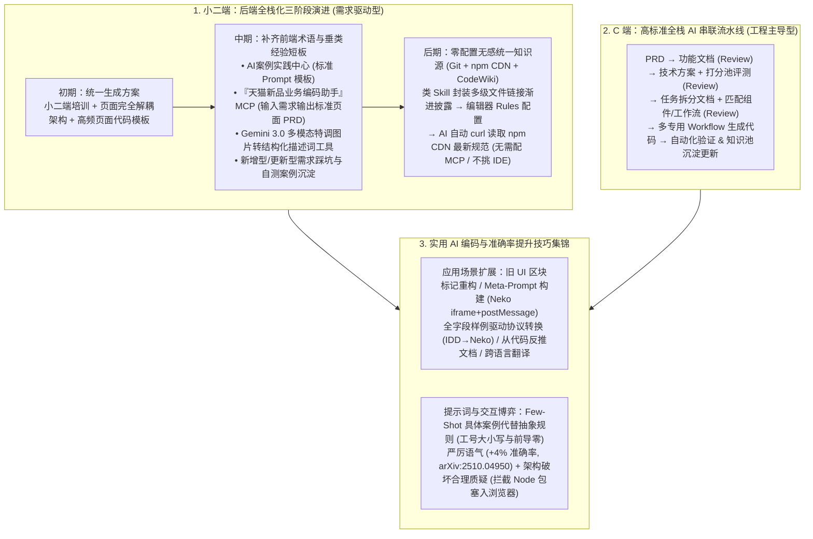

# 天猫新品团队AI编码实战指南（下）

## 1. TL;DR

1. **交付分割线与全栈化分工**：天猫新品团队以“**交付分割线**”划分业务严苛度——分割线以下的**小二端工作台、研发工具与 DEMO（需求驱动型，无严苛视觉还原要求、页面解耦）**交由后端同学通过 AI 对话全栈完成；分割线以上的**C 端频道与 B 端商家平台（工程主导型，错误与明显交互问题 0 容忍、高视觉还原）**由前端聚焦沉淀 AI 友好架构与串联工作流。
2. **小二端“后端全栈化”三阶段演进**：从**初期**（培训 + 页面完全解耦结构 + 高频页面代码模板）$\rightarrow$ **中期**（搭建「AI 案例实践中心」、提供「天猫新品业务编码助手」MCP 自动生成标准化页面 PRD、基于 **Gemini 3.0 多模态特调图片转结构化提示词工具**、沉淀新增/更新踩坑案例库）$\rightarrow$ **后期**（顺应开发者偏好纯 Chat 而厌恶繁琐 Spec/MCP 配置的习惯，将类 Skill 知识库发布为 **Git 仓库 + npm 包 CDN 资源**，只需在编辑器 `Rules` 中配置一行指令即可让 AI 通过 `curl` 按多级文件链接渐进式拉取规范，并接入 CodeWiki 问答）。
3. **C 端复杂业务 AI 全链路串联**：围绕“PRD $\rightarrow$ 功能文档 $\rightarrow$ 技术方案（打分池评测）$\rightarrow$ 任务拆分文档 $\rightarrow$ 多专用 Workflow 代码生成 $\rightarrow$ 自动化验证与知识池回流”构建多级人工 Review 卡点与走查/接口/页面检查 MCP 工具链。
4. **六大高阶 AI 编码实战技巧**：涵盖**旧 UI 区块标记重构**、**让 AI 为复杂需求写 Prompt（Meta-Prompting，如 Neko 原生 JS + `iframe` + `postMessage` 实时双向同步调试面板）**、**全字段样例驱动复杂协议转换（IDD $\rightarrow$ Neko）**、**多方案选优与从代码反推文档**、**Few-Shot 案例代替抽象描述（如工号 `WB123432` 大小写与 `014515` 前导零权限修复）**，以及**严厉语气（实证准确率较礼貌语气高约 `4%`）与架构破坏合理质疑**。

## 2. 问题定义与背景

### 2.1 五级场景严苛度矩阵与“交付分割线”

在推进“后端向前、前端向后”的全栈化转型中，团队首先根据错误容忍度、交互容忍度、代码要求与视觉还原要求划定了清晰的**交付分割线**：

| 严苛等级 | 典型业务场景 | 错误容忍度 | 交互问题容忍度 | 代码质量要求 | 视觉还原要求 | 主力承接模式 |
| :--- | :--- | :--- | :--- | :--- | :--- | :--- |
| **最为严苛** | **C 端频道** | `0 容忍` | 明显问题 `0 容忍` | 高 | 高 | 前端主导 + AI 流程串联 |
| **较为严苛** | **B 端商家平台** | `0 容忍` | 特别明显 `0 容忍` | 中 | 中 | 前端主导 + AI 流程串联 |
| *— 交付分割线 —* | *— 以下为需求驱动型 —* | *—* | *—* | *—* | *—* | *— 后端 + AI 全量生成 —* |
| **普通严苛** | **小二端工作台** | `0 容忍` | 影响主链路 `0 容忍` | 低 | 低 | 后端同学通过 AI 对话独立交付 |
| **低严苛** | **研发自用工具与平台** | 一定程度容忍 | 无 Hack 绕过则 `0 容忍` | 无 | 无 | 后端/全员 AI 快速生成 |
| **不严苛** | **研发 DEMO** | 怎么都能容忍 | 能意会即可容忍 | 无 | 无 | 纯 AI 对话秒级原型 |

## 3. 知识框架

## 4. 核心内容拆解

### 4.1 小二端（后端全栈化）三阶段演进：从 MCP 辅助到 `npm CDN + curl` 无感知识库

1. **初期（统一底座）**：针对不同后端同学使用不同 AI 工具产出风格割裂的问题，强制采用**页面间完全解耦**的目录结构，提供基础编码规范与高频列表/表单页代码模板。
2. **中期（破解“后端不懂前端术语”与“垂类死循环”）**：
   - **「AI 案例实践中心」+「天猫新品业务编码助手」MCP**：后端同学只需用大白话输入业务诉求，MCP 即可返回一份包含专业前端结构描述的标准化页面 PRD 喂给编码 AI。
   - **基于 Gemini 3.0 的多模态图片转提示词工具**：当后端同学只有参考截图时，直接传图给 Coding IDE 还原效果往往欠佳；先经特调的 Gemini 3.0 将截图解析为系统化、结构化的 UI 描述词，还原准确率大幅提升。
   - **结构化踩坑案例沉淀**：按“新增型需求”与“更新型需求”沉淀包含需求背景、实践步骤、功能自测与常见报错提示的实战手册。
3. **后期（极简无感的 `Git + npm CDN + curl` 类 Skill 方案）**：
   - **真实痛点反馈**：经过一段时间运行，发现绝大多数开发者**依然最习惯用最基础的 Chat 对话模式**，不愿使用繁琐的 Spec 规划流程，甚至嫌配置 MCP 太麻烦；同时多仓库规范频繁更新难以同步。
   - **终极轻量方案**：将小二端开发规范与代码模板以**类 Skill 的多级文档链接形式（渐进式披露，按需读取不爆 Token）**维护在 Git 仓库并发布为 **npm 包**。开发者只需在各自编辑器的 `Rules` 中配置极简引导，AI 在对话时即可**直接执行 `curl` 命令读取 npm 包对应的最新 CDN 资源**（亦可搭配 CodeWiki 问答），彻底摆脱对特定 IDE 或本地 MCP 环境配置的依赖。

### 4.2 C 端（工程主导型）全链路 AI 串联设计

面对 0 容忍的 C 端频道与核心 B 端平台，无法靠单次对话一步登天，团队构建了带多级人工 Review 闸门与知识池闭环的串联工作流：
1. **四级文档渐进推导（每步均设人工 Review 与打分池校验）**：
   - `原始 PRD` $\rightarrow$ **功能文档**（梳理核心功能与分支运行结果）$\rightarrow$ **技术方案**（匹配知识库并引入专用技术方案 Agent 进行打分评测）$\rightarrow$ **任务拆分文档**（匹配上下文、公共组件与专用工作流 `workflow 1/2/3`）。
2. **开发与验收后沉淀闭环**：
   - 结合走查辅助、接口查询、页面检查 MCP 完成代码生成与自动化功能/质量校验；需求上线后自动识别并提取关键组件、工作流回流至团队**知识池**。

### 4.3 高阶实战技巧与准确率提升心法

1. **四大高价值编码场景技巧**：
   - **UI 布局重构（让 AI“瞎子也能看得见”）**：先让 AI 阅读并解释旧代码布局、对旧页面做区块划分与标记，再明確指令哪些旧区块迁移至何处、新增哪些功能。
   - **Meta-Prompting（让 AI 帮你写复杂 Prompt）**：面对极复杂的工程诉求（如开发 **Neko 智能参数调试面板**：需解析 HTTP GET/POST 参数语义、用无构建过程的原生 JS 编写表单、以 `iframe` 加载并通过 `postMessage` 实现高频双向同步且保持原格式），先口述朴素诉求让 AI 生成结构化长 Prompt，再喂给编码 Agent。
   - **全字段样例驱动复杂协议转换**：在将 `IDD` 协议转换为差异极大的 `Neko` 协议时，无需手写冗长映射规则，直接给出一份**覆盖所有字段的完整源数据与目标数据 JSON 样例**，让 AI 自动推导转换函数，人类专注端到端边缘 Case 测试验收。
   - **多方案选优与代码逆向文档**：对不熟悉的仓库先让 AI 给出多套方案并评估改动影响面，人工拍板后再写代码；功能完成后让 AI 根据最新代码反推使用文档（如导入 IDD/CODE/Postman 集合指南）或将阿里云 ACP 课程 `.ipynb` 中的 Python 示例一键翻译为 JS 实现。
2. **三大准确率提升技巧**：
   - **用 Few-Shot 具体案例代替抽象逻辑描述**：例如修复工号权限 Bug 时，直接列举真实异常样例（`WB123432` vs `wb123432` 大小写差异、`14515` vs `014515` 前导零与首尾空格差异），AI 能一次性写出精准覆盖所有边界的处理函数。
   - **严厉语气（实证提升约 `4%` 准确率）**：引用学术研究（`https://arxiv.org/pdf/2510.04950`）与团队在大盘新品时令分析中的实测，当礼貌提示反复失效时，采用极严厉甚至带压迫感的语气（如“你要不好好干，我就把你电源拔了”），在格式遵循与准确率上可超过礼貌语气约 **4%**。
   - **对破坏架构的 Hack 修复保持“合理质疑”**：AI 以“跑通当前报错”为最高优先级，常做出破坏架构的短视行为（例如为修一个依赖缺失 Bug，竟强行把原本跑在 Node 环境的包塞进浏览器端加载，无视项目已有的 Node-Browser 通信机制）。此时必须明确质疑：“*请尊重项目原本的架构，把破坏性的改动归位，按照更合理的方式进行修复*”。

## 5. 数据速查表

| 维度 / 实证项 | 关键指标 / 方案配置 | 工程背景与效果说明 |
| :--- | :--- | :--- |
| **场景严苛度分级** | **5 级**（C端频道 / B端平台 / 小二工作台 / 研发工具 / DEMO） | 以“小二端工作台”之上为**交付分割线**区分工程主导型与需求驱动型 |
| **图片转结构化提示词基座** | **Gemini 3.0 多模态特调工具** | 相比直接传参考图给 IDE，先转为结构化页面描述词还原度显著更高 |
| **无感知识库分发形态** | **Git 仓库 + npm 包 CDN + `curl` 按需拉取** | 配合编辑器 `Rules` 与多级链接渐进式披露，免除 MCP 配置且实时同步 |
| **严厉语气 vs 礼貌语气准确率** | 准确率提升约 **`+4%`**（`arXiv:2510.04950`） | 在大盘新品时令分析等强格式约束任务中明显提升输出准确度 |

## 6. 踩坑与教训 / 可迁移的设计原则

1. **工具链推广必须顺应开发者的“最小阻力路径（Chat + Rules）”**：即使团队造了再多独立平台或复杂 MCP，许多一线研发依然最爱在 IDE Chat 框里直接开聊；将团队规范与模板发成 npm 包并通过 CDN 暴露，让 AI 根据一行 `Rules` 自动用 `curl` 渐进式拉取多级文档，是实现“零配置、跨工具、实时更新”的绝佳工程巧思。
2. **永远警惕 AI 修 Bug 时的“架构腐化（短视 Hack）”**：大模型为了消掉眼前的报错，会毫不犹豫地打破前后端/Node与浏览器的模块隔离边界；人工 Code Review 的核心职责不是查拼写，而是用“合理质疑”拦截破坏原架构边界的改动。
3. **参考图还原优先走“VLM 转结构化 PRD 描述 $\rightarrow$ 编码模型”两步走**：直接把截图丢给代码生成模型往往顾此失彼，先用特调的多模态模型（如 Gemini 3.0）将图片拆解为系统化的布局与组件描述词，生码质量更可控。

## 7. 记忆锚点

- **一条交付分割线**：线上（C 端频道 / B 端商家平台，工程主导）vs 线下（小二工作台 / 研发工具 / DEMO，后端用 AI 全栈交付）。
- **三阶段小二端赋能**：初期（解耦 + 模板）$\rightarrow$ 中期（业务编码助手 MCP + Gemini 3.0 图转词 + 踩坑库）$\rightarrow$ 后期（`Git + npm CDN + Rules curl` 渐进式无感知库）。
- **六个实战巧招**：区块标记重构 UI、AI 写复杂 Prompt（Neko `iframe + postMessage`）、全字段样例转协议（IDD $\rightarrow$ Neko）、Few-Shot 工号边界举例、严厉语气（`+4%`）、质疑架构破坏。

## 8. 复习卡片

1. 天猫新品团队是如何通过“交付分割线”划分前后端在 AI 时代的全栈分工的？::将错误与交互 0 容忍、高视觉还原要求的“C 端频道”和“B 端商家平台”划在分割线以上（工程主导型，由前端主导串联工作流）；将无严苛视觉还原要求、页面独立的“小二端工作台”、“研发工具”和“DEMO”划在分割线以下（需求驱动型，交由后端同学通过 AI 对话全量完成）。
2. 在辅助后端同学开发前端页面时，中期阶段通过哪三项工具解决了“后端不懂前端专业术语、描述不准需求”的痛点？::一是搭建「AI 案例实践中心」汇总标准 Prompt 模板；二是提供「天猫新品业务编码助手」MCP 将口语需求转为标准页面 PRD；三是提供基于 Gemini 3.0 特调的图片生成结构化提示词工具。
3. 为什么团队在后期放下了复杂的外部工具配置，转而采用“Git + npm 包 CDN + `curl`”的知识库方案？::因为实战反馈表明大多数开发者更倾向于直接在编辑器内用基础 Chat 模式完成需求，不愿跳出编辑器或配置繁琐的 MCP；将规范与模板封装为类 Skill 的多级链接文档并发布为 npm 包，只需在编辑器 `Rules` 中配置让 AI 通过 `curl` 按需读取 CDN 资源，即可实现跨工具、零配置、实时同步且不占过多 Token 的无感辅助。
4. 理想化的 C 端复杂业务 AI Coding 流程是如何将 PRD 一步步转化为代码并沉淀资产的？::依次经过“PRD → 功能文档 → 技术方案（含打分池评测）→ 任务拆分文档（匹配组件与工作流）→ 多专用 Workflow 生成代码 → 自动化验证与代码质量校验”，每个文档节点均设人工 Review，最终将识别出的关键组件与工作流回流更新至知识池。
5. 当需要实现极复杂的交互需求（如 Neko 智能参数调试面板：原生 JS、无构建、`iframe` 加载、`postMessage` 实时双向同步）时，应该如何构建 Prompt？::采用“让 AI 操作 AI（Meta-Prompting）”的策略，开发者只需向 AI 描述清楚核心功能约束与业务诉求，先让 AI 生成一份结构化的多功能复杂 Prompt，再将其交给编码工具执行。
6. 论文（`arXiv:2510.04950`）与团队实战在“提示词语气”和“Bug 修复审查”上分别得出了什么有趣结论？::非常严厉的语气在某些任务上的准确率可超过非常礼貌的语气约 4%（团队在大盘新品时令分析中验证可显著提升输出格式准确度）；而在修复 Bug 时，AI 常为跑通报错而破坏架构（如将 Node 包强行塞入浏览器环境），开发者必须及时提出“合理质疑”要求其归位破坏性改动。

## 9. 知识关联

- **所属主题**：
  - [AI研发协同](../../20_topics/AI研发协同.md)
  - [Skill设计与治理](../../20_topics/Skill设计与治理.md)
  - [Harness与模型协同](../../20_topics/Harness与模型协同.md)
- **本地跃迁**：[原始 PDF](RAW.pdf) · [逐页转写文本](MD.md)
- **候选双链**：[[天猫新品AI编码实战指南上]] · [[企业购面向Skills编程]] · [[场景营销前端AI Coding方案]] · [[营销中后台生码工作流实践]]

## 10. 原文参考资料

1. **关联姊妹篇**：《天猫新品营销技术团队 AI 编码实战指南（上）》（涵盖写不对/写不好/写不了/改不动四大痛点诊断与方法论）
2. **提示词语气实证研究论文**：`https://arxiv.org/pdf/2510.04950`（关于严厉语气相比礼貌语气提升约 4% 准确率的研究）
3. **跨语言改写参考课程**：阿里云大模型 ACP 认证教程（`2_6_构建Agent完成复杂任务.ipynb`）

> [!note]- 校对报告
> - **页码溯源**：p.1–2（上下篇结构回顾、五级场景严苛度矩阵与“交付分割线”、最大化复用核心思想）；p.2–7（小二端 AI 主导对话生码三阶段：初期培训/解耦/模板；中期 AI 案例实践中心、「天猫新品业务编码助手」MCP、Gemini 3.0 图片转提示词工具、新增/更新踩坑案例；后期 Git 仓库 + npm 包 CDN + 编辑器 Rules `curl` 多级渐进式披露知识库与 CodeWiki 问答，以及精细微调与开放式视觉统一展望）；p.7–9（C 端全栈 AI 辅助主要 Action 与 PRD→功能文档→技术方案打分池→任务拆分→多专用 Workflow→知识池更新完整流程图）；p.9–15（实用技巧集锦：旧 UI 区块标记重构、Neko `iframe + postMessage` 复杂 Prompt 构建、IDD 到 Neko 全字段样例数据转换、多方案选优、从 welcome 组件代码反推文档、ACP 课程总结与 JS 转译、Few-Shot 工号 `WB123432`/`014515` 权限修复、严厉语气 `+4%` `arXiv:2510.04950` 及拦截 Node 包塞入浏览器的合理质疑）。
> - **一致性核验**：作者（卓屿，淘天集团-天猫新品营销技术团队）、发布时间（2026-05-08）、所有场景表格、工具名称与案例细节均逐页核对一致；正文中无任何内联页码引用。
> - **质量边界**：全文逻辑与配图文字已完整纳入对应章节。
