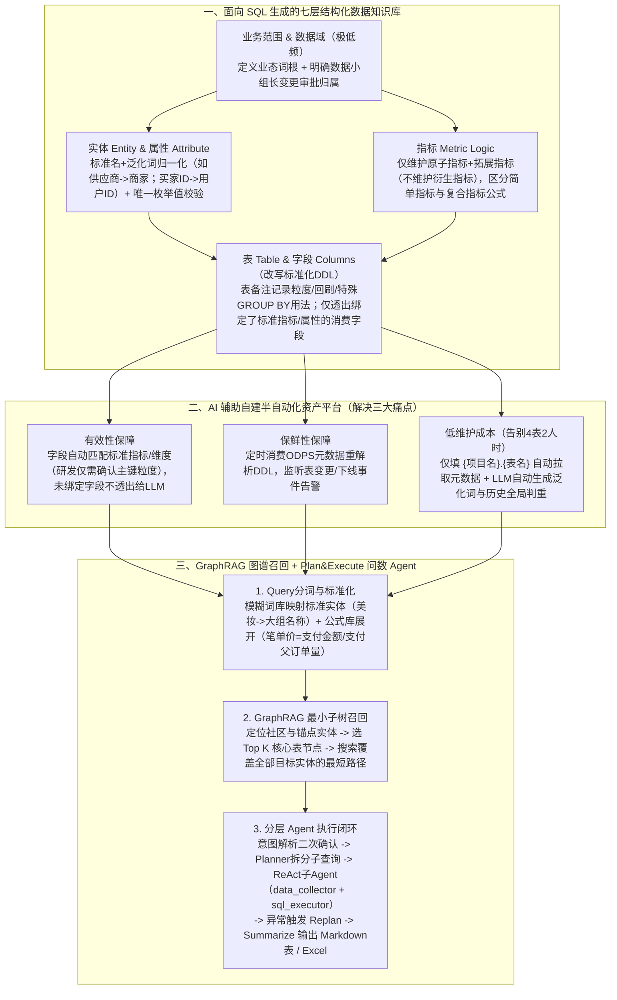

# 天猫超市数据AI实践总结

## 1. TL;DR

1. **核心痛点**：天猫超市自营数据体系历经十年沉淀了**数万张表、近万个调度节点（核心保障任务占 30%+）**，存在同名异义/异名同义、僵尸冷表及口径散落脚本/文档等问题；业务同学跨系统手动取数成本高，而静态钉钉文档维护 1 个域的 4 张中间层表就要耗费研发 **2 人时**。
2. **三大建库原则与五类知识**：坚持**“不重构现有数仓模型、小而精筛选核心资产、灵活扩展”**原则，围绕写 SQL 的三大要素（指标定义、数据粒度、数据范围）结构化构建 **实体（Entity）、属性（Attribute）、指标（Metric Logic）、表（Table）、字段（Columns）**（外加业务范围与数据域）知识体系，仅维护“原子指标 + 拓展指标”而将衍生指标交给 LLM 交叉组合。
3. **演进路径（钉钉文档 $\to$ AI 自建资产平台 $\to$ GraphRAG + Plan&Execute Agent）**：通过与 AI 自然语言交互低成本自建半自动化资产维护平台（定时消费 ODPS 元数据解析 DDL、自动生成泛化词与全局判重、仅透出已绑定标准知识的字段）；结合 **GraphRAG 最小子树路径召回** 与 **Plan&Execute + ReAct（`data_collector` / `sql_executor`）+ Replan** 架构实现免 SFT 的智能问数。
4. **量化效果**：上线推广后累计问答**数千次+**，面向技术同学的资产找表准确率达 **85%+**，面向业务同学的智能问数准确率达 **75%+**；某品类跨看板新增需求从传统修改商品标签表/ADS/报表共 **2–4 人日** 缩短为**在知识库维护 1 条商品属性并更新图谱**即可支撑全场景问数。

## 2. 问题定义与背景

### 2.1 十年存量数据资产的三大结构性顽疾

天猫超市自营数据资产覆盖供应链、交易、日志、商品、直播等域，累计沉淀 **数万张表、近万个调度节点（核心保障任务占 30%+）**，长期演进暴露出三大痛点：
1. **规范问题（同名异义与异名同义）**：例如“支付金额”在不同表中被命名为 `div_pay_amt`、`pay_ord_amt`、`scitm_pay_ord_amt`、`gmv` 等，缺乏统一语义映射。
2. **冷资产噪声**：历史业务变迁遗留大量低频“僵尸表”与过时口径，若一刀切全量接入 AI 会造成严重输入噪声与幻觉。
3. **逻辑口口相传**：关键指标口径、回刷策略与特殊聚合逻辑（如算 IPV 需先按 `user_id + item_id` 分组再对其他字段取 `max`）散落在脚本与协作文档中。

### 2.2 知识库建设的三大顶层设计原则

1. **不重构数据模型**：数研精力有限，不在物理数仓层推倒重来，而是通过知识库语义层让 LLM 理解存量表设计。
2. **小而精优先（牺牲初期全面性换取高准确性）**：严禁将参差不齐的全量表一刀切塞给 AI，先筛选高频核心表做成精品知识库再逐步扩展。
3. **从静态文档向半自动化平台平滑演进**：S1 阶段用钉钉文档快速跑通 POC，S2 阶段针对手工维护痛点升级为产品化管理平台。

## 3. 知识框架

## 4. 核心内容拆解

### 4.1 五类核心知识结构与减负设计细节

从数据研发写 SQL 必备的“指标定义、数据粒度、数据范围”出发，知识库构建了以下结构：
1. **业务范围与数据域**：业务范围定义业态中文名与英文词根缩写；数据域绑定**数据小组长**，后续所有关联知识与元数据变更自动触发小组长审批流。
2. **实体（Entity）与属性（Attribute）**：
   - 将同义概念归一化为“**1 个标准名 + 多个泛化名**”（如“供应商”与“商家”归一为标准实体`商家`；“买家ID”与“用户ID”归一为标准属性`用户ID`）。
   - **属性枚举值唯一标准**：同一属性名严禁出现两套枚举值标准，枚举值直接用于后续指标公式校验与意图理解。
3. **指标（Metric Logic）——为什么不维护衍生指标？**
   - **只维护“原子指标 + 拓展指标”，不维护“衍生指标”**（例如只维护`支付金额`，不维护`某大组支付金额`或`百亿补贴支付金额`），交由 LLM 在推理期将“属性/维度”与“原子指标”动态交叉组合，使维护工作量呈指数级下降。
   - 平台将指标分为**简单指标**（单指标求和或单属性去重，系统匹配属性自动生成公式）与**复合指标**（人工输入公式，系统自动做语法校验与子串合法性识别，非法公式打上无效标签不透出给大模型）。
4. **表（Table）与字段（Columns / 标准化 DDL）**：
   - **表备注强化特殊用法说明**：除业务范围、粒度、回刷策略外，重点写明特殊聚合规则（如场域汇总表声明：“交易指标需先按 `order_id` 分组其他字段取 `max`；计算 `ipv` 需先按 `user_id + item_id` 分组其他字段取 `max`”）。
   - **DDL 裁剪与强绑定**：只绑定并透出需要被问数消费的字段，无关字段一律不进入图谱与大模型上下文。

### 4.2 从钉钉文档（S1）到半自动化资产平台（S2）的演进

1. **S1 静态钉钉文档暴露的三大痛点**：
   - **有效性脆弱**：五类知识必须严丝合缝关联，手工维护时若新增指标`支付金额`但忘了把 DDL 中 `pay_ord_amt` 的注释改成一模一样的`支付金额`，大模型就会断链产生幻觉。
   - **保鲜性缺失**：ODPS 物理表 DDL 修改或节点下线无法自动同步到静态文档。
   - **维护成本高昂**：维护 1 个域的 **4 张中间层表**即需耗费研发 **2 人时**（含联动扫描修改、手写中英泛化词、全量历史判重、DDL 备注重复写入四重负担）。
2. **S2 借助 AI 交互自建资产维护平台**：
   - 团队因技术栈不匹配且内部管理 QPS 低，直接通过与 AI 自然语言交互搭建出 Web 资产管理平台（后端连通数据库并回流 ODPS）：
   - **表级极简录入**：研发仅需输入 `{项目名}.{表名}`，系统自动校验 ODPS 存在性并解析项目空间、层级、业务范围、数据域与注释。
   - **字段级自动对齐**：研发仅需勾选“是否粒度（主键）”，系统根据字段名/备注自动匹配知识库中的标准指标与维度，研发只需点击确认，且只有完成唯一绑定的字段才会透出给大模型。
   - **泛化词自动生成与全局判重**：利用数据库查询与大模型生成能力，自动扩写泛化词并完成与历史记录的唯一性校验；同时定时消费数据平台元数据自动重解析 DDL。

### 4.3 GraphRAG 最小子树召回与分层 Agent 框架

1. **为什么用 GraphRAG 替代传统向量 RAG？**
   - 传统 RAG 难以刻画多表 Join 关联路径，极易捏造不存在的“幻觉表/幻觉字段”。
   - **两阶段图谱召回流程**：
     - **Step 1（分词与公式/实体展开）**：用模糊词库与公式库将 Query 标准化（如询问“今年美妆某场域的笔单价是多少？”，将“美妆”映射为标准实体`大组名称`，将“笔单价”按公式展开为 `支付金额 / 支付父订单量`）。
     - **Step 2（锚点筛选与最小子树搜索）**：根据业务意图锁定图谱社区，针对指标锚点（如`支付金额`同时存在于订单、场域、商品等多张表）结合问题属性筛选出 **Top K 核心表节点**作为起点，在图谱上搜索覆盖全部目标实体的**最小子树（最短路径）**，输出包含表节点与实体节点连接的 Top K 路径。
2. **免 SFT 的双层 Agent 框架（Plan&Execute + ReAct + Replan）**：
   - 在未对基座模型做 SFT 的前提下，采用：`意图解析（提取日期/场域/指标并与用户二次确认） → Plan&Execute Planner（拆解原子子查询并管理依赖） → ReAct 子 Agent（含 data_collector 数据收集与 sql_executor SQL 生成及语法/语义双重校验） → 异常触发 Replan 重规划 → Summarize 节点完整性验证后输出 Markdown 表格或可编辑 Excel`。

### 4.4 Bad Case 复盘与未来演进（案例库 + 事中卡点保鲜）

- **两类典型 Bad Case 洞察**：
  1. **纯新客跨表陷阱**：问“2025 年 7 月新客、老客客单价”，模型误以为新老客都在用户分层标签表（`T-2`），忽略了**纯新客不在标签表中、需用 `LEFT JOIN` 关联不到即为纯新客**的特殊口径。
  2. **场域表一对多去重陷阱**：问“最近 1 个月 UV 表现最好的场域”，模型忽略了同一笔订单会归属多个场域、必须先去重计算的隐含约束。
- **针对性改进**：按表（By Table）建立**复杂表典型 Case SQL 案例库**随表注入，并建立“事前纳入上线交付节点 + **事中提交新取数需求时强制比对指标库并跳转注册** + 事后监听 ODPS DDL 变更事件告警 + 线上代码自動解析补全”的四维保鲜机制。

## 5. 数据速查表

| 指标 / 维度 | 原文数值 | 语境 / 条件 |
| --- | --- | --- |
| 天猫超市存量数据资产规模 | **数万张表、近万个调度节点（核心保障任务占 30%+）** | 历经十年建设，覆盖供应链/交易/日志/商品/直播等域 |
| 静态文档手工维护耗时 | **维护 1 个域的 4 张中间层表需 2 人时** | 含变更扫描、泛化词扩写、全局判重、DDL 重复写入 |
| 资产查询（找表与写基础 SQL）准确率 | **85%+（累计问答数千+）** | 面向数开/数科/前后端技术同学，8 月上线推广（知识库范围内） |
| 智能问数（业务直接取数分析）准确率 | **75%+（累计问答数千+）** | 面向业务同学，支持多周期对比与导出 Excel（知识库范围内） |
| 新增某品类看板需求提效对比 | **传统 2–4 人日 $\to$ AI 流程仅维护 1 条商品属性 + 更新图谱** | 传统需改商品标签表 + 各 ADS 表 + 多张报表数据集 |

## 6. 踩坑与教训 / 可迁移的设计原则

| 错误做法 | 失败表现或原因 | 原文应对（可迁移的设计原则） |
| --- | --- | --- |
| **把数仓数万张存量表与全字段 DDL 一刀切全量灌入知识库** | 僵尸表与无关字段造成严重上下文噪声，模型推理变慢且频繁产生幻觉表 | **小而精准入 + 字段级裁剪透出**：仅精选核心表入库，且只有绑定了标准指标/维度的消费字段才透出给图谱与 LLM |
| **在知识库中穷举维护所有“维度 × 原子指标”的衍生指标** | 衍生指标数量呈组合爆炸，手工维护与变更成本完全不可持续 | **只维护“原子指标 + 拓展指标”**：不维护衍生指标（如“百补支付金额”），交由 LLM 在推理期动态交叉组合属性与原子指标 |
| **用纯向量 RAG 检索多表关联的复杂数仓元数据** | 难以表达表间外键/关联路径，且无法拆解复合公式（如笔单价） | **公式库预展开 + GraphRAG 最小子树召回**：先将复合指标拆解为原子指标并映射标准实体，再以 Top K 核心表为锚点搜索覆盖全部实体的最短路径 |
| **对特殊聚合表（如场域多归属表、T-2 用户标签表）只给字段定义不给用法** | 模型漏掉“先按 `order_id` 分组取 `max`”或“关联不到即为纯新客”等隐含逻辑 | **在表备注中强声明特殊聚合规则 + 建立 By-Table 的典型 Case SQL 案例库** |

## 7. 记忆锚点

1. **建库三原则与五要素**：“**不改数仓、小而精、平台化；实体属性加指标，表与字段紧绑定（原子拓展入库，衍生交给模型）**”。
2. **问数全链路公式**：$\text{模糊词/公式展开} \xrightarrow{\text{GraphRAG}} \text{Top-K 锚点最小子树路径} \xrightarrow{\text{Plan\&Execute + ReAct + Replan}} \text{85\% 找表 / 75\% 问数准确率}$。

## 8. 复习卡片

1. 天猫超市数据团队在构建面向 AI 的数据知识库时确立了哪三条核心原则？为什么？::① 不重构现有数据模型（存量数万张表改造代价过大，优先在知识库语义层适配 LLM）；② 小而精维护（存量含大量僵尸表，精选核心资产牺牲初期全面性以换取高准确性）；③ 支持灵活扩展与半自动化平台演进。
2. 为什么知识库中只维护“原子指标 + 拓展指标”而不维护“衍生指标”？::因为衍生指标（如“某大组的支付金额”“百亿补贴支付金额”）本质上是“属性/维度”与“原子指标”的交叉组合；只维护原子/拓展指标并让 LLM 理解属性与指标的组合关系，可以大幅消减维护工作量与冗余噪声。
3. 静态钉钉文档维护知识库（S1 阶段）暴露了哪四项具体的人工成本（导致 4 张表需耗费 2 人时）？::① 变更成本高（单点修改需手工扫描全部关联项）；② 人工扩写中英文泛化词繁琐；③ 新增知识需人工扫描全量历史记录做唯一性判重；④ 新增指标/属性后还需重复写入对应表的 DDL 字段注释。
4. 半自动化资产维护平台（S2 阶段）是如何解决 DDL 保鲜与无效字段干扰问题的？::通过定时消费数据平台（ODPS）元数据自动重解析表 DDL 并监听表修改/下线事件告警保障保鲜性；在字段管理中研发仅需标记主键粒度，系统自动匹配标准指标/维度，且严格限制**只有完成唯一标准知识绑定的字段**才向大模型透出。
5. 天猫超市 Data Agent 的 GraphRAG 图谱召回是如何处理“今年美妆某场域的笔单价是多少？”这类查询的？::先通过模糊词库与公式库将“美妆”映射为标准实体`大组名称`，将“笔单价”展开为`支付金额 / 支付父订单量`；再定位检索社区与`支付金额`锚点实体，筛选 Top K 核心表节点作为起点，在图谱中搜索覆盖全部目标实体的最小子树（最短路径）。
6. 在未对基座大模型做 SFT 的情况下，天猫超市问数 Agent 采用了怎样的执行架构来保障复杂查询稳定性？::采用分层模块化架构：意图解析（含用户二次确认）→ `Plan&Execute` Planner 拆解原子子查询 → 调用基于 `ReAct` 的子 Agent（`data_collector` 与 `sql_executor` 含语法语义双重校验）→ 遇到 SQL 报错或数据缺失触发 `Replan` 重规划 → `Summarize` 校验后输出 Markdown 表格或 Excel。
7. 复盘“新老客客单价对比”和“场域 UV 排名”两个 Bad Case 时，模型分别犯了什么典型错误？团队如何改进？::在场景 1 中模型误以为纯新客也在 `T-2` 用户标签表里（实则关联不到才算纯新客）；在场景 2 中模型忽略了同一订单会出现在多个场域需去重计算。改进方案是在表备注中写明特殊分组规则，并按表（By-Table）建立典型 Case SQL 案例库随表注入。

## 9. 知识关联

- **本库主题关联**：
  - [Agent数据分析](../../20_topics/Agent数据分析.md)：构建五类结构化数据知识库、半自动化资产平台与 GraphRAG + Plan&Execute 智能问数系统（找表 85%+、问数 75%+）。
  - [检索与文档解析](../../20_topics/检索与文档解析.md)：使用模糊词库+公式展开配合 GraphRAG 最小子树（最短路径）召回解决多表关联幻觉。
  - [决策知识结构化](../../20_topics/决策知识结构化.md)：将口口相传的数仓口径拆解为业务范围、数据域、实体、属性、原子指标、表与标准化字段 DDL。
- **候选双链**：`[[DataAgent]]`、`[[NL2SQL]]`、`[[GraphRAG]]`、`[[数据语义层]]`、`[[指标管理]]`

## 10. 原文参考资料

- **原文标题**：《天猫超市数据AI实践总结》
- **发布渠道与日期**：微信公众号「大淘宝技术」，2025-12-29
- **作者与团队**：沐濯、麦堡、空水（淘天集团-自营技术团队）

> [!note]- 校对报告
> - **页码溯源汇总**：
>   - 存量数据资产背景（数万张表、近万个调度节点、核心保障任务占 30%+、三大痛点）与 Data Agent 目标：`p.1–2`
>   - 知识库三原则（不重构模型、小而精、可扩展）与七类知识结构（业务范围、数据域、实体、属性、指标、表、字段）：`p.3–5`
>   - S1 钉钉文档案例（`div_pay_amt`/`supplier_code` 泛化、交易明细表与场域汇总表特殊 `GROUP BY` 说明）与 S2 产品化平台（解决有效性/保鲜性/维护成本，4 张中间表 2 人时痛点）：`p.5–10`
>   - GraphRAG 图谱构建与最小子树最短路径召回（“美妆笔单价”示例）：`p.10–11`
>   - Plan&Execute + ReAct（`data_collector` / `sql_executor`）+ Replan 框架及三大落地效果（资产查询 85%+、智能问数 75%+、新增品类看板从 2–4 人日降至维护 1 条属性）：`p.12–15`
>   - 未来规划与两个典型 Bad Case（`T-2` 纯新客关联不到逻辑、场域表订单去重）及事前/事中/事后知识保鲜：`p.15–17`
> - **关键数值一致性核查**：
>   - 核心保障任务 `30%+`、维护 1 个域 4 张中间层表耗费 `2 人时`、技术同学找表准确率 `85%+`、业务同学问数准确率 `75%+`、传统看板调整工时 `2–4 人日` 均与原文完全一致。
> - **图像与版面质量说明**：
>   - `p.1, 2, 4, 6–15` 含知识库大图、平台界面截图、GraphRAG 拓扑图与 Agent 架构图（位于 PDF 图像层），`p.18` 为空白尾页；全部表格、架构步骤与 Bad Case 分析均在文本层完整提取。
