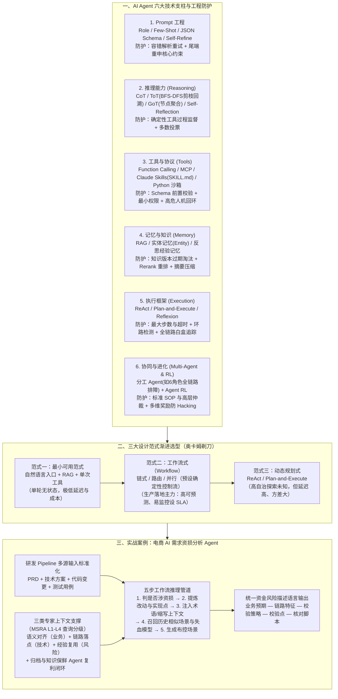

# 如何设计一个AI Agent系统

## 1. TL;DR

1. **核心定位与公式**：站在工业级工程落地视角（不含预训练/微调），定义 **`AI Agent = LLM (Reasoning) + Planning + Memory + Tool Use`**；借 Andrej Karpathy 的“软件 1.0（代码）$\to$ 2.0（权重）$\to$ 3.0（Prompt/上下文，LLM 为新 OS 内核）”指出 Agent 研发是从**命令式计划驱动**向**目标导向与评估集驱动（实验迭代）**的范式跃迁。
2. **六大核心技术支柱与工程挑战对策**：系统拆解 **① Prompt 工程**（角色/Few-shot/Schema 输出/工具模板/Self-Consistency & Self-Refine；抗结构不稳定与长文指令衰退）、**② 基础推理**（CoT/ToT/GoT/Self-Reflection；用确定性工具做过程监督防错误累积）、**③ 工具与行动**（Function Calling/MCP/`Claude Skills` 文件夹封装/Code Interpreter 沙箱；最小权限 + 人机回环）、**④ 记忆与知识**（RAG/实体记忆/反思经验记忆；版本淘汰 + Rerank）、**⑤ 执行框架**（ReAct / Plan-and-Execute / Reflexion；设最大步数 + 环路检测 + 全链路白盒追踪）、**⑥ 协同与进化**（SOP 多智能体 + 高层仲裁 + 多维复合奖励防 Reward Hacking）。
3. **三大架构设计范式与选型谱系**：对比 **范式一：最小可用范式（单轮 `入口 + RAG + 单次工具`）**、**范式二：工作流式（Workflow：链式 / 路由 / 并行，确定性控制流优先）**、**范式三：动态规划式（ReAct / Plan-and-Execute，运行时自主编排）** 的优劣边界，给出纯 Prompt、低代码拖拽（Dify/Coze/AI Studio）与纯代码（LangChain/LangEngine/Spring AI Alibaba/AgentScope）三类开发方式对照。
4. **电商 AI 需求资损分析实战**：针对日常海量中低风险需求漏评导致的资损敞口、专家经验难复制、人工串行效率低三大痛点，采用 **“工作流外壳 + MoE 领域专家 Agent + 研发 Pipeline（PRD/技术方案/代码变更/测试用例）多源标准化输入”**，通过五步推理将高熵任务分治为 **`业务预期 — 链路特征 — 校验策略 — 校验点 — 核对脚本`** 统一风险描述语言，并配套语义对齐、链路落点、经验复用三类上下文与自动归档保鲜闭环。
5. **八条一线工程箴言**：遵循**奥卡姆剃刀从最小可用范式起步**；**“工作流外壳 + 智能内核 + 知识管理”混合架构**是生产常态；**“智能是奢侈品，稳定是必需品”**（85% 可预测可兜底胜过 95% 偶发低级错误）；消除次要困难但**领域建模与评估飞轮等根本困难对人要求更高**。

## 2. 问题定义与背景

### 2.1 软件 1.0 / 2.0 / 3.0 与传统研发 vs Agent 研发对比

| 维度 | 传统软件工程研发（Software 1.0） | AI Agent 工程研发（Software 3.0 应用层） |
|---|---|---|
| **核心目标与思维模型** | 命令式：精确定义每一步 `if-else` 如何做，实现确定性功能 | 目标导向式：定义高级目标、边界与环境（工具+记忆），让 Agent 自主达成 |
| **主要产出物** | 源代码、可执行程序、API 接口 | Agent 架构（Workflow + 状态机）、Prompt/Skills、知识库、**共同评估集** |
| **研发与协作模式** | 线性瀑布/敏捷：围绕 API 接口文档分工（需求 $\to$ 设计 $\to$ 编码 $\to$ 测试） | 实验驱动闭环：架构师、Prompt 工程师、业务专家**围绕同一个评估集协作**，定义“好结果”并复盘 Bad Case |
| **调试与评判标准** | 断点 Debug 查变量；确定性（输入 $A \Rightarrow$ 输出 $B$） | 全链路追踪思维链（Thought/Action/Observation）；概率性（评估**行为可靠性、任务完成率、工具准确率**） |

## 3. 知识框架

## 4. 核心内容拆解

### 4.1 六大技术支柱中的关键机制与工程治理对策

| 技术支柱 | 核心机制与电商示例 | 典型工程挑战 | 生产级应对策略 |
|---|---|---|---|
| **Part 1：提示词工程** | 角色设定（大促广告法审核）、Zero/Few-Shot（30–60 字 SEO 标题）、JSON Schema 抽取、工具模板、Self-Consistency（生 5 条投票）+ Self-Refine | ① JSON 语法错或夹带废话； ② 长上下文**指令依从性衰退** | ① **鲁棒解析器 + 错误回传重试 + Schema 严格校验**； ② **提示强化（每轮 Prompt 末尾简要重申核心约束）** + 保持关键指令在活跃窗口 |
| **Part 2：基础推理** | **CoT**（满减+单品券+京豆分步算价）、**ToT**（双11华东仓配三分支评分剪枝回溯）、**GoT**（扫地机冷启动多节点聚合回流）、**Self-Reflection**（客服同理心与查单号质检） | 多步推理链早期微小错误被后续步骤继承放大（**推理错误累积**）；延迟成本激增 | 引入计算器/规则引擎做**中间步骤过程监督**；并行多路径**多数投票**；按任务复杂度动态路由推理深度 |
| **Part 3：工具与行动** | Function Calling、**MCP**（统一封装 MySQL/OSS/Redis 异构商品源）、**Claude Skills**（含 `SKILL.md`、`tools/*.py`、`knowledge/*.json`、`prompt_template.yaml` 的文件夹）、**Code Interpreter**（Pandas/Matplotlib 沙箱） | ① 工具幻觉与参数类型/格式错； ② 提示注入或推理失误触发**越权高危操作** | ① **前置 Schema 校验 + 执行失败详情回传自我修正**； ② **最小权限原则**（独立执行身份）+ **高危操作强制人机回环（HITL）审批** |
| **Part 4：记忆与知识** | **RAG**（生鲜春节发货处罚规范）、**对话实体记忆**（持续提取购物意图实体）、**反思经验记忆**（记录去年双11预售定金膨胀与店铺券叠加资损教训供今年 618 检索） | ① 召回过期或高相似低相关片段； ② 上下文窗口溢出与噪声干扰 | ① **知识生命周期版本管理（过期淘汰）+ Rerank 重排序过滤**； ② 长文摘要压缩 + 注入前预处理剔除无关噪声 |
| **Part 5：执行框架** | **ReAct**（全网比价买国行 Switch OLED）、**Plan-and-Execute**（新商家入驻资质收集与工商核验）、**Reflexion**（母婴人群圈选失败后反思排除已购并加购买力过滤） | ① **执行死循环与子任务发散**； ② 多跳黑盒难以定位故障环节 | ① **强制最大步数与超时限制 + 目标锚定与重复操作序列环路检测中断**； ② **端到端全链路追踪（记录每次 I/O、耗时、状态）+ 强制输出关键决策日志白盒化** |
| **Part 6：协同与进化** | **Multi-Agent**（全链路故障定位：协调 Agent + 应用/RPC/数据库/离线/中间件 6 类专家 Agent）、**Agent RL**（仿真环境点击 +1 / 下单 +10 PPO 调优推荐策略） | ① 多 Agent 冗余通信、目标冲突与死锁； ② 强化学习 **Reward Hacking**（钻漏洞拿高分） | ① **制定标准化通信协议与 SOP + 引入高层仲裁 Agent/规则引擎**； ② 构建完成度/效率/安全/合规**多维复合奖励 + RLHF 人类偏好建模** |

### 4.2 三大 Agent 设计范式选型对比（源自 Anthropic 最佳实践）

| 范式名称 | 控制流与状态特征 | 核心优势 | 局限与适用边界 |
|---|---|---|---|
| **范式一：最小可用范式** | 单轮线性：`意图识别 → RAG → 单次工具 → LLM 汇总`，无状态、无循环规划 | 延迟最低（通常仅调 1 次 LLM）、成本最低、极易调试维护 | 无多步规划与复杂工具组合能力；适合“问问/查查/解释一下”等轻交互场景及项目起步原型 |
| **范式二：工作流式（Workflow）** | 预设确定性控制流（**链式 / 路由 / 并行 / 状态机**），节点内用 LLM 填空或判断，节点间流转由代码硬控 | **高可预测性与低幻觉**，支持节点级 SLA/超时/重试、I/O 并行加速、业务流程图共创与路由灰度 A/B | 交互略机械（难应对中途跳出流程的开放问题），场景膨胀后状态机维护成本高；路由节点分类错会导致全链路错配 |
| **范式三：动态规划式** | 运行时由 LLM 通过 `ReAct` 或 `Plan-and-Execute` 自主拆解目标、任意顺序/次数调工具并动态重规划 | 极高灵活性，能处理“试一下才知道”的探索性未知任务，可自然组合出未预设的新路径 | 易陷入死循环、相同输入输出方差大、多步串行延迟极高、Token 成本不可预测、需严格沙箱防恶意指令 |

### 4.3 工业级实战：电商 AI 需求资损分析 Agent

1. **为什么传统人工资损评估难以为继**：
   - **资源与风险错位**：重兵把守大项目，但大量日常中低风险需求因人力不足漏评，上线后演变为重大资损；
   - **专家隐性经验难规模化复制**：新手面对复杂叠加规则无从下手；
   - **串行人工评估成为高频迭代效率瓶颈**。
2. **三态协同总体架构**：
   - **运行态（MoE 领域专家 + 多租户）**：嵌入研发 Pipeline（需求评审 $\to$ 技术评审 $\to$ 开发 $\to$ 测试 $\to$ 发布），总控协调器按业务线调度各领域专家 Agent；
   - **归档与保鲜态**：每次需求分析结论、命中风险点、校验脚本与效果指标自动结构化归档，并自动更新业务/技术/风险知识库，实现“越用越准”；
   - **研发态**：构建领域需求评测集与**分析效果验证 Agent**，持续度量打标准确率与风险召回率。
3. **五步确定性工作流推理管道与统一风险描述语言**：
   - 模拟人类专家从新手到精通的 5 步法：**`Step 1 判定是否涉资损（围绕新增/修改商业玩法或资金链路） → Step 2 提炼需求改动点与技术实现点（建立结构化中间表示） → Step 3 注入业务术语（平台返/递进满减）与应用缩写上下文 → Step 4 召回历史相似需求、失血模型与历史资损故障 → Step 5 生成最终资损布控场景列表`**。
   - **四大工程降熵抓手**：① **多源输入标准化**（整合 PRD + 技术方案 + 代码变更 + 测试用例，交叉校验业务预期与技术实现是否一致）；② **需求点/实现点结构化抽象**；③ **变更影响面分析**（从单点代码扩展至触达的资金链路、状态流转、账务/优惠/结算口径）；④ **统一资金风险描述语言**——串联 **`「业务预期 — 链路特征 — 校验策略 — 校验点 — 核对脚本」`**，使输出可直接驱动核对脚本开发。
4. **结合 MSRA 查询四级分类（L1–L4）构建三类专家上下文**：
   - 引用 MSRA 论文将外部数据利用分为 **Level 1（显式事实提取）、Level 2（隐含事实基础推理）、Level 3（领域规则可解释推理）、Level 4（从历史数据挖掘隐藏策略）**；
   - 据此说明资损知识库绝非静态文档罗列，而是提供三种工程化上下文能力：**① 语义对齐能力（业务上下文，消弭跨团队口径差异）**、**② 链路落点能力（技术上下文，精准定位到应用/接口/扩展点/表字段/指标口径）**、**③ 经验复用能力（风险上下文，沉淀重复计费、漏计、幂等缺失、补偿不一致、状态机错乱的“风险模式 + 校验点 + 脚本模板”）**。

## 5. 数据速查表

| 维度 / 分类 | 原文核心要素与枚举 | 语境与工程意义 |
|---|---|---|
| **软件范式三代演进** | `Software 1.0`（写代码/CPU）$\to$ `2.0`（训权重/GPU）$\to$ `3.0`（写 Prompt 与管上下文/LLM） | 源自 Andrej Karpathy 2025 年 6 月 YC 演讲；LLM 是新 OS 内核 |
| **Agent 核心公式** | `AI Agent = LLM (Reasoning) + Planning + Memory + Tool Use` | 从被动问答 Copilot 跃升为主动规划执行的 Autopilot |
| **Claude Skills 典型目录结构** | `SKILL.md` + `tools/*.py` + `knowledge/*.json` + `prompt_template.yaml` | 不微调模型即可“安装”高可靠垂直领域专家能力包 |
| **三种工程开发模式代表工具** | 纯 Prompt / 低代码拖拽（`Dify`、`Coze`、`AI Studio`）/ 纯代码（`LangChain`、`LangEngine`、`Spring AI`、`Spring AI Alibaba`、`AgentScope`） | 按业务复杂度、定制记忆与 CI/CD 诉求分层选型 |
| **MSRA 外部数据查询四级分类** | `Level 1` 明确事实 $\to$ `Level 2` 隐含事实 $\to$ `Level 3` 领域规则可解释推理 $\to$ `Level 4` 隐藏策略挖掘 | 指导资损分析各子节点的 Prompt 设计与 RAG 知识依赖深度 |
| **产品化稳定性黄金权衡** | **准确率 85% 但错误可预测可兜底 $>$ 准确率 95% 但偶发低级失控错误** | “智能是奢侈品，稳定是必需品”；高频简单用规则+小模型，低频复杂调大模型+人工审核 |

## 6. 踩坑与教训 / 可迁移的设计原则

| 错误做法 | 失败表现或原因 | 原文应对（可迁移的设计原则） |
|---|---|---|
| **项目初期一上来就搭建多 Agent 自主动态规划复杂系统** | 链路长、方差大、极难调试定位，陷入过度工程化泥潭 | **遵循奥卡姆剃刀从“最小可用范式”起步**：先压榨单轮 `Prompt + RAG + 单工具` 潜力，再按需演进至“工作流外壳 + 智能内核”混合架构 |
| **在多轮长对话中只在开头 System Prompt 写一次约束规则** | 随着上下文拉长出现“指令依从性衰退”，模型遗忘格式或安全红线 | **每轮 Prompt 末尾简要重申核心约束** + 滑动窗口/摘要压缩确保关键指令始终处于活跃区 |
| **资损分析只看 PRD 文档，或直接让大模型从长文档一步生成风险结论** | PRD 与实际代码实现常不一致，且直接从长文生成极易发生幻觉漂移 | **Pipeline 多源输入对齐（PRD+技术方案+代码变更+用例）+ 分步工作流降熵**，先抽象结构化中间表示再推导全链路影响面 |
| **把知识库当成静态 PDF/文档堆积桶，缺乏结构化落点与保鲜机制** | 文档过时冲突，且模型只能给出“可能有资损”的空泛废话，无法落地为可执行脚本 | 构建 **业务语义对齐 + 技术链路落点（应用/接口/表字段）+ 风险经验模板** 三层上下文，并配“归档与知识保鲜 Agent”自动回流新风险 |
| **认为引入 AI 后对工程师的业务与设计能力要求降低了** | AI 只能消除文本处理与样板生成等“次要困难”，领域建模与边界定义不清会导致垃圾进垃圾出 | 架构师与 Prompt 工程师必须深度理解业务，建立 **“线上发现问题 $\to$ 标注新样本 $\to$ 调优 $\to$ 量化评测集验证”** 的数据飞轮 |

## 7. 记忆锚点

- **生产落地架构口诀**：「**奥卡姆剃刀先上最小可用，生产主力靠“工作流外壳 + 智能内核 + 知识管理”；85% 可兜底胜过 95% 偶发失控**」。
- **资损分析五联语言**：「**业务预期 $\to$ 链路特征 $\to$ 校验策略 $\to$ 校验点 $\to$ 核对脚本（配业务语义、技术落点、风险模板三层上下文）**」。

## 8. 复习卡片

AI Agent 的核心组成公式是什么？Agent 研发与传统软件研发在协作方式和评判标准上有何本质区别？::公式为 AI Agent = LLM (Reasoning) + Planning + Memory + Tool Use；传统研发基于 API 接口文档分工、追求确定性（输入 A 必得 B），而 Agent 研发由架构师、Prompt 工程师与业务专家围绕同一个“共同评估集”实验迭代，评判行为可靠性、任务完成率与工具调用准确率。
针对长上下文中的“指令依从性衰退”和“输出结构不稳定”，分别有哪些工程应对手段？::针对指令依从性衰退：在每轮交互 Prompt 的末尾简要重申最核心约束，并通过上下文压缩让关键指令留在活跃区；针对输出结构不稳定：采用容错解析器、对照预定义 Schema 严格校验，并将解析报错信息自动回传给 LLM 重试修正。
Anthropic 提出的 Claude Skills 机制是什么？一个标准 Skill 文件夹包含哪些要素？::是一种无需微调即可为模型“安装”垂直领域专家能力包的模块化机制；每个独立文件夹包含 SKILL.md（用途、限制、输入输出规范）、tools/（可执行脚本）、knowledge/（领域规则库）和 prompt_template.yaml。
最小可用范式、工作流式（Workflow）与动态规划式（ReAct/Plan-and-Execute）三者在工业落地中如何取舍？::最小可用范式（单轮入口+RAG+单工具）延迟与成本最低，适合轻交互与初期验证；工作流式（链式/路由/并行）由代码锁定节点流转、LLM 负责节点内处理，可预测性与 SLA 可控性最高，是生产主力；动态规划式灵活性最高但延迟高、成本不可控且易死循环，需严格步数限制与沙箱约束。
电商 AI 需求资损分析 Agent 为什么要采用“多源输入标准化”和“统一资金风险描述语言”？::因为关键资损风险常藏在技术方案与代码变更细节中而非 PRD 一句话，整合 PRD、技术方案、代码变更与测试用例才能校验业务预期与技术实现的一致性；统一的“业务预期—链路特征—校验策略—校验点—核对脚本”描述语言可将分析结论直接转化为可执行的防控脚本。
资金安全知识体系提供的哪三类关键上下文能力使其区别于普通文档资料库？::① 语义对齐能力（业务上下文：统一跨团队术语、玩法与口径）；② 链路落点能力（技术上下文：将抽象风险定位到具体应用、接口、扩展点、表字段与指标口径）；③ 经验复用能力（风险上下文：将重复计费、幂等缺失、状态机错乱等沉淀为“风险模式+校验点+脚本模板”）。
为什么作者强调“智能是奢侈品，稳定是必需品”？在产品交互演进上有哪两种路径？::因为在生产环境中，准确率 85% 但错误可预测可兜底的系统，比准确率 95% 但偶发低级失控错误的 Agent 更受业务欢迎（高频简单用规则+小模型，低频复杂用大模型+人工审核）；产品交互上分为保留原操作兜底的“过渡型（人机协同）”与彻底重塑为意图一键直达的“重构型”。

## 9. 知识关联

- **本库主题索引**：[Skill设计与治理](../../20_topics/Skill设计与治理.md)、[Agent工程循环](../../20_topics/Agent工程循环.md)、[决策知识结构化](../../20_topics/决策知识结构化.md)、[Agent评测与反馈](../../20_topics/Agent评测与反馈.md)
- **本库关联文章**：[退小宝AI助手应用架构+26.2.11](../退小宝AI助手应用架构+26.2.11/AI_退小宝AI助手应用架构.md)、[AI时代工程师范式演进+26.1.21](../AI时代工程师范式演进+26.1.21/AI_AI时代工程师范式演进.md)、[Agent业务效果评测+26.9.17](../Agent业务效果评测+26.9.17/AI_Agent业务效果评测.md)
- **候选双链**：[[Software 3.0]]、[[Building Effective Agents]]、[[Claude Skills]]、[[电商资损防控Agent]]

## 10. 原文参考资料

- **原文信息**：《如何设计一个AI Agent系统》，作者：北桓（淘天集团-SRE团队），发布日期：2026-01-26。
- **文内引用演讲、论文与框架**：
  - Andrej Karpathy (2025-06 YC 演讲)：[*Software in the era of AI*](https://www.youtube.com/watch?v=LCEmiRjPEtQ)
  - 综述论文：*The Rise and Potential of Large Language Model Based Agents: A Survey*
  - Anthropic 工程指南：*Building effective agents*
  - MSRA 论文：*Retrieval Augmented Generation (RAG) and Beyond: A Comprehensive Survey on How to Make your LLMs use External Data More Wisely*
  - 开发框架：`Dify`、`Coze`、`AI Studio`、`LangChain`、`LangEngine`、`Spring AI`、`Spring AI Alibaba`、`AgentScope`

> [!note]- 校对报告
> - **页码溯源汇总**：
>   - `## 1. TL;DR` & `## 2. 问题定义与背景`：源自 p.1–6（Andrej Karpathy Software 1.0/2.0/3.0 对比表、LLM vs AI Agent 对比表、传统软件工程 vs AI Agent 研发对比表）。
>   - `## 4.1 六大技术支柱`：源自 p.6–19（Part 1 Prompt 工程、Part 2 CoT/ToT/GoT/Self-Reflection、Part 3 Function Calling/MCP/`/ecommerce_loss_prevention/SKILL.md`/Code Interpreter、Part 4 RAG/实体记忆/反思记忆、Part 5 ReAct/Plan-and-Execute/Reflexion、Part 6 Multi-Agent 6 角色故障定位与 Agent RL，以及每部分的工程挑战与应对表）。
>   - `## 4.2 三大设计范式与开发方式`：源自 p.19–24（研发流程三大转变、Anthropic 最小可用范式 / 工作流式链式-路由-并行 / 动态规划式优缺点、纯 Prompt / 低代码 / 纯代码对比表）。
>   - `## 4.3 AI 需求资损分析案例` & `个人实践体会`：源自 p.24–32（资损三大背景痛点、运行态/归档保鲜/研发态、Step 1–5 流程、四项工作流降熵抓手、MSRA Level 1–4 分级与三类上下文能力、第 6 章 8 条工程实践体会含 95% vs 85% 论述）。
> - **材料质量说明**：p.8–14 中的示例 Prompt 代码块部分长行右侧略有截断，正文与笔记已完整保留其核心结构与字段语义；全文逻辑脉络与表格完整无缺。
