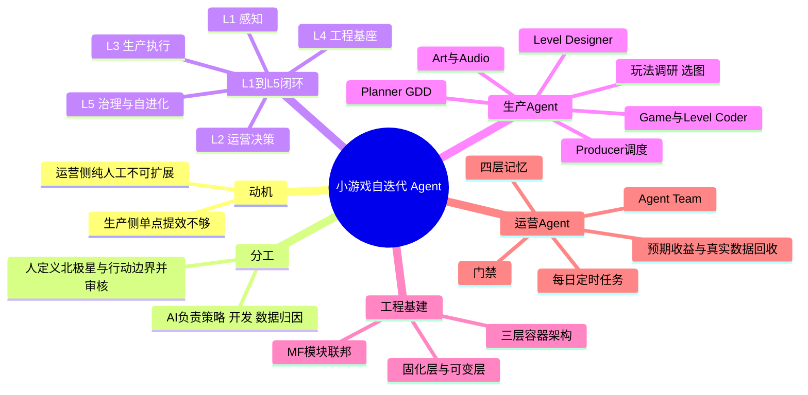
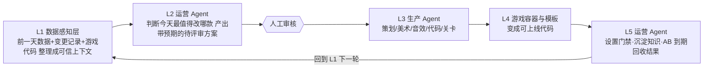
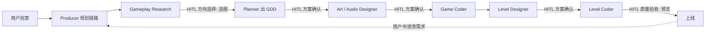
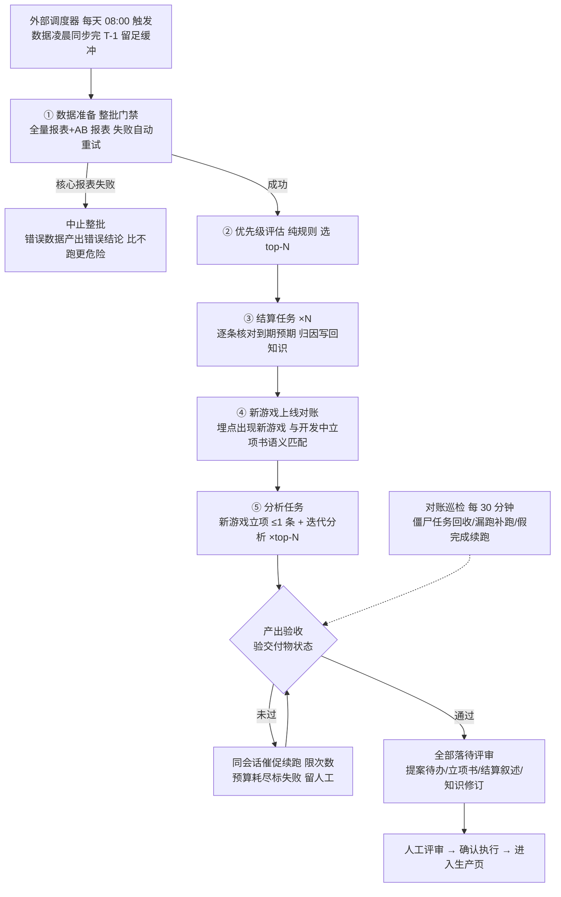

# AI 自迭代的小游戏 Agent

> [!note] 阅读约定
> 无标记 = 原文内容；`[推断]` = 从原文推出但原文未明说；`⚠️[原文疑点]` = 原文自相矛盾/不一致，如实保留；`⚠️[图中无法辨认]` = 图中文字看不清。标注"（图）"的内容来自配图而非正文。本文没有 `[扩展]` 内容，故无「扩展阅读」章节。

## 1. TL;DR

- 痛点：AI Coding / 生图 / 关卡生成等**单点提效**没有带动整体业务提速，上线一款新小游戏仍需 2～3 周；运营侧则有经验难复用、分析不精细、结论缺验证、归因缺统一上下文四个问题。
- 方案：一套覆盖选型→策划→美术→音频→开发→关卡→发布→AB 实验→归因→再迭代的**自迭代 Agent**；人只保留两项职责：**定义北极星指标与行动边界、审核关键方案**。
- 架构：判断与执行拆开——**生产 Agent**（Producer 统一调度，LangGraph 编排 + Claude Agent SDK 远程容器写代码）与**运营 Agent**（Agent Team 对抗归因 + 每日定时任务 + 可证伪"下注" + 四层记忆）。
- 结果：2 周上线 6 款小游戏（最快 2 天走完含测试验收的全流程）；12 款游戏迭代从方案到上线 3 天，95%+ 迭代正向、40%+ 全指标正向。
- 局限：系统受游戏模式和关卡类型限制，优化主要以小游戏主体为主；下一步扩展到抽奖、社交裂变、组队 PK 等更广义互动玩法。

## 2. 核心概念

| 概念 | 一句话定义 | 解决的痛点 |
|---|---|---|
| **自迭代 Agent** | 让游戏从创意到上线，并在真实数据反馈下持续迭代的全链路系统 | 每个环节都变快，完整流程却没同比提速 |
| **北极星指标 / 行动边界** | 由人定义的目标与约束；评审以北极星指标作为唯一准则 | 防止 AI 自行漂移，保留人的控制权 |
| **Producer（制作人）** | 生产侧调度中枢，只做理解需求、规划链路、调度 Agent，不直接生产内容 | 多环节上下文传递与中途改需求的影响范围判断 |
| **GDD** | 策划 Agent 产出的游戏设计文档，每句话都要能被下游 Agent 直接消费 | 下游 Agent 重复获取信息或依赖人工搬运 |
| **关卡工厂** | Level Designer 不逐关设计，而是定义数据结构、生成算法、验证策略、难度曲线；每关 = 算法 + 参数 + Seed 的确定性产物 | 关卡不可溯源、不可改造、不可验收 |
| **固化层 / 可变层（壳应用）** | 容器内预置的壳应用：固化通用框架与接口，Coder 只填游戏特有逻辑 | Coder 从零搭工程、服务端能力重复开发 |
| **MF（模块联邦）场景化** | 一个宿主（game-center）+ N 个纯玩法远程模块 | 每个游戏一个 H5 页面，业务逻辑重复度 95% |
| **Agent Team** | "主持人 + 专家团"对抗模式：专家独立看数、互相论证、主持人收敛 | 单 Agent 易把方案做简单、归因到无法行动的客观因素 |
| **门禁** | 强制检查点（整批验收 / 真实状态验收 / 巡检 / 统一交付标准） | 无人值守时错误结果进入待评审队列和知识库 |
| **可证伪的"下注"** | 每个策略必须写明预测区间、引用的知识、什么结果会证伪当前判断 | 报告论证完整，但上线后未必有正向收益 |

### 易混概念对比

| | 生产 Agent | 运营 Agent |
|---|---|---|
| 职责 | 接收**已确认**的方案，完成策划、美术、音效、代码、关卡生产 | 读业务报表 / AB 实验 / 变更记录 / 历史记忆，负责归因、优先级判断、决定改什么 |
| 依赖 | 多环节**上下文传递** | **持续归因** |
| 沉淀 | 游戏架构、资产规范、开发经验 | 业务指标、实验结果、决策依据 |

| | 纯 Workflow | 纯自主 Agent | 本方案（LangGraph + Claude Agent SDK） |
|---|---|---|---|
| 特点 | 每步固定、灵活性差 | 全靠模型决策、不可控、token 消耗大 | 主干确定，节点内自主推理 |

| | 经典视图 | 画布视图 |
|---|---|---|
| 交互范式 | 对话 + 产物面板（Copilot） | 节点 + 连线（Workflow） |
| 信息组织 | 线性编排，聚焦单一环节 | 空间并列，展示全局拓扑 |
| 场景 | 首次生产、单环节审阅 | 全局审查、迭代修改、精细调整 |

## 3. 知识框架

### L1–L5 迭代闭环

### 生产链路与 Human-in-the-loop

> [!note] 图说明
> 链路顺序取自原文"Gameplay Research → Planner → Art Designer → Game Coder → Level Designer → Level Coder"；HITL 位置取自原文三类暂停节点（方向选择 / 方案确认 / 质量验收）。图中各节点与具体 HITL 的一一对应是对原文的 `[推断]` 式落位，原文只说"策划/关卡/美术产出后 Review"。

### 每日定时任务（图）

## 4. 关键要点

### 1. 为什么不是单链路 Workflow

- 生产侧：即使单点效率提升，上线一款新小游戏仍需 2～3 周，因为每个环节要人工反复确认；从创意到原型最快也要 6 天；各环节 AI 工具零散割裂（"能力孤岛"）。
- 运营侧四个问题：经验难以复用 / 分析不够精细（10+ 款游戏 × 场域、游戏、关卡三级数据 × 每日更新）/ 结论缺少验证 / 归因缺乏统一上下文（数据、代码、关卡配置、变更历史分散）。
- 结论：生产 Agent 依赖多环节上下文传递，运营 Agent 依赖持续归因。

### 2. 两个闭环

**生产闭环 = 解决上下文流转**
- 玩法调研、策划方案、资产清单、关卡数据结构进入多 Agent 的**全局状态**，下游直接读取。
- 用户中途改需求时，由 Producer 统一判断影响范围，逐级路由到需要重做的下游环节。

**迭代闭环 = 处理数据驱动决策**（七步）

| 步骤 | 动作 |
|---|---|
| 感知状态 | 读三级报表、AB 实验快照、变更记录、版本时间线 |
| 理解目标 | 对齐北极星指标与行动边界 |
| 拆解决策 | 判断每日迭代优先级 |
| 调用能力 | 按任务召唤专家角色，强制加载任务手册和既有知识 |
| 产出方案 | 迭代提案或新游戏立项书 |
| 读取反馈 | 读 AB 回流数据，到期后对照预期收益结算 |
| 沉淀经验 | 归因结论写入知识库与记忆 |

### 3. L1–L5 分层（图中层名）

| 层 | 图中层名 | 职责（正文） |
|---|---|---|
| L1 | 感知层 | 把前一天的数据、变更记录、游戏代码整理成可信上下文 |
| L2 | 运营决策层 | 运营 Agent 判断当天最值得改哪款，产出带预期的待评审方案 |
| L3 | 生产执行层 | 生产 Agent 接方案做生产 |
| L4 | 工程基座层 | 游戏容器与模板，把方案变成可上线代码 |
| L5 | 治理与自进化层 | 运营 Agent 设置门禁、沉淀知识、AB 到期回收结果 |

- 图底栏三句话（图）：判断与执行分离 / 硬约束进代码，不靠提示词 / 交付的不是结论，是可证伪的下注。
- 原文刻意**没有做包揽一切的"超级 Agent"**，而是判断与执行拆开；两个 Agent 职责隔离但可互相查阅上下文。

### 4. 生产 Agent：Producer 调度

- 技术栈：**LangGraph** 负责全局流程编排与多 Agent 协调；**Claude Agent SDK（tarot-code-agent）** 负责在远程容器中执行真实代码生成。
- Producer 协调 6 个专业 Agent，链路为 Gameplay Research → Planner → Art Designer → Game Coder → Level Designer → Level Coder。⚠️[原文疑点] 音频 Agent 在文中单独出现（Art & Audio Designer），却不在这条 6 节点链里；另见校对报告中关于图内"7 个 Agent"的疑点。
- Producer 五项能力（图）：任务规划 / 会话记忆 / 状态管理 / 意图识别（区分推进流程、修改方案、提问咨询）/ Agent 编排（生成精准工作指令而非泛泛描述）。
- 例："新增一种敌机" → 策划 Agent 更新资产清单 → 资产 Agent 生成美术资产 → 开发 Agent 执行代码开发；玩法调研和音频在图中标注"本次不涉及"。

| 设计决策 | 说明 |
|---|---|
| Producer 统一规划 | 所有路由决策由 Producer 通过 **Structured Output** 统一做出，避免判断散落在各条边逻辑里 |
| 设计 → 审核 → 确认 | 设计类 Agent 产出后交付给人审核 |
| 上下文自动串联 | 策划方案、资产清单、关卡数据结构等进入全局状态，下游直接使用 |
| Human-in-the-loop | 选图、方案确认、资产审核等关键节点用户可参与决策 |

### 5. 各子 Agent 的针对性设计

| Agent | 做什么 | 关键设计 |
|---|---|---|
| **Gameplay Research** | 从模糊创意到调研报告 | **先搜索、后选图**：并发搜图 → 用户选截图 → 多模态分析提炼玩法规则 → 规则作搜索关键词定位详细攻略；同时筛 2–3 张最适合作美术参考的图贯穿后续生图；用户不用文字精确描述玩法 |
| **Planner** | 调研结果 → GDD | **信息密度最大化**：一段描述若不能映射到具体开发动作就不写；实体定义/操作规则给 Coder，图片资产清单给 Art Designer，程序资产清单给 Coder，视觉风格约束全局美术；资产分两类（程序资产 vs 素材资产）；先定美术风格（如扁平卡通/像素复古/3D 写实）避免风格不统一后期返工 |
| **Art Designer** | 生图 | 生产线式 Workflow（见下节） |
| **Audio Designer** | 生音频 | **ReAct 模式**：LLM 分析 GDD 后自主规划音效清单，Tool Use 调用可灵 AI；按 BGM / 交互音效 / 状态音效 / UI 音效分类输出，Game Coder 按场景引用 |
| **Level Designer** | 设计关卡工厂 | 方案严格限定 5 章：gameType、数据结构、生产方式、验证方式、难度曲线；优先基于 Game Coder 已实现的 TypeScript 接口设计，方案产出即可落地 |
| **Game Coder / Level Coder** | 远程容器编码 | 唯一需要真实开发环境的 Agent：读写文件、装依赖、启动开发服务器 |

> [!tip] 技巧
> 设计类 Agent 直接调 LLM API（响应快、成本低）；Coder 类通过 Claude Agent SDK 在隔离容器执行（完整文件系统与工具链）。设计产物经全局状态自动流入 Coder 的系统提示词，无需额外"交接"环节。

### 6. 美术资产：让生成结果稳定进工程

> [!important] 重点
> 美术资产最难的不是"能不能生成图片"，而是生成结果能否**稳定进入工程**。

**风格一致性三类参考图**
1. **Base**：调研阶段推荐的风格参考图
2. **Style**：首张生成素材作锚点，后续资产以其为参考
3. **Entity**：有多种状态/关系的对象，用标准态作参考

**流水线**：GDD 解析提取需求清单 → 依赖分析定生成顺序 → 分组并发 + 风格锚点 → 每张图 Gemini 生图 + 抠图 → 合成页面框架图 → 多模态分析布局，输出结构化描述给 Game Coder（让 Coder 读到布局意图而不是靠零散图片猜位置）。

**四种执行模式**（由 LLM 做意图分类）：首次全量生成 / 用户指定局部重生 / 续生失败资产 / 回答美术咨询；局部修改不必从头生成。

**流程三段**：资产规划（决策环节，LLM 先列完整资产含朝向图、拆分图——先规划再生图）→ 执行生图 → **资产矫正**（用工程能力处理 AI 生图无法精准对齐：找切割线 → 裁出主体包围盒 → 居中拼回；图）。

### 7. 关卡：设计工厂而非关卡

核心：让每一关都是**确定性产物**（算法 + 参数 + Seed），AI 看得懂、改得动、改完可验证。

**关卡生成模式的选择依据两个判断**：生成后是否必然有解？生成 & 可解性判定是否耗时？

| 模式 | 难度定义 | 适用 |
|---|---|---|
| **A · 难度因子配置** | 代码内置难度梯度，按进度派生所有难度因子；运行时根据 `Rng(seed)` 现场生成关卡内容 | 飞机大战等轮次闯关类；水果忍者 / 贪吃蛇等操作型闯关类 |
| **B · 内置预制关卡** | 关卡生成器**离线**用 `Rng(seed)` 生成候选关卡，经可通过性校验，不合格重试，再按评分择优；运行时只消费静态数据，生成链路由构建配置隔离，不进入线上 MF 包 | 忍者跳跃 / 疯狂喷气机等地图跑酷类；数织 / 倒水等推理求解类 |

- 两种模式共同遵守一条 **MF 契约**：宿主默认只下发"当前关卡数 & 总关卡数"，游戏依据通关进度在本地动态生成关卡，或直接使用内置关卡。
- 确定性生成带来三项迭代能力：**可溯源**（任意一天任意一关可还原，Seed + 难度因子精确复现）/ **可改造**（LLM 分析层拿到真实生成代码而非仅配置值，提案可明确到参数及目标值；执行层改源码后可通过蓝图可视化和 Seed 逐关 diff 回归）/ **可验收**（蓝图与运行时复用同一条生成链路，蓝图所见即玩家所玩）。
- 关卡生产方式与验证（图）：算法生成（验证：BFS/DFS 可解路径、数学公式证明有解）/ LLM 生成（词库、题库、对话；验证：LLM 判断合理性）/ 文生图生成（找不同、找茬；验证：行为模拟玩家 N 次统计通关率，超时/死局重新生成）。
- 全自动"生成 → 验证 → 重试"闭环由 Level Coder 实现：验证失败自动重试（最多 N 次），仍失败则降级参数重生（图）。
- 难度曲线 30 关（图）：Tier 1（1–8 关）新手引导、参数宽松；Tier 2（9–16）正常难度；Tier 3（17–24）进阶挑战、参数收紧；Tier 4（25–30）高难精英、极限参数。

### 8. 工程基建：三层容器 + 固化/可变

| 层级 | 职责 |
|---|---|
| 调度层 | LangGraph 多 Agent 编排、设计产物管理、上下文组装、通过 **Socket.IO** 向容器发送编码指令 |
| 容器服务层 | 部署在每个容器内，CodeAgentSDK 将网络事件翻译为 Agent 方法调用，同时管理依赖安装、开发服务器、Git 操作 |
| AI Agent 层 | 封装 Claude Code SDK，在真实工作区中执行文件读写、代码搜索、命令运行，像人类开发者一样工作 |

⚠️[原文疑点] 同一文中 SDK 名称混用：正文称 "Claude Agent SDK"，此表称 "Claude Code SDK"；图中另有"CodeAgentSDK（替代 Claude Code SDK）"。

- 每个 Coder 节点对接一个独立远程容器，容器内预装壳应用代码。
- 容器就绪 → 上下文注入 → 远程执行 → 流式回传（图）：Socket → SSE → 前端；UUID 去重避免重复消息；Level Coder 连接类错误自动重连一次，超时上限 100 分钟；容器 DevStudio 端口 5566（图，小字）。
- Game Coder 注入内容（图）：GDD + 美术/音效资产清单 + 页面框架图分析；Level Coder：GDD 概览 + 关卡方案 + gameType 注册指引。
- 两个好处：① Coder 不用从零搭工程，只往固化框架里填逻辑，大幅缩短编码时间；② 服务端能力（关卡查询/推进、道具管理、广告打通）完全复用。

| 壳应用 | 固化层 | 可变层 |
|---|---|---|
| **小游戏壳** | Phaser + React 脚手架、Controller 分层（业务/游戏/音频）、通用 UI 框架（Loading/导航栏/功能面板）、状态管理、通用接口（关卡查询推进、道具 CRUD）、资源加载链路和事件总线 | 游戏对象和管理器、主场景逻辑、具体 UI 内容与交互、关卡配置数据、道具效果、资源定义 |
| **关卡生成壳** | Period → Day → Level 三级周期配置、通用服务接口（关卡/道具/广告链路）、前端路由框架和 gameType 注册机制、Schema 驱动的配置体系、构建发布流程 | 具体游戏的关卡生成算法、验证逻辑、可视化页面、关卡 JSON 结构、参数曲线 |

### 9. MF 场景化与宿主-游戏通信协议

| 场景 | 传统模式（一个 H5 页面一个游戏） | MF 模块联邦 |
|---|---|---|
| 业务逻辑 & 应用外壳 | 每个游戏重复实现一套外壳 | 收敛到宿主一份，全局复用 |
| 新增游戏 | 新建工程 + 造应用外壳 + 页面发布；业务逻辑重复度 95% | asset 应用类型：MF 构建 + remoteEntry 入口；模板只含游戏逻辑；只新增 remoteEntry 入口配置，宿主零代码改动 |
| 更新某游戏 | 页面整体重新构建、发版、审核 | 独立构建部署到 CDN，宿主无感 |
| 更新业务逻辑 | 每个游戏页都要开发、测试 & 发布 | 仅更新宿主业务代码 |
| 打开体验 | 页面级，切换游戏需要页面 | 场景内直接打开，无明显加载感 |

| 通道 | 方向 | 内容 |
|---|---|---|
| **queryGameConfig** | 游戏问、宿主答 | 一个**通用异步函数**承载所有数据请求；宿主自由决定数据来源，游戏只负责消费 |
| **生命周期回调** | 游戏 → 宿主，单向通知 | `onReady`（引擎就绪）/ `onGameStart`（一局开始）/ `onGameEnd`（一局结束，含 `success` 通关字段和业务数据）/ `onError`（异常报错或用户关闭返回）；原文标注为"部分生命周期事件" |
| **app:event** | 游戏 → 宿主 | 游戏侧 `emit('app:event', name, payload)`；宿主侧 `onEvent(name, payload)` 接收 |
| **host:event** | 宿主 → 游戏 | 宿主侧 `ref.sendHostEvent(name, payload)`；游戏侧 `on('host:event', handler)` 监听 |

> [!important] 重点
> 协议不为每种数据/事件单独设计接口，而是固定"一个查询通道 + 上行/下行两条事件通道"，保证规范性和可扩展性。

### 10. 运营 Agent：Agent Team（主持人 + 专家团）

原因：运营分析没有标准答案；单 Agent 容易方案过简、归因到无法行动的客观因素、给出缺证据无法落地的结论。

| 角色 | 职责 | 关注目标 |
|---|---|---|
| 主持人 | 启动 & 管理专家团、收敛结论、与用户对话 | 推进分析流程 |
| 数据分析师 | 分析数据 + 迭代日志 + 业务背景；定位异常并归因，提可执行提案 | 迭代目标：UV 提升 / 次留提升 |
| 开发工程师 | 读策划方案、真实代码 & 关卡配置；决策可行性，接受 / 修正 / 驳回 | 可落地、风险可控、开发成本合理 |
| 游戏设计师 | 结合 BI 分析结论提出 1–3 个游戏候选；和 BI 结对产出终选游戏的提案书 | 玩法差异化、双赢设计 |
| 评审 | 独立看数；质询与驳回，以北极星指标作为唯一准则 | 有效性、准确性、目标对齐 |

- 机制：每个专家**先独立看数**形成自己的上下文和证据链，避免过早锚定；不同任务有各自系统 Prompt（步骤、门禁、已知死路），**开工时强制注入**；专家围绕具体方案互相论证，分歧在对话中解决，最后由主持人收敛，不把未处理的争论抛给用户。
- 三阶段（图）：① 无交流、各自看数（BI 跑一遍看数+分析+建议；开发读代码理解已有逻辑；评审独立看数，先出死路清单与口径审计）→ ② 讨论交流（BI × 开发对着代码与数据讨论，分歧不许上报主持人，必须自己讨论出联合结论；交评审对抗质询，对照北极星逐条反驳）→ ③ 循环迭代（默认多轮；按质询结果补证据/修方案，被说服就明确认输，不许硬撑）→ 最终产出待人工评审的提案，点击确认可跳转对应游戏开发。
- 两类产出：**现有游戏迭代提案** 与 **新游戏立项**。
  - 迭代提案（图）：现状取数（漏斗/人均局数/次留）→ 关卡级定位 → 读真实配置 → 读真实代码（"不能跳"）→ BI × 开发联合结论 → 提案文档三段式（数据现状 / 归因分析 / 提案清单，条目回链到"改哪个模块、怎么改、目标值多少"）→ 预注册预期。提案条目三方向（图）：关卡数值调整 / 关卡配置调整 / 玩法 & 道具调整。⚠️[图中无法辨认] 三方向的具体子条目文字过小。
  - 新游戏立项（图）：门禁（先锁定北极星方向并先读"已知死路清单"）→ ① 并行深潜（数据分析师出立项约束清单；评审出死路清单 + 口径审计）→ 门禁（两份报告齐了才允许开始想游戏）→ ② 设计对抗（设计师出 2–3 候选，数据分析师主动挑战设计假设）→ ③ 主持人收敛 → ④ 评审终审质询 → 立项书（游戏名 + 简述 + 数据分析）+ 预注册预期 → 待人工评审。

### 11. 无人值守的四道门禁

> [!warning] 易错
> 无人值守最要避免的不只是明确失败，还有**把错误结果输入待评审队列和知识库**。

1. **数据整批验收**：核心报表构建失败，当天所有任务中止——宁可不跑，也不让错误数据生成结论。
2. **验收真实状态**：会话正常退出 ≠ 任务完成；检查立项书是否新建、提案是否更新、待结算清单是否清空；未通过则同会话催促续跑，预算耗尽后才标失败交人工。
3. **自动巡检**：每半小时一次，回收假死任务、补跑漏掉批次，纠正"看起来完成、实际没有交付物"。
4. **统一交付标准**：自动化只省掉中途等待同意的步骤；查重、读代码、证据要求与交互式流程一致；产物进待评审队列，**评审权仍在人手里**。

### 12. 能力自进化：预期收益 ↔ 真实数据回收

- 前提：系统持续生成方案，**不会因为跑得多就自动变好**。
- 做法：把交付物重新定义为一次可证伪的"下注"——写明**预测区间**、**引用了哪些知识**、**什么结果会证伪当前判断**。
- 回收：到期后逐条对账预期与实际，并追溯本次判断引用的知识；知识有问题则进入后续治理，而不只是把实验标成功/失败。
- 流程（图）：提案/立项时预注册预期 → 人工确认 → 生产页开发并以 AB 实验发布上线 → 游戏版本时间线（版本变更/AB 起止/全量/回滚）→ 到期自动结算（先对"实际交付了什么"，再对照预期取数）→ **分层归因**：假设错 → 修正判断层知识；方法错 → 修正方法层知识；执行错 → 补避坑条目 → 分层知识库（所有修改落待评审）→ 下次分析引用更准的知识。

### 13. 四层记忆系统

| 分层 | 承载内容 | 本系统对应 | 如何消费 |
|---|---|---|---|
| 核心规则 | 稳定、高频、每次必须生效的规则；由人工审核的确定性内容 | 北极星指标、行动边界、诚实纪律、数据口径红线 | 常驻注入 |
| 知识 | 已沉淀的经验与教训；LLM 可检索、自演化 | 已验证规律（按现象/机制/未验证推断分级）、成败经验（含条件、限制、证据、反证）、程序性方法 | 按游戏类型 & 任务需求动态匹配；引用时携带匹配分数 |
| 历史记忆 | 原始事件与证据；LLM 提炼的历史摘要 | 分析轮次、运营动作变更日志、内部改动迭代记录、迭代与 AB 实验时间线 | 原始事件是唯一可直接引用的历史证据；历史摘要作为背景补充 |
| 会话记忆 | 会话中的所有内容 | 会话详情、SDK 转录信息、本轮任务状态 | 中断重连：用于恢复会话的必要消息 |

- 一条记忆正文只留"**结论 + 判断依据**"，不存一次性细节和易过期的时效数值。
- 治理元数据：作用域（单游戏/跨游戏）/ 来源证据（哪次结算、哪个会话）/ 证据等级（现象、机制、未验证推断；低等级禁用"显著""必然"等强断言）/ 置信度与状态（候选、生效、已失效）/ 版本链（可回溯到生成时的系统状态）。
- 读写原则（图）："写进严，读出宽"——任务手册强制拼装（按任务把必读条目原文直接注入）+ 按需检索兜底（目录 → 定位 → 全文）；写入走 pending 暂存区（git staging 思路，增/改/删一律打待评审标记），人工评审通过 = 转正，驳回 = 反向恢复。⚠️[原文疑点] 图中记忆存储画了 5 类（领域知识库 / 迭代&AB 实验时间线记忆 / 变更记忆 / 会话记忆 / 经验卡），与正文"四层记忆"的分法不完全对应。

### 14. 架构层面：Workflow 与自主推理的融合

- **LangGraph 管骨架**：主干确定（调研→策划→美术→编码→关卡→关卡编码），阶段间流转、审核、暂停恢复由结构硬性保证，不依赖模型判断——模型偶尔"跑偏"，整体流程也不失控。
- **节点内自主推理**：Planner 自主决定 GDD 章节深度和侧重点；Art Designer 自主分析依赖和生成顺序；Level Designer 自主判断是否提问；流程不干涉节点内部推理。
- **HITL 时机精心设计**：只在三类节点暂停（方向选择 / 方案确认 / 质量验收），其余全自动——既保证用户掌控权，又避免过度打断。

### 方法对比表

| 方法 | 适用场景 | 解决的问题 | 局限 |
|---|---|---|---|
| 单链路 Workflow | 流程固定、无需多环节上下文 | — | 原文判定本场景不适用：生产要多环节上下文传递，运营要持续归因 |
| 纯自主 Agent | — | 灵活 | 全靠模型决策、不可控、token 消耗大 |
| LangGraph 骨架 + SDK 节点内自主 | 本场景（生产链路） | 流程可控 + 局部灵活 | 受游戏模式和关卡类型限制（原文总结） |
| 关卡模式 A（难度因子 + 运行时生成） | 必然有解、毫秒级生成的游戏 | 无需预生成，运行时现场生成 | 原文未写局限 |
| 关卡模式 B（离线预制关卡） | 可能无解、生成/判定耗时的游戏 | 离线校验可通过性并择优，运行时只吃静态数据 | 生成链路不进线上包，需构建配置隔离 |
| 单 Agent 运营分析 | — | 简单 | 方案过简、归因到不可行动因素、缺证据 |
| Agent Team 对抗模式 | 运营分析 / 新游戏立项 | 独立证据链、互相论证、避免过早锚定 | 原文未写局限 |
| 传统 H5 一游戏一页面 | — | — | 外壳重复实现、更新需整页重发版审核 |
| MF 模块联邦 | 本场景（多游戏接入） | 外壳一份复用、独立 CDN 部署、宿主零改动 | 原文未写局限 |

## 5. 数据速查表

| 指标 | 数值 | 出处 |
|---|---|---|
| 上线新小游戏（改造前） | 2～3 周 | 正文 §02 |
| 创意到原型（改造前） | 最快 6 天 | 正文 §02 |
| 6 款小游戏上线周期 | 两周（从 7 月起） | 正文 §04 |
| 最快一款：平台内全流程 | 约 1 小时 | 正文 §04 |
| 最快一款：含测试验收上线 | 2 天 | 正文 §04 |
| 8 月底后迭代量 | 20+ 次迭代 + 1 款新游戏 | 正文 §05 |
| 首周线上全面迭代 | 12 款，方案产出到开发上线 3 天 | 正文 §05 |
| 迭代正向率 | 95%+ 正向；40%+ 全指标正向 | 正文 §05 |
| 传统模式业务逻辑重复度 | 95% | 正文 MF 对比表 |
| 巡检频率 | 每半小时 | 正文 §05 |
| 每日任务触发 | 08:00 | 图 |
| 音效 Tool Use 循环 | 最多 15 轮 | 图 |
| Level Coder 超时上限 | 100 分钟 | 图 |
| 玩法调研搜图 | 合并去重取前 20 张；筛 2–3 张作美术参考 | 图 + 正文 |
| 关卡难度曲线 | 30 关 / 4 个 Tier | 图 |
| 总览图（2026 年 8 月）上新 | 单月上新 5 种游戏类型、9 款新游戏 | 图 |
| 总览图 迭代 | 单月迭代 12 款线上游戏、完成 20+ 次迭代 | 图 |
| 总览图 对端效果 | 次日主动打开 +2.5% / 停留时长 +23.5% / 订单 +1.3% / GMV +3% | 图 |
| 总览图 迭代效果 | 停留时长 +15.3% / 人均局数 +6.4% / 通关率 +1.7% / 全通率 +1.1% | 图 |

> [!warning] 易错
> ⚠️[原文疑点] 总览图写"2026 年 8 月单月上新 9 款新游戏"，而正文是"7 月起两周上线 6 款"和"8 月底后 1 款新游戏"，口径（时间窗/是否含内部试验）原文未说明，勿混用。总览图中各效果数值为小字，已按图读出，建议对照原图复核。

## 6. 踩坑与教训

- 单点提效 ≠ 整体提速：每个环节变快，端到端流程没同比提速。
- 运营分析：单 Agent 易把方案做简单、归因到无法行动的客观因素、给出缺证据结论 → 用 Agent Team。
- 分析报告论证完整 ≠ 上线后有正向收益 → 交付物改为可证伪的"下注"，到期对账。
- 美术：难点不是"能不能生成图片"，而是能否稳定进工程；AI 生图无法精准对齐，需用代码做切线/裁剪/居中矫正。
- 无人值守：会话正常退出 ≠ 任务完成；错误数据宁可整批中止；错误结果进入知识库比失败更危险。
- 专家过早锚定会污染分析 → 先各自独立看数，再讨论。
- 低证据等级的记忆禁用"显著""必然"等强断言；记忆正文不存一次性细节和易过期数值。
- 当前局限：受游戏模式和关卡类型限制，优化主要以小游戏主体为主。

### 可迁移的设计原则

1. **判断与执行拆开**：生产与运营分别做 Agent，职责隔离、上下文可互查（原文明确）。
2. **流程骨架硬编码，节点内放权给模型**：流转/审核/暂停恢复不依赖模型判断（原文明确）。
3. **产出必须能被下游直接消费**：写不进具体开发动作的描述就不写（原文 GDD 原则）；`[推断]` 可推广为任何多 Agent 交接的 schema 约束。
4. **让产物"确定性"以便迭代**：关卡 = 算法 + 参数 + Seed，使可溯源/可改造/可验收成立；`[推断]` 可迁移到任何需要 AI 反复改动并回归验证的内容生产。
5. **固化通用、开放差异**：壳应用 + 固化层/可变层 + MF 宿主，让 Agent 只写差异化逻辑。
6. **交付物要可证伪并回收对账**：预测区间 + 引用知识 + 证伪条件，知识自身也被追责。
7. **自动化只省"等待同意"，不省"证据要求"**：查重、读代码、证据标准与人工流程一致；评审权留给人。
8. **硬约束进代码，不靠提示词**（图底栏）：门禁、整批验收、状态验收都是机制而非 Prompt 请求。

## 7. 记忆锚点

1. **"两个人、两个 Agent"**：人只管两件事——定北极星/行动边界、审关键方案；AI 分生产与运营，判断与执行分开。
2. **"下注 → 对账 → 改知识"**：每个方案是一张可证伪的注单；到期按"假设错 / 方法错 / 执行错"分层归因，再改知识库。

## 8. 复习卡片

自迭代 Agent 中人保留哪两项职责？::定义北极星指标与行动边界；审核关键方案
为什么不做一个"超级 Agent"？::把判断（运营 Agent）与执行（生产 Agent）拆开，职责清晰，隔离但可互查上下文
LangGraph 与 Claude Agent SDK 各负责什么？::LangGraph 负责全局流程编排与多 Agent 协调；Claude Agent SDK 在远程容器中执行真实代码生成
玩法调研为什么"先搜索、后选图"？::让用户从真实截图中"指"出兴趣而非文字精确描述；选中图再经多模态分析提取玩法规则，并筛 2–3 张作美术参考
美术风格一致性的三类参考图？::Base（调研推荐风格图）、Style（首张生成素材作锚点）、Entity（多状态对象用标准态）
关卡模式 A 与 B 的选择依据？::生成后是否必然有解；生成 & 可解性判定是否耗时。A 运行时现场生成，B 离线预制并校验
确定性关卡带来哪三项能力？::可溯源、可改造、可验收
MF 与传统模式的核心区别？::传统每游戏一个页面且业务逻辑重复度 95%；MF 是一个宿主 + N 个纯玩法远程模块，新增游戏只加 remoteEntry 配置
宿主-游戏通信协议的通道？::queryGameConfig（通用查询）、生命周期回调（onReady/onGameStart/onGameEnd/onError）、app:event（游戏→宿主）、host:event（宿主→游戏）
无人值守的四道门禁？::数据整批验收、验收真实状态、自动巡检（每半小时）、统一交付标准
## 9. 知识关联

> [!tip] 候选双链（请自行决定哪些指向已有笔记）
> [[LangGraph]] · [[Claude Agent SDK]] · [[Multi-Agent 编排]] · [[Human-in-the-loop]] · [[Structured Output]] · [[ReAct 与 Tool Use]] · [[Agent 记忆系统]] · [[Agent 门禁与验收]] · [[AB 实验与归因]] · [[Module Federation]] · [[程序化内容生成 PCG]] · [[GDD 游戏设计文档]]

## 10. 原文参考资料

- 原文提及 LangGraph、Claude Agent SDK、Module Federation (MF) 等技术组件，未单独列出外部参考文献。

> [!note]- 校对报告
> **1. 覆盖度**
> - 已覆盖：摘要、引言、§02 动机、§03 全链路架构（L1–L5）、§04 生产 Agent（Producer、调研、Planner、美术/音频、关卡、Coder、MF、视图、优势）、§05 运营（规模化验证、Agent Team、每日任务、门禁、自进化、记忆）、§06 总结与展望。
> - 未写入或仅概括：各"小游戏截图/平台界面"表格（忍者跳跃、盖楼、飞机大战、贪吃蛇、打地鼠、祖玛、水果忍者、流沙方块、趣味数独、一箭又一箭的截图）仅作为游戏名与结论提及，截图内文字未逐字转录；团队介绍与拓展阅读未收录；L1–L5 架构图内小字（各层子模块）未逐项转录。
>
> **2. 一致性抽查（5 项）**
> 1. 6 款 / 两周 / 7 月起 —— 与正文 §04 一致
> 2. 最快 1 小时（平台内）、2 天（含测试验收上线）—— 一致
> 3. 12 款迭代 3 天；95%+ 正向、40%+ 全指标正向 —— 一致
> 4. 业务逻辑重复度 95% —— 一致
> 5. 现状 2～3 周、创意到原型最快 6 天 —— 一致
>
> **3. [推断] 与 ⚠️ 汇总**
> - `[推断]`：生产链路 mermaid 图中 HITL 与具体节点的落位（原文仅说策划/关卡/美术产出后 Review）；可迁移原则 3、4 的"可推广"部分；年份 2026 取自发布日期（原文正文只写"今年 1 月""从 7 月起""8 月底"）。
> - ⚠️[原文疑点]：① 总览图"9 款新游戏 / 5 种类型 / 单月"与正文"6 款（两周）/ 8 月底 1 款"口径不一致；② Producer"协调 6 个专业 Agent"的链路不含音频 Agent；③ 架构图小字疑为"1 位制作人 + 7 个 Agent / 运营 1 位主持 + 5 位专家"，与正文 6 个 Agent、Agent Team 表中 1 主持 + 4 专家不一致（图中小字，读数不确定，⚠️[图中无法辨认]）；④ Claude Agent SDK / Claude Code SDK / CodeAgentSDK 命名混用；⑤ 记忆图 5 类存储与正文四层记忆的划分不一致；⑥ 玩法调研表中"麻将消消乐"一行的截图标题与内容为"贪吃蛇大作战"；水果忍者、流沙方块、麻将消消乐、趣味数独、一箭又一箭均不在"6 款已上线"名单内，其与上线批次的关系原文未说明。
> - ⚠️[图中无法辨认]：迭代提案图中三方向子条目文字；总览图各数值与端口 5566 等小字已尽力读出，建议复核。
> - 日期：取自文章发布时间 2026-09-22。
