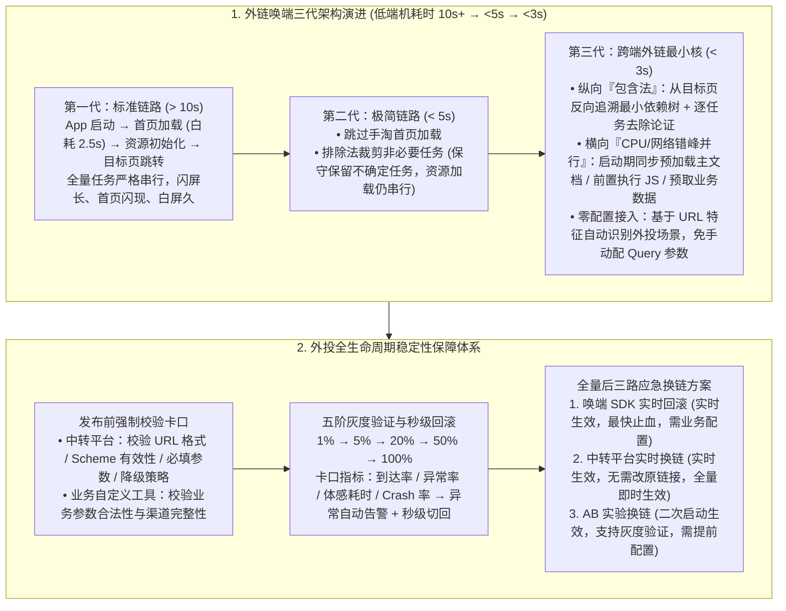

# 从全量启动到最小核：手淘外链唤端链路的三次架构演进

## 1. TL;DR

1. **外链唤端（DeepLink）核心痛点与两代瓶颈突破**：在外投广告与短视频种草唤起手淘 App 场景中，传统全量冷启动在低端机上总耗时高达 **10 秒以上**（其中仅加载用户根本不看的“手淘首页”就白白耗费 **2.5 秒**），造成高昂买量在“最后一公里”大量流失；团队历经**标准链路（`> 10s`）$\rightarrow$ 极简链路（`< 5s`）$\rightarrow$ 跨端外链最小核（`< 3s`）**三代架构演进，将低端设备唤端体感耗时大幅压缩 **70% 以上（从 10 秒压至 3 秒以内）**。
2. **纵向裁剪：从“排除法”到“包含法（反向依赖树）”**：极简链路采用保守的“排除法”（仅剔除明确无关任务），而**最小核架构**改用彻底的**“包含法”**——从零开始，以目标页面渲染为起点**反向追溯最小依赖树**（如 `页面渲染 → 容器环境 → 网络库就绪 → 安全证书初始化`），对依赖树外任务逐一做去除必要性论证，并通过分阶段灰度排查 SDK 隐式未文档化依赖。
3. **横向并行：CPU 启动任务与网络 I/O 资源预加载并行化 + URL 特征无感接入**：打破以往“等 App 启动完才开始加载落地页资源”的串行等待，利用启动期 CPU 密集而网络带宽空闲的错峰特性，在识别 DeepLink 意图后**同步并行发起落地页主文档请求、JS 代码前置执行与业务数据预请求**；同时基于 **URL 特征自动识别外投场景启用最小核**，免去业务方手动配置 URL Query 参数的高昂成本。
4. **外投不可撤回约束下的全生命周期稳定性防线**：针对外投链接一旦发出即无法直接修改的严苛约束，构建**发布前双层强校验**（中转平台通用规则 + 业务自定义工具校验）、**五阶卡口灰度放量**（`1% → 5% → 20% → 50% → 100%`，监控到达率/异常率/体感耗时/Crash 率，支持**秒级/分钟级实时回滚**）以及**全量后三路应急换链体系**（唤端 SDK 实时回滚、中转平台实时换链、AB 实验二次启动换链）。

## 2. 问题定义与背景

### 2.1 为什么外链唤端（DeepLink）是性能与稳定性的“零容错战场”？

当用户在短视频、社交平台或信息流广告中因冲动点击一条外投链接唤起手淘 App 时，面临四大严苛挑战：
1. **冷启动不可避免且耐心极低**：App 大概率处于未启动状态，若遭遇漫长的闪屏停留、首页闪现又消失及目标页白屏（低端机总耗时 **> 10 秒**），用户会立即滑走返回原平台且几乎不会二次点击。
2. **全量启动上下文与深层目标页天然错配**：手淘标准冷启动围绕“首页”设计，用户明明要去闪购详情页，系统却先花 **2.5 秒**加载一个永远不会被看到的首页。
3. **CPU 与网络资源串行空置**：启动任务消耗 CPU，而目标页面资源拉取消耗网络带宽，标准链路将两者严格串行化，导致启动期间网络 I/O 完全闲置。
4. **外投链接的“不可变性”**：链接一旦挂载到外部广告位与短视频中便无法直接修改或撤回，任何拼写失误、Scheme 错误或容器崩溃都必须依赖中间层与端侧应急机制兜底。

## 3. 知识框架

## 4. 核心内容拆解

### 4.1 三代唤端架构演进对比：从“排除法”到“包含法 + 横向并行”

| 架构代数 | 低端机体感耗时 | 任务裁剪哲学 | 首页与网络加载策略 | 业务接入方式與局限 |
| :--- | :--- | :--- | :--- | :--- |
| **方案一：标准链路** | **`> 10 秒`** | 全量执行所有冷启动任务 | 先花 **`2.5 秒`** 加载手淘首页，启动完才串行拉取目标页资源 | 默认全量链路，体验慢且画面闪现混乱 |
| **方案二：极简链路** | **`< 5 秒`** | **排除法**（从全量中剔除明确无关任务，保守保留大量“不确定”任务） | 直接跳过首页加载，但目标页资源仍需等启动完才串行开始 | 需业务方手动配置 URL Query 参数触发，跨渠道切流规则不一、易出错 |
| **方案三：最小核链路** | **`< 3 秒`** | **包含法**（从零开始，反向追溯目标页最小依赖树 + 逐任务必要性论证） | **CPU 启动任务与网络 I/O 并行**：启动期同步预加载主文档、前置执行 JS、预请求业务数据 | **基于 URL 特征自动识别**外投场景并开启，全渠道零参数免改造接入 |

### 4.2 最小核（Minimal Kernel）的两大核心技术突破

1. **纵向极致裁剪 —— 基于“包含法”的反向依赖树构建**：
   - 摒弃“排除法”面对历史存量任务不敢删的保守困境，以目标页面最终渲染为起点**反向推导最小依赖链路**：
     $$\text{页面渲染} \xrightarrow{\text{依赖}} \text{容器环境} \xrightarrow{\text{依赖}} \text{网络库就绪} \xrightarrow{\text{依赖}} \text{安全证书初始化} \dots$$
   - 对依赖树之外的每一个启动任务进行实证拷问：“*去掉它之后，目标页面能否正常渲染和交互？*”若能则坚决移出最小核；同时针对部分 SDK 内部未文档化的隐式初始化依赖，通过分阶段线上灰度放量逐一验证兜底。
2. **横向错峰并行 —— 填补启动期网络 I/O 空白**：
   - 洞察到启动阶段主要是 **CPU 密集型**（本地类加载与 SDK 初始化），而页面加载主要是 **网络 I/O 密集型**。
   - 最小核在解析到 DeepLink 意图的瞬间，不等容器初始化完毕，立即并行发起**落地页主文档网络请求、JS 脚本前置解析执行、以及核心业务接口数据前置请求**，将原本串联的两段时间窗口完全重叠。

### 4.3 外投稳定性三道防线：发布前校验、五阶灰度与三路应急换链

1. **发布前双层强制校验**：
   - **中转平台统一卡口**：强制校验 URL 格式规范、Scheme 有效性、必填参数完整性及降级策略配置，未通过严禁进入外投流程。
   - **业务自定义校验工具**：允许业务方扩展校验特定活动 ID 或渠道参数合法性。
2. **五阶梯度灰度与四维指标卡口**：
   - 严格按 **`1% → 5% → 20% → 50% → 100%`** 五个梯度放量；每个阶段必须同时满足**到达率、异常率、体感耗时、Crash 率**四大核心指标卡口才准许晋级，任一指标劣化立即触发自动告警并执行**秒级/分钟级实时回滚**。
3. **全量投放后的三路应急换链方案对比**：
   - **唤端 SDK 实时回滚**：**实时生效**，止血速度最快，但需业务前置接入配置；
   - **中转平台实时换链**：**实时生效**，无需修改已投放在外的原始链接即可全量即时切换目标落地页；
   - **AB 实验换链**：**二次启动生效**，优势是支持对新换链接先做灰度验证，需提前埋入实验配置。

## 5. 数据速查表

| 关键指标 / 阶段 | 量化数值 / 梯度配置 | 工程意义与业务价值 |
| :--- | :--- | :--- |
| **低端设备唤端总耗时演进** | **`> 10s`（标准）$\rightarrow$ `< 5s`（极简）$\rightarrow$ `< 3s`（最小核）** | 整体耗时压缩 **70%+**，大幅减少外投买量在“最后一公里”流失 |
| **标准链路无用首页加载耗时** | **`2.5 秒`** | 外链直达深层落地页（如闪购详情），跳过首页立省 2.5 秒与闪现干扰 |
| **分阶段灰度放量梯度** | **`1% → 5% → 20% → 50% → 100%`** | 配合到达率、异常率、体感耗时、Crash 率四维卡口与秒级回滚 |
| **全量后应急换链生效时效** | 唤端 SDK / 中转平台：**实时生效**；AB 实验：**二次启动生效** | 解决外部渠道广告链接不可撤回、不可直接修改的运维难题 |

## 6. 踩坑与教训 / 可迁移的设计原则

1. **存量庞大 App 的启动瘦身，必须从“排除法”升级为“包含法（反向依赖追溯）”**：在拥有数百个启动任务的超级 App 中，用排除法问各个业务团队“这个任务能不能删”，得到的回答永远是“不确定，别删”；只有从目标页面渲染反向构建最小依赖树，用实验证明“不跑它页面依然正常”，才能实现从 5 秒到 3 秒的质变。
2. **性能极致优化的核心是消灭“CPU 忙时网络闲、网络忙时 CPU 闲”的串行空泡**：冷启动早期网络网卡几乎零流量，将 DeepLink 的 HTML 主文档、JS Bundle 与首屏数据请求提前到启动第一个毫秒并行发出，是零成本换取秒级提速的利器。
3. **把性能优化开关从“业务手动传参”下沉为“底层根据 URL 特征自动识别”**：极简链路时期要求各投放业务手动拼接特定 Query 参数才能走快车道，导致大量渠道漏配或配错；在统一容器入口根据 URL 特征自动识别外投流量，才能一劳永逸实现全渠道 100% 覆盖。

## 7. 记忆锚点

- **两个关键痛点数字**：低端机原耗时 **`> 10 秒`**、无用首页加载白耗 **`2.5 秒`**。
- **三代唤端架构跃迁**：标准链路（`>10s` 全量串行）$\rightarrow$ 极简链路（`<5s` 跳首页 + 排除法）$\rightarrow$ **最小核链路（`<3s` 包含法反向依赖树 + 启动与网络预加载并行 + URL 自动识别）**。
- **三路应急换链武器**：唤端 SDK 实时回滚（实时最快止血）+ 中转平台实时换链（实时免改原链）+ AB 实验换链（二次启动生效支持灰度）。

## 8. 复习卡片

1. 为什么手淘外链唤端（DeepLink）在传统标准链路下低端机耗时高达 10 秒以上？最突出的两个资源浪费点是什么？::因为标准链路将应用启动、首页加载、资源初始化与页面跳转完全串行执行；最突出的浪费一是花了 2.5 秒去加载用户根本不会看到的“手淘首页”，二是启动阶段（消耗 CPU）与目标页资源加载（消耗网络带宽）严格串行，导致启动期网络完全空闲。
2. 极简链路（`< 5s`）与跨端外链最小核（`< 3s`）在“启动任务裁剪思路”上有何本质区别？::极简链路采用保守的“排除法”（仅剔除明确无关的任务，保留大量不确定是否需要的任务）；最小核采用彻底的“包含法”，以目标页面渲染为起点反向追溯最小依赖树（渲染→容器→网络库→安全证书），仅纳入必需任务并通过五阶灰度排除隐式依赖风险。
3. 最小核方案是如何解决“横向并行”与“全渠道业务接入成本高”这两个问题的？::在识别到 DeepLink 意图后，于启动阶段同步并行发起落地页主文档请求、JS 代码前置执行与业务数据预请求，填补启动期网络空闲；同时基于 URL 特征自动识别外投场景启用最小核，免去了业务方手动配置 URL Query 参数的成本。
4. 针对外投链接一旦发出便无法直接修改的特点，团队在“发布前”和“灰度阶段”建立了哪些保障机制？::发布前通过“中转平台通用校验（URL格式/Scheme/必填参数/降级策略）+ 业务自定义校验工具”拦截错误；灰度阶段按 `1% → 5% → 20% → 50% → 100%` 五阶放量，严守到达率、异常率、体感耗时、Crash 率四大卡口并支持秒级实时回滚。
5. 当外投链接全量上线后突发故障时，哪三种应急换链方案可以快速止血？它们各自的生效时间与特点是什么？::一是“唤端 SDK 实时回滚”（实时生效，止血最快，需业务配置）；二是“中转平台实时换链”（实时生效，无需修改原外投链接即可全量即时切换）；三是“AB 实验换链”（二次启动生效，支持灰度验证，需提前配置）。

## 9. 知识关联

- **所属主题**：
  - [跨端开发与性能](../../20_topics/跨端开发与性能.md)
  - [异常监控与稳定性](../../20_topics/异常监控与稳定性.md)
- **本地跃迁**：[原始 PDF](RAW.pdf) · [逐页转写文本](MD.md)
- **候选双链**：[[淘宝跨端体验优化AI演进]] · [[淘宝跨端动效解决方案]] · [[AI Skills鸿蒙定位服务迁移]]

## 10. 原文参考资料

1. **内部核心系统与基建**：手机淘宝统一容器、外链中转平台、唤端 SDK、淘宝闪购业务落地页

> [!note]- 校对报告
> - **页码溯源**：p.1–3（外投 DeepLink 买量流失背景、低端机 >10s 耗时、首页加载白耗 2.5s、启动 CPU 与网络加载串行痛点）；p.3–6（方案一标准链路 >10s、方案二极简链路跳过首页+排除法裁剪 <5s、方案三跨端外链最小核包含法反向依赖树追溯+启动期主文档/JS/业务数据并行预加载+URL 特征自动识别免参数配置 <3s）；p.6–9（发布前中转平台+业务自定义双层参数校验、`1%→5%→20%→50%→100%` 五阶灰度与到达率/异常率/体感耗时/Crash 率卡口及秒级回滚、全量后唤端 SDK 实时回滚/中转平台实时换链/AB 实验换链三方案对比表）。
> - **一致性核验**：作者（逸宏，淘天集团-跨端技术团队）、发布时间（2026-04-14）、全部耗时指标（10s、2.5s、5s、3s）、灰度比例与换链方案均与原文逐字核对一致；正文中无任何内联页码引用。
> - **质量边界**：全文脉络清晰，核心架构演进与应急预案完整收录。
