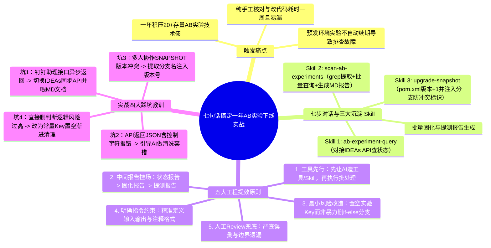
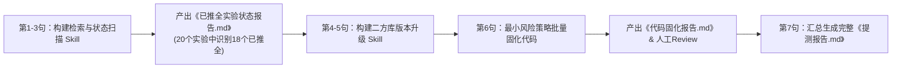

# 【手猫研发提效随笔】七句话搞定一年AB实验下线：CodingAgent的魔法时刻

> [!abstract] 导读
> **一句话总结**：淘天集团天猫 APP 技术团队（作者：依凡）分享了如何利用 CodingAgent 通过“七步对话指令 + 沉淀三个可复用 Skill（实验状态查询、全仓扫描报告、SNAPSHOT 版本升级）+ 最小风险置空策略”，在一天内自动化完成积压一年的 18 个已推全 A/B 实验代码下线与提测报告生成（原本手工清理需耗费整周）。
> **阅读价值**：展示了一种极具实操性的日常工程提效范式——**“不要让 AI 一次性硬啃模糊大任务，而是先指挥 AI 造出原子 Skill 工具，再通过阶段性 Markdown 报告把控过程，最后用最小爆炸半径策略完成批量代码改造”**。

## 1. TL;DR

- **业务触发点**：团队一年积累了大量手猫（手机天猫）A/B 实验代码未清理；由于线上实验会自动续期而**预发环境实验不会自动续期**，过期实验频繁引发预发环境排查故障，亟需批量治理下线。
- **核心破局套路（“先造工具/Skill，再跑流水线”）**：
  1. **封装 3 个专用 Skill**：`ab-experiment-query`（对接 IDEAs 平台 API 查单实验状态）、`scan-ab-experiments`（`grep` 扫描全仓 Key + 批量查状态 + 生成已推全实验 Markdown 表格报告）、`upgrade-snapshot`（解析 `pom.xml` 自增版本 + 提取 Git 分支标识生成防冲突 SNAPSHOT 版本）。
  2. **中间态报告控场**：每走完一个关键阶段（扫描排查、代码固化、提测准备），强制要求 Agent 输出结构化 Markdown 报告供人工 Review 签字，杜绝黑盒批处理失控。
  3. **最小风险代码固化策略**：放弃高风险的“直接删除业务 `if-else` 实验分支逻辑”，改为**“将已推全实验的常量 Key 置为空字符串 `""` 并追加原值与日期注释”**，以最小代码改动面实现安全下线。
- **量化提效成果**：扫描出 20 个存量实验，精准识别并自动固化 **18 个已推全实验**（保留 2 个运行中实验），将原本需 **1 周** 的枯燥机械操作压缩至 **1 天（绝大部分时间用于思考与 Review）**，且沉淀出的 3 个 Skill 可供后续长期一键复用。

## 2. 问题定义与背景

### 2.1 A/B 实验技术债的典型痛点
在高频迭代的电商业务中，A/B 实验是验证业务假设的标配，但“只管上线实验、不管下线清理”几乎是所有研发团队的通病：
1. **预发环境隐形炸弹**：线上环境的 A/B 实验通常配置了自动续期机制，但**预发（Staging）环境不会自动续期**；一旦实验过期，预发流量就会掉入非预期分支，导致联调测试出现诡异 Bug，耗费大量排查精力。
2. **人工清理极其繁琐且易错**：手动清理需要逐一在代码库搜出实验 Key、去实验平台网页核对是否已推全、修改二方库版本、逐个文件删改代码并整理提测范围，耗时长达数天甚至一周，开发同学普遍畏难拖延。

## 3. 知识框架



## 4. 核心内容拆解

### 4.1 “七句话”背后的自动化工程流水线



作者并没有把所有要求揉成一段含糊的巨型 Prompt，而是通过 **7 句递进指令**，边执行边把能力固化为可复用的 **Agent Skills**：

| 对话步骤 | 核心指令意图 | 沉淀产物 / 工程动作 |
| :--- | :--- | :--- |
| **第 1 句** | 创建单实验状态查询工具 | 生成 **`ab-experiment-query` Skill**：传入 `AK`、工号、`appCode` 与实验 Key，调用内部 **IDEAs 平台 API** 实时返回实验状态。 |
| **第 2 句** | 扫描全仓已推全的手猫实验并生成报告 | 先用 `grep` 从源码提取出 20 个 AB 实验 Key，批量调用 API 识别出 **18 个已推全、2 个运行中**，自动排版输出含“实验 Key、描述、代码路径、实验链接”的 Markdown 表格。 |
| **第 3 句** | 将扫描与报告能力固化为 Skill | 生成 **`scan-ab-experiments` Skill**：后续只需输入 `/scan-ab-experiments` 即可一键完成全仓扫描与状态盘点。 |
| **第 4 句** | 升级当前二方库版本为带分支标识的 SNAPSHOT | 解析 `pom.xml`，将 `2.10.51-RELEASE-2026012902` 升级为 `2.10.52-<branch>-SNAPSHOT`，防止团队多人并行开发时覆盖快照包。 |
| **第 5 句** | 将版本升级动作固化为 Skill | 生成 **`upgrade-snapshot` Skill**：标准化日常二方库开发前置准备工作。 |
| **第 6 句** | 批量将已推全实验逻辑固化到代码并出报告 | Agent 进入 Plan 模式询问固化方式，采纳**“常量置空 + 原值注释”**策略批量改写 18 处实验定义，并输出《代码固化报告》。 |
| **第 7 句** | 生成最终提测报告准备上线 | 自动汇总修改文件清单、18 个固化实验明细、风险评估与回归测试建议，直接交付 QA 同学。 |

### 4.2 三大核心 Skill 的工作流定义

在文中展示的体系里，每个 Skill 都被声明为职责单一、可组合的标准工作流（Workflow）：
1. **`ab-experiment-query`**：`获取用户输入的实验 key → 调用 IDEAs API 查询状态 → 解析并展示结果`。
2. **`scan-ab-experiments`**：`扫描代码提取实验 key → 批量查询实验状态 → 筛选已推全实验 → 生成 Markdown 报告`。
3. **`upgrade-snapshot`**：`读取 pom.xml 获取当前版本 → 版本号 +1 → 提取分支标识 → 生成新版本号 → 更新 pom.xml`。

### 4.3 关键工程决策：为什么选择“置空常量 Key”而非“删除判断分支”？

在第 6 步批量改造代码时，CodingAgent 主动在 Plan 模式询问了两种固化方案：**A. 直接删除所有使用该 Key 的 `if-else` 分支逻辑** vs. **B. 仅将实验 Key 常量设置为空字符串 `""`**。作者果断选择了方案 B：

```java
// 修改前
public static final String AB_202407291048_1537 = "AB_202407291048_1537";

// 修改后
// [AB已推全-2026.02.02] 原值: AB_202407291048_1537
public static final String AB_202407291048_1537 = "";
```

- **底层工程考量**：在底层 AB SDK 中，当传入的实验 Key 为空字符串时，会自动走默认推全逻辑且不再发起远程实验分流请求。
- **优势**：改动严格收敛在常量定义行（单行文本替换），**不触碰复杂的业务调用栈与大段缩进块**，将批量改代码的回归测试成本和语法破坏风险降到最低，同时通过标准注释保留了历史可追溯性。

## 5. 数据速查表

| 维度 | 传统纯手工清理 | CodingAgent + Skill 自动化治理 | 关键差异与收益 |
| :--- | :--- | :--- | :--- |
| **整体耗时** | 约 **1 周**（逐个查网页、改代码、写文档） | **1 天**（主要为方案思考与人工 Review） | 研发效能数量级提升，彻底释放重复劳动 |
| **处理规模与精准度** | 人工易漏查、易误删仍在运行中的实验 | 自动扫描 **20 个**实验，精准固化 **18 个**已推全、保留 **2 个**运行中 | API 实时核验状态，零误判 |
| **过程可观测性** | 改到哪算哪，缺乏中间记录 | 三份标准 Markdown 报告（状态报告、固化报告、提测报告） | 全程白盒可控，QA 提测无缝衔接 |
| **资产复用性** | 一次性苦力活，明年积压还得重头再来 | 沉淀 **3 个标准 Skill**（查询/扫描/升版本） | 下次清理仅需触发 `/scan-ab-experiments` |

## 6. 踩坑与教训 / 可迁移的设计原则

- **坑 1：选错异步 API 导致 Agent 拿不到返回结果**
  - **现象**：最初调用钉钉个人助理接口查实验，接口虽返回 HTTP `success`，但真实实验状态是通过钉钉聊天消息异步推送的，Agent 无法在调用链中直接捕获。
  - **解法**：切换为 IDEAs 平台的同步查询 API，并将 API 接口文档转为 Markdown 喂给 CodingAgent 自主学习适配。
- **坑 2：轻信外部 API 返回的 JSON 格式一定干净**
  - **现象**：批量查询 20 个实验时，部分实验描述字段中包含非标准控制字符，直接导致 JSON 解析中断。
  - **解法**：明确指令引导 AI 在解析层增加非法控制字符清洗与容错逻辑。
- **坑 3：多人并行开发下的 SNAPSHOT 版本互相覆盖**
  - **解法**：在 `upgrade-snapshot` Skill 中强制从当前 Git 分支名提取功能标识嵌入 SNAPSHOT 版本号，从机制上规避二方包发布冲突。
- **可迁移原则：“边干活边造锤子（Skill）”与“三明治报告法”**
  - 面对任何批量治理类任务（如废弃接口下线、旧日志框架迁移、安全漏洞批量修复），**切忌让 AI 直接全仓乱改**：先让它写一个只读扫描 Skill 输出《待改造清单.md》，人工确认清单无误后，再指定最小改动的写入模板并输出《改动审计报告.md》。

## 7. 记忆锚点

- **七步精髓浓缩为三步曲**：**先造 Skill 工具（查状态/扫全仓/升版本） $\rightarrow$ 跑中间报告确认范围（20 筛 18） $\rightarrow$ 最小风险置空固化并出提测报告**。
- **一个重构避险智慧**：批量下线已推全实验时，**先把常量 Key 置为 `""` 并注释原值**，远比直接让 AI 深入业务代码抠除多层 `if-else` 更安全可控。
- **三个沉淀资产**：`ab-experiment-query`、`scan-ab-experiments`、`upgrade-snapshot`。

## 8. 复习卡片

Why did expired A/B experiments cause debugging failures in the pre-release (staging) environment but not in production for the Tmall App team?::Because production A/B experiments were configured to auto-renew upon expiration, whereas pre-release environment experiments did not auto-renew, causing staging traffic to unexpectedly fall back to stale branches.
What three reusable Agent Skills were created during the 7-step A/B experiment cleanup workflow?::1. `ab-experiment-query` (queries single experiment status via IDEAs API); 2. `scan-ab-experiments` (greps experiment keys across the repo, batch-queries statuses, and generates a Markdown report); 3. `upgrade-snapshot` (increments `pom.xml` version and embeds a Git branch identifier).
Why did the author choose to set fully rolled-out A/B experiment keys to an empty string (`""`) instead of deleting the `if-else` branching logic directly?::Setting the constant key to `""` (with a comment preserving the original key and date) achieves the exact same runtime effect with minimal code diff and lowest regression risk, avoiding accidental logic breakage inside complex business branches.
What role do intermediate Markdown reports play in managing batch code modifications with a CodingAgent?::They act as human-in-the-loop quality checkpoints (Experiment Status Report -> Code Solidification Report -> QA Test Handover Report), making the agent's batch operations transparent, auditable, and easy to review before moving to the next step.
How did the team resolve the API integration pitfall when the initial DingTalk assistant interface failed to return experiment statuses directly?::Because the DingTalk interface returned results asynchronously via chat messages, they switched to the synchronous IDEAs platform API and fed its Markdown API documentation to the CodingAgent for automatic adaptation.
How does the `upgrade-snapshot` skill prevent Maven artifact collisions when multiple developers upgrade the same shared library concurrently?::By automatically extracting a feature identifier from the current Git branch name and injecting it into the new `-SNAPSHOT` version string in `pom.xml`.

## 9. 知识关联

- **本批同主题精读**：
  - [天猫AI助手：调度框架重构与AI Coding工程化实践](../天猫AI助手调度重构+26.8.11/AI_天猫AI助手调度重构.md)：同一作者（依凡，天猫 APP 技术团队）的另一力作，从日常脚本工具提效升级到核心系统架构重构与 `CLAUDE.md` 全量 AI 交付。
  - [Agent Skill 系统设计：从概念到工程落地](../Agent Skill系统设计+26.7.1/AI_Agent Skill系统设计.md)：系统讲解了 Agent Skill 的设计哲学与触发编排机制，与本文手把手创建 3 个实用 Skill 的过程相互印证。
  - [AI 评测还在看准确率？数据科学早就用因果推断做归因分析了](../AI评测因果推断归因+26.8.10/AI_AI评测因果推断归因.md)：分别从工程侧（A/B 实验代码治理）与算法数据科学侧（实验与观测归因）完善实验评测体系。
- **主题索引（`20_topics`）**：
  - [AI研发协同](../../20_topics/AI研发协同.md)
  - [Skill设计与治理](../../20_topics/Skill设计与治理.md)
- **本目录归档文件**：[原始 PDF](RAW.pdf) · [逐页转写文本](MD.md)
- **候选概念双链**：[[AB实验治理]] · [[Agent-Skill]] · [[CodingAgent]] · [[最小风险重构]] · [[二方库版本治理]]

## 10. 原文参考资料

- **原文出处**：大淘宝技术公众号，《【手猫研发提效随笔】七句话搞定一年AB实验下线：CodingAgent的魔法时刻》（作者：依凡，淘天集团—天猫APP技术团队，发布日期：2026-07-31）

> [!note]- 校对报告
> - **页码溯源（1-based 物理页码）**：
>   - 篇首标题、作者（依凡，天猫 APP 技术团队）、预发环境 A/B 实验过期痛点与“七句话”完整交互过程：源自 `RAW.pdf` `p.1–11`（对应 `MD.md` 第 1–11 页，其中 `p.9–10` 为纯截图页）。
>   - 核心方法论拆解（工具先行、3 个 Skill 的 YAML 结构定义、三类过程报告、常量置空代码对比、人工 Review 要点）：源自 `RAW.pdf` `p.11–14`（对应 `MD.md` 第 11–14 页）。
>   - 实战四大踩坑教训（钉钉异步接口 vs IDEAs API、JSON 控制字符解析、SNAPSHOT 版本冲突、代码固化策略权衡）与总结：源自 `RAW.pdf` `p.14–16`（对应 `MD.md` 第 14–16 页，`p.17` 为空白尾页）。
> - **一致性核验**：原文共 17 页（含 14 页截图与配图），第 12 页给出的 3 个 Skill 伪 YAML 为 24 行概念性流程摘要（已在笔记第 4.2 节完整呈现），非独立长篇 `SKILL.md` 文件，故无需额外拆分附件。所有数字（20 个实验、18 个已推全、2 个运行中、版本号 `2.10.51` $\rightarrow$ `2.10.52`）均与原文严格一致。
