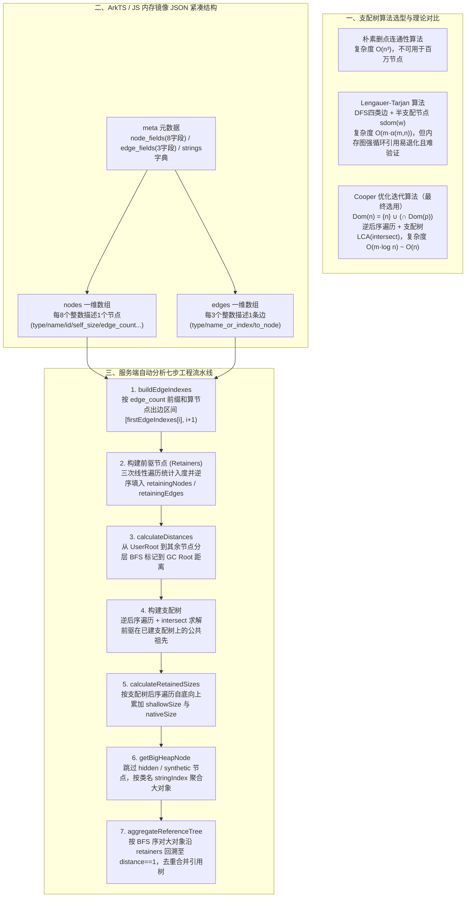

# 支配树算法原理及鸿蒙工具实践

## 1. TL;DR

1. **核心痛点**：随着淘宝 App 鸿蒙版 UV 增长，ArkTS 内存溢出（OOM）引发的 Crash 上升；百万级对象的内存快照需快速计算每个对象的 **Retained Size（深堆大小）** 并聚合泄漏引用链，才能定位真正需要释放的大对象。
2. **算法选型**：对比朴素算法 $O(n^3)$、Lengauer-Tarjan 算法 $O(m\alpha(m,n))$ 与 Cooper 迭代算法后，选用**基于逆后序（Reverse Post-Order）遍历 + 支配树最近公共祖先（`intersect`）优化的迭代算法**（复杂度从 $O(n^2)$ 降至 $O(m\log n)$ 乃至近似 $O(n)$），规避了内存图中大量循环引用对 Lengauer-Tarjan 半支配节点计算的复杂度放大，且可与华为 Profiler 插件及 Chrome `HeapSnapshot.ts` 对拍验证。
3. **工程实现**：解析 ArkTS/JS JSON 内存快照（`nodes`、`edges`、`strings` 紧凑一维数组编码），通过七步流水线——构建边索引 `firstEdgeIndexes` $\to$ 三遍扫描构建前驱数组 `retainingNodes` $\to$ BFS 计算 `nodeDistances` $\to$ 逆后序迭代构建支配树 $\to$ 后序遍历累加 `retainedSizes` $\to$ 过滤 `hidden/synthetic` 聚合大对象类型 $\to$ BFS 回溯生成去重聚合引用树 `aggregatedRefTree`——实现端到端服务端自动分析。

## 2. 问题定义与背景

### 2.1 Shallow Size 与 Retained Size 的本质差异

在百万级节点的内存镜像中排查 OOM 时，对象的内存占用分为两类：
- **Shallow Size（浅堆大小）**：对象自身结构占用的内存（例如类 `A` 仅持有一个指向 `B` 的引用指针 `b`，其 `shallowSize = 4 bytes`；`B` 含一个 `int c`，其 `shallowSize = 4 bytes`）。
- **Retained Size（深堆大小）**：回收该对象后 GC 能连带释放的内存总和（若仅 `a` 引用 `b`，释放 `a` 可同时释放 `b`，故 `a` 的 `retainedSize = 4 + 4 = 8 bytes`）。

### 2.2 支配树（Dominator Tree）形式化定义

将内存镜像抽象为以 `GC Root`（入口节点 $r$）为源点的有向图 $G=(V,E)$：
- **支配关系（Dominate）**：若从入口 $r$ 到节点 $i$ 的**每一条路径**都必须经过节点 $d$，则称 $d$ 支配 $i$，记作 $d \text{ dom } i$。
- **直接支配节点（Immediate Dominator, `idom`）**：若 $d \text{ dom } i$（$d \neq i$），且不存在另一个节点 $c$ 使得 $d \text{ dom } c$ 且 $c \text{ dom } i$，则称 $d$ 是 $i$ 的直接支配节点，记作 $\text{idom}(i) = d$。
- **支配树性质**：以 $\text{idom}(i)$ 为父节点构成的树即为支配树；回收节点 $a$ 后，其在支配树中的所有子树节点都将失去通往 GC Root 的全部路径而成为孤立对象被 GC 回收，因此：
  $$\text{RetainedSize}(a) = \text{ShallowSize}(a) + \sum_{x \in \text{Children}_{\text{dom}}(a)} \text{RetainedSize}(x)$$

## 3. 知识框架

## 4. 核心内容拆解

### 4.1 三种支配树构建算法对比与 Lengauer-Tarjan 原理解析

1. **为什么弃用 Lengauer-Tarjan 而选优化迭代算法？**
   - **复杂度与工程要求**：离线分析工具对几百毫秒级的速度差异不敏感，而 Lengauer-Tarjan 原理与并查集压缩极为复杂；
   - **对拍可靠性**：华为鸿蒙 IDE Profiler 插件与 Chrome DevTools（`HeapSnapshot.ts`）均采用优化迭代算法，可直接对齐中间结果防错；
   - **图结构特性**：编译器控制流图（CFG）环结构规整，而内存对象引用图存在**大量循环引用与强连通环**，导致 Lengauer-Tarjan 在计算半支配节点时复杂度显著上升。
2. **Lengauer-Tarjan 核心概念纠偏与推导**：
   - **DFS 四类边**：树边（黑，DFS 生成树边）、前向边（蓝，祖先到子树非直系儿子的边，如 `2->6`）、返祖边（橙，节点回到祖先的边，如 `4->2`）、横叉边（绿，右子树连向左子树的边，如 `8->5`，因 DFS 必先遍历完左子树，故横叉边只能从大 DFS 序指向小 DFS 序）。
   - **半支配节点（Semi-Dominator, $\text{sdom}(w)$）定义纠偏**：对于节点 $w$，若存在路径 $v = v_0 \to v_1 \to \dots \to v_k = w$ 使得**所有中间节点 $v_1 \dots v_{k-1}$ 的 DFS 序均严格大于 $w$**（常见 AI 误答常漏掉“路径中间节点 DFS 序 $> w$”这一约束），则称 $v$ 为半支配候选；其中 **DFS 序最小的候选 $v$** 即为 $\text{sdom}(w)$。
   - **从 $\text{sdom}(w)$ 到 $\text{idom}(w)$ 的两个定理**：在 $\text{sdom}(w)$ 到 $w$ 的树边路径上找 $\text{sdom}(u)$ DFS 序最小的中间节点 $u$：
     - 若 $\text{sdom}(u) = \text{sdom}(w)$，则 $\text{idom}(w) = \text{sdom}(w)$；
     - 若 $\text{sdom}(u) < \text{sdom}(w)$，则 $\text{idom}(w) = \text{idom}(u)$。

### 4.2 Cooper 优化迭代算法的两个关键加速点

基于支配传递性方程：
$$\text{Dom}(s) = \{s\}, \quad \text{Dom}(n) = \{n\} \cup \left(\bigcap_{p \in \text{pred}(n)} \text{Dom}(p)\right)$$

参考论文《A Simple, Fast Dominance Algorithm》（Keith D. Cooper 等），通过两项改进将朴素 $O(n^2)$ 集合求交降至近似线性：
1. **逆后序（Reverse Post-Order）遍历加速收敛**：在 DFS 树的四类边中，树边与前向边无论先序还是逆后序均只需 1 次遍历；返祖边均需多次迭代；但对于**横叉边**，逆后序保证前驱节点先于当前节点被访问，只需 **1 次遍历**即可收敛（先序则需多次）。
2. **用支配树最近公共祖先（`intersect`）替代集合求交**：由于前驱节点的支配树在迭代中已局部构建完成，求 $\bigcap_{p \in \text{pred}(n)} \text{Dom}(p)$ 等价于在当前支配树上顺着 `idom` 指针向上寻找所有前驱节点的**最近公共祖先（LCA）**，单次迭代复杂度降至 $O(m \log n)$，当迭代轮数恒定时接近 $O(n)$。

### 4.3 ArkTS / JS 内存镜像解析与七步工程实现

1. **紧凑数组格式解析**：
   - `node_fields` 共 8 个字段：`["type", "name", "id", "self_size", "edge_count", "trace_node_id", "detachedness", "native_size"]`（即 `nodeFieldCount = 8`）。`node_types` 含 14 种类型（如 `hidden`、`array`、`string`、`object`、`closure`、`native`、`synthetic` 等）。
   - `edge_fields` 共 3 个字段：`["type", "name_or_index", "to_node"]`，`edge_types` 含 7 种引用类型（`context`、`element`、`property`、`internal`、`hidden`、`shortcut`、`weak`）。注意 `to_node` 存储的是目标节点在 `nodes` 数组中的**真实下标**（即 `toNodeOrdinal * nodeFieldCount`）。
2. **构建出边索引（`buildEdgeIndexes`）**：
   - `edges` 数组不显式存储源节点 `from_node`，而是按节点顺序连续排列；累加每个节点的 `edge_count` 即可得到节点 `nodeOrdinal` 的出边切片范围 `[firstEdgeIndexes[nodeOrdinal], firstEdgeIndexes[nodeOrdinal + 1])`。
3. **三遍线性扫描构建前驱数组（`retainingNodes` / `retainingEdges`）**：
   - **第一遍**：遍历所有边的 `to_node`，校验 `toNodeIndex % nodeFieldCount == 0` 后，统计每个目标节点的入度（前驱个数）存入 `firstRetainerIndex[toNodeOrdinal]`；
   - **第二遍**：做前缀和转换，将 `firstRetainerIndex[nodeOrdinal]` 改写为该节点在 `retainingNodes` 数组中的起始槽位下标，并在起始槽位暂存剩余可填数量 `retainerCount`；
   - **第三遍**：遍历所有源节点及其出边，利用 `firstRetainerIndex[toNode] + (--retainingNodes[firstRetainerSlotIndex])` **由后向前**无锁填充 `retainingNodes` 与 `retainingEdges`。
4. **分层 BFS 计算距离（`calculateDistances`）**：
   - 先遍历 `rootNodeIndexInternal` 的直接子节点，若 `isUserRoot(childNodeIndex)` 为真则设 `nodeDistances = 1` 并入队做第一轮 BFS；随后再将 `rootNodeIndexInternal` 自身入队做第二轮 BFS，覆盖其余 `synthetic` 等内部节点。
5. **后序遍历计算 `retainedSizes`（`calculateRetainedSizes`）**：
   - 初始化每个节点的 `retainedSizes` 为其 `self_size`（及 `native_size`）；
   - 按支配树**后序遍历**（`postOrderIndex = 0 .. nodeCount - 2`），保证子节点先于父节点算完，执行 `retainedSizes[dominatorOrdinal] += retainedSizes[nodeOrdinal]` 自底向上线性汇总。
6. **大对象过滤与引用链回溯聚合（`getBigHeapNode` + `aggregateReferenceTree`）**：
   - 跳过 `isHidden` 与 `isSynthetic` 节点，按类名 `stringIndex` 聚合计数与 `retainedSize` 筛选大对象类型；
   - 按 BFS 序对命中大对象类型的节点调用 `calculateReferenceTree`，顺着 `findRetainers` 递归回溯至 `nodeDistances == 1`（UserRoot 子节点），拼接 `stringIndex` 路径作为 `pathKey` 聚合进 `aggregatedRefTree`（若同一条链路根节点 `cached == refChain.get(0)` 则跳过重复累加）。

## 5. 数据速查表

| 指标 / 结构项 | 原文数值 / 复杂度 | 语境 / 条件 |
| --- | --- | --- |
| 内存镜像单快照规模 | **百万级对象（示例快照 `node_count: 100,056`，`edge_count: 384,773`）** | 鸿蒙 ArkTS / JS Heap Snapshot JSON |
| 朴素支配树算法复杂度 | **$O(n^3)$** | 逐个删点重跑连通性，不可用于大规模图 |
| Lengauer-Tarjan 算法复杂度 | **一般 $O(m \log n)$，优化后 $O(m \alpha(m, n))$** | $\alpha$ 为反阿克曼函数，趋近线性 $O(n)$ |
| 迭代算法复杂度演进 | **朴素 $O(n^2) \to$ 优化后 $O(m \log n) \sim O(n)$** | 逆后序遍历 + 支配树 `intersect` 求最近公共祖先 |
| `node_fields` 字段数与偏移 | **8 个字段（`nodeFieldCount = 8`）** | `type, name, id, self_size, edge_count, trace_node_id, detachedness, native_size` |
| `node_types` 节点类型数 | **14 种** | `hidden, array, string, object, code, closure, regexp, number, native, synthetic, concatenated string, slicedstring, symbol, bigint` |
| `edge_fields` 与 `edge_types` | **3 个字段 / 7 种边类型** | 字段：`type, name_or_index, to_node`；类型：`context, element, property, internal, hidden, shortcut, weak` |

## 6. 踩坑与教训 / 可迁移的设计原则

| 错误做法 | 失败表现或原因 | 原文应对（可迁移的设计原则） |
| --- | --- | --- |
| **直接轻信大模型对复杂图论算法（如半支配节点）的文字解释** | AI 常遗漏“路径中间节点 DFS 序必须大于当前节点 $x$”等关键约束，导致算法实现错误 | **对照原始论文与成熟开源实现对拍**：以 Lengauer-Tarjan / Cooper 原论文及 Chrome `HeapSnapshot.ts`、华为 Profiler 插件结果交叉验证 |
| **在强循环引用的内存对象图上硬套 Lengauer-Tarjan** | 内存节点间环路密集导致半支配节点求取变慢，且代码晦涩极易写错 | **根据图拓扑特性选型算法**：选用实现简洁、对环路鲁棒的逆后序 + `intersect` 迭代算法 |
| **用 `HashMap<Node, List<Node>>` 构建百万节点的入边（前驱）表** | Java 对象头与集合扩容引发严重二次内存膨胀甚或分析服务自身 OOM | **三遍扫描 + 扁平一维 `int[]` 原地建索引**：用 `firstRetainerIndex` + `retainingNodes` 一维数组通过“先计数、再分槽、倒序填入”实现零对象开销建图 |
| **在聚合引用树时直接累加所有路径上的 `retainedSize`** | 同一根节点或支配子树的内存被多条引用分支重复相加，导致统计失真 | **先按支配树后序累加 `retainedSize`，回溯聚合时做同源节点去重（`if (cached == refChain.get(0)) continue`）** |

## 7. 记忆锚点

1. **支配树与深堆公式**：$\text{RetainedSize}(u) = \text{ShallowSize}(u) + \sum_{\text{idom}(v)=u} \text{RetainedSize}(v)$（后序遍历自底向上一次累加完成）。
2. **Cooper 迭代两大法宝**：“**逆后序消横叉，树上 LCA 代求交**”——逆后序让横叉边一次收敛，`intersect` 在已建支配树上求公共祖先替代 $O(n^2)$ 集合交集。

## 8. 复习卡片

1. 内存分析中 Shallow Size 与 Retained Size 的区别是什么？为什么支配树能直接算出 Retained Size？::Shallow Size 是对象自身占用的内存大小，Retained Size 是回收该对象后 GC 能连带释放的内存总和；因为支配树中父节点支配所有子树节点，父节点被回收则整棵子树必然失去所有通往 GC Root 的路径而被回收，故父节点的 Retained Size 等于其 Shallow Size 加上所有支配树子节点的 Retained Size 之和。
2. 为什么鸿蒙 ArkTS 内存分析工具放弃了渐近复杂度更优的 Lengauer-Tarjan 算法，而选用优化后的迭代算法？::一是内存对象引用图中存在大量循环引用，会使 Lengauer-Tarjan 计算半支配节点的开销大增；二是离线分析工具对微小的速度差异不敏感；三是 Chrome DevTools 和华为 Profiler 插件均采用优化迭代算法，方便直接对拍验证防止出错。
3. Lengauer-Tarjan 算法中“半支配节点（$\text{sdom}(w)$）”的严格定义是什么？::对于节点 $w$，若存在从节点 $v$ 到 $w$ 的路径，使得路径上所有中间节点（不含首尾）的 DFS 序都严格大于 $w$，则 $v$ 是 $w$ 的半支配候选；所有候选中 DFS 序最小的节点即为 $\text{sdom}(w)$。
4. Cooper 等人在《A Simple, Fast Dominance Algorithm》中对经典迭代算法做了哪两点核心优化？::一是改用逆后序（Reverse Post-Order）代替先序遍历，使横叉边只需一次遍历即可完成计算；二是利用已局部构建的支配树，将前驱节点支配集的求交运算转化为在支配树上求最近公共祖先（`intersect` 方法），将复杂度降至 $O(m \log n) \sim O(n)$。
5. ArkTS / Chrome HeapSnapshot 的 `edges` 数组中只有 `to_node` 没有 `from_node`，如何确定每条边属于哪个源节点？::因为 `edges` 数组严格按源节点顺序连续存放，通过累加每个节点的 `edge_count` 属性构建前缀和数组 `firstEdgeIndexes`，节点 `i` 持有的出边范围即为 `[firstEdgeIndexes[i], firstEdgeIndexes[i+1])`。
6. 在不使用动态集合类的前提下，如何仅用一维 `int[]` 数组高效构建所有节点的前驱（Retainers）索引？::采用三遍扫描法：① 遍历 `edges` 统计每个 `toNode` 的入度存入 `firstRetainerIndex`；② 遍历节点将入度数组转为前缀和起始槽位偏移，并在槽位首元素暂存剩余计数；③ 再次遍历各节点出边，从槽位尾部向前递减填入 `retainingNodes` 与 `retainingEdges`。
7. 为什么 `calculateRetainedSizes` 必须按照后序遍历（Post-Order）顺序累加内存大小？::因为父节点的 `retainedSize` 依赖其所有支配树子节点的 `retainedSize`；后序遍历能严格保证所有被支配的子节点先于其直接支配节点（`dominatorOrdinal`）完成计算，从而只需一趟线性遍历即可自底向上累加完毕。
8. 在聚合大对象引用链（`aggregateReferenceTree`）时，如何过滤噪声并避免重复统计？::先在 `getBigHeapNode` 中跳过 `hidden` 和 `synthetic` 虚拟机内部节点，按类名 `stringIndex` 筛选大对象；再按 BFS 顺序对大对象沿 `retainers` 回溯至 `nodeDistances == 1` 的根节点，合并相同 `pathKey` 时若发现 `cached == refChain.get(0)` 则跳过重复累加。

## 9. 知识关联

- **本库主题关联**：
  - [操作系统与内存管理](../../20_topics/操作系统与内存管理.md)：基于 GC Root 有向图支配树计算 Retained Size，完成 ArkTS 内存镜像解析与大对象泄漏链路自动聚合。
  - [跨端开发与性能](../../20_topics/跨端开发与性能.md)：支撑手机淘宝鸿蒙版（ArkTS）线上 OOM Crash 治理与客户端-服务端内存快照自动化分析。
  - [解决问题](../../20_topics/解决问题.md)：结合图拓扑特征（强循环引用）与工业界基准（Chrome/华为 Profiler）务实选型算法并完成工程落地。
- **候选双链**：`[[支配树算法]]`、`[[鸿蒙ArkTS]]`、`[[内存泄漏分析]]`、`[[RetainedSize]]`、`[[Lengauer-Tarjan]]`

## 10. 原文参考资料

- **原文标题**：《支配树算法原理及鸿蒙工具实践》
- **发布渠道与日期**：微信公众号「大淘宝技术」，2026-01-14
- **作者与团队**：灵貎（淘天集团-终端平台基础工程团队）
- **原文引用论文与源码**：
  - Keith D. Cooper et al., *《A Simple, Fast Dominance Algorithm》*: `https://www.cs.tufts.edu/~nr/cs257/archive/keith-cooper/dom14.pdf`
  - Adam L. Buchsbaum et al., *《A New, Simpler Linear-Time Dominators Algorithm》*: `http://adambuchsbaum.com/papers/dom-toplas.pdf`
  - Thomas Lengauer & Robert Endre Tarjan, *《A Fast Algorithm for Finding Dominators in a Flowgraph》*: `https://faculty.cc.gatech.edu/~harrold/6340/cs6340_fall2009/Readings/lengauer91jul.pdf`
  - Android Studio Perflib `LinkEvalDominators.kt` & Chrome DevTools `HeapSnapshot.ts`

> [!note]- 校对报告
> - **页码溯源汇总**：
>   - 鸿蒙版 ArkTS OOM 背景、支配树形式化定义、Shallow Size vs Retained Size 示例及三类算法对比：`p.1–3`
>   - Lengauer-Tarjan 算法原理、AI 半支配定义纠偏、DFS 四类边与 `sdom`/`idom` 推导：`p.3–6`
>   - 迭代算法公式、JS/ArkTS 内存镜像 JSON 结构（`node_fields`/`edge_fields`）、构建边索引与前驱节点三遍扫描代码：`p.6–11`
>   - BFS 距离计算、Cooper 逆后序与 `intersect` 最近公共祖先优化、后序遍历计算 `retainedSizes` 及大对象引用树回溯聚合：`p.11–16`
>   - 参考文献与团队介绍：`p.16–17`
> - **关键数值一致性核查**：
>   - 示例 JSON 中 `node_count: 100056`、`edge_count: 384773`、首节点 `9,11693,1,0,6386,0,0,0`（`type: 9` 对应 `synthetic`，`name: 11693` 对应 `SyntheticRoot`，`edge_count: 6386`）与原文代码完全一致。
> - **图像与版面质量说明**：
>   - `p.1–6, 12–13, 16` 含行内数学符号公式小图、DFS 四色边有向图及 Cooper 论文伪代码截图（位于 PDF 图像层），`p.10–15` 部分 Java 代码长行右侧略有截断；笔记已根据上下文与算法逻辑完整还原所有数学公式与核心代码结构。
