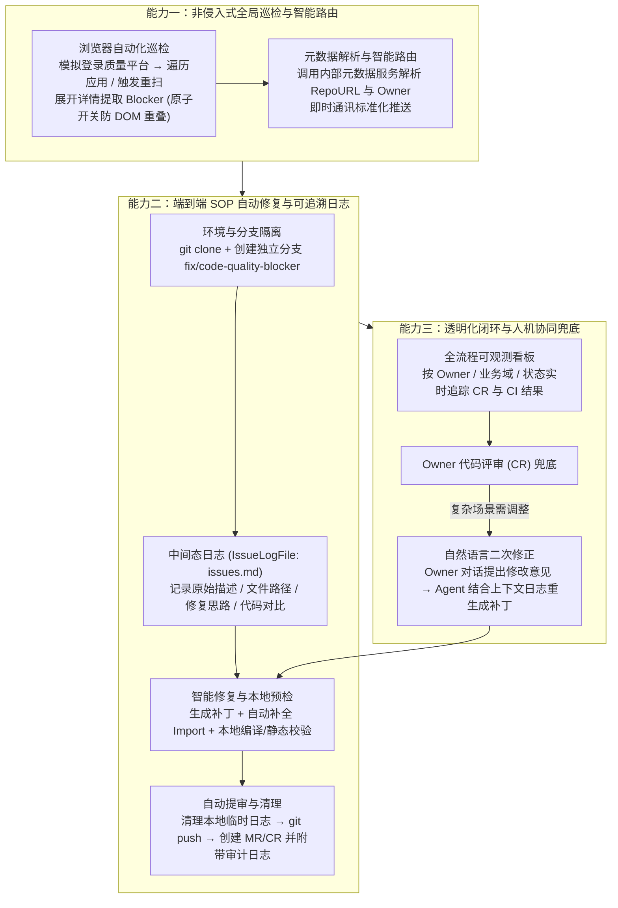

# 从人机协作到AI主导：我们是怎么把代码质量交给“数字SRE”的？

## 1. TL;DR

1. **研发角色四阶段跃迁**：AI 参与开发正历经“AI 初步介入（ChatGPT 答疑）→ AI 辅助开发（Copilot/通义灵码插件补全）→ AI 协作开发（Cursor/Claude Code 工程级重构）→ **AI 主导开发（Devin/数字 SRE 端到端闭环，人类兜底审核）**”四个阶段。
2. **传统 Blocker 治理三大痛点**：被动式巡检导致历史交接应用沦为“治理盲区”；手动修复链路冗长（定位 → 拉分支 → 修改 → 提 CR 平均耗时 **2–4 小时/应用**）；SRE 深陷找人催办与表格汇总等行政事务。
3. **“AI 主导 + 人类兜底”三层能力架构**：
   - **非侵入式浏览器自动化全局巡检与智能路由**：绕过各应用 JDK/Maven 版本差异（方案 A）与数仓 `T+1` 延迟（方案 B），由 Agent 模拟登录质量平台抓取 Blocker 详情并自动解析 Owner 路由通知。
   - **端到端 SOP 全自动修复与中间态日志（`Intermediate Log`）**：自动完成仓库定位、隔离分支创建（`fix/code-quality-blocker`）、代码修改与 Import 补全、本地编译预检及自动提审 CR，并将 Markdown 中间态修复日志附加至 CR 消除黑盒。
   - **可观测看板与自然语言二次修正**：构建多维监控后台，支持 Owner 直接用自然语言对话指导 Agent 迭代生成新版补丁。
4. **量化落地成效**：在首批 **20 个应用**试点中实现单次任务自动修复成功率 **60%+**、Blocker 整体修复覆盖率 **70%+**；推广至**百余个应用**后，相比传统方式**节省约 80% 直接人力成本**。

## 2. 问题定义与背景

### 2.1 传统高危（Blocker）代码质量治理的困境

在存量庞大的业务系统中，针对直接威胁线上稳定性的高危（Blocker）代码异味与缺陷治理长期面临三重阻力：
1. **发现滞后与长尾盲区**：依赖应用 Owner 被动登录质量平台查看扫描报告，人员流动或历史交接后的长尾应用长期无人维护，高危问题持续积压。
2. **手工修复链路冗长且质量参差**：传统修复需经历“定位原因 → 拉取分支 → 本地修改 → 本地编译 → 提交 CR”，平均每个应用耗时 **2–4 小时**，且高度依赖开发者个人经验，易修复不彻底或引入新风险。
3. **SRE 角色错位**：SRE 团队耗费大量精力在人工催办与表格统计上，难以沉淀自动化治理基建。

### 2.2 为什么选择 Blocker 作为“AI 主导”切入点？

Blocker 级别问题一方面对系统稳定性威胁直接、业务收益明确；另一方面其缺陷模式与修复规则相对清晰，非常适合作为从“IDE 辅助写代码”升级向“中心化数字 SRE 员工端到端完成任务、人类仅在 CR 节点兜底审核”的试验田。

## 3. 知识框架

## 4. 核心内容拆解

### 4.1 巡检技术选型权衡：为什么选择 UI 浏览器自动化？

在全局问题发现阶段，团队对比了三种技术路径：
- **放弃方案 A（本地静态扫描集成，如 Error-Prone）**：存量百余个应用的 JDK/Maven 版本、构建脚本与依赖体系差异极大，强行统一接入维护成本高且极易因环境冲突阻塞正常构建。
- **放弃方案 B（CI 流水线数据仓库对接）**：内部质量数据回流至数据仓库存在 **`T+1` 延迟**，且缺乏实时外部 API，无法满足“发现即修复”的实时闭环诉求。
- **优选方案（浏览器 UI 自动化非侵入式抓取）**：Agent 模拟用户登录质量平台，定期遍历应用列表、按需触发扫描并抓取 Blocker 详情。不仅**零侵入现有构建工具链**，还能通过“每次只展开并关闭一个问题详情页（原子性 DOM 操作）+ 动态加载等待与指数退避重试”保证高鲁棒性。

### 4.2 端到端修复五阶段 SOP 与中间态日志机制

数字 SRE Agent 遵循标准化的五阶段作业程序（SOP）：
1. **阶段一（环境初始化）**：根据 `{AppName}` 调用元数据服务获取 `{RepoURL}` 与负责人信息，执行 `git clone` 同步主干。
2. **阶段二（变更隔离准备）**：调用研发平台接口创建变更单，拉取并切换至唯一隔离分支（如 `fix/code-quality-blocker`）。
3. **阶段三（浏览器自动化诊断）**：登录 `{QualityPlatformURL}`，抓取全部 Blocker 位置与原因，结构化写入临时中间态日志 `{IssueLogFile}`（如 `issues.md`）。
4. **阶段四（智能修复与本地预检）**：逐条读取 `{IssueLogFile}` 修复代码异味、自动检查并补全 `Import` 语句，执行**本地编译或静态检查**验证语法与技术正确性，随后清理本地 `{IssueLogFile}`（防止污染仓库）并执行 `git commit & push`。
5. **阶段五（流程闭环与审计回溯）**：自动创建 Merge Request / CR 并指定 Owner 评审；将中间态日志内容作为 Commit Message 或评论附加在 CR 中，使 Owner 能直接审阅“问题根因 + AI 修复思路 + 代码 Diff”，而非面对黑盒补丁。

### 4.3 规模化分层治理策略与人机协同纠偏

在从首批 20 个试点应用推广至百余个全量项目时，团队采取了三类分层运营策略：
- **存量治理（已接入且有 Blocker）**：AI 全自动发起修复与 CR，Owner 仅做确认合并，实现“无感治理”。
- **增量接入（未接入质量平台）**：协助完成平台接入配置后，由 Agent 执行首次全量扫描与修复。
- **数据一致性联合校验**：针对平台显示“0 问题”的应用，与平台侧联合核对统计口径，消除因统计延迟导致的漏报盲区。
- **自然语言二次修正闭环**：针对 AI 未能一次修好的复杂隐性业务约束（约占 30%–40%），Owner 无需拉分支手改，直接在管理后台用自然语言给出反馈意见，Agent 结合历史中间态日志迭代生成新补丁并更新 CR。

## 5. 数据速查表

| 指标维度 | 传统人工治理模式 | 数字 SRE（AI 主导 + 人兜底） | 工程收益与来源说明 |
| :--- | :--- | :--- | :--- |
| **单应用全链路修复耗时** | 平均 **`2–4 小时 / 应用`** | **全自动流水线 + 轻量 CR 审核** | 省去人工定位、拉分支、改代码、跑编译的繁琐操作 |
| **数仓接口延迟对比** | CI 数仓回流存在 **`T+1` 延迟** | **浏览器自动化实时抓取/触发重扫** | 支撑“发现即修复”的准实时闭环 |
| **试点阶段效能（首批 ~20 个应用）** | 依赖人工抽检与催办 | 单次自动修复成功率 **`60%+`**，整体覆盖率 **`70%+`** | 验证端到端 SOP 与工具重试鲁棒性 |
| **规模化推广范围与人力节省** | 百余个应用（长尾易积压成盲区） | 覆盖**百余个应用**，节省约 **`80%`** 直接人力成本 | 将研发与 SRE 从语法级修复和催办事务中解放 |

## 6. 踩坑与教训 / 可迁移的设计原则

1. **当底层工具链异构且 API 缺失时，浏览器 UI 自动化是最务实的非侵入连接器**：不要为了自动化而强行推动百余个老旧应用改造 Maven/JDK 构建插件；通过浏览器自动化在 UI 层抓取 + 原子化开关详情页（防止 DOM 重叠）+ 指数退避重试，能以最低成本跑通全局巡检。
2. **用“中间态日志文件（`issues.md`）”同时解决长链路记忆与人类 CR 审计难题**：Agent 将抓取到的问题与修复思路先写入本地 Markdown 文件，既能在多轮修复中稳固自身上下文，又能在 `git commit` 前清理文件并将其内容转为 CR 评论，让人类 Reviewer 一目了然。
3. **自动化流水线必须保留“自然语言二次修正”逃生舱**：AI 单次修复率达到 60%–70% 即可产生巨大价值，剩余长尾切忌退回纯手工操作，而在看板上提供对话式纠偏接口让 Agent 重提补丁。

## 7. 记忆锚点

- **四阶段演进坐标**：初步介入（答疑）→ 辅助开发（插件补全）→ 协作开发（IDE Agent）→ **AI 主导开发（数字 SRE 端到端闭环）**。
- **三大核心能力模块**：非侵入式浏览器巡检与路由 + 五阶段端到端 SOP 自动修复（含 `issues.md` 中间态日志）+ 可观测看板与自然语言二次修正。
- **三组关键成效数据**：单应用原耗时 `2–4 小时`、试点自动修复率 `60%+`（覆盖率 `70%+`）、百余应用规模化节省 `80%` 直接人力成本。

## 8. 复习卡片

1. 传统模式下治理高危（Blocker）代码质量问题面临哪三大核心痛点？::问题发现滞后且长尾无主应用易成“治理盲区”；手工修复链路冗长（平均耗时 2–4 小时/应用）且质量依赖个人经验；SRE 陷入找人催办和表格统计等行政事务。
2. 在构建全局巡检能力时，为什么团队放弃了“本地静态扫描集成（Error-Prone）”和“CI 数据仓库对接”，而选择了浏览器 UI 自动化？::因为各应用的 JDK/Maven 构建环境差异巨大，本地集成维护成本与断构建风险极高；而内部 CI 数据回流数仓存在 T+1 延迟且无实时外部 API，因此非侵入式的浏览器 UI 自动化是兼顾稳定性与实时性的最优折中。
3. 数字 SRE Agent 在浏览器自动化抓取多个 Blocker 问题详情时，如何防止页面 DOM 状态混乱或动态加载失败？::采用原子性操作策略（每次只展开一个问题详情页，提取写入日志后立即关闭详情页以避免 DOM 重叠干扰），并配合动态加载等待、页面滚动与指数退避重试机制。
4. 数字 SRE Agent 的“中间态日志机制（Intermediate Log）”是如何工作的？它有什么双重价值？::Agent 在修复过程中生成临时 Markdown 文件（如 `issues.md`）记录问题原始描述、路径、修复思路与代码对比；它既能增强 Agent 多轮修复的上下文一致性，又能在清理本地文件后作为 Commit Message 或评论附加到 CR 中供 Owner 审计回溯。
5. 当应用 Owner 在 CR 审核时发现 AI 的修复方案破坏了隐性业务约束，系统如何低成本纠偏？::Owner 无需手动拉分支改代码，可直接在可视化管理后台通过自然语言对话提出修改意见，Agent 会结合此前的上下文日志与新指令重新生成补丁并更新 CR。
6. 数字 SRE 系统在首批试点（约 20 个应用）与规模化推广（百余个应用）中分别取得了怎样的量化成效？::试点阶段单次任务自动修复成功率达 60%+，Blocker 整体修复覆盖率达 70%+；推广至百余个应用后，相比传统方式节省了约 80% 的直接人力成本。

## 9. 知识关联

- **所属主题**：
  - [AI研发协同](../../20_topics/AI研发协同.md)
  - [异常监控与稳定性](../../20_topics/异常监控与稳定性.md)
  - [桌面Agent与工作流](../../20_topics/桌面Agent与工作流.md)
- **本地跃迁**：[原始 PDF](RAW.pdf) · [逐页转写文本](MD.md) · [SRE Agent 提示词模板](PROMPT.md)
- **候选双链**：[[浏览器自动化GUI到OpenCLI]] · [[企业购面向Skills编程]] · [[场景营销前端AI Coding方案]]

## 10. 原文参考资料

1. **演进对比参考工具**：ChatGPT / 通义千问、GitHub Copilot / 通义灵码、Cursor / Claude Code、Devin / AutoDev
2. **静态分析与工程基建**：Error-Prone 静态扫描、浏览器自动化控制组件、Git / Merge Request (CR) 研发协同平台
3. **内置提示词工程模板**：《SRE Agent Blocker 处理提示词示例》（含角色定义、核心变量、五阶段 SOP、防幻觉与隐私安全约束及 Markdown 输出报告模板）

> [!note]- 校对报告
> - **页码溯源**：p.1–2（AI 参与开发的四个阶段：初步介入、辅助开发、协作开发、主导开发）；p.2–4（传统 Blocker 治理三大痛点、2–4 小时/应用耗时、“AI 主导 + 人类兜底”方案概览）；p.4–7（三大核心能力模块：浏览器 UI 自动化 vs Error-Prone vs CI T+1 选型对比、智能路由、端到端六步修复 SOP、中间态日志 `Intermediate Log` 机制、可观测看板与自然语言二次修正）；p.7–9（首批 ~20 个应用试点 60%+ 自动修复率与 70%+ 覆盖率、百余个应用存量/增量/一致性分层治理、节省约 80% 直接人力成本及未来展望）；p.9–11（完整 77 行《SRE Agent Blocker 处理提示词示例》，已同步独立归档至 `PROMPT.md`）。
> - **一致性核验**：作者（雨一，淘天集团-直播&AI应用技术团队）、发布日期（2026-05-27）、全部量化数据与提示词五阶段 SOP 均与原文核对一致；正文中无任何内联页码引用。
> - **质量边界**：原文提示词代码块完整清晰，已提取为同目录 `PROMPT.md` 并在知识关联中建立双向引用。
