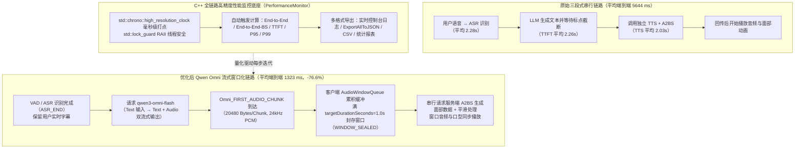

# AI真人数字人语音对话性能优化实践总结

## 1. TL;DR

1. **核心痛点**：在淘宝 VisionPro 旗舰店真人 AI 数字人导购场景中（人设提示词 **2 万字+**），传统 `ASR → LLM → TTS & A2BS` 三段式串行链路必须等上一环节攒够标点分句才能触发下一环节，导致平均端到端延迟（ASR 结束到首次语音播放）高达 **5.64 秒（5644 ms）**（其中 ASR 2.28s、LLM TTFT 2.26s、TTS 2.03s），用户体感严重“卡壳”。
2. **高精度全链路性能监控先行**：基于 C++ `std::chrono::high_resolution_clock` 与 `std::lock_guard<std::mutex>` 构建线程安全的 `PerformanceMonitor`，打通从 `ASR_START` 到 `Omni_A2BS_FACIAL_PLAY_START` 的 19+ 类细粒度事件，自动计算均值、Min/Max 与 **P95 / P99** 并导出 JSON/CSV/报表。
3. **核心架构升级（Qwen Omni `Text → Audio/Text` 流式一体化）**：为保留用户端实时字幕同时砍掉独立 TTS 环节，放弃纯 `Audio2Audio` 黑盒模式，采用 **保留前置 ASR + `qwen3-omni-flash` 接收文本输入并同步流式输出音频与文本（`ASR → LLM(Omni) → Text/Audio → A2BS`）**，实测文本输入 Omni 比音频输入处理更快。
4. **客户端音频窗口缓冲（`OmniA2BSHelper`）**：针对 Omni 流式返回的 `20480 字节` 音频小块若逐块调服务端 A2BS 会导致面部口型断裂不自然的问题，设计按 `24000 Hz` 采样率累积 **1.0 秒目标窗口（`targetDurationSeconds = 1.0f`）** 封存后再串行请求 A2BS 并做平滑过渡。
5. **量化优化成效与自定义音色演进**：在伯希和导购 10 类标准问题集上，平均端到端语音延迟从 **5644 ms 降至 1323 ms（降幅 76.6%）**；针对 Qwen Omni 仅支持官方音色（如 `Cherry`）的局限，给出 `任意 LLM + 百炼 Qwen-TTS-Realtime（WebSocket 实时声音复刻流式输出）` 的双轨选型方案。

## 2. 问题定义与背景

### 2.1 三段式串行基线瓶颈拆解（2 万字+ 人设 Prompt）

在 VisionPro 淘宝旗舰店导购测试中（每组 10 个会话，人设提示词 2 万字以上），原始串行链路耗时拆解如下：
- **ASR（语音转文字）**：平均 **2.28 s**
- **LLM 首 Token（TTFT）**：平均 **2.26 s**（还需等待生成至第一个标点符号截断才能送 TTS）
- **TTS（文本转语音）**：平均 **2.03 s**
- **端到端延迟（`ASR_END` $\to$ `AUDIO_PLAY_START`）**：平均 **5.64 s（5644 ms）**，且 P95/P99 波动剧烈。

### 2.2 候选优化路线评估对比

| 优化方向 | 候选方案设计 | 评估结论与取舍依据 |
|---|---|---|
| **纯端到端语音 `Audio2Audio`** | 用户语音直接进一体化模型出语音，省去独立 ASR 与 TTS | **放弃**：会丢失用户说话的实时字幕展示需求，且实测 Omni 接收音频输入比接收文本输入更慢 |
| **`ASR + Qwen Omni (Text → Audio/Text)`** | 保留 ASR 出字幕，将识别文本输入 `qwen3-omni-flash` 直接流式返回音频 Chunk 与回复文字 | **最终采用**：既保留字幕，又彻底省去独立 TTS 串行等待，且 TTFT 与首音频块延迟最低 |
| **`LLM + Qwen-TTS-Realtime`** | 任意 LLM 流式文本通过 WebSocket 驱动百炼 `Qwen-TTS-Realtime` 流式生成语音 | **特定场景替补**：解决 Qwen Omni 只支持官方预置音色（如 `Cherry`）的限制，支持特定人物音色实时复刻（仅多少许网络通信延迟） |
| **A2BS（语音转面部 BlendShape 口型）** | 原始按标点整句调用 $\to$ 改为客户端 `AudioWindowQueue` 按 **1～2 秒**音频窗口封存调用 | 避免按 `20480 B` 原始小 Chunk 频繁请求导致口型抖动断裂，兼顾首包响应与口型平滑 |

## 3. 知识框架

## 4. 核心内容拆解

### 4.1 基础设施先行：C++ 高精度全链路监控体系（`PerformanceMonitor`）

1. **事件枚举全覆盖（`EventType`）**：
   - **基础事件**：`ASR_START`、`ASR_END`、`LLM_REQUEST_START`、`LLM_FIRST_TOKEN`、`LLM_COMPLETE`、`TTS_REQUEST_START`、`TTS_RESPONSE`、`AUDIO_PLAY_START`、`ANIMATION_START`。
   - **Omni 与窗口化 A2BS 专属事件**：`Omni_STREAM_START`、`Omni_FIRST_AUDIO_CHUNK`、`Omni_AUDIO_CHUNK`、`Omni_STREAM_COMPLETE`、`Omni_AUDIO_WINDOW_SEALED`、`Omni_A2BS_FACIAL_START`、`Omni_A2BS_FACIAL_RESPONSE`、`Omni_A2BS_FACIAL_PLAY_START`、`Omni_AUDIO_WINDOW_PLAY` 等。
2. **核心指标双口径区分**：
   - **`end_to_end_ms`**：从 `ASR_END` 到 `AUDIO_PLAY_START`（纯音频首播延迟）。
   - **`end_to_end_bs_ms`**：从 `ASR_END` 到 `Omni_A2BS_FACIAL_PLAY_START`（带面部口型同步的首播延迟，因需等待首个 1s 音频窗口封存并完成 A2BS 计算，比纯音频首播略高）。
3. **工程实现要点**：
   - 采用 `PerformanceConfig.h` 宏开关 `PERFORMANCE_MONITORING_ENABLED` 统一控制编译期启停；
   - 使用 `std::mutex` + `std::lock_guard` 保障多线程并发打点安全；
   - 在 `AUDIO_PLAY_START` 与 `Omni_A2BS_FACIAL_PLAY_START` 事件到达时自动触发耗时结算，并汇总全局均值、最值及 **P95 / P99** 分位数。

### 4.2 客户端音频窗口缓冲机制（`OmniA2BSHelper`）

- **为什么不能逐个 Chunk 调 A2BS**：Omni 流式返回的每个音频 Chunk 大小约为 **`20480` 字节**（在 `24000 Hz` 16-bit 单声道 PCM 下仅约 0.42 秒），若每收到一个 Chunk 就调一次服务端 A2BS，生成的面部表情会严重不连续、出现高频跳变抖动。
- **窗口化封存设计（`OmniA2BSConfig` & `AudioWindowQueue`）**：
  - 配置参数：`targetDurationSeconds = 1.0f`（目标窗口时长 1～2 秒，对应人类自然短句时长）、`minDurationSeconds = 0.01f`、`sampleRate = 24000`。
  - 流式接收时：每个 Chunk 通过 `AudioWindow::Append` 追加 `base64Chunks` 与 `pcmSamples`；当 `CurrentDurationSeconds() >= targetDurationSeconds` 时调用 `SealReadyWindow()` 封存当前窗口、分配递增 `windowIndex`、合并 Base64（`FinalizeBase64()`）并触发 `Omni_AUDIO_WINDOW_SEALED` 事件，交由 A2BS 串行生成口型并做边界平滑；流结束时用 `SealRemainingWindow()` 处理尾部不足 1 秒的余量音频。

### 4.3 实战评测与音色扩展演进

- **标准测试集**：围绕“伯希和”户外品牌导购构建 10 个高频问题（手套价格/材质、品牌介绍、购买方式、帽子颜色材质、美丽奴羊毛含义、头灯流明、围巾颜色、可购商品、当前优惠），每组跑 10–31 个请求。
- **单次典型请求时间线（Request 1 实录）**：
  - `ASR Duration`: `3168 ms`
  - `LLM TTFT`: `590 ms`
  - `Omni First Audio`: `241 ms`（首 Token 后 241ms 即到达首音频块）
  - `End-to-End`（纯音频）: `843 ms`；`End-to-End-BS`（含口型同步）: `1856 ms`。
- **31 次请求统计报表（`LogStatisticsReport`）**：
  - `LLM TTFT`: avg `968.5 ms`（min `640 ms`, max `1920 ms`, P95 `1683 ms`, P99 `1920 ms`）
  - `Omni First Audio`: avg `1250.0 ms`（min `890 ms`, max `2314 ms`, P95 `1450 ms`, P99 `1500 ms`）
  - `End-to-End Latency`: avg `1264.5 ms`（多组综合平均 **`1323 ms`**，较基线 `5644 ms` 下降 **`76.6%`**）
  - `End-to-End-BS Latency`: avg `1856.6 ms`（min `1500 ms`, max `2300 ms`, P95 `2100 ms`, P99 `2300 ms`）。

## 5. 数据速查表

| 指标 / 配置项 | 优化前基线 / 参数设定 | 优化后实测值（Qwen Omni 链路） | 语境与变化幅度 |
|---|---|---|---|
| **人设提示词长度** | **2 万字+** | **2 万字+** | VisionPro 淘宝旗舰店真人 AI 数字人导购 |
| **端到端延迟（`ASR_END` $\to$ 首播）** | **5.64 s（5644 ms）** | **1.32 s（1323 ms，单批报表 1264.5 ms）** | **延迟降低 76.6%** |
| **基线各环节串行耗时** | ASR **2.28 s** / LLM TTFT **2.26 s** / TTS **2.03 s** | LLM TTFT 均值 **968.5 ms** / TTS **0 ms（内置省去）** | 消除标点断句等待与独立 TTS 耗时 |
| **Omni 首音频到达（`First Audio`）** | — | 均值 **1250.0 ms**（P95 **1450 ms**, P99 **1500 ms**） | 单例最快在首 Token（590ms）后 **241 ms** 到达 |
| **带口型同步端到端（`End-to-End-BS`）** | — | 均值 **1856.6 ms**（P95 **2100 ms**, P99 **2300 ms**） | 含首个 1s 音频窗口累积与 A2BS 口型生成 |
| **Omni 模型与音色配置** | — | `model_name: "qwen3-omni-flash"`, `voice: "Cherry"`, `character_bs: "yuhe"` | 启用 `Omni_audio.enabled = true` |
| **A2BS 音频窗口参数** | 按标点整句截断 | 单 Chunk **20480 B**，采样率 **24000 Hz**，目标窗口 **1.0s（1～2s）** | `minDurationSeconds = 0.01f`，平衡延迟与口型平滑度 |
| **后续端侧规划目标** | — | 端侧小模型首句响应目标 **$< 500\text{ ms}$ TTFT** | 配合小模型首句 + 大模型补充的双模型加速与高频问答 facialSamples 预录缓存 |

## 6. 踩坑与教训 / 可迁移的设计原则

| 错误做法 | 失败表现或原因 | 原文应对（可迁移的设计原则） |
|---|---|---|
| **直接改用纯语音输入输出（`Audio2Audio`）一体化模式** | 虽然省去了 ASR，但客户端拿不到用户说话的实时字幕，且实测 Omni 处理音频输入比文本输入更慢 | **保留前置 ASR + Omni `Text → Audio/Text` 模式**：兼顾用户端实时字幕展示与极速音频流式生成 |
| **每收到一个 Omni 音频 Chunk（20480 字节）就立刻调用一次 A2BS** | 音频片段过短（不足半秒），缺少上下文导致生成的面部表情剧烈抖动、口型断裂不自然 | **客户端音频窗口缓冲（`AudioWindowQueue`）**：按 24kHz 累积满 **1～2 秒**（`targetDurationSeconds = 1.0f`）再封存请求 A2BS 并做边界平滑 |
| **不建细粒度分位监控就盲目换模型或改并发** | 只能凭主观感觉“快了一点”，无法区分延迟卡在 LLM 首 Token、首个音频块还是 A2BS 窗口封存 | **高精度打点先行**：用 `high_resolution_clock` 埋设 19+ 个生命周期事件，同时盯住均值与 **P95 / P99** 长尾稳定性 |
| **在需要特定真人品牌代言人音色的场景强行单用 Qwen Omni** | Qwen Omni 目前仅支持官方预置音色（如 `Cherry`），不支持任意音色零样本复刻 | **分场景双轨架构**：官方音色用 `Qwen Omni` 极致低延迟；定制真人音色用 `LLM + WebSocket 驱动百炼 Qwen-TTS-Realtime` 实时复刻流式输出 |

## 7. 记忆锚点

- **数字人降延迟三板斧**：「**留 ASR 保字幕，换 Omni（Text$\to$Audio/Text）砍掉独立 TTS，攒 1 秒音频窗再调 A2BS 稳住口型**」。
- **核心收益数字**：「**2 万字 Prompt 下，端到端从 5644ms 压到 1323ms（提速 76.6%），带口型同步均值 1.86s**」。

## 8. 复习卡片

为什么 VisionPro 淘宝数字人导购最初的端到端延迟高达 5.64 秒？::因为采用“ASR（2.28s）→ LLM（TTFT 2.26s 且需等待标点符号截断）→ 独立 TTS（2.03s）& A2BS”三段式串行结构，每一步都必须等待上一步完成或攒够整句 buffer。
既然 Qwen Omni 支持直接输入音频输出音频（Audio2Audio），为什么团队最终选择了“ASR + Omni Text→Audio/Text”模式？::① 纯 Audio2Audio 会丢失用户端展示说话字幕的能力；② 实测给 Omni 输入 ASR 转写后的文本，其推理返回速度比直接输入音频更快。
PerformanceMonitor 中 end_to_end_ms 与 end_to_end_bs_ms 两个指标有什么区别？::end_to_end_ms 是从 ASR_END 到纯音频开始播放（AUDIO_PLAY_START）的耗时；end_to_end_bs_ms 是从 ASR_END 到首个音频窗口完成 A2BS 口型生成并开始播放面部动画（Omni_A2BS_FACIAL_PLAY_START）的耗时。
为什么客户端不能每收到一个 Omni 返回的 20480 字节音频块就立即调用 A2BS 接口？如何解决？::单个 20480 字节块时长过短，逐块请求会导致面部表情不连续、口型抖动；通过 AudioWindowQueue 按 24000Hz 采样率累积满 1～2 秒（targetDurationSeconds=1.0f）封存为一个 AudioWindow 后再串行调用 A2BS 并做平滑。
Qwen Omni 链路在音色定制上有什么局限？遇到需要特定真人声音复刻的场景如何替代？::Qwen Omni 仅支持官方预置音色（如 Cherry）；若需特定人物音色，可采用“任意 LLM 流式输出 + WebSocket 连接百炼 Qwen-TTS-Realtime”实时复刻音色并流式生成语音。
除了切换 Omni 模型外，团队还规划了哪两项端侧/架构级延迟优化手段？::① 双模型加速（端侧 <500ms TTFT 的小模型快速响应首句过渡，大模型补充完整回答）；② 预录制缓存（提前缓存高频问答的音频与 facialSamples 口型数据）。

## 9. 知识关联

- **本库主题索引**：[推荐系统与多模态评测](../../20_topics/推荐系统与多模态评测.md)、[跨端开发与性能](../../20_topics/跨端开发与性能.md)、[操作系统与内存管理](../../20_topics/操作系统与内存管理.md)、[异常监控与稳定性](../../20_topics/异常监控与稳定性.md)
- **本库关联文章**：[TaoAvatar 3D数字人应用+26.6.5](<../TaoAvatar 3D数字人应用+26.6.5/AI_TaoAvatar 3D数字人应用.md>)、[直播数字人HAT+26.10.8](../直播数字人HAT+26.10.8/AI_直播数字人HAT.md)、[直播数字人ASR拟人化LLM+26.1.30](../直播数字人ASR拟人化LLM+26.1.30/AI_直播数字人ASR拟人化LLM.md)
- **候选双链**：[[Qwen-Omni]]、[[Qwen-TTS-Realtime]]、[[A2BS语音驱动口型]]、[[流式音频窗口缓冲]]

## 10. 原文参考资料

- **原文信息**：《AI真人数字人语音对话性能优化实践总结》，作者：揽清（淘天集团-Meta技术团队），发布日期：2026-02-25。
- **文内提及模型与技术组件**：`qwen3-omni-flash`、`Qwen-Max`、`Qwen-Plus`、阿里云百炼 `Qwen-TTS-Realtime`、`MNN`、`Object Drawer`、`TaoAvatar`、`Walle`。

> [!note]- 校对报告
> - **页码溯源汇总**：
>   - `## 1. TL;DR` & `## 2. 问题定义与背景`：源自 p.1–3（VisionPro 淘宝旗舰店导购、2 万字+ 人设 Prompt、基线 5.64s / 5644ms、ASR 2.28s / LLM TTFT 2.26s / TTS 2.03s、优化后 1.32s / 1323ms 提升 76.6%、保留字幕采用 `Text -> Audio/Text`）。
>   - `## 4.1 性能监控系统设计`：源自 p.3–9（`std::chrono::high_resolution_clock`、`std::lock_guard<std::mutex>`、`EventType` 枚举、`RequestPerformance` 与 `PerformanceStatistics` 结构体、Request 1 日志与 31 次请求统计报表）。
>   - `## 4.2 音频窗口缓冲 + 串行 A2BS`：源自 p.9–13（`qwen3-omni-flash` / `Cherry` / `yuhe` 配置、20480 字节 Chunk、`OmniA2BSConfig` 的 `targetDurationSeconds = 1.0f` / `minDurationSeconds = 0.01f` / `sampleRate = 24000`、`AudioWindow` 与 `AudioWindowQueue`）。
>   - `## 4.3 优化效果与后记`：源自 p.13–16（伯希和 10 个测试问题、文本输入比音频输入更快、5 大展望方向含 `<500ms` 端侧小模型与双模型加速、25 年 11 月中旬百炼 `Qwen-TTS-Realtime` 实时音色复刻方案）。
> - **材料质量说明**：p.2、p.10–11、p.13–15 含部分流程图与数据对比截图，其核心数值（`5644ms -> 1323ms`、`-76.6%`、Request 1 与 31 次请求 JSON/报表中的全部毫秒级均值与 P95/P99）均已在正文代码块中完整呈现并逐项核对无误。
