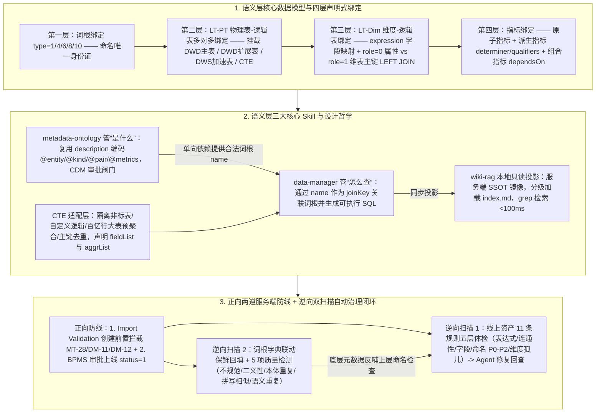

# AI时代的数据研发-Semantic（语义层）实践总结

## 1. TL;DR

本文系统总结了淘天直播技术团队从“面向 SQL 的传统数仓开发”向**“Semantic（语义层）+ DataAgent”双轨制范式**转型的架构设计与工程落地。针对传统研发周期长（单需求熟练工至少 1 天）、业务-技术语义翻译消耗 **`30%+` 精力**以及同名指标（如 GMV）存在 **`5 种`以上口径**的痛点，团队构建了以**逻辑表（Logic Table）**为解耦核心、以 **CTE 适配层**隔离非标数仓与百亿级大表聚合、以**四层声明式绑定**（词根 $\to$ 物理表-逻辑表 `LT-PT` $\to$ 维度-逻辑表 `LT-Dim` $\to$ 指标 `dependsOn`）为图谱骨架的语义层。在 AI 协同与治理上，设计了三套核心 Skill 体系：**`wiki-rag`**（服务端 SSOT 的本地只读 Markdown 投影，`< 100ms` 极速检索无向量化损失）、**`metadata-ontology`**（零 Schema 改造，复用字典 `description` 字段以 `@key=value` 编码本体公理）与 **`data-manager`**（配合服务端**创建时前置校验 + BPMS 审批拦截**两道防线，以及**线上资产 11 条合规扫描 + 词根字典 5 项质量扫描**的逆向自动保鲜闭环），使数据研发成功转型为 Semantic Architect 与 AI 教练。

## 2. 问题定义与背景

### 2.1 传统数仓研发的三大瓶颈与 Agentic 双轨制变革

1. **传统面向人类消费者的数仓痛点**：
   - **链路冗长效率低**：一个需求经历“需求评审 $\to$ 模型设计 $\to$ 设计评审 $\to$ ETL 开发 $\to$ 代码 Review $\to$ 数据验证 $\to$ 上线部署 $\to$ 联调测试 $\to$ 报表搭建 $\to$ 数据回刷”共 10 个环节，熟练工全力投入也至少耗时 **`1 天`**。
   - **业务-技术语义鸿沟**：将“活跃用户复购率”等业务语言翻译为“7日/30日活跃、是否含退款后再购”等技术实现，消耗了数据团队 **`30%` 以上的精力**。
   - **指标口径丛林**：同一个“GMV”在不同报表中可能有 **`5 种`** 计算方式（营销含券 vs 财务不含券、运营下单口径 vs 仓储发货口径），知识散落在 SQL 代码与个人脑海中。
2. **Agentic Data Stack 双轨制架构**：
   - 传统 `ODS → DWD → DWS → ADS` 物理分层是为“人类更容易理解数据”设计的；当 AI Agent 成为主要消费者兼维护者时，系统演进为**双轨制**——**AI Agent 通过统一的语义层直接消费数据，人类分析师继续通过传统 BI/报表消费数据**。短期内物理分层退居为对消费者透明的性能优化实现细节。

## 3. 知识框架



## 4. 核心内容拆解

### 4.1 CTE 适配层：在不完美物理数仓上构建干净语义层的“权宜利器”

**核心主张**：标准化的物理数仓可遇不可求，CTE（公用表表达式）适配层通过“把脏逻辑关在 `statement` 里、向语义层只暴露规范 `fieldList` 与 `aggrList`”，解决了非标表接入、业务自定义逻辑、百亿级大表加速与标准表二次加工四大难题。

- **CTE 解决的四大现实诉求与三大支柱**：

| 维度 | 具体工程问题或机制 | CTE 的解决方案与核心约束 |
| :--- | :--- | :--- |
| **诉求 1：兼容非标数仓表** | 业务临时表、项目表、外部非 CDM 表不能直接 `type=0 import`（污染标准性），也不能让业务裸写 SQL（失去治理） | 用一段 `SELECT` 将非标数据源投影为符合语义层契约的规范形状再注册 |
| **诉求 2：沉淀业务自定义逻辑** | “最近 7 天活跃主播”（窗口+时间过滤）、“去重最近状态”（`ROW_NUMBER + QUALIFY`）、跨表合并（`UNION/COALESCE`）、剔除黑名单场次 | 将散落的业务领域规则沉淀为可命名、可审批、可单点复用的 CTE 资产（如 5 个 metric 共用同一段“7天改30天”逻辑只需改 1 处 `statement`） |
| **诉求 3：百亿行大表性能优化** | 直播核心事实表（如 `dwd_tb_ctlive_xxx_di`）常为**百亿行级**日增量明细，直接跑 DSL2SQL 会超时或重复全表扫描 | 将常用聚合粒度（如 `account_id + ds`）和常用指标提前 `GROUP BY` 到 CTE，充当 SQL 层面的“轻量级虚拟 DWS” |
| **诉求 4：标准表二次加工** | `dwd` 明细转 `dim` 关联，或多粒度维表主键去重对齐关联粒度 | 在 CTE 层完成二次去重与粒度转换，防止下游 JOIN 发散产生数据异常 |
| **支柱：隔离性 + 单点维护 + 性能可控** | `statement` 内部可写任意合法 ODPS SQL，对外只暴露 `fieldList` 与手工声明的最小粒度 **`aggrList`**（如 `['account_id','ds']`） | 🔥 **硬约束**：`aggrList` 必须精确反映 `statement` 的真实最小粒度（若漏填分区字段会导致生成 SQL 极慢甚至算错）；且 CTE 只是权宜之举，不能替代底层标准物理数仓建设 |

### 4.2 逻辑表（Logic Table）与四层声明式语义图谱绑定

**核心主张**：逻辑表是物理数仓与 AI 语义之间的解耦防火墙——指标和维度只面向逻辑表而不直接绑物理表，SQL 生成器通过遍历“四层声明式绑定边”自动拼出 `WITH ... SELECT` 与 `LEFT JOIN`。

- **逻辑表的立体物理表挂载与“按使用方式而非表名前缀建模”**：
  - **立体挂载（一对多物理表）**：一个逻辑表（如 `basic_pay`）可同时挂载 `1` 张 DWD 基础明细表（`mappingType=1`）、`1` 张 `dwd_ext` 扩展明细表（`mappingType=1`，字段更全）以及多张 `dws` 预聚合加速表（`mappingType=2`）。指标配置必须与物理层严格对应——**DWD 层填 `commonExpression + dwdAggFunction`，DWS 层填 `expression + aggFunction`，两套配置严禁混用**，由 SQL 生成器按查询场景自动选最优物理表。
  - **业务过程隔离（多对一物理表）**：同一张宽表 `tbcdm.dws_tb_ctlive_jiangjie_vst_gc_itm_pv_lead_trd_1d` 可按业务过程拆分为 `jiangjie_pay`（`businessProcess=pay`）、`jiangjie_ipv`（`ipv`）、`jiangjie_read`（`read`）三个独立逻辑表；同样，名为 `dim_` 前缀的物理表（如 `tbcdm.dim_tb_ctlive_itm_tag`）只要下游需要 `GROUP BY + SUM/COUNT` 算指标，即可建为逻辑事实表 `basic_plh`。
- **四层声明式绑定机制详解**：

| 绑定层级 | 解决的问题 | 关键配置字段与真实代码示例 | 工程机制与断链后果 |
| :--- | :--- | :--- | :--- |
| **第一层：词根 $\to$ 语义层** | “叫什么”（命名统一身份证） | 5 类词根：`业务过程(1)` / `指标(4)` / `维度(6)` / `主题(8)` / `限定词(10)` | 创建 `pay_amt_risk` 若 `name` 不在 `type=4` 词根字典中，服务端直接拒绝 |
| **第二层：物理表 $\to$ 逻辑表（`LT-PT`）** | “数据从哪来” | `basic_pay ↔ dwd_..._tcp_pay_di (mappingType=1)` / `dws_..._1d (mappingType=2)` | 物理表改名、拆分或迁移只需更新 `LT-PT` 绑定，上层所有指标与维度 `expression` 零改动 |
| **第三层：维度 $\to$ 逻辑表（`LT-Dim`）** | “怎么关联” | `expression="${account_id}"` 或常量 `'Y'`；**`role=0`（属性维度） vs `role=1`（维表专属主键维度）** | 🔥 SQL 生成器看到 `role=1` 即知需生成 `LEFT JOIN dim_table ON fact.key = dim.pk`；`role=0` 则直接从事实表取值无需 JOIN；常量表达式 `'Y'` 可泛化表达视图全量命中属性 |
| **第四层：指标 $\to$ 逻辑表 & 指标间依赖** | “怎么算” | 原子指标直接绑逻辑表（`pay_amt(6637)`）；派生指标通过 `basePointId + determiner("risk") + qualifiers` 绑原子指标；组合指标通过 **`dependsOn` + `alias`** 组合多指标（`${sale_amt_b1} + ${sale_amt_b2}`） | `nameAndDeterminer` 是指标唯一标识；`dependsOn` 是派生/组合指标的命脉，边断则 SQL 生成器无法回溯上游表达式 |

### 4.3 三大设计哲学：`Wiki-RAG`、`Meta-Ontology` 与服务端双防线 `Harness`

**核心主张**：用本地只读文件投影（`wiki-rag`）解决检索速度与口径唯一性，用零 Schema 侵入的 `@key=value` 标签（`metadata-ontology`）解决概念关系推理，用服务端硬校验代码替代脆弱的提示词约束。

- **`Wiki-RAG`：服务端 SSOT 的本地极速只读投影**：
  - **SSOT（投影 $\neq$ 真相）**：服务端平台拥有唯一存储与最终解释权；`wiki-rag` 是为 LLM 上下文窗口优化的本地只读 Markdown 镜像（替代早期较重的 LightRAG），脏了随时重同步。
  - **目录即语义与 `< 100ms` 极速检索**：按 `topic → bp → points/` 组织（如 `basic/pay/points/pay_amt.md`），配合 `_index.md`、`_enum_index.md` 与 `_relations.md`（一跳拿到逻辑表$\to$物理表$\to$维度$\to$指标全关系），对 `grep` 极度友好、离线可用、无向量化（Embedding）语义损失，Agent **`< 100ms`** 即可拿到资产 ID。
  - **分级按需加载与四大反模式**：按 `index.md → 主题 _index.md → 单资产 .md` 逐层读取，只留核心字段（`ID/name/showName/formula/aggrType/description`）剔除审计字段；**严禁直接手改 wiki 文件、绕过 wiki 猜物理字段口径、全量塞入 Prompt 或维护多套 wiki**。
- **`Meta-Ontology`：不改 Schema、在 `description` 中编码概念公理**：
  - **职责边界（`metadata-ontology` 管“是什么”，`data-manager` 管“怎么查”）**：技术配置只知道字段怎么绑，却不知道 `account_id` 与 `account_name` 是同一实体的配对形态、`cate_level1_id` 是 `level2` 的父节点、`pay_amt`（金额类）与 `pay_cnt`（计数类）不同类、`is_ad` 常配哪些指标。两者以 **`name` 作为唯一 `joinKey`** 单向关联（创建维度/指标时若词根不存在，必须先停下走 `metadata-ontology` 创建并经 CDM 专家组审批上线）。
  - **零侵入公理化实现**：不改服务端数据库 Schema、不加新接口，直接通过 `build_description(free_text, metadata)` 在字典既有 `description` 字段中编码 `@key=value` 标签，并由 `parse_description()` 解析为结构化 JSON：

```text
一级类目id，来自商品类目体系，顶层节点 @entity=cate @kind=identifier @level=1 @pair=cate_level1_name @usage=类目下钻分析,商品筛选 @metrics=pay_amt,expo_uv,clk_pv @source=item_info.cate_id+cate_tree @caveat=每年类目调整;历史数据可能与现网不一致 @contact=xxx
```

- **Harness 边界铁律与两道服务端质量防线 + 逆向双扫描保鲜**：
  - **工程与 AI 边界原则**：“**能不用 AI 的就不用 AI，能用工程解决的就用工程解决；能写代码的就不写提示词**”——单靠牛皮的 `data-manager` Skill 提示词无法避免模型幻觉，且人工 Code Review 根本审不过来。
  - **正向两道服务端防线**：
    1. **防线一：创建时前置校验（Import Validation）**：落库前强制拦截并返回精确到字段的中文报错——含**词根强绑定**（`MT-28/DM-11`，`name/showName` 必须来自字典且 `showName` 必须以词根中文名开头）、**`status` 审批卡口**（`DM-12` + service 层双重拦截，创建时严禁直接设为在线 `status=1`，只允许草稿/下线 `0/3`）、**关联完整性校验**与**同批次去重**。
    2. **防线二：上线审批拦截（BPMS Approval）**：资产从草稿/下线转为在线（`status=1`）或删除时，必须经 CDM 审批人通过后才生效。
  - **逆向日常自动巡检与左右互搏自进化**：
    1. **语义层线上资产合规扫描（5 层 `11 条`规则体检）**：检查 **① 表达式合规（规则 1–2，物理字段 `${}` 包裹规范）**、**② 资产连通性（规则 3–6，拦截幽灵/孤儿资产）**、**③ 字段有效性（规则 7，引用字段在底层物理表真实存在）**、**④ 命名与元数据一致性（规则 8–10，按 `P0` name 不在词根 / `P1` showName 前缀不匹配 / `P2` topic 与 businessTag 不一致分级）**、**⑤ 维度孤儿（规则 11，无任何 LT-Dim 绑定的上线维度）**；通过 IM 推送分级报告，确认后由 Agent 自动修复并 `GET` 回查验证。
    2. **语义标签词根联动保鲜 + 5 项质量扫描**：针对 `type=1/4/6/10` 词根字典，先拉取线上最新资产反向回填缺失的 `@source` 或 `@dimensions` 标签；再执行 **5 项质量检测**——**不规范**（缺 `@usage/@entity/@kind` 或未翻译）、**二义性**（`showName <= 2` 个字符）、**本体重复**（同 type 内 `entity + kind` 完全相同）、**拼写相似**（`name` 编辑距离 `<= 2` 或相似度 `>= 0.9`）、**语义重复**（`showName` 完全相同或相似度 `>= 0.85`）。

## 5. 数据速查表

| 指标 / 配置项 | 原文数值 / 表达式 | 语境 / 条件 |
| :--- | :--- | :--- |
| 传统数仓单需求耗时与沟通开销 | 熟练工 all-in 至少 **`1 天`**；业务-技术语义翻译消耗 **`30%+`** 精力 | 经历评审、建模、ETL、测试、报表、回刷等 10 个串行环节 |
| 同名指标口径分裂示例 | 同一个 `GMV` 存在 **`5 种`** 计算方式 | 营销含券 vs 财务不含券、运营下单口径 vs 仓储发货口径 |
| 直播核心事实表明细规模 | **百亿行级**（如 `dwd_tb_ctlive_xxx_di` 日增量明细） | 直接全表扫描跑 SQL 需数十分钟甚至超时，需 CTE 预聚合加速 |
| 逻辑表物理绑定类型枚举 | `mappingType=1`（DWD 主表/扩展表）；`mappingType=2`（DWS 加速表） | DWD 用 `commonExpression + dwdAggFunction`，DWS 用 `expression + aggFunction` |
| 维度绑定角色枚举（`LT-Dim`） | `role=0`（属性维度，直接从事实表取值）；`role=1`（维表主键维度，触发 `LEFT JOIN`） | SQL 生成器识别 JOIN 路径的核心标志 |
| 词根字典五大基本范畴 | `业务过程(1)` / `指标(4)` / `维度(6)` / `主题(8)` / `限定词(10)` | `metadata-ontology` 中的概念原子分类编号（逆向扫描重点覆盖 `1/4/6/10`） |
| `wiki-rag` 本地检索响应耗时 | **`< 100 ms`** | 基于本地文件级索引与 `grep`，离线可用、零 Embedding 语义损失 |
| 创建时前置校验核心规则码 | `MT-28` / `DM-11`（词根与中文前缀强绑定）；`DM-12`（禁止创建时 `status=1`，仅允许 `0/3`） | 服务端 Import Validation 第一道防线 |
| 线上语义资产日常体检规则数 | `5` 大层共 **`11 条`** 规则（按 `P0 / P1 / P2` 分级推送 IM 并由 Agent 修复回查） | 覆盖表达式、连通性、字段存在性、命名一致性与维度孤儿 |
| 词根字典质量扫描阈值 | 二义性：`showName <= 2` 字符；拼写相似：编辑距离 `<= 2` 或相似度 `>= 0.9`；语义重复：相似度 `>= 0.85` | 逆向治理第二阶段 5 项质量检测量化标准 |

## 6. 踩坑与教训 / 可迁移的设计原则

| 错误做法 | 失败表现或原因 | 原文应对（可迁移的设计原则） |
| :--- | :--- | :--- |
| **要求业务方必须先把所有非标临时表改造成完美的标准数仓表才能接入语义层** | 违背现实工程规律，极高接入阻力导致语义层无法推广；若直接 `type=0 import` 非标表又会污染语义层 | **用 CTE 适配层隔离底层异构性**：在 `statement` 内消化非标表、窗口逻辑与百亿大表预聚合，对外只暴露规范 `fieldList` 与精确声明的 `aggrList` |
| **让指标和维度直接硬编码绑定底层物理表字段，或按物理表名前缀（`dim_`/`dwd_`）死板划分模型** | 物理表一旦重构、拆表或迁移，上层所有指标表达式全部断裂；且现实中一张物理表常需兼作维表与事实表 | **插入逻辑表（Logic Table）解耦层 + 四层声明式绑定**：按业务怎么用（算指标还是被 JOIN）定义逻辑表，把物理变更收敛在 `LT-PT` 绑定层 |
| **把本地 `wiki-rag` 当成可直接手动修改的数据源，或绕过 Wiki 直接从物理表字段猜口径** | 破坏单一事实源（SSOT），导致下游 DSL、SQL 与分析报告口径分裂 | **坚守“服务端平台 = 唯一真相（SSOT），`wiki-rag` = 本地只读投影”**：Agent 澄清只准引用 Wiki，Wiki 脏了直接从服务端重同步重建 |
| **为了引入本体论（Ontology）而大动干戈修改服务端数据库 Schema 与接口** | 跨团队改造服务端存储结构与 API 成本极高、周期漫长 | **复用既有 `description` 字段编码 `@key=value` 公理标签**：纯加法零侵入实现实体、形态、层级、配对与适用指标的结构化解析，以 `name` 为 `joinKey` 连接 `data-manager` |
| **单纯依赖编写精妙的 `SKILL.md` 提示词与人工 CR 来保障语义层资产质量** | 模型幻觉无法靠提示词根除，且面对海量资产变更人工根本 CR 不过来 | **“能写代码就不写提示词” + 正逆向双闭环治理**：正向用服务端 Import Validation（`MT-28/DM-11/DM-12`）与 BPMS 审批硬拦截；逆向用每日 11 条资产体检 + 5 项词根扫描驱动 Agent 自动修复 |

## 7. 记忆锚点

- **Harness 边界金句**：“能不用 AI 的就不用 AI，能用工程解决的就用工程解决；能写代码的就不写提示词——提示词起效快但治标不治本。”
- **语义层架构总口诀**：“CTE 藏脏保粒度，逻辑表解耦挂四边（词根/`LT-PT`/`LT-Dim`/指标）；`wiki-rag` 百毫秒读投影，`ontology` 借 `description` 贴标签；前拦审批后巡检，十一条体检加五项词根保常新。”

## 8. 复习卡片

为什么语义层需要引入 CTE（公用表表达式）适配层，它的三根支柱和 `aggrList` 的核心约束是什么？::因为现实中存在大量非标临时表、跨表业务自定义逻辑（如近 7 天活跃主播）、百亿行级明细大表查询超时以及多粒度维表去重诉求；CTE 通过“隔离性（脏逻辑留在 `statement`、对外只暴露 `fieldList`）”“单点维护（一处修改多指标生效）”和“性能可控（手工声明 `aggrList`）”充当轻量级虚拟 DWS，但 `aggrList` 必须精确反映 `statement` 的真实最小粒度，否则生成的 SQL 会变慢甚至算错。
逻辑表（Logic Table）在语义层中如何实现物理层解耦与“立体物理表挂载”？::指标和维度只绑定逻辑表而不直接绑物理表，物理表改名或迁移只需更新 `LT-PT` 绑定；同时一个逻辑表可立体挂载 DWD 基础表、DWD 扩展表（`mappingType=1`，配 `commonExpression + dwdAggFunction`）与多张 DWS 加速表（`mappingType=2`，配 `expression + aggFunction`），由 SQL 生成器按查询场景自动挑选最优物理表。
在语义图谱的四层声明式绑定中，第三层 `LT-Dim` 的 `role=0` 与 `role=1` 以及第四层的 `dependsOn` 各自起什么决定性作用？::在 `LT-Dim` 绑定中，`role=0` 表示属性维度（直接从事实表取字段无需关联），`role=1` 表示维表专属主键维度（指引 SQL 生成器自动拼出 `LEFT JOIN dim_table ON fact.key = dim.pk`）；在第四层指标绑定中，`dependsOn` 声明了派生指标对原子指标或组合指标对多个上游指标的计算依赖边，一旦断开则无法回溯上游表达式。
`wiki-rag` 为什么能在 `< 100ms` 内完成检索且没有向量化语义损失，它与服务端平台的关系是什么？::服务端平台是唯一事实源（SSOT，拥有最终解释权），而 `wiki-rag` 只是按 `topic → bp → points/` 目录结构组织的本地只读 Markdown 投影；它通过 `_index.md` 与 `_relations.md` 支持本地 `grep` 极速精确检索（无需调用远程 API 或 Embedding 向量检索），脏了直接从服务端重同步重建。
`metadata-ontology` 与 `data-manager` 是如何分工并通过 `name` 协同的，如何在不改服务端 Schema 的前提下落地本体论？::`metadata-ontology` 管“是什么”（实体归属、形态、层级、ID/Name 配对、常配指标与注意事项），`data-manager` 管“怎么查”（表、字段绑定与 SQL 生成），两者以 `name` 作为唯一 `joinKey` 单向关联（无词根则必须先走本体创建并经 CDM 审批）；工程上直接复用字典既有 `description` 字段，用 `@key=value` 语法编码本体标签并由 `parse_description()` 解析。
为什么作者强调“单靠 `data-manager` Skill 提示词无法保障语义层质量”，服务端为此构建了哪两道正向防线和哪两类逆向巡检？::因为模型幻觉无法靠提示词彻底消除且人工 CR 审不过来；正向构建了“创建时前置校验（Import Validation，含词根强绑定 `MT-28/DM-11` 与禁止直接创建在线态 `status=1` 的 `DM-12`）”和“上线 BPMS 审批拦截”两道防线；逆向则每日定时运行“线上资产 5 层 11 条合规扫描”与“词根字典联动保鲜 + 5 项质量扫描（不规范/二义性/本体重复/拼写相似/语义重复）”，驱动 Agent 自动修复并回查。

## 9. 知识关联

- **本库通用主题**：[Agent数据分析](../../20_topics/Agent数据分析.md) · [决策知识结构化](../../20_topics/决策知识结构化.md) · [检索与文档解析](../../20_topics/检索与文档解析.md) · [Skill设计与治理](../../20_topics/Skill设计与治理.md) · [Harness与模型协同](../../20_topics/Harness与模型协同.md)
- **本篇原始与转写材料**：[原始 PDF](RAW.pdf) · [逐页转写文本](MD.md)
- **候选双链**：[[Semantic语义层与逻辑表架构]] · [[Wiki-RAG本地只读投影]] · [[Meta-Ontology词根本体治理]] · [[语义资产正逆向双闭环防线]]

## 10. 原文参考资料

- **原文信息**：《AI时代的数据研发-Semantic（语义层）实践总结》，作者：盈科（淘天集团-直播技术团队），公众号：大淘宝技术，发布时间：`2026-08-16 19:09`（浙江）。
- **文内提及内部组件与技能体系**：`data-manager`、`metadata-ontology`、`wiki-rag`（替代早期 `lightRag`）、阿里 `ODPS` / `CDM` 规范与 `BPMS` 审批流（内部系统未对外开源）。

> [!note]- 校对报告
> 1. **页码溯源汇总**：
>    - `p.1–4`：从面向 SQL 到面向 AI Semantic 的研发范式变革、三大趋势与传统数仓三大瓶颈（10 步流程至少 1 天、语义鸿沟耗费 `30%+` 精力、同一 GMV 有 `5 种`计算方式）及语义层“钓鱼佬偏光镜”定位。
>    - `p.4–9`：Agentic AI 定义、Agentic Data Stack 双轨制架构（AI 走语义层、分析师走传统 BI）、语义层对物理分层（`ODS→DWD→DWS→ADS`）的透明化封装、SQL Developer 向 Semantic Architect（AI 教练）转型，以及“语义层 + 服务端 + DataAgent”三叉戟生产关系与正/逆/横向技术架构。
>    - `p.9–11`：核心概念 `CTE`——四大现实诉求（兼容非标表、沉淀业务自定义逻辑、百亿行级明细大表 `dwd_tb_ctlive_xxx_di` 预聚合加速、标准表二次加工去重）与三根支柱（`statement` 隔离性、单点维护、`aggrList` 最小粒度性能控制）。
>    - `p.12–19`：核心概念 `逻辑表`——物理层解耦防火墙、按使用方式而非表名前缀划分 `FACT/DIM`（`dim_tb_ctlive_itm_tag` 案例）、立体物理表挂载（DWD `mappingType=1` vs DWS `mappingType=2`）、按业务过程隔离（`pay/ipv/read`）、语义图谱四层声明式绑定（词根 $\to$ `LT-PT` $\to$ `LT-Dim` `role=0/1` $\to$ 指标 `dependsOn/determiner/qualifiers`）及六大架构优点。
>    - `p.19–25`：设计哲学 `Wiki-RAG`（SSOT 投影 $\neq$ 真相、`_index.md` 与 `_relations.md` `< 100ms` 检索、分级加载与四大反模式）与 `Meta-Ontology`（5 类词根 `1/4/6/8/10`、复用 `description` 编码 `@key=value` 标签、`parse_description()` JSON 示例、与 `data-manager` 通过 `name` 单向关联及 CDM 审批阀门）。
>    - `p.25–31`：设计哲学 `Harness`（“能不用 AI 就不用 AI，能写代码就不写提示词”）、服务端正向两道防线（Import Validation `MT-28/DM-11/DM-12` + BPMS 审批）、逆向双扫描治理（线上资产 5 层 11 条合规扫描 + 词根字典联动保鲜与 5 项质量扫描阈值）及后续规划。
> 2. **勘误与质量边界说明**：
>    - **右侧代码行轻微裁切（未凭空补造）**：PDF 原文 `p.16` 第 10 行（`lt=360_confirm_lock_r`）、第 14 行（`lt=cte.ib_center_promot_bonus_itm(357`）及 `p.17` 第 14 行（`alias:"sal`）因原代码块右侧超出页面边界存在末尾字符截断，笔记与 `MD.md` 均保留原貌并在此说明；`p.32` 为末尾空白页（0 字符）。
> 3. **核验结论**：全文满足单 H1、10 大编号章节、正文零内联页码、6 条单行 `::` 复习卡片，所有规则编号、阈值参数与四层绑定机制均与原文逐页核对一致。
