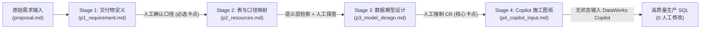

# Copilot 需求交付 Skill 如何实现数据需求24h交付

> [!abstract] 导读
> **一句话总结**：淘天集团直播技术数据团队（作者：冷星）针对 DataWorks Copilot 直接写复杂 SQL 时面临的“手写结构化 Prompt 极累、复杂嵌套 CTE 生码崩溃、多轮对话熵增退化、评审后无口径锚点、多需求串行排队”五大痛点，设计并落地了基于 **Spec Coding（规约驱动编程）与渐进式披露（Progressive Disclosure）** 的数据需求交付技能 `copilot_req2sql`——通过 `P1 需求澄清 → P2 资源与口径梳理 → P3 模型设计（人工强 CR） → P4 无状态 Copilot 施工图纸` 四阶段文档链，将传统“依赖人连续投入的串行排期”重塑为“Agent 自动并行推进、人按优先级在 P1/P3 介入决策”的新范式，实现清晰数据需求 **24 小时内端到端交付**。
> **阅读价值**：不仅是一篇数仓 Text-to-SQL 的实战指南，更透彻阐明了 **Agent Skill 的渐进式披露目录设计** 以及 **“如何用分阶段落盘的 Spec 锚点把有状态的多轮对话降维成无状态的精准翻译”**。

## 1. TL;DR

- **核心定位**：`copilot_req2sql` 是一个运行在 MaxCompute（ODPS）+ DataWorks 技术栈上的数据需求交付 Agent Skill。输入为来自 Aone、钉钉聊天或 PRD 的原始业务需求，输出为一份经过人类确认、自包含的结构化 Prompt（`p4_copilot_input.md`），交由 DataWorks Copilot 一键翻译为 **0 人工修改的高质量生产 SQL**。
- **直接用 Copilot 写复杂 SQL 的五大痛点**：
  1. **手工组织 Prompt 心智负担重**：人脑需同时拼装业务口径、底表 Schema、数仓规范与提示词格式，准备半小时不如自己手写。
  2. **复杂嵌套逻辑生码即崩**：面对多数据源、多层 CTE 与事件配对逻辑，无 Spec 约束的 LLM 一旦猜错一步（编造表名、聚合粒度错），整段 SQL 报废。
  3. **多轮对话“熵增定律”**：在单 Session 里反复修 Bug 导致上下文越来越长、注意力衰减，而重开新会话又会丢失全部前置讨论。
  4. **需求评审后缺乏确定性中间锚点**：“薛定谔的口径共识”（如“普通确收金额” vs “锁支付确收金额”）直到几天后验数时才暴雷。
  5. **前置准备阻塞导致多需求只能串行排期**：查表、对口径、写方案强依赖人的连续注意力，无法并行推进 3~5 个需求。
- **破局核心（四阶段 Spec 锚点链 + 渐进式披露）**：
  - **四阶段落盘工作流**：`P1 交付物定义与澄清（人确认） → P2 表/口径搜索与探查校验 → P3 数据模型设计（人强制 CR） → P4 生成无状态 Copilot 施工图纸`。
  - **渐进式披露架构**：主文件 `SKILL.md` 仅 200 行路由与核心规则，7 组参考示例与 ETL 规范存放在 `references/` 下按 P1–P4 阶段动态加载，杜绝 Lost in the Middle。
  - **串行变并行**：每个需求拥有独立的 `specs/yyyymmdd_{任务名}/` 目录，Agent 后台并行推进多个需求的 P1–P3 准备，研发仅在 P1 确认和 P3 CR 时异步切入，达成 **24h 极速交付**。

## 2. 问题定义与背景

### 2.1 为什么“SOTA 大模型 + DataWorks Copilot”在真实数仓场景仍不够用？
对于“口径清晰、来源表明确、表关联关系已知”的简单取数，Copilot 10 分钟就能写出可用 SQL。但在淘宝直播真实数据研发中，**这三大前提恰恰是最稀缺的**：
- 业务方提需求往往只有一句模糊描述（如*“看下双11各玩法红包曝光、领取、核销和成交效果”*）或复杂的埋点配对逻辑（如*“计算全链路 12 个事件耗时，取事件 1019 后的第一条 1021/1023/1026”*）。
- 传统模式下，从“模糊业务语言”到“精确数据语义”中间缺失了一层**可被业务方和数据研发共同审查的翻译锚点**。

### 2.2 传统网页端 Copilot 直出 vs. `copilot_req2sql` Spec Coding 对比

| 痛点维度 | 传统网页端 Copilot 多轮直出 | `copilot_req2sql` 四阶段 Spec Coding |
| :--- | :--- | :--- |
| **对抗痛点 1：写 Prompt 累** | 人肉翻文档查表、梳理字段映射，准备半小时 | P1–P3 由 Agent 自动拉取语义层与表结构，P4 自动合成完整 Prompt |
| **对抗痛点 2：复杂 SQL 易崩** | LLM 边猜业务语义边写 SQL，一步错全盘重写 | 在 P3 提前锁定 CTE 拆解、JOIN 逻辑与伪代码，Copilot 在 P4 只做确定性“翻译” |
| **对抗痛点 3：多轮对话熵增** | 单会话反复纠错导致上下文膨胀、模型变笨 | P4 是**独立自包含的无状态交互物**，随时开启干净会话直接生码 |
| **对抗痛点 4：口径薛定谔共识** | 评审靠口头和群聊记录，验数才发现口径不一致 | P1（指标口径确认）与 P3（模型设计 CR）将 Review 左移到写代码之前 |
| **对抗痛点 5：多需求串行排队** | 人脑单线程查表定方案，需求排队等待 | 多需求独立 Spec 目录由 Agent 并行跑 P1–P3，人按优先级异步介入 |

## 3. 知识框架

```mermaid
mindmap
  root((copilot_req2sql 数据需求24h交付体系))
    五大业务痛点诊断
      手工拼装复杂 Prompt 耗时费力
      多源多层 CTE 复杂逻辑直接生码崩溃
      长会话多轮纠错触发熵增与失忆
      需求评审缺乏口径锚点（薛定谔共识）
      前置准备占用连续注意力导致串行排期
    核心架构：四阶段 Spec 锚点工作流
      Stage 1 (p1_requirement.md)：提取维度与指标，单问题多选式严格澄清
      Stage 2 (p2_resources.md)：对接语义层知识库查常用口径 + 人工探查生僻表
      Stage 3 (p3_model_design.md)：生成加工流程图/DDL/伪代码（人工强制 CR）
      Stage 4 (p4_copilot_input.md)：剥离历史讨论，输出无状态自包含施工图纸
    关键工程机制
      标准 Spec 目录隔离（stages/ + proposal/ + workflow_events.jsonl）
      渐进式披露（200行 SKILL.md 主路由 + references/ 7组按阶段加载文档）
      异步并行协作范式（Agent 并行推 P1-P3，人聚焦 P1 确认与 P3 CR）
    能力边界认知
      Spec Coding 解决“翻译层与上下文管理”，不替代“专家决策层”
      分区策略、宽表vs星型建模、复杂 JOIN 兜底仍需人类压舱石
```

## 4. 核心内容拆解

### 4.1 标准化 Spec 目录结构与四阶段递进工作流

每个数据需求在本地都会初始化一个独立的标准工作空间，所有中间状态落盘归档，彻底摆脱对单次聊天窗口的依赖：

```text
specs/
└── yyyymmdd_{任务名}/
    ├── stages/                     # Agent 按阶段自动生成并经人工确认的 Spec 锚点链
    │   ├── p1_requirement.md       # 阶段1：维度、指标、时间范围与过滤口径澄清结果
    │   ├── p2_resources.md         # 阶段2：映射后的底表 Schema、分区信息与取数伪代码
    │   ├── p3_model_design.md      # 阶段3：完整数据模型设计（DDL、CTE拆解、JOIN逻辑）
    │   ├── p4_copilot_input.md     # 阶段4：交付给 DataWorks Copilot 的无状态终态 Prompt
    │   └── workflow_events.jsonl   # 全流程工作流事件审计日志，便于排障回溯
    └── proposal/                   # 人工放入的原始需求输入
        └── yyyymmdd_proposal.md    # 从 Aone、钉钉或 PRD 复制的原始需求文本
```



#### 1. 阶段 1（P1 交付物定义）：五条铁律消除“薛定谔的口径”
Agent 从自然语言中自动抽取出**时间周期、分析维度、核心指标**，并遵循五条严格的交互澄清原则与用户逐项确认：
- **一次只问一个问题**（避免多问题堆叠导致遗漏）；
- **多选优先**（给出候选口径选项降低用户输入负担）；
- **追问模糊点，绝不猜测**；
- **严禁篡改用户原始字段名**；
- **有表名填表名，无表名明确标“暂无”**（严禁大模型自行脑补不存在的数仓表名）。

#### 2. 阶段 2（P2 表与口径搜索 + 校验）：语义层自动化 + 人工探查互补
- **高频常用口径（自动闭环）**：Agent 自动检索直播数据团队沉淀的**语义层知识库（Semantic Layer）**，调用 DataWorks API 拉取底表 DDL 校验字段与分区是否满足，直接生成映射草案。
- **低频生僻/新表口径（人工赋能）**：对于语义层未覆盖的临时口径，由数据研发手写探查 SQL 确认字段分布与分区后告知 Agent，由 Agent 规范化整理进 `p2_resources.md`。

#### 3. 阶段 3（P3 模型设计）：为什么这是必须人工强 CR 的决定性环节？
作者揭示了一条核心因果链：**`P3 模型设计质量 → P4 交互物质量 → Copilot 最终生码质量`**。
- Agent 会根据数仓规范自动完成约 **90%** 的模型设计草案（加工步骤拆解、数据流向图、目标表 DDL、各层 CTE 伪代码）。
- **人工强制 CR 的不可替代性**：直播数仓规范极其庞杂（表命名、指标命名、业务黑话），且诸如**“选宽表还是星型模型”、“按天分区还是按小时分区”、“存累加值还是快照值”**等架构权衡必须依赖人类数据工程师的领域判断。在 P3 把 DDL 分区策略和 JOIN 伪代码审对，就是为 P4 上好最高效的保险。

#### 4. 阶段 4（P4 Copilot 交互物）：把“有状态长对话”降维成“无状态施工图纸”
- P4 将 P3 确认后的终态结论（需求背景、维度指标清单、来源表与字段映射、目标 DDL、CTE 伪代码及编码规范）打包成一份**完全自包含、无状态的 Prompt**。
- DataWorks Copilot 拿到 P4 时，无需关心 P1~P3 经历了多少轮曲折的口径拉扯，只需扮演纯正的“代码翻译官”，从而实现一次性生成 **0 人工修改** 的生产级 SQL。

### 4.2 Skill 工程精髓：渐进式披露（Progressive Disclosure）

为什么不直接写一个 3000 行的超级 Prompt 模板，而要封装成 Agent Skill？核心在于对抗大模型的注意力稀释与规则串扰：

```text
SKILL.md                            <-- 主入口（仅约 200 行）：全局状态机路由与核心红线，Agent 始终可见
└── references/                     <-- 阶段参考库：仅当工作流推进到对应阶段时才按需动态加载
    ├── requirement_example/        <-- 仅在 P1 阶段加载（需求澄清模板与正反例）
    ├── resource_example/           <-- 仅在 P2 阶段加载（表结构映射与探查规范）
    ├── model_design_example/       <-- 仅在 P3 阶段加载（数仓建模与伪代码范例）
    ├── copilot_input_example/      <-- 仅在 P4 阶段加载（Copilot 终态 Prompt 组装模板）
    ├── etl_rules/                  <-- 全阶段按需共享（离线 ETL 与指标命名规范）
    └── workflow_explaination/      <-- 框架层（事件记录与阶段流转协议）
```

通过这种**“主干路由极简 + 阶段知识按需挂载”**的设计，确保大模型在 P1 澄清时不会被 P3 的 SQL 语法规则干扰，在 P3 建模时每一条数仓规范都能获得最高的注意力权重。

## 5. 数据速查表

| 维度 / 阶段 | 输入与核心动作 | 落盘产物 | 人类角色与介入深度 |
| :--- | :--- | :--- | :--- |
| **Stage 1：需求澄清** | 解析 `proposal.md`，提取维度/指标并单步多选追问 | `p1_requirement.md` | **强制确认卡点**：确认业务口径无歧义 |
| **Stage 2：资源梳理** | 检索直播语义层知识库 + DataWorks API 查表结构 | `p2_resources.md` | **按需介入**：常用表全自动，仅生僻表需人工探查输入 |
| **Stage 3：模型设计** | 自动生成加工链路、目标 DDL、CTE 与 JOIN 伪代码 | `p3_model_design.md` | **核心强制 CR 卡点**：审查建模范式、分区策略与 JOIN 正确性 |
| **Stage 4：交互物生成** | 剥离过程噪音，合成为自包含无状态施工图纸 | `p4_copilot_input.md` | 无需人工编写，直接复制给 Copilot 生码并对最终 SQL 做上线前审计 |
| **整体效能跃迁** | 串行排期变为多需求 `specs/` 并行推进 | 完整可追溯 Spec 资产包 | 清晰口径需求实现 **24 小时内端到端交付**，实战案例 **0 手改代码** |

## 6. 踩坑与教训 / 可迁移的设计原则

- **核心认知 1：Spec Coding 不是为了消除人工审查，而是为了让 AI 产出“更易被人类审计”**
  - **教训**：直接在几百行生成的复杂 SQL 里肉眼找一个隐蔽的口径偏差或笛卡尔积 JOIN 极其痛苦；但在 `p1_requirement.md` 和 `p3_model_design.md` 的结构化表格与伪代码里发现问题只需几分钟。
  - **原则**：**把 Review 从“代码写完后”左移到“Spec 阶段”**，用两道轻量级文档确认（P1 + P3）省去后面十轮痛苦的 SQL Debug。
- **核心认知 2：把多轮有状态对话（Stateful）转化为终态无状态输入（Stateless）**
  - **原则**：任何复杂生成任务，都应把“探索与澄清过程”和“最终代码生成过程”彻底物理隔离——用前序阶段产出干净的 `p4_input.md`，再开全新上下文一次性生成最终代码，彻底免疫多轮对话熵增。
- **核心认知 3：清醒认识 AI 在数仓领域的边界**
  - Spec Coding 解决的是“沟通对齐成本”与“上下文拼装成本”，但无法替代数据研发对**数据倾斜防治、分区粒度权衡、核心业务 JOIN 逻辑**的专业判断。

## 7. 记忆锚点

- **一个交付目标与核心工具**：通过 **`copilot_req2sql` Skill** 实现数据需求 **24h 交付**。
- **四张递进图纸（P1–P4）**：**P1 需求澄清表 $\rightarrow$ P2 底表资源图 $\rightarrow$ P3 模型设计蓝图（人工强 CR） $\rightarrow$ P4 无状态 Copilot 施工图纸**。
- **两个核心设计机制**：**渐进式披露（200 行主路由 + 7 组阶段按需引用）** + **有状态澄清与无状态生码解耦**。
- **一种工作模式转变**：从“人守着单需求串行排期”变为“**Agent 后台并行推 P1-P3，人按优先级异步卡点决策**”。

## 8. 复习卡片

What are the five major pain points of using an LLM/Copilot directly to generate complex warehouse SQL without a Spec-driven workflow?::1. High cognitive load of manually assembling prompts; 2. Poor code quality on complex multi-CTE logic where one wrong guess ruins the whole query; 3. Multi-turn conversation entropy/degradation; 4. Lack of agreed-upon intermediate specification artifacts after requirement reviews ("Schrödinger's consensus"); 5. Serial scheduling bottlenecks caused by manual preparation work.
What are the four sequential stages and corresponding markdown artifacts produced by the `copilot_req2sql` skill?::Stage 1: Deliverable Definition (`p1_requirement.md`); Stage 2: Table & Metric Mapping (`p2_resources.md`); Stage 3: Data Model Design (`p3_model_design.md`); Stage 4: Stateless Copilot Input Prompt (`p4_copilot_input.md`).
How does Progressive Disclosure work inside the `copilot_req2sql` Skill architecture to prevent context overload?::The main `SKILL.md` file is kept concise (~200 lines) containing only workflow routing and core rules, while 7 sets of detailed templates, examples, and ETL rules live under `references/` and are loaded dynamically on-demand only when the agent enters the corresponding P1–P4 stage.
Why is human Code Review mandatory at Stage 3 (`p3_model_design.md`) before generating the Stage 4 Copilot prompt?::Because P3 determines the quality ceiling of P4 and the final SQL; architectural decisions like wide-table vs. star-schema modeling, partitioning granularity, and complex JOIN edge cases require human domain expertise and cannot be safely left to LLM guesswork.
How does `copilot_req2sql` neutralize the "entropy law of multi-turn conversations" when generating the final SQL?::By distilling all confirmed conclusions from P1–P3 into a standalone, self-contained `p4_copilot_input.md` file that carries zero chat history, effectively turning final SQL generation in DataWorks Copilot into a clean, stateless translation task.
How does the `copilot_req2sql` skill transform data engineers' multi-requirement scheduling from serial to parallel?::Each requirement gets an isolated `specs/yyyymmdd_{task}/` workspace where agents run P1–P3 preparation in parallel in the background, allowing engineers to asynchronously context-switch and intervene only at high-leverage decision checkpoints (P1 confirmation and P3 model review).

## 9. 知识关联

- **本批同主题精读**：
  - [百亿补贴 C 端 AI Coding 实战：基于 SDD 的服务端 AI Coding 实践](../百补服务端SDD实践+26.7.27/AI_百补服务端SDD实践.md)：本文在数据研发（SQL）领域践行 Spec Coding + 渐进式披露，与百补服务端在 Java 领域践行 SDD + 自进化记忆体形成了跨技术栈的完美印证。
  - [Agent Skill 系统设计：从概念到工程落地](../Agent Skill系统设计+26.7.1/AI_Agent Skill系统设计.md)：深入阐述了 `SKILL.md` + `references/` 渐进式披露的通用系统设计规范。
  - [QoderWork 数科 Skills 建设实践](../QoderWork数科Skills+26.6.26/AI_QoderWork数科Skills.md)：同属数据科学/数据研发领域的 Agent Skills 工程化实践，可对比两者在数据探查、口径对齐与自动化分析上的技能编排设计。
- **上批关联精读**：
  - [AI时代的数据研发-Semantic（语义层）实践总结](../数据研发Semantic语义层+26.8.16/AI_数据研发Semantic语义层.md)：详细拆解了本文在 Stage 2 中所依赖的“直播数据语义层知识库”是如何构建与演进的。
- **主题索引（`20_topics`）**：
  - [AI研发协同](../../20_topics/AI研发协同.md)
  - [Skill设计与治理](../../20_topics/Skill设计与治理.md)
  - [Harness与模型协同](../../20_topics/Harness与模型协同.md)
- **本目录归档文件**：[原始 PDF](RAW.pdf) · [逐页转写文本](MD.md)
- **候选概念双链**：[[Spec-Coding]] · [[渐进式披露]] · [[Agent-Skill]] · [[数据语义层]] · [[DataWorks-Copilot]] · [[无状态Prompt]]

## 10. 原文参考资料

- **原文出处**：大淘宝技术公众号，《Copilot 需求交付 Skill 如何实现数据需求24h交付》（作者：冷星，淘天集团-直播技术数据团队，发布日期：2026-07-19）

> [!note]- 校对报告
> - **页码溯源（1-based 物理页码）**：
>   - 篇首标题、作者（冷星，直播技术数据团队）、技术栈说明（MaxCompute + DataWorks + Agent Skill）与 AI 生成 SQL 的五大真实痛点：源自 `RAW.pdf` `p.1–5`（对应 `MD.md` 第 1–5 页）。
>   - `copilot_req2sql` 定义、`specs/yyyymmdd_{任务名}/` 目录结构、四阶段工作流与直播活跃用户统计 24h 交付实战案例：源自 `RAW.pdf` `p.5–10`（对应 `MD.md` 第 5–10 页）。
>   - 核心能力拆解：渐进式披露（`SKILL.md` 约 200 行 + `references/` 7 组按需加载文件）、P1 五条澄清原则、P2 语义层检索与人工探查互补、P3 因果链与人工强制 CR、P4 无状态施工图纸：源自 `RAW.pdf` `p.10–15`（对应 `MD.md` 第 10–15 页）。
>   - Spec Coding 对抗五大痛点的逐一映射、多需求并行推进价值、能力边界剖析与总结展望：源自 `RAW.pdf` `p.15–19`（对应 `MD.md` 第 15–19 页）。
> - **一致性核验**：原文共 19 页（含 13 页流程图与实操截图），文中第 11 页展示了 `SKILL.md` 与 `references/` 的 8 行目录树结构，但并未公布 200 行 `SKILL.md` 的完整原文（故不单独生成 `SKILL.md` 附件，目录树已在笔记第 4.2 节完整收录）。全文零正文内页码引用，所有细节与 `MD.md` 严格一致。
