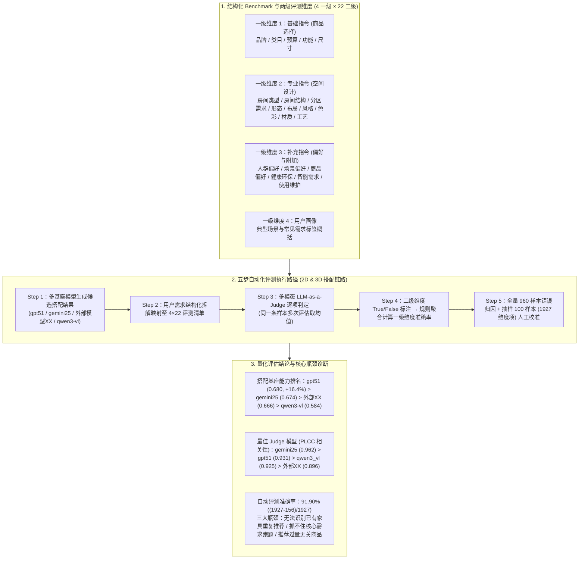

# 面向智能导购的Agent评测实践

## 1. TL;DR

1. **端到端家装导购 Agent 自动化评估闭环**：针对淘宝家装 AI 智能导购应用“放我家”在 2D/3D 空间家具搭配中的复杂个性化需求，构建了“**Benchmark 创建 $\rightarrow$ 多模态 LLM-as-a-Judge 交叉评审 $\rightarrow$ 人工抽样验收校准 $\rightarrow$ 自动化回归报告与错误归因**”四模块五步评测流水线。
2. **两级结构化评价体系（4 大一级维度 + 22 项二级维度）**：将用户图文需求拆解为**基础指令维度（品牌/类目/预算/功能/尺寸）**、**专业指令维度（房间类型/房间结构/分区需求/形态/布局/风格/色彩/材质/工艺）**、**补充指令维度（人群偏好/场景偏好/商品偏好/健康环保/智能需求/使用维护）**与**用户画像维度**；二级维度以 `True/False` 原子判定后再聚合计算一级维度准确率。
3. **四基座模型与四评审模型交叉评测结论**：在 **960 条**测试样本上对 4 种基座模型交叉评分发现，**`gpt51`（总分 `0.680`）综合表现最优，较当前线上基座 `qwen3-vl`（总分 `0.584`）提升 `16.4%`**（排名：`gpt51 > gemini25 [0.674] > 外部模型XX [0.666] > qwen3-vl [0.584]`）；在评审模型一致性（与多模型均值基准的 PLCC 相关性）上，**`gemini25`（PLCC `0.962`）最为稳定可靠**。
4. **91.90% 自动评判准确率与三大共性瓶颈定位**：随机抽样 **100 条样本（共 1,927 个评测维度项，仅 156 项误判）** 人工复核证实 LLM-as-a-Judge 准确率达 **`91.90%`**；同时精准识别出当前所有搭配 Agent 的三大核心瓶颈：**无法识别已有家具导致重复推荐（最高频）、未抓住核心需求导致跑题、推荐过量无关商品**。

## 2. 问题定义与背景

### 2.1 家居空间导购 Agent 的评估难题

在“放我家”等家居家装智能导购场景中，用户的输入不仅包含图文混合的房间现状（如已有床和书桌、采光与动线限制），还叠加了多维度的软装风格、家庭成员结构（儿童/老人/宠物）与预算功能约束。传统人工抽检面临三大痛点：
- **成本高、耗时长**：无法支撑模型版本与提示词策略的高频全量回归；
- **主观性强、难复现**：不同评审员对“北欧风是否协调”、“动线是否合理”标准不一；
- **缺乏细粒度退化归因**：版本升级后难以快速定位究竟是空间结构理解退化还是商品属性过滤失效。

## 3. 知识框架

## 4. 核心内容拆解

### 4.1 四大一级维度与细粒度二级指标设计

为将主观的“家装搭配好不好”转化为客观可复现的二元判定（`True/False`），团队构建了双层解耦指标树：
1. **基础指令维度（聚焦单品硬约束）**：涵盖**品牌**（指定品牌/进口/环保）、**类目**（床/书桌/玩具收纳柜/餐边柜/空气净化器等）、**预算**（价位带如 `500–2000`、是否接受定制）、**功能**（可升降/带储物/折叠/护眼照明/防滑）与**尺寸**（兼容空间动线、儿童身高、老人便利）。
2. **专业指令维度（聚焦空间设计与美学）**：涵盖**房间类型**、**房间结构**（识别图片或文本中的“已有家具”、剩余空间、光线与墙面利用）、**分区需求**（如儿童房绘本阅读角/编程桌/午休帐篷，客厅观影区/宠物区/老人康复区）、**形态**（直线/L 型/U 型/开放 vs 封闭收纳）、**布局**（靠墙/转角）、**风格**、**色彩**、**材质**與**工艺**（圆角防撞/抗指纹/易拆洗）。
3. **补充指令维度（聚焦软性偏好与附加条件）**：涵盖**人群偏好**（儿童护眼防撞、老人柔光扶手低噪、宠物耐抓易清洁、婴儿安全可视、夫妻观影护肤）、**场景偏好**、**商品偏好**（口碑/销量/明星同款/最省空间）、**健康环保**（无异味/抗菌防霉）、**智能需求**与**使用维护**。
4. **用户画像维度**：综合评估对目标人群典型行为模式与潜在生活方式的契合度。

### 4.2 多模型交叉评审实验与 Judge 可信度校准

团队使用 4 种多模态大模型——**外部模型 XX**、**`gemini25`（`gemini-2.5-pro-06-17`）**、**`gpt51`（`gpt-51-1113-global`）**、**`qwen3-vl`（`qwen3-vl-235b-a22b-instruct`）**——既作为被测搭配生成模型，又作为交叉评审模型（每条样本多次评估取均值）：
1. **被测基座模型搭配能力横向对比**：
   - **`gpt51` 夺冠（总分 `0.680`）**：在基础指令（`0.692`）与专业指令（`0.799`）两项核心硬指标上全面领先，较当前线上基座 `qwen3-vl`（总分 `0.584`）大幅提升 **16.4%**。
   - **第二梯队各有专长**：`gemini25`（总分 `0.674`）在**用户画像维度（`0.581`）**拔得头筹；`外部模型XX`（总分 `0.666`）在**补充指令维度（`0.670`）**略占优。
   - **`qwen3-vl` 差距明显（总分 `0.584`）**：四个一级维度得分均垫底（尤其是用户画像仅 `0.445`），明确了线上模型升级的直接收益空间。
2. **哪个大模型最适合当“裁判（Judge）”？（PLCC 相关性分析）**：
   - 将 4 个评审模型在同一批样本上的平均分作为“基准分”，计算各评审模型与基准分的皮尔逊线性相关系数（PLCC）：**`gemini25` 以 `0.962` 位居第一**（高于 `gpt51` 的 `0.931`、`qwen3_vl` 的 `0.925` 和 `外部模型XX` 的 `0.896`），被确立为最稳定的主力自动化评审模型。
3. **人工抽样复核与六大误判/缺陷归因**：
   - 随机抽取 **100 条样本**（总计 **1,927 个评测维度项**）进行人工逐项复核，确认误判仅 **156 项**，自动化评审整体准确率达 **$(1927 - 156) / 1927 = 91.90\%$**。
   - 聚合全部 **960 条样本**暴露出三大高频共性缺陷（以及细分六类问题：重复/冲突搭配、类目/功能缺失、智能化需求未响应、尺寸不合理、人群画像不匹配、场景定位或审美偏差）：
     1. **无法识别已有家具导致重复推荐（最高频）**：忽略输入图文中的存量床、沙发、餐边柜，重复塞入同类大件家具；
     2. **未抓住核心需求导致跑题**：多约束下主次颠倒（如用户核心诉求是“改善光线与阅读区”，模型却推荐装饰摆件）；
     3. **推荐过量无关商品**：在仅需微调的场景下堆砌冗余单品，破坏空间动线与预算控制。

## 5. 数据速查表

| 被测模型 / 评审模型 | 基础指令 | 专业指令 | 补充指令 | 用户画像 | 总分 / 关键结论 | Judge PLCC 相关性 |
| :--- | :--- | :--- | :--- | :--- | :--- | :--- |
| **`gpt51` (`gpt-51-1113-global`)** | **`0.692`** | **`0.799`** | `0.668` | `0.560` | **`0.680`（第一，较线上 `+16.4%`）** | `0.931`（第二） |
| **`gemini25` (`gemini-2.5-pro-06-17`)** | `0.681` | `0.766` | `0.668` | **`0.581`** | `0.674`（第二，画像最优） | **`0.962`（最佳 Judge）** |
| **`外部模型XX`** | `0.665` | `0.786` | **`0.670`** | `0.543` | `0.666`（第三，补充指令最优） | `0.896`（第四） |
| **`qwen3-vl` (`235b-a22b-instruct`)** | `0.598` | `0.720` | `0.572` | `0.445` | `0.584`（当前线上基线） | `0.925`（第三） |
| **评测样本与人工复核规模** | — | — | — | — | 全量 **`960` 条**；人工抽检 **`100` 条（`1,927` 维度项，误判 `156` 项）** | 自动评测准确率 **`91.90%`** |

## 6. 踩坑与教训 / 可迁移的设计原则

1. **用“二级原子 `True/False` 判定 + 规则向上聚合”替代让 LLM 直接打主观总分**：如果让 Judge 模型直接给方案打 1–10 分，方差极大且不可解释；将需求拆解为 22 个二级维度做布尔判定（满足/不满足）后再汇总为 4 个一级维度准确率，可将人机一致性推高至 91.90%。
2. **“生成能力最强”的模型未必是“评审最稳”的模型**：实验表明 `gpt51` 在生成家装搭配方案时总分第一（`0.680`），但作为 Judge 评审员时，`gemini25` 与多评审员共识基准的 PLCC 相关性最高（`0.962`）。构建评测台时应通过多模型交叉投票与 PLCC 优选专门的 Judge 基座。
3. **多模态空间导购 Agent 必须专项强化“存量物体感知与负向抑制”**：960 条样本归因显示，最高频的 Bad Case 并非推荐不够丰富，而是“看不见图里已有的床/沙发而重复推荐”以及“过度推荐填满空间”；必须在工作流前置增加存量家具检测与互斥约束卡点。

## 7. 记忆锚点

- **一套两级指标树**：**4 个一级维度**（基础指令 / 专业指令 / 补充指令 / 用户画像）$\times$ **22 个二级维度**（`True/False` 原子判定）。
- **两个标杆模型分工**：生成搭配选 **`gpt51`**（总分 `0.680`，较线上 `qwen3-vl` 提升 `16.4%`）；自动化评审 Judge 选 **`gemini25`**（PLCC 相关性 `0.962`）。
- **三组核心验证数字**：全量归因样本 **`960` 条**、人工抽样复核 **`100` 条（`1,927` 维度项，误判 `156` 项）**、Judge 准确率 **`91.90%`**。
- **三大共性搭配瓶颈**：无法识别已有家具（重复推荐）+ 未抓住核心需求（跑题）+ 推荐过量无关商品（输出过度）。

## 8. 复习卡片

1. “放我家”智能导购 Agent 的自动化评估体系由哪四个核心模块组成？::由 Benchmark 创建、LLM 模拟人工评测（多模型投票与多次评估取均值）、人工抽样验收校准（质量闸门）、以及自动化全量回归评测与报告产出四个模块组成。
2. 导购 Agent 评测体系的“4 个一级维度”分别是什么？二级维度采用什么形式打分？::四个一级维度为基础指令维度（商品选择相关）、专业指令维度（空间设计相关）、补充指令维度（偏好与附加条件）和用户画像维度；下属 22 个二级维度统一采用 `True/False`（满足/不满足）形式判定，再按规则聚合计算一级维度准确率。
3. 在四款基座模型（`gpt51`、`gemini25`、`外部模型XX`、`qwen3-vl`）的横向评测中，生成搭配能力与评审（Judge）一致性分别谁最优？::在生成搭配能力上，`gpt51` 总分最高（0.680），较线上 `qwen3-vl`（0.584）提升 16.4%；在作为 Judge 评审模型时，`gemini25` 与多模型均值基准的 PLCC 相关性最高（0.962），评审最为稳定。
4. 团队是如何验证 LLM-as-a-Judge 在家装导购场景下的评判准确率的？具体数值是多少？::从评测集中随机抽取 100 条样本（涵盖 1,927 个评测维度项）进行人工逐项复核，发现仅 156 项误判，整体准确率达到 $(1927 - 156) / 1927 = 91.90\%$。
5. 对全部 960 条测试样本进行问题聚合后，发现当前多模态搭配 Agent 最突出的三大共性瓶颈是什么？::一是无法识别输入图片或文本中的“已有家具”导致重复推荐（出现频率最高）；二是在多维约束下未抓住用户核心需求导致输出跑题；三是推荐过量无关商品导致输出过度。

## 9. 知识关联

- **所属主题**：
  - [Agent评测与反馈](../../20_topics/Agent评测与反馈.md)
  - [推荐系统与多模态评测](../../20_topics/推荐系统与多模态评测.md)
  - [因果推断与评测归因](../../20_topics/因果推断与评测归因.md)
- **本地跃迁**：[原始 PDF](RAW.pdf) · [逐页转写文本](MD.md)
- **候选双链**：[[高价率工作台评测优化]] · [[Agent-Memory评测全景]] · [[TLiveOmni直播多模态大模型]] · [[面向LLM的AI Friendly架构]]

## 10. 原文参考资料

1. **前沿 Agent 基准参考**：
   - **WideSearch**（ByteDance Seed）：`https://widesearch-seed.github.io/`
   - **VisualAgentBench**（THUDM）：`https://github.com/THUDM/VisualAgentBench`
   - **DeepResearch Bench**：`https://deepresearch-bench.github.io/`
2. **参评多模态大模型版本**：`gpt-51-1113-global` (`gpt51`)、`gemini-2.5-pro-06-17` (`gemini25`)、`qwen3-vl-235b-a22b-instruct` (`qwen3-vl`)

> [!note]- 校对报告
> - **页码溯源**：p.1–2（家装 AI 导购“放我家”背景、四模块整体方案与五步落地执行路径）；p.3–5（基础指令/专业指令/补充指令/用户画像 4 大一级维度与 22 项二级维度完整定义表、数据集多样性与挑战性构建）；p.5–7（4 种基座模型 `外部模型XX`/`gemini25`/`gpt51`/`qwen3-vl` 交叉评测得分表、`gpt51` 0.680 较 `qwen3-vl` 0.584 提升 16.4%、评审模型 PLCC 相关性 `gemini25` 0.962 第一）；p.7–9（960 条样本三大核心瓶颈聚合、100 条抽样 `(1927-156)/1927 = 91.90%` 自动评测准确率、156 条误判的六大类问题归因与总结展望）。
> - **一致性核验**：作者（阿元，淘天集团-场景智能技术团队）、发布时间（2026-05-15）、所有模型版本号、分维度得分、PLCC 系数与准确率计算公式均与原文逐字核对一致；正文中无任何内联页码引用。
> - **质量边界**：文中“外部模型XX”为原文脱敏表述，已原样保留。
