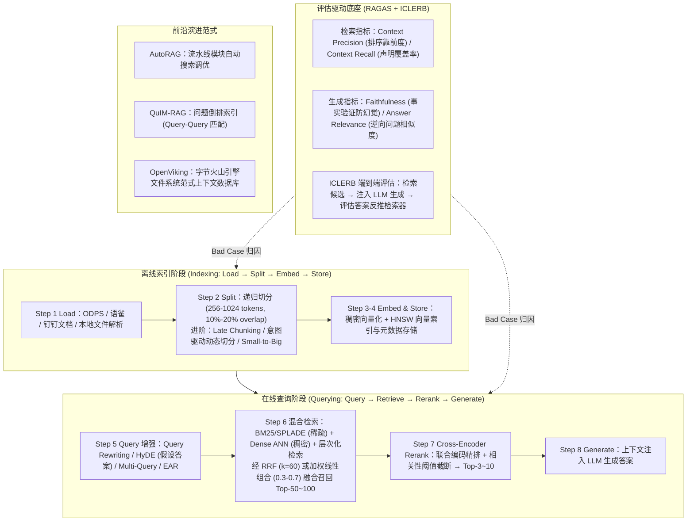

# 如何构建一个更“好”的知识库？

## 1. TL;DR

1. **知识库定位与边界决策**：知识库是 Agent 架构中的非参数化外部记忆系统（源自 2020 年 Lewis 等人提出的 `Parametric + Non-Parametric Memory` 范式）。当数据量 `< 50K tokens` 且更新频率低时优先选 Long Context；数据量大、更新频繁或需精确召回时采用 RAG，或采用“RAG 粗筛 + Long Context 精读”混合架构。
2. **评估先行（RAGAS + ICLERB）**：使用无参考评估框架 **RAGAS** 从检索质量（`Context Precision`、`Context Recall`）与生成质量（`Faithfulness` 忠实度、`Answer Relevance` 答案相关性）拆解定位故障根因；结合 **ICLERB** 端到端评估理念，克服“语义相似 $\neq$ 对 LLM 生成有用”的局限。
3. **高阶文档切分（Chunking）选型**：实证研究表明纯“语义切分（Semantic Chunking）”计算成本高而收益有限，“递归切分 + 10%–20% 重叠”是高性价比基线；进阶场景引入 **Late Chunking**（基于长上下文 Embedding 先全局编码再切分）、**意图驱动动态切分**（准确率提升 `5%–67%`、分块数减少 `40%–60%`）与 **Small-to-Big** 策略。
4. **检索增强、RRF 融合与 Cross-Encoder 精排**：在线查询链路通过 **HyDE**、**Multi-Query** 与 **EAR**（领域内/外 Top-5/20 准确率提升 `3–8` / `5–10` 个点）增强 Query，采用“BM25 稀疏 + Dense 稠密”混合检索经 **RRF（$k=60$）** 融合召回 `Top-50~100`，再由 **Cross-Encoder Reranker** 精排截取 `Top-3~10` 送入 LLM；并探索 **AutoRAG**、**QuIM-RAG**（问题倒排索引）与 **OpenViking**（文件系统范式）等前沿架构。

## 2. 问题定义与背景

### 2.1 从参数化记忆局限到非参数化知识库

2020 年 Meta AI（原 FAIR）在 NeurIPS 论文 *Retrieval-Augmented Generation for Knowledge-Intensive NLP Tasks* 中将预训练 Seq2Seq 模型权重构成的**参数化记忆（Parametric Memory）**与基于 DPR（Dense Passage Retriever）构建的密集向量索引**非参数化记忆（Non-Parametric Memory）**相结合。在 Agent 构建语境下，知识库的核心接口即为**上传（离线索引）**与**召回（在线检索）**，旨在解决基座模型知识静态过时、私有领域知识缺失、长尾事实幻觉以及缺乏可解释溯源的问题。

### 2.2 RAG 与超长上下文（Long Context）的工程边界

随着 Claude 200K、Gemini 1M+ 等长窗口模型普及，工程选型遵循明确边界：
- **直接采用 Long Context**：数据总量 `< 50K tokens`、更新频率低、无需跨海量文档精确定位。
- **构建 RAG 知识库**：语料规模庞大、动态更新频繁、对单次推理延迟与 Token 成本敏感、需严格溯源防幻觉。
- **混合架构**：通过 RAG 检索粗筛候选章节，再交由 Long Context 模型一次性精读推理。

## 3. 知识框架

## 4. 核心内容拆解

### 4.1 知识库质量评估体系：RAGAS 与 ICLERB

1. **RAGAS 四大核心指标**：
   - **Context Precision（上下文精确率）**：评估相关文档片段是否被排在前列（例如召回 5 个 chunks 中，2 个相关片段排在第 1、2 位显著优于排在第 4、5 位）。
   - **Context Recall（上下文召回率）**：将参考答案（Reference）拆解为多条独立声明（Claims），检验每条声明是否可归因于召回上下文并计算占比（需参考答案，非纯 Reference-free）。
   - **Faithfulness（忠实度，取值 $[0, 1]$）**：使用 LLM 从生成答案中提取全部声明，逐条验证是否可由检索上下文推断，直接度量模型幻觉率。
   - **Answer Relevance（答案相关性）**：从生成答案反向让 LLM 生成候选问题，计算其与原始 Query 的余弦相似度，惩罚答非所问或冗余回答。
2. **ICLERB 端到端评估理念**：
   - 传统 IR 指标（Recall@K、NDCG@K、F1）仅衡量语义相似度，但**语义相似 $\neq$ 对 LLM 生成有用**。ICLERB 通过“检索候选文档 → 注入 LLM 生成答案 → 评估答案准确性 → 反推 Embedding 与 Reranker 效果”实现端到端对齐。

### 4.2 切分策略（Chunking）深度对比与进阶方案

切分需要在“细粒度减少噪声”与“粗粒度保持语义完整”之间权衡（常规经验参数：`chunk_size = 256–1024 tokens`，`chunk_overlap = 10%–20%`）：
1. **基础策略与语义切分的性价比真相**：
   - 固定长度切分适合快速原型；**递归切分（Recursive Chunking，按段落 → 句子 → 字符层次切分）**是通用结构化文本的最佳基线。
   - 论文 *Is Semantic Chunking Worth the Computational Cost?* 实证指出：基于相邻句子 Embedding 余弦相似度阈值的语义切分，在文档检索、证据检索与答案生成三项任务上相比固定/递归切分性能提升极有限，但计算开销剧增，因此**“递归切分 + 10%–20% 合理重叠”更具工程实用价值**。
2. **三类高阶切分技术**：
   - **Late Chunking（延迟切分，Jina AI 2024）**：针对传统“先切分再编码”丢失跨块指代上下文的缺陷，利用长上下文 Embedding 模型（如 Jina Embeddings v2 8K）**先对整篇文档做全局 Transformer 编码，再在 Token Embedding 层面按块池化切分**，无需额外训练即可让每个 chunk 融入全文上下文。
   - **意图驱动动态切分（Intent-Driven Dynamic Chunking，2026）**：以“预测用户可能提出的信息需求/问题”而非文档表面排版决定切分边界，实测**检索准确率提升 5%–67%，分块数量减少 40%–60%，答案覆盖率保持 93%–100%**。
   - **Small-to-Big 策略**：检索阶段使用细粒度小分块精准命中，送入 LLM 生成阶段时自动扩展替换为所属父级大段落/章节上下文。

### 4.3 召回（Retrieval）与重排序（Rerank）工程实践

1. **混合检索与融合公式**：
   - 结合**稀疏检索**（BM25 词频统计、SPLADE 学习稀疏权重，擅长专有名词与精确匹配）与**稠密检索**（Dense Embedding + HNSW ANN，擅长同义泛化理解）。
   - **RRF（倒数排名融合）**：$\text{RRF}(d) = \sum_{i} \frac{1}{k + r_i(d)}$，其中 $r_i(d)$ 为文档在第 $i$ 路召回中的排名，平滑常数 $k$ 通常取 **60**；或采用验证集调优的加权线性组合（权重通常在 `0.3–0.7` 之间）。
2. **四类查询增强（Query Enhancement）**：
   - **Query Rewriting**：LLM 改写澄清模糊查询。
   - **HyDE（Hypothetical Document Embeddings）**：先让 LLM 生成假设性回答，再用该假设回答的 Embedding 检索真实文档（利用“答案-答案”比“问题-答案”在向量空间更接近的特性）。
   - **Multi-Query**：生成多个视角的查询变体并行检索后合并去重。
   - **EAR（Expand, Rerank, and Retrieve）**：克服贪婪解码查询扩展的次优问题，通过先生成多样扩展候选、经查询重排序器筛选最优扩展再检索，使**领域内 Top-5/20 准确率提升 3–8 个点，领域外提升 5–10 个点**。
3. **Cross-Encoder Rerank 精排权衡**：
   - 向量检索属于 **Bi-Encoder**（Query 与 Document 独立编码，无细粒度 Token 交互）；Reranker 采用 **Cross-Encoder** 将 Query 与 Document 拼接联合编码。
   - 由于 Cross-Encoder 推理复杂度为 $O(K)$，工程黄金配比为：**多路初筛召回 $K = 50\sim 100$（兼顾召回率与延迟）→ RRF 融合 → Cross-Encoder 精排 + 相关性分数阈值截断 → 取 $N = 3\sim 10$ 送入 LLM**。

### 4.4 三大前沿知识库架构案例

1. **AutoRAG（自动化 RAG 管道调优）**：针对分块、Embedding、检索、Reranker 组合空间爆炸问题，提供自动化网格/贝叶斯评估寻优框架。
2. **QuIM-RAG（问题倒排索引匹配）**：在 500+ 页领域语料离线索引阶段，为每个文档块预生成潜在问题构建“问题倒排索引”，在线将低精度的 `Query-Document` 匹配转化为高精度的 `Query-Query` 匹配，在 BERT-Score 与 RAGAS 指标上显著超越传统 RAG。
3. **OpenViking（字节跳动火山引擎，文件系统范式上下文数据库）**：打破传统 RAG 扁平化向量黑盒与上下文碎片化痛点，采用**文件系统范式（Filesystem Paradigm）**分层组织记忆、资源与技能，面向长时运行 Agent 提供可解释、可主动迭代的全局上下文管理。

## 5. 数据速查表

| 环节 / 参数指标 | 推荐数值 / 实测收益 | 工程依据与来源 |
| :--- | :--- | :--- |
| **Long Context vs RAG 阈值** | `< 50K tokens` 选 Long Context | 超过该规模或高频更新场景应采用 RAG 或“RAG 粗筛 + 长窗口精读” |
| **标准切分参数 (`chunk_size` / `overlap`)** | `256–1024 tokens` / `10%–20%` | 兼顾检索粒度与跨块边界信息完整性 |
| **意图驱动动态切分收益** | 准确率 **`+5%–67%`**，分块数 **`-40%–60%`** | 答案覆盖率保持 **`93%–100%`**（arXiv:2602.14784） |
| **RRF 融合平滑常数 $k$** | **`k = 60`**（线性加权系数 `0.3–0.7`） | 平衡 BM25 稀疏检索与 Dense 稠密检索的多路排名融合 |
| **EAR 查询扩展重排收益** | 领域内 Top-5/20 **`+3–8 pt`**，领域外 **`+5–10 pt`** | 筛选最优查询扩展后再执行检索（arXiv:2305.17080） |
| **初筛召回 $K$ vs 精排送入 LLM $N$** | 初筛 **`K = 50–100`** → 精排 **`N = 3–10`** | 控制 Cross-Encoder $O(K)$ 延迟并防止无关上下文污染 LLM |

## 6. 踩坑与教训 / 可迁移的设计原则

1. **不要盲目上线高成本的“语义切分（Semantic Chunking）”**：对每句话算 Embedding 再算余弦相似度切分，计算开销成倍增加但端到端 QA 收益微乎其微；优先用“递归切分 + 10% 重叠 + 保留章节页码元数据”建立稳健基线，长文档上下文丢失问题优先考虑 **Late Chunking** 或 **Small-to-Big**。
2. **切勿只看检索 NDCG@K 而忽视端到端生成评估**：高语义相似度的片段未必包含推导答案所需的关键事实；必须结合 RAGAS（分别监控检索 `Precision/Recall` 与生成 `Faithfulness/Answer Relevance`）和 ICLERB 端到端闭环定位瓶颈。
3. **Cross-Encoder 精排必须配合合理的候选池 $K$ 与阈值截断**：若初筛 $K > 200$ 会导致在线 Rerank 延迟失控；且精排后应设置最低相关性分数阈值过滤低分噪声，避免凑满 Top-N 反而在 LLM 端诱发幻觉。

## 7. 记忆锚点

- **两大阶段八步流水线**：离线索引（`Load → Split → Embed → Store`）+ 在线查询（`Query → Retrieve → Rerank → Generate`）。
- **RAGAS 四象限指标**：检索看 `Context Precision` + `Context Recall`；生成看 `Faithfulness` + `Answer Relevance`。
- **切分三进阶**：`Late Chunking`（先全局编码再切分）、`Intent-Driven`（按预测问题切分）、`Small-to-Big`（小块检索大块生成）。
- **召回精排黄金配比**：`BM25 + Dense` → `RRF (k=60)` 取 `Top 50–100` → `Cross-Encoder Rerank` 取 `Top 3–10`。

## 8. 复习卡片

1. Meta AI 在 2020 年提出的 RAG 原始架构将哪两种记忆结合在一起？::将预训练 Seq2Seq 模型权重构成的“参数化记忆（Parametric Memory）”与基于密集向量索引（DPR）构成的“非参数化记忆（Non-Parametric Memory）”相结合。
2. 在超长上下文大模型时代，何时应直接用 Long Context，何时必须用 RAG？::当数据量小于 50K tokens 且更新频率低时直接用 Long Context；当数据量大、更新频繁或需低成本精确溯源时使用 RAG，或采用“RAG 粗筛 + Long Context 精读”。
3. RAGAS 框架中的 `Faithfulness` 和 `Answer Relevance` 分别如何计算？::`Faithfulness` 通过 LLM 提取生成答案中的所有声明（claims）并检验有多少比例能从检索上下文推断出来；`Answer Relevance` 通过从答案反向生成问题并计算其与原查询的语义相似度来评估。
4. 为什么学术实证认为传统的“语义切分（Semantic Chunking）”性价比不高？更推荐什么切分方案？::因为逐句计算 Embedding 相似度的计算成本极高，但在检索与生成任务上相比固定/递归切分提升有限；工程上推荐“递归切分 + 10%–20% 重叠”作为基线，或采用先全局编码再切分的 Late Chunking。
5. Jina AI 提出的 Late Chunking（延迟切分）解决了什么核心问题？其工作原理是什么？::解决了传统“先切分再编码”导致跨块上下文与指代信息丢失的问题；它利用长上下文 Embedding 模型先对整篇文档做全局注意力编码，再在 Token 表征层按块池化切分。
6. HyDE（假设性文档嵌入）为什么能提升零样本稠密检索的召回率？::因为用户简短提问与长文档片段在向量空间存在表征鸿沟，HyDE 先让 LLM 生成假设性回答，利用“答案与答案”在向量空间比“问题与答案”更接近的特性完成检索。
7. 什么是 QuIM-RAG 的核心创新？它如何改善大语料库检索精度？::QuIM-RAG 引入“问题倒排索引（Inverted Question Matching）”，为文档片段离线生成潜在问题，将在线检索从“Query-Document 匹配”转化为更精准的“Query-Query 匹配”。
8. 为什么向量检索（Bi-Encoder）之后还需要 Reranker（Cross-Encoder）？工程上常取多少候选量？::Bi-Encoder 将 Query 与 Document 独立编码，缺乏细粒度 Token 交互；Cross-Encoder 拼接两者联合编码精度更高但复杂度为 $O(K)$，工程上通常初筛召回 $K=50\sim 100$，经 RRF（$k=60$）融合后精排取 $Top\text{-}3\sim 10$ 送入 LLM。

## 9. 知识关联

- **所属主题**：
  - [检索与文档解析](../../20_topics/检索与文档解析.md)
  - [Agent长期记忆](../../20_topics/Agent长期记忆.md)
  - [Agent评测与反馈](../../20_topics/Agent评测与反馈.md)
- **本地跃迁**：[原始 PDF](RAW.pdf) · [逐页转写文本](MD.md)
- **候选双链**：[[RAG全链路技术详解]] · [[AI答疑助手LightRAG升级]] · [[Agent-Memory评测全景]] · [[Spec+RAG打造懂业务AI程序员]]

## 10. 原文参考资料

1. **RAG 奠基论文**：Patrick Lewis et al., *Retrieval-Augmented Generation for Knowledge-Intensive NLP Tasks*, NeurIPS 2020 (`https://arxiv.org/abs/2005.11401`)
2. **评估与基准体系**：
   - *RAGAS: Automated Evaluation of Retrieval Augmented Generation*, 2023 (`https://arxiv.org/abs/2309.15217`)
   - *ICLERB: In-Context Learning Embedding and Reranker Benchmark*, 2024 (`https://arxiv.org/abs/2411.18947`)
   - 幻觉分类与检测综述：`https://arxiv.org/abs/2601.19927`、`https://arxiv.org/abs/2503.21157`
3. **切分与检索增强论文**：
   - *Is Semantic Chunking Worth the Computational Cost?*, 2024 (`https://arxiv.org/abs/2410.13070`)
   - *Late Chunking: Contextual Chunk Embeddings Using Long-Context Embedding Models*, Jina AI 2024 (`https://arxiv.org/abs/2409.04701`)
   - *Intent-Driven Dynamic Chunking*, 2026 (`https://arxiv.org/abs/2602.14784`)
   - *Dense Hierarchical Retrieval for Open-Domain QA* (`https://arxiv.org/abs/2110.15439`)
   - *HyDE: Precise Zero-Shot Dense Retrieval without Relevance Labels* (`https://arxiv.org/abs/2212.10496`)
   - *EAR: Expand, Rerank, and Retrieve* (`https://arxiv.org/abs/2305.17080`)
4. **前沿开源框架与架构**：
   - **AutoRAG**：`https://arxiv.org/abs/2410.20878` / `https://github.com/Marker-Inc-Korea/AutoRAG`
   - **QuIM-RAG**：IEEE Access 2024 (`https://arxiv.org/abs/2501.02702`)
   - **OpenViking**（字节跳动火山引擎）：`https://github.com/volcengine/OpenViking`

> [!note]- 校对报告
> - **页码溯源**：p.1–4（RAG 起源 NeurIPS 2020、参数化与非参数化记忆定义、适用场景与 `< 50K tokens` Long Context vs RAG 选型边界）；p.4–8（RAGAS 评估框架、Context Precision/Recall、Faithfulness、Answer Relevance、幻觉分类与 ICLERB 端到端评估）；p.8–16（idealab 平台离线索引四步与在线查询四步、AutoRAG、QuIM-RAG 问题倒排索引、OpenViking 文件系统范式及四大小结原则）；p.16–23（固定/递归/语义切分对比、Semantic Chunking 成本效益研究、Late Chunking、意图驱动动态切分 `+5%–67%` 准确率与 `-40%–60%` 分块数、Small-to-Big 与切分参数建议）；p.23–28（BM25 稀疏检索、Dense 稠密检索、RRF $k=60$ 与 `0.3–0.7` 加权混合检索、层次化检索、Query Rewriting / HyDE / Multi-Query / EAR `+3–8` 与 `+5–10` 个点提升）；p.29–31（Bi-Encoder vs Cross-Encoder Rerank、Top-K `50–100` 与 Top-N `3–10` 权衡、阈值截断与总结）。
> - **一致性核验**：作者团队（大淘宝技术架构部）、发表时间（2026-06-10）、全部论文 arXiv 链接与实验数值均逐页核对一致；正文中无任何内联页码引用。
> - **质量边界**：原文部分公式与对比表格以截图形式嵌入 PDF，已结合上下文正文与论文定义完整还原其核心数学与工程含义。
