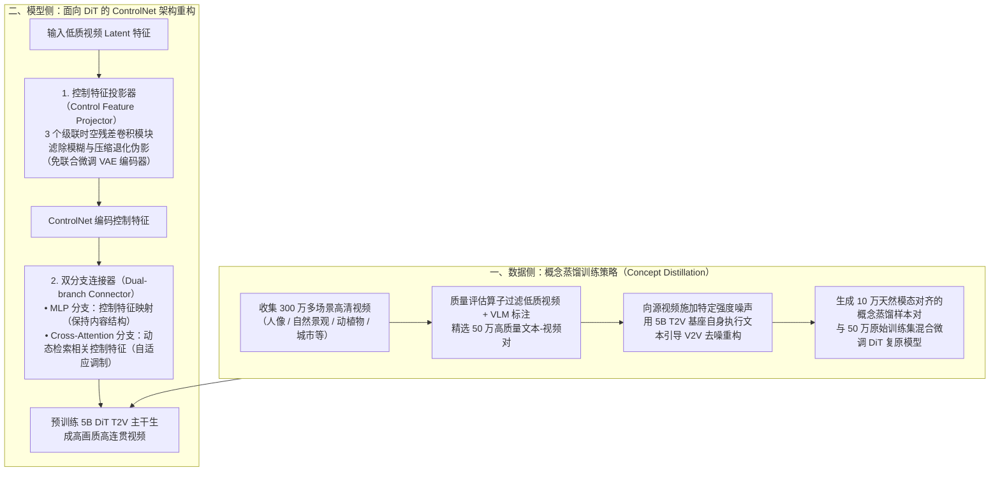

# ICLR 2026｜基于概念蒸馏的生成式视频复原算法 Vivid-VR

## 1. TL;DR

1. **核心痛点**：基于预训练文生视频（T2V）DiT 基座与 ControlNet 的生成式视频复原模型在微调时，由于 VLM 自动标注的文本描述与真实视频存在“图文不完全对齐”及潜在空间差异，极易引发**分布漂移（Distribution Shift）**，导致复原视频出现纹理失真（过度磨皮/油画感）与帧间闪烁形变。
2. **概念蒸馏（Concept Distillation）数据策略**：从收集的 **300 万**高清视频中经质量算子筛选出 **50 万**高质量文本-视频对；不盲目堆砌昂贵 VLM，而是对源视频施加特定强度噪声，利用 **5B 参数 T2V 基座模型自身**在文本引导下做 Video-to-Video 去噪重构，合成 **10 万**在潜在空间与文本天然对齐的概念蒸馏样本混合微调。
3. **两大控制架构创新**：① **控制特征投影器（Control Feature Projector）**——用 **3 个级联的时空残差卷积模块**在进入 ControlNet 前滤除输入低质视频 Latent 中的模糊与压缩退化伪影，避免联合微调整个 VAE 编码器的高昂开销；② **双分支连接器（Dual-branch Connector）**——并联 **MLP 特征映射分支 + Cross-Attention 动态检索分支**，替代传统 `ZeroMLP / ZeroSFT`，兼顾结构保持与自适应语义调制。
4. **实验验证与局限**：在合成数据集（`SPMCS / UDM10 / YouHQ40`）、真实世界视频（`VideoLQ / UGC50`）及 AIGC 视频（`AIGC50`）上的 `NIQE / MUSIQ / CLIP-IQA / DOVER / MD-VQA` 等无参考感知指标全面超越 `Real-ESRGAN / SUPIR / MGLD / UAV / STAR / DOVE / SeedVR`；当前瓶颈是 **5B T2V 基座推理成本较高**，下一步探索单步/少步扩散加速。

## 2. 问题定义与背景

### 2.1 为什么微调 T2V 基座做视频复原会发生“分布漂移”

生成式视频复原（Generative Video Restoration）旨在利用强大的预训练 T2V 扩散 Transformer（DiT）基座修复低质视频。然而在构建训练对 $\langle \text{低质视频}, \text{文本描述} \rangle$ 时面临双重鸿沟：
1. **VLM 标注噪声（图文不完全对齐）**：现有视觉语言模型（VLM）生成的字幕往往遗漏细节或存在偏差。
2. **潜在空间失配（Latent Space Discrepancy）**：即使升级更贵的 VLM，外部真实视频的 VAE 潜在分布与 T2V 基座自身的生成潜在分布仍存在固有差异，直接微调会破坏基座原本的先验分布，表现为门窗结构扭曲、毛发油画感与时序跳变。

### 2.2 核心概念与对比基线

| 类别 / 模块 | 传统 / 现有基线方案 | Vivid-VR 创新方案 | 解决的核心痛点 |
|---|---|---|---|
| **训练数据构建** | 仅用 VLM 给外部视频打标直接微调 | **50 万精选真实对 + 10 万 T2V 自合成概念蒸馏样本** | 消除图文错位与潜在空间分布漂移，保留基座生成质感 |
| **退化特征过滤** | 直接把低质视频 Latent 送入 ControlNet，或昂贵地联合微调 VAE Encoder | **控制特征投影器（3 个级联时空残差卷积模块）** | 以极低算力开销滤除模糊、块效应等退化伪影 |
| **DiT 控制特征注入** | `ZeroMLP` 或 `ZeroSFT` 静态线性融合 | **双分支连接器（MLP 分支 + Cross-Attention 分支）** | 动态检索相关控制特征，兼顾空间结构对齐与自适应调制 |
| **对比基线（7+ 种）** | 重建类：`Real-ESRGAN`；图像生成复原：`SUPIR`；视频生成复原：`MGLD / UAV / STAR / DOVE / SeedVR` | 基于 **5B 参数 DiT T2V 基座** 的 Vivid-VR | 解决 `SUPIR` 帧间跳变及其他视频方法纹理闪烁问题 |

## 3. 知识框架

## 4. 核心内容拆解

### 4.1 概念蒸馏（Concept Distillation）的三步构造法

1. **海量数据清洗与精选（300 万 $\to$ 50 万）**：
   - 收集覆盖人像、自然景观、动植物、城市景观的 **300 万**高清视频，使用多种视频质量评估算子剔除低质样本，再用 VLM 生成对应文本描述，得到 **50 万**精选文本-视频对。
2. **T2V 自合成概念对齐样本（10 万对）**：
   - 给定文本-视频对，先对源视频施加**特定强度的噪声**，再利用预训练 **T2V 基座模型自身**在文本描述引导下执行 **Video-to-Video 去噪重构**。
   - **为什么有效**：重构出的视频在很大程度上保留了源视频的运动与场景布局，但会将局部视觉概念调整得与文本描述严格一致，且其表征**天然落在 T2V 基座自身的潜在空间流形上**。
3. **混合训练转移概念先验**：
   - 将 **10 万**概念蒸馏合成样本与 **50 万**真实训练样本混合微调基于 DiT 的复原模型，既学会从退化输入恢复结构，又防止微调过程遗忘 T2V 基座的高频纹理生成能力。

### 4.2 面向 DiT 的两大控制架构改进

1. **控制特征投影器（Control Feature Projector）**：
   - **痛点**：低质视频经冻结的 VAE Encoder 编码后，其 Latent 特征中仍夹杂大量模糊、噪声和压缩伪影；若直接喂给 ControlNet 会把退化伪影带入生成过程，而联合微调整个 VAE Encoder 计算与显存代价极高。
   - **结构**：在 Latent 进入 ControlNet 前串联 **3 个级联的时空残差卷积模块（Spatiotemporal Residual Convolutional Blocks）**，以极低算力开销过滤退化伪影、提纯控制信号。
2. **双分支连接器（Dual-branch Connector）**：
   - **痛点**：传统 ControlNet 向主干注入特征常采用简单的 `ZeroMLP` 或 `ZeroSFT`，难以充分融合 DiT 的时空 Token 特征。
   - **结构**：将连接器设计为并联双分支：
     - **MLP 分支**：负责逐位置的控制特征映射，保留输入视频的宏观几何与内容结构。
     - **Cross-Attention 分支**：利用交叉注意力机制动态检索相关的控制特征，实现对生成主干的自适应调制。

### 4.3 多场景评测与消融验证

- **三大评测基准集**：
  1. **合成视频数据集**：`SPMCS`、`UDM10`、`YouHQ40`
  2. **真实世界视频数据集**：`VideoLQ`、`UGC50`
  3. **AIGC 视频增强数据集**：`AIGC50`
- **五大无参考视觉感知指标**：`NIQE`、`MUSIQ`、`CLIP-IQA`、`DOVER`、`MD-VQA`。
- **定性与消融结论**：
  - 在房屋门窗结构重建、人像发丝与动物毛发纹理（根根分明无过度磨皮/油画感）、跨帧几何稳定性（窗户不随时间变形、无 `SUPIR` 的帧间跳变）上显著领先。
  - 表 2 与图 6 消融实验证实：**控制特征投影器、双分支连接器、概念蒸馏策略**三者各自均带来正向定量与定性增益（去掉双分支连接器或概念蒸馏会导致细节退化与伪影回潮）。

## 5. 数据速查表

| 维度 / 模块 | 原文数值 / 规格 | 语境与说明 |
|---|---|---|
| **录用顶会与开源信息** | **ICLR 2026** | 论文 `arXiv:2508.14483`，代码开源于 `github.com/csbhr/Vivid-VR` |
| **原始收集高清视频规模** | **300 万** | 涵盖人像、自然景观、动植物、城市景观等 |
| **质量算子筛选后真实训练集** | **50 万** 文本-视频对 | 经多种质量评估算子过滤低质视频并用 VLM 标注 |
| **概念蒸馏自合成样本规模** | **10 万** 样本对 | 对源视频加特定强度噪声后由 T2V 基座执行文本引导 V2V 去噪重构 |
| **T2V 基座模型参数量** | **5B 参数**（DiT 架构） | 效果拔群但推理成本较高，未来探索单步/少步扩散加速 |
| **控制特征投影器结构** | **3 个级联的时空残差卷积模块** | 替代高成本的“联合微调 VAE 编码器”，滤除 Latent 退化伪影 |
| **评测数据集（6 个）** | `SPMCS`、`UDM10`、`YouHQ40`、`VideoLQ`、`UGC50`、`AIGC50` | 覆盖合成退化、真实低质拍摄与 AIGC 视频增强三大场景 |
| **评价指标（5 项）** | `NIQE`、`MUSIQ`、`CLIP-IQA`、`DOVER`、`MD-VQA` | 反映人类视觉感知的无参考图像/视频质量评价指标 |

## 6. 踩坑与教训 / 可迁移的设计原则

| 错误做法 | 失败表现或原因 | 原文应对（可迁移的设计原则） |
|---|---|---|
| **盲目花重金升级更大的 VLM 去解决视频复原微调的图文对齐问题** | 不仅标注成本昂贵，且依然无法消除外部视频与 T2V 基座在潜在空间（Latent Space）的分布差异，仍会发生分布漂移 | **概念蒸馏（用基座喂基座）**：对源视频加噪后用 T2V 基座自身做文本引导去噪重构，生成天然处于基座潜在分布内的对齐样本混合训练 |
| **直接将低质视频的 VAE Latent 特征输入 ControlNet** | 模糊、块效应等退化伪影顺着控制流污染生成主干；若联合微调 VAE Encoder 则算力开销过大 | 在 ControlNet 入口前置轻量级**控制特征投影器（3 层时空残差卷积）**专门滤除退化伪影 |
| **沿用 `ZeroMLP` 或 `ZeroSFT` 将 ControlNet 特征注入 DiT** | 静态映射难以充分融合 DiT 特征，结构保持与纹理生成互相掣肘 | 采用 **MLP 映射 + Cross-Attention 动态检索** 的双分支连接器（Dual-branch Connector） |
| **直接把单帧生成式图像超分模型（如 `SUPIR`）逐帧用于视频复原** | 缺乏时序建模约束，导致视频出现明显的帧间跳变与闪烁 | 基于视频级 DiT T2V 基座配合时空残差投影与双分支控制，保障长序列时序一致性 |

## 7. 记忆锚点

- **Vivid-VR 核心三件套**：「**数据靠概念蒸馏（50 万真 + 10 万 T2V 加噪自重构），入口靠 3 层时空残差滤伪影，注入靠 MLP + Cross-Attention 双分支连接器**」。
- **为什么概念蒸馏优于换更贵 VLM**：「**VLM 只能改文本，T2V 加噪自重构才能同时对齐文本与基座潜在空间分布**」。

## 8. 复习卡片

基于 T2V 基座微调视频复原模型时，为什么会出现“分布漂移（Distribution Shift）”？表现为什么现象？::因为 VLM 生成的文本描述与视频内容无法完美对齐，且外部视频与 T2V 基座潜在空间存在差异；表现为复原视频纹理失真（油画感/过度磨皮）以及帧间闪烁或形变。
为什么作者不用更昂贵的 VLM 来解决图文不对齐问题，而是提出“概念蒸馏”？::因为更贵的 VLM 不仅成本高，而且无法消除外部真实视频与 T2V 基座在潜在空间（Latent Space）的分布差异；用 T2V 基座自身对加噪源视频做文本引导去噪重构，才能得到潜在空间天然完美对齐的样本。
Vivid-VR 的训练数据是如何配比构建的？::从 300 万高清视频中用质量算子筛选并用 VLM 标注出 50 万精选文本-视频对，再用 T2V 基座加噪去噪合成 10 万概念蒸馏样本对，两者混合微调。
控制特征投影器（Control Feature Projector）的结构是什么？它替代了什么昂贵操作？::由 3 个级联的时空残差卷积模块组成，位于低质视频 Latent 进入 ControlNet 之前；它以极低计算开销滤除退化伪影，替代了高成本的“联合微调整个 VAE 编码器”。
双分支连接器（Dual-branch Connector）包含哪两个分支？各自负责什么？::包含 MLP 分支（负责控制特征映射，保持内容结构）与 Cross-Attention 分支（利用注意力机制动态检索相关控制特征，实现自适应调制），克服了 ZeroMLP/ZeroSFT 融合 DiT 特征不足的问题。
Vivid-VR 当前在工业落地中的主要局限是什么？未来优化方向是什么？::主要局限是基于 5B 参数的 T2V 基座模型导致推理成本较高；未来方向是探索单步/少步扩散（One-step / Few-step Diffusion）技术以提升推理速度。

## 9. 知识关联

- **本库主题索引**：[推荐系统与多模态评测](../../20_topics/推荐系统与多模态评测.md)、[跨端开发与性能](../../20_topics/跨端开发与性能.md)、[模型架构与训练](../../20_topics/模型架构与训练.md)
- **本库关联文章**：[MNN-Sana-Edit-V2端侧图像编辑+26.4.22](../MNN-Sana-Edit-V2端侧图像编辑+26.4.22/AI_MNN-Sana-Edit-V2端侧图像编辑.md)、[TaoAvatar 3D数字人应用+26.6.5](<../TaoAvatar 3D数字人应用+26.6.5/AI_TaoAvatar 3D数字人应用.md>)
- **候选双链**：[[生成式视频复原]]、[[Concept Distillation]]、[[Diffusion Transformer]]、[[ControlNet]]

## 10. 原文参考资料

- **原文信息**：《ICLR 2026｜基于概念蒸馏的生成式视频复原算法 Vivid-VR》，作者：淘天音视频技术团队，发布日期：2026-03-04。
- **论文与开源仓库**：
  - 论文链接：[Vivid-VR (arXiv:2508.14483)](https://arxiv.org/abs/2508.14483)
  - 开源地址：[https://github.com/csbhr/Vivid-VR](https://github.com/csbhr/Vivid-VR)

> [!note]- 校对报告
> - **页码溯源汇总**：
>   - `## 1. TL;DR` & `## 2. 问题定义与背景`：源自 p.1–3（ICLR 2026 录用、arXiv 与 GitHub 链接、分布漂移痛点、VLM 图文不对齐与潜在空间差异）。
>   - `## 4.1 概念蒸馏策略`：源自 p.3–4（300 万高清视频收集 $\to$ 质量算子筛选 50 万文本-视频对 $\to$ 加噪后用 T2V 基座做文本引导 V2V 去噪重构生成 10 万样本对混合微调）。
>   - `## 4.2 模型架构`：源自 p.4–5（控制特征投影器：3 个级联时空残差卷积模块 vs 联合微调 VAE 编码器；双分支连接器：替代 ZeroMLP/ZeroSFT，由 MLP 分支 + Cross-Attention 分支组成）。
>   - `## 4.3 实验与展望`：源自 p.5–8（合成集 `SPMCS/UDM10/YouHQ40`、真实集 `VideoLQ/UGC50`、AIGC 集 `AIGC50`；对比 `Real-ESRGAN/SUPIR/MGLD/UAV/STAR/DOVE/SeedVR`；指标 `NIQE/MUSIQ/CLIP-IQA/DOVER/MD-VQA`；5B 参数 T2V 基座推理成本高与单步/少步扩散展望）。
> - **材料质量说明**：p.5 双分支连接器公式及 p.6 表 1、p.7 表 2 为嵌入图片（⚠️[图片表格未转写具体单元格小数]），本笔记严格依据正文明确给出的全部数据集名称、对比方法、评价指标与定性/消融结论撰写，不捏造未在文本层出现的表格小数。
