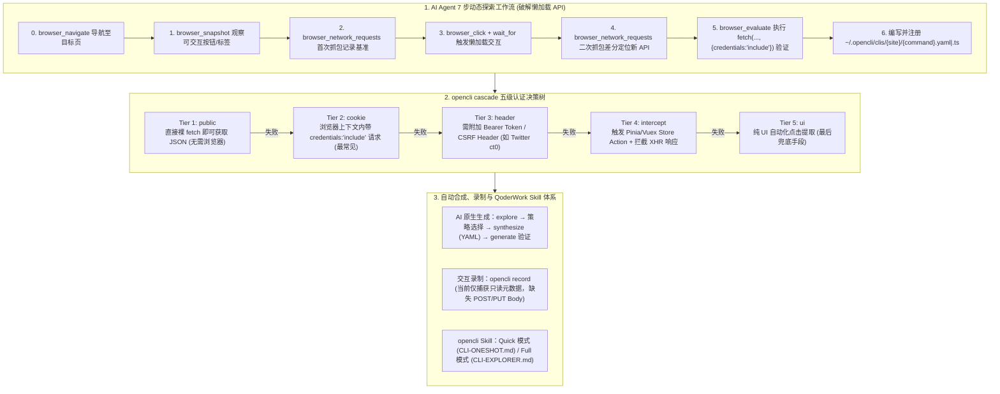

# 浏览器自动化：从GUI到OpenCLI

## 1. TL;DR

1. **核心范式转换（从点按钮到调接口）**：放弃脆弱、高延迟、易受前端 DOM 改版影响的纯 GUI 浏览器点击自动化，转向通过 **OpenCLI（`@jackwener/opencli`）** 解析并复现网页背后的底层数据 API，将各类 Web 系统封装为确定性的本地命令行工具（CLI）供 AI Agent 调用。
2. **AI Agent 七步动态探索工作流（应对懒加载）**：针对字幕、评论、关注等**懒加载（Lazy-loaded）API**，要求 Agent 必须实际打开浏览器执行“导航 $\rightarrow$ 快照观察 $\rightarrow$ 首次抓包 $\rightarrow$ 模拟点击交互 $\rightarrow$ 二次抓包比对新增请求 $\rightarrow$ `browser_evaluate` 内 `fetch` 验证 $\rightarrow$ 编写适配器”闭环，而非仅靠静态代码分析。
3. **五级认证探测策略（`opencli cascade`）与双格式适配器**：内置从轻到重的 **Tier 1 (`public`) $\rightarrow$ Tier 2 (`cookie`) $\rightarrow$ Tier 3 (`header` 如 Bearer/CSRF) $\rightarrow$ Tier 4 (`intercept` 注入 Pinia/Vuex Store Action 与 XHR 拦截) $\rightarrow$ Tier 5 (`ui` 兜底)** 五级鉴权策略；纯声明式流水线采用 `.yaml` 适配器，含内嵌 JS `evaluate` 或复杂拦截的场景采用 `.ts` 适配器。
4. **AI 原生命令合成与录制局限**：提供 `explore → synthesize → generate` 自动生成链路、`opencli record` 浏览器操作录制回放以及配套 QoderWork 的 `opencli` Skill（含 `CLI-ONESHOT.md` 与 `CLI-EXPLORER.md`）；同时客观指出当前录制引擎存在**缺失 POST/PUT 请求体（Request Body Payload）**、暂仅覆盖只读查询接口而难以自动闭环写操作的工程边界。

## 2. 问题定义与背景

### 2.1 为什么传统的 GUI 浏览器自动化难以支撑生产级 Agent？

运营配置后台、工单处理系统、招聘管理与内部平台大多运行在浏览器中。当 AI Agent 试图通过传统 GUI 自动化（识别坐标或选择器、模拟鼠标点击与键盘输入）操控这些系统时，面临三大固有缺陷：
- **脆弱性高**：前端样式微调、弹窗遮挡或动态 DOM 重绘即导致脚本崩溃；
- **执行效率低**：每步操作需等待页面渲染与动画完成，Token 与时间开销高昂；
- **语义黑盒**：GUI 是面向人类视觉设计的交互层，而网页展示的数据本质上全部来自前端向后端发起的 HTTP/API 请求。直接定位并复现底层 API，能将不稳定的视觉操作转化为确定性的命令调用。

## 3. 知识框架

## 4. 核心内容拆解

### 4.1 应对懒加载的 AI Agent 七步探索协议

许多核心业务 API（如视频字幕、评论列表、关注操作、候选人详情）属于**懒加载（Lazy Loading）**，仅在页面初始加载时不会触发网络请求。因此 Agent 严禁仅靠静态源码分析，必须遵循 7 步动态探索：
1. **Step 0 (`browser_navigate`)**：打开浏览器导航至目标 URL。
2. **Step 1 (`browser_snapshot`)**：获取当前页面可交互元素快照（按钮、Tab 标签、链接）。
3. **Step 2 (`browser_network_requests`)**：首次抓取网络请求列表，记录初始 JSON API URL 模式。
4. **Step 3 (`browser_click` + `browser_wait_for`)**：模拟点击“字幕”、“评论”等目标功能按钮并等待响应。
5. **Step 4 (`browser_network_requests`)**：二次抓包并与 Step 2 做差分比对，精准锁定点击新触发的底层 API。
6. **Step 5 (`browser_evaluate`)**：在浏览器控制台上下文中执行 `fetch(url, {credentials: 'include'})` 验证返回数据结构与鉴权要求。
7. **Step 6（生成适配器）**：根据复杂度编写 `.yaml` 或 `.ts` 适配器文件并验证。

### 4.2 五级认证策略（`opencli cascade`）与适配器选型

通过 `opencli cascade <api_url>` 可按成本从低到高自动探测接口所需的鉴权级别：

| 认证层级 | 策略名称 | 触发条件与实现方式 | 适用适配器格式 |
| :--- | :--- | :--- | :--- |
| **Tier 1** | `public` | 直接外部 `fetch(url)` 即可拿到数据，**完全无需启动浏览器**（如 HackerNews Top） | `.yaml`（声明式） |
| **Tier 2** | `cookie` | 在浏览器 `evaluate` 步骤内携带 `{credentials: 'include'}` 即可请求成功（最常见） | `.yaml` 或 `.ts` |
| **Tier 3** | `header` | 需提取并附加动态请求头（如 `Bearer` Token、`CSRF` / Twitter `ct0`） | `.ts`（TypeScript） |
| **Tier 4** | `intercept` | 接口带复杂签名加密，直接调用前端 **Pinia / Vuex Store Action** 并拦截 XHR 响应 | `.ts`（TypeScript） |
| **Tier 5** | `ui` | 无法复现请求或纯前端渲染，降级为传统 UI 自动化（`navigate + tap + map`） | `.yaml`（声明式） |

- **适配器路径与命名规范**：所有生成的适配器统一存放于 `~/.opencli/clis/{site}/{command}.yaml`（或 `.ts`），其中 `{site}` 与 `{command}` 必须采用全小写加连字符（kebab-case，禁止大写或下划线），保存后即可通过 `opencli {site} {command} -f json|yaml` 调用。

### 4.3 自动生成链路、`opencli record` 局限与业务落地

1. **四阶段 AI 原生生成流水线**：
   - `explore`（深度抓取页面、自动滚动、拦截请求、识别前端框架与状态管理）$\rightarrow$ **策略选择**（根据鉴权头/签名特征自动判定 Tier 1–5）$\rightarrow$ `synthesize`（合成候选 YAML，模板化 URL 与字段映射）$\rightarrow$ `generate`（串联探索、合成、注册与实测回退）。
2. **`opencli record` 录制回放的工程边界**：
   - 支持捕获用户在目标页面上的交互序列与网络请求并评分排序生成 CLI。
   - **当前核心局限**：录制引擎目前仅捕获请求元数据（`url`、`method`、`responseBody`），**未能完整提取 `POST`/`PUT` 等写操作的 `Request Body`（Payload）**。因此自动生成逻辑目前**仅能覆盖只读查询类接口（列表查询、详情获取）**，尚无法在创建、更新、删除等写操作场景形成自动闭环。
3. **典型落地场景與未来软件竞争维度**：
   - 已落地于**内部“会画”平台 CLI 化**以及 **BOSS 招聘自动化（自动与候选人沟通、统计招聘漏斗数据）**。
   - **核心洞察**：GUI 是给人用的，API 是能力底座，而 Agent 最青睐的是具备清晰“命令、参数、返回值、失败原因”的执行面。未来评价软件与 SaaS 的核心竞争维度将从“界面好不好点”转向**“对 Agent 的可调用性（Callability）”**。

## 5. 数据速查表

| 维度 / 机制 | 具体配置 / 规格 | 工程说明 |
| :--- | :--- | :--- |
| **安装与核心命令** | `npm install -g @jackwener/opencli` | 支持 `opencli list`、`opencli cascade`、`opencli record` 及 `-f json/yaml` 输出 |
| **探索工作流步数** | **7 步（Step 0 – Step 6）** | 通过首次抓包与点击后二次抓包差分，解决懒加载 API 发现难题 |
| **认证策略分级** | **5 级（Tier 1 `public` – Tier 5 `ui`）** | 优先使用零浏览器或轻量 Cookie/Header/Store 拦截，UI 自动化仅作最后兜底 |
| **适配器存储规范** | `~/.opencli/clis/{site}/{command}.yaml\|.ts` | `site` 与 `command` 强制使用小写连字符（kebab-case），保存即动态注册 |
| **录制引擎当前边界** | 仅捕获 `url, method, responseBody` | **缺失 `POST/PUT` Request Body Payload**，自动生成仅限只读查询接口 |

## 6. 踩坑与教训 / 可迁移的设计原则

1. **能复现底层 API 就绝不写脆弱的 DOM 点击脚本**：浏览器自动化的最高境界是“消灭 UI 操作”；通过复用浏览器登录态 Cookie（Tier 2）或直接触发前端 Pinia/Vuex Store Action 并拦截 XHR（Tier 4），可跳过复杂的接口签名逆向并获得比 UI 点击高一个数量级的稳定性。
2. **发现懒加载接口必须用“交互前后两次抓包 Diff”**：切勿指望打开网页首页就能抓全所有接口；必须让 Agent 先记录基准请求集，再模拟点击二级 Tab（如评论/字幕），通过请求差分精准提取目标 API。
3. **清晰认知录制工具的“只读 vs 写入”边界**：对于缺乏 Request Body 捕获能力的录制工具，只用其自动生成查询类 CLI；涉及状态变更的 `POST/PUT` 写操作应通过 TypeScript 适配器（`.ts`）显式构造 Payload 并做好安全校验。

## 7. 记忆锚点

- **一个核心理念**：不跟网页 GUI 较劲，直接抓取并复现背后的 API（从界面竞争走向**可调用性竞争**）。
- **两类适配器格式**：纯声明式用 `.yaml`，含内嵌 JS `evaluate`/Header/Store 拦截用 `.ts`（存放在 `~/.opencli/clis/{site}/{command}`）。
- **五级鉴权阶梯（Cascade）**：`Tier 1 public` $\rightarrow$ `Tier 2 cookie` $\rightarrow$ `Tier 3 header` $\rightarrow$ `Tier 4 intercept (Pinia/Vuex)` $\rightarrow$ `Tier 5 ui`。
- **七步懒加载探索**：导航 $\rightarrow$ 快照 $\rightarrow$ 首次抓包 $\rightarrow$ 点击交互 $\rightarrow$ 二次抓包差分 $\rightarrow$ `fetch` 验证 $\rightarrow$ 写适配器。

## 8. 复习卡片

1. OpenCLI 解决浏览器自动化稳定性与效率难题的核心思路是什么？::放弃不稳定的前端 GUI 模拟点击，直接定位并复现网页前端向后端发起的底层 API 请求，将其封装为确定性的本地命令行工具（CLI）供 Agent 调用。
2. 为什么 AI Agent 在探索网站 API 时不能只靠静态分析或单次加载抓包，而必须执行 7 步动态探索流程？::因为大量核心接口（如字幕、评论、关注等）采用懒加载（Lazy Loading）机制，必须先抓包记录初始基准，再模拟点击交互并二次抓包做差分对比，才能发现新触发的 API。
3. OpenCLI 的五级认证策略（`opencli cascade`）从 Tier 1 到 Tier 5 依次是什么？::依次为 Tier 1 `public`（公开 API 无需浏览器）、Tier 2 `cookie`（浏览器内带 Cookie 请求）、Tier 3 `header`（附加 Bearer/CSRF 等请求头）、Tier 4 `intercept`（调用 Pinia/Vuex Store Action 并拦截 XHR）、Tier 5 `ui`（传统 UI 自动化兜底）。
4. 在编写 OpenCLI 适配器时，何时应该选择 `.yaml` 格式，何时应该选择 `.ts`（TypeScript）格式？::当流水线属于纯声明式（如简单 Public/Cookie 鉴权或 `navigate + tap + map + limit`）时使用 `.yaml`；当包含内嵌 JS 代码的 `evaluate` 步骤、复杂 Header 提取或 Store/XHR 拦截时使用 `.ts`。
5. `opencli record` 浏览器录制回放功能目前存在什么核心局限？::目前的录制引擎仅捕获请求元数据（`url`、`method`、`responseBody`），未能完整提取 `POST`/`PUT` 等写操作的请求体（Request Body Payload），因此自动脚本生成目前仅适用于只读查询类接口。
6. OpenCLI 适配器文件的标准存放路径与命名规范是什么？::必须保存在 `~/.opencli/clis/{site}/{command}.yaml`（或 `.ts`），且 `{site}` 和 `{command}` 必须全部使用小写字母与连字符（kebab-case），严禁使用大写字母或下划线。

## 9. 知识关联

- **所属主题**：
  - [桌面Agent与工作流](../../20_topics/桌面Agent与工作流.md)
  - [Skill设计与治理](../../20_topics/Skill设计与治理.md)
  - [Harness与模型协同](../../20_topics/Harness与模型协同.md)
- **本地跃迁**：[原始 PDF](RAW.pdf) · [逐页转写文本](MD.md) · [OpenCLI 技能定义](SKILL.md)
- **候选双链**：[[数字SRE代码质量治理]] · [[OpenClaw核心架构800行实现]] · [[QoderWork数科Skills]] · [[Agent Skill迭代式编写]]

## 10. 原文参考资料

1. **开源工具包**：`@jackwener/opencli`（通过 `npm install -g @jackwener/opencli` 安装）
2. **配套 Agent Skill 规范**：`opencli` Adapter Generator Skill（含快速模式 `./references/CLI-ONESHOT.md` 与完整探索模式 `./references/CLI-EXPLORER.md`）

> [!note]- 校对报告
> - **页码溯源**：p.1–3（GUI 浏览器自动化困境、OpenCLI 核心思路、`@jackwener/opencli` 安装与 `hackernews`/`bilibili`/`zhihu` 命令示例、AI Agent Step 0–6 七步动态探索工作流）；p.3–5（懒加载机制说明、`opencli cascade` Tier 1–5 五级认证决策树、TypeScript `.ts` vs YAML `.yaml` 适配器选型与 CLI 执行流程）；p.6–7（`explore → synthesize → generate` 四步自动生成 CLI、`opencli record` 录制回放原理及缺失 Request Body Payload 仅支持只读接口的局限性分析）；p.7–10（QoderWork 自动生成 CLI 的 `SKILL.md` 完整定义、内部会画平台 CLI 化与 BOSS 招聘自动化案例、从 GUI 到可调用性的软件竞争维度思考）。
> - **一致性核验**：作者（明径，大淘宝技术）、发布日期（2026-05-22）、全部 CLI 命令、五级鉴权策略、路径规范与局限性分析均逐页核对一致；正文中无任何内联页码引用。
> - **质量边界**：原文 p.8–9 附带的 `opencli` `SKILL.md` 部分长行在 PDF 排版中右侧略有截断，已在同目录 `SKILL.md` 中结合上下文完整归档并注明。
