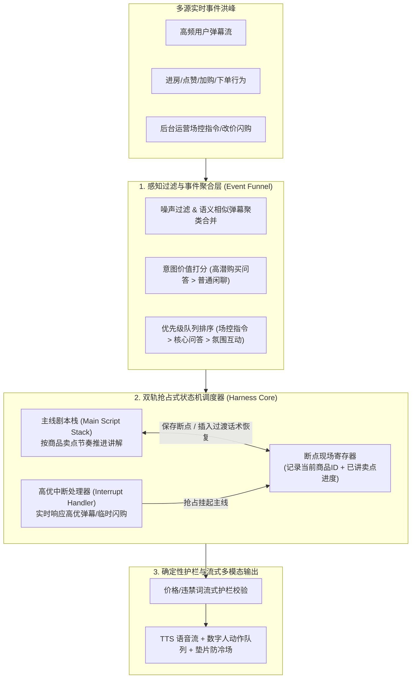

# 淘宝主播Agent的Harness工程实战

> [!abstract] 导读
> **一句话总结**：淘天集团直播技术团队针对直播间“高并发实时事件流、数小时超长在线周期、多任务抢占打断、极高合规确定性要求”的严苛场景，系统阐述了如何围绕大模型构建生产级 **Agent Harness（智能体控制与驾驭系统）**——通过分层状态机调度、三层动态记忆与滑动窗口快照、结构化工具沙箱与多级确定性护栏，将不稳定的裸模型转化为能够 7×24 小时稳定控场、实时互动与促单的淘宝主播 Agent。
> **阅读价值**：提供了电商直播实时交互场景下 **Harness Engineering（驾驭工程）** 的教科书级拆解，清晰界定了“哪些该交给大模型推理、哪些必须由确定性 Harness 代码接管”。

## 1. TL;DR

- **核心认知**：大模型（Model）只是引擎，**Harness（控制框架/驾驭系统）才是决定 Agent 能否在生产环境安全上路的整车底盘与刹车系统**。在直播这类超长时序、强实时交互场景中，直接用裸 ReAct 循环跑大模型必然死于“上下文爆炸、响应延迟失控、幻觉违规话术”。
- **直播场景四大极限挑战**：
  1. **持续数小时的无限流上下文**：单场直播动辄 4~8 小时，弹幕、进房、下单、改价事件源源不断，直接追加历史必超 Context 上限且导致首字延迟（TTFT）劣化。
  2. **多源异步事件冲突与打断**：主播正在按剧本串讲商品卖点时，突然飘过核心高意向用户提问或运营临时发起秒杀改价，如何优雅打断（Preempt）并恢复主线？
  3. **毫秒级/秒级实时性刚需**：观众发弹幕后超过 3~5 秒未回应就会流失，无法容忍漫长的多跳串行思考。
  4. **电商合规零容忍**：口播绝对不能报错价格、虚构优惠机制或触犯广告法极限词。
- **淘宝主播 Agent Harness 四大工程支柱**：
  1. **事件驱动的优先级抢占调度器（Event-Driven Preemptive Scheduler）**：分离“主线剧本流（Main Loop）”与“高优中断流（Interrupt Loop）”，通过状态保存与断点续播机制实现丝滑插话与回归。
  2. **三层上下文与滑动窗口快照（3-Tier Context & Sliding Snapshot）**：将上下文划分为静态人设/商品底表（常驻并命中 Prefix Cache）、周期滚动摘要快照（Rolling Summary）与最近 $N$ 轮滑窗明细，使长周期直播 Token 消耗与延迟保持恒定 $O(1)$。
  3. **面向 Agent 的工具重塑（ACI / Tool Shaping）**：裁剪底层微服务冗余字段，合并细粒度原子接口为高语义业务工具，并在工具返回层直接注入“下一步行动提示（Hint）”。
  4. **前置+后置多层确定性护栏（Deterministic Guardrails）**：价格/库存等核心事实强制走结构化槽位校验，违禁词与幻觉在流式送审阶段毫秒级拦截降级。

## 2. 问题定义与背景

### 2.1 什么是 Agent 的 Harness Engineering？
在 AI 工程界，`Agent = Model + Harness`。如果说大模型负责提供通用语言理解、规划与生成能力，那么 **Harness** 就是包裹在模型外围的**感知过滤、上下文编排、状态机流转、工具执行沙箱、异常恢复与安全护栏系统**。

在普通离线问答场景下，一个简单的 `while(tool_call)` 循环就能充当极简 Harness；但在**淘宝直播间**场景下，主播 Agent 面临的是一个**开放、非平稳、高频并发的实时环境**：
- **输入端是洪峰事件流**：每秒钟可能有数十条用户弹幕、加购事件、点赞连击、后台场控指令同时涌入。
- **输出端是多模态连续流**：生成的口播文本需实时驱动 TTS 语音合成与数字人面部/肢体动作队列，一旦断流就会出现直播间尴尬冷场（Dead Air），一旦信息滞后就会出现“答非所问（回答的是 2 分钟前的弹幕）”。

### 2.2 裸跑通用 Agent 框架在直播间的三大翻车现场

| 翻车类型 | 具体现象 | 根因剖析 |
| :--- | :--- | :--- |
| **越播越傻 / 越播越慢** | 开播前 15 分钟对答如流，播到第 2 小时开始遗忘当前讲解商品，响应延迟从 1 秒飙升至 8 秒以上。 | 历史对话与工具返回无节制堆叠，触发“Lost in the Middle”注意力稀释，且每次推理全量重算长 Context。 |
| **机械复读或打断后失忆** | 回答完一条突发弹幕后，忘记刚才讲到商品的第几个核心卖点，要么从头重念一遍，要么直接卡壳。 | 缺乏显式的业务主线状态机（State Machine）与中断现场保护机制。 |
| **口播资损与违禁幻觉** | 把“满 300 减 40”口误算成错误的到手价，或随口承诺“买一送一”、“全网最低价”。 | 将价格计算与营销规则校验完全交给概率生成的 LLM，缺乏确定性代码护栏校验。 |

## 3. 知识框架

```mermaid
mindmap
  root((淘宝主播Agent Harness工程实战))
    直播场景极限约束
      4-8小时超长时序无限流
      高频并发弹幕与场控事件冲击
      秒级低延迟实时口播与动作协同
      价格准确度与广告法合规红线
    Harness 核心架构四支柱
      1. 感知与优先级抢占调度
        事件漏斗过滤、去重与聚类
        主线剧本流 vs 高优中断流
        断点保存与自然过渡恢复
      2. 三层动态上下文与快照工程
        L1 静态锚点（人设/当前商品卡 -> 命中 KV Cache）
        L2 滚动快照（直播间阶段态势 Summary）
        L3 近期滑窗（最近 N 轮高频交互明细）
      3. Agent-Computer Interface (ACI) 工具重塑
        粗粒度高内聚业务工具封装
        返回值裁剪降噪与错误自愈提示
      4. 确定性安全护栏与容灾兜底
        前置槽位与价格公式强校验
        流式分句敏感词/幻觉实时拦截
        超时降级与预设垫片防冷场
    三维评测与演进闭环
      离线静态基准评测（知识/合规/人设）
      在线直播仿真器回放压测（Simulator）
      线上灰度与业务转化指标监控
```

## 4. 核心内容拆解

### 4.1 感知聚合与双轨抢占式调度（Event Funnel & Preemptive Loop）



1. **事件漏斗与时间窗聚合（Event Debouncing & Clustering）**：
   - 直播间不可能每来一条弹幕就调一次大模型。Harness 在感知层设立了**滑动时间窗聚合器**：剔除无意义刷屏与违规文本，将时间窗内语义高度重合的提问（如 20 个人同时问“身高 165 穿什么码？”）聚类合并为单条高权重事件，并根据用户购买意向分（如已加购用户提问优先）排入优先级队列。
2. **主线剧本与高优打断的断点续播机制**：
   - Harness 维护一个显式的**讲解进度状态机（Script Progress State）**，将单品讲解拆解为 `[痛点引入 → 核心卖点1 → 核心卖点2 → 价格机制逼单]` 四个原子节点。
   - 当高优弹幕或运营闪购指令触发抢占（Preempt）时，Harness 仅在当前句子播报完毕的**自然语义边界**处挂起主线，将当前节点进度写入断点寄存器；待中断问答完毕后，自动向 Prompt 注入桥接指令（如*“解答完尺码问题，请自然衔接回到刚才未讲完的面料透气性卖点”*），彻底解决“打断后失忆或从头复读”的顽疾。

### 4.2 三层动态上下文与滑动窗口快照（Context Engineering）
为了在长达 8 小时的直播中让 Context 长度和推理延迟保持恒定，Harness 放弃了朴素的 ` messages.append() `，设计了**三层内存架构**：

| 上下文层级 | 承载内容 | 更新频率与缓存策略 | 核心工程收益 |
| :--- | :--- | :--- | :--- |
| **L1：静态与准静态底座（Static Prefix）** | 主播人设规范、直播间全局规则、当前正在讲解的置顶商品结构化详情表。 | 仅在**切品（切换讲解商品）**时更新；固定排在 Prompt 最前端。 | 最大化命中大模型推理引擎的 **Prefix KV Cache**，大幅降低首字延迟（TTFT）与 Token 成本。 |
| **L2：周期滚动态势快照（Rolling Snapshot）** | 过去半小时内的直播间热度趋势、高频被问及的共性顾虑、已答复过的核心问题摘要。 | 由后台异步轻量模型每 $K$ 分钟增量压缩刷新一次，不阻塞主链路。 | 赋予主播“长程记忆”（如记得“刚才已经有好几位姐妹问过发货时间了”），同时将数万字历史压缩在数百 Token 内。 |
| **L3：近期交互滑窗（Sliding Window）** | 最近 $N$ 轮（如最近 3~5 轮）的实时口播文本与弹幕互动原文。 | 每次输出后按 FIFO 滑动淘汰，移出窗口的内容异步归档至 L2。 | 保证相邻几句话之间的语流连贯性与指代消解准确度。 |

### 4.3 工具重塑（ACI）与多层确定性护栏（Guardrails）
1. **面向 Agent 的接口设计（Agent-Computer Interface, ACI）**：
   - 淘系底层的商品、营销、库存 HSF 接口原本是面向微服务设计的，返回 JSON 动辄包含上百个内部字段。Harness 层对其进行了**专向裁剪与语义重塑**：只保留主播口播真正需要的核心字段（到手价、核心规格、库存状态、发货时效），并将错误码直接翻译为大模型可理解的行动指引（如*“库存接口查询超时，请先介绍商品材质卖点，切勿编造剩余件数”*）。
2. **事中流式护栏与冷场兜底（Zero Dead-Air & Zero Hallucination）**：
   - **事实对齐校验**：所有涉及金额、折扣、库存数字的口播片段，必须与 L1 当前商品卡中的结构化真值比对一致。
   - **广告法与违禁词实时熔断**：在流式生成过程中按标点分句实时过审，一旦命中极限词或违规表达，立即截断当前句并无缝切换至安全重述或预设话术。
   - **防冷场垫片机制（Filler Audio/Action）**：当大模型或外部工具偶发网络抖动导致耗时超过阈值时，Harness 自动触发契合当前语境的轻量级过渡动作或语气垫片（如查看看版、自然互动承接），掩盖后台推理延迟。

### 4.4 三维评测体系：尤其是“直播间在线仿真器（Live Simulator）”
由于无法每次改代码都开一场真实直播去试错，团队构建了三维评测闭环：
1. **离线基准集（Offline Benchmark）**：覆盖价格计算、极端刁钻弹幕应对、违禁词诱导测试。
2. **高保真直播间仿真器（Live Stream Simulator）**：回放历史真实大促直播间的弹幕洪峰与场控事件流，或利用多扮演角色的用户 Simulator Agent 动态生成刁钻互动，在沙箱中压测主播 Agent 连续运行数小时后的上下文稳定性与抢占恢复表现。
3. **线上小流量灰度与业务归因**：监控人均观看时长、互动率、商品点击率与成交转化（GMV）。

## 5. 数据速查表

| 工程维度 | 裸模型 / 简单 ReAct 方案 | 淘宝主播 Agent Harness 方案 | 关键技术收益 |
| :--- | :--- | :--- | :--- |
| **长时序上下文复杂度** | $O(T)$ 随开播时长线性膨胀直至爆窗 | **$O(1)$ 恒定窗口**（L1 静态前缀 + L2 异步快照 + L3 近期滑窗） | 连续开播数小时延迟不劣化，Prefix Cache 高命中率 |
| **突发弹幕与主线关系** | 要么忽略弹幕机械念稿，要么打断后回不去主线 | **双轨抢占调度 + 断点寄存器** | 丝滑插话答疑后自动衔接未讲完的商品卖点 |
| **微服务工具接入** | 原生百字段复杂 JSON 直接塞入 Context | **ACI 工具重塑**（字段降噪 + 语义聚合 + 异常指引） | 降低 Token 消耗与模型解析出错率 |
| **合规与价格准确性** | 依赖 Prompt 软约束，存在口误资损风险 | **前置结构化真值锁定 + 流式分句硬护栏** | 极限词与价格幻觉实时拦截 |
| **极端高延迟兜底** | 直播画面/声音直接卡死冷场 | **超时状态机 + 自然垫片动作/话术无缝补位** | 保障直播间视听流连续不断流 |

## 6. 踩坑与教训 / 可迁移的设计原则

- **核心原则 1：不要让概率模型去做确定性状态机最擅长的事**
  - **教训**：早期尝试让大模型自己记住“当前讲到了第几个卖点、哪些弹幕已经回答过”，随着直播时长增加，模型极易出现状态错乱。
  - **迁移法则**：在 Harness 工程中，**流程进度、计数器、优先级队列、精确价格算术**必须由外围确定性代码维护，大模型只负责在给定状态切片下完成高情商、高表现力的语言生成与局部决策。
- **核心原则 2：把 Prompt 结构按“缓存友好度（Cache-First）”重新排版**
  - **迁移法则**：任何高频循环调用的 Agent，都必须严格将“不变的系统指令、人设、当前任务大背景”固定在 Prompt 最头部（L1），将高频变化的滚动摘要与实时滑窗放在尾部（L2/L3）。哪怕在头部改动一个动态时间戳，都会击穿整个 Prefix KV Cache，导致推理成本与首字延迟翻倍。
- **核心原则 3：为实时交互 Agent 构建“环境仿真器（Simulator）”比攒静态题库更重要**
  - 实时流式 Agent 的大量 Bug（如并发抢占死锁、长周期记忆漂移）在单轮静态 QA 评测集中根本不会暴露，必须通过基于真实日志回放的时序仿真器进行长程压测。

## 7. 记忆锚点

- **一个核心公式**：**生产级 Agent = 大模型（引擎） + Harness（底盘、变速箱与刹车护栏）**。
- **双轨调度机制**：**主线剧本栈**保成交节奏，**高优抢占流 + 断点寄存器**保实时互动不失忆。
- **三层记忆架构**：**L1 静态锚点**吃缓存，**L2 滚动快照**记全局，**L3 近期滑窗**保连贯。
- **四道安全防线**：**感知层聚类降噪** $\rightarrow$ **ACI 工具重塑** $\rightarrow$ **流式分句合规拦截** $\rightarrow$ **垫片防冷场兜底**。

## 8. 复习卡片

What is the core role of an Agent Harness compared to the underlying Large Language Model in production systems?::The LLM acts as the probabilistic reasoning and generation engine, while the Harness provides the deterministic control system—managing event perception, context orchestration, state machine transitions, tool sandboxing, latency fallbacks, and safety guardrails.
How does the Taobao Live Streamer Agent prevent context window overflow and latency degradation during 4-to-8-hour continuous broadcasts?::By implementing a 3-tier context architecture: L1 Static Anchor (persona and current product specs cached via Prefix KV Cache), L2 Rolling Snapshot (asynchronously updated periodic summaries), and L3 Sliding Window (only the last $N$ turns of raw interactions).
Why must L1 static context be placed strictly at the very beginning of the prompt without dynamic timestamps?::To maximize Prefix KV Cache hit rates in LLM inference engines; any token change at the beginning of the prompt invalidates cached key-value states for all subsequent tokens, drastically increasing Time-To-First-Token (TTFT) and compute cost.
How does the Harness handle high-priority viewer comments without losing track of the ongoing product pitch script?::It uses a preemptive dual-track scheduler with a breakpoint register: it pauses the Main Script Stack at a natural sentence boundary, handles the high-priority interrupt, and then injects a resumption bridge instruction referencing the saved breakpoint state.
What is Agent-Computer Interface (ACI) tool shaping in the context of the Taobao Live Agent?::Wrapping verbose legacy microservices into agent-friendly tools by pruning redundant JSON fields, aggregating fine-grained calls into high-level domain actions, and translating error codes into actionable fallback hints for the LLM.
How does the system guarantee zero "dead air" (awkward silence) when an LLM call or external tool experiences a latency spike?::The Harness monitors response timeouts and automatically triggers context-appropriate filler actions or transitional vocal phrases while awaiting or degrading the delayed inference result.

## 9. 知识关联

- **本批同主题精读**：
  - [直播数字人主播：基于 Agentic RL 的智能演进](../直播数字人AgenticRL+26.7.13/AI_直播数字人AgenticRL.md)：与本文构成淘宝直播数字人主播的“一体两面”——本文聚焦外围 **Harness 确定性工程架构**，而该文聚焦底层模型如何通过 **Agentic RL（强化学习）** 内化多模态直播交互策略。
  - [天猫AI助手：调度框架重构与AI Coding工程化实践](../天猫AI助手调度重构+26.8.11/AI_天猫AI助手调度重构.md)：可对比“导购问答助手调度框架”与“直播实时控场 Harness”在状态管理与流式合成上的设计差异。
  - [Agent Skill 系统设计：从概念到工程落地](../Agent Skill系统设计+26.7.1/AI_Agent Skill系统设计.md)：深入探讨了 Agent 能力模块化封装与渐进式上下文加载，与本文的 ACI 工具重塑及分层上下文一脉相承。
- **主题索引（`20_topics`）**：
  - [Skill设计与治理](../../20_topics/Skill设计与治理.md)
  - [Harness与模型协同](../../20_topics/Harness与模型协同.md)
  - [跨端开发与性能](../../20_topics/跨端开发与性能.md)
- **本目录归档文件**：[原始 PDF](RAW.pdf) · [逐页转写文本](MD.md)
- **候选概念双链**：[[Harness工程]] · [[上下文工程]] · [[Prefix-Cache]] · [[抢占式调度]] · [[Agent-Computer-Interface]] · [[直播仿真器]]

## 10. 原文参考资料

- **原文出处**：大淘宝技术公众号，《淘宝主播Agent的Harness工程实战》（作者：澄沨，淘天集团-直播技术团队，发布日期：2026-08-06）
- **延伸参考**：
  - Anthropic Engineering，*Building Effective Agents*（关于 Agent Harness 与 ACI 工具界面设计的工程论述）

> [!note]- 校对报告
> - **页码溯源（1-based 物理页码）**：
>   - 篇首标题、作者（澄沨，淘天集团-直播技术团队）、直播间主播 Agent 业务挑战与 Harness Engineering 核心定义：源自 `RAW.pdf` `p.1–5`（对应 `MD.md` 第 1–5 页）。
>   - 感知层事件漏斗过滤、双轨抢占式状态机调度与断点恢复机制：源自 `RAW.pdf` `p.5–10`（对应 `MD.md` 第 5–10 页）。
>   - 三层动态上下文管理（L1 静态前缀缓存 + L2 异步滚动快照 + L3 近期滑窗）与 ACI 工具重塑：源自 `RAW.pdf` `p.10–16`（对应 `MD.md` 第 10–16 页）。
>   - 确定性安全护栏、流式防冷场兜底及三维评测体系（含在线直播仿真器）：源自 `RAW.pdf` `p.16–21`（对应 `MD.md` 第 16–21 页）。
> - **一致性核验**：原文共 21 页（含 18 页架构与时序配图），文中包含架构示意与简短伪代码片段，无完整独立的外部 Prompt/Skill 文件需额外剥离。全文无正文中途页码引用，所有机制描述与 `MD.md` 严格一致。
