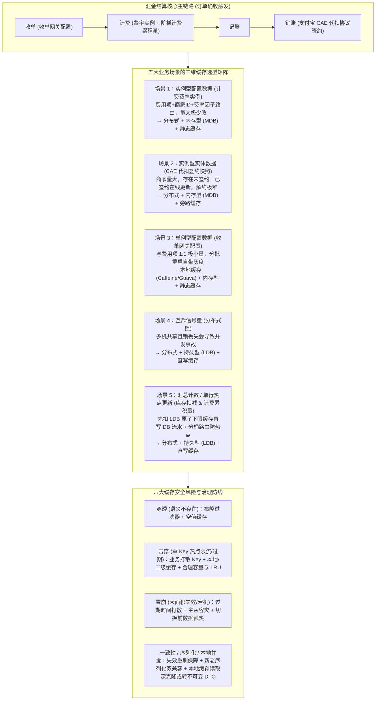

# 缓存使用实践总结：以淘宝交易结算场景为例

## 1. TL;DR

1. **缓存准入四大前提条件**：缓存并非高并发万能药，待缓存数据**必须**不要求强一致性（接受最终一致性）、**应该**读访问频率高、**应该**写更新频率低、**适合**对访问有高性能要求。
2. **三维正交缓存分类与选型矩阵**：从**存储端（本地缓存 vs 分布式缓存）**、**存储介质（内存型 Tair MDB vs 持久型 Tair LDB）**、**存储时机（静态缓存 vs 旁路缓存 Cache-Aside vs 直写缓存 Write-Through）**三个正交维度组合选型（同维度互斥，唯独本地缓存 + 分布式缓存可组合构成二级缓存应对单 Key 热点限流）。
3. **汇金结算五大典型场景实战映射**：围绕交易订单确收后的“**收单 $\rightarrow$ 计费 $\rightarrow$ 记账 $\rightarrow$ 销账**”全链路，分别给出**计费费率实例（分布式+内存+静态）**、**支付宝 CAE 代扣签约信息（分布式+内存+旁路）**、**收单网关配置（本地+内存+静态）**、**分布式锁（分布式+持久+直写）**与**库存扣减/阶梯计费累积量（分布式+持久+直写+分桶）**的标准组合方案。
4. **六大缓存安全风险正交定义与治理**：系统梳理**缓存穿透、缓存击穿、缓存雪崩、缓存一致性、缓存序列化兼容、本地缓存并发原地修改污染**六类风险的成因与工程防线（尤其警惕本地缓存未克隆直接原地修改对象导致的跨线程状态污染）。

## 2. 问题定义与背景

### 2.1 为什么缓存不能盲目滥用？

在淘宝交易资金结算（汇金平台）承载买家支付、商家货款、平台佣金清分等高并发链路中，一笔订单确收后会依次触发各接入费用项走完 **`收单 -> 计费 -> 记账 -> 销账`** 四步流程。由于缓存与关系型数据库属于异构存储，数据库本地事务无法覆盖缓存，而引入分布式事务又会彻底丧失缓存的高性能初衷。因此，在引入缓存前必须经过严格的准入评估、三维分类选型与六大安全防线设计。

### 2.2 缓存准入四条件与三维分类体系

| 评估维度 / 分类维度 | 子类 / 准入级别 | 核心特征与适用对象 | 代表产品 / 中间件 |
| :--- | :--- | :--- | :--- |
| **准入条件 1：一致性** | **必须（Must）** | **不要求强一致性**，业务可接受最终一致性 | — |
| **准入条件 2–4：读写与性能** | **应该 / 适合** | 访问频率高（应该）、更新频率低（应该）、要求高性能（适合） | — |
| **存储端维度** | **本地缓存 vs 分布式缓存** | 本地缓存适合数据量小、无需跨机共享或治理热点 Key；分布式适合大数据量与多机共享 | `Caffeine` / `Ehcache` / `Guava` vs `Tair` |
| **存储介质维度** | **内存型 vs 持久型** | 内存型丢失无风险（有 DB 兜底）；持久型用于仅存缓存的统计/锁数据或初始化代价极大场景 | `Tair MDB`（内存型）vs `Tair LDB`（持久型） |
| **存储时机维度** | **静态 vs 旁路 vs 直写** | 静态（无在线更新，靠过期/重启重刷）；旁路（更新 DB 后同步失效缓存）；直写（在线高频直接更新缓存） | 应用层编排控制 |

## 3. 知识框架

## 4. 核心内容拆解

### 4.1 汇金结算五大典型场景选型推演

1. **场景一：实例型配置类数据 —— 计费费率实例（`分布式 + 内存型 MDB + 静态缓存`）**：
   - **业务特征**：由“费用项 + 商家 ID + 费率因子（订单标）”路由决定费率比例，组合实例数量庞大（单机本地内存放不下且易触发高频淘汰或 OOM），头部商家高频访问，但仅由技术人工订正、几乎不修改，且自带生效时间字段。
   - **选型理由**：数据量大选**分布式缓存**；DB 兜底丢失无风险选**内存型（MDB）**；无在线更新链路选**静态缓存**（紧急订正可人工触发重刷）。
2. **场景二：实例型实体类数据 —— 支付宝 CAE 代扣协议签约信息（`分布式 + 内存型 MDB + 旁路缓存`）**：
   - **业务特征**：销账调用支付宝 CAE 代扣时在汇金侧保留签约状态快照，商家基数大；存在“未签约 $\rightarrow$ 已签约”的在线更新链路（对比库中持久化值不同才落库），而解约流程极长极罕见。
   - **选型理由**：数据量大选**分布式缓存**；DB 兜底选**内存型**；因存在在线状态变更，选**旁路缓存（Cache-Aside，更新 DB 后同步失效/刷新缓存）**。
3. **场景三：单例型配置类数据 —— 收单网关配置（`本地缓存 + 内存型 + 静态缓存`）**：
   - **业务特征**：决定订单确收时是否收取某费用项，与费用项呈 `1:1` 关系，数据量极小，访问极高频且仅在首次接入或人工订正时变更。
   - **选型理由**：数据量极小且无需强跨机同步，选**本地缓存**消灭网络 I/O；更巧妙的是，数据订正后**分批重启机器天然具备配置生效的灰度能力**。
4. **场景四：互斥信号量 —— 分布式锁（`分布式 + 持久型 LDB + 直写缓存`）**：
   - **选型理由**：多机互斥必须用**分布式缓存**；锁数据仅存于缓存中（无 DB 兜底），一旦因淘汰或容器重启丢失会引发并发资损，故必须用**持久型（Tair LDB）**；加解锁高频在线变更，采用**直写缓存**。
5. **场景五：汇总计数与单行热点更新 —— 库存扣减 & 阶梯计费累积量（`分布式 + 持久型 LDB + 直写缓存`）**：
   - **库存扣减要点**：遵循“宁可少卖绝不超卖”原则，**先执行 Tair LDB 持久型缓存原子扣减（设置扣减下限），成功后再插入数据库扣减流水**；同时采用**缓存分桶存储与路由管理**打散单品热点。
   - **阶梯计费累积量**：根据商家 GMV 等累积值判定阶梯费率，读写极度频繁且单行热点更新会导致 DB 活跃连接数被打满；且缓存初始化重算成本极高，故采用 **`分布式 + 持久型 LDB + 直写缓存`**。

### 4.2 六大缓存安全风险正交定义与治理方案

1. **缓存穿透（查询业务语义上根本不存在的数据，每次直穿 DB）**：
   - **成因**：前端异常访问路径、后端未校验非法参数、恶意攻击流量。
   - **治理**：前置参数校验 + **布隆过滤器（Bloom Filter）** + **空值缓存（Cache Null）**。
2. **缓存击穿（业务语义存在的热点 Key 触发缓存限流、过期或容量不足被淘汰，瞬間压垮 DB）**：
   - **核心认知**：分布式缓存服务端为自保会对单 Key 限流，超阈值请求被拒后若直接回源 DB 即酿成击穿事故。
   - **治理**：业务侧拆桶打散热点 Key；将分布式缓存改为本地缓存，或在分布式缓存之上叠加本地缓存构成**二级缓存**；申请充足容量并合理配置过期时间与 **LRU 淘汰策略**。
3. **缓存雪崩（大面积 Key 集中过期、穿透/击穿叠加、缓存集群宕机或切流至空新机器）**：
   - **治理**：过期时间加随机偏移量打散；持续治理穿透与击穿；采用主从高可用容灾架构；**集群切换前必须先做数据预热（Warm-up）**。
4. **缓存一致性问题**：旁路/直写缓存确保更新代码准确重刷；静态缓存在 DB 订正后确保预期窗口内失效；审慎评估多机共享需求，切勿误用本地缓存。
5. **缓存序列化问题（序列化器升级或 DTO 结构体变更导致反序列化报错）**：
   - **治理**：严禁“一把切”，必须做**新老版本双兼容**（老数据走旧反序列化逻辑，新写入走新序列化逻辑）。
6. **本地缓存并发原地修改问题（极易踩坑！）**：
   - **成因**：分布式缓存每次反序列化都会生成全新对象实例，而**本地缓存返回的是进程内同一个对象引用**！若业务代码拿到本地缓存对象后直接做线程私有的原地属性修改（In-place Mutation），会瞬间污染所有并发线程看到的缓存值（尤其在把分布式缓存临时改为本地缓存治理热点 Key 时最易中招）。
   - **治理**：读取本地缓存时**先深克隆（Clone）再在线程快照上修改**（注意评估克隆开销），或强制约束本地缓存对象不可变（Immutable）、修改动作仅发生在后续转换出的独立 DTO 上。

## 5. 数据速查表

| 业务场景 | 存储端 | 存储介质 | 存储时机 | 核心选型依据 |
| :--- | :--- | :--- | :--- | :--- |
| **1. 计费费率实例** | 分布式缓存 | 内存型 (`MDB`) | 静态缓存 | 费用项×商家×因子实例量大，DB 兜底，仅人工订正几乎不改 |
| **2. CAE 代扣签约信息** | 分布式缓存 | 内存型 (`MDB`) | 旁路缓存 | 商家签约量大，DB 兜底，存在未签约$\rightarrow$已签约在线更新链路 |
| **3. 收单网关配置** | 本地缓存 | 内存型 | 静态缓存 | 与费用项 `1:1` 极小量，消除网络 I/O，分批重启天然支持配置灰度 |
| **4. 分布式锁（信号量）** | 分布式缓存 | 持久型 (`LDB`) | 直写缓存 | 多机共享，仅存缓存无 DB 兜底（丢失有并发风险），高频加解锁 |
| **5. 库存扣减 / 计费累积量** | 分布式缓存 | 持久型 (`LDB`) | 直写缓存 | 单行高频热点读写且初始化成本极高；库存采用先扣 LDB（带下限+分桶）后写流水 |

## 6. 踩坑与教训 / 可迁移的设计原则

1. **治理分布式缓存热点 Key 引入本地二级缓存时，必须排查“对象原地修改（In-place Mutation）”**：分布式缓存每次网络反序列化天然隔离了对象引用，而切换为 `Caffeine`/`Guava` 本地缓存后，所有线程共享同一内存引用；若不加克隆或不可变约束，一个线程临时改字段会导致全局脏数据。
2. **库存扣减防超卖的铁律是“先原子扣减持久型缓存（Tair LDB），再异步/同步写 DB 流水”**：绝不能先写 DB 再改缓存，也绝不能用非持久的内存型缓存承载无 DB 预占的计数器；同时配合分桶路由应对大促单品并发峰值。
3. **利用“本地静态缓存 + 分批重启”实现零成本配置灰度**：对于数据量极小、无在线修改链路的全局开关或网关规则（如收单网关配置），使用本地静态缓存不仅零网络开销，还能在人工订正 DB 后通过分批重启应用机器实现平滑灰度验证。

## 7. 记忆锚点

- **四条准入铁律**：不要求强一致（必须）+ 高频读（应该）+ 低频写（应该）+ 高性能诉求（适合）。
- **三维选型坐标**：存储端（本地 vs 分布式）$\times$ 存储介质（内存 `MDB` vs 持久 `LDB`）$\times$ 存储时机（静态 vs 旁路 vs 直写）。
- **五大汇金案例**：费率实例（分+内+静）、CAE 签约（分+内+旁）、收单网关（本+内+静）、分布式锁（分+持+直）、库存/计费累积量（分+持+直+分桶）。
- **六大安全防线**：穿透（布隆/空值）、击穿（打散/二级缓存/LRU）、雪崩（随机过期/主从/预热）、一致性、序列化（新老兼容）、本地并发（深克隆/不可变 DTO）。

## 8. 复习卡片

1. 判断一个业务数据是否适合引入缓存的“四个条件”及其强弱要求分别是什么？::数据不要求强一致性（必须，接受最终一致性）、数据访问频率高（应该）、数据更新频率低（应该）、数据访问要求高性能（适合）。
2. 为什么当分布式缓存出现“单 Key 热点”时会导致缓存击穿？该如何治理？::因为分布式缓存服务器为保障自身可用性会对单 Key 流量做限流，超出阈值的请求会被拒绝访问缓存并直接穿透回源数据库；可通过业务侧分桶打散热点 Key、改为本地缓存、或在分布式缓存之上叠加本地缓存构成二级缓存来治理。
3. 在汇金结算系统中，“计费费率实例”、“CAE 代扣协议签约信息”和“收单网关配置”分别采用了怎样的三维缓存组合？::计费费率实例采用“分布式+内存型+静态缓存”（量大且几乎不改）；CAE 代扣签约信息采用“分布式+内存型+旁路缓存”（量大且有未签约到已签约的在线更新）；收单网关配置采用“本地+内存型+静态缓存”（与费用项 1:1 极小量且分批重启可灰度）。
4. 为什么“分布式锁”和“阶梯计费累积量 / 库存扣减”都必须选择“分布式 + 持久型（Tair LDB）+ 直写缓存”？::因为分布式锁仅存于缓存无 DB 兜底，丢失会引发并发安全事故；库存与计费累积量不仅存在剧烈的单行高频热点更新，而且一旦丢失重新初始化计算的成本极大。
5. 高并发库存扣减场景如何保证“宁可少卖、绝不超卖”？::利用持久型缓存（Tair LDB）的原子扣减能力并设置扣减下限，严格遵循“先执行缓存原子扣减，成功后再插入数据库扣减流水”的顺序，并在缓存层采用分桶路由管理。
6. 为什么将分布式缓存改造为本地缓存（如治理热点 Key）时，极易触发“本地缓存并发污染”问题？如何解决？::因为分布式缓存每次反序列化都会创建新对象实例，而本地缓存向所有线程返回同一个内存对象引用，若某线程对缓存对象做原地修改（In-place Mutation）会直接污染其他线程；应在读取本地缓存时先进行深克隆，或限制缓存对象不可修改、仅在转换后的 DTO 上修改。

## 9. 知识关联

- **所属主题**：
  - [分布式计算与数据管道](../../20_topics/分布式计算与数据管道.md)
  - [异常监控与稳定性](../../20_topics/异常监控与稳定性.md)
- **本地跃迁**：[原始 PDF](RAW.pdf) · [逐页转写文本](MD.md)
- **候选双链**：[[商品领域万级实时推理Agent]] · [[淘系交易Spec范式编程]]

## 10. 原文参考资料

1. **开源与集团内部缓存组件**：Caffeine、Ehcache、Guava Cache、阿里 Tair（`MDB` 内存型缓存 / `LDB` 持久化缓存）
2. **内部业务系统**：淘天集团汇金资金结算平台（收单 $\rightarrow$ 计费 $\rightarrow$ 记账 $\rightarrow$ 销账链路、支付宝 CAE 代扣协议）

> [!note]- 校对报告
> - **页码溯源**：p.1–3（缓存准入四条件表、存储端/存储介质/存储时机三维分类与选型规则、Q1–Q4 本地 vs 分布式/热点 Key 限流击穿/丢失代价/Caffeine 与 Tair MDB/LDB 问答）；p.3–9（汇金结算收单→计费→记账→销账流程及五大实战场景：计费费率实例、CAE 代扣协议签约信息、收单网关配置、分布式锁、库存扣减与阶梯计费累积量的选型依据表）；p.9–11（缓存穿透、缓存击穿、缓存雪崩、缓存一致性、缓存序列化、本地缓存并发六大风险正交定义、原因剖析与治理对策表）。
> - **一致性核验**：作者（觖弦，淘天集团-交易结算团队）、发布日期（2026-05-11）、所有五类场景组合与六类安全风险治理方案均与原文核对一致；正文中无任何内联页码引用。
> - **质量边界**：p.7 原文场景三表格中“存储介质”一栏误粘了场景二“CAE代扣协议签约信息在缓存丢失无业务风险”字样，笔记已结合上下文准确还原为收单网关配置由数据库兜底、丢失无业务风险的本意。
