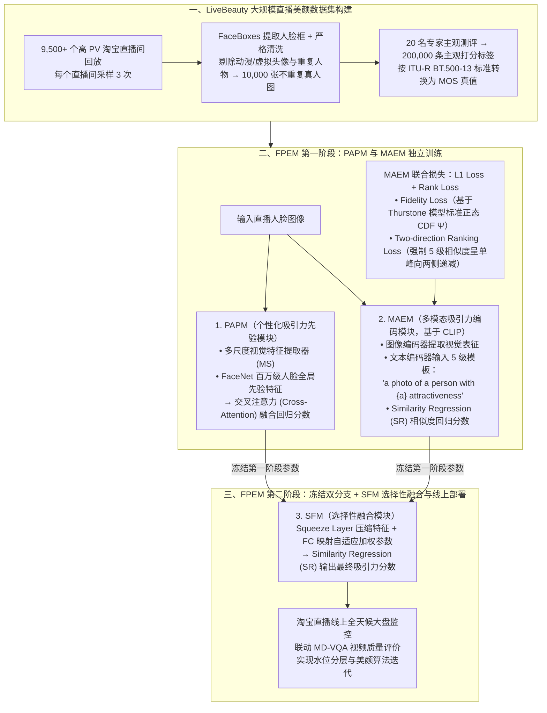

# ICCV25 | 淘宝人脸吸引力预测算法FPEM

## 1. TL;DR

1. **核心成果与业务背景**：淘天音视频技术团队与上海交通大学翟广涛教授团队合作论文《FPEM: Face Prior Enhanced Facial Attractiveness Prediction for Live Videos with Face Retouching》被计算机视觉顶会 **ICCV 2025（CCF A 类，11,152 篇投稿录用 2,702 篇，录用率 24.2%）** 收录；旨在量化评估淘宝每日数十万直播间的实时美颜效果（直接影响人均观看时长与 GMV）。
2. **业界最大直播美颜人脸吸引力数据集 `LiveBeauty`**：从 **9,500+ 个**高 PV 淘宝直播间回放中各采样 3 次，经 `FaceBoxes` 检测并剔除动漫/虚拟头像与重复人物后，构建包含 **10,000 张不同真人图像**（覆盖多样美颜参数、光照与表情）、由 **20 名专家**打分生成 **200,000 条**主观标签并按 **`ITU-R BT.500-13`** 标准转换为 MOS 真值的数据集。
3. **两阶段三模块多模态架构 `FPEM`**：① **PAPM（个性化吸引力先验模块）**——结合多尺度视觉特征提取器与百万级人脸预训练的 **`FaceNet`** 全局人脸先验，经交叉注意力融合回归分数；② **MAEM（多模态吸引力编码模块）**——基于 **`CLIP`** 架构，用 `{bad, poor, fair, good, perfect}` 5 级吸引力标签构造文本模板 `"a photo of a person with {a} attractiveness"`，通过相似度回归（SR）输出分数；③ **SFM（选择性融合模块，第二阶段训练）**——冻结第一阶段独立训练好的 PAPM 与 MAEM，用一层 `Squeeze Layer` + 全连接层自适应学习融合权重并经 SR 得出最终预测分。
4. **联合损失函数创新（L1 + 双重 Rank Loss）**：在 MAEM 训练中结合 $L_1$ 回归损失与排序损失 $L_{\text{Rank}}$；其中 $L_{\text{Rank}}$ 由基于**瑟斯顿模型（Thurstone's model，标准正态分布 CDF $\Psi(\cdot)$，方差设为 1）的保真度损失（Fidelity Loss）**与强制 5 级文本余弦相似度呈**单峰向两侧递减分布的双向排序损失（Two-direction Ranking Loss）**组成。
5. **全数据集霸榜与线上大盘监控**：在公开基准 `SCUT-FBP5500`、`MEBeauty` 及自建 `LiveBeauty` 上的 **SROCC、PLCC、KROCC** 三大指标全面超越现有 SOTA；线上联动视频质量评价模型 **`MD-VQA`** 实现淘宝直播大盘美颜与视觉体验的全天候水位分层监控。

## 2. 问题定义与背景

### 2.1 为什么直播美颜需要专门的数据集与多模态吸引力模型

在淘宝直播生态中，美颜并非单纯的“磨皮”，而是涵盖脸型微调、五官比例重塑与光影修饰的复杂算法变换。现有学术研究存在两大缺口：
1. **数据集缺口**：学术界已有数据集（如 `SCUT-FBP5500`、`MEBeauty`）要么闭源、要么开源规模偏小，且均未覆盖**真实电商直播间复杂光照、动态表情与不同美颜算法参数处理后**的人脸分布。
2. **单模态/零样本泛化瓶颈**：纯低层视觉卷积网络缺乏百万级人脸结构先验；而直接拿零样本（Zero-shot）`CLIP` 做人脸吸引力预测（FAP）泛化能力有限，必须结合专门的相似度回归策略（SR）与单峰排序约束。

## 3. 知识框架

## 4. 核心内容拆解

### 4.1 `LiveBeauty` 数据集采集与标注规范

1. **采样与去重清洗**：从淘宝直播高浏览量（PV）回放视频中每个直播间采样 3 帧，使用高精度实时人脸检测器 **`FaceBoxes`** 裁剪人脸边界框；严格剔除动漫形象、虚拟主播头像及同一主播的重复帧，从 **9,500+ 个**直播间中精选出 **10,000 张互不相同的人脸图像**（覆盖不同美颜滤镜强度、复杂室内外光照与直播互动表情）。
2. **专业主观打分与 MOS 转换**：组织 **20 名专家**对 10,000 张图像逐一评测，累计产生 **200,000 条**主观评分，并严格遵循国际电信联盟 **`ITU-R BT.500-13`** 标准计算平均主观意见分（**MOS, Mean Opinion Score**）作为 Ground-Truth。

### 4.2 `FPEM` 两阶段三模块架构设计

#### （1）第一阶段模块 A：`PAPM`（Personalized Attractiveness Prior Module）
- **双路特征提取**：一路提取包含局部纹理与清晰度的**多尺度（Multi-Scale, MS）低层视觉特征**；另一路利用在百万级人脸数据上预训练的 **`FaceNet`** 提取**全局人脸身份与几何先验特征**。
- **交叉注意力融合**：通过 Cross-Attention 模块将低层画质特征与高层人脸结构先验对齐融合，回归出先验分支预测分。

#### （2）第一阶段模块 B：`MAEM`（Multi-modal Attractiveness Encoder Module）
- **5 级美学语义锚点构造**：基于 `CLIP` 双塔架构，定义 5 个有序美学等级标签（对应由低到高的 5 档吸引力），填入固定提示模板：
  $$\text{``a photo of a person with \{a\} attractiveness''}$$
- **相似度回归（Similarity Regression, SR）**：计算人脸图像特征与 5 个等级文本锚点特征的余弦相似度，经 SR 模块映射为连续美学回归分（消融证实去掉 SR 会导致 CLIP 在回归任务上性能断崖式下跌）。

#### （3）第二阶段模块 C：`SFM`（Selective Fusion Model）
- **两阶段解耦训练**：第一阶段分别独立训练 PAPM 与 MAEM；进入第二阶段后，**冻结 PAPM 与 MAEM 的网络参数**，仅训练轻量的 SFM 模块。
- **自适应特征融合**：SFM 通过一层 **`Squeeze Layer`** 压缩双路特征，经全连接层（FC）动态生成自适应加权参数，将“全局人脸先验”与“多模态美学语义”深度融合，最后同样通过 **SR（相似度回归）** 输出最终预测分数。

### 4.3 联合损失函数：$L_1$ + 保真度损失 + 双向单峰排序损失

在 MAEM 训练中，总损失结合了回归精度与序关系约束：
1. **保真度损失（Fidelity Loss，基于 Thurstone 瑟斯顿模型）**：
   - 给定图像对 $(x_i, x_j)$ 及其真值 MOS 分数，定义二元偏序标签；根据**瑟斯顿模型（Thurstone's model）**，图像 $x_i$ 比 $x_j$ 更具吸引力的预测概率由模型预测差值经**标准正态分布累积分布函数 $\Psi(\cdot)$（方差设为 1）**给出，再计算交叉熵/保真度距离以保证样本间全局保序性。
2. **双向排序损失（Two-direction Ranking Loss，单峰分布约束）**：
   - **人类审美单峰先验**：人类对同一张脸吸引力等级的感知是循序渐进的单峰分布，极少出现“既像极丑又像极美”的多峰分布。
   - 设图像与第 $j$ 个吸引力等级（共 5 级）的余弦相似度为 $s_j$，概率最高的主峰等级下标为 $o$；**双向排序损失强制要求相似度从峰值等级 $o$ 向左侧（更低等级）和向右侧（更高等级）两个方向均严格单调递减**，从而将有序等级先验注入特征空间。

## 5. 数据速查表

| 维度 / 指标 | 原文数值 / 标准规格 | 语境与说明 |
|---|---|---|
| **顶会录用数据** | **ICCV 2025（CCF A 类），录用率 24.2%** | 共 11,152 篇有效投稿，录用 2,702 篇（淘天音视频 & 上海交大合作） |
| **`LiveBeauty` 数据集规模** | **9,500+ 直播间 $\to$ 10,000 张不同真人图 $\to$ 200,000 条标注** | 每直播间采样 3 次，20 名专家打分，按 `ITU-R BT.500-13` 转 MOS |
| **文本模态提示词模板** | `"a photo of a person with {a} attractiveness"` | 共 **5 级**吸引力标签，输入 CLIP 文本编码器 |
| **瑟斯顿模型（Thurstone）参数** | 标准正态分布累积分布函数 $\Psi(\cdot)$，**方差设为 1** | 用于计算成对图像的保真度损失（Fidelity Loss） |
| **三大评测数据集** | `SCUT-FBP5500`、`MEBeauty`、`LiveBeauty` | 包含同域测试与 `LiveBeauty` 训练 $\to$ `MEBeauty` 跨数据集泛化测试 |
| **三大评价指标** | **SROCC**（斯皮尔曼秩相关）、**PLCC**（皮尔逊线性相关）、**KROCC**（肯德尔秩相关） | SROCC/KROCC 衡量保序性，PLCC 衡量与 MOS 分数的线性拟合度 |
| **线上联合监控模型** | **`FPEM` + `MD-VQA`**（多维 UGC 直播视频质量评价） | 对淘宝数十万直播间视觉体验做全天候水位分层与美颜迭代指导 |

## 6. 踩坑与教训 / 可迁移的设计原则

| 错误做法 | 失败表现或原因 | 原文应对（可迁移的设计原则） |
|---|---|---|
| **直接用学术界摆拍/素颜数据集训练的模型去评估淘宝直播间** | 直播间存在复杂美颜算法（瘦脸/大眼/磨皮）与动态光影，传统数据集未覆盖该分布导致评分失准 | 采集 9,500+ 真实直播间构建包含美颜变换的 **10,000 张 `LiveBeauty` 专属基准集** |
| **直接拿 Zero-shot CLIP 或不带专用回归头的图文模型做连续美学打分** | 消融实验表明零样本 CLIP 在人脸吸引力预测上泛化很差，移除相似度回归（SR）后性能显著下跌 | 设计专门的 **Similarity Regression (SR)** 模块将 5 级文本锚点相似度映射为连续分数 |
| **只用 $L_1 / L_2$ 回归损失训练多等级美学文本匹配** | 模型忽略了 5 个美学等级之间的天然序关系，可能输出“同时与 bad 和 perfect 高相似”的违背常识的多峰分布 | 引入 **Thurstone 保真度损失 + 双向单峰排序损失（Two-direction Ranking Loss）**，强制相似度从峰值等级向两侧单调递减 |
| **把视觉先验分支与多模态 CLIP 分支从头到尾端到端一起乱训** | 两个异构分支收敛速度与特征尺度不同，直接联合训练易互相干扰 | 采用 **两阶段训练 + SFM 选择性融合**：第一阶段独立训练 PAPM 与 MAEM，第二阶段冻结二者仅训 SFM 自适应加权 |

## 7. 记忆锚点

- **FPEM 架构口诀**：「**一阶段双塔独训（PAPM 融多尺度与 FaceNet 先验 + MAEM 用 CLIP 5 级模板配单峰双向 Rank Loss），二阶段冻结双塔用 SFM 自适应加权回归**」。
- **数据集数字锚点**：「**9500+ 直播间采 1 万张不重样真人图，20 专家打 20 万标签按 ITU-R BT.500-13 转 MOS**」。

## 8. 复习卡片

淘宝自建的 LiveBeauty 数据集是如何构建的？为什么它比 SCUT-FBP5500 和 MEBeauty 更适合直播场景？::从 9,500 多个高 PV 淘宝直播间回放中各采样 3 次，用 FaceBoxes 提取人脸并剔除动漫/虚拟头像与重复人物，得到 10,000 张互不相同的人脸图像；由 20 名专家打出 200,000 条主观标签并按 ITU-R BT.500-13 转为 MOS 真值，是首个涵盖真实直播美颜算法参数、复杂光照与表情的大规模数据集。
FPEM 模型的三个核心模块（PAPM、MAEM、SFM）各自负责什么功能？为什么采用两阶段训练？::① PAPM 融合多尺度低层视觉特征与百万级人脸预训练的 FaceNet 全局人脸先验；② MAEM 基于 CLIP 结合 5 级吸引力文本模板提取多模态美学语义并做相似度回归（SR）；③ 第二阶段冻结 PAPM 与 MAEM 参数，由 SFM 通过 Squeeze Layer 与全连接层自适应加权融合双路特征，防止异构分支联合训练互相干扰。
MAEM 模块中的 Rank Loss 由哪两部分组成？各自的数学原理是什么？::由保真度损失（Fidelity Loss）和双向排序损失（Two-direction Ranking Loss）组成：前者基于瑟斯顿模型（Thurstone's model，用方差为 1 的标准正态分布 CDF Ψ 建模两图优劣概率）保持样本间序关系；后者利用人类审美感知的单峰特性，强制图像与 5 个吸引力等级的余弦相似度从最高峰等级 o 向左右两侧严格递减。
消融实验（表 3 与表 4）验证了哪些关键设计结论？跨数据集测试（LiveBeauty 训 → MEBeauty 测）暴露了什么现象？::验证了多尺度特征、FaceNet 先验、CLIP 相似度回归（SR）、L1+Rank 联合损失以及两阶段 SFM 融合均显著提升 SROCC/PLCC/KROCC；跨数据集测试中各模块仍有正向泛化贡献，但因不同数据集的分布与审美评分标准差异，整体跨库指标偏低。
FPEM 模型在淘宝直播线上业务中是如何落地的？::FPEM 与多维直播视频质量评价模型 MD-VQA 联动部署，对淘宝每日数十万直播间的大盘视觉体验进行全天候水位分层监控，识别优质内容并指导美颜算法迭代优化。

## 9. 知识关联

- **本库主题索引**：[推荐系统与多模态评测](../../20_topics/推荐系统与多模态评测.md)、[跨端开发与性能](../../20_topics/跨端开发与性能.md)、[Agent评测与反馈](../../20_topics/Agent评测与反馈.md)
- **本库关联文章**：[概念蒸馏视频复原Vivid-VR+26.3.4](../概念蒸馏视频复原Vivid-VR+26.3.4/AI_概念蒸馏视频复原Vivid-VR.md)、[TLiveOmni直播多模态大模型+26.5.20](../TLiveOmni直播多模态大模型+26.5.20/AI_TLiveOmni直播多模态大模型.md)
- **候选双链**：[[人脸吸引力预测FAP]]、[[CLIP多模态回归]]、[[Thurstone瑟斯顿模型]]、[[MD-VQA视频质量评价]]

## 10. 原文参考资料

- **原文信息**：《ICCV25 | 淘宝人脸吸引力预测算法FPEM》，作者：淘天音视频技术团队 & 上海交通大学多媒体实验室（翟广涛教授团队），发布日期：2026-01-23。
- **论文下载链接**：
  - CVF OpenAccess：[Li et al., *FPEM: Face Prior Enhanced Facial Attractiveness Prediction for Live Videos with Face Retouching*, ICCV 2025](https://openaccess.thecvf.com/content/ICCV2025/papers/Li_FPEM_Face_Prior_Enhanced_Facial_Attractiveness_Prediction_for_Live_Videos_ICCV_2025_paper.pdf)
- **文内引用参考文献（6 篇）**：
  1. Liang et al., *SCUT-FBP5500: A diverse benchmark dataset for multi-paradigm facial beauty prediction*, ICPR 2018.
  2. Lebedeva et al., *MEBeauty: a multiethnic facial beauty dataset in-the-wild*, Neural Computing and Applications 2022.
  3. Zhang et al., *MD-VQA: Multi-dimensional quality assessment for UGC live videos*, ICPR 2023.
  4. Zhang et al., *FaceBoxes: A CPU real-time face detector with high accuracy*, IJCB 2017.
  5. *Recommendation ITU-R BT.500-13: Methodology for the subjective assessment of the quality of television pictures*, ITU 2002.
  6. Schroff et al., *FaceNet: A unified embedding for face recognition and clustering*, CVPR 2015.

> [!note]- 校对报告
> - **页码溯源汇总**：
>   - `## 1. TL;DR` & `## 2. 问题定义与背景`：源自 p.1–3（ICCV 2025 CCF A 类顶会、11,152 篇投稿录用 2,702 篇录用率 `24.2%`、CVF 论文链接、淘宝数十万直播间美颜与观看时长/GMV 关联、`LiveBeauty` 10,000 张图 / 20 万主观标签、`SCUT-FBP5500` / `MEBeauty` / `MD-VQA`）。
>   - `## 4.1 LiveBeauty 数据集` & `## 4.2 FPEM 模型设计`：源自 p.3–5（9,500+ 直播间各采样 3 次、`FaceBoxes`、20 名专家、`ITU-R BT.500-13` MOS、两阶段训练、PAPM 多尺度+`FaceNet`+交叉注意力、MAEM `CLIP`+5 级吸引力标签+`"a photo of a person with {a} attractiveness"`+SR、SFM `Squeeze Layer`+FC+SR）。
>   - `## 4.3 损失函数与实验论证`：源自 p.5–8（$L_1$ + $L_{\text{Rank}}$、Thurstone 模型标准正态 CDF $\Psi(\cdot)$ 方差为 1 的 Fidelity Loss、单峰双向递减 Two-direction Ranking Loss、SROCC/PLCC/KROCC 三指标对比与表 3–4 消融结论、跨文化审美主观性展望）。
> - **材料质量说明**：p.4–7 含模型结构图、行内公式小图及表 1–4 实验结果图片（⚠️[图片表格未在文本层展开单元格小数]），本笔记已将正文明确阐述的全部数学模型原理、超参设定与消融结论完整还原，不捏造未出现在文本层的表格小数。
