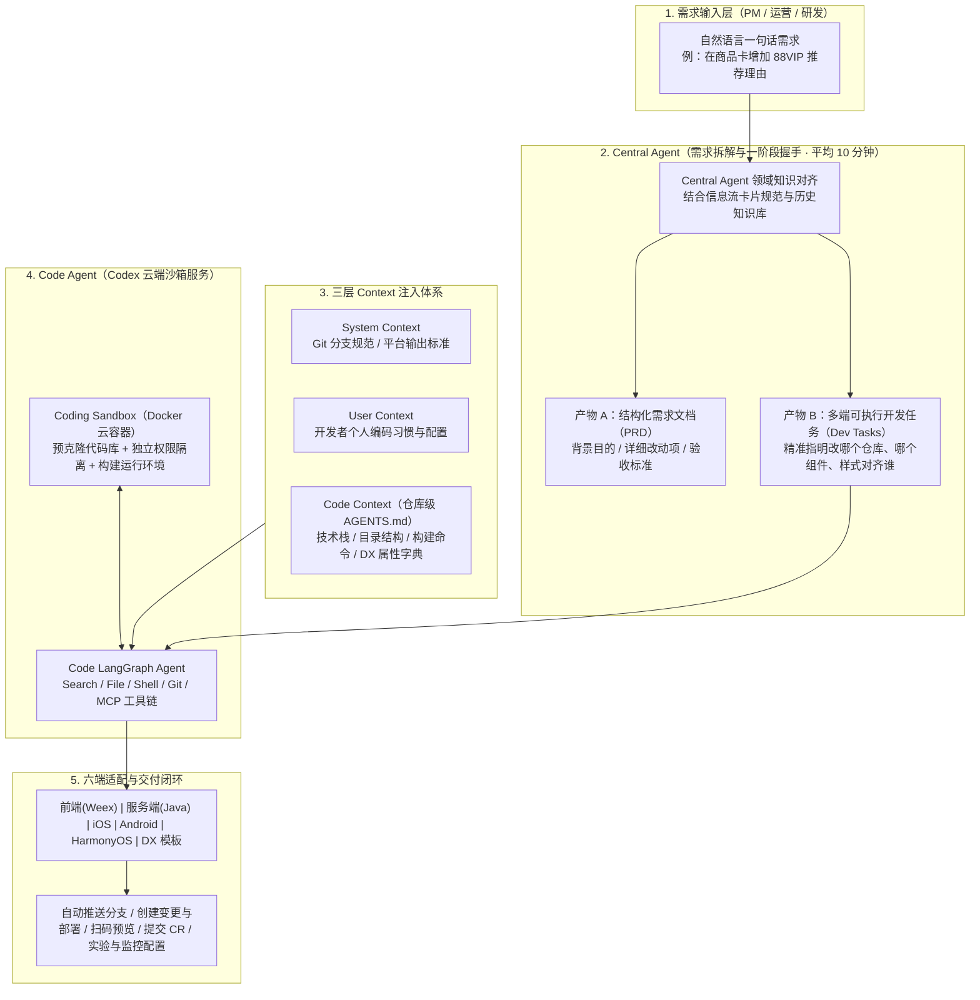

# 产品经理也能“开发”需求？淘宝信息流从需求到上线的AI端到端实践

## 1. TL;DR

1. **核心痛点（多端碎片化 + N 次沟通握手）**：淘宝推荐信息流（首页猜你喜欢 + 购后支付成功/订单详情等推荐场）面临极高的迭代压力，单个需求平均耗时 **1 周**；仅前端展示层就横跨 **`iOS`、`Android`、`HarmonyOS`、`Weex`、`DX（DinamicX）` 5 大技术栈**（加上服务端共 **6 大研发端**），且产品经理（PM）与多端研发之间存在类似 TCP 握手却高达“N 次往返”的沟通损耗与业务上下文断层。
2. **WaterFlow 端到端 AI 架构（Central Agent + Codex 云沙箱 + 三层 Context）**：淘天用户终端技术团队构建了面向 PM、研发、测试与运营的一站式 AI 研发平台 **WaterFlow**：
   - **`Central Agent`（1 次握手生成双产物）**：PM 输入一句话自然语言需求，平均 **10 分钟**自动拆解生成标准 **PRD 需求文档**与按技术栈定制的**可执行开发任务（Development Tasks / Prompts）**；
   - **`Code Agent`（基于 `Codex` 云端容器沙箱）**：将代码检索、编写、构建与预览封装进预装好各端仓库与环境的云端 Docker 容器（`Coding Sandbox` + `Code LangGraph Agent`），让没有本地 IDE 环境的产品经理也能一键完成多端编码与真机扫码预览；
   - **三层 Context 注入体系**：融合 **System Context**（平台级 Git 与输出规范）、**User Context**（个人编码偏好）与 **Code Context**（仓库级 `AGENTS.md` 工程规约与 DX 组件属性字典）。
3. **量化成效**：上线约 3 个月内，WaterFlow 已产出 **30+ 套完整需求与开发任务（占团队总需求量的 `30%`）**，AI 生成任务完成率达 **`90%`**，累计生成涵盖 Java / JS / XML 的生产代码 **超过 `54,000` 行**，将信息流常规需求从提出到上线的交付周期从 **1 周压缩至 2 天以内**。

## 2. 问题定义与背景

### 2.1 淘宝信息流的双场景与“五端前端 + 服务端”重度碎片化

淘宝推荐信息流涵盖两大核心业务阵地：**首页信息流（猜你喜欢）**与**购后信息流（支付成功页、订单详情页、购物车等）**。由于历史演进与跨端性能诉求，信息流业务的研发链路极其庞大，哪怕只是在商品卡片上新增一个标签，往往也需要横跨 **6 大研发端**协同修改：
1. **前端展示层 5 大技术栈**：`iOS`、`Android`、`HarmonyOS`、`Weex`（TypeScript + React + Weex 2.0）、`DX`（淘宝自研动态化 XML 模板引擎）；
2. **服务端（Backend）**：Java 推荐编排与下发字段扩展。

### 2.2 传统研发链路痛点与外部 AI 工具的四大水土不服

1. **传统研发两大痛点**：
   - **迭代周期长**：单个需求从 PRD、排期到多端联调上线平均耗时 **1 周**；
   - **PM 与研发的“N 次握手”沟通黑洞**：对比 TCP 协议的“三次握手”，由于 PM 轮岗频繁、不熟悉历史卡片模板结构与底层推荐理由逻辑，往往只给出一句模糊描述（如“在商品卡增加 88VIP 推荐理由”），研发不得不就位置、字号、颜色、冲突兜底反复追问，形成高昂的“N 次握手”损耗。
2. **为什么现有 AI Coding 工具无法直接套用？**
   - **Devin / OpenAI Agents**：绑定海外 Slack 生态而非钉钉，且缺乏淘宝信息流专属的预览与测试基建；
   - **Cursor / GitHub Copilot**：本地 IDE 环境配置门槛极高，无法要求 PM 在本地配齐 iOS/Android/Java/Weex 多端编译环境；
   - **bolt.new / Lovable**：仅适合从 0 到 1 生成轻量级新原型，无法处理存量庞大的客户端、服务端与内部私有 DX 模板代码。

## 3. 知识框架

## 4. 核心内容拆解

### 4.1 Central Agent：将“N 次握手”收敛为“1 次握手”

`Central Agent` 充当懂业务历史与多端代码结构的“资深架构师 + 资深 PM”：
- **左输入、右双产物工作台**：PM 在左侧输入自然语言需求并经过 1 次轻量确认（One-way handshake），右侧在 **平均 10 分钟内** 自动生成两份产物：
  1. **需求文档（PRD）**：包含背景目的（Why）、具体改动内容（What）与验收标准（Acceptance Criteria）；
  2. **开发任务（Development Tasks）**：针对受影响的技术栈生成可直接交给 `Code Agent` 执行的高质量 Prompt，明确指出**在哪里改（Where）**和**怎么改（How）**。
- **Prompt 精细化改写实例**：
  - **原始模糊描述**：`在商品卡增加88VIP推荐理由`
  - **Central Agent 改写后的可执行任务**：`在商品卡的标题下方增加88VIP推荐理由，字体颜色大小跟官方立减保持一致`（自动补齐位置锚点“标题下方”与样式参照物“官方立减”）。

### 4.2 Code Agent 与 Codex 云端沙箱：让 PM 零环境开发预览

为了让没有本地 IDE 的 PM 和运营也能驱动编码与验收，WaterFlow 通过 API 将开发任务委派给云端 **`Codex` 沙箱服务**：
1. **`Coding Sandbox`（云端 Docker 容器）**：预先克隆各端目标代码仓库、配齐编译构建依赖并实现任务级权限隔离；
2. **`Code LangGraph Agent`（多步自主编码智能体）**：集成代码检索（Search）、文件读写（File）、终端命令（Shell）、版本控制（Git）与 MCP 工具链，协同 Coding LLM 在容器内完成“检索定位 $\to$ 修改代码 $\to$ 编译校验 $\to$ 生成预览”。

### 4.3 三层 Context 注入机制与仓库级 `AGENTS.md`

WaterFlow 通过三层 Context 消除大模型在存量工程中的幻觉：
1. **System Context（系统级上下文）**：全局不可篡改的平台铁律，如 Git 分支管理规范与标准输出格式；
2. **User Context（用户级上下文）**：记录操作人的个人编码习惯与配置画像；
3. **Code Context（代码库级上下文）**：核心载体为各仓库根目录下的 **`AGENTS.md`** 及领域补充字典：
   - **Weex 仓库（`@ali/weex-waterfall`）`AGENTS.md` 实例**：声明技术栈为 `TypeScript + React + CSS + Weex 2.0 + Ice 3.0`；规定标准命令 `tnpm install`、`tnpm run startWeex`、`tnpm run build`；明确 `src/cards`、`src/components`、`src/hooks`、`src/utils` 四大目录职责；
   - **DX 模板专属字典**：针对通用大模型不熟悉的内部 `DinamicX (DX)` 框架，在 `Code Context` 中额外注入 **DX 组件清单与属性字典**。

### 4.4 六大技术栈全流程适配与 6 大落地场景

1. **六端 Pre-dev / Post-dev 闭环**：覆盖前端、服务端、客户端（iOS/Android/HarmonyOS）与 DX。开发前自动创建 `Codex` 容器（DX 自动拉取最新线上模板）；开发后自动推送 Git 分支、创建变更单与部署、生成真机预览、提交 CR，并串联自动化监控、AB 实验配置与模板预览。
2. **六大代表性生产落地案例**：① 定时上架商品表达优化；② 评价返现卡片样式调整；③ URL 参数解析逻辑补充；④ 商品卡新增 88VIP 推荐理由；⑤ 确认收货页缓存性能埋点；⑥ **iOS 深色模式（Dark Mode）跨端适配（同时横跨 iOS 原生端与 DX 动态模板端）**。

## 5. 数据速查表

| 指标 / 维度 | 原文数值 | 语境 / 条件 |
| --- | --- | --- |
| 传统信息流单个需求平均交付周期 | **`1 周`（约 5–7 天）** | 含需求沟通、排期、多端开发与联调验收 |
| 信息流前端涵盖技术栈数量 | **`5 大前端技术栈`（`iOS` / `Android` / `HarmonyOS` / `Weex` / `DX`）** | 加上服务端 Java 共计 **6 大研发端** |
| `Central Agent` 生成 PRD + 开发任务耗时 | **平均 `10 分钟`** | PM 自然语言输入后经 1 次握手确认 |
| WaterFlow 上线 3 个月生成需求套数与占比 | **`30+ 套` PRD 与开发任务（占团队总需求量的 `30%`）** | 真实生产环境统计 |
| AI 开发任务完成率 | **`90%`** | 覆盖增量卡片样式、推荐理由、埋点与跨端适配 |
| 累计生成生产代码行数 | **超过 `54,000 行`** | 涵盖 Java、JS/TS、XML 等多端语言 |
| WaterFlow 端到端需求上线周期 | **缩短至 `2 天以内`** | 相比传统 1 周周期大幅提速，支持 PM 自助交付预览 |

## 6. 踩坑与教训 / 可迁移的设计原则

| 错误做法 | 失败表现或原因 | 原文应对（可迁移的设计原则） |
| --- | --- | --- |
| **把 PM 的原始一句话需求（如“加个 88VIP 推荐理由”）直接丢给 Coding Agent 写代码** | 缺少具象的位置锚点与样式参照，Agent 在庞大存量卡片组件中盲目猜测，改错位置或破坏原有布局 | **前置 `Central Agent` 做“规约翻译”**：结合领域知识将模糊需求改写为指明“在标题下方、字号颜色对齐官方立减”的分端可执行开发任务 |
| **要求产品经理或跨栈研发在本地电脑配齐 iOS/Android/Java/Weex/DX 编译环境来用 AI 插件** | 本地多端环境配置极其繁琐且权限受限，非本端研发根本无法编译预览 | **将 Coding Agent 装进云端 Docker 沙箱（`Codex`）**：预克隆仓库并打通云端构建与手机扫码预览，实现零本地环境开发 |
| **让通用大模型直接修改阿里内部私有框架（如 `DX` 动态模板或内网 `tnpm` 工程）** | 通用模型不认识私有 XML 组件属性，或误用公网 `npm` 命令导致构建失败 | **构建三层 Context（`System + User + Code`）**：在仓库 `AGENTS.md` 中锁死 `tnpm` 命令与目录结构，并额外注入私有 DX 组件与属性字典 |

## 7. 记忆锚点

1. **架构公式**：**WaterFlow = `Central Agent`（10 分钟把 N 次握手变 1 次握手，产 PRD + 分端 Prompt）+ `Codex 云沙箱`（Docker 容器 + LangGraph Agent）+ `三层 Context`（System + User + `AGENTS.md`/DX 字典）**。
2. **四组核心战果**：覆盖 **`30%`** 需求（`30+` 套）、任务完成率 **`90%`**、生成代码 **`> 54,000` 行**、交付周期从 **1 周缩至 `2 天以内`**。

## 8. 复习卡片

1. 淘宝信息流业务在引入端到端 AI 研发前，面临哪两个最核心的研发效率痛点？::① **多端技术栈高度碎片化**：单个需求平均耗时 **1 周**，仅前端展示就横跨 `iOS`、`Android`、`HarmonyOS`、`Weex`、`DX` 5 大技术栈（加服务端共 6 端）；② **PM 与研发的“N 次握手”沟通损耗**：PM 轮岗频繁、不熟悉底层卡片模板与推荐理由逻辑，模糊需求导致多端反复追问确认。
2. 为什么 Cursor/Copilot 或 bolt.new/Lovable 无法直接解决“让淘宝产品经理自助开发信息流需求”的问题？::**Cursor/Copilot** 属于本地 IDE 工具，要求使用者在本地配齐 iOS/Android/Java/Weex 等多端复杂编译环境，PM 无法上手；**bolt.new/Lovable** 仅适合从 0 到 1 生成轻量级新原型，无法处理淘宝庞大存量代码库、内部私有 `DX` 模板引擎及内部发布预览基建。
3. WaterFlow 系统中的 `Central Agent` 扮演什么角色？它生成的两个核心产物是什么？::`Central Agent` 负责结合信息流领域知识将 PM 与研发的“N 次握手”收敛为“1 次握手”。PM 输入自然语言需求后，它在**平均 10 分钟内**生成两个产物：① **标准化需求文档（PRD）**（含背景、改动项、验收标准）；② **分端可执行开发任务（Development Tasks）**（将模糊描述转化为指明具体组件位置与样式参照物的精准 Prompt）。
4. WaterFlow 的 `Code Agent`（`Codex` 云沙箱）由哪两部分组成？为什么它能支持 PM 零环境开发？::由 **`Coding Sandbox`（预克隆各端代码库、配齐编译环境且权限隔离的 Docker 云容器）** 与 **`Code LangGraph Agent`（具备 Search/File/Shell/Git/MCP 工具的自主编码智能体）** 组成。因为代码修改、编译构建和生成手机扫码预览全部在云端容器中自动完成，PM 无需在本地安装任何 IDE。
5. WaterFlow 的“三层 Context 注入机制”分别是什么？仓库级的 `AGENTS.md` 主要包含哪些内容？::三层 Context 包括：① **System Context**（平台级 Git 与输出铁律）；② **User Context**（个人编码偏好与配置）；③ **Code Context**（仓库级上下文）。其中仓库根目录的 `AGENTS.md` 明确声明了**技术栈（Tech Stack）、标准构建与启动命令（Commands，如 `tnpm run build`）、核心目录职责（`src/cards|components|hooks|utils`）**，并针对私有框架补充了 **DX 组件与属性字典**。
6. WaterFlow 在淘宝信息流上线 3 个月取得了哪些核心量化成果？::累计生成 **30+ 套** PRD 与开发任务（占团队总需求量的 **`30%`**），AI 开发任务完成率达 **`90%`**，累计生成生产代码超过 **`54,000` 行**（覆盖 Java/JS/XML），将需求从提出到上线的平均周期从 **1 周缩短至 2 天以内**。

## 9. 知识关联

- **本库主题关联**：
  - [AI研发协同](../../20_topics/AI研发协同.md)：构建面向 PM、研发、测试与运营的 WaterFlow 端到端 AI 研发平台，通过 Central Agent（10 分钟生成 PRD+开发任务）与 Codex 云沙箱将信息流需求交付周期从 1 周缩短至 2 天内（完成率 90%，生成代码超 5.4 万行）。
  - [Agent工程循环](../../20_topics/Agent工程循环.md)：采用 Central Agent + 多端 Code LangGraph Agent（运行于隔离 Docker 容器沙箱，配备 Search/File/Shell/Git/MCP 工具集）的双层协同架构，打通从需求拆解到自动构建、扫码预览与提交 CR 的全流程。
  - [Prompt优化](../../20_topics/Prompt优化.md)：设计 System Context + User Context + Code Context（仓库级 `AGENTS.md` 工程规范与私有 DX 模板属性字典）三层上下文注入机制，并通过 Central Agent 将模糊业务描述改写为带位置锚点与样式参照的精准 Prompt。
  - [跨端开发与性能](../../20_topics/跨端开发与性能.md)：在淘宝首页与购后信息流场景下统一适配 iOS、Android、HarmonyOS、Weex（`@ali/weex-waterfall`）与 DinamicX（DX）五大前端技术栈及 Java 服务端，支持跨 iOS 与 DX 的深色模式适配与缓存性能埋点。
- **候选双链**：`[[WaterFlow平台]]`、`[[Codex云沙箱]]`、`[[AGENTS_md规范]]`、`[[DinamicX动态模板]]`、`[[端到端AI研发]]`

## 10. 原文参考资料

- **原文标题**：《产品经理也能“开发”需求？淘宝信息流从需求到上线的AI端到端实践》
- **发布渠道与日期**：微信公众号「大淘宝技术」，2025-09-29
- **作者与团队**：川封（淘天集团-用户终端技术团队）
- **核心提及系统与技术**：WaterFlow、`Central Agent`、`Code Agent`、`Codex` 云沙箱、LangGraph、`AGENTS.md`、`@ali/weex-waterfall`（Weex 2.0 + Ice 3.0 + React + TypeScript）、`DinamicX (DX)`

> [!note]- 校对报告
> - **页码溯源汇总**：
>   - 淘宝首页与购后信息流业务背景、单需求平均耗时 `1 周`、前端横跨 `iOS / Android / HarmonyOS / Weex / DX` 5 大技术栈及 PM 与研发“N 次握手”痛点：`p.1–3`
>   - 外部主流 AI 工具（Devin/OpenAI Agents、Cursor/Copilot、bolt.new/lovable）在淘宝信息流场景下的局限性分析：`p.3–4`
>   - WaterFlow 整体架构、`Central Agent`（1 次握手、平均 `10 分钟` 生成 PRD + 开发任务双产物、88VIP 推荐理由 Prompt 优化对比）：`p.4–6`
>   - `Code Agent` 与 `Codex` 云端 Docker 沙箱（`Coding Sandbox` + `Code LangGraph Agent`）：`p.6–7`
>   - 三层 Context（`System / User / Code Context`）、`@ali/weex-waterfall` 仓库 `AGENTS.md` 规范及 DX 组件属性字典：`p.7–9`
>   - 六端（前端/服务端/客户端/DX）Pre-dev 与 Post-dev 工程流水线适配：`p.9–10`
>   - 上线 3 个月量化成效（`30+` 套占 `30%`、`90%` 完成率、`> 54,000` 行代码、周期从 `1 周` 缩至 `2 天以内`）及 6 大落地案例：`p.10–12`
> - **关键数值一致性核查**：
>   - 传统周期 `1 周` vs WaterFlow `2 天以内`、前端 `5` 大技术栈（加服务端 `6` 端）、Central Agent 耗时 `10 分钟`、覆盖率 `30+ 套 / 30%`、完成率 `90%`、代码量 `> 54,000 行` 均与原文完全一致。
> - **图像与版面质量说明**：
>   - `p.2–8, 10–13` 含 11 张架构图、工作台截图、`AGENTS.md` 示例图与真实需求预览对比图（位于 PDF 图像层），`p.14` 为尾页；全部核心架构、目录规范与量化数据均在文本层完整提取。
