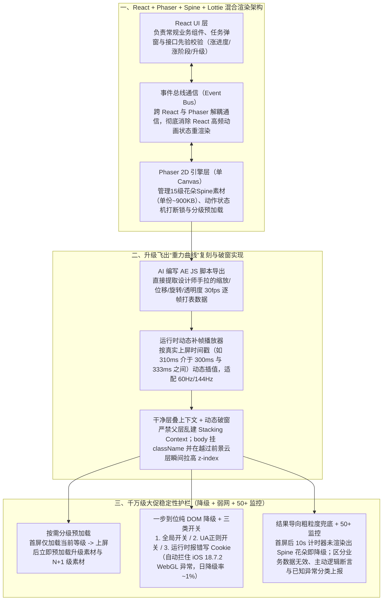

# 2025淘宝直播双11花花乐动画实现方案思考&分享

## 1. TL;DR

1. **核心业务与痛点**：淘宝直播 2025 双 11 主互动玩法“花花乐”（共 **15 个等级**气球花，11 月 10 日前满级可抽 **4,999 元**红包）包含大量自定义网格节点拉伸形变（花朵晃动、长出新枝叶）及带“重力感”的跨层级飞出破窗升级动画；若用 Lottie 导出帧动画或将升级飞出写进 15 份 Spine 素材（单份 `png+json` 约 **900KB**），会导致体积爆炸且难以维护。
2. **混合渲染与 AI 导出 AE 分帧打表 + 动态补帧**：
   - **架构分工**：采用 **`React + Phaser + Spine + Lottie + 事件通信`**，React 负责常规 UI，轻量 2D 游戏引擎 Phaser 在单 Canvas 内负责 Spine 骨骼网格拉伸动画与素材分组管理，跨层通过事件通信减少 React 无效重渲染；
   - **重力飞出曲线复刻**：针对手拉 AE 缩放/位移/旋转复合曲线无法用标准贝塞尔模拟的痛点，**用 AI 编写 AE JS 脚本导出 30fps 逐帧数据表**，并在运行时播放器中引入类似高端电视的**实时线性插值动态补帧**（如在 `300ms` 缩放 `100` 与 `333ms` 缩放 `90` 之间动态算出 `310ms` 的中间值），兼顾小体积与 60Hz/144Hz 高刷屏丝滑体验；
   - **破窗层级切换**：保持父容器层叠上下文（Stacking Context）干净，升级时向 `body` 注入 `className` 并在飞跃临界点动态拉高 Canvas `z-index` 跃过前景云层。
3. **大促工程保障（预加载 + 三级开关 DOM 降级 + 10s 粗粒度兜底 + 50+ 监控）**：首屏渲染当前等级花朵后立即预加载升级素材与下一等级素材；拒绝繁琐的“WebGL 降级 Canvas”半吊子兼容，直接提供 **纯 DOM 渲染降级方案** + **三类开关（全局配置 / UA 正则 / 运行时报错写 Cookie 联动 SSR）** + **首屏后 10 秒未渲染出花朵自动触发降级**，线上成功自动兜底 `iOS 18.7.2` WebGL 异常，全周期仅约 **1%** 用户触发当日降级，配合 **50+ 条**业务语义级监控保障双 11 零故障。

## 2. 问题定义与背景

### 2.1 双 11“花花乐”四大核心动效诉求与选型拆解

1. **按钮微风吹拂动效**：简单循环效果，直接使用 **Lottie** 播放即可。
2. **花朵晃动与阶段性长出新枝叶**：涉及图片**自定义网格节点拉伸形变（Mesh Deformation）**。若用 Lottie 导出序列帧不仅素材体积巨大且帧率难保，必须选用 **Spine 2D 骨骼动画**。
3. **满进度升级“花朵+红包飞出破窗”**：
   - 共有 **15 个等级**的花，单等级 Spine 素材（`png + json`）约 **900KB**（内含打气、生长、待机 3–5 组动作）；
   - 若将升级飞出动画做进 Spine 素材，15 个文件都要重复塞入相同的红包飞出动画，造成严重体积冗余与设计师重复劳动，因此**升级飞出必须由前端代码驱动整个容器变换**。

### 2.2 Spine 相比 Lottie 的六大核心差异

- **相同点**：均对原始素材做图片分层，并用 JSON 描述动画行为以替代序列帧。
- **不同点**：① Spine 以**时间**为单位而非帧；② 按**动作名（Action Name）**拆分而非帧数区间；③ 原生支持**更换皮肤（Skin）**；④ 原生支持**动作间补间过渡（Mix/Crossfade）**防止生硬切换；⑤ 支持**绑定自定义网格点位做拉伸形变**；⑥ **必须使用 Canvas/WebGL 渲染**，不支持 SVG。

## 3. 知识框架

## 4. 核心内容拆解

### 4.1 为什么引入轻量 2D 引擎 Phaser？状态机打断锁如何设计？

1. **选用 Phaser 而非裸 Spine Web Player 的原因**：实际业务不仅要播放 Spine，还涉及合成渲染红包图片、精细控制多级素材加载生命周期、按分组编排组合动画；Phaser 作为成熟的轻量 H5 2D 引擎能一站式接管单个 `<canvas>` 内的资源与渲染调度。
2. **动作状态机与按钮加锁反推**：花朵平时处于“待机循环动画”，点击打气时需切入“打气/生长/升级”动作；必须严格定义哪些动作**可被打断**、哪些动作**不可被打断**，并以此反推打气按钮的加锁与解锁时机；同时针对素材加载失败或 JS Error 导致“动画长时间不循环”或“按钮长时间死锁”设置超时监控与强制解锁兜底。

### 4.2 AI 导出 AE 分帧打表 + 高刷屏实时动态补帧

1. **为什么手调 `ease-in-out` 贝塞尔曲线失败？**
   - 升级时“花 + 红包”以右上角为中心点同时进行缩放、位移、旋转与透明度变换，设计师在 AE 中手拉的多属性复合曲线带有强烈的“重力坠落再弹起”质感，人眼粗估或常规 CSS 贝塞尔曲线还原度极差。
2. **AI 编写 AE JS 脚本导出 30fps 分帧数据（打表法）**：
   - 利用 After Effects 支持运行 JS 脚本的特性，让 AI 编写导出脚本将 AE 源文件中的逐帧属性提取为结构化 JSON 数据表，再由 AI 编写运行时逐帧播放器并完成 AE 坐标系到前端 DOM/Canvas 坐标系的比例转换。
3. **运行时动态补帧（解决 30fps 数据在 60Hz/144Hz 屏幕上的卡顿）**：
   - AE 源稿按 **30fps**（约每 `33.3ms` 一帧）导出；若直接按帧播放，在 60fps 或 144fps 设备上会明显掉帧，而若把 JSON 导出改为 60fps 则体积翻倍且仍无法适配 144Hz 屏幕。
   - **借鉴高端电视动态补帧原理**：由于升级飞出是纯播放过程、不涉及游戏级实时操控跟手延迟，播放器直接根据当前 `requestAnimationFrame` 的真实时间戳（例如 `t = 310ms`），读取前后两个关键帧（`300ms` 时缩放为 `100`，`333ms` 时缩放为 `90`）进行**实时线性插值计算**，以零体积增量完美适配任意高刷屏。

### 4.3 破窗层级管理与“数据先验、动画后行”原则

1. **破窗动效的层叠上下文（Stacking Context）铁律**：
   - 升级时花朵起初被前景云朵遮挡，飞到高点时需越过云朵盖住顶栏（破窗）。
   - 实现核心是**保持页面 DOM 层级干净**：严禁在各模块的任意父容器上随意创建独立的层叠上下文（否则子元素的 `z-index` 会被锁死在父级上下文内部无法跨模块破层）；保持同一层叠上下文后，只需在升级触发时向 `<body>` 挂载对应 `className`，并在特定时间点切换 Canvas 的 `z-index` 即可安全破窗。
2. **红包弹窗与动画的精确同步（先拿结果再播动画）**：
   - 用户点击按钮后，**必须先请求后端接口并校验返回数据的合法性**，明确本次点击的结果是“涨进度”、“涨阶段”还是“满级升级”（若接口报错或返回无效面额，在播动画前直接弹 Toast 走异常分支）；
   - 只有在数据与素材均就绪后才启动连续动画，按设计师时间轴准时弹出红包弹窗。

### 4.4 千万级大促稳定性：预加载、三级降级开关与 50+ 监控

1. **15 级花朵的渐进式预加载策略**：
   - 首屏进入后仅加载**当前等级（$N$ 级）**的 Spine 素材并第一时间上屏；
   - 一旦首屏花朵渲染完成，立即在后台静默预加载**升级过渡素材**与**下一等级（$N+1$ 级）**素材；每次升级动画播放完毕后循环触发下一级预加载。
2. **果断放弃半吊子兼容，直接做纯 DOM 降级 + 三类开关**：
   - 拒绝“WebGL 失败降级 2D Canvas”这种效果既不完美又测不过来的中间态，直接准备一套经过完整测试验收的**纯 DOM 静态/轻量渲染降级方案**。
   - **三道降级开关**：① **全局配置开关**（应对 Spine 方案重大故障）；② **UA 正则配置开关**（定向屏蔽问题机型）；③ **运行时报错写 Cookie 开关**（运行时捕获 WebGL/引擎异常后写入当天有效的降级 Cookie，刷新页面时由 SSR 直接直出 DOM 降级版——双 11 期间成功自动兜底了 **`iOS 18.7.2` 的 WebGL 异常**，每天及全周期仅约 **1%** 用户触发降级）。
3. **“针对结果而非过程”的 10 秒粗粒度兜底與 50+ 监控**：
   - 无论是低端机、节能模式还是弱网，最终都体现为“花没渲染出来”或“接口慢”；首屏加载完成后直接启动一个 **10 秒计时器**，若 10 秒后 Spine 花朵仍未渲染上屏，立即无条件切入 DOM 降级方案。
   - 布设 **50+ 条细粒度监控**，涵盖：**业务级接口校验异常**（如 HTTP 200 但返回的红包无有效面额）、**素材加载超时/死锁异常**、**主动逻辑断言异常**（如新进度值小于当前值、服务端下发了前端未映射的新任务/弹窗枚举 ID）、**已知异常独立拆出上报**（不混入全局 `js error` 噪音）以及 **SSR 降级 CSR 监控**。

## 5. 数据速查表

| 指标 / 配置项 | 原文数值 | 语境 / 条件 |
| --- | --- | --- |
| 双 11 满级红包大奖面额 | **4,999 元** | 11 月 10 日前升满级可额外开出 |
| 花花乐等级总数与单级素材体积 | **共 15 级 / 单级 `png + json` 约 900KB** | 每级含打气、生长、待机 3–5 组 Spine 动作 |
| AE 导出帧率与屏幕目标刷新率 | **AE 导出 30fps $\to$ 运行时动态补帧适配 60fps / 144fps** | 避免导出 60fps 导致 JSON 体积翻倍 |
| 线上触发自动降级的用户占比 | **每天约 1%（全周期累计亦约 1%）** | 降级 Cookie 有效期为当天，成功自动兜底 `iOS 18.7.2` WebGL 问题 |
| 首屏 Spine 渲染粗粒度兜底阈值 | **10 秒计时器** | 首屏完成后 10s 内花朵未渲染出来即触发 DOM 降级 |
| 大促全链路监控布设数量 | **50+ 条监控** | 覆盖接口业务语义校验、资源、主动断言、分类异常与 SSR 降级 |

## 6. 踩坑与教训 / 可迁移的设计原则

| 错误做法 | 失败表现或原因 | 原文应对（可迁移的设计原则） |
| --- | --- | --- |
| **把通用的“升级飞出红包”动画重复做进 15 个等级的 Spine 素材包里** | 单包 900KB × 15 导致体积冗余且设计师需重复改 15 份文件 | **骨骼局部动作放 Spine，容器成组飞出用代码驱动**：用 AI 写 AE 脚本导出分帧表 + 运行时动态补帧播放器复刻重力曲线 |
| **在页面各父级容器上随意设置会创建层叠上下文（Stacking Context）的 CSS 属性** | 子元素的 `z-index` 被锁死在局部父容器内，升级时花朵无法跃过前景云朵实现“破窗” | **保持页面层叠上下文扁平干净**：统一在同一层叠上下文下通过 `body` 挂载 `className` 驱动跨模块 `z-index` 跃迁 |
| **点击按钮后立刻播升级动画，边播边等后端抽奖接口返回** | 若接口超时或返回异常数据，动画播到一半卡死或无法弹出正确的红包弹窗 | **数据先验、动画后行**：点击后先请求接口并做业务有效性校验，明确动作分支（涨进度/阶段/升级）后再启动动画时间轴 |
| **针对“不支持 WebGL 但支持 Canvas”做半吊子 Canvas 渲染兼容** | 兼容效果差、测试矩阵翻倍且命中的极端边缘设备极少 | **一步到位纯 DOM 降级 + 10 秒结果导向计时器 + Cookie/UA/全局三级开关**：用确定性的 DOM 兜底换取 99% 用户满血体验与 1% 异常用户 100% 可用 |

## 7. 记忆锚点

1. **混合动效黄金架构**：$\text{React（UI与弹窗）} + \text{Phaser（单Canvas管素材）} + \text{Spine（网格拉伸形变）} + \text{Lottie（简单微动效）} + \text{AE脚本打表动态补帧（重力飞出）}$。
2. **大促保命三板斧**：“**N+1 级渐进预加载 + 三开关纯 DOM 降级（全局/UA/Cookie） + 10 秒未上屏粗粒度熔断（50+ 监控护航）**”。

## 8. 复习卡片

1. 在“花花乐”玩法中，为什么花朵晃动和长出新枝叶必须选用 Spine 而不是 Lottie？为什么升级时的红包飞出又不用 Spine 实现？::因为花朵晃动与枝叶生长涉及图片的“自定义网格节点拉伸形变”，若用 Lottie 只能导出体积庞大且卡顿的序列帧；而升级飞出动画在全部 15 个等级中完全相同，若塞进每份约 900KB 的 Spine 素材中会导致 15 份文件重复膨胀，因此改用代码驱动整个容器变换。
2. 既然 Spine 官方有 Web 播放器，为什么团队还要引入 Phaser 2D 游戏引擎？React 和 Phaser 之间如何通信？::因为实际需求除了播放 Spine 外，还需在同一 Canvas 内合成渲染红包图片、控制 15 级素材的预加载生命周期以及按分组编排动画；React 与 Phaser 之间通过事件总线（Event Bus）通信，同时避免了 React 内部因高频动画状态变化引发的无效重渲染。
3. 面对设计师在 AE 中手拉的“带重力感”的缩放/位移/旋转复合曲线，前端是如何做到 1:1 还原并适配 60Hz/144Hz 屏幕的？::第一步用 AI 编写 AE JS 脚本，将 AE 源文件中的 30fps 逐帧变换数值导出为结构化 JSON（打表法）；第二步在运行时播放器中采用“动态补帧”，根据当前渲染时间戳（如 `310ms`）在相邻两帧（`300ms` 与 `333ms`）之间做实时插值计算，无需让 JSON 体积翻倍即可适配高刷屏。
4. 为什么动态补帧技术在电视看电影场景可行、在实时竞技游戏中不可行，却非常适合花花乐的升级飞出动画？::因为动态补帧必须先拿到后一帧数据才能算出中间帧，在实时游戏中会引入画面滞后导致操作不跟手；而花花乐的升级飞出动画整套分帧表已提前导出、播放中途无需响应用户实时操控输入，因此只有顺滑收益而无延迟代价。
5. 实现花朵从云朵后方飞到最顶层的“破窗效果”时，在 CSS 层叠规则上必须遵守什么前提？::必须保持页面 DOM 层级干净，严禁在各模块的父容器上随意创建独立的“层叠上下文（Stacking Context）”；只有让相关元素处于同一层叠上下文中，升级时通过向 `body` 添加 `className` 调整 `z-index` 才能按预期跨越前景遮挡。
6. 花花乐是如何设计动画降级方案与三类触发开关的？线上实测降级比例是多少？::放弃繁琐的“WebGL 降级 Canvas”兼容，直接提供经过完整验收的纯 DOM 渲染降级方案，并配置三类开关：① 全局配置开关；② UA 正则配置开关；③ 运行时捕获异常写入当日 Cookie（刷新后由 SSR 直接渲染降级版）。该机制成功自动兜底了 `iOS 18.7.2` 的 WebGL 故障，每天及全周期仅约 1% 用户触发降级。
7. 什么是“针对结果而非针对过程”的异常兼容思路？文中给出了什么具体实现案例？::不尝试穷举判断设备到底是不是“低端机”、“开启了低电量模式”或“弱网”，而是直接监控最终主流程结果是否达标；例如在首屏加载完成后启动一个 10 秒计时器，若 10 秒后 Spine 花朵仍未渲染上屏，则无论原因为何直接触发 DOM 动画降级。

## 9. 知识关联

- **本库主题关联**：
  - [跨端开发与性能](../../20_topics/跨端开发与性能.md)：采用 `React + Phaser + Spine + Lottie` 混合架构，结合 AI 编写 AE 脚本导出 30fps 分帧打表与运行时动态插值补帧实现 60/144fps 丝滑动画。
  - [异常监控与稳定性](../../20_topics/异常监控与稳定性.md)：设计 N+1 分级预加载、全局/UA/Cookie 三级纯 DOM 降级开关、10 秒结果导向熔断计时器与 50+ 条业务语义监控，护航双 11 千万级互动稳定性。
  - [AI研发协同](../../20_topics/AI研发协同.md)：借助 AI 快速编写 After Effects（AE）JS 数据导出脚本与前端分帧插值播放器，跨越设计软件与前端代码鸿沟。
- **候选双链**：`[[Phaser游戏引擎]]`、`[[Spine骨骼动画]]`、`[[动态补帧插值]]`、`[[层叠上下文]]`、`[[大促降级兜底]]`

## 10. 原文参考资料

- **原文标题**：《2025淘宝直播双11花花乐动画实现方案思考&分享》
- **发布渠道与日期**：微信公众号「大淘宝技术」，2025-12-08
- **作者与团队**：酒舟（淘天集团-直播用户终端技术团队）
- **核心提及技术栈**：React、Phaser、Spine、Lottie、After Effects（AE JS 脚本）

> [!note]- 校对报告
> - **页码溯源汇总**：
>   - 双 11 花花乐业务背景（11.10 前升满级抽 4,999 元红包）与四大动效拆解：`p.1–2`
>   - `React + Phaser + Spine + Lottie + 事件通信` 架构选型与 Spine vs Lottie 六大差异：`p.3–4`
>   - 待机循环状态机打断锁、15 级 Spine 素材（单级 `png+json` 约 900KB）、AI 编写 AE JS 脚本导出 30fps 分帧数据与运行时动态补帧（`300ms`/`310ms`/`333ms` 示例）：`p.5–10`
>   - 破窗效果与层叠上下文（Stacking Context）规范、先校验接口返回再播动画的时序原则：`p.11–13`
>   - 素材交付联调 checklist、N+1 分级预加载、纯 DOM 降级三级开关（全局/UA/Cookie，兜底 `iOS 18.7.2` WebGL 问题，日降级率 ~1%）、首屏 10 秒计时器粗粒度兜底与 50+ 条监控体系：`p.14–19`
> - **关键数值一致性核查**：
>   - 红包金额 `4999元`、等级数 `15级`、单份素材体积 `900kb`、导出帧率 `30帧` vs 渲染 `60帧/144帧`、动态补帧示例 `300ms(100) / 310ms / 333ms(90)`、iOS 版本 `18.7.2`、降级比例 `1%`、首屏计时器 `10秒`、监控数量 `50+条` 均与原文完全一致。
> - **图像与版面质量说明**：
>   - `p.1–2, 4–11, 13–15, 18` 含设计师 Demo 录屏帧、Spine 网格拉伸图、状态机图、AE 曲线对比图与分帧 JSON 截图（位于 PDF 图像层），`p.20` 为空白尾页；全部技术原理与工程保障细节均在正文文本层完整提取。
