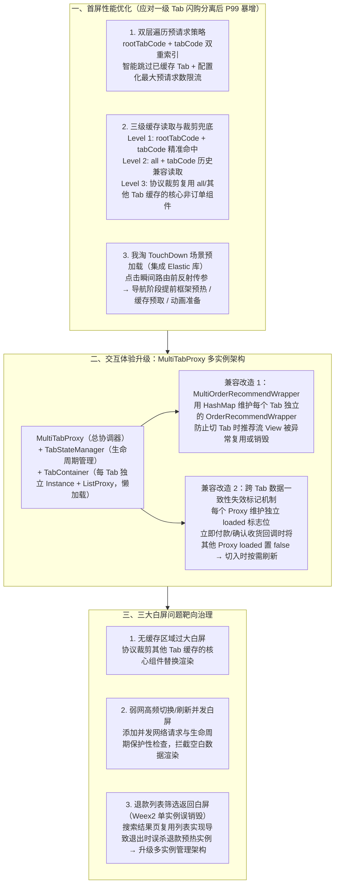

# 淘宝订单列表体验优化实践

## 1. TL;DR

1. **核心痛点**：随着淘宝闪购业务上线，订单列表新增一级 Tab（涵盖全部订单、购物、闪购、飞猪等）并支持算法首屏直达指定 Tab；但旧版预请求与缓存仅支持“全部订单（`all`）”，且采用单实例架构（`ListProxy`），导致**非全部订单场景首屏 P99 暴增、切换 Tab 销毁重建丢滚动状态且卡顿、弱网并发与退款筛选返回频发边缘白屏**。
2. **首屏性能优化（双层遍历预请求 + 三级缓存 + TouchDown 预热）**：将预请求从单层 `tabCode` 升级为 **`rootTabCode + tabCode` 双层遍历策略**（配动态限流与已缓存过滤）；构建 **默认（`rootTabCode + tabCode`）$\to$ 历史兼容（`all + tabCode`）$\to$ 兜底核心组件裁剪复用（读取 `all` 缓存中除订单外的核心组件）** 三级缓存体系；针对最大流量入口“我淘”点击进入（TouchDown 场景）集成架构组 **`Elastic` 库**，在路由前反射传参提前完成框架预热、缓存预取与动画准备。
3. **交互体验升级（`MultiTabProxy` 多实例架构 + 推荐流隔离 + 失效标记）**：打破所有二级 Tab 共用单个 `ListProxy` 每次切换必走“销毁 $\to$ 重建 $\to$ 绑 ViewPager $\to$ 渲染”的瓶颈，设计 **`MultiTabProxy`（总协调器）+ `TabStateManager` + `TabContainer`（各自独立持有 `Instance + ListProxy`）** 懒加载多实例架构；配套开发 **`MultiOrderRecommendWrapper`（用 `HashMap` 隔离各 Tab 独立推荐流实例）** 与 **`loaded` 失效标记机制（立即付款/确认收货回调时将其他 Proxy 的 `loaded` 置为 `false` 触发切入时懒刷新）**。
4. **三大白屏顽疾根治**：① **无缓存白屏**——通过协议裁剪技术提取其他 Tab 缓存中的非订单核心组件兜底渲染；② **弱网快速切 Tab/下拉刷新并发白屏**——增加并发请求生命周期保护性检查拦截空白数据渲染；③ **退款列表筛选返回白屏**——定位到订单搜索结果页复用了订单列表实现，退出搜索页时误销毁了单实例异步预热的退款列表 `Weex2` 实例，升级为多实例管理架构彻底解决销毁冲突。

## 2. 问题定义与背景

### 2.1 业务演进引发的三大终端体验痛点

| 痛点领域 | 触发背景与旧架构缺陷 | 用户体感与线上表现 |
|---|---|---|
| **1. 首屏性能瓶颈** | 闪购分离后新增一级 Tab（`rootTabCode`：全部订单、购物、闪购、飞猪等）并支持算法首屏直达；但旧预请求与缓存只认 `all`（全部订单） | 非全部订单场景预请求失效、整体缓存命中率明显下降、**首屏耗时 P99 暴增** |
| **2. 交互体验断层** | 旧版采用单实例架构（全局仅一个 `ListProxy`），每次切换二级 Tab 都要经历 `销毁 -> 重建 -> 配置参数 -> 绑定 ViewPager -> 渲染` | 切换动画卡顿、每次切 Tab 都重新转圈 Loading，且**原 Tab 的滚动位置与数据状态全部丢失** |
| **3. 边缘白屏频发** | ① 无缓存时仅原生 Tab 头渲染，其余动态组件全白； ② 弱网下快速切 Tab/刷新引发并发请求生命周期错乱； ③ 退款列表（`Weex2` 单实例预热）进入订单筛选搜索页退出时实例被连带销毁 | 页面大面积割裂白屏，或从筛选页返回退款列表时白屏无法交互 |

## 3. 知识框架

## 4. 核心内容拆解

### 4.1 首屏性能优化：双层预请求、三级缓存与 TouchDown 抢跑

1. **从单层 `tabCode` 升级为 `rootTabCode + tabCode` 双层遍历预请求**：
   - 针对一级业务域（全部订单、购物、闪购、飞猪）+ 二级状态 Tab 的双层结构，引入双重索引预请求；
   - **防服务端过载护栏**：内置**智能缓存过滤**（已存在有效缓存的 Tab 直接跳过）与**动态限流配置**（实时控制最大并发预请求数）。
2. **三级缓存回退与协议裁剪兜底**：
   - **第一级（默认精准读取）**：按 `rootTabCode + tabCode` 读取对应业务域与状态缓存；
   - **第二级（历史兼容读取）**：按 `all + tabCode` 读取兼容缓存；
   - **第三级（跨 Tab 协议裁剪兜底）**：当目标 `rootTabCode` 完全无缓存时，读取 `all`（或其他已缓存 Tab）的数据，**通过协议裁剪技术剥离订单列表项、保留除订单外的公共动态核心组件**先行渲染，消灭大面积空白感。
3. **最大流量入口“我淘 TouchDown”抢跑预热**：
   - 流量分析显示订单列表绝大部分入口流量来自“我淘”页点击；
   - 集成架构组 **`Elastic` 库**，在用户手指触碰点击（TouchDown）、路由尚未完成跳转前，**利用反射机制提前将 `rootTabCode` 与 `tabCode` 传入订单列表模块**，在导航过渡阶段并行完成容器框架预热、缓存预取与动画准备。

### 4.2 交互体验升级：`MultiTabProxy` 多实例架构与两项关键兼容

1. **单实例 `ListProxy` $\to$ 多实例 `MultiTabProxy`**：
   - **三层核心组件**：`MultiTabProxy`（多 Tab 统一代理与事件订阅协调器）$\to$ `TabStateManager`（管理各 Tab 独立状态与生命周期）$\to$ `TabContainer`（封装单 Tab 的完整 `Instance + ListProxy`、数据与视图）。
   - **懒加载与动态容器**：仅当用户真正切到某个 Tab 时才按需创建对应 `TabContainer`，并支持根据服务端协议数据动态调整 `ViewPager` 页面数量；切换回已访问 Tab 时直接复用存活实例，毫秒级恢复原滚动位置与列表状态。
2. **兼容难点一：信息流推荐模块的多实例隔离（`MultiOrderRecommendWrapper`）**：
   - **问题**：单实例时代每次切 Tab 都会销毁并重建底部“猜你喜欢/推荐流” View；升级多实例后，若仍共用推荐流组件会导致跨 Tab 切换时推荐流 View 被异常覆盖或提前销毁。
   - **解法**：设计 `MultiOrderRecommendWrapper`，内部通过 **`HashMap` 映射表**为每个 Tab 绑定独立的 `OrderRecommendWrapper` 实例（各自保存推荐数据、滚动位置、加载状态），使其生命周期与所属 `TabContainer` 严格对齐。
3. **兼容难点二：订单状态变更后的跨 Tab 脏数据刷新（`loaded` 失效标记机制）**：
   - **问题**：单实例下用户在“全部订单”点击“立即付款”或“确认收货”后切到“待付款/待收货” Tab，因每次切 Tab 都会销毁重建发请求，天然能拿到最新数据；但多实例复用后，切过去默认不重发请求，会导致看到旧状态脏数据。
   - **解法**：每个 `Proxy` 维护独立的布尔标志位 **`loaded`**；当“立即付款、确认收货”等状态变更回调触发时，**刷新当前 Proxy 的同时，将其余所有相关 Proxy 的 `loaded` 显式置为 `false`**；当用户切换到目标 Tab 时检查 `loaded == false` 即触发懒加载刷新。

### 4.3 三大白屏场景根因剖析与靶向治理

| 白屏场景 | 根因链路剖析 | 工程治理方案 |
|---|---|---|
| **1. 无缓存命中时局部大白屏** | 首次进入未命中缓存的 Tab 时，仅有原生订单 Tab 导航栏能渲染，其余动态下发的核心组件因无数据全白 | 三级缓存兜底：**协议裁剪复用其他 Tab 缓存中的核心组件**并替换上下文数据先行上屏 |
| **2. 弱网 + 快速切换 Tab / 下拉刷新白屏** | 用户高频操作叠加弱网慢响应，导致多个并发网络请求返回乱序，生命周期管理错乱将空白数据渲染上屏 | **被动防御与并发状态保护**：在数据回调与渲染入口增加生命周期与有效数据保护性检查，拦截异常空覆盖 |
| **3. 退款列表点击“订单筛选”返回后白屏** | ① 从我淘进退款列表启用了 `Weex2` 框架单实例异步预热； ② “订单搜索结果页”复用了订单列表页代码实现； ③ 退出搜索结果页时触发了单实例销毁逻辑，把底层退款列表实例一并销毁； ④ 返回退款列表时实例已死且无重建机制 | **退款列表升级为多实例管理架构**：彻底隔离退款列表页与复用实现的订单搜索结果页的实例生命周期，消除退出误杀冲突（支持灰度与秒级回滚） |

## 5. 数据速查表

| 模块 / 机制 | 原文涉及类名 / 技术组件 | 解决的核心指标与体验问题 |
|---|---|---|
| **预请求与缓存索引维度** | 从单层 `tabCode` 升级为 **`rootTabCode + tabCode`** 双层索引 | 解决闪购分离（全部/购物/闪购/飞猪）后非 `all` 场景首屏 **P99 暴增**与缓存命中率下跌 |
| **我淘入口预加载技术** | 架构组 **`Elastic` 库** + 路由前**反射传参** | 在 TouchDown 导航阶段提前完成框架预热、缓存预取与动画准备 |
| **多实例核心三件套** | `MultiTabProxy` + `TabStateManager` + `TabContainer`（含 `Instance + ListProxy`） | 告别切 Tab“销毁$\to$重建”，保持滚动位置并消除重复 Loading（实测演示从 7s 卡顿重刷降至丝滑秒切） |
| **推荐流多实例隔离器** | `MultiOrderRecommendWrapper` + **`HashMap`** + `OrderRecommendWrapper` | 每个 Tab 独立维护推荐数据、滚动位置与加载状态 |
| **跨 Tab 状态同步机制** | 每个 Proxy 维护独立 **`loaded` 标志位** | 付款/确认收货回调时将其他 Proxy 置 `loaded = false`，兼顾实例复用与跨 Tab 数据一致性 |
| **退款列表白屏冲突组件** | **`Weex2`** 异步预热框架（单实例 $\to$ 多实例管理架构） | 修复退出复用的“订单搜索结果页”时误销毁退款列表实例导致的返回白屏 |

## 6. 踩坑与教训 / 可迁移的设计原则

| 错误做法 | 失败表现或原因 | 原文应对（可迁移的设计原则） |
|---|---|---|
| **业务新增一级分类（如闪购分离）并开启算法直达后，仍沿用旧版单维默认 Tab 预请求** | 流量被分流到非默认 Tab，原有预请求与缓存全部落空，首屏耗时 P99 陡增 | 预请求与缓存键必须随业务路由维度同步升维（**`rootTabCode + tabCode` 双层遍历 + 动态限流 + 协议裁剪兜底**） |
| **多 Tab 容器采用单实例销毁重建模式（每次切 Tab 销毁旧实例建新实例）** | 切 Tab 动画卡顿、每次都闪 Loading，且用户切回原 Tab 时浏览滚动位置全丢 | 升级为**懒加载多实例架构（`MultiTabProxy`）**，同时注意评估多实例带来的阶段性内存与首屏负载平衡 |
| **升级多实例复用后，忽略了子模块（如底部推荐流）和跨 Tab 状态变更（如付款后切待付款）的副作用** | 推荐流 View 在切 Tab 时被异常串用或销毁；付款后切到待付款 Tab 看到未刷新的旧订单 | ① 子模块同步改造为基于 `HashMap` 的多实例包装器；② 引入 **`loaded = false` 脏标记广播机制**实现跨实例按需刷新 |
| **不同页面（如退款列表与订单搜索结果页）复用同一套列表底层实现且共用单实例生命周期** | 从子页面（搜索结果页）退出时触发销毁钩子，把父页面（退款列表）预热的 `Weex2` 实例误杀，返回即白屏 | 凡存在页面栈嵌套或实现复用的容器，**严禁共享全局单实例销毁域**，必须按页面实例 ID 隔离生命周期 |

## 7. 记忆锚点

- **订单列表三板斧**：「**首屏靠双层预请求 + 三级裁剪缓存 + Elastic 反射抢跑；切 Tab 靠 `MultiTabProxy` 多实例 + `HashMap` 推荐隔离 + `loaded` 脏标记；治白屏靠裁剪兜底 + 并发守卫 + Weex2 多实例防误杀**」。
- **多实例改造铁律**：「**单改多必护两头：一防跨 Tab 操作后数据不刷新（加 `loaded=false` 脏标记），二防嵌套复用页退出误杀主实例**」。

## 8. 复习卡片

为什么淘宝上线“闪购”业务并支持首屏直达指定 Tab 后，订单列表的首屏耗时 P99 会暴增？是如何解决的？::因为新增了一级 Tab（全部订单、购物、闪购、飞猪等），而旧版缓存与预请求只支持“全部订单（all）”，导致非全部订单场景预请求失效；通过升级为 rootTabCode + tabCode 双层遍历预请求、构建三级缓存体系，并在“我淘”点击（TouchDown）时集成 Elastic 库通过反射提前传参预热解决。
订单列表的“三级缓存策略”包含哪三个层级？当目标 Tab 完全无缓存时如何避免大面积白屏？::三级依次为：① 默认读取 rootTabCode + tabCode；② 历史兼容读取 all + tabCode；③ 兜底优化：通过“协议裁剪技术”读取 all 或其他 Tab 缓存中的非订单核心组件并替换上下文后先行渲染，避免仅显示原生 Tab 头的割裂白屏。
从单实例 ListProxy 升级为 MultiTabProxy 多实例架构后，主要由哪三个核心组件协作？::① MultiTabProxy：作为多 Tab 统一代理与总协调器；② TabStateManager：管理每个 Tab 的独立状态和生命周期；③ TabContainer：封装单个 Tab 的完整状态（包含独立的 Instance + ListProxy、数据与视图），采用按需懒加载创建。
升级为多实例架构后，底部“推荐流”模块和“立即付款/确认收货后跨 Tab 切换”分别遇到了什么兼容性问题？如何解决的？::① 推荐流问题：单实例下每次切 Tab 重建推荐 View，多实例下需防止異常复用销毁，故开发 MultiOrderRecommendWrapper 用 HashMap 为每个 Tab 维护独立的 OrderRecommendWrapper；② 跨 Tab 数据不刷新问题：多实例复用默认切 Tab 不重发请求，故为每个 Proxy 引入 loaded 标志位，当付款/确认收货回调触发时将其余 Proxy 的 loaded 置为 false，切入时按需刷新。
为什么在“退款列表”点击订单筛选进入搜索结果页、再返回退款列表时会出现白屏或无法交互？::因为从我淘进入退款列表时启用了 Weex2 框架的单实例异步预热，而“订单搜索结果页”复用了订单列表页的实现；当退出搜索结果页时触发了单实例销毁逻辑，将底层退款列表实例一并销毁，返回时无重建机制导致白屏；通过将退款列表升级为多实例管理架构彻底修复。
作者在文末展望中提到了多 Tab 多实例架构重构带来的什么工程权衡（Trade-off）？::在获得 Tab 状态保持与丝滑切换体验提升的同时，多实例常驻也带来了首屏性能/资源开销的阶段性上涨压力，因此必须在懒加载时机、内存占用、首屏速度与切换流畅度之间寻找最佳平衡点。

## 9. 知识关联

- **本库主题索引**：[跨端开发与性能](../../20_topics/跨端开发与性能.md)、[操作系统与内存管理](../../20_topics/操作系统与内存管理.md)、[异常监控与稳定性](../../20_topics/异常监控与稳定性.md)
- **本库关联文章**：[手淘外链唤端最小核演进+26.4.14](../手淘外链唤端最小核演进+26.4.14/AI_手淘外链唤端最小核演进.md)、[淘宝跨端体验优化AI演进+26.4.3](../淘宝跨端体验优化AI演进+26.4.3/AI_淘宝跨端体验优化AI演进.md)、[淘宝交易结算缓存实践总结+26.5.11](../淘宝交易结算缓存实践总结+26.5.11/AI_淘宝交易结算缓存实践总结.md)
- **候选双链**：[[终端多级缓存与预请求]]、[[MultiTabProxy多实例架构]]、[[Weex2白屏治理]]、[[TouchDown路由预加载]]

## 10. 原文参考资料

- **原文信息**：《淘宝订单列表体验优化实践》，作者：悠二（淘天集团-基础交易终端团队），发布日期：2026-01-19。
- **文内提及框架与组件**：`Elastic` 预加载库、`ListProxy`、`MultiTabProxy`、`TabStateManager`、`TabContainer`、`MultiOrderRecommendWrapper`、`OrderRecommendWrapper`、`Weex2`。

> [!note]- 校对报告
> - **页码溯源汇总**：
>   - `## 1. TL;DR` & `## 2. 问题定义与背景`：源自 p.1–2（闪购分离后首屏 P99 暴增、Tab 切换体验断层、边缘白屏频发三大痛点与整体优化架构）。
>   - `## 4.1 首屏性能优化`：源自 p.2–4（`rootTabCode + tabCode` 双层遍历预请求、三级缓存策略含协议裁剪核心组件兜底、我淘 TouchDown 场景集成 `Elastic` 库反射提前传参预热）。
>   - `## 4.2 交互体验升级（多实例架构）`：源自 p.4–7（单实例 `ListProxy` 销毁重建痛点、`MultiTabProxy + TabStateManager + TabContainer` 懒加载多实例、`MultiOrderRecommendWrapper` + `HashMap` 隔离推荐流、`loaded = false` 失效标记机制）。
>   - `## 4.3 白屏问题治理` & `总结展望`：源自 p.8–10（无缓存协议裁剪复用其他 Tab 核心组件、弱网并发请求保护性检查、退款列表 `Weex2` 单实例被复用的订单搜索结果页退出误销毁及多实例修复、多实例带来的首屏性能阶段性上涨平衡反思）。
> - **材料质量说明**：p.2–6、p.8–9 含架构图与优化前后录屏帧对比，正文已将所有类名、缓存层级与根因链条完整文字化说明；无独立长篇 Prompt/Skill 文件需拆分。
