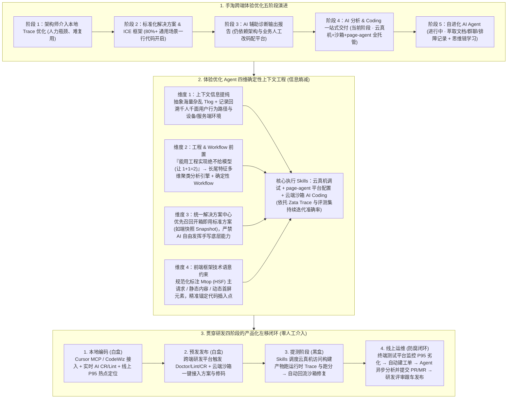

# 淘宝跨端体验优化 AI 演进之路

## 1. TL;DR

1. **五款跨端 AI 产品与两大基建底座**：手淘跨端团队在“飞燕项目”三期优化基础上，联合跨端研发平台与终端测试平台从 0 到 1 孵化了 **体验优化 Agent、JSE-Agent、Doctor Agent、AI 终端测试平台、Scalpel Agent** 五款 AI 产品，并配套交付 **高性能解决方案（ICE 框架 + 端边云 ER）** 与 **负向采集 SDK** 两款基建底座，在双 11 主会场、闪购、直播等场景驱动 DAU、GMV、曝光兑现率与访购率全面提升。
2. **体验优化五阶段演进与裸用 AI 的五大盲区**：历经“架构师介入本地 Trace 优化 $\rightarrow$ 标准化解决方案与 ICE 框架交付（80%+ 通用场景一行代码开启）$\rightarrow$ AI 辅助诊断报告 $\rightarrow$ **AI 分析 & Coding 一站式交付（当前阶段）** $\rightarrow$ 自进化 AI Agent（文档/群聊/排障记录知识萃取 + 思维链学习）”；揭示直接用 `Cursor + Opus 4.5` 优化淘内 C 端应用会因**不懂端边云 SSR 渲染、不懂手淘私有网络优化申明、区分不了主请求与首屏元素业务技术语意、无法调云真机跑运行时 Trace、无法操作平台与发布流**而产生无效或错误修改（如生成了骨架屏组件却未被引用插入）。
3. **把不确定性关进笼子的四维 Context Engineering**：
   - **上下文信息（Tlog 抽象与用户行为回溯）**：针对【会员中心】单 URL 下已开卡、未开卡 B 样式、断约、冲刺、800-用户等千人千面 UI 导致线下无法复现线上 P95 长尾的难题，对海量杂乱 Tlog 建模并回溯用户行为路径与设备/服务端环境。
   - **工程 & Workflow 确定性前置**：坚持“能用工程实现绝不给模型处理（让 $1+1=2$）”，前置执行长尾特征多维聚类分析与固定 Workflow。
   - **统一解决方案中心召回**：严禁 AI 自由发挥手写复杂的端快照（Snapshot）等底层逻辑，强制从解决方案中心召回标准开箱即用方案。
   - **前端框架约束代码技术语意**：通过 ICE 等框架规范化声明哪些是 `Mtop (HSF)` 主接口、哪些是静态/动态首屏内容，解决“生成骨架却不知插在哪”的痛点。
4. **左移全研发周期的四阶段产品化侵入（零人工介入闭环）**：结合 **Zata Trace 与评测集**持续校准准确率，将 Agent 能力嵌入 **本地编码（IDE MCP / CodeWiz 白盒检测 + 线上 P95 定位）$\rightarrow$ 预发发布（云端沙箱 Doctor/Lint/CR 一键修复）$\rightarrow$ 提测阶段（Skills 调度云真机黑盒运行时跑分与热点修复）$\rightarrow$ 线上运维（终端测试平台监控 P95 劣化 $\rightarrow$ 自动建工单触发 Agent 异步生成 PR/MR 跟车发布）**。

## 2. 问题定义与背景

### 2.1 跨端 AI 产品矩阵全景（5 款 AI 产品 + 2 款核心基建）

| 产品 / 基建名称 | 核心定位与解决的技术命题 | 关键能力演进 |
| :--- | :--- | :--- |
| **1. 体验优化 Agent** | 跨端性能体验优化与高性能方案自动接入 | 整合端边云采集、云真机调试、`page-agent` 平台操作与云端沙箱 AI Coding 闭环 |
| **2. JSE-Agent** | 线上 JS 异常（JSE）负向治理闭环 | 结合**负向采集 SDK**，从早期简单 `sourcemap` 堆栈分析升级为**静态代码 + 运行时 `4XX` 复杂问题联合分析** |
| **3. Doctor Agent** | 跨端白盒工程质量守护 | 交付 `AI CR` / `AI Lint` 能力，沉淀数字化规则中心资产 |
| **4. AI 终端测试平台** | 预发与线上黑盒自动化测试 | 交付稳定性测试、Monkey 测试、云真机性能跑分与线上劣化监控工单触发 |
| **5. Scalpel Agent** | 架构防腐与老旧架构自动化下线升级 | 结合 SRE 健康分机制，提供 AI 一键修改代码完成跨端架构升级能力 |

### 2.2 为什么直接用 `Cursor + Opus 4.5` 做手淘体验优化会频频翻车？

团队随机抽取淘内 C 端应用使用 `Cursor + Opus 4.5` 试点发现，通用 Coding Agent 面对复杂跨端工程存在五大盲区：
1. **不懂端边云 SSR 协同架构**：停留在传统纯客户端渲染（CSR）八股文优化，无法感知代码如何在服务端、边缘节点（ER）与手淘客户端之间流转消费。
2. **缺乏手淘私有基建领域知识**：不知道手淘网络层做了哪些预请求/并行优化及如何在代码中声明开启。
3. **缺失业务代码技术语意**：面对纯静态源码，区分不出哪个接口是阻塞首屏的主 `Mtop (HSF)` 请求、哪个 DOM 是核心首屏元素（例如 AI 为了优化 FCP 生成了骨架屏组件代码，但根本不知道该挂载引用到何处）。
4. **缺乏运行时云真机 Trace 视野**：千人千面业务（如【会员中心】同一 URL 下包含已开卡、未开卡 B 版、断约、冲刺用户、800-用户等多种状态）的 **P95 性能长尾**只在线上特定人群与机型触发，线下看静态代码或普通 Trace 根本无法复现。
5. **缺乏平台配置与发布执行手脚**：无法自动修改跨端研发平台与边缘 ER 配置。

## 3. 知识框架

## 4. 核心内容拆解

### 4.1 将 AI 不确定性关进笼子：端边云整合的四维上下文工程

上下文工程的本质是**信息熵减**。围绕手淘端边云基建（高性能解决方案、ICE 框架、跨端研发平台、前端源站、边缘应用 ER），体验优化 Agent 构建了四层确定性护栏：
1. **上下文信息：Tlog 抽象建模与千人千面行为回溯**：
   - 针对【会员中心】等复杂页面单 URL 多状态（已开卡 / 未开卡 B 样式 / 断约 / 冲刺 / 800-用户）导致的“线下 Trace 正常、线上 P95 居高不下”难题，拒绝将海量原始 Tlog 裸喂给模型（必出幻觉），而是通过基建无感注入采集**用户真实行为路径回溯 + 设备/服务端/边缘环境快照**，提炼高密度异常特征。
2. **工程 & Workflow：确定性逻辑前置（让 $1+1=2$）**：
   - 确立铁律：**“原则上，能用工程实现的确定性执行过程一定不给模型处理”**。在模型介入前，先由**长尾特征多维聚类分析引擎**对海量线上数据进行归因聚合，并用固定 Workflow 锁死标准诊断步骤。
3. **统一解决方案中心：用“标准件召回”替代“模型自由造轮子”**：
   - 体验优化不同于已有明确指令的普通 Spec 编码，其初始输入往往只是“FCP 偏长需优化首帧”。若任由 AI 自由发挥在业务 JS 里手写一套【端快照（Snapshot）】逻辑，极易引入严重线上故障；通过建设**统一解决方案中心**，让 Agent 优先检索召回经基建验证的开箱即用标准方案（80%+ 通用场景仅需一行配置或标准代码接入）。
4. **代码技术语意：剥离上层业务黑话，锚定底层框架语意**：
   - 借助前端框架（ICE）规范化约束，让 AI 无需理解千奇百怪的营销业务规则，也能清晰识别代码中**哪些是 `Mtop (HSF)` 核心数据请求、哪些是静态骨架内容、哪些是动态首屏渲染节点**，彻底解决“生成了骨架屏组件却不知道挂载到哪里”的断层。

### 4.2 Skills 武装与全研发周期四阶段左移闭环

通过 **云真机调试 Skill**、**`page-agent` 平台操作 Skill** 与 **云端沙箱 AI Coding Skill**（配合 **Zata** 平台建设的 Trace 排障与评测集飞轮），团队将 Agent 深度嵌入研发全生命周期的四个环节：
1. **本地编码阶段（白盒）**：支持在 Cursor（通过 MCP）或内部 CodeWiz 中直接调用，实时提供 `AI CR / AI Lint` 建议、一键接入高性能方案，并拉取线上 P95 长尾问题直接定位本地热点代码。
2. **预发发布阶段（白盒）**：代码提交预发后，跨端研发平台自动触发 `Doctor Agent + AI Lint + AI CR` 扫描，并在云端沙箱中一键修复白盒工程缺陷。
3. **提测阶段（黑盒运行时）**：打破静态源码分析局限，由 Agent 通过 Skills 自动调度**云真机平台**加载构建后的真实产物进行运行时性能跑分与 Trace 采集，发现劣化热点后自动回调分析器与云端沙箱完成代码修正。
4. **线上运维阶段（全自动防腐闭环）**：`线上监控发现 P95 劣化 → 终端测试平台自动生成工单 → 异步触发体验优化 Agent 完成归因分析、平台配置变更与代码修复 → 自动提交 PR/MR`，业务负责人收到工单时补丁已就绪，仅需 Code Review 后跟车发布，实现**零人工干预的数据回收、分析与修复闭环**。

## 5. 数据速查表

| 维度 / 机制 | 关键指标 / 覆盖范围 | 工程意义与落地效果 |
| :--- | :--- | :--- |
| **孵化跨端 AI 产品与基建数量** | **`5 款` AI 产品 + `2 款` 跨端基建** | 覆盖体验优化、JSE 负向、Doctor 白盒、终端黑盒测试与 Scalpel 架构升级 |
| **标准化高性能方案开箱即用率** | **`80%` 以上**通用场景**一行代码**开启 | 基于 ICE 框架与端边云（源站 + 边缘 ER + 客户端）基建沉淀 |
| **会员中心单 URL 典型多态数** | **5 类典型人群状态**（已开卡/未开卡B/断约/冲刺/800） | 解释了为何线下无法复现线上 P95 长尾，必须依赖线上环境与行为回溯 |
| **研发全链路左移覆盖阶段** | **4 阶段**（本地编码 / 预发发布 / 提测黑盒 / 线上运维） | 实现 `线上 P95 劣化 → 工单 → AI 报告 → 自动产出 PR/MR` 零人工介入闭环 |

## 6. 踩坑与教训 / 可迁移的设计原则

1. **性能与稳定性优化类 AI Coding，严禁让大模型“自由发挥造轮子”，必须走“统一解决方案中心召回”**：性能优化涉及端边云缓存、SSR 流式水合、端快照（Snapshot）等高危底层机制，模型自己手写极易引发白屏或内存泄漏；必须先将高性能方案封装为一行代码可开启的标准基建，让 Agent 充当“精准配置与接线员”。
2. **解决“AI 生成了优化组件却不会挂载”的关键在于框架层的“技术语意标准化”**：不要指望 AI 读懂每个业务五花八门的组件命名；在前端框架层强制规范 `Mtop (HSF)` 主请求、首屏容器与静态/动态区域的声明方式，为 AI 提供统一的技术语意锚点。
3. **坚持“能用工程实现绝不给模型处理（$1+1=2$）”与“白盒静态 + 云真机黑盒运行时结合”**：先用确定性工程对海量 Tlog 做长尾特征多维聚类，再在提测阶段调度云真机采集真实运行时 Trace，才能根治纯静态代码分析看不见 SSR 与千人千面 P95 瓶颈的顽疾。

## 7. 记忆锚点

- **五款跨端 AI 产品矩阵**：`体验优化 Agent`（性能）+ `JSE-Agent`（4XX 与运行时异常）+ `Doctor Agent`（白盒 CR/Lint）+ `终端测试平台`（黑盒 Monkey/跑分）+ `Scalpel Agent`（SRE 健康分与架构防腐升级）。
- **四维确定性上下文工程**：上下文信息（Tlog 抽象+行为回溯）+ 工程与 Workflow（长尾聚类前置）+ 统一解决方案中心（禁手写 Snapshot）+ 框架技术语意（识别 Mtop 主请求与首屏节点）。
- **四阶段左移闭环**：本地编码（IDE MCP / CodeWiz）$\rightarrow$ 预发发布（云端沙箱白盒）$\rightarrow$ 提测阶段（云真机黑盒跑分）$\rightarrow$ 线上运维（P95 劣化自动建单出 PR/MR）。

## 8. 复习卡片

1. 手淘跨端团队孵化的 5 款 AI 技术产品分别解决什么领域的命题？::`体验优化 Agent` 解决端边云性能诊断与高性能方案接入；`JSE-Agent` 结合负向采集 SDK 解决线上 JS 异常与运行时 4XX 复杂问题；`Doctor Agent` 交付 AI CR/Lint 提升白盒工程质量；`AI 终端测试平台` 负责预发黑盒稳定性/Monkey/性能测试；`Scalpel Agent` 结合 SRE 健康分一键升级老旧架构。
2. 为什么直接使用 `Cursor + Opus 4.5` 等通用工具优化手淘跨端 C 端页面时效果不佳？::因为通用 AI 存在五大盲区：无法理解端边云 SSR 渲染复杂度（仍停留在传统 CSR 八股文）、不懂手淘私有网络优化声明、无法从纯静态代码中区分 Mtop 主请求与首屏元素等技术语意（如生成了骨架屏却未挂载引用）、无法调用云真机分析运行时 Trace、以及无法操作内部平台配置与发布。
3. 体验优化 Agent 是如何通过“四维上下文工程”将 AI 的不确定性关进确定性牢笼的？::一是对海量 Tlog 建模并回溯千人千面（如会员中心多状态）用户行为路径；二是遵循“能用工程实现绝不给模型”原则前置运行长尾特征多维聚类与固定 Workflow；三是通过“统一解决方案中心”优先召回标准开箱即用方案（如端快照）而非让 AI 自由手写；四是通过前端框架规范化声明 Mtop 请求与首屏动静态技术语意。
4. 体验优化 Agent 借助哪些核心 Skills 打通了从本地编码到线上运维的“四阶段问题左移”闭环？::借助云真机调试、`page-agent` 平台操作与云端沙箱 AI Coding 等 Skills（配合 Zata Trace 与评测集），贯穿：1. 本地编码（IDE MCP/CodeWiz 白盒检测与 P95 定位）；2. 预发发布（云端沙箱 Doctor/Lint 自动修复）；3. 提测阶段（调度云真机做黑盒运行时跑分与修复）；4. 线上运维（监控 P95 劣化自动建工单、异步分析并生成 PR/MR 供开发者评审跟车发布）。
5. 为什么【会员中心】等复杂跨端应用的 P95 性能长尾问题在线下难以复现？体验优化 Agent 如何解决数据采集难题？::因为同一 URL 下存在已开卡、未开卡 B 样式、断约、冲刺用户、800-用户等千人千面的复杂 UI 形态，长尾问题仅在线上特定人群与机型组合下触发；Agent 通过无感注入基建对海量杂乱的 Tlog 进行模型抽象，并完整记录与回溯用户真实行为路径及设备/服务端环境。
6. 体验优化演进的第五阶段“自进化 AI Agent”是如何设计的？::通过知识萃取机制自动从技术文档、群聊讨论与历史问题排查记录中提炼统一的解决方案与规则驱动沉淀，并结合思维链（CoT）学习与 Zata 评测集迭代，使 Agent 持续进化为懂手淘跨端体验的 AI 架构师。

## 9. 知识关联

- **所属主题**：
  - [跨端开发与性能](../../20_topics/跨端开发与性能.md)
  - [异常监控与稳定性](../../20_topics/异常监控与稳定性.md)
  - [AI研发协同](../../20_topics/AI研发协同.md)
  - [Harness与模型协同](../../20_topics/Harness与模型协同.md)
- **本地跃迁**：[原始 PDF](RAW.pdf) · [逐页转写文本](MD.md)
- **候选双链**：[[手淘外链唤端最小核演进]] · [[淘宝跨端动效解决方案]] · [[数字SRE代码质量治理]] · [[天猫新品AI编码实战指南上]]

## 10. 原文参考资料

1. **内部跨端与 AI 基建**：手淘飞燕项目（一/二/三期）、跨端研发平台、终端测试平台、ICE 前端框架、边缘应用 ER（Edge Routine）、高性能解决方案中心、负向采集 SDK、`page-agent`、CodeWiz、Zata（Trace 与评测平台）

> [!note]- 校对报告
> - **页码溯源**：p.1–3（飞燕项目背景、5 款 AI 产品 `体验优化 Agent`/`JSE-Agent`/`Doctor Agent`/`终端测试平台`/`Scalpel Agent` + 2 款基建 `高性能解决方案`/`负向采集 SDK` 介绍）；p.3–5（跨端体验优化五阶段演进表、80%+ 通用场景一行代码开启、`Cursor + Opus 4.5` 试点暴露的 SSR/领域知识/主请求与首屏技术语意/云真机 Trace/平台操作五大问题）；p.6–11（端边云基建整合、信息熵减四维上下文工程：会员中心 5 种状态 P95 长尾与 Tlog 行为回溯、“1+1=2”长尾特征多维聚类工程前置、统一解决方案中心防止自由手写端快照 Snapshot、Mtop/HSF 与动静态框架技术语意、Skills 与 Zata Trace 评测体系）；p.12–15（本地编码白盒、预发发布白盒、提测阶段云真机黑盒、线上运维 P95 劣化自动建工单异步生成 PR/MR 四阶段左移闭环与 0 人工介入落地总结）。
> - **一致性核验**：作者（染陌，淘天集团-跨端技术团队）、发布时间（2026-04-03）、所有产品名称、演进阶段与技术机制均逐页核对一致；正文中无任何内联页码引用。
> - **质量边界**：原文中部分详细聚类引擎与 Skills 架构图以图片嵌入，核心设计原则与工作流闭环已在正文中完整提炼。
