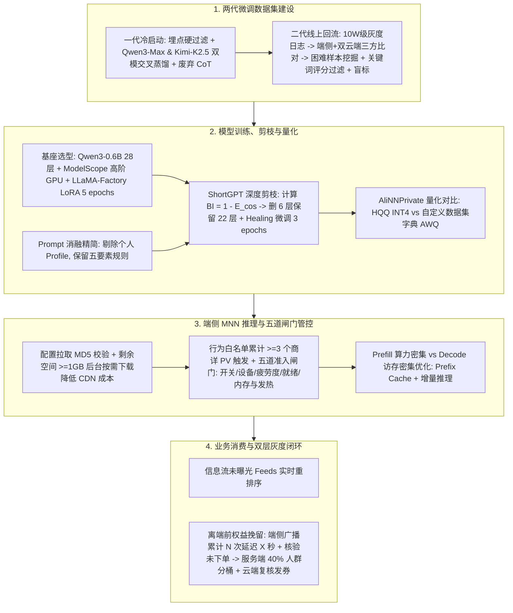

# 淘特端侧模型从微调到应用的全链路实践

## 1. TL;DR

本文系统复盘了淘特 App 基于 **Qwen3-0.6B** 构建端侧实时购物意图识别模型的全链路工程实践。针对云端大模型在实时动线感知中的延迟与 Token 成本瓶颈，团队定义了“闲逛、比价犹豫、场景购物”三类意图及关键词提取任务，通过**两代数据集迭代**（第一代双云端模型交叉蒸馏 + 废弃 CoT；第二代 10 万级线上回流三方一致性筛选 + 困难样本挖掘）将真机准确率提升至 **80% 以上**（配合自定义字典 AWQ 量化在真机 Benchmark 上最高达 **91.8%**）。在模型压缩与端侧推理上，采用 **LoRA 微调 + ShortGPT 块影响度（BI）删减 6 层 + 3 轮 Healing 微调 + AliNNPrivate/MNN 量化部署**，结合五道准入闸门、Prefix Cache 与增量推理优化，成功落地信息流未曝光卡片重排序与离端前权益挽留场景，实现实验组单笔补贴投入增量 GMV 正向提升，并针对 280MB 模型包的 CDN 隐形成本给出按需下载治理方案。

## 2. 问题定义与背景

### 2.1 业务痛点与端侧模型切入动机

1. **实时意图捕捉的延迟与成本矛盾**：用户在 App 内浏览商品详情页（PV）时，平台需实时区分其处于“无目的闲逛”“单品比价犹豫”还是“围绕特定场景（如露营、钓鱼）跨品类选购”，以便在信息流未曝光队列中即时重排相关商品，或在高购买意图用户准备离开 App 前精准发放权益券挽留。若全量高频调用云端 LLM，端到端延迟与 Token 成本均难以承受。
2. **端侧基建与小模型生态成熟**：移动端 `0.5B–3B` 规模小模型（Qwen、Gemma、MiniCPM 等）及集团内 `LLaMA-Factory` 微调、`AliNNPrivate` 转换量化与端侧 `MNN` 推理引擎链路已趋成熟，使业务团队能将实时意图识别下沉至手机端侧执行。

### 2.2 核心任务定义与输入输出示例

- **输入（用户实时行为序列）**：记录页面类型、商品标题、价格、三级类目编码（`cat:大类.子类.孙类`）及停留时长，例如连续浏览多款不同品牌/型号的空调遥控器商详页及停留秒数。
- **输出（结构化意图 + 3–6 个降序关键词）**：
  - `闲逛`：仅输出 `"闲逛"`（不触发业务事件）。
  - `比价犹豫`：输出 `"比价犹豫|空调遥控器;美的;通用款;省电星;华凌"`，触发 `shopping_hesitate_trigger` 事件。
  - `场景购物`：输出 `"场景购物|关键词1;关键词2;..."`，触发 `shopping_scene_trigger` 事件。

## 3. 知识框架

## 4. 核心内容拆解

### 4.1 两代微调数据集建设：从双模交叉蒸馏到线上三方回流

**核心主张**：小模型微调“数据质量远优于数量”，通过废弃思维链（CoT）、引入双教师模型交叉验证以及基于线上推理分歧定向挖掘困难样本，将首版 `43%` 的准确率一路推升至 `91.8%`。

- **第一代数据集（冷启动合成）的关键取舍**：
  - **坚决废弃 CoT（思维链）**：早期尝试蒸馏云端模型的思考过程喂给端侧 `0.6B` 模型，结果不仅导致小模型幻觉概率激增、整体准确率跌至 **不到 60%**，更使端侧生成最终结论前耗费大量 Decode 时间，从行为输入到意图产出往往超过 **1 分钟**，完全无法满足实时交互要求。
  - **单云端标注升级为双模型交叉验证**：单用 `Qwen3-Max` 存在单模型偏好；团队在 50 条分层 Benchmark 上对比候选模型与 `Qwen3-Max` 的一致率，最终选用一致率最高的 **`Kimi K2.5`（72%，优于 `GLM-5` 的 70% 与 `DeepSeek V3.2` 的 68%）** 组成双教师交叉标注——两者一致自动采纳（0420 批次 `10,300` 条样本中自动采纳率达 **69.3%**），分歧样本转人工校对。
  - **一代局限**：能力天花板受限于教师模型规则，且人为设定的意图分布（场景购物 `7%` / 比价犹豫 `15%` / 闲逛 `78%`）与线上真实分布存在偏差；一代多轮迭代后 DSW 环境准确率 **84%**，量化后真机准确率 **76%**。
- **第二代数据集（10 万级灰度日志回流重建）**：
  - **三方一致性比对与困难样本挖掘**：将端侧模型真实输出与两个云端教师模型（`Qwen3-Max`、`Kimi K2.5`）标注做三方比对：① **三方一致**作为高置信正样本直接入集；② **两云端一致但端侧不同**单列为**困难样本（Hard Examples）**，精准定位端侧模型当前的错误边界，定向补入训练集收益最高；③ **三方均不一致**交人工盲标（每次标注 50 条，标注文件隐藏所有模型预测以避免锚定效应）。同时定期人工抽检云端双模共识样本以防共性偏差。
  - **关键词质量门禁**：非闲逛样本由 `qwen-max` 按 `0~3` 分评估候选关键词是否准确概括核心商品或场景，得分 **$\le 1$ 分直接丢弃**，阻断幻觉关键词污染训练集。二代迭代后 DSW 准确率升至 **91%**，常规量化后真机准确率达 **80%**。

### 4.2 训练平台、基座选型与 Prompt 消融实验

**核心主张**：端侧模型选型必须倒推量化转换链路兼容性与训练显卡硬件差异，并通过消融实验砍掉高耗时低收益的 Prompt 字段。

- **训练平台与 GPU 硬件踩坑**：
  - 对比 `ideaLab` 与 `ModelScope` 后，选用 **`ModelScope + LLaMA-Factory`**，但发现不同 GPU 硬件微调出的模型在云端 DSW 环境准确率差异不大，**经量化后在同一套真机验证集上的准确率差距竟超过 21%**（老旧显卡量化后掉点严重）。因此工程策略是：环境搭建与流程调通先用免费 CPU/低成本环境，正式微调与导出切换至高阶 GPU，并编写 `init_env.bash` 应对断线重连参数重置。
- **基座选型**：在移动端主流的 `0.5B–3B` 模型（Gemma、Phi、Qwen、MiniCPM、SmolLM、TinyLlama）中，因淘系端侧部署需经 `AliNNPrivate` 转换量化并由 `MNN` 引擎推理，Qwen 系列适配成熟度最高，最终按“选新不选旧”原则在 `Qwen2.5-0.5B` 与 **`Qwen3-0.6B`** 之间选定后者。
- **Prompt 消融与长度控制**：
  - 端侧 Prefill 延迟随 System Prompt 长度呈线性增长（原文在 Vivo S20 真机上实测了不同 Prompt 长度的延迟曲线）。
  - 团队对 System Prompt 各模块（意图分类、类目说明、判定参考、输出格式、关键词规则）及输入特征（用户个人 Profile、类目、商品价格、简版 Prompt）开展同数据集消融实验，最终**放弃过度掉点的简化版 Prompt，但在正常版本中剔除了冗余的个人 Profile**（完整 System Prompt 见本目录 [PROMPT.md](PROMPT.md)）。

### 4.3 LoRA 微调、ShortGPT 深度剪枝与 HQQ/AWQ 量化对比

**核心主张**：利用 `ShortGPT` 块影响度（BI）剪除中间冗余 Transformer 层并配合短轮次 Healing 微调，可在真机精度几乎不掉的前提下缩减体积与延迟；而在量化阶段用业务自有数据集字典替换 AWQ 默认英文 Wiki 字典，可使真机准确率从 `79.8%` 跃升至 `91.8%`。

- **LoRA 微调关键配置**（基于 `Qwen3-0.6B`）：
  - 采用 `lora_target: all`、`lora_rank: 8`、`lora_alpha: 16`、`lora_dropout: 0`、`cutoff_len: 2048`、`bf16: true`、`enable_thinking: false`。
  - 训练超参：`num_train_epochs: 5`（由 3 轮改为 5 轮）、`learning_rate: 5.0e-05`、`lr_scheduler_type: cosine`、`per_device_train_batch_size: 2`、`gradient_accumulation_steps: 8`。
  - 自动选优机制：切分 `val_size: 0.05` 作验证集，每 `100` 步评估一次（`eval_steps: 100`、`save_steps: 100`、`save_total_limit: 5`），启用 `load_best_model_at_end: true` 按最低 `eval_loss` 自动保存最优权重。
- **ShortGPT 块影响度（Block Influence）剪枝与 Healing 微调**：
  - **剪枝算法**：选用对 `LLaMA-Factory` 与 `AliNNPrivate` 链路零侵入的 **ShortGPT** 方案，按论文公式计算每一层输入输出隐藏态的块影响度：
    $$\mathrm{BI} = 1 - \mathbb{E}[\cos(h_{\text{in}}, h_{\text{out}})]$$
    其中 $\cos(h_{\text{in}}, h_{\text{out}})$ 越接近 $1$ 说明该层越接近无加工透传，$\mathrm{BI}$ 越小代表该层越冗余。
  - **28 层 BI 分布规律与删层取舍**：`Qwen3-0.6B` 共 28 层（索引 `0` 至 `27`），实测 BI 呈现典型的**“两头高、中间低”**分布——首尾层最高（第 `0` 层 `0.9104`、第 `27` 层 `0.5632`、第 `1` 层 `0.2214`），而中间层普遍在 `0.069–0.106` 之间（最低为第 `24` 层 `0.0693`、第 `12` 层 `0.0783`、第 `13` 层 `0.0785`、第 `25` 层 `0.0808`）。
  - **为什么云端最优的 `K=8` 在真机被否决**：对比剪除 6 层、8 层、10 层，云端未量化评测显示 `K=8` 掉点极少且速度更快；但**经量化上真机后**，删 8 层在 iOS 上准确率仅 **73.7%**（比删 6 层的 **79.8%** 低 **6.1pp**），在 Android 上为 **76.8%**（比删 6 层的 **79.8%** 低 **3.0pp**）。速度收益不足以抵消量化叠加剪枝后的真机精度损失，故生产环境最终选定**删 6 层（保留 22 层）**。
  - **Healing 恢复微调 vs Logit 蒸馏**：删层造成结构扰动后必须做恢复微调（Healing），仅需将 `model_name_or_path` 与 merge base 改为剪枝后模型，并将 `num_train_epochs` **从 5 降为 3**（收敛更快，训 5 轮反而会过拟合剪枝残留噪声）。团队还尝试了修改 `LLaMA-Factory` 源码实现 Minitron 式 Logit 蒸馏（损失函数 $\mathcal{L} = (1-\alpha)\cdot \mathrm{CE} + \alpha\cdot \mathrm{KL}\cdot T^2$，默认 $\alpha=0.9, T=1.0$），但实测效果不及 Healing 微调，遂作为备选放弃。
- **HQQ 与 AWQ 量化方案对比**：

| 量化方案 | 校准字典依赖 | 导出耗时 | 量化后模型体积 | 真机 Benchmark 准确率 | 工程取舍结论 |
| :--- | :--- | :--- | :--- | :--- | :--- |
| **FP16 原始权重** | 无 | — | 约 `1.2 GB` | 云端 DSW 基线 (`91%`) | 体积过大，无法在移动端分发部署 |
| **HQQ + INT4** | 无需校准集 | `< 1 分钟` | 约 `288 MB`（`~300 MB`） | `79.8%` | 导出极快、体积缩减为 1/4，适合快速迭代验证 |
| **AWQ（自定义业务字典）** | 需替换默认英文 Wiki 字典为自有数据集字典 | `~40 分钟` | `376 MB` | **`91.8%`**（提升 `12.0pp`） | `AliNNPrivate` 默认英文字典不适配中文电商动线；换用业务自有字典后真机精度跨越式提升 |

### 4.4 端侧推理架构、性能基线与业务落地闭环

**核心主张**：通过五道准入闸门保护端侧运行时稳定性，针对 Prefill（算力受限）与 Decode（带宽受限）分别实施优化，并以“端侧实时广播 + 延迟核验未下单 + 服务端分桶与云端复核”构建安全可控的业务变现链路。

- **端侧意图推理七步核心链路与五道准入闸门**：
  1. **配置拉取**：启动或切换账号时先读本地缓存，异步刷新服务端配置，仅当配置 `MD5` 变化时更新。
  2. **下载管理**：检查 Orange 配置与设备存储空间（要求剩余空间 **`>= 1 GB`**）才在后台下载解压模型。
  3. **行为记录与规则触发**：白名单过滤用户行为，当序列累计满足规则（如 **`>= 3` 个商详 PV**）时组装标准 Prompt 触发推理。
  4. 🔥 **五道准入闸门（Admission Gates）**：依次检查 **① 总开关是否打开、② 当前设备是否在允许范围、③ 是否超过疲劳度限制、④ 模型是否就绪、⑤ 剩余内存/发热等运行时状态是否正常**；任一不满足立即终止并记录跳过原因。
  5. **意图推理**：调用 MNN SDK 推理，剥离思考片段后匹配出四类结果（`比价犹豫`、`场景购物`、`闲逛`、`未知`）。
  6. **事件分发**：仅前两类有效购物意图分别分发为 `shopping_hesitate_trigger` 与 `shopping_scene_trigger` 广播事件。
  7. **全链路监控上报**：上报各环节状态构建漏斗看板，并在 Debug 包保留本地环形缓冲日志。
- **Prefill vs Decode 瓶颈拆解与真机 Benchmark 建设**：
  - **Prefill（预填充，计算密集型）**：一次性并行输入整段 Prompt（如 `[500, 1024]` 矩阵），每层执行 7 个大矩阵乘法（`q/k/v/o_proj` + `gate/up/down_proj`），受限于算力。
  - **Decode（逐词生成，访存密集型）**：基于 KV Cache 每次仅输入 `[1, 1024]` 向量，做矩阵-向量乘法，但每生成一个 Token 都必须从内存完整读取一遍全部 28 层（或剪枝后 22 层）权重，受限于内存带宽。
  - **15 项指标与两阶段真机 Benchmark**：将指标按 `P0/P1/P2` 分级，其中 **`P0` 核心指标为 TTFT（首字等待时长）、Decode 吞吐（出字连续性）、峰值 RSS（OOM 被杀风险）与模型加载耗时（首次打开耗时）**。真机测试分为 **`128 / 256 / 512 / 1024` 长度分档测试**与**长时间连续推理压力测试**（监控吞吐退化、内存泄漏与过热降频），并结合 Prefix Cache 与增量推理将单次推理向 `1s` 以内压缩。
- **离端前权益挽留的三端职责解耦架构**：
  1. **端侧模型层**：仅负责从本地行为序列识别意图，命中后立即发送携带 `sceneCode`、`modelId`、`modelVersion`、`eventId` 的标准广播 `ACTION_CLIENT_MODEL_INTENT_HIT`。
  2. **端侧权益模块**：监听广播后读取 `llm_benefit_dispatch_runtime` 配置映射 `sceneCode → triggerGroup`，按会话累计同组命中达第 $N$ 次时启动延迟 $X$ 秒；延迟结束时调用端侧 `hasOrderedSince` 接口**确认用户在此期间仍未下单**，才调用 `BXPEIEngine.triggerPeiDecision` 进入 `PEI directTrigger` 链路。
  3. **服务端统一管控**：从全人群切出 **40%** 端模型验证人群并做实验组/对照组稳定分桶（端侧不感知），结合上传的行为记录由云端大模型最终复核决定是否通过 UBA 动线系统弹出权益 Pop 发券。阶段性 AB 数据显示，实验组单位补贴投入（每投资 1 元）带来的增量 GMV 持续正向。
- **隐形成本治理（CDN 下载流量）**：端侧虽免去了云端算力与 Token 成本，但单模型 Zip 包约 **`280 MB`**，全量自动下载会产生可观的 CDN 费用，需通过人群圈选、按需触发与差分/缓存策略严控无效下载。

## 5. 数据速查表

| 指标 | 原文数值 | 语境 / 条件 |
| :--- | :--- | :--- |
| 基础模型与层数 | `Qwen3-0.6B`（共 `28` 层 Transformer，隐藏维 `1024`） | 对比 `0.5B–3B` 移动端模型后选定 |
| 携带 CoT 微调的负面表现 | 整体准确率 `< 60%`，端到端耗时约 `1 分钟` | 第一代数据集早期实验，遂彻底废弃 CoT |
| 云端双模型交叉标注一致率 | `Kimi K2.5` 达 `72%`（优于 `GLM-5` `70%`、`DeepSeek V3.2` `68%`） | 在 50 条分层 Benchmark 上与 `Qwen3-Max` 对比；0420 批次 `10,300` 条自动采纳 `69.3%` |
| 第一代人工设定意图分布 | 场景购物 `7%` / 比价犹豫 `15%` / 闲逛 `78%` | 冷启动合成阶段设定，DSW 准确率 `84%`、量化后真机 `76%` |
| 第二代回流规模与准确率 | `10W` 级用户灰度回流；DSW `91%`、常规量化真机 `80%` | 引入端侧+双云端三方比对、关键词 $\le 1$ 分丢弃与每次 50 条盲标 |
| 不同 GPU 微调后真机量化准确率极差 | `> 21%` | 同一套 val 数据集在最好与最坏 GPU 硬件微调量化后的真机差距 |
| LoRA 微调与 Healing 轮次 | 初次微调 `5 epochs`（`rank=8, alpha=16, lr=5e-5`）；Healing 微调 `3 epochs` | 剪枝后若训 5 轮易过拟合残留噪声，故降为 3 轮 |
| 28 层块影响度（BI）极值分布 | 最高：第 `0` 层 `0.9104`、第 `27` 层 `0.5632`；最低：第 `24` 层 `0.0693`、第 `12` 层 `0.0783` | 基于 $\mathrm{BI} = 1 - \mathbb{E}[\cos(h_{\text{in}}, h_{\text{out}})]$ 实测 |
| 剪枝 8 层 vs 剪枝 6 层真机准确率 | iOS：`73.7%` vs `79.8%`（差 `6.1pp`）；Android：`76.8%` vs `79.8%`（差 `3.0pp`） | 生产最终采用删 6 层（保留 22 层），放弃云端表现最优的删 8 层 |
| Logit 蒸馏备选超参 | $\mathcal{L} = (1-\alpha)\cdot \mathrm{CE} + \alpha\cdot \mathrm{KL}\cdot T^2$，$\alpha=0.9, T=1.0$ | 效果不及 Healing 微调，未上线采用 |
| FP16 / HQQ / AWQ 体积与真机精度 | FP16 `~1.2 GB`；HQQ INT4 `288 MB`（`<1min` 导出，精度 `79.8%`）；AWQ `376 MB`（`~40min` 导出，精度 **`91.8%`**） | AWQ 需将 `AliNNPrivate` 默认英文 Wiki 字典替换为自有数据集字典 |
| 端侧下载与触发阈值 | 剩余存储空间 `>= 1 GB`；有效行为序列 `>= 3` 个商详 PV；模型 Zip 包 `280 MB` | Orange 配置与端侧规则引擎参数 |
| 服务端实验人群切分比例 | `40%` 端模型验证人群（内部再分实验组/对照组） | 离端前权益挽留 AB 实验配置 |

## 6. 踩坑与教训 / 可迁移的设计原则

| 错误做法 | 失败表现或原因 | 原文应对（可迁移的设计原则） |
| :--- | :--- | :--- |
| **给 `0.6B` 端侧小模型蒸馏长思维链（CoT）** | 小模型容量有限，强行输出 CoT 导致幻觉率飙升（准确率 `<60%`），且 Decode 耗时拉长至 1 分钟以上 | **端侧小模型果断去 CoT**：关闭 Thinking（`enable_thinking: false`），直接输出结构化分类与关键词，将复杂推理留在数据蒸馏阶段 |
| **仅看云端未量化评测指标决定剪枝层数或训练显卡** | 老旧 GPU 训练的模型或删 8 层（`K=8`）模型在云端 DSW 表现良好，但量化部署到 iOS/Android 真机后准确率暴跌 `3.0pp–21%+` | **以量化后真机 Benchmark 为唯一准绳**：必须在目标真机（iOS/Android）上验证量化产物精度，并使用高阶 GPU 执行最终微调与量化 |
| **直接使用量化工具（`AliNNPrivate` AWQ）自带的默认校准字典** | 默认字典为英文 Wiki 语料，与中文电商用户行为序列分布严重失配，未能发挥 AWQ 激活感知量化的优势 | **构建业务领域专属校准字典**：基于自有微调数据集生成校准字典并修改导出路径，虽导出耗时增至 40 分钟、体积增至 376MB，但真机准确率跃升 `12pp` 至 `91.8%` |
| **剪枝后沿用与原始微调相同的训练轮数（5 epochs）** | 删层后的模型收敛更快，继续训练 5 轮会过拟合到剪枝产生的残留结构噪声上 | **缩短 Healing 恢复微调轮数**：保持数据与超参不变，将 `num_train_epochs` 从 5 降至 3，并以 `val_size=0.05` 每 100 步选 `eval_loss` 最优权重 |
| **在端侧无节制下发模型包或无视运行时状态强行触发推理** | 280MB 模型包全量下载造成高额 CDN 费用；低内存或发热时强行推理易引发 App 卡顿或 OOM 被杀 | **按需下载 + 五道准入闸门**：校验剩余存储 `>=1GB` 与人群配置后再下载；每次推理前强制通过开关、设备、疲劳度、就绪态与内存/温控五道闸门 |

## 7. 记忆锚点

- **全链路提精度口诀**：“去 CoT 双模蒸，十万回流抓分歧；ShortGPT 砍六层，三轮 Healing 换字典，AWQ 真机破九成。”
- **端侧上线护栏锚点**：“算力看 Prefill，带宽卡 Decode；五道闸门护运行，延迟核单防误发，莫忘两百八兆 CDN 账。”

## 8. 复习卡片

为什么淘特端侧 `Qwen3-0.6B` 意图识别模型在第一代数据集建设中废弃了思维链（CoT）？::因为 `0.6B` 小模型引入 CoT 后不仅幻觉概率大增（整体准确率不足 60%），还会使端侧输出最终意图前的 Decode 耗时拉长至约 1 分钟，无法满足实时推荐重排与离端挽留的时效要求。
第二代数据集中如何利用“端侧模型 + 两个云端教师模型（Qwen3-Max 与 Kimi K2.5）”的三方比对高效提分？::三者一致的样本作为高置信正样本直接入集；两个云端模型一致但端侧模型预测不一致的样本被单列为“困难样本”，精准对应端侧模型当前的错误边界，定向补入训练集收益最高；三方都不一致的样本则隐藏模型预测交由人工盲标。
ShortGPT 剪枝中的块影响度（$\mathrm{BI} = 1 - \mathbb{E}[\cos(h_{\text{in}}, h_{\text{out}})]$）是什么含义，为什么淘特最终选择删 6 层而非云端最优的删 8 层？::BI 衡量每一层输入与输出隐藏态的余弦距离，值越小说明该层越接近透传、越冗余（28 层呈两头高中间低分布）；虽然云端评测删 8 层最优，但量化后在 iOS 和 Android 真机上删 8 层比删 6 层分别掉点 6.1pp 和 3.0pp，故生产选择删 6 层并做 3 轮 Healing 微调。
在 `AliNNPrivate` 中对比 HQQ 与 AWQ 量化时，如何将真机准确率从 79.8% 提升到 91.8%？::`AliNNPrivate` 自带的 AWQ 默认使用英文 Wiki 字典，需根据业务自有训练数据集重新构建专属校准字典并替换路径；虽然导出时间从不到 1 分钟增至约 40 分钟、体积从 288MB 增至 376MB，但真机准确率大幅提升 12 个百分点。
端侧大模型推理的 Prefill 阶段与 Decode 阶段在硬件瓶颈上有何本质区别？::Prefill 阶段将整段输入 Prompt（如 500 个 Token）一次性并行送入各层做大矩阵乘法，属于计算（算力）密集型操作；Decode 阶段每次仅输入 1 个 Token 做矩阵-向量乘法，计算量小但每步都必须从内存重新加载全部模型权重，属于访存（内存带宽）密集型操作。
在离端前权益挽留场景中，端侧模型、端侧权益模块与服务端是如何分工协作防止误发券的？::端侧模型仅负责识别意图并发送标准广播；端侧权益模块累计同组命中达 N 次并等待延迟 X 秒后，调用 `hasOrderedSince` 确认用户在此期间仍未下单才发起触发请求；服务端则在 40% 验证人群分桶内由云端大模型最终复核行为序列并决定是否弹窗发券。

## 9. 知识关联

- **本库通用主题**：[模型架构与训练](../../20_topics/模型架构与训练.md) · [大模型推理与算子优化](../../20_topics/大模型推理与算子优化.md) · [Prompt优化](../../20_topics/Prompt优化.md) · [跨端开发与性能](../../20_topics/跨端开发与性能.md)
- **本篇原始与转写材料**：[原始 PDF](RAW.pdf) · [逐页转写文本](MD.md) · [提炼 Prompt](PROMPT.md)
- **候选双链**：[[端侧大模型部署与MNN推理]] · [[ShortGPT块影响度剪枝]] · [[AWQ激活感知量化]] · [[云端双模蒸馏与线上回流闭环]]

## 10. 原文参考资料

- **原文信息**：《淘特端侧模型从微调到应用的全链路实践》，作者：仄平（淘天集团-互动&体验团队），公众号：大淘宝技术，发布时间：`2026-10-15 20:50`（浙江）。
- **文内引用开源项目与论文**（仅作原文记录，未联网访问核验）：
  1. Microsoft LoRA 开源仓库：`https://github.com/microsoft/LoRA`（Edward Hu et al., *LoRA: Low-Rank Adaptation of Large Language Models*, 2021）
  2. ShortGPT 剪枝算法：Men et al., *ShortGPT: Layers in Large Language Models are More Redundant Than You Expect*, 2024, `arXiv:2403.03853`
  3. 端侧量化与推理工具链：`LLaMA-Factory`、`AliNNPrivate`（`llmexport.py`）、`MNN` 推理引擎。

> [!note]- 校对报告
> 1. **页码溯源汇总**：
>    - `p.1–4`：探索背景、三类意图（闲逛/比价犹豫/场景购物）与两大落地场景、空调遥控器浏览动线输入输出示例及四层整体架构（模型层/推理引擎层/端侧 AI Lab/业务层）。
>    - `p.4–6`：两代微调数据集建设（一代废弃 CoT 原因、`Qwen3-Max` 与 `Kimi K2.5` 72% 一致率双模交叉标注、0420 批次 10,300 条自动采纳 69.3%；二代 10W 级灰度回流三方比对、困难样本挖掘、关键词 0–3 分过滤与每次 50 条盲标）。
>    - `p.6–9`：训练平台与 GPU 选型（不同 GPU 量化后真机准确率极差超 21%）、`Qwen3-0.6B` 选型、System Prompt 原文与 Vivo S20 延迟关系及消融实验（剔除个人 Profile，放弃简化版 Prompt）。
>    - `p.9–15`：PEFT/LoRA 分类树、49 行 `train.yaml` 完整配置、ShortGPT 公式 $\mathrm{BI} = 1 - \mathbb{E}[\cos(h_{\text{in}}, h_{\text{out}})]$、28 层 BI 完整数值表、删 6/8/10 层真机对比（iOS `73.7%` vs `79.8%`、Android `76.8%` vs `79.8%`）、3 轮 Healing 微调、Logit 蒸馏公式及 FP16/HQQ/AWQ 量化对比（`288MB` vs `376MB`，`79.8%` vs `91.8%`）。
>    - `p.15–23`：端侧七步推理流程、五道准入闸门、Prefill（`[500, 1024]`，7 个 Linear 矩阵乘）与 Decode（`[1, 1024]`，访存密集）原理、15 项指标（4 项 P0）与真机两阶段 Benchmark（`128/256/512/1024` 分档与连续压力测试）、权益挽留三端协作架构（40% 验证人群分桶）、`280MB` Zip 包 CDN 隐形成本与后续规划。
> 2. **勘误与质量边界说明**：
>    - **右侧代码裁切（未凭空补造）**：PDF 原文 `p.10` 第 32 行注释末尾（`# 维持原 rank（如想配套调大改为 16，alpha 改`）、`p.11` 第 49 行路径末尾（`output_dir: .../Qwen3-0.6B-Thinking/lor`）及 `p.14` 量化命令路径末尾（`--path .../QWen3_0.6B_finetuned_2026-08-12-15-05-`）因原网页代码块横向超出页面宽度发生轻微右侧截断，笔记与 `MD.md` 均忠实保留原貌，未猜测补全。
>    - **图像层图表说明**：`p.6`（GPU 对比表）、`p.7`（小模型横评表）、`p.8–9`（延迟曲线与消融对比表）、`p.12–13`（剪枝对比表）、`p.18–23`（15 项指标明细表、Benchmark 参数/报告截图、增量 GMV 柱状图与 CDN 优化表）在 PDF 中为内嵌位图，未进入 PDF 文本层；正文中明确写出的核心结论、百分比与对比结论已全部纳入笔记，位图内未在正文复述的细项数值不作猜测转写。
> 3. **核验结论**：全文满足单 H1、10 大编号章节、正文零内联页码、6 条单行 `::` 复习卡片，并已同步提炼完整 System Prompt 至 `PROMPT.md`；文内配置与脚本未在本地执行。
