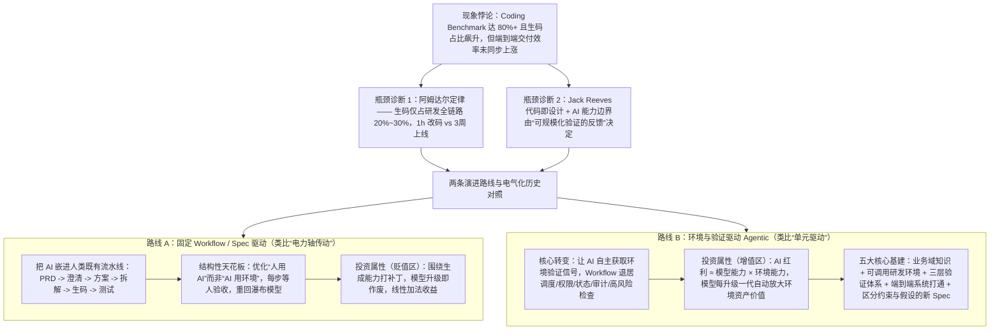

# 我对 AI Coding 的一点思考：从 Spec 驱动转向环境与验证驱动

## 1. TL;DR

针对各大模型在 `SWE-bench Pro`、`Terminal-Bench 2.1` 等编码基准上已冲上 `80%` 上下、团队 AI 生码占比快速提升但端到端研发交付效率却未同步上涨的悖论，本文从**阿姆达尔定律（Amdahl's Law）**与**电气化革命史（从“电力轴传动”到“单元驱动”）**切入，指出单纯编写代码仅占研发全链路的 **`20%~30%`**（如某 C 端动线需求改码与本地验证仅需 **1 小时**，但跨平台联调发布与封网合规耗时 **3 周**）。作者批判了将 AI 塞进人类既有瀑布流水线（PRD $\to$ 方案 $\to$ 拆解 $\to$ 生码 $\to$ 测试，每步等人验收）的 **Spec 驱动（固定 Workflow）路线**，提出以**“下一代 SOTA 模型发布时，当前投入是获益还是作废”**划分贬值区与增值区，主张遵循 $\text{AI 红利} \approx \text{模型能力} \times \text{环境能力}$ 的乘法效应，全面转向**环境与验证驱动**——构建业务领域知识库、可复现可调用的研发工具环境、秒级/分钟级/人工三层验证体系，并在 Spec 中严格区分“长期硬约束”与“允许 AI 根据反馈自主调整的实现假设”。

## 2. 问题定义与背景

### 2.1 生码高分与端到端交付停滞的“阿姆达尔瓶颈”

1. **Benchmark 刷榜与真实体感背离**：截至 2026 年 7 月，`HumanEval`、`LiveCodeBench`、`SWE-bench Verified` 已被 SOTA 模型刷爆，更复杂的 `SWE-bench Pro` 和 `Terminal-Bench 2.1` 也达到 **`80%` 上下**；然而在企业级生产研发中，一个 C 端用户动线改造需求的终端改码加本地验证仅需 **`1 小时`**，但涉及多内部平台关联发布与 618 封网窗口时，从编码完成到真正上线实际耗费了 **`3 周`**。
2. **阿姆达尔定律（Amdahl's Law）的定量约束**：
   - 团队内部统计表明，纯粹的“生码（Coding）”在整个研发链路中仅占 **`20%~30%`**（甚至更少）。
   - 根据阿姆达尔定律，系统整体加速比受限于无法被优化的串行部分：即便把占三成的生码环节耗时压缩到接近零，整条研发链路的效率提升上限也只有三成，Coding 之外的**环境准备、跨系统联调、测试验证与发布合规**已成为新的决定性瓶颈。

### 2.2 为什么是 Coding 与数学最先被 AI 突破

Coding 与数学最先被突破，不仅因为公开语料丰富，更深层的机制在于它们是少有的**“可验证的反馈公开、对错机器自己就能判”**的领域（编译是否通过、单测是否通过，运行即知）。相反，企业级生产系统的反馈藏在封闭的内部构建、部署、日志和监控平台里，没有公开自动反馈且单次验证成本极高——**AI 的能力边界正是由“可验证的反馈”决定的**。

## 3. 知识框架

## 4. 核心内容拆解

### 4.1 科技史镜像：从“电力轴传动”到“单元驱动”的研发工作流重构

**核心主张**：把 AI 塞进人类原有分工节点（PRD $\to$ 方案 $\to$ 生码 $\to$ 测试）只是用电动机替换蒸汽机却保留中央传动轴；真正的生产力跃升来自赋予每个工位独立获取反馈并自主运转的“单元驱动”。

- **电气化革命的两阶段启示**：
  - **第一阶段（电力轴传动 / 分组驱动，1899–1919 年）**：19 世纪末工厂围绕蒸汽机与贯穿厂房的中央传动轴排列机器；电动机出现初期，多数工厂因既有厂房设备沉没成本与早期电网限制，仅用大型电动机替换蒸汽机而保留原传动轴布局（美国制造业电力占比从 `1899 年` 的约 **`5%`** 升至 `1919 年` 的 **`50%`** 耗时约 **20 年**），能量损耗与局部故障停工依然存在。
  - **第二阶段（单元驱动，20 世纪 20 年代）**：每台机器配备独立小型电机，工厂得以按原材料进入、加工、装配到成品的逻辑重构为开阔单层流水线，此时生产率才迎来真正跃升。
- **批判固定 Workflow / Spec 驱动的“新瀑布模型”陷阱**：
  - 当前主流做法（包括部分 SDD、固定 Agent Skills、Superpowers 插件）将人类协作分工的流水线固化为 Agent 必须死守的执行顺序，每个节点调用 AI 提效、节点间仍靠人验收流转。
  - **三大结构性缺陷**：① 优化的是“人使用 AI 的方式”而非“AI 使用环境的方式”；② 本质是**在 AI 时代重新引入瀑布模型**（错误假设需求澄清后必对、方案评审后必可行、编码只需忠实执行）；③ 根据 Jack Reeves 1992 年《Code as Design》（源代码才是真正的设计，文档只是有损摘要），真实开发中一次测试失败可能源于实现、环境、数据、架构假设或需求理解中的任一层，若每次失败都回退到方案文档重新生码，会把已经做对的判断一并推倒。
- **Agentic 路线的真正定义**：
  - Agentic 的本质**不是“让 AI 主导业务决策”，而是“让 AI 能够自主获取环境验证信号”**，无需每一步都停下来等人判断对错。
  - 在此架构下，Workflow 并不消失，而是退回到它真正该承担的位置：**任务调度、权限控制、状态保存、审计留痕与高风险动作检查**。

### 4.2 研发投入的“贬值区”与“增值区”：$\text{AI 红利} \approx \text{模型能力} \times \text{环境能力}$

**核心主张**：用“下一代 SOTA 模型发布时，我正在做的事是获益还是作废”作为唯一投资标尺，停止与模型厂商的训练维度对赌，全力建设模型无法凭空从权重里长出来的内部环境工具。

| 投资区域 | 典型研发投入内容 | 与模型能力升级的关系 | 收益数学模型 | 判定准则 |
| :--- | :--- | :--- | :--- | :--- |
| **贬值区（围绕生成能力）** | 微调模型提升生码质量、囤积提示词技巧、精细编排生码步骤与脚手架 | **被下一代模型吸收作废**：凡是替代或补偿模型推理能力的工作，模型厂商恰恰正在这些维度上训练下一代底座 | $\text{模型} + \text{常数}$（线性收益，且常数随时间衰减） | 与模型厂商的军备竞赛对赌，“昨天的脚手架变成今天模型的内置能力” |
| **增值区（围绕环境与验证）** | 将企业内部的构建、部署、测试、数据、接口、日志、监控、发布链路改造为 AI 可调用的工具与验证环境 | **随下一代模型发布复利增值**：凡是提供模型自己造不出来的外部世界真实状态、构建结果、日志与测试反馈，任何外部厂商都无法代劳 | **$\text{模型能力} \times \text{环境能力}$**（乘法复利效应） | 环境是企业自有因子（只涨不跌）；环境为 0 则再强的模型生产力也为 0；模型每强一代都会将同一套环境价值重新放大 |

### 4.3 环境与验证驱动的五大核心基础设施建设

**核心主张**：将只有人类会点击操作的内部研发平台翻译成 AI 可调用的工具接口，构建按耗时分层的自动验证反馈网，并将 Spec 重构为“硬约束 + 可调整假设”。

1. **业务领域知识的构建**：沉淀业务域 Skill 与本体知识库（弥补公开预训练语料缺失的内部业务规则）。
2. **可复现、可调用的研发环境**：让 Agent 能独立构建项目、启动服务、准备测试数据、调用接口、操作浏览器或 App、查看日志与调用链、读取监控指标——本质是把“只有人会操作的内部系统”翻译为“AI 可调用的工具”。
3. 🔥 **三层验证反馈体系（Tiered Verification）**：
   - **秒级反馈（编译、类型检查、单元测试）**：支撑 Agent 高频自主试错与快速自愈循环。
   - **分钟级反馈（集成测试、契约测试、浏览器自动化）**：覆盖跨模块与真实交互行为验证。
   - **人工判断（Human Judgment）**：仅保留给机器无法可靠裁决的部分——**业务价值、用户体验与伦理安全边界**。
4. **端到端研发系统 AI-Friendly 改造**：打通发布平台、实验平台、监控平台、跨平台影响面分析、联调环境、灰度验证与封网期合规检查工具（精准消解“1 小时改码、3 周上线”的阻塞段）。
5. 🔥 **Spec 与技术方案的新写法：严格区分“约束（Constraints）”与“假设（Assumptions）”**：
   - **约束（不可违背的红线）**：如“数据不能出域”“接口必须向后兼容”“延迟不能超过阈值”——必须长期保存并尽可能通过自动化脚本強制检查。
   - **假设（有待验证的实现路径）**：如“采用微服务还是单体”“使用哪种缓存策略”——应允许 AI 根据实际编码与运行中的验证反馈自主调整。**Spec 只负责划定“什么算对”的边界，不负责把实现路径写死。**

## 5. 数据速查表

| 指标 | 原文数值 | 语境 / 条件 |
| :--- | :--- | :--- |
| 复杂编码基准 SOTA 水平 | `80%` 上下 | 2026 年 7 月快照，`SWE-bench Pro` 与 `Terminal-Bench 2.1` |
| C 端动线改造需求耗时对比 | 终端改码 + 本地验证：`1 小时`；从编码完成到真正上线：**`3 周`** | 涉及多个内部平台关联发布并遇上 618 封网期 |
| 纯生码（Coding）占研发全链路比例 | **`20% ~ 30%`**（甚至更少） | 团队内部粗略统计；按阿姆达尔定律，生码压缩到 0 的全局提效上限仅约三成 |
|《Code as Design》提出年份 | `1992 年`（Jack Reeves） | 论证“源代码才是软件真正的设计，文档只是有损摘要” |
| 美国制造业电力占机械动力比例演进 | `1899 年` 约 **`5%`** $\to$ `1919 年` 约 **`50%`**（历时约 `20 年`） | 到了 20 世纪 20 年代普及“单元驱动”与流水线重构后生产率才显著跃升 |
| 分层验证体系的三档时间粒度 | **秒级**（编译/类型检查/单测）、**分钟级**（集成/契约/浏览器自动化）、**人工判断**（业务价值/体验/伦理） | 环境与验证驱动的核心反馈分层 |

## 6. 踩坑与教训 / 可迁移的设计原则

| 错误做法 | 失败表现或原因 | 原文应对（可迁移的设计原则） |
| :--- | :--- | :--- |
| **在生码已经只占 20%–30% 的情况下，继续把全部精力投在“让 AI 写代码更快”上** | 受阿姆达尔定律限制，其余 70%–80% 的联调、数据准备、发布与封网合规不打通，端到端交付周期依然长达数周 | **瞄准阿姆达尔瓶颈做环境工具化**：优先将跨平台影响面分析、联调测试物料准备、发布编排、灰度监控与合规检查改造为 AI 可调用工具 |
| **把人类分工的瀑布流水线（PRD $\to$ 方案 $\to$ 生码 $\to$ 测试）原封不动固化成 Agent 的硬性执行步骤** | 每个节点都要等人验收，测试一旦失败就推倒重改方案，优化的只是“人用 AI”而非“AI 用环境” | **让 Agent 靠环境验证信号驱动自循环，Workflow 退居护栏**：用秒级/分钟级自动验证替代人工逐节点盯盘，Workflow 仅负责调度、权限、状态、审计与高风险拦截 |
| **重金投入提示词技巧囤积、生码步骤精细编排或针对通用生码能力做小修小补微调** | 处于“贬值区”：下一代 SOTA 模型升级时即被底座内置能力覆盖，前期脚手架迅速作废 | **以“下一代模型发布时是获益还是作废”划界**：聚焦模型无法从权重里生成的内部系统状态、日志与测试反馈建设，享受 $\text{模型能力} \times \text{环境能力}$ 的复利 |
| **在 Spec 和技术方案中把所有实现路径细节写死，当作不可更改的指令塞给 AI** | 文档只是有损摘要，运行态暴露环境或架构假设不成立时，AI 因被死板 Spec 束缚而无法自适应调整 | **在 Spec 中分离“约束”与“假设”**：数据安全、向后兼容、延迟阈值作为硬约束自动检查；缓存选型、模块拆分作为假设允许 AI 根据运行反馈自主调整 |

## 7. 记忆锚点

- **投资划界第一性问题**：“下一代 SOTA 模型发布时，我正在做的这件事，是获益，还是作废？替代模型推理的必贬值，提供世界真实反馈的必增值。”
- **核心公式与口诀**：“生码只占两三成，阿姆达尔锁上限；$\text{AI 红利} \approx \text{模型能力} \times \text{环境能力}$；Spec 只定约束莫锁路径，秒级单测加分钟集成让工位自己转起来。”

## 8. 复习卡片

为什么团队的 AI 生码占比大幅提升、模型在 SWE-bench Pro 上已达 80% 左右，但端到端研发交付效率却没有同步上涨？::根据团队统计，纯粹的生码在整个研发链路中仅占 20%–30%（例如改码加本地验证只需 1 小时，跨平台关联发布与封网合规却耗时 3 周）；由阿姆达尔定律可知，即使把三成的生码时间压缩到零，全局效率提升上限也只有三成，真正的瓶颈已转移到编码之外的环境与验证环节。
作者如何用电气化革命中的“电力轴传动”与“单元驱动”类比当前 AI Coding 的两种演进路线？::“电力轴传动”类比当前主流的固定 Workflow / Spec 驱动路线——虽引入了 AI，但保留了人类原有的 PRD$\to$方案$\to$生码$\to$测试瀑布流水线，每步仍需人验收流转；“单元驱动”则类比环境与验证驱动的 Agentic 路线——通过赋予每个工位可复现的环境与自动验证信号，让 Agent 摆脱中央人工传导、独立闭环运转。
在转向环境与验证驱动的 Agentic 路线后，原有的 Workflow 应该消失还是承担什么职责？::Workflow 不会消失，而是从“规定具体生码思考步骤的管道”退回到基础设施边界：负责任务调度、权限控制、状态保存、审计留痕以及高风险动作检查。
如何判断一项 AI 研发投入属于“贬值区”还是“增值区”，为什么说企业 AI 红利等于“模型能力 $\times$ 环境能力”？::判断标准是“下一代 SOTA 模型发布时该投入是获益还是作废”：凡是替代或补偿模型推理能力的（如囤积提示词技巧、精细编排生码步骤）都会被下一代模型吸收而贬值；凡是向模型提供内部系统真实状态、构建结果、日志和测试反馈的都属于增值区，因为模型是租来的因子、环境是自有因子，任一为零则乘积为零，而模型每升级一代都会将同一套环境资产的价值成倍放大。
环境与验证驱动下的“分层验证体系”和“新 Spec 写法”各自有什么核心要求？::分层验证体系分为秒级反馈（编译、类型检查、单元测试，支撑高频自主迭代）、分钟级反馈（集成测试、契约测试、浏览器自动化，覆盖真实行为）和人工判断（仅保留给业务价值、用户体验与伦理边界）；新 Spec 写法则严格区分“约束”（数据不出域、向后兼容、延迟阈值等长期保存并自动检查的红线）与“假设”（缓存策略等允许 AI 根据运行反馈自主调整的实现路径）。

## 9. 知识关联

- **本库通用主题**：[Harness与模型协同](../../20_topics/Harness与模型协同.md) · [AI研发协同](../../20_topics/AI研发协同.md) · [Agent工程循环](../../20_topics/Agent工程循环.md)
- **本篇原始与转写材料**：[原始 PDF](RAW.pdf) · [逐页转写文本](MD.md)
- **候选双链**：[[环境与验证驱动AI-Coding]] · [[阿姆达尔定律与研发效能瓶颈]] · [[Spec约束与假设分离]] · [[秒级与分钟级分层验证体系]]

## 10. 原文参考资料

- **原文信息**：《我对 AI Coding 的一点思考：从 Spec 驱动转向环境与验证驱动》，作者：永霸（淘天集团-交易业务技术团队），公众号：大淘宝技术，发布时间：`2026-08-24 01:15`（浙江）。
- **文内引用文献与基准**：
  1. Jack Reeves, *What Is Software Design? (Code as Design)*, C++ Journal, 1992.
  2. 阿姆达尔定律（Amdahl's Law）及 1899–1920s 美国制造业电气化（电力轴传动 vs 单元驱动）历史研究。
  3. 编码评测基准：`HumanEval`、`LiveCodeBench`、`SWE-bench Verified`、`SWE-bench Pro`、`Terminal-Bench 2.1`（2026 年 7 月快照）。

> [!note]- 校对报告
> 1. **页码溯源汇总**：
>    - `p.1–3`：SOTA 模型在 Coding Benchmark（`SWE-bench Pro`、`Terminal-Bench 2.1` 达 `80%` 上下）的表现、1 小时终端改码 vs 3 周跨平台上线案例、生码仅占全链路 `20%~30%` 的阿姆达尔定律分析，以及基于“可验证反馈”与 Jack Reeves《Code as Design》（1992）的能力边界诊断。
>    - `p.3–5`：电气化革命从“电力轴传动”（1899–1919 年美国制造业电力占比从 `5%` 升至 `50%`）到 20 世纪 20 年代“单元驱动”的历史对照、固定 Workflow（Spec 驱动）重回瀑布模型的结构性天花板，以及 Agentic 路线（自主获取验证信号 + Workflow 退居调度/权限/状态/审计/高风险检查）的定义。
>    - `p.5–7`：“下一代 SOTA 模型发布时是获益还是作废”投资标尺、贬值区 vs 增值区对比、$\text{AI 红利} \approx \text{模型能力} \times \text{环境能力}$ 乘法模型，以及环境与验证驱动的五大基础设施（业务域知识、可复现可调用研发环境、秒级/分钟级/人工三层验证体系、端到端研发系统打通、区分“约束”与“假设”的 Spec 新写法）。
>    - `p.8–9`：作者与团队介绍及读者关于接口测试真实物料准备、系统拆解包袱的精选留言。
> 2. **勘误与质量边界说明**：
>    - `p.1`（2026 年 7 月主流模型 Coding Benchmark 成绩表）在 PDF 中为内嵌图片（位于图像层），作者已在正文中明确注明“各来源口径不一，仅供参考，SWE-bench Pro 和 Terminal-Bench 2.1 已冲到 80% 上下”；`p.9` 含一条微信底部商业广告（深蓝汽车）与读者留言，广告内容已排除在技术笔记之外。
> 3. **核验结论**：全文满足单 H1、10 大编号章节、正文零内联页码、5 条单行 `::` 复习卡片，所有论点、比例数值与历史对照细节均与原文逐页一致。
