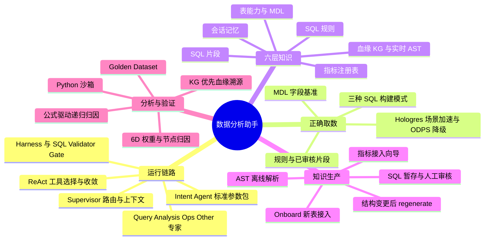
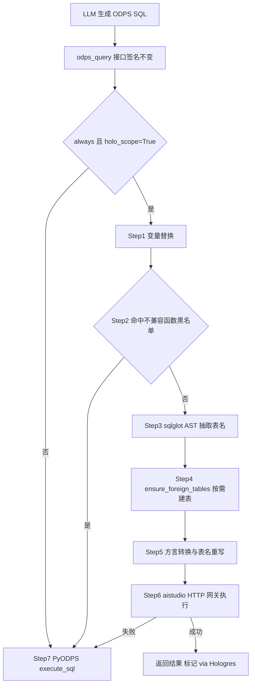

# 淘宝百亿补贴数据分析助手 Agent 实战

原文：[RAW.pdf](RAW.pdf)；转写定位：[MD.md](MD.md)；文章与加工记录：[META.json](META.json)。本文页码均指 PDF 物理页序，包含文末空白页共 30 页。

## 1. TL;DR

`bybt-data-analysis-assistant` 将自然语言问题转成找表、构建 SQL、执行、归因、血缘解释与 Python 二次分析，解决取数慢、口径不统一、归因依赖人工和 SQL 知识无法复用的问题。系统先用一次 LLM 调用生成意图参数包，再由 Supervisor 分发给取数、分析、运维或兜底专家，由专家通过 ReAct 自主选择工具和收敛时机。正确取数的关键是 **NL2MDL2SQL**：用 MDL 限定真实字段，用规则和已审核片段保留业务口径，再通过 SQL 后置校验。六层知识体系把表能力、SQL 片段、规则、血缘、指标公式和会话记忆分开管理；指标注册驱动递归归因，AST 解析为血缘图谱提供来源，人工审核连接采集与复用。原文给出分析场景单次查询由 ODPS 的 30–120 秒变为 Hologres 外部表的 3–10 秒，以及意图感知的 6D 评测体系；这些是该项目的报告口径，文章没有提供完整性能测试设置或整套 Agent 的总体评测成绩。

## 2. 核心概念：哪些组件解决不同问题

| 概念 | 本文中的用途 | 需要区分的边界 |
|---|---|---|
| **数据分析智能体** | 从用户问题出发，自主完成取数、分析和解释，并能选择工具、自我纠错 | 并非只把一句话翻译成 SQL；“生成 SQL”请求也可能只校验并返回而不执行 |
| **MDL（Model Definition Language）** | WrenAI 的结构化语义模型，记录表名、字段、关系、描述，SQL 生成前提供表结构 | MDL 提供字段基准；每表过滤和聚合口径还依赖规则与片段 |
| **Supervisor** | 根据意图参数包进行日期注入、语义计划、记忆召回和专家路由 | 专家分工限制工具与指令范围，具体工具选择仍由 ReAct 完成 |
| **ReAct** | Thought → Action → Result 的推理执行循环，决定调用哪些工具、参数和停止时机 | 取数知识可以归为若干阶段，但不是所有问题都固定跑完这些阶段 |
| **Harness** | 运行时“刹车系统”，处理重复调用、预算、元数据先查、预聚合表保护等约束 | SQL Validator Gate 另做语法、表名、字段的后置校验 |
| **Metric Registry** | 指标定义、拆解公式与维度分类的注册表 | 它回答“怎样拆指标”；血缘层回答“字段怎样由上游计算出来” |
| **AST 血缘解析** | 基于 sqlglot 对 ETL SQL 做静态分析，产出字段级来源与计算关系 | 可离线灌入图谱，也可在 KG 未命中时即时解析；不是让 LLM 猜上游 |
| **Golden Dataset** | 用带 `expected` 的样例检查结果与中间过程 | 不只检查最终文字，还检查工具调用、SQL 和诊断树 |


## 3. 知识框架

下图**按正文整理**，展示本文的运行主线与支撑体系；知识项为并列分工，不表示必须逐一串行调用。



## 4. 关键要点：架构、语义层、知识库与评测

### 一、项目问题与能力边界

### 把业务问题转换为完整分析任务

**系统的目标是缩短从业务提问到数据解释的路径，同时留下可复用知识。**传统流程是需求提交、等待开发、排期、交付；不同人编写 SQL 时，`WHERE` 条件和指标口径可能不同。面对波动，人工还要逐个维度跑 SQL 对比；用完的 SQL 若不沉淀，下次又从零开始。本文把这四类问题分别连接到自然语言取数、语义层加规则库、自动诊断树、暂存后审核入库。

用户的措辞决定任务的完成条件。“昨天 GMV 多少”需要返回数值；“GMV 为什么跌了”需要归因和下钻；“字段怎么算”需要上游字段与计算表达式；“各行业 GMV 做帕累托”需要先取数再进行 Python 分析。特别是“帮我写一个查昨天 GMV 的 SQL”，原文明确展示的是生成 → 校验 → 返回，**不执行**。因此不能把所有 `sql_dev` 请求都理解成自动查询。

能力速览将 NL2SQL、波动归因、血缘溯源、Python 分析、SQL 开发、元数据探查、ETL 源代码、调度运维、会话记忆和 SQL 自动暂存列为“生产可用”，将阈值校准和多意图处理列为“可用”。这些状态是作者对项目能力的描述，不是本笔记运行或验收的结果。

### 技术栈服务于分工

**本文采用不同技术承接生成、检索、图谱和查询职责，而不是让一个模型承担全部知识与执行。**主 LLM 为 Qwen（DashScope）；重任务用 `qwen-plus`，意图识别、语义计划等轻任务用 `qwen-turbo`，作者给出的目的为控制成本和延迟。向量模型 `text-embedding-v3` 为 1024 维；Agent 使用 LangChain `create_agent` 支持 ReAct 和 SSE，LangGraph 提供 Supervisor 多 Agent 编排。

语义层是 WrenAI（`wren-langchain`），向量检索是 TisPlus3（Ha3），血缘图谱是支持 `local/hybrid` 检索的 LightRAG，查询引擎是 MaxCompute（ODPS），元数据来自 DataWorks API。后端为 FastAPI + Uvicorn，前端为 React + Ant Design + Vite。TisPlus3 在该项目中承担表能力、规则、片段等检索；把这些具体内部服务名记成本文的实现选择即可，文章未提供可独立复制的部署环境。

### 二、Agent 架构设计：入口、调度、执行、保障

### 意图识别：一次调用生成标准参数包

**入口层先把自然语言标准化，降低后续专家重新解释时间和指标的成本。**一次 LLM 调用同时做意图分类、时间解析、指标识别和维度推断。下面是原文完整 JSON 示例，日期属于示例问题，不是文章发布日期，也不是系统通用默认日期。

```json
{
  "intent_type": "attribution",
  "confidence": 0.95,
  "metric_field": "gmv_amt",
  "metric_name": "GMV",
  "time_label": "昨天 vs 前天",
  "curr": "2026-06-14",
  "prev": "2026-06-13",
  "scope": "all"
}
```

这里的 `confidence` 是意图参数包中的置信度示例，原文没有把 `0.95` 写成路由阈值。`curr/prev` 把“昨天/前天”转换为明确日期，`metric_field` 把用户的 GMV 对应到字段，`scope` 则可取 `all/industry/channel` 等示例范围。LLM 调用失败时回退到关键词匹配加规则解析；这是入口层降级，不等于整条分析链路都使用规则运行。

一个问题包含多个意图时，主意图放在 `intent_type`，次要意图放在 `secondary_intents` 数组。原文举例 `table_meta + data_query`，对应“查表结构 + 写查询”。这个表示保留了组合任务，不必强行把一句问题压成一种能力；文章未给出次意图冲突的全部排序算法。

### 多 Agent 协同：减少每个专家的选择空间

**专家分工主要解决工具过多与指令膨胀的问题。**作者认为，单 Agent 需要巨大的 system prompt 和几十个工具，容易工具选择困难、prompt 膨胀并浪费调用预算。多 Agent 让每个专家只看相关工具与指令，由 Supervisor 分发任务。

| 专家 | 原文意图范围 | 核心职责 | 工具数（约） |
|---|---|---|---|
| Query Agent | `data_query/lineage/table_meta/table_code/sql_dev/mixed` | 血缘、取数、元数据、源代码、SQL 开发五种模式分路 | 23 |
| Analysis Agent | `analysis/attribution` | 波动归因诊断树、ReAct 自由探查、Python 沙箱 | 20 |
| Ops Agent | `ops` | 调度实例、日志、报警、基线查询 | 10 |
| Other Agent | `other` | 寒暄、闲聊与兜底 | 3 |


架构总览给 Supervisor 的职责为日期注入、语义计划和记忆召回。保障层包含 SQL Validator Gate、答案净化、SQL 自动暂存与 SSE 流式输出；知识底座包含 MDL、片段、规则、血缘和会话记忆。总览与后文六层知识采用不同粒度，后文还单独展开指标注册表，不应因总览未画这个项就认为系统没有该知识源。

### ReAct：阶段分类不等于固定 Pipeline

**执行层按当前观察选择下一步，而不是把所有请求都塞入同一套步骤。**原文以“昨天 GMV 和前天比怎么样”为例：先调用 `search_metrics` 得到表和 `gmv_amt`；再调用 `rule_search` 确认口径；`build_sql` 构建比较查询；`odps_query` 执行；最后 `python_analyze` 处理环比并返回解释。

原文把简单 GMV 取数对比为固定流程五步与 ReAct 两步收敛；归因问题由 ReAct 自主决定下钻方向；帕累托请求则可组合取数与分析。这里的步数是解释行为差异的案例，不是性能基准，也没有承诺所有简单问题都只需两次工具调用。

取数链路可以按用途归为知识检索、知识应用、语义层生成、执行与分析：`search_metrics/cap_search` 找指标与表；`rule_search/snippet_search` 获取规则和模板；`build_sql` 构建；`odps_query/python_analyze` 执行和加工。Agent 自主决定调用顺序、是否跳过阶段、是否多轮调用，简单取数可能跳过知识应用。

> [!warning] 原文知识层编号存在局部不一致
> 原文对应处 的取数阶段表将“指标定义 + 能力清单”一起标作 Layer 1；原文对应处 的六层存储表、原文对应处 的工具映射明确把指标注册表放在 Layer 5、能力清单放在 Layer 1。本笔记按完整六层定义说明两者职责，保留此处 ⚠️[原文疑点]，不把那一行当作新的分层方案。

### Harness 与 SQL Gate：自主执行有预算和约束

**工具选择自由仍需运行时守卫与结果校验。**原文的守卫规则包含告警级规则，也包含由软上限升级到硬停止的预算限制；不能把所有 `warn` 都写成已强制阻断。

| 规则 | 原文约束 | 严重度 |
|---|---|---|
| R2 死循环检测 | 连续 6 次调用同一工具 → 告警 | `warn` |
| R5 表验证 | 生成 SQL 前必须先查元数据 | `warn` |
| R7 预聚合表保护 | 禁止手写预聚合表 SQL，必须用 builder | `warn` |
| R8 精确去重 | 相同工具 + 相同参数不重复执行 | `warn` |
| R9 总量上限 | 软上限 30 次，硬上限 50 次 | `warn→fatal` |


所有 Agent 生成的 SQL 还经过 SQL Validator Gate，检查语法正确、表名存在、字段合法。它与“已审核 WHERE 不得修改”的知识权威规则分别承担输出检查和生成约束；原文没有声称单靠语法校验即可证明业务结论正确。

### 三、NL2MDL2SQL：把字段和口径放到生成之前

### 为什么不直接 Text-to-SQL

**SQL 能执行，不代表指标口径正确。**原文列出直接 Text-to-SQL 的三类问题：LLM 编造字段、不知道某表该加什么过滤、每次从零生成无法复用。具体例子是 `ads_bybt_flow_sum_di` 必须带 `activity_type = '百亿补贴'`，遗漏后即使语法合法也会改变取数对象。

WrenAI 的 `mdl.json` 提供表名、字段、关系和描述；`dry_plan` 做自然语言到 SQL 的预演；`recall` 召回查询历史；`fetch_context` 补充表结构上下文。SQL 生成前先获得 MDL 定义，使可用字段有明确基准，再由语义层校验与规则应用支持口径一致和复用。

原文 MDL 示例把模型命名为 `ads_flow_sum_di`，`tableReference.table` 同名；`gmv_amt` 的类型为 `decimal`、表达式可见为 `pay_amt`；`bizdate` 为 `date`，描述为“汇总日表”。⚠️[材料缺失] 原文对应处 第 7 行在 PDF 页面右侧被裁切，无法取得该 JSON 行的完整结尾，故这里只解释已可见字段，不提供补齐后的可运行 JSON。

### 三种 SQL 构建模式：表类型决定保护方式

**同一种 SQL 生成方式不能等价覆盖预聚合表、普通表和复杂 JOIN。**预聚合表的风险在于漏维度，普通表需要注入口径模板，复杂多表问题则由语义层生成。原文的分类如下。

| 模式 | 触发条件 | 工作方式 |
|---|---|---|
| 预聚合表 Builder | 表为 `ROLLUP/CUBE` 类型 | 自动补全维度过滤，防止漏维度 |
| 普通表 Builder | 表为 `dwd/dws/dim` 类型 | 自动注入 snippet 和规则条件 |
| WrenAI NL2SQL | 传 `question` 参数，复杂多表 JOIN | LLM 基于语义层直接生成 |

R7 的预聚合表保护与第一种模式配合：Agent 必须使用 builder，不让模型绕过表的聚合结构手写查询。这里的“直接生成”仍然建立在 WrenAI 语义层上，不能误读为退回不带 schema 与规则的裸 Text-to-SQL。

### Hologres 外部表：加速多次下钻，但保持原查询入口

**查询加速集中放在分析场景的执行路由中，Agent 的工具签名保持不变。**原文报告 ODPS 单次 SQL 为 30–120 秒，一次诊断可能执行 5–10 次 SQL，总耗时可能超过 10 分钟；Hologres 外部表直读 ODPS 后单次为 3–10 秒。文章未列出表规模、并发、SQL 分布与计时方法，不能据此承诺其他场景也获得相同延迟。

作者选择外部表直读而非全量同步：全量同步（T+1 导入）查询最快，但需 DBA 维护同步链路，增量管理复杂；外部表方式数据实时、无需 DBA 预先导入整个 project，代价是首次查询有 1–3 秒建表开销。拿到 SQL 后才用 sqlglot 抽取表名、按需挂载外部表，后续命中缓存。

加速**只对** `stream_analysis` 多步分析编排器启用。普通 NL2SQL、CLI 脚本和运维查询走 ODPS；`contextvars.ContextVar` 标记分析场景。配置 `HOLO_ROUTE_MODE=off` 时一键走 ODPS；`always` 加 `holo_scope=False` 仍走 ODPS；只有 `always` 且 `holo_scope=True` 才进入 Holo 路由。这意味着 `always` 不是“系统所有查询一律使用 Holo”。

下图**按正文执行链整理**，保留场景闸门、黑名单、按需建表、执行失败降级；图中聚合后的“转换与执行”对应原文 Step5–6。



执行细节是先替换 `${bizdate}` 为日期值；`GET_JSON_OBJECT/EXPLODE` 等不兼容函数命中黑名单后直接走 ODPS；查 `information_schema.foreign_tables`，不存在则创建外部表；转换 ODPS → PostgreSQL 方言，并把 `bm_dw.xxx` 重写为 `public.xxx`；成功结果标记 `via Hologres`，失败保留原 PyODPS 路径。

外部表管理使用进程内缓存加 `.holo_foreign_imported.json` 持久化，幂等去重、重启不丢记录；外部表与 ODPS 表同名，默认 prefix/suffix 为空。切库或重建实例后，外部表丢失但缓存可能仍在，系统识别 `relation "xxx" does not exist`，清空 IMPORT 缓存，重新确保外部表后重试**一次**；原文称最多增加 3 秒。这里的恢复范围是该错误和该重试流程，不是对所有 Holo 故障无限自愈。

### 四、知识库体系：分层存储、确定来源与审核复用

### 六层知识的区别是职责与权威

**本文的“记忆”不是单个向量库，而是具有不同更新时机与约束等级的知识集合。**表结构变更、ETL 变更、新指标接入和日常对话会分别影响不同层；将所有信息混成一类召回内容，会丢失“能参考什么、必须遵守什么”的区别。

| 层 | 内容 | 原文底座 | 更新时机 |
|---|---|---|---|
| Layer 1 表能力 + MDL | 表结构、可用维度、指标、适用场景 | TisPlus3 + `mdl.json` | 表结构变更时 |
| Layer 2 SQL 片段 | 已审核标准 SQL 模板，可复用 | TisPlus3 `odps_sql_snippets` | 每次对话产出 |
| Layer 3 SQL 规则 | 每表 WHERE、聚合口径、字段选取规则 | TisPlus3 `odps_sql_rules` | 表变更时 |
| Layer 4 血缘知识 | 表 → 列 → 上游列的完整关系 | LightRAG + TisPlus3 + AST 引擎 | ETL 变更时 |
| Layer 5 指标注册 | 指标定义、拆解公式、维度分类 | `metrics.yaml` + `formula_registry` | 新指标接入时 |
| Layer 6 会话记忆 | 跨 Session 偏好、常用表、上下文 | TisPlus3 + DashScope Embedding | 每次对话 |


不同知识不能互相替代。已审核 SQL 片段的 `WHERE` 是硬约束，必须原样使用；规则库是每表编写规范，必须遵循；指标注册表是诊断公式依据；参考级 SQL 片段允许借鉴结构并调整；MDL 是字段基准，只能使用其中定义的字段。其权威差异决定了 Agent 不能把“参考模板可改”扩展为“已审核过滤也可改”。

知识检索由工具显式接入 ReAct：`search_metrics` 查指标定义，`cap_search` 找表能力，`snippet_search` 查模板，`rule_search` 查规则；血缘使用 `lightrag_table_lineage` 或 `parse_sql_lineage`。这些工具映射使问题的缺口与知识来源连接起来，而不是在每次生成时都往 prompt 里塞入整个知识库。

### AST 血缘解析：从 ETL 源码得到字段来源

**血缘知识的依据是 SQL 静态结构，而不是只有结果表的描述。**某个 GMV 字段来自哪些表、经过什么计算、受哪些 WHERE 约束，分散在数百行 ETL SQL 中；人工维护不可持续，作者使用 sqlglot 管线自动提取字段级血缘。

原文称“六阶段解析管线”，图中另列 Phase 0 的 schema 准备，然后列 Phase 1–6；本笔记保留全部编号，不把 Phase 0 丢掉。

1. **Phase 0，Schema Registry**：加载相关表字段定义，来源为本地 JSON 文件与 DataWorks API 降级路径，为后续展开星号和裸列定位提供 schema。
2. **Phase 1，Preprocess**：全角标准化、DDL 剥离、变量替换、多 INSERT 拆分及方言兼容，先把原始 ETL SQL 整成可解析输入。
3. **Phase 2，Normalize**：sqlglot 解析 SQL → AST，展开 `SELECT *` 为显式列列表。
4. **Phase 3，Extract**：DFS 遍历 AST，按 scope 提取 CTE、子查询、UNION 分支与主查询；每个 scope 保留源表、输出列、JOIN、WHERE。
5. **Phase 4，Resolve**：使用符号表与 alias 消歧，隔离 CTE scope，按拓扑序逐层解析；裸列名通过 schema 定位。
6. **Phase 5，Map**：resolved scopes 映射为血缘边。`direct` 为上游列直传，`computed` 为表达式中的列引用，`aggregated` 为 SUM/COUNT 等聚合。
7. **Phase 6，Output**：输出标准 JSON，字段包括 `target_table/source_tables/columns`（含 `depends_on`）、`joins/where_conditions`。

解析的复杂语法处理也保留作用域关系：CTE 独立 scope 通过 `exported_columns` 通信；UNION ALL 的每个分支独立 scope 并对齐列位置；子查询递归提取 parent-child 关联；ROLLUP/CUBE/GROUPING SETS 结构化提取并保留语义；LATERAL VIEW EXPLODE 识别产出列与源列；UNPIVOT 识别值列与名称列；TRANSFORM（Hive UDF）识别输入和输出列；ODPS 专有函数 `TO_CHAR/TO_DATE` 保全以防 sqlglot 退化。

**离线与实时是同一知识机制的两个使用时机。**新表 Onboard 时，`lineage_kg_builder.py` 解析 ETL SQL、生成三元组、灌入 LightRAG；对话中若用户贴 SQL，或从 DataWorks 取到源码，`parse_sql_lineage` 即时解析。血缘查询先调用 `lightrag_column_logic(table,column)`，KG 未命中再用 `dw_get_table_source(table)` 取源码，随后实时解析，返回字段映射、来源表与 WHERE。

原文回归测试覆盖 45 张真实表、296 个节点，报告综合准确率 `100.00%`。这是特定测试范围的报告，不等价于任意 ODPS SQL 都保证正确；测试表各行样本、错误率与置信上界见后文数据表。原文未给出这些抽样量与综合样本量的去重关系。

### 指标注册：先定义“怎么拆”，再归因

**归因公式是声明式知识，不能让 LLM临时猜，也不必每接一个指标就改代码。**原文举例 GMV 要拆成访客数 × 转化率 × 客单价，LLM 若猜成流量 × 客单价会漏掉转化率。注册体系让运营通过 Web 向导接入指标，把公式、字段和维度留在配置中。

| 公式类型 | 语义 | 原文适用语境与示例 |
|---|---|---|
| `additive` 加法型 | 指标 = 各维度值之和 | 可直接累加的绝对值：商品数、补贴金额、流量 PV |
| `multiplicative` 乘法型 | 指标 = A × B × C | 漏斗关系：GMV = 曝光 UV × 转化率 × 客单价 |
| `ratio` 除法型 | 指标 = 分子 / 分母 | 比率、效率：ROI = GMV / 补贴金额 |


下面完整保留原文 `MetricDef` 示例，合并 原文对应处 的跨页代码，只去掉显示行号；这是配置材料，缺少项目与服务环境，未执行或验证。

```yaml
metric_id: gmv
name: GMV
formula_type: multiplicative
description: 支付GMV，流量漏斗拆解为 曝光UV × 转化率 × 客单价
total_col: pay_amt
factors:
  - name: IPVUV
    label: 曝光UV
    type: column        # 直接取列值
    column: ipv_uv
  - name: CVR
    label: 转化率
    type: ratio         # 分子/分母
    numerator: ord_cnt
    denominator: ipv_uv
  - name: AOV
    label: 客单价
    type: ratio
    numerator: pay_amt
    denominator: ord_cnt
source:
  table: ads_sup_index_di
dimensions:
  - dim_col: ind1_name
    label: 行业
    perspective: goods  # 供给/商品类
    axis: business
  - dim_col: act_type
    label: 活动类型
    perspective: place  # 渠道/流量类
    axis: traffic
aliases: [gmv_amt, 交易额, 成交额]
```

**乘法型恒等式铁律**是因子相乘约分后必须恰好等于 `total_col`。因此校验的是字段级恒等式，而非“公式看起来像业务漏斗”。原文给出：

$$
\begin{aligned}
GMV &= IPVUV \times CVR \times AOV \\
&= ipv\_uv \times (ord\_cnt / ipv\_uv) \times (pay\_amt / ord\_cnt) \\
&= pay\_amt
\end{aligned}
$$


维度具有两个正交分类轴。`perspective` 是视角：`people` 人群/用户、`goods` 供给/商品、`place` 场域/渠道；`axis` 是分析轴：`funnel` 漏斗层、`user` 用户侧、`business` 供给/招商、`traffic` 流量/渠道、`supply` 供给侧。两者不能混填，`ind1_name` 的示例为 `goods + business`，`act_type` 为 `place + traffic`。

接入过程为选择 MDL 表 → AI 根据 schema 推导 MetricDef → 预览并校验恒等式与维度分类 → 确认写入 `metrics.yaml + formula_registry` → 刷新 `metric_registry` 缓存。AI 生成时，系统自动修正 perspective/axis 混淆，用 Pydantic schema 逐条校验，非法项标红但不阻断合法项，并注入 `table_profile` 帮助理解 ROLLUP/CUBE。

注册定义再经 `formula_registry` 展开，为诊断提供多个候选拆解；引擎进行多路筛选，选择显著路径，并沿主因子递归下钻，最后形成诊断树。公式配置与诊断执行因此相互衔接，但文章没有展开各公式的贡献度计算算法。

### 采集与治理：生成内容先暂存，再审核复用

**自动产出并不直接成为所有后续请求必须遵守的知识。**采集入口包括 AST 解析 ETL、对话产出 SQL、指标接入向导，分别形成 LightRAG 血缘、Staging 待审核片段、`metrics.yaml` 指标定义；原图随后连接人工审核与入库复用。表结构变更时自动 `regenerate`，更新规则、片段和 AST 血缘。

Web 管理界面提供表管理（表清单、onboard、regenerate、字段查看）、SQL 片段和规则的查看/编辑/审核、暂存 SQL 的确认入库、指标向导及 SSE 事件流回放。它把知识来源、审核动作和运行痕迹连接起来，避免 SQL 用完即弃。原文没有给出全部审核标准或权限流程，不能把“提供审核页面”外推为完整治理制度。

### 五、分析能力：波动归因、血缘溯源和 Python

### 波动归因诊断：公式路径与自由探查协作

**归因不是仅写一段解释，而是沿注册公式构造和收敛诊断树。**技术五步为读取指标公式、尝试多公式并选择显著拆解、沿主因子递归下钻、自适应调整显著性阈值、公式不覆盖时用 ReAct 自由探查。递归的原文停止条件为“变化率 < 阈值”；阈值根据数据波动特征动态调整，文章没有给出通用数值或计算公式。

原文示意树先从 GMV 漏斗寻找主因，再按行业拆转化率，进一步拆家电行业下单量和访问量，最终输出“家电行业下单量骤降导致 GMV 下跌”。这个示例保留了**漏斗 → 行业 → 指标**的下钻层次；“访客增长不是下降原因”是该示例对主因的判别，不能扩展成访客变化在所有交互情况下均无贡献。

> [!warning] 诊断树数字只作为原文示意，不能当作精确算例
> ⚠️[原文疑点] 原文对应处 同一漏斗图写 GMV `-20%`、访客 `+5%`、转化率 `-22%`、客单价 `+3%`。`[推断] 计算核对`：按图示乘法关系，`1.05 × 0.78 × 1.03 − 1 = −15.643%`，与 `-20%` 不一致。更深一层写家电转化率 `-45%`、下单量 `-40%`、访问量 `-8%`；若三者采用同一时期和比率口径，`0.60 / 0.92 − 1 ≈ −34.78%`，也不等于 `-45%`。原文未给出近似说明或不同口径，笔记不统一这些数字、不以其构造确定答案或效果结论；诊断机制仍可从 原文对应处 技术步骤学习。

### 血缘溯源：KG 优先，AST 补充未覆盖表

**血缘解释通过明确来源回答“怎么算”和“依赖谁”。**字段计算先使用 LightRAG `local` 模式查询 `lightrag_column_logic`，示例返回 `gmv_amt = pay_amt`、上游 `dwd_ord_ent.pay_amt`、过滤条件；KG 未命中则取 ETL 源码实时解析。整表依赖用 `hybrid` 模式的 `lightrag_table_lineage`，示例列出交易明细、活动维表和小时汇总三张上游表。

这里的 KG 数据本身来自 Onboard 时的 AST 离线解析，实时 AST 是降级补充，两条路径不是互相竞争的两套口径。⚠️[材料缺失] 原文对应处 第 8 行 `parse_sql_lineage` 调用右端被裁切，参数尾部不完整，本笔记只保留工具名、降级顺序与可读输出，不补成可运行代码。

原文对应处 和 原文对应处 示例对 `ads_flow_sum_di` 展示 `activity_type = ''`；原文对应处 对 `ads_bybt_flow_sum_di` 展示 `activity_type = '百亿补贴'`。两者表名不同，不能仅凭过滤值不同判定矛盾，更不能把 原文对应处 的过滤静默填进前面示例。

### Python 沙箱：用查询结果做二次加工

**SQL 负责取出数据，Python 沙箱承接帕累托、排名、透视和环比等结果加工。**`python_analyze` 自动把上次查询结果注入为 `df`。原文示例计算 `(today-yesterday)/yesterday`，按 `today` 降序，计算 `today.cumsum()/today.sum()` 为累计占比，然后选择行业、两天数值、环比与累计占比并打印 Markdown。

沙箱只允许 pandas/numpy/math 等白名单库，屏蔽 `open/exec/eval/__import__` 等危险 builtins，单次执行超过阈值后自动终止。原文没有给出超时阈值，也没有讨论白名单之外的完整隔离实现，不能据此增加容器、进程或网络隔离事实。

⚠️[材料缺失] 原文对应处 第 5 行在 `.head(` 之后被裁切，缺少参数及结尾。下面是**原文片段，不可直接运行**，保留可读行而不猜补行尾；`df` 的注入也依赖该项目沙箱。

```python
# Agent 生成的分析代码（沙箱内执行）
df['环比'] = (df['today'] - df['yesterday']) / df['yesterday']
df = df.sort_values('today', ascending=False)
df['累计占比'] = df['today'].cumsum() / df['today'].sum()
result = df[['industry', 'today', 'yesterday', '环比', '累计占比']].head(
# [原文第5行右端裁切，参数与结尾缺失；此标记为笔记说明]
print(result.to_markdown())
```

### 六、系统构建与部署：新表如何变成可用知识

### Onboard 是五步知识接入流水线

**新表不是只写进 MDL 就结束，还要形成类型、口径、模板和能力清单。**原文的五步为：

1. 表结构同步：ODPS schema → `mdl.json + TisPlus3`。
2. 表类型探查：区分 A 类预聚合与 B 类普通表，并识别主键、维度。
3. 规则抽取：从下游血缘代码中由 LLM 提取 WHERE 条件。
4. SQL 模板生成：B 类表自动生成标准模板。
5. 入库：规则、片段和能力清单写入 TisPlus3。


这一流程与运行时三种 SQL 构建模式接上：类型探查决定 builder 类别，规则与模板成为生成输入。Onboard 支持 Web 与 CLI 两种方式；文章未给出相应完整 CLI 命令与源码，因此这里是工程流程学习，不能直接当成可安装项目教程。

### 启动入口与项目职责

原文给出 `./boot.sh`，前端 `http://<IP>:4173`，API 文档 `http://<IP>:8000/docs`，健康检查 `http://<IP>:8000/health`。`<IP>` 为原文占位符；启动脚本被描述为 venv + 双进程 + 健康检查。材料没有提供完整仓库、凭据和服务接入配置，这些命令与地址仅作为原文实现入口保存，未执行。

项目中 `agent.py` 承担 CLI 与 Agent 构建，`agent_analysis.py` 为模板分析入口，`config.py` 为 ODPS/LLM/TisPlus3 等配置，`boot.sh` 为生产部署脚本。`agents/` 包含 supervisor、intent、专家基类、四类专家、harness 和 SQL gate；`tools/` 分为 odps、capabilities、snippets、rules、lineage、analysis、attribution、dataworks、memory、intent。`web/api` 与 `web/frontend` 分别承接 FastAPI 和 React；`wren_project/target/mdl.json` 为模型，`.wren/memory/` 为向量索引。

这份结构用于辨认职责与依赖，原文未交付其中的实现文件。本笔记不将树形清单包装成已经获得的工程源码，也没有获得可提炼的完整 system prompt 或 Skill 定义。

### 七、评测体系：评分、意图权重与失败归因

### 6D 分开看正确性、过程与忠实度

**“回答看着聪明”不足以评估 Agent，本文将任务拆成可检查维度。**每维 0–100 分，D1/D2 对归因特别有意义，D3/D4/D6适用于所有意图，D5 对取数、血缘和混合意图检查 SQL。

| 维度 | 检查对象 | 核心问题 |
|---|---|---|
| D1 因子命中率 | 诊断树主因子 | 是否与期望一致 |
| D2 诊断树结构 | 下钻深度、分支数、方向 | 是否达标 |
| D3 工具合规性 | 应调、禁调与顺序 | 工具使用是否符合任务 |
| D4 结论质量 | LLM-as-Judge 按意图特定 Rubric | 量化数据、因果链、可执行性是否符合预期 |
| D5 SQL 正确性 | 语法、表名、字段、WHERE、白名单 | SQL 是否满足规范 |
| D6 忠实度 | 回答事实与工具结果/知识库 | 是否有无依据事实或幻觉 |


**同一维度对不同意图的意义不同，所以总分按意图加权。**原文明确归因分析 D5 权重为零、取数 D1 权重为零；这表示评分侧重点，不等于归因工具内部使用的 SQL 可以错误。权重为零显示 `--`，不参与打分；可在 Web 界面通过 `scripts/eval/metrics_config.json` 调整。

| 意图 | D1 | D2 | D3 | D4 | D5 | D6 |
|---|---:|---:|---:|---:|---:|---:|
| `analysis` | 0.25 | 0.20 | 0.20 | 0.15 | -- | 0.20 |
| `data_query` | -- | -- | 0.25 | 0.20 | 0.35 | 0.20 |
| `lineage` | -- | -- | 0.20 | 0.30 | 0.20 | 0.30 |
| `mixed` | -- | -- | 0.20 | 0.20 | 0.30 | 0.30 |
| `table_meta` | -- | -- | 0.25 | 0.25 | -- | 0.50 |


### Golden Dataset：期望值也覆盖中间轨迹

**评测样例的关键是把“正确完成”写成多层约束。**原文 `scripts/eval/datasets/default.json` 当前覆盖六类、15 个用例：归因 2、取数 3、血缘 3、混合意图 2、元数据 2、边界 2。每类至少两个用例，边界用例覆盖错误字段、不存在的表等输入，期望能识别和纠正并提示。

下面保留原文完整样例，只删除行号与恢复 JSON 缩进。其日期、主因、公式和树深是**该用例的期望**，不是前面“GMV 下跌”示例的结果，也不是通用默认配置。

```json
{
  "id": "gmv_daily_attribution",
  "question": "20260610 GMV波动分析",
  "intent": "analysis",
  "tags": ["attribution", "gmv", "daily"],
  "expected": {
    "main_factor": ["3C数码", "坑产", "平台出资", "GMV_PER_ITEM"],
    "main_factor_fuzzy": ["3C", "坑产", "平台"],
    "formula_used": ["gmv.industry", "gmv.supply", "gmv_per_item.is_bt"],
    "direction": "up",
    "min_tree_depth": 2,
    "must_call_tools": ["attribution_diagnose", "attribution_explain"],
    "must_not_call_tools": [],
    "conclusion_must_contain": ["贡献", "主因", "3C"]
  }
}
```

`main_factor` 与 `main_factor_fuzzy` 区分严格匹配和部分命中，模糊命中得 60 分，避免仅因措辞差异误判。`formula_used`、`min_tree_depth` 和工具列表关注中间过程；`direction` 与 `conclusion_must_contain` 关注最终解释。Web“评测中心”可在线增删样例，无需改代码。这里的可扩展是项目提供的维护能力，文章没有展示扩大数据集后的整体评测成绩。

### 从 SSE 事件到分数与报告

**结构化 trace 将生成过程变成可归因的评测证据。**`harness.run_case(question)` 调用 `stream_supervised()` 获取 SSE，收集 `tool_call/tool_result/token/routing/validation`，解析 `attribution_diagnose` 的诊断树 JSON，并检测 HOLO fallback 标记。`EvalTrace` 保存全部 events、工具调用与结果、diagnosis_tree、final_answer 和节点状态。

评分器分别做主因匹配、树结构检查、工具合规、LLM Rubric 判结论、SQL 验证和规则加 LLM 幻觉检测。原文 D1 可读部分为严格匹配 100、模糊匹配 60、方向匹配 30；⚠️[材料缺失] 原文对应处 第 19 行后续分支被裁切，第 21 行 D3 在 `must_call(40) + must_not_call(25) + orderin...` 之后被裁切。因此不补未匹配分支值或工具顺序项完整分数。

加权总分公式为：

$$\text{加权总分}=\sum_i(D_i\times W_i)$$


报告包括终端 6D 分数与归因诊断、`reports/eval_<timestamp>_<git_hash>.json`、Bad Case 归档及 `--compare old.json new.json` 版本对比。Bad Case 的原文条件是总分 `<60` **或**任一维度 `=0`；文中没有展开对“不参与评分的维度”的过滤实现，不能替源码确认该细节。

### 节点级归因：总分低时找到可修复环节

**失败定位不能只说“模型不行”，而应映射到意图、路由、工具、SQL、校验和回答的证据。**原文状态表给出以下节点。

| 节点 | 数据来源 | 原文失败条件 |
|---|---|---|
| `intent` | `intent` 事件 | 意图分类为空 |
| `routing` | `routing` 事件 | 未收到路由事件 |
| `tool_call` | `tool_result` 事件 | 工具返回以 ❌ 开头 |
| `sql_gen` | `build_sql` 结果 | 返回错误 |
| `gate` | `validation_*` 事件 | 重试耗尽未通过 |
| `answer` | 最终回答 | 回答为空或执行异常 |

示例根因包括 `gate - validation_exhausted`（重试 3 次未通过）、`tool_call - 工具返回错误: odps_query`，以及 `quality - 各节点均成功，但回答质量未达预期`。最后一种把执行成功与回答质量不足区分开，不能把工具全成功自动算成任务完成。

⚠️[原文疑点] 原文对应处 正文称提取“7 个关键节点”，但表格实际只展示 6 个；原文对应处 的 `quality` 只出现在示例，没有相应表格数据来源与完整失败判定。本笔记保留六行表和 quality 示例，不补造第七节点的定义。

## 5. 数据速查表

以下性能值、规则预算和测试值分别属于不同对象，不能串成一条“从多少提高到多少”的效果曲线。

| 指标 | 原文数值 | 语境 / 条件 | 出处 |
|---|---|---|---|
| 死循环检测 | 连续 6 次同一工具 | R2，`warn` | 原文对应处 守卫表 |
| 工具调用软/硬上限 | 30 次 / 50 次 | R9，`warn→fatal` | 原文对应处 守卫表 |
| ODPS 单次查询 | 30–120 秒 | 多次递归下钻分析场景 | 原文对应处 |
| 一次诊断 SQL 数 | 5–10 次 | 作者说明可能导致总耗时超过 10 分钟 | 原文对应处 |
| Hologres 单次查询 | 3–10 秒 | 外部表直读 ODPS，分析场景加速 | 原文对应处 |
| 首次建外部表额外开销 | 1–3 秒 | 按需建表，后续缓存命中 | 原文对应处 |
| 切库自愈 | 重试 1 次；最多增加 3 秒 | relation 不存在，清缓存并重建外部表 | 原文对应处 |
| AST 回归范围 | 45 张真实表、296 个节点 | 该项目血缘解析回归框架 | 原文对应处 |
| 维度评分范围 | 每维 0–100 分 | D1–D6 | 原文对应处 |
| Golden Dataset | 六类、15 个用例 | 原文当前数据集 | 原文对应处 |
| D1 匹配分数 | 严格 100、模糊 60、方向 30 | 可读 scorer 片段；尾部分支裁切 | 原文对应处 |
| Bad Case 条件 | 总分 <60 或任一维度 =0 | 原文归档条件 | 原文对应处 |
| gate 失败示例 | 重试 3 次未通过 | `validation_exhausted` 例子 | 原文对应处 |

AST 回归表独立保存如下；错误率与综合准确率的含义不同，原文综合行不能被改写成“7848 个节点”。

| 校验指标 | 原文抽样量 | 原文错误率 / 准确率 | 原文 95% 置信上界 | 出处 |
|---|---:|---:|---:|---|
| `computed_alias` 滥用反查 | 809 | 错误率 0.00% | — | 原文对应处 |
| 同名列归属冲突 | 2000 | 错误率 0.00% | — | 原文对应处 |
| `depends_on` 表完整性 | 230 | 错误率 0.00% | — | 原文对应处 |
| JOIN/WHERE 归属校验 | 1348 + 1413 | 错误率 0.00% | — | 原文对应处 |
| GROUP BY 归属 | 1619 | 错误率 0.00% | 0.94% | 原文对应处 |
| UNION 列对齐 | 760 | 错误率 0.00% | 0.50% | 原文对应处 |
| 综合准确率 | 7848 | 准确率 100.00% | — | 原文对应处 |

原文未说明综合 `7848` 与各维度抽样量如何去重，也未给出置信上界算法；保留表中数值，不据此重新估算总体分母或对任意 SQL 的成功概率。

## 6. 踩坑与教训及可迁移设计原则

- **裸 SQL 生成 → 可执行但漏业务过滤 → 用 MDL、规则和片段分别守住字段与口径。**只看语法正确会遗漏“表必须带哪些 WHERE”的问题；本文具体过滤例子见 原文对应处，权威层级见 原文对应处。
- **单 Agent 持有大量工具 → 选择困难、prompt 膨胀 → 专家分工缩小上下文。**这是作者在该项目中的设计理由，不是任何任务都必须拆多 Agent 的证据。
- **把所有表都当普通明细 → 预聚合维度漏过滤 → 表类型识别与 builder 保护。**ROLLUP/CUBE 使用预聚合 builder，运行时禁止手写预聚合 SQL；普通表则注入规则和模板。
- **凭 LLM 猜公式 → 可能漏因子 → 指标注册并做恒等式校验。**AI 可辅助生成定义，但需要 schema、预览、分类修正与逐条验证。
- **图谱没命中就无法解释 → 未接入表出现知识空洞 → 取 ETL 源码实时 AST 降级。**恢复的是字段来源与计算依据，不是靠猜测补血缘。
- **把 Holo 当全局开关 → 混淆分析与普通请求 → 场景 ContextVar 加路由配置共同判定。**不兼容函数和执行失败仍回到 ODPS；切库缺表只重试一次。
- **生成 SQL 直接当成可复用标准 → 错误口径会沉淀 → 暂存、人工审核后入库。**参考片段与已审核 WHERE 权威不同，结构变更还需 regenerate。
- **只看最终文字或总分 → 不知道哪里失败 → 同时记录工具轨迹、诊断树与节点事件。**D6 查事实支持，节点诊断查执行环节，质量示例查执行成功后的回答缺口。

## 7. 记忆锚点

1. **“乘法型恒等式铁律”**：因子相乘约分后恰好等于 `total_col`。它串起“AI 可帮生成、注册表决定拆法、校验保证定义”的机制。（原文表达，原文对应处）
2. **“采集 → 沉淀 → 审核 → 复用”**：SQL、指标和血缘不是一次生成就结束，更新与审核将它们接到下一次 Agent 使用。（原文表达，原文对应处）

## 8. 复习卡片

为什么 MDL 不能替代 SQL 规则库？::MDL 是真实字段的基准；规则库保留每表 WHERE、聚合口径和字段选取规范。字段存在不代表过滤口径正确，两者职责不同。
为什么本文采用多 Agent？::作者希望每个专家只看到相关工具和指令，减少单 Agent 大 prompt、几十个工具带来的选择困难与调用浪费。
取数链路的四类阶段是不是必须依次全跑？::不是。ReAct 自主决定顺序、是否需要阶段及是否多轮；简单取数可能跳过知识应用，复杂分析可能重复调用。
如何保护 ROLLUP/CUBE 预聚合表的查询？::按表类型选择预聚合 builder，自动补全维度过滤；R7 要求预聚合 SQL 必须用 builder，不能手写绕过。
HOLO_ROUTE_MODE=always 是否让所有查询走 Holo？::不会，还要 holo_scope=True；本文只在 stream_analysis 数据分析场景加速，普通 NL2SQL、CLI 与运维查询走 ODPS。
血缘 KG 未命中后怎样恢复？::通过 dw_get_table_source 取得 ETL SQL，再用 parse_sql_lineage 做 AST 实时解析，返回字段映射、来源表与 WHERE。
乘法型 MetricDef 为什么要校验恒等式？::因子相乘约分后必须恰好等于 total_col，避免看似合理的业务拆法漏因子或与目标字段不一致。
公式不覆盖的归因场景如何处理？::Analysis Agent 通过 ReAct 自主选工具自由探查；注册公式驱动的多路筛选和递归下钻仍用于可覆盖的部分。
Golden Dataset 为什么要记录工具和树结构期望？::最终文字正确还不足以说明执行过程正确；expected 同时校验工具序列、SQL 内容与诊断树，减少只看结论的盲区。
为什么执行节点全成功不等于回答达标？::原文 quality 例子表示各节点均成功但回答质量未达到期望。评测还需要结论质量与事实支持维度，不能只看工具是否报错。

## 9. 知识关联

- 数据与语义：[[NL2SQL]]、[[语义层建模]]、[[SQL口径治理]]、[[预聚合表查询]]。
- Agent 执行：[[Supervisor多Agent协作]]、[[ReAct工具调用]]、[[Agent运行时守卫]]、[[工具调用预算]]。
- 知识与分析：[[SQL血缘解析]]、[[指标注册与归因]]、[[知识审核复用]]、[[Python分析沙箱]]。
- 验证：[[Agent评测]]、[[Golden Dataset]]、[[轨迹评测与失败归因]]。

这些是导航候选，不表示知识库已有同名笔记，也不增加本文之外的技术结论。

## 10. 原文参考资料

原文提到 WrenAI、sqlglot、LangChain/LangGraph、LightRAG 等实现名称，但没有给出可核验的具体论文、文档或仓库链接；未添加外部扩展阅读。原文对应处 的技术栏目推广与留言界面不进入学习正文。全文没有提供完整 Prompt 或 Skill 定义；system prompt 仅作为设计讨论出现，不能据此生成“原文 Prompt”。> [!note]- 校对报告
> **覆盖度**：实际通读 p.1–30 全部文本层，缩略浏览并放大检查全部 30 页图像；p.30 确认为空白页。覆盖项目问题、快速上手、架构与模型分工、入口/调度/ReAct/守卫、NL2MDL2SQL 三模式、Holo 路由及自愈、六层知识权威、AST 全部编号阶段与回归表、指标配置与向导、治理闭环、归因五步、血缘双路径、Python 安全模型、Onboard、项目职责、6D/权重/数据集/trace/节点归因。原文图表均实际存在；不将文本层提取不到表格当作缺图。完整 MetricDef 和评测 JSON 各保留一次，架构/流程采用按正文整理的 Mermaid。有意省略团队营销背景、推广栏目、留言，以及完整重复的 ASCII 装饰框和项目树排版；职责与关键路径已保留。
>
> **一致性抽查**：
>
> | 核对项 | 笔记值 | 原文值与位置 | 结果 |
> |---|---|---|---|
> | 守卫调用上限 | 软 30 / 硬 50 次 | p.8 R9 表 | 一致 |
> | ODPS/Holo 单次延迟 | 30–120 / 3–10 秒 | p.11 正文 | 一致，限定分析场景 |
> | 首次建表开销 | 1–3 秒 | p.11–12 | 一致 |
> | AST 回归范围 | 45 表 / 296 节点 | p.16 正文 | 一致，不混同综合样本量 |
> | Golden Dataset | 六类 / 15 用例 | p.26；表中 2+3+3+2+2+2 | 一致 |
>
> **推断与异常**：`[推断] 计算核对` 仅用于 p.21 示意树，指出乘法与比率数值不能按同一口径闭合，未作为确定答案。⚠️[原文疑点] 另有 p.10 与 p.13/p.19 的指标知识层编号不一致，以及 p.28 七节点说明与六行状态表不齐、p.29 quality 仅为示例。⚠️[材料缺失] 为 PDF 实际长行裁切：p.10 MDL 第7行、p.22 血缘调用第8行、p.23 Python 第5行、p.28 scorer 第19/21行；未补齐，不把片段作为可运行代码。AST 综合样本与分项的去重、置信上界算法原文未说明，保留原表。没有以低置信猜读填入任何图中文字，没有新增外部事实。
>
> **日期与格式**：日期取自 p.1“2026年9月3日 18:55”，署名为天猫技术团队，p.29 明示作者伯略，公众号为大淘宝技术。本次结合知识库归档约定，实际文件名为 `AI_百亿补贴数据分析Agent.md`；文章目录日期及 frontmatter 均为 2026-09-03，未以生成日期替代发布日期。已检查一个 H1、YAML、闭合代码块、10 条 `问题::答案` 卡片和表格；恢复普通汉字与跨页示例缩进，删除显示行号，未静默补代码或统一冲突数字。Mermaid 未实际渲染；原文命令、配置与代码未执行，本文生成不代表本人已掌握或项目已验证。
