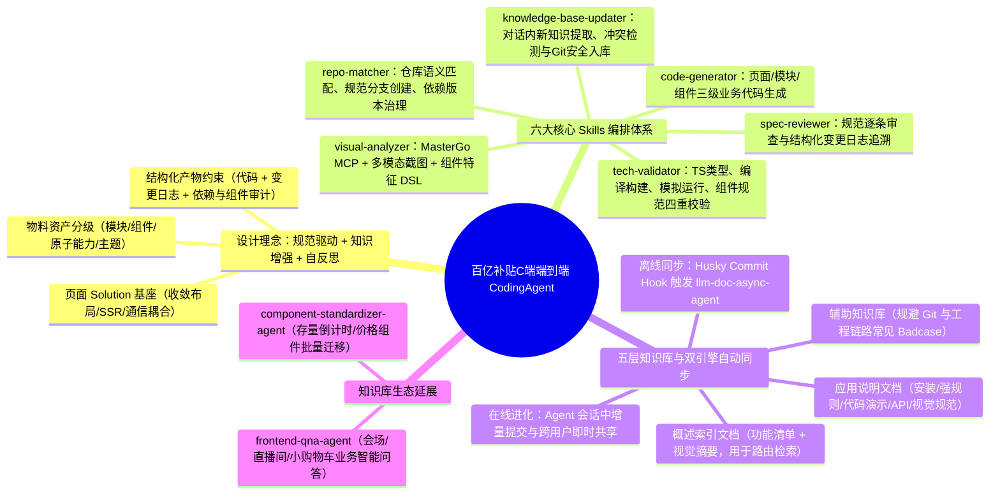
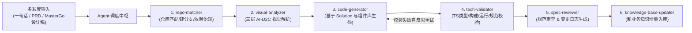

# 百亿补贴 C 端 AI Coding 实战：端到端 CodingAgent 设计与实践

> [!abstract] 导读
> **一句话总结**：淘天集团天猫技术团队（作者：程禄）针对百亿补贴 C 端前端开发中“重复编码占比高、仓库考古成本大、视觉还原难、文档易过期”四大结构性痛点，构建了**基于规范驱动（Specification-Driven）与知识增强（Knowledge-Augmented）的自反思端到端 CodingAgent**——通过 Solution 页面底座、五层结构化垂直知识库、Git Hooks 自动化同步与 온라인知识自进化，配合 6 大专业 Skill（含三层 AI-D2C 视觉还原），打通从需求/设计稿到可交付工程代码的全链路。
> **阅读价值**：完整展示了 ToC 复杂前端团队如何把散乱的组件资产与设计稿还原改造为 Agent 可消费的标准化协议，尤其是 **Git Hooks 自动同步文档（`llm-doc-async-agent`）** 与 **对话内在线沉淀知识（`knowledge-base-updater`）** 的双轮更新机制极具借鉴价值。

## 1. TL;DR

- **核心定位**：面向百亿补贴 C 端业务的垂直领域端到端 `coding-agent`，支持从一句话描述、完整 PRD 到 MasterGo 设计稿的多粒度输入，直接输出符合团队工程规范、可进入迭代流程的生产级代码。
- **架构三大基石**：
  1. **规范驱动（物料资产体系 + Solution 基座）**：将页面拆解为模块、组件、原子能力、主题四级标准物料，并通过统一的 **页面 Solution 框架**封装布局、SSR 数据输入、事件通信与交互语法糖，将“页面级复杂开发”降维成“低耦合的模块与组件拼装”。
  2. **知识增强（五层知识库 + 双通道自动进化）**：按开发粒度建立分层知识库（概述索引层 + 应用说明层 + 辅助排障库），通过 **Husky Git Hooks + `llm-doc-async-agent`** 在代码 commit 时自动同步组件文档，并通过 **`knowledge-base-updater` Skill** 在日常对话中实时增量沉淀新业务经验。
  3. **自反思闭环（Self-Reflective Validation）**：强制要求 Agent 除代码外同步输出结构化变更日志与依赖升级记录，经由 `tech-validator`（TS类型/编译/模拟运行/组件规范）与 `spec-reviewer` 循环纠错。
- **AI-D2C 三层视觉还原方案**：通过 **Layer 1 结构化 Schema 获取（MCP 读取 MasterGo） + Layer 2 多模态截图布局验证（消除图层嵌套噪音） + Layer 3 领域组件特征 DSL 路由（价格/倒计时/按钮自动匹配业务组件）**，克服传统 D2C 无法关联业务组件库的顽疾。

## 2. 问题定义与背景

### 2.1 C 端前端研发的四大结构性痛点
在百亿补贴高频迭代的营销与导购场域中，前端开发者长期受困于四类重复性消耗：
1. **重复性编码占比高**：会场页、商品卡片、利益点模块的骨架高度相似，但每次迭代仍需手写大量重复的接口调用、字段映射与样式微调代码。
2. **上下文“代码考古”成本大**：业务存量仓库庞大，新需求开发前寻找目标仓库、理清组件 Props 用法与历史依赖关系占据了大量研发时间。
3. **视觉高还原耗费心力**：C 端大促与日常频道对 UI 像素级还原要求极严，传统手写 CSS 或纯通用大模型看图写代码难以对齐团队专有组件库。
4. **知识库极易腐化失效**：组件与业务文档分散在各处，业务一忙就无人更新，导致文档与代码实际版本脱节，AI 读取过期文档后只会生成报错代码。

### 2.2 为什么通用 AI 编程工具无法直接实现业务端到端交付？
通用工具擅长补全孤立的函数或生成通用 React/Vue 样板，但不懂百亿补贴内部的 **Solution 页面框架协议、私有 npm 组件包规则、分支命名与 beta/latest 依赖发布规约**。因此必须构建深度绑定业务域知识库的专属 `coding-agent`。

## 3. 知识框架



## 4. 核心内容拆解

### 4.1 调度中枢与六大专业 Skill 协同流水线



| Skill 名称 | 核心职责 | 解决的关键工程问题 |
| :--- | :--- | :--- |
| **`repo-matcher`** | 基于知识库仓库元信息与需求语义自动定位目标仓库，按规范创建分支并检查 `beta/latest` 依赖策略与 Breaking Change 风险。 | 消灭手动找仓库、中文违规分支名与依赖版本冲突。 |
| **`visual-analyzer`** | 结合 MasterGo MCP Schema、设计稿导出截图与组件 UI 特征 DSL，完成设计稿解析与标准化业务组件路由。 | 解决传统 D2C 强依赖设计师 Auto Layout、无法关联业务组件库的难题。 |
| **`code-generator`** | 基于页面 Solution 框架与检索到的组件模板，分层完成页面级、模块级、组件级数据流与交互代码编写。 | 将复杂整页开发拆解为标准化模块组装，保证 API 调用准确。 |
| **`tech-validator`** | 依次执行 TypeScript 类型检查、编译构建检查、模拟运行时异常检测及组件规范检查。 | 解决 Vibe Coding 代码不可维护、隐含编译与运行时报错的通病。 |
| **`spec-reviewer`** | 对照团队规范库逐条审查工程化质量、组件使用模式与需求完成度，输出结构化报告与变更日志。 | 保障交付产物可追溯、方便人工快速 Code Review。 |
| **`knowledge-base-updater`** | 从研发对话中自动识别新场景/新组件用法，结构化提取并经冲突检测后通过 Git 安全提交至知识库。 | 实现“一人踩坑沉淀、全员下次对话即时复用”的在线自进化。 |

### 4.2 五层结构化知识库设计与双通道自动更新

#### 1. 为什么知识库必须分层且区分“索引”与“详情”？
如果把所有组件的 API 文档、示例代码、业务规则平铺塞进 Context，不仅导致 Token 消耗爆炸，还会因无关信息干扰引发模型幻觉。团队采用**“二级检索结构（概述索引文档 $\rightarrow$ 应用说明文档）+ 辅助知识库”**：
- **概述索引类文档（路由层）**：每个 npm 包顶层维护一份轻量索引，仅列出各子模块的**功能清单（匹配业务功能）**与**视觉规范摘要（匹配 UI 特征）**，供 Agent 快速定位该用哪个组件。
- **应用说明类文档（执行层）**：命中的具体组件才加载完整说明，严格包含 `# 概述`、`# 安装`、`# 规则`（如严禁使用未声明属性、样式组合对齐要求）、`# 代码演示`（含完整 Props 传入与消费示例）、`# API`（TS 类型与枚举定义）和 `# 视觉规范`。

#### 2. 彻底告别人工维护：Git Hooks + 在线 Skill 双轮同步
- **组件库侧（Commit 自动同步）**：在组件仓库配置 Husky Git Hook，开发者提交代码时自动触发：
  ```sh
  npx @ali/hp-agent@beta llm-doc-sync "同步并且允许推送（不必询问）"
  ```
  后台 `llm-doc-async-agent` 自动分析 `Readme.md` 与 `src/*` 源码变更并推送至知识库仓库，实现**零心智负担的代码-文档强一致**。
- **业务应用侧（对话在线进化）**：当开发者在开发“场景秒杀”等新业务积累了新组件组合经验时，`knowledge-base-updater` 自动走完 `新知识识别 → 结构化提取 → 冲突检测 → Git 增量安全提交 → 下次对话自动拉取生效` 五步闭环，并配备完整审计回滚机制防止恶意篡改。

### 4.3 AI-D2C 三层架构：结构化数据 + 多模态还原 + 领域 DSL

针对 C 端前端最头疼的视觉还原，团队摒弃了单纯靠规则模板或单纯丢一张图给多模态模型的极端做法，设计了三层融合架构：
1. **Layer 1：结构化数据获取（精确几何与属性支撑）**
   - 通过 MCP 工具直连 MasterGo 设计稿，拉取图层树结构、精确坐标尺寸、色值字号以及组件实例信息。
2. **Layer 2：多模态布局验证（消除脏图层噪音）**
   - 设计师画稿常存在大量无意义嵌套图层或覆盖物；结合设计稿导出的**真实渲染截图**输入多模态模型，消除多图层累积噪音并校准骨架布局。
3. **Layer 3：基于组件特征 DSL 的智能语义路由**
   - 定义业务组件的显式 UI 特征 DSL，将设计稿局部区块精准映射为百补标准组件而非原生 `div`：
     - **价格组件特征**：`包含 ¥ 符号 + 数字 + 可选划线价`
     - **倒计时组件特征**：`时分秒格式 + 分隔符`
     - **按钮组件特征**：`圆角矩形 + 居中文本 + 可选图标`

## 5. 数据速查表

| 模块 / 专题 | 核心技术机制 | 解决的核心痛点 | 落地场景与衍生生态 |
| :--- | :--- | :--- | :--- |
| **页面 Solution 基座** | 统一封装布局、SSR 数据注入、事件通信语法糖 | 页面级开发上下文耦合过重 | 整页开发降维成模块/组件级开发 |
| **核心知识库同步** | Husky Git Hook + `llm-doc-async-agent` | 组件迭代后开发者忘记更新文档 | 每次 `git commit` 自动解析 `src/*` 同步文档 |
| **业务知识库进化** | `knowledge-base-updater` + Git 增量审计提交 | 个人业务经验无法跨人复用 | 对话内自动提取新模式，全团队即时共享 |
| **AI-D2C 视觉还原** | MasterGo MCP Schema + 截图多模态校准 + 组件特征 DSL | 纯 Schema 图层噪点多、无法匹配私有组件库 | 模块级高还原代码生成与标准组件自动替换 |
| **衍生垂直 Agent 1** | `component-standardizer-agent` | 存量老代码手动迁移标准组件耗时费力 | 倒计时组件、价格组件跨文件批量改写与自动验证 |
| **衍生垂直 Agent 2** | `frontend-qna-agent` | 新同学熟悉会场/直播间/小购物车业务慢 | 基于知识库精准业务答疑，释放老员工答疑负担 |

## 6. 踩坑与教训 / 可迁移的设计原则

- **现阶段 AI-D2C 的真实边界与演进方向**
  - **踩坑**：长页面完整 MasterGo Schema 体积巨大，直接输入会导致 Token 过载与上下文丢失错乱；同时重复图层重叠干扰仍难以 100% 靠截图消除。
  - **应对与规划**：当前将 AI-D2C 聚焦在**模块级（Module-level）视觉还原**以确保高可用度；长远来看必须推动“设计协议与代码协议双向绑定”（Design Token 与 Code Token 自动映射、设计变体与组件变体一一对应）。
- **可迁移原则 1：用“框架语法糖（Solution）”降低 AI 生成代码的自由度**
  - 与其让 AI 每次从零编写复杂的页面级状态管理与 SSR 数据获取逻辑，不如先在工程侧封装好高内聚的页面级 Solution 基座，让 AI 只需要做填空式的模块拼装。
- **可迁移原则 2：把知识库托管在 Git 仓库中，并用 Hook 替代人类自觉**
  - 任何依赖开发者“自觉手动更新”的知识库在 3 个月内必然腐化；必须将知识库同步嵌入 `git commit` 流水线与 Agent 对话闭环中。

## 7. 记忆锚点

- **一个核心架构定式**：**规范驱动（Solution + 物料资产） + 知识增强（五层索引/详情分离） + 自反思（Validator + Reviewer）**。
- **双通道知识保鲜**：**离线靠 Husky Hook（`llm-doc-async-agent`）随代码提交同步，在线靠 `knowledge-base-updater` 随对话增量进化**。
- **AI-D2C 三明治**：**MasterGo MCP 拿精确数值 + 多模态截图消图层噪音 + 特征 DSL 路由私有组件**。
- **六大核心 Skill**：`repo-matcher` $\rightarrow$ `visual-analyzer` $\rightarrow$ `code-generator` $\rightarrow$ `tech-validator` $\rightarrow$ `spec-reviewer` $\rightarrow$ `knowledge-base-updater`。

## 8. 复习卡片

How does the Taobao Billion-Subsidy frontend team reduce the complexity of page-level code generation for their CodingAgent?::By building a unified Page Solution framework that encapsulates layout skeletons, SSR data injection, and event communication as syntactic sugar, downgrading page-level development into loosely coupled module and component assembly.
What dual-channel mechanisms keep the frontend vertical knowledge base synchronized and up-to-date without manual documentation burden?::1. A Husky Git commit hook triggering `llm-doc-async-agent` to parse `Readme.md` and `src/*` diffs automatically upon code commits; 2. The `knowledge-base-updater` skill that extracts new business patterns during agent conversations and commits them incrementally via Git.
Why is the component knowledge base split into "Overview Index Documents" and "Application Instruction Documents"?::To prevent context overload and noise: the lightweight Overview Index lists only functional and visual summaries for fast routing, while the full Application Instruction doc (API, rules, demos) is loaded on-demand only for matched components.
What are the three layers of the `visual-analyzer` AI-D2C architecture?::Layer 1 fetches structured MasterGo schemas via MCP; Layer 2 uses multimodal rendered screenshots to filter out messy nested layer noise; Layer 3 uses a UI Feature DSL (e.g., matching `¥ + number` to the Price component) to route elements to standardized business components.
What four checks are performed by the `tech-validator` skill during the self-reflection loop?::TypeScript static type checking, build/compilation verification, simulated runtime exception checking, and team component specification compliance checking.
Besides `coding-agent`, what two additional vertical agents were built on top of the same frontend knowledge base ecosystem?::`component-standardizer-agent` (for batch migrating legacy code to standardized countdown and price components) and `frontend-qna-agent` (for intelligent onboarding and Q&A across campaign pages, live rooms, and mini-carts).

## 9. 知识关联

- **本批同主题精读**：
  - [百亿补贴 C 端 AI Coding 实战：基于 SDD 的服务端 AI Coding 实践](../百补服务端SDD实践+26.7.27/AI_百补服务端SDD实践.md)：同属百亿补贴技术团队的姊妹篇，本文聚焦 **C 端前端端到端 CodingAgent 与 D2C**，该文聚焦 **服务端 SDD（规约驱动开发）与自进化记忆体**。
  - [Tarot Pixel：面向多端研发的视觉稿高还原代码生成实践](../Tarot Pixel视觉稿还原+26.6.24/AI_Tarot Pixel视觉稿还原.md)：深入剖析了大淘宝在设计稿高还原（D2C）领域的算法与工程深水区探索，可与本文的 `visual-analyzer` 对照阅读。
  - [从 AE 到代码：AI 辅助下的前端动画开发实践](../AE到代码AI动画实践+26.6.28/AI_AE到代码AI动画实践.md)：拓展了前端 AI Coding 在复杂交互动效（After Effects 转代码）场景下的工程边界。
- **主题索引（`20_topics`）**：
  - [AI研发协同](../../20_topics/AI研发协同.md)
  - [Skill设计与治理](../../20_topics/Skill设计与治理.md)
  - [跨端开发与性能](../../20_topics/跨端开发与性能.md)
- **本目录归档文件**：[原始 PDF](RAW.pdf) · [逐页转写文本](MD.md)
- **候选概念双链**：[[CodingAgent]] · [[D2C设计稿转代码]] · [[Git-Hooks文档同步]] · [[自反思架构]] · [[前端物料体系]] · [[MasterGo-MCP]]

## 10. 原文参考资料

- **原文出处**：大淘宝技术公众号，《百亿补贴 C 端 AI Coding 实战：端到端 CodingAgent 设计与实践》（作者：程禄，淘天集团-天猫技术团队，发布日期：2026-08-02）

> [!note]- 校对报告
> - **页码溯源（1-based 物理页码）**：
>   - 篇首标题、作者（程禄，淘天集团-天猫技术团队）、ToC 前端四大痛点与规范驱动+知识增强自反思总体架构：源自 `RAW.pdf` `p.1–4`（对应 `MD.md` 第 1–4 页）。
>   - 六大核心 Skill（`repo-matcher`、`visual-analyzer`、`code-generator`、`tech-validator`、`spec-reviewer`、`knowledge-base-updater`）设计与编排：源自 `RAW.pdf` `p.4–8`（对应 `MD.md` 第 4–8 页）。
>   - 五层知识库结构化模板（概述索引类 vs 应用说明类）及 Husky Git Hooks + `llm-doc-async-agent` 自动同步实现：源自 `RAW.pdf` `p.9–13`（对应 `MD.md` 第 9–13 页）。
>   - AI-D2C 三层架构（MasterGo MCP + 多模态截图 + 组件特征 DSL）、衍生垂直 Agent（`component-standardizer-agent` / `frontend-qna-agent`）及落地效果总结：源自 `RAW.pdf` `p.13–19`（对应 `MD.md` 第 13–19 页，`p.20` 为空白尾页）。
> - **一致性核验**：原文共 20 页（含 16 页配图与模板片段），其中第 10–11 页展示的为知识库 Markdown 注释骨架示意而非完整可独立运行的 Skill/Prompt 包，故直接内嵌总结于正文中。所有英文组件名与流程细节均严格忠实于 `MD.md`。
